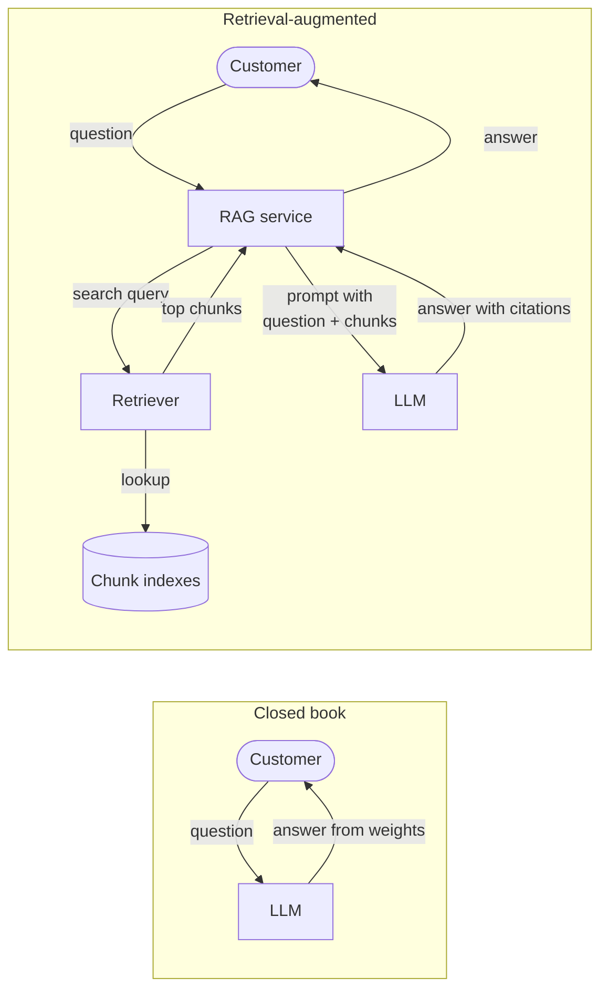
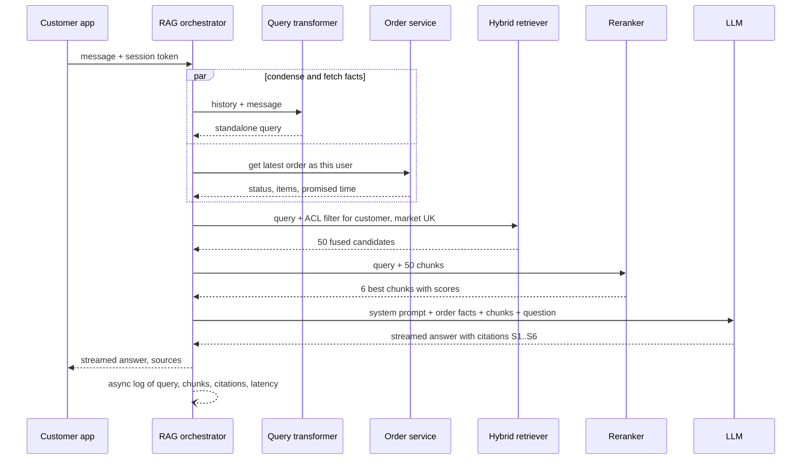

# Chapter 75 — RAG Architecture

> **Level:** 4 · **Track:** B (ML/AI) · **Estimated reading time:** 6 h

A QuickBite customer types into the support chat at 8:12 p.m.: "my order came 35 min late and the soup leaked, what do I get?" A language model on its own can write a fluent, confident and wrong answer to that question. It has never read QuickBite's refund policy, it does not know that the policy changed on 1 September, and it cannot see this customer's order. The answer QuickBite needs is narrower and harder: the right policy paragraphs, today's version, the facts of this order, only the documents this customer is allowed to see, and a reply that cites its sources and says "I don't know" when the sources are silent.

**Retrieval-augmented generation (RAG)** is the architecture that does this. Before the model writes, a retrieval system finds the few passages that bear on the question and places them in the prompt; the model then answers from that evidence. This chapter treats RAG as a system with two pipelines: an offline **ingestion pipeline** that turns documents into a searchable index, and an online **query pipeline** that retrieves, reranks, builds a context and generates a grounded, cited answer. You will size each stage, implement a chunker, a hybrid retriever and the retrieval metrics, and learn where RAG systems fail in production.

The chapter builds on others. Inverted indexes and BM25 are Chapter 16 (§16.3, §16.5); embedding models, approximate nearest neighbor (ANN) indexes and vector databases, including filtered search, are Chapter 74 (§74.11 for filtering); tokens and context windows are Chapter 72; prefix caching and serving cost are Chapter 73; ranking metrics are §57.12; ingestion pipelines are Chapter 61. LLM evaluation methodology (LLM-as-a-judge, hallucination detection, prompt-injection defenses) belongs to Chapter 78, the choice between fine-tuning and RAG to Chapter 76, and agent orchestration to Chapter 77; this chapter previews each and cross-references the owner.

::: note
**QuickBite assumptions used in this chapter.** These reuse the Book II design point and are teaching assumptions, not measurements of a real company: 500,000 orders a day; the support chatbot is a 7B model (§58.11) adapted by continued pre-training on 50 billion tokens (§65.9.1) with an 8,192-token context window (§64); GPUs cost \$2.50 per GPU-hour and a 16-vCPU node \$0.77 per hour (§60.11); the reference GPU is an H100 with 989 TFLOP/s dense BF16 (Chapter 67). **New in this chapter:** 6% of orders open a support chat, so 30,000 conversations a day with 2.5 user messages each, about **75,000 RAG queries a day**, peaking at **8 queries per second** (an average of 0.87/s times a peak-to-average ratio of about 9.6, as in §60.6; consistent with the 200 concurrent conversations of Chapter 64 sending a message every 25 s). The knowledge corpus is 3,000 help-center articles (about 900 tokens each), 400 policy documents (about 6,000 tokens) and 5,000 internal support runbooks (about 700 tokens): 8,400 documents and **8.6 million tokens**. A separate **resolved-case corpus** for the human-agent assistant holds two years of one-paragraph case summaries: 21.9 million cases of about 250 tokens. Embeddings have 768 dimensions. LLM token prices are an illustrative internal transfer price for the self-hosted 7B model: \$0.20 per million input tokens and \$0.60 per million output tokens (Chapter 73 derives such prices from GPU-hours). Sizes use SI units (1 GB = 10⁹ bytes).
:::

## 75.1 Learning objectives

After this chapter you should be able to:

- Explain what RAG adds to a language model (freshness, grounding, citations, access control) and what it cannot fix.
- Draw the reference architecture of a RAG system, separating the offline ingestion pipeline from the online query pipeline, and place each storage boundary and failure point.
- Design document ingestion: parsing PDFs, HTML and tables, preserving structure and metadata, deduplicating, and propagating updates, deletes and access-control changes.
- Choose a chunking strategy, compute chunk counts and index sizes, and implement a structure-aware chunker with overlap.
- Estimate the time and cost of embedding a corpus, and plan re-embedding and index versioning when the embedding model changes.
- Implement BM25, a dense retriever and reciprocal rank fusion, and explain why hybrid retrieval beats either alone.
- Size a reranking cascade under a latency budget and compare cross-encoders with bi-encoders.
- Apply query rewriting, multi-query, HyDE, decomposition and conversational condensation, and know when each pays for itself.
- Build a context within a token budget, order it against "lost in the middle", attach citations, and defend against prompt injection carried by retrieved text.
- Evaluate retrieval with recall@k, MRR and nDCG on a labeled query set, and outline end-to-end RAG evaluation.
- Enforce document-level access control at retrieval time and explain why filtering after generation is unsafe.
- Compute end-to-end latency and cost per query, design the caches, and choose the production metrics that reveal a degrading RAG system.

## 75.2 Prerequisites

- Inverted indexes, analyzers and BM25 — §16.3–§16.5 (sparse retrieval in §75.8 reuses them unchanged).
- Embeddings, cosine similarity, ANN indexes (HNSW, IVF, PQ) and filtered vector search — Chapter 74, §74.11 (dense retrieval and access-control filtering depend on them).
- Tokens, context windows, prefill and decode — Chapter 72 (the token budget of §75.11 and the latency of §75.15).
- Prefix caching and the cost of LLM serving — Chapter 73 (cost per query in §75.15).
- Ranking metrics: precision, recall, average precision, MRR and nDCG — §57.12 (retrieval evaluation in §75.13).
- Ingestion, change data capture (CDC) and data-quality gates — §61.4, §61.11 (the ingestion pipeline of §75.5).
- Caching patterns and invalidation — §20.7, §20.10; row-level security in multi-tenant systems — §47.5.2.

## 75.3 Why retrieval-augmented generation

### 75.3.1 The closed-book problem

::: definition
**Definition — Retrieval-augmented generation (RAG).** An architecture in which, for each request, a **retriever** selects passages from an external corpus and a **generator** (a language model) produces the answer conditioned on the request plus those passages. The corpus is the model's **non-parametric memory**: it can be changed, filtered and cited without retraining. Knowledge stored in the model's weights is **parametric memory**.
:::

#### First-principles explanation

Think of two exams. In a closed-book exam the student answers from memory: fluent, fast, and wrong whenever the syllabus changed after they studied or the question is about something they never read. In an open-book exam the student first looks up the relevant pages, then writes the answer with page references. The open-book student is slower per question, but you can check their work, and you can update the book without re-teaching the student. A plain LLM is the closed-book student. RAG turns it into the open-book student, and the engineering of RAG is the engineering of the library: what is on the shelves, how it is indexed, how fast the right page is found, and who is allowed to read which book.

#### Why does this exist?

A language model's knowledge is a compressed snapshot of its training data. Three facts about QuickBite's support chatbot make that snapshot insufficient:

1. **Freshness.** Policies change monthly; the 7B model was last trained months ago. Retraining for every policy edit is slow and expensive (§65.9.1 sized one continued pre-training run at about 1,458 GPU-hours).
2. **Private and per-user facts.** The model was never trained on this customer's order and must not be: order data changes by the second and is personal data (§50.9).
3. **Accountability.** A support answer that grants or denies a refund must be traceable to a policy paragraph. A model answering from weights cannot say where an answer came from, and it **hallucinates**: it produces plausible text not supported by any source.

Lewis et al. introduced the name and a trained end-to-end version: a dense retriever over 21 million Wikipedia passages feeding a sequence-to-sequence generator, which set new results on open-domain question answering and produced more specific and factual text than a parametric-only model [Lewis et al. 2020]. Production RAG systems today mostly keep the retriever and generator separate and connect them with a prompt, which is the design this chapter follows.

#### How it works internally

1. **Offline**, documents are parsed, split into **chunks** (passages of a few hundred tokens), embedded and written to a vector index and a keyword index, each chunk tagged with metadata such as source, version and access-control labels.
2. **Online**, the user's message is turned into a standalone search query, which retrieves candidate chunks from both indexes, filtered to what this user may see.
3. A **reranker** reorders the candidates by relevance and keeps the best few.
4. A **context builder** packs those chunks, with source identifiers, into a prompt within a token budget.
5. The **generator** writes an answer that cites the chunk identifiers, or refuses when the evidence does not support an answer.
6. Every step is logged so that retrieval quality, groundedness and cost can be measured (§75.13, §75.15).

**Figure 75.1 — Closed-book generation versus retrieval-augmented generation.**

**Reading the diagram.** On the left, the client's question goes straight to the model, which answers from parametric memory; nothing outside the weights is consulted, so nothing can be cited or updated. On the right, a RAG service sits between client and model. It sends a search query to the retriever, which reads the chunk indexes (the storage boundary that holds non-parametric memory) and returns the best chunks; the service then calls the model with the question and the chunks. All arrows are synchronous calls within one request. New failure points appear on the right: the retriever can miss the relevant chunk, the index can be stale, and the extra hop adds latency. The retriever and the indexes scale independently of the model, which is the point: knowledge grows by adding documents, not parameters.

### 75.3.2 What RAG buys

**Table 75.1 — Four ways to give the support chatbot knowledge (preview of Chapter 76).**

| Property | Closed-book LLM | Fine-tuning or continued pre-training | RAG | Long context: put everything in the prompt |
|---|---|---|---|---|
| Freshness | Training cutoff | Next training run (days to weeks) | Next index update (minutes) | Immediate |
| Citations | None | None | Chunk-level | Possible, weak at scale |
| Access control | Impossible per user | Impossible per user | Filter per request | Must assemble per user |
| Per-query cost | Lowest | Lowest | + retrieval + ~3,000 context tokens | + entire corpus in tokens |
| Teaches style, format, domain language | Weakly | Strongly | Weakly | Weakly |
| Corpus size limit | — | — | Billions of chunks | Context window (Chapter 72) |
| Main failure | Hallucination | Hallucination, stale facts | Retrieval misses, bad context | Cost, latency, lost in the middle |

The table explains why QuickBite uses both: continued pre-training (§65.9.1) taught the 7B model the vocabulary of food delivery and the tone of a support agent, and RAG supplies the facts. Chapter 76 develops the decision between the two; the short rule is **fine-tune for behavior, retrieve for knowledge**.

Five benefits drive most RAG deployments:

- **Knowledge freshness.** Editing a policy updates the index within minutes (§75.5.4), with no training.
- **Grounding.** The model is instructed to answer only from supplied passages, which reduces hallucination when retrieval succeeds.
- **Citations.** Each claim points at a chunk, so customers and auditors can check it and engineers can debug it.
- **Access control.** Retrieval runs as the user, so a courier never sees a merchant contract and a customer never sees an internal runbook (§75.14).
- **Cost.** Adding 10,000 documents costs a few cents of embedding (§75.7), not a training run.

### 75.3.3 Limitations

RAG moves the hard problem; it does not remove it. A RAG system is only as good as its retrieval: if the right chunk is not in the context, the model either refuses (good) or answers from weights (bad). Retrieval adds 100–300 ms and an operational system with its own freshness, capacity and security concerns. Grounding reduces but does not eliminate hallucination: models still misread, over-generalize or blend passages. Questions that need reasoning over the whole corpus ("what are the most common complaints this month?") are poorly served by top-k retrieval (§75.16). And every retrieved passage is untrusted input to the model, which opens a new attack surface (§75.11.4).

::: industry
**Air Canada's chatbot and the bereavement-fare policy.** In *Moffatt v. Air Canada* (2024), a customer relied on the airline's website chatbot, which told him he could apply for a bereavement fare refund after travel; the airline's actual policy page said otherwise. The British Columbia Civil Resolution Tribunal held the airline responsible for what its chatbot said and rejected the argument that the chatbot was a separate entity responsible for its own actions. The decision does not describe how the chatbot was built, so it is not evidence about RAG specifically. Its lesson for any support assistant is architectural: answers must be grounded in the current policy, cite it, and refuse rather than improvise when the policy does not cover the question.
*Evidence: Primary* — [Moffatt v. Air Canada 2024]
:::

::: mistake
**"RAG eliminates hallucination."** It changes the dominant failure from "the model invented a fact" to "the retriever supplied the wrong or incomplete evidence, and the model trusted it" or "the model ignored the evidence". You still need groundedness checks (§75.12), retrieval metrics (§75.13) and refusal paths. Treat the retrieved context as necessary, not sufficient.
:::

## 75.4 Reference architecture

### 75.4.1 Two pipelines and three stores

A RAG system is two pipelines that share stores. The **ingestion pipeline** runs asynchronously: it watches sources, parses and chunks changed documents, computes embeddings and writes the indexes. The **query pipeline** runs synchronously inside a user request with a latency budget measured in hundreds of milliseconds. They meet at three storage boundaries: the **document store** (canonical parsed documents and their versions), the **chunk indexes** (a vector index and an inverted index over the same chunk IDs) and the **chunk store** (chunk text and metadata, fetched by ID to build the prompt).

**Figure 75.2 — Reference architecture of QuickBite's support RAG system.**

**Reading the diagram.** *Components.* Four sources feed the system: three document sources and the order database, which is never indexed but queried live. The ingestion pipeline turns change events into parsed, deduplicated, chunked and embedded records; the index writer fans each chunk out to a vector index, a BM25 inverted index and a chunk store, all keyed by the same chunk ID. The query pipeline runs behind a chat gateway that authenticates the user and enforces rate limits (§22). *Protocols and direction.* Sources push webhooks or commit hooks, or are crawled nightly; the query path is HTTPS from the app and internal RPC between services. *Sync versus async.* Dotted arrows are asynchronous (ingestion and logging), solid arrows are synchronous calls inside one chat request. *Storage boundaries.* The document store holds canonical versions and access-control lists (ACLs); the two indexes hold searchable representations; the chunk store holds the text that will be shown to the model. *Failure points.* A stalled ingestion stage makes answers stale without any error on the query path; the reranker and LLM depend on GPUs; the order lookup depends on the order service's availability. *Scaling.* Ingestion scales with document churn and embedding throughput (§75.7); the query path scales with requests per second, and its cost is dominated by the reranker and the LLM (§75.15).

### 75.4.2 One query, step by step

**Figure 75.3 — Sequence of one support question through the query pipeline.**

**Reading the diagram.** The orchestrator owns the request. It runs two independent calls in parallel: condensing the conversation into a standalone query, and fetching this customer's order facts from the order service *as the authenticated user*, so the model cannot be talked into reading someone else's order. Retrieval receives the query and an access filter derived from the session (audience "customer", market "UK"), returns 50 candidates, and the reranker keeps 6. The LLM receives a prompt with labeled sources and streams an answer that cites them. Every call is synchronous except the final log write. The critical path is condense → retrieve → rerank → LLM prefill; §75.15 budgets it. If the order service is down, the orchestrator still answers policy questions and says it cannot see the order; if retrieval fails, it must refuse or hand off rather than let the model answer from weights.

### 75.4.3 Unstructured and structured knowledge

Not everything should be embedded. Table 75.2 lists QuickBite's knowledge sources and how each reaches the model.

**Table 75.2 — QuickBite knowledge sources and access paths.**

| Source | Size | Changes | Audience | Access path |
|---|---|---|---|---|
| Help-center articles | 3,000 docs, 2.7M tokens | Daily edits | Customers, couriers or merchants (per article) | Hybrid retrieval |
| Policy documents | 400 docs, 2.4M tokens | Monthly, versioned | Per audience and market | Hybrid retrieval, version-filtered |
| Support runbooks | 5,000 docs, 3.5M tokens | Weekly | Internal agents only | Hybrid retrieval, ACL-filtered |
| Order, payment, refund records | 500,000 orders/day | Every second | The order's customer | Live API call as the user |
| Resolved-case summaries | 21.9M cases | 30,000/day | Internal agents only | Dense retrieval (agent assistant) |

Order data is the important exception. It is structured, per-user, fast-changing and exact; vector similarity adds nothing and freshness would suffer. The orchestrator fetches it with a normal authenticated API call and places it in the prompt as a labeled block. This is still retrieval augmentation, just without an index. Chapter 77 generalizes the idea: an agent chooses among tools, one of which is document search.
