# Chapter 76 — LLM Adaptation: Prompting, Fine-Tuning and Alignment Pipelines

> **Level:** 4 · **Track:** B (ML/AI) · **Estimated reading time:** 6 h

QuickBite's support chatbot works. It retrieves the right refund paragraph (Chapter 75), runs on a 7B model that already speaks the language of food delivery (§65.9.1), and answers in about half a second. The product team still has a list of complaints. The bot apologizes in three sentences when one would do. It sometimes writes "I've issued a refund" when it has only *proposed* one, and the refund service cannot parse its reply because it is prose instead of the JSON the service expects. It answers allergy questions with the same breezy tone it uses for late soup. None of these are missing-knowledge problems, so more retrieval will not fix them. They are **behavior** problems: format, tone, judgment and reliability.

This chapter is about changing behavior, from the cheapest lever to the most expensive: prompts engineered and tested like code, structured output, supervised fine-tuning, LoRA and QLoRA, and preference alignment with RLHF and DPO, together with the data pipelines, serving patterns and release gates around them.

Transformer mechanics and chat templates are Chapter 72; training memory and $6ND$ are Chapter 65; quantization is §67.6 and distillation §67.8; prefix caching is §73.8; RAG is Chapter 75; labeling is Chapter 63; privacy and model cards are Chapter 71. Evaluation methodology belongs to Chapter 78 and agents to Chapter 77. This chapter owns the decision between RAG and fine-tuning (§76.14).

::: note
**QuickBite assumptions used in this chapter.** These reuse the Book II design point and are teaching assumptions, not measurements of a real company. The chatbot model has the Llama-2-7B shape: 32 layers, hidden size 4,096, MLP width 11,008, 32,000-token vocabulary, 6.74 billion parameters, 13.5 GB in BF16, 524 KB of KV cache per token (§72.8.2, §72.11). It was adapted by continued pre-training on 50 billion tokens (§65.9.1: 1,458 GPU-hours, about \$3,650) and is served with RAG at 75,000 queries a day from 30,000 conversations, peaking at 8 queries per second; a query's prompt is about 4,050 tokens including a 700-token system prompt and six retrieved chunks; internal token prices are \$0.20 per million input and \$0.60 per million output tokens (Chapter 75). GPUs cost \$2.50 per GPU-hour; an H100 achieves about $4 \times 10^{14}$ FLOP/s in training (40% of its 989 TFLOP/s dense BF16 peak). Human review costs \$22 per hour at 80% productive time (§63.5.2). **New in this chapter:** a supervised fine-tuning set of about 24,000 conversations, a preference set of 8,000 comparisons, and a 1,500-conversation evaluation set. Sizes use SI units (1 GB = 10⁹ bytes).
:::

## 76.1 Learning objectives

After this chapter you should be able to:

- Place a requirement on the adaptation ladder (prompting, few-shot, RAG, fine-tuning, continued pre-training, pre-training) and justify the rung by data, cost and failure mode.
- Engineer prompts as versioned artifacts with templates, delimiters and regression tests.
- Produce reliable structured output with schemas, constrained decoding, validation and bounded retries, and compute the expected cost of retries.
- Quantify the context, latency and cost of in-context learning, including prompt-caching effects.
- Build supervised fine-tuning data with chat templates and loss masking, and size the memory and compute of full fine-tuning.
- Derive LoRA's trainable-parameter count and QLoRA's memory, and implement and merge a LoRA layer.
- Choose between merged adapters and multi-LoRA serving.
- Explain RLHF (Bradley–Terry reward model, PPO with a KL penalty) and DPO, and compute both losses.
- Design an adaptation data pipeline with PII scrubbing, deduplication, synthetic data, decontamination and a token budget.
- Decide between RAG and fine-tuning, and define release gates for adapted models.

## 76.2 Prerequisites

- Tokens, chat templates, prefill and decode, sampling — Chapter 72, §72.4.6, §72.13 (every prompt and every training example is a token sequence).
- Parameter counting for the 7B model — §72.8.2 (LoRA's parameter count reuses its matrix shapes).
- Training memory ($16N$ bytes plus activations), $6ND$ compute, activation checkpointing and ZeRO/FSDP — §65.3, §65.9, §65.14 (full fine-tuning memory in §76.7).
- Weight-only quantization and group scales — §67.6.1 (QLoRA in §76.8).
- Knowledge distillation — §67.8 (LLM distillation in §76.13).
- Prefix caching and serving cost — §73.8, §73.15 (in-context learning economics in §76.6, multi-LoRA serving in §76.9).
- RAG architecture and the token budget — Chapter 75, §75.11 (§76.14 compares RAG with fine-tuning).
- Annotation guidelines, agreement and synthetic data — §63.5, §63.6, §63.12 (preference data in §76.10, data pipelines in §76.11).
- Memorization, privacy and model cards — §71.9, §71.12 (risks in §76.15).

## 76.3 The adaptation ladder

### 76.3.1 Six rungs, from instructions to new weights

::: definition
**Definition — Adaptation.** Changing a pre-trained language model's behavior for a task or domain. **Inference-time adaptation** changes only the input: instructions, examples, retrieved documents. **Training-time adaptation** changes weights: supervised fine-tuning, preference optimization, continued pre-training. The **adaptation ladder** orders these methods by cost, data needed and how deeply they change the model.
:::

#### First-principles explanation

Think of hiring an experienced chef. You hand them a note, "we plate small" (an **instruction**); if that fails, you show three finished plates (**few-shot examples**); for today's specials you give them the recipe card (**retrieval**); for a subtle house style used on every dish, you train them for weeks (**fine-tuning**); for a cuisine they have never cooked, you send them on a long course (**continued pre-training**). You would raise a chef from childhood (**pre-training**) only if no chef anywhere could learn your cuisine. Each step costs more and is harder to undo.

#### Why does this exist?

Adaptation methods differ by four to six orders of magnitude in cost. Editing a prompt costs an afternoon; QuickBite's continued pre-training cost 1,458 GPU-hours (§65.9.1); pre-training a 7B model on a trillion tokens needs about 29,000 H100-hours (§65.3). Climbing too high wastes money and agility, because every weight change must be re-evaluated and re-released; staying too low means ever-longer, slower, brittle prompts.

#### How it works internally

**Figure 76.1 — The adaptation ladder.**

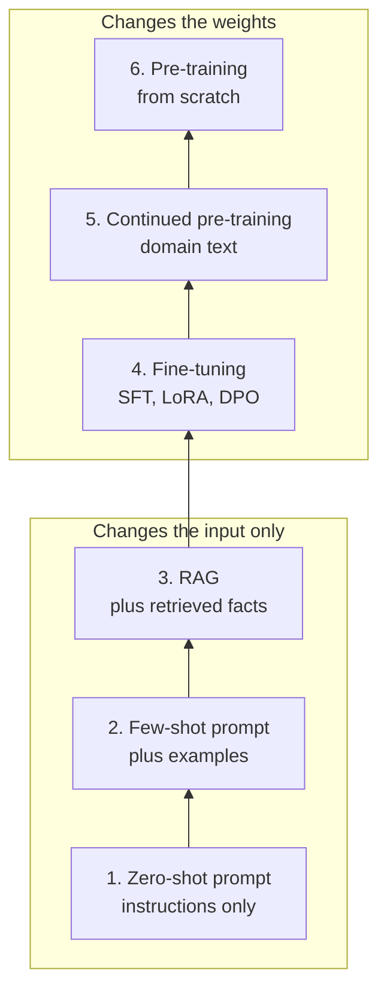

**Reading the diagram.** Read bottom up. The lower three rungs change only the input to an unchanged model, so they deploy like configuration and roll back instantly; they touch a prompt registry and, for RAG, the indexes of Chapter 75. The upper three produce new weights that pass through training, an evaluation gate and the model registry (Chapter 69). Arrows mean "climb when the rung below fails", a design-time decision with no runtime path. Input-side rungs add per-request tokens forever; weight-side rungs add a one-off training cost. The failure point is climbing without evidence.

Rungs are not exclusive: the production QuickBite bot combines a system prompt, retrieval, a LoRA fine-tune and a continued pre-trained base. The ladder orders what to *try first*.

**Table 76.1 — Cost and data needs per rung, for a 7B model at QuickBite scale.**

| Rung | What changes | Data needed | One-off cost | Per-request cost | Time to ship | Fixes |
|---|---|---|---|---|---|---|
| 1. Zero-shot prompt | Instructions | None; a few dozen test cases | Hours of engineering | +100–1,000 tokens | Minutes | Task framing, simple format |
| 2. Few-shot | Examples in the prompt | 3–20 curated examples | Hours | +500–5,000 tokens | Minutes | Format, style by imitation |
| 3. RAG | Facts in the prompt | A document corpus | Days of engineering; cents of embedding | +1,000–5,000 tokens, +100–300 ms | Days | Fresh, private, citable knowledge |
| 4. Fine-tuning (SFT, LoRA, DPO) | Weights or adapters | 1,000–100,000 examples or pairs | 1–50 GPU-hours plus curation | None, often negative (shorter prompts) | Weeks | Behavior, tone, format, judgment |
| 5. Continued pre-training | All weights | $10^9$–$10^{11}$ tokens of domain text | $10^2$–$10^4$ GPU-hours | None | Weeks to months | Domain vocabulary and style |
| 6. Pre-training from scratch | Everything | $10^{12}$+ tokens | $10^4$–$10^7$ GPU-hours | None | Months | New languages, modalities, full control |

For a 7B model, fine-tuning *compute* is cheap (about five GPU-hours for QuickBite's SFT run, §76.7); the cost of rung 4 is curated data and the evaluation and release machinery around it.

### 76.3.2 A decision procedure

**Figure 76.2 — Choosing the lowest rung that works.**

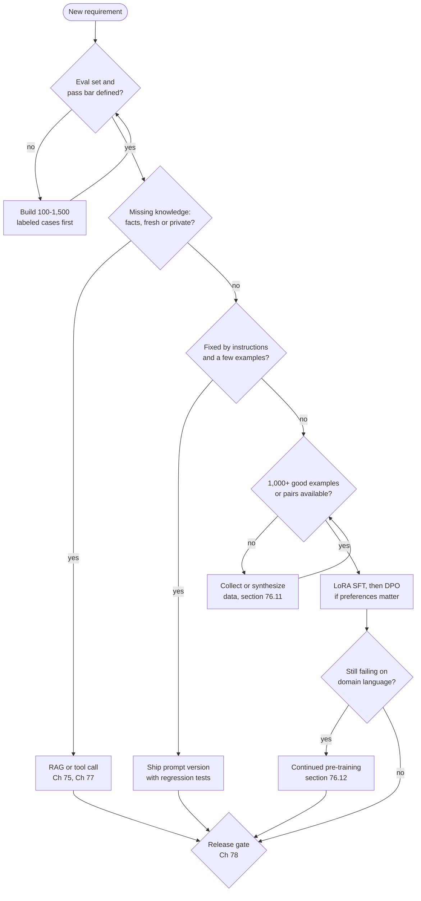

**Reading the diagram.** Every path starts at an evaluation set, because without a pass bar you cannot tell whether a rung failed. Knowledge gaps go to retrieval or tools; behavior gaps go to prompting, then to fine-tuning only when prompting fails *and* enough examples exist. Pre-training from scratch is omitted: almost no product team needs it. Every branch ends at the same release gate, for prompt and weight changes alike. These are offline decisions; the data-collection loops consume most calendar time.

#### Mathematical foundations

The decision is often framed in money: does a one-off training cost pay back through shorter prompts?

::: formula
**Break-even between prompt tokens and a fine-tune**

$$T_\text{break-even} = \frac{C_\text{FT}}{R \cdot \Delta n \cdot p_\text{in}}$$

| Symbol | Meaning | Units |
|---|---|---|
| $T_\text{break-even}$ | Days until the fine-tune's one-off cost is repaid by tokens it removes | days |
| $C_\text{FT}$ | One-off cost of fine-tuning: data curation, compute, evaluation | \$ |
| $R$ | Requests per day | requests/day |
| $\Delta n$ | Prompt tokens removed per request (instructions and examples the model no longer needs) | tokens |
| $p_\text{in}$ | Price per input token | \$/token |
:::

::: example
**Worked example — Does fine-tuning pay for itself at QuickBite?** Today's prompt carries a 700-token system prompt; adding three few-shot examples of 350 tokens each would fix the format problems but add 1,050 tokens. A LoRA fine-tune would let the system prompt shrink to 150 tokens with no examples, so $\Delta n = 700 + 1{,}050 - 150 = 1{,}600$ tokens. $R = 75{,}000$, $p_\text{in} = \$0.20$ per million.

1. Daily saving: $75{,}000 \times 1{,}600 \times 0.20 \times 10^{-6} = \$24.00$.
2. One-off cost (§76.7, §76.11): about \$55,000 of human review, \$5,500 of preference labels and about \$300 of GPU time including a hyperparameter sweep: $C_\text{FT} \approx \$60{,}800$.
3. $T_\text{break-even} = 60{,}800 / 24.00 = 2{,}533$ days, almost seven years.
4. With prefix caching of the static prompt at 10% of the input price (§73.8), the saving falls to \$2.40 a day and break-even recedes past 60 years.

**Interpretation.** At 75,000 requests a day, token savings never justify fine-tuning; at 100 times the volume they would within a month. **Engineering implication.** At small and medium scale, fine-tune for *quality and reliability* (format adherence, tone, judgment, fewer retries), not for token cost, and make the case with an evaluation, not a spreadsheet. The economics flip for very high-volume tasks and for distilling into smaller models (§76.13).
:::

::: mistake
**"Fine-tuning is how you teach a model your documents."** Fine-tuning on documents teaches style and some facts unreliably, cannot be updated without retraining, gives no citations and cannot enforce per-user access. Teach facts by retrieval; teach behavior by fine-tuning (§76.14).
:::

## 76.4 Prompt engineering as an engineering discipline

### 76.4.1 Anatomy of a production prompt

::: definition
**Definition — Prompt, system prompt and prompt template.** A **prompt** is the full token sequence sent to the model for one call. The **system prompt** is the part that sets role, rules and output format and is the same for every request of a given application version. A **prompt template** is a versioned artifact with named slots (user message, retrieved chunks, order facts) that code fills at request time; the filled template is then wrapped in the model's **chat template**, the special tokens that mark system, user and assistant turns (§72.4.6).
:::

#### First-principles explanation

A prompt is a work order for a capable contractor who has never seen your company: the job, the constraints, what "done" looks like, examples, and the materials, each clearly labeled so the customer's note cannot be mistaken for your instructions. Because the contractor is stochastic and replaced every few months, you test work orders like code.

#### Why does this exist?

Brown et al. showed that GPT-3 could perform many tasks from a description and a few demonstrations in the prompt, with no gradient updates, and that this **in-context learning** improved sharply with model size [Brown et al. 2020]. That made the prompt a programming interface, and interfaces need structure, versioning and tests.

#### How it works internally

A production prompt has six parts, assembled in a fixed order:

1. **Role and goal.** "You are QuickBite's customer-support assistant. Resolve the customer's issue in as few turns as possible."
2. **Rules and constraints**, stated positively and specifically: "Answer only from the SOURCES block. If the sources do not cover the question, say so and offer a human agent. Never promise a refund; propose one with the `refund` action."
3. **Output format**: a schema or an exact template (§76.5).
4. **Examples** (optional): a few input–output pairs showing the hard cases (§76.4.2).
5. **Context**: retrieved chunks and order facts, each wrapped in **delimiters**, explicit markers such as `<sources>…</sources>` or fenced blocks that separate data from instructions.
6. **The user's message**, also delimited and labeled as untrusted.

Stable parts come first and variable parts last, so the prefix cache can reuse the static head (§73.8). Delimiters make the structure legible to the model and let the application escape delimiter-like text inside untrusted input, a first-line defense against prompt injection (§75.11.4, Chapter 78).

**Figure 76.3 — Prompt assembly from a versioned template registry.**

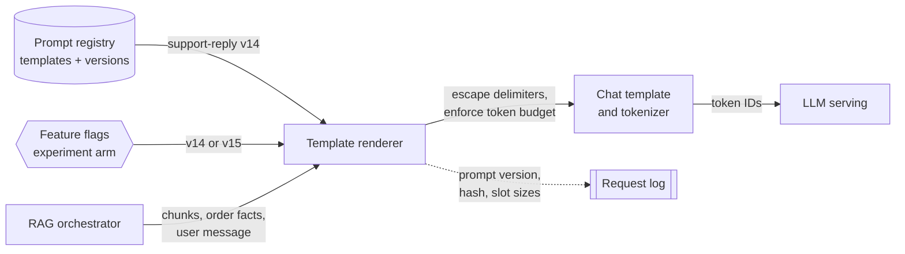

**Reading the diagram.** Templates live in a registry (the storage boundary) as immutable versions; a feature-flag service picks the version per request, enabling experiments (§57.14). The stateless renderer fills slots, escapes delimiters in untrusted text and enforces the token budget of §75.11 with the serving tokenizer; the chat template adds turn markers. Each request logs prompt version and hash asynchronously (dotted), which attributes quality changes to prompt changes. Failure points: in-place unversioned edits, a renderer that tokenizes differently from the server, slots that silently overflow.

### 76.4.2 Instructions, examples and chain-of-thought

**Instructions** work best when specific, testable and few: "be concise" is weak; "at most three sentences unless the customer asks for detail" is testable. Conflicting instructions are resolved unpredictably, so prompt reviews look for conflicts as code reviews look for dead branches.

**Few-shot examples** teach by imitation. They are most valuable for format and for edge cases that are hard to describe ("customer is angry and the order was actually on time"). They are also the most expensive part of a prompt per unit of behavior and carry biases of their own (§76.6).

**Chain-of-thought (CoT)** prompting asks the model to write intermediate reasoning before the answer. Wei et al. showed that worked reasoning in few-shot exemplars substantially improved large models on arithmetic, commonsense and symbolic reasoning, with the benefit appearing only at large scale [Wei et al. 2022]; Kojima et al. elicited similar gains zero-shot with "Let's think step by step" [Kojima et al. 2022]; sampling several paths and voting, **self-consistency**, improves further at proportional cost [Wang et al. 2023a]. CoT trades output tokens, the slowest kind (§72.10), for accuracy on multi-step problems. QuickBite's bot reasons in a hidden, logged `analysis` field, and refund-eligibility arithmetic is done by deterministic code the model calls (Chapter 77).

::: warning
**Reasoning text is not an explanation.** A chain of thought is generated text; it can be plausible and still not reflect how the answer was produced. Do not show it to customers as a justification, and do not use it as an audit trail for decisions that need one: log the inputs, the tools called and the rule that fired.
:::

### 76.4.3 Templates, versioning and prompt regression tests

Treat a prompt like source code with a release process:

- **Version every template** immutably, with an owner, a changelog and the model version it was tuned for. A prompt tuned for one model is not guaranteed to work on its successor.
- **Pin model and prompt together** in configuration; a model upgrade is a prompt change too.
- **Test every change** against a **golden set**: a few hundred labeled conversations covering intents, edge cases, past incidents and adversarial inputs.
- **Roll out** through the same canary and experiment machinery as code (§69.6.4), comparing quality, refusal rate, length and cost per request.

A **prompt regression test** asserts properties, not exact strings, because outputs are stochastic. Useful assertions include: the output parses against the schema; the action is `handoff` for allergy questions; every citation is one of the supplied sources; the reply is at most 600 characters; no refund is promised in prose; the refusal rate on out-of-scope questions stays above 95%. Assertions that need judgment ("is the tone empathetic?") use a calibrated LLM judge or human review, which Chapter 78 covers.

**Figure 76.4 — Prompt regression testing in CI.**

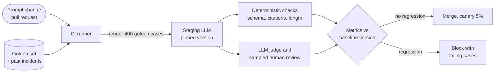

**Reading the diagram.** A template change triggers CI, which renders every golden case (the storage boundary of curated conversations and incident replays), calls a staging model pinned to the production version, and runs deterministic assertions plus a slower judged evaluation, comparing against the production version with confidence intervals (Chapter 78). Calls are synchronous inside the job; 400 cases of 4,250 tokens cost well under a dollar. Failure points: a golden set that never grows, nonzero temperature making results noisy, and averages that hide regressions on rare intents.

::: mistake
**"A better prompt is a longer prompt."** Each added rule competes for the model's attention with every other rule and with the user's message, adds tokens to every request, and makes conflicts more likely. Delete rules that tests show are unnecessary; move stable, well-specified behavior into the weights (§76.7) when the prompt becomes a rulebook.
:::

## 76.5 Structured output

### 76.5.1 Schemas, function calling and constrained decoding

::: definition
**Definition — Structured output.** Model output that must conform to a machine-readable contract, usually a **JSON Schema** (field names, types, enumerations, ranges, required fields). **Function calling** (or tool calling) is the special case in which the contract is a function signature: the model emits a function name and a JSON argument object, and the application executes it. **Constrained decoding** (grammar-based sampling) enforces the contract during generation by allowing only tokens that keep the output valid.
:::

#### First-principles explanation

A free-text reply is a handwritten letter; structured output is a filled-in form. You can ask nicely for the form (instructions), hand the writer a stencil that prevents writing outside the boxes (constrained decoding), and check every form at the counter (validation and retry). The stencil guarantees the form's *shape*, not that the amounts in it are right.

#### Why does this exist?

LLM outputs feed programs: QuickBite's reply goes to a renderer, its proposed action to the refund service, its citations to the grounding check (§75.12). Instruction-only JSON fails in characteristic ways (prose before the object, missing fields, values outside an enumeration), and at 75,000 requests a day a 1% failure rate is 750 broken conversations.

#### How it works internally

**Function-calling formats.** The application describes each tool with a name, a description and a JSON Schema for its arguments; the chat template renders them into the prompt; the model, fine-tuned for this, answers with text or a tool-call block; the server parses the block into a structured field, and the application validates and executes it. Chapter 77 builds agents on this loop.

**Constrained decoding** works inside the sampling loop (§72.13):

1. Compile the schema or grammar into an automaton (a finite-state machine for regular formats; a pushdown automaton for nested JSON).
2. At each decode step, the automaton's current state determines which next characters are legal.
3. Map legal characters to legal **tokens**. This is the hard part, because a token can span several characters (`{"` or `":"`), so a token is legal only if every character in it is. Willard and Louf precompute, for each automaton state, the set of vocabulary tokens that are valid from it, turning the per-step check into a lookup [Willard and Louf 2023].
4. Set the logits of illegal tokens to $-\infty$, sample from the rest, advance the automaton.
5. Stop when the automaton reaches an accepting state.

**Figure 76.5 — Constrained decoding inside the generation loop.**

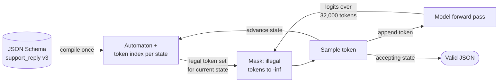

**Reading the diagram.** The schema is compiled once per version and cached (the storage boundary); the per-state token index makes each mask a lookup. Every decode step is synchronous: forward pass, mask, sample, advance; the mask costs CPU time per step, overlapped with GPU work. Output always parses and matches types and enumerations. Failure points: a permissive schema, a tokenizer mismatch between compile and serving, compile latency for new schemas, and degraded content when the grammar forces low-probability paths.

**Table 76.2 — Ways to obtain structured output.**

| Approach | Guarantees | Cost | Failure mode | Choose when |
|---|---|---|---|---|
| Instructions + examples | Nothing | Prompt tokens | Prose, missing fields | Prototypes; tolerant consumers |
| Fine-tuned function calling | High syntactic rate, not certain | Training data | Rare malformed calls | Most production tool use |
| Constrained decoding | Syntax, types, enums | CPU mask per step; compile time | Valid but wrong values | Machine consumers; strict schemas |
| Validate + retry | Business rules too | Extra calls on failure | Latency spikes; correlated failures | Always, as the last line |

::: industry
**Structured outputs in a commercial API.** OpenAI introduced a "Structured Outputs" mode that constrains a model's output to a developer-supplied JSON Schema, reporting that with it the gpt-4o-2024-08-06 model scored 100% on its internal evaluation of complex schema following, against under 40% for gpt-4-0613 without it. The announcement also notes the trade-offs typical of constrained decoding: a latency cost the first time a new schema is processed, and support for only a subset of JSON Schema.
*Evidence: Primary* — [OpenAI 2024]
:::

### 76.5.2 Validation and bounded retries

Constrained decoding cannot check rules that span fields or depend on the world: "the refund amount must not exceed the order total", "citations must be among the sources supplied in this prompt", "`amount_cents` must be zero unless the action is `refund`". These are checked in code after generation, and a failure triggers a **repair retry**: the same prompt plus the validator's error messages, so the model can fix the specific problem. Retries are bounded, and after the last one the system takes a safe **fallback**, here a handoff to a human agent.

**Figure 76.6 — Validate, repair and fall back.**

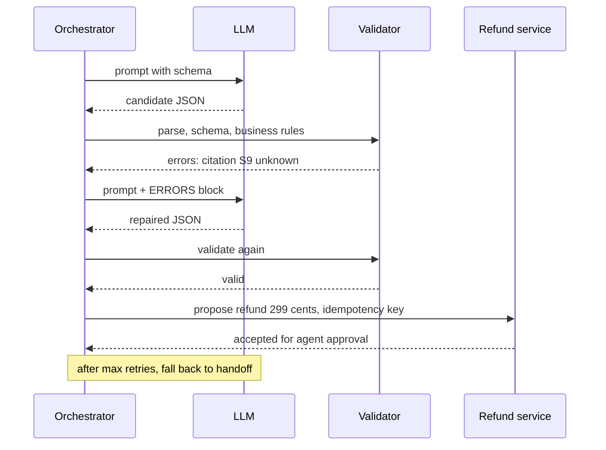

**Reading the diagram.** Each model call is a full synchronous generation, so a retry roughly doubles that request's latency. The validator is deterministic code and the only component allowed to pass actions to the refund service, which receives an idempotency key (§22.15) so a retry cannot refund twice; the refund is only *proposed*, and authority stays with the service. Failure points: correlated failures that repeat on retry, retry storms after a model regression, unbounded loops. Retry rate is therefore a capacity input and an alerting metric.

#### Mathematical foundations

::: formula
**Success probability and expected calls with bounded retries**

$$P_\text{fallback} = (1 - p_1)(1 - p_r)^{k} \qquad E[\text{calls}] = 1 + (1 - p_1)\sum_{j=0}^{k-1} (1 - p_r)^{j}$$

| Symbol | Meaning | Units |
|---|---|---|
| $p_1$ | Probability the first attempt passes validation | — |
| $p_r$ | Probability a repair attempt passes, given the previous attempt failed | — |
| $k$ | Maximum number of retries after the first attempt | count |
| $P_\text{fallback}$ | Probability all attempts fail and the fallback is used | — |
| $E[\text{calls}]$ | Expected model calls per request | calls |
:::

::: example
**Worked example — Sizing retries for the support bot.** Instruction-only JSON on the 7B base: $p_1 = 0.70$, repairs succeed with $p_r = 0.85$, $k = 2$. Each call takes about 5.8 s end to end (575 ms TTFT from §75.15 plus 200 output tokens at 26 ms each, §73.15).

1. $P_\text{fallback} = 0.30 \times 0.15^2 = 0.30 \times 0.0225 = 0.00675$: 506 handoffs a day at 75,000 requests.
2. $E[\text{calls}] = 1 + 0.30 \times (1 + 0.15) = 1.345$: 34.5% more GPU work than one call per request.
3. Latency: 30% of requests take at least two calls, about 11.6 s, so the p95 latency roughly doubles.
4. After constrained decoding and a LoRA fine-tune on the schema (§76.8), syntactic failures vanish and semantic ones fall: assume $p_1 = 0.97$, $p_r = 0.80$. Then $P_\text{fallback} = 0.03 \times 0.04 = 0.0012$ (90 a day) and $E[\text{calls}] = 1 + 0.03 \times 1.2 = 1.036$.

**Interpretation.** Retries rescue reliability but charge for it in GPU time and tail latency; improving the first attempt is worth more than adding retries. **Engineering implication.** Measure $p_1$ and $p_r$ per intent in production, alert when $p_1$ drops (a model or prompt regression), cap $k$ at one or two, and size capacity using $E[\text{calls}]$, not one call per request. Remember that $p_r$ is conditional: a model that fails because the task is ambiguous will often fail again.
:::

#### Code example: a validator and retry loop with a mock model

The program below implements the three layers of checking (syntax, schema, business rules), a repair loop that feeds errors back, a handoff fallback, and a mock model whose outputs mimic the common failure modes. It runs in well under a second with only the standard library.

```python
import json
import random

# The contract the support bot must honor: a JSON object with these fields.
SCHEMA = {
    "intent":       {"type": str,  "enum": {"late_order", "missing_item", "refund_status", "other"}},
    "reply":        {"type": str,  "max_len": 600},
    "citations":    {"type": list, "item_type": str},
    "action":       {"type": str,  "enum": {"none", "refund", "handoff"}},
    "amount_cents": {"type": int,  "min": 0},
}

def validate(raw, order_total_cents, source_ids):
    """Return (parsed, errors). Syntax, then schema, then business rules."""
    try:
        obj = json.loads(raw)
    except json.JSONDecodeError as e:
        return None, [f"invalid JSON: {e.msg} at char {e.pos}"]
    if not isinstance(obj, dict):
        return None, ["top level must be an object"]
    errors = []
    for field, rule in SCHEMA.items():
        if field not in obj:
            errors.append(f"missing field '{field}'")
            continue
        v = obj[field]
        if type(v) is not rule["type"]:          # bool is not accepted as int
            errors.append(f"'{field}' must be {rule['type'].__name__}")
            continue
        if "enum" in rule and v not in rule["enum"]:
            errors.append(f"'{field}'={v!r} not in {sorted(rule['enum'])}")
        if "max_len" in rule and len(v) > rule["max_len"]:
            errors.append(f"'{field}' longer than {rule['max_len']} chars")
        if "min" in rule and v < rule["min"]:
            errors.append(f"'{field}' below {rule['min']}")
        if "item_type" in rule and not all(type(x) is rule["item_type"] for x in v):
            errors.append(f"'{field}' items must be {rule['item_type'].__name__}")
    extra = set(obj) - set(SCHEMA)
    if extra:
        errors.append(f"unexpected fields {sorted(extra)}")
    if errors:
        return None, errors
    # Business rules the schema cannot express.
    if obj["action"] == "refund" and not 0 < obj["amount_cents"] <= order_total_cents:
        errors.append(f"refund {obj['amount_cents']} outside (0, {order_total_cents}]")
    if obj["action"] != "refund" and obj["amount_cents"] != 0:
        errors.append("amount_cents must be 0 unless action is refund")
    unknown = [c for c in obj["citations"] if c not in source_ids]
    if unknown:
        errors.append(f"citations {unknown} not among provided sources")
    return (obj if not errors else None), errors

class MockModel:
    """Stands in for the LLM: a fixed list of candidate outputs, picked at random."""
    CANDIDATES = [
        '{"intent": "late_order", "reply": "Sorry, your order was 35 min late. '
        'I have proposed a refund of the delivery fee.", "citations": ["S2"], '
        '"action": "refund", "amount_cents": 299}',
        'Sure! Here is the JSON: {"intent": "late_order"}',                # prose + JSON
        '{"intent": "late_order", "reply": "Refunded.", "citations": ["S9"], '
        '"action": "refund", "amount_cents": 299}',                       # invented source
        '{"intent": "late", "reply": "Refunded.", "citations": [], '
        '"action": "refund", "amount_cents": 5000}',                      # bad enum, too much
    ]
    def __init__(self, seed):
        self.rng = random.Random(seed)
    def generate(self, prompt):
        # A repair prompt makes the valid answer more likely, as it does in practice.
        weights = [0.85, 0.05, 0.05, 0.05] if "ERRORS" in prompt else [0.70, 0.10, 0.10, 0.10]
        return self.rng.choices(self.CANDIDATES, weights=weights)[0]

def call_with_retries(model, prompt, order_total, sources, max_retries=2):
    attempt_prompt = prompt
    for attempt in range(max_retries + 1):
        raw = model.generate(attempt_prompt)
        obj, errors = validate(raw, order_total, sources)
        if obj is not None:
            return obj, attempt + 1, []
        # Feed the errors back so the next attempt can repair them.
        attempt_prompt = prompt + "\nYour previous output was rejected. ERRORS: " + "; ".join(errors)
        last = errors
    return {"intent": "other", "reply": "Let me connect you with an agent.", "citations": [],
            "action": "handoff", "amount_cents": 0}, max_retries + 1, last

for raw in MockModel.CANDIDATES:
    print(validate(raw, 1850, {"S1", "S2", "S3"})[1])

model = MockModel(seed=7)
stats = {1: 0, 2: 0, 3: 0, "fallback": 0}
for i in range(10_000):
    obj, attempts, errs = call_with_retries(model, "PROMPT", 1850, {"S1", "S2", "S3"})
    stats["fallback" if errs else attempts] += 1
calls = stats[1] + 2 * stats[2] + 3 * (stats[3] + stats["fallback"])
print("10,000 requests:", stats)
print(f"mean model calls per request = {calls / 10_000:.3f}")
```

Output:

```text
[]
['invalid JSON: Expecting value at char 0']
["citations ['S9'] not among provided sources"]
["'intent'='late' not in ['late_order', 'missing_item', 'other', 'refund_status']"]
10,000 requests: {1: 7024, 2: 2564, 3: 347, 'fallback': 65}
mean model calls per request = 1.339
```

What to notice:

- Validation runs in three layers, and the schema layer returns early: the fourth candidate is also over the order total, but the enumeration error is reported first. Repairs fix one round of errors at a time, which is one reason $k = 2$ beats $k = 1$.
- The citation rule is a business rule. A grammar cannot know which source IDs were in *this* prompt; only code that built the prompt can check it. This is the same check as the grounding verification of §75.12.
- `type(v) is not int` rejects `true` for an integer field; Python's `bool` is a subclass of `int`, a classic validator bug.
- The simulated rates match the formula: 70.2% succeed first time (0.70), 0.65% fall back (formula 0.675%), and 1.339 calls per request (formula 1.345).
- The fallback is a safe action (handoff), never "pass the invalid output through".

#### Failure scenarios

| What goes wrong | Why | Detection | Recovery | Prevention |
|---|---|---|---|---|
| Valid JSON, wrong refund amount | Grammar checks shape only | Business-rule validator; audit sampling | Reject; handoff | Rules in code; authority in services |
| Retry storm after deploy | New model fails first attempt | $p_1$ and calls-per-request alerts | Roll back model or prompt | Canary on $p_1$ |
| Constrained output reads stilted or truncated | Grammar forces low-probability paths | Quality eval with and without constraints | Loosen grammar; add reasoning field | Fine-tune on the schema |
| Tool call executed twice | Retry after timeout | Duplicate actions in ledger | Reconcile | Idempotency keys on every action |

::: mistake
**"Constrained decoding makes output correct."** It makes output *parseable*. The model can still pick the wrong enumeration value, invent an amount or cite the wrong source in perfectly valid JSON. Keep validation and keep authority over actions in deterministic services.
:::

## 76.6 In-context learning limits

### 76.6.1 What in-context learning costs and where it breaks

::: definition
**Definition — In-context learning (ICL).** A model performing a task specified by instructions and demonstrations inside its prompt, with no change to its weights [Brown et al. 2020]. The demonstrations are "learned" only for the duration of one forward pass and must be re-sent on every call.
:::

#### First-principles explanation

In-context learning is like briefing a temp worker at the start of every shift: no training budget, but the briefing is paid every shift, delays the start, has limited capacity, and its order changes what is remembered.

#### Why does this exist?

ICL's limits are the reason the upper rungs exist. Four matter for system design.

1. **Context cost.** Demonstrations are prompt tokens on every request: money, TTFT and KV-cache memory (§73.5).
2. **Context capacity.** Examples compete with retrieved evidence for the same window (§75.11).
3. **Sensitivity.** Lu et al. showed that merely permuting the same few-shot examples could move accuracy from near state-of-the-art to near chance on some tasks [Lu et al. 2022]; Zhao et al. identified **majority-label bias**, **recency bias** and common-token bias, and proposed calibrating outputs with a content-free input [Zhao et al. 2021].
4. **Position effects.** The middle of a long context is used less reliably than its ends [Liu et al. 2024], so more examples bring diminishing, sometimes negative, returns.

#### How it works internally

Mitigations follow from the causes: **retrieve** the few most similar demonstrations per request from a labeled pool (Chapter 74), **balance and shuffle** them and test several orders, reporting the spread, **cache** static examples in the prefix, and treat an ever-growing example set as the signal to fine-tune (§76.7).

#### Mathematical foundations

::: formula
**Daily cost and latency of few-shot demonstrations**

$$C_\text{ICL} = R \cdot n_\text{ex} \cdot t_\text{ex} \cdot p_\text{in} \cdot \big(1 - h\,(1 - \delta)\big) \qquad \Delta T_\text{TTFT} = (1 - h)\, n_\text{ex}\, t_\text{ex}\, \tau_\text{prefill}$$

| Symbol | Meaning | Units |
|---|---|---|
| $C_\text{ICL}$ | Daily cost of the demonstrations | \$/day |
| $R$ | Requests per day | requests/day |
| $n_\text{ex}$, $t_\text{ex}$ | Number of demonstrations; tokens per demonstration | count; tokens |
| $p_\text{in}$ | Price per input token | \$/token |
| $h$ | Fraction of demonstration tokens served from the prefix cache | — |
| $\delta$ | Price of a cached token relative to an uncached one | — |
| $\Delta T_\text{TTFT}$ | Added time to first token | s |
| $\tau_\text{prefill}$ | Prefill time per uncached token | s/token |
:::

::: example
**Worked example — Three demonstrations in the support prompt.** $R = 75{,}000$, $n_\text{ex} = 3$, $t_\text{ex} = 350$, $p_\text{in} = \$0.20$ per million; prefill costs about 28.3 µs per token on one H100 (§73.8); the context window budget of §75.11 leaves $B = 5{,}882$ tokens for chunks of 440 tokens with headers.

1. Uncached ($h = 0$): $75{,}000 \times 1{,}050 \times 0.20 \times 10^{-6} = \$15.75$ a day, \$5,749 a year; TTFT $+1{,}050 \times 28.3\,\mu\text{s} = 29.7$ ms.
2. Static examples in the cached prefix, $h = 0.95$, $\delta = 0.1$: factor $1 - 0.95 \times 0.9 = 0.145$, so \$2.28 a day; TTFT $+0.05 \times 29.7 = 1.5$ ms.
3. Per-request retrieved examples cannot be cached ($h = 0$): back to \$15.75 a day and 29.7 ms, plus an embedding lookup.
4. Capacity: $\lfloor (5{,}882 - 1{,}050)/440 \rfloor = \lfloor 10.98 \rfloor = 10$ chunks fit instead of 13.
5. KV memory: 1,050 tokens × 524 KB = 550 MB per concurrent sequence if not shared; with the roughly 24 RAG-length sequences that fill a 103,000-token KV pool (§73.5), 13 GB of KV cache, unless the shared prefix is stored once.

**Interpretation.** Static few-shot examples are cheap when cached; dynamic ones cost full price and latency, and both consume context and, without prefix sharing, KV memory. **Engineering implication.** Prefer static, cached demonstrations; retrieve examples only where they measurably help; and treat "we need more and more examples" as evidence for fine-tuning.
:::

::: mistake
**"In-context learning is free fine-tuning."** It is paid per request, forgotten after each call, limited by the window and sensitive to order. It is the right tool for small, changing or experimental behavior, not for thousands of stable rules.
:::

## 76.7 Supervised fine-tuning

### 76.7.1 Instruction data, chat templates and loss masking

::: definition
**Definition — Supervised fine-tuning (SFT).** Continuing training of a pre-trained model with the next-token loss on curated (prompt, desired response) examples, usually multi-turn conversations, so that it produces responses like the examples. **Instruction tuning** is SFT on many tasks phrased as instructions. **Loss masking** excludes prompt tokens from the loss so the model learns to produce responses, not to reproduce prompts.
:::

#### First-principles explanation

SFT is apprenticeship: the chef cooks a few thousand dishes alongside the head chef. Loss masking means you grade only what the apprentice cooked, not how well they read the order ticket aloud.

#### Why does this exist?

A base model continues documents; an assistant answers. Ouyang et al. found that a 1.3B-parameter model fine-tuned on demonstrations and then aligned with preferences was preferred by labelers over the 175B GPT-3 [Ouyang et al. 2022]: behavior mattered more than 100× the parameters.

#### How it works internally

1. **Format examples** as conversations: a system message, user and assistant turns, and, for RAG-style bots, the same SOURCES and order-facts blocks the production prompt contains, so training matches serving.
2. **Render with the chat template** of the model you will serve, byte-for-byte the same template the inference server uses (§72.4.6). A mismatch is a silent training–serving skew.
3. **Tokenize and build labels**: copy input IDs to labels, then replace every system, user and tool token with an ignore value. Keep the end-of-turn token in the loss, or the model never learns to stop.
4. **Pack** short conversations into fixed-length sequences (2,048 tokens here) with attention masks that stop examples attending to each other, to avoid wasting compute on padding.
5. **Train** for one to three epochs at a small learning rate with warmup (§58.5.3), evaluating on a held-out set every few hundred steps; stop on validation loss and on task metrics.

**Figure 76.7 — From a logged conversation to a masked training sequence.**

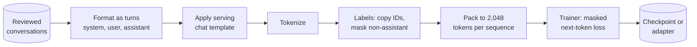

**Reading the diagram.** Reviewed conversations (the input storage boundary) pass through a deterministic, versioned batch pipeline whose output, a tokenized and labeled dataset, is stored for reproducible training (§61.13). The chat template must be the serving template, the most common failure point. The trainer writes a full checkpoint or, with LoRA, a small adapter. Preprocessing is parallel by conversation; training scales by data parallelism (Chapter 65).

#### Mathematical foundations

::: formula
**Masked SFT loss**

$$\mathcal{L}_\text{SFT} = -\frac{1}{\sum_t m_t} \sum_{t} m_t \log p_\theta(x_t \mid x_{<t})$$

| Symbol | Meaning | Units |
|---|---|---|
| $x_t$ | Token at position $t$ of the packed sequence | token ID |
| $p_\theta(x_t \mid x_{<t})$ | Model probability of that token given all earlier tokens | — |
| $m_t$ | 1 if $x_t$ belongs to an assistant turn (or its end token), else 0 | — |
| $\mathcal{L}_\text{SFT}$ | Mean negative log-likelihood over response tokens | nats/token |
:::

::: example
**Worked example — Why unmasked loss looks better and teaches less.** A 2,000-token sequence has 1,500 prompt tokens (system prompt, sources, user turns) and 500 response tokens. The model already predicts the templated prompt well (0.4 nats per token) but responses poorly (1.6 nats).

1. Unmasked: $(1{,}500 \times 0.4 + 500 \times 1.6)/2{,}000 = (600 + 800)/2{,}000 = 0.70$ nats per token.
2. Masked: $800/500 = 1.6$ nats per token.
3. Share of the unmasked gradient signal spent on prompts, by loss mass: $600/1{,}400 = 43\%$, much of it teaching the model to reproduce the system prompt and retrieved chunks.

**Interpretation.** The unmasked run reports a lower loss while learning less of what matters, and it spends capacity memorizing prompts, including any personal data in user turns. **Engineering implication.** Mask prompts, report loss on response tokens only, and never compare loss values between masked and unmasked runs.
:::

#### Code example: building masked labels

```python
import torch
import torch.nn.functional as F

torch.manual_seed(0)
IGNORE = -100                                   # PyTorch's cross_entropy skips this label

def build_example(turns, vocab):
    """turns: list of (role, text). Returns input ids and labels; only assistant text is learned."""
    ids, labels = [], []
    for role, text in turns:
        header = [vocab[f"<|{role}|>"]]
        body = [vocab[w] for w in text.split()]
        ids += header + body
        learn = role == "assistant"
        labels += [IGNORE] * len(header) + (body if learn else [IGNORE] * len(body))
        if learn:                               # the model must also learn to stop
            ids.append(vocab["<|end|>"]); labels.append(vocab["<|end|>"])
    return torch.tensor(ids), torch.tensor(labels)

words = ("<|system|> <|user|> <|assistant|> <|end|> you are quickbite support "
         "my soup leaked sorry refunded the soup").split()
vocab = {w: i for i, w in enumerate(dict.fromkeys(words))}
turns = [("system", "you are quickbite support"),
         ("user", "my soup leaked"),
         ("assistant", "sorry refunded the soup")]
ids, labels = build_example(turns, vocab)

# Next-token prediction: position t predicts token t+1, so shift labels left by one.
logits = torch.randn(len(ids), len(vocab))     # stand-in for model outputs
inp_labels = labels[1:]
masked = F.cross_entropy(logits[:-1], inp_labels, ignore_index=IGNORE)
unmasked = F.cross_entropy(logits[:-1], ids[1:])
inv = {i: w for w, i in vocab.items()}
print(" ".join(f"{inv[i.item()]}{'*' if l != IGNORE else ''}" for i, l in zip(ids, labels)))
print(f"tokens {len(ids)}, tokens in loss {(inp_labels != IGNORE).sum().item()}")
print(f"masked loss {masked.item():.4f} vs unmasked {unmasked.item():.4f}")
```

Output:

```text
<|system|> you are quickbite support <|user|> my soup leaked <|assistant|> sorry* refunded* the* soup* <|end|>*
tokens 15, tokens in loss 5
masked loss 2.9590 vs unmasked 2.9347
```

What to notice:

- Starred tokens are the only targets: 5 of 15. The role header `<|assistant|>` is masked, the end token is not.
- Labels are shifted by one because logits at position $t$ predict token $t+1$; forgetting the shift trains the model to copy its input.
- The logits here are random, so the two losses are similar; on a real model the gap is large, as the worked example shows.

### 76.7.2 Data quality over quantity

Zhou et al. fine-tuned a 65B LLaMA model on only 1,000 curated prompts and responses, and in their human study its answers were equivalent to or preferred over GPT-4's in 43% of cases; they proposed the **superficial alignment hypothesis**, that knowledge comes from pre-training and alignment mostly teaches format and style [Zhou et al. 2023]. A few thousand consistent, correct, diverse examples beat hundreds of thousands of noisy ones, and every bad example is a behavior you pay to teach, so QuickBite reviews conversations before training (§76.11).

### 76.7.3 Memory and compute of full fine-tuning

Full fine-tuning updates every weight, so it needs the full training state of §65.3: BF16 weights and gradients, FP32 master weights and two Adam moments.

::: formula
**Full fine-tuning memory and fine-tuning compute cost**

$$M_\text{full} = N\,(b_w + b_g + b_m + b_o) + M_\text{act} \qquad G = \frac{k\, N\, D}{3{,}600\, F_\text{eff}} \qquad C = G\, p_\text{GPU}$$

| Symbol | Meaning | Units |
|---|---|---|
| $M_\text{full}$ | Memory for full fine-tuning | bytes |
| $N$ | Parameters | parameters |
| $b_w$, $b_g$, $b_m$, $b_o$ | Bytes per parameter for weights (2), gradients (2), FP32 master copy (4), Adam moments (8) | bytes |
| $M_\text{act}$ | Activation memory for one micro-batch (§65.14.2) | bytes |
| $G$ | GPU-hours | GPU-h |
| $k$ | FLOPs per parameter per token: 6 for full training; about 4 when the base is frozen (no weight gradients) | FLOPs |
| $D$ | Tokens processed, all epochs, prompt tokens included | tokens |
| $F_\text{eff}$ | Achieved FLOP/s per GPU | FLOP/s |
| $p_\text{GPU}$ | Price per GPU-hour | \$/GPU-h |
:::

::: example
**Worked example — Fully fine-tuning QuickBite's 7B model.** $N = 6.74 \times 10^9$; sequences of 2,048 tokens; $D = 1.8 \times 10^8$ tokens (60 million per epoch, three epochs; §76.11); $F_\text{eff} = 4 \times 10^{14}$; \$2.50 per GPU-hour.

1. Model state: $6.74 \times 10^9 \times 16 = 107.8$ GB (§65.9 rounds the same model to 112 GB using 7B parameters).
2. Activations per sequence (§65.14.2): 30.6 GB with none recomputed, 9.1 GB with selective recomputation, 1.49 GB with full checkpointing.
3. One 80 GB GPU: even with full checkpointing $107.8 + 1.5 = 109.3$ GB does not fit. Eight GPUs with ZeRO-3: $107.8/8 = 13.5$ GB of state plus 9.1 GB of activations is about 22.6 GB per GPU.
4. Compute: $6 \times 6.74 \times 10^9 \times 1.8 \times 10^8 = 7.28 \times 10^{18}$ FLOPs; $G = 7.28 \times 10^{18} / (3{,}600 \times 4 \times 10^{14}) = 5.06$ GPU-hours, 38 minutes on eight GPUs, $C = \$12.60$.
5. A twenty-run hyperparameter sweep: about 100 GPU-hours, \$250.
6. Storage: every full fine-tune is a new 13.5 GB checkpoint for serving and a 108 GB training checkpoint if you keep optimizer state.

**Interpretation.** For a 7B model the binding constraint of full fine-tuning is memory (eight GPUs for a job that needs five GPU-hours) and artifact size, not compute or money. **Engineering implication.** Full fine-tuning makes sense when you will serve one variant and have multi-GPU training available; when you want one GPU, many variants, or cheap rollback, use LoRA (§76.8).
:::

#### Failure scenarios

| What goes wrong | Why | Detection | Recovery | Prevention |
|---|---|---|---|---|
| Model never stops generating | End-of-turn token masked out | Lengths hit max tokens | Retrain with end token in loss | Unit test on label construction |
| Quality fine offline, poor in production | Training and serving chat templates differ | Token-by-token diff of golden prompts | Re-render data; retrain | One template source for both |
| Model copies agents' bad habits | Unreviewed logs used as targets | Eval on tone and policy slices | Filter and retrain | Review and quality filters (§76.11) |

::: mistake
**"More epochs on our data means a better bot."** Past one to three epochs, small SFT sets are memorized: validation loss rises, responses become formulaic and personal data in the data becomes extractable (§71.9). Stop on held-out task metrics.
:::

## 76.8 Parameter-efficient fine-tuning: LoRA and QLoRA

### 76.8.1 LoRA: a low-rank update beside a frozen weight

::: definition
**Definition — LoRA (low-rank adaptation).** Freezing a pre-trained weight $W_0 \in \mathbb{R}^{d_\text{out} \times d_\text{in}}$ and learning an additive update $\Delta W = \frac{\alpha}{r} BA$ with $B \in \mathbb{R}^{d_\text{out} \times r}$, $A \in \mathbb{R}^{r \times d_\text{in}}$ and rank $r \ll \min(d_\text{in}, d_\text{out})$, so the layer computes $h = W_0 x + \frac{\alpha}{r} B A x$ [Hu et al. 2022]. $A$ is initialized randomly and $B$ to zero, so training starts exactly at the base model; $\alpha$ is a scaling constant.
:::

#### First-principles explanation

Rather than repainting a mural (full fine-tuning), you paint on a thin transparent overlay: cheap to store, one per client, removable. Low rank means the overlay may use only a few "brush directions", which is enough for most adaptations.

#### Why does this exist?

Hu et al. observed that fine-tuning updates have low "intrinsic rank" and showed that on GPT-3 175B, LoRA matched or exceeded full fine-tuning on their benchmarks while cutting trainable parameters about 10,000× and GPU memory about 3×, with no added inference latency once merged [Hu et al. 2022]. Freezing the base removes 14 of the 16 bytes per parameter of training state.

**Figure 76.8 — A LoRA layer.**

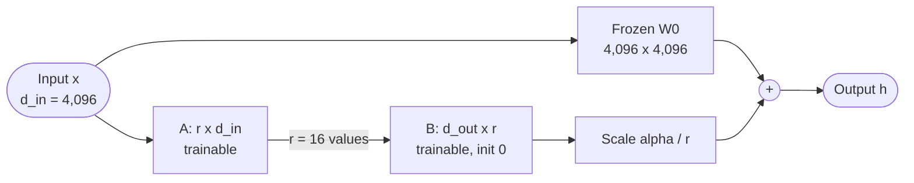

**Reading the diagram.** The input flows through two synchronous paths: the frozen pre-trained weight and the low-rank bypass, which squeezes $x$ to 16 numbers and expands it back. Their sum is the output. Gradients flow through both paths to earlier layers, but only $A$ and $B$ are updated, so only they need gradient and optimizer storage. Because $B$ starts at zero the layer starts as the base model. At deployment the bypass can be folded into $W_0$ (merged) or kept separate and swapped per request (§76.9).

#### Mathematical foundations

::: formula
**LoRA trainable parameters**

$$N_\text{LoRA} = L \sum_{m \in \mathcal{T}} r\,\big(d_\text{in}^{(m)} + d_\text{out}^{(m)}\big)$$

| Symbol | Meaning | Units |
|---|---|---|
| $N_\text{LoRA}$ | Trainable adapter parameters | parameters |
| $L$ | Transformer layers | layers |
| $\mathcal{T}$ | Target matrices per layer, for example $\{W_Q, W_K, W_V, W_O\}$ | — |
| $r$ | LoRA rank | — |
| $d_\text{in}^{(m)}$, $d_\text{out}^{(m)}$ | Input and output dimensions of target matrix $m$ | values |
:::

::: example
**Worked example — LoRA on QuickBite's 7B at $r = 16$.** $L = 32$, $d = 4{,}096$, $d_\text{ff} = 11{,}008$, $N = 6{,}738{,}415{,}616$ (§72.8.2).

1. One attention projection: $16 \times (4{,}096 + 4{,}096) = 131{,}072$; four per layer: 524,288; 32 layers: **16,777,216** trainable parameters, $0.249\%$ of the model.
2. Adding the three MLP matrices: $3 \times 16 \times (4{,}096 + 11{,}008) = 724{,}992$ per layer, so $32 \times (524{,}288 + 724{,}992) = 39{,}976{,}960$, $0.593\%$.
3. Adapter file in BF16: 33.6 MB (attention only) or 80.0 MB, against a 13.5 GB model: 400× and 170× smaller.
4. Training state at 16 bytes per trainable parameter: 0.27 GB or 0.64 GB, against 107.8 GB for full fine-tuning.
5. One matrix at $r = 16$ trains $131{,}072 / 16{,}777{,}216 = 0.78\%$ of its own entries; at $r = 64$, 3.1%.

**Interpretation.** LoRA moves fine-tuning from "a model-sized artifact per variant" to "a few tens of megabytes per variant". **Engineering implication.** Target all linear layers when quality matters (it typically helps more than raising $r$), start at $r = 8$–$16$, and treat $\alpha/r$ as part of the learning rate: changing $r$ without adjusting $\alpha$ changes the effective step size.
:::

#### Code example: a tiny LoRA layer, its parameter count and an exact merge

```python
import torch
from torch import nn

torch.manual_seed(0)

class LoRALinear(nn.Module):
    """y = x W^T + (alpha/r) * x A^T B^T, with W frozen and only A, B trained."""
    def __init__(self, base: nn.Linear, r: int, alpha: float):
        super().__init__()
        self.base = base
        for p in self.base.parameters():
            p.requires_grad_(False)                       # freeze the pre-trained weight
        d_out, d_in = base.weight.shape
        self.A = nn.Parameter(torch.randn(r, d_in) / r)   # small random init
        self.B = nn.Parameter(torch.zeros(d_out, r))      # zero init: starts as the base model
        self.scale = alpha / r

    def forward(self, x):
        return self.base(x) + self.scale * (x @ self.A.T @ self.B.T)

    def merged(self) -> nn.Linear:
        """Fold the update into one ordinary Linear: W' = W + (alpha/r) B A."""
        out = nn.Linear(self.base.in_features, self.base.out_features, bias=False)
        with torch.no_grad():
            out.weight.copy_(self.base.weight + self.scale * self.B @ self.A)
        return out

def count(m):
    total = sum(p.numel() for p in m.parameters())
    trainable = sum(p.numel() for p in m.parameters() if p.requires_grad)
    return total, trainable

d, r = 256, 8
base = nn.Linear(d, d, bias=False)
layer = LoRALinear(base, r=r, alpha=16)
total, trainable = count(layer)
print(f"base params {d*d:,}; trainable LoRA params {trainable:,} "
      f"= r*(d_in+d_out) = {r*(d+d)}; fraction {trainable/(d*d):.2%}")

# Task: the "fine-tuned" target differs from the base by a rank-4 change.
x = torch.randn(512, d)
delta_true = (torch.randn(d, 4) @ torch.randn(4, d)) * 0.05
y = x @ (base.weight + delta_true).T
x0 = layer(x)
print(f"before training: output equals base exactly? {torch.equal(x0, base(x))}")

opt = torch.optim.Adam([layer.A, layer.B], lr=1e-2)
for step in range(301):
    loss = ((layer(x) - y) ** 2).mean()
    opt.zero_grad(); loss.backward(); opt.step()
    if step % 100 == 0:
        print(f"step {step:3d}  loss {loss.item():.5f}")

print(f"base weight changed? {not torch.equal(base.weight, layer.base.weight)} "
      f"(grad is {layer.base.weight.grad})")
merged = layer.merged()
diff = (merged(x) - layer(x)).abs().max().item()
print(f"max |merged(x) - lora(x)| = {diff:.2e}")
sv = torch.linalg.svdvals(layer.scale * layer.B @ layer.A)
print("singular values of learned update:", [round(s, 3) for s in sv[:r].tolist()])
print("singular values of true update:   ", [round(s, 3) for s in torch.linalg.svdvals(delta_true)[:r].tolist()])

# The same formula at QuickBite scale: Llama-2-7B shape, r = 16.
L, dm, dff, N = 32, 4096, 11008, 6_738_415_616
attn = L * 4 * 16 * (dm + dm)
mlp = L * 3 * 16 * (dm + dff)
print(f"7B, r=16, q/k/v/o: {attn:,} ({attn/N:.3%}); + MLP: {attn+mlp:,} ({(attn+mlp)/N:.3%})")
```

Output:

```text
base params 65,536; trainable LoRA params 4,096 = r*(d_in+d_out) = 4096; fraction 6.25%
before training: output equals base exactly? True
step   0  loss 2.65255
step 100  loss 0.00038
step 200  loss 0.00001
step 300  loss 0.00001
base weight changed? False (grad is None)
max |merged(x) - lora(x)| = 9.06e-06
singular values of learned update: [14.643, 13.621, 12.338, 11.419, 0.006, 0.003, 0.002, 0.001]
singular values of true update:    [14.642, 13.62, 12.338, 11.421, 0.0, 0.0, 0.0, 0.0]
7B, r=16, q/k/v/o: 16,777,216 (0.249%); + MLP: 39,976,960 (0.593%)
```

What to notice:

- Before training the LoRA layer reproduces the base output bit for bit, thanks to $B = 0$; the frozen weight never receives a gradient.
- The merged `Linear` matches the LoRA forward to about $10^{-5}$, single-precision rounding: merging removes the bypass at no accuracy cost.
- The rank-8 adapter learned the rank-4 change almost exactly: four large singular values match the true update, four are near zero. Rank is a ceiling, not a target.
- The 6.25% trainable fraction is for a 256-wide toy; at $d = 4{,}096$ the same rank trains 0.39% of a matrix, and the formula reproduces the 7B counts above.

### 76.8.2 QLoRA: LoRA on a 4-bit base

**QLoRA** stores the frozen base in a 4-bit format and trains BF16 LoRA adapters through it [Dettmers et al. 2023]. Three ideas make it work: **4-bit NormalFloat (NF4)**, a 4-bit data type whose 16 levels are spaced for normally distributed weights, with one scale per block of 64 weights; **double quantization**, which quantizes those per-block scales themselves to 8 bits (blocks of 256), cutting their overhead from 0.5 to about 0.127 bits per parameter; and **paged optimizers**, which move optimizer state to CPU memory during memory spikes. During each forward and backward pass, a block of weights is dequantized to BF16 in registers, multiplied, and discarded (§67.6.1); gradients flow through the frozen 4-bit weights to the adapters. Dettmers et al. fine-tuned a 65B model on a single 48 GB GPU while matching 16-bit fine-tuning on their benchmarks.

**Figure 76.9 — Data flow in a QLoRA training step.**

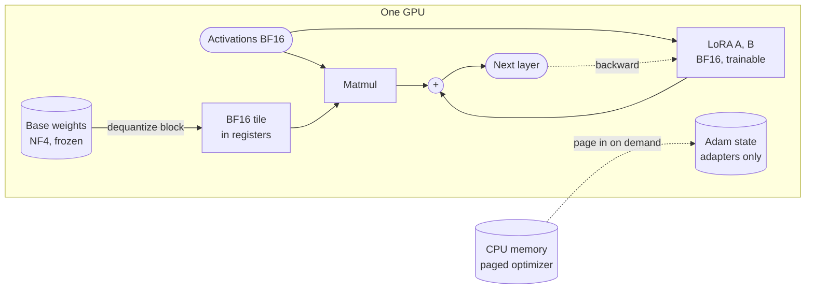

**Reading the diagram.** The NF4 base weights (the largest storage on the GPU) are dequantized per tile on the fly, so full 16-bit weights never exist; activations and adapters stay in BF16. The backward pass (dotted) updates only the adapters, whose Adam state can be paged to CPU memory asynchronously during spikes. Failure points: dequantization makes steps slower than BF16 LoRA, and an adapter trained against quantized weights sees slightly different numerics when merged into a BF16 base. Scale-out uses data parallelism.

::: formula
**QLoRA training memory on one GPU**

$$M_\text{QLoRA} = N_q\,\frac{4 + c}{8} + 2\,N_{16} + 16\,N_\text{LoRA} + b\,m_\text{seq} + M_\text{ovh}$$

| Symbol | Meaning | Units |
|---|---|---|
| $N_q$ | Parameters in quantized linear layers | parameters |
| $c$ | Bits of quantization metadata per parameter (0.127 with double quantization) | bits |
| $N_{16}$ | Parameters kept in 16 bits (embeddings, output head, norms) | parameters |
| $N_\text{LoRA}$ | Adapter parameters, with 16 bytes each of training state | parameters |
| $b$ | Micro-batch size | sequences |
| $m_\text{seq}$ | Activation memory per sequence, with checkpointing, plus logits | bytes |
| $M_\text{ovh}$ | CUDA context, allocator slack, dequantization buffers | bytes |
:::

::: example
**Worked example — Fine-tuning the 7B on one 24, 48 or 80 GB GPU.** Sequences of 2,048 tokens, full activation checkpointing (1.49 GB, §65.14.2) plus about 0.5 GB for FP32 logits and their gradient ($2{,}048 \times 32{,}000 \times 4$ bytes $= 0.26$ GB each): $m_\text{seq} \approx 2.0$ GB. LoRA on all linear layers, $r = 16$. $M_\text{ovh} = 1.5$ GB. Usable memory is 85% of capacity.

1. Quantized weights: $N_q = 32 \times 202{,}375{,}168 = 6.476 \times 10^9$; $6.476 \times 10^9 \times 4.127/8 = 3.34$ GB.
2. 16-bit weights: $262.4 \times 10^6 \times 2 = 0.52$ GB. Adapters: $39.98 \times 10^6 \times 16 = 0.64$ GB.
3. Fixed total: $3.34 + 0.52 + 0.64 + 1.5 = 6.0$ GB. For BF16 LoRA: $13.48 + 0.64 + 1.5 = 15.6$ GB.
4. Largest micro-batch $b = \lfloor (0.85\,M_\text{GPU} - \text{fixed})/2.0 \rfloor$, giving Table 76.3.

**Table 76.3 — Largest micro-batch of 2,048-token sequences for the 7B model on one GPU.**

| Method | Fixed memory | 24 GB (20.4 usable) | 48 GB (40.8) | 80 GB (68.0) |
|---|---|---|---|---|
| Full fine-tuning | 109.3 GB | Does not fit | Does not fit | Does not fit |
| LoRA, BF16 base | 15.6 GB | 2 | 12 | 26 |
| QLoRA, NF4 base | 6.0 GB | 7 | 17 | 31 |
| QLoRA, 70B-class base, attention adapters | about 39 GB | Does not fit | Weights fit; little room for activations | Fits; batch set by activations, measure |

**Interpretation.** For the 7B model, QLoRA's benefit is fitting a 24 GB card with a useful batch; on an 80 GB GPU, BF16 LoRA already fits and avoids dequantization overhead. QLoRA's headline win is at 65–70B, where NF4 weights alone are about 36 GB. **Engineering implication.** Choose QLoRA when GPU memory is the binding constraint (large bases, small GPUs); otherwise prefer BF16 LoRA for speed and simpler merging. The 70B row's fixed memory is $35.3$ GB of NF4 weights, 1.0 GB of 16-bit embeddings, 1.0 GB of adapter state and the overhead; its activations scale with hidden size and layers, so measure them.
:::

### 76.8.3 Other parameter-efficient methods

**Table 76.4 — Parameter-efficient fine-tuning methods.**

| Method | What is trained | Inference cost | Notes |
|---|---|---|---|
| Adapters [Houlsby et al. 2019] | Small bottleneck MLPs inserted in each block | Extra layers on every token | Within 0.4% of full fine-tuning on GLUE with 3.6% added parameters per task |
| Prefix tuning [Li and Liang 2021] | Continuous key and value vectors prepended at every layer | Longer effective context | About 0.1% of parameters; strong in low-data settings |
| Prompt tuning [Lester et al. 2021] | Soft token embeddings at the input only | A few extra tokens | Approaches full fine-tuning as models grow |
| LoRA [Hu et al. 2022] | Low-rank updates to chosen matrices | Zero if merged; small if not | The default choice |
| QLoRA [Dettmers et al. 2023] | LoRA over a 4-bit base | As LoRA; base may stay 4-bit | Lowest training memory |

::: mistake
**"LoRA is always as good as full fine-tuning."** For style, format and behavior it usually is. For large shifts, such as a new language or heavy new-domain knowledge, a low-rank update can underfit; that is a signal for continued pre-training (§76.12), not for an ever-larger $r$.
:::

## 76.9 Serving fine-tuned models

### 76.9.1 Merged weights versus multi-LoRA serving

You can serve a LoRA fine-tune in two ways. **Merging** folds $\frac{\alpha}{r}BA$ into $W_0$ and serves an ordinary model: zero overhead, but one full copy of the weights per variant. **Multi-LoRA serving** keeps one shared base in GPU memory and applies each request's adapter on the fly, so a single replica can serve many variants in the same batch. The difficulty is efficiency: a batch now mixes requests for different adapters, so the small $BAx$ products differ per request and do not form one large matrix multiply.

Two systems published the main techniques. **Punica**'s CUDA kernel, segmented gather matrix–vector multiplication (SGMV), batches LoRA computations across different adapters; it reported 12× higher throughput than state-of-the-art serving systems when serving multiple LoRA models, adding about 2 ms per token [Chen et al. 2024]. **S-LoRA** keeps adapters in host memory, loads those needed by running requests, and manages adapter weights and KV cache in one paged pool (**unified paging**), reporting up to 4× higher throughput than HuggingFace PEFT and vLLM with naive LoRA support and serving thousands of adapters [Sheng et al. 2024]. Mainstream engines now support multi-LoRA serving (as of 2026).

**Figure 76.10 — Multi-LoRA serving with adapter hot-swapping.**

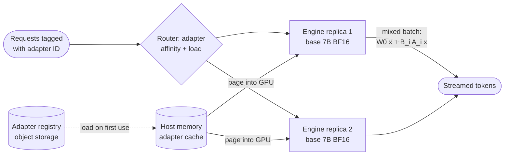

**Reading the diagram.** Each request names its adapter; the router prefers a replica already holding it, as prefix-aware routing does for KV blocks (§73.8). Adapters load asynchronously from the registry (object storage, §15.4) into a host cache and are paged into GPU memory beside the KV cache. One batch mixes adapters: the base multiply is shared and a gathered kernel applies each $B_iA_i$. Hot-swapping is a pointer change plus a load. Failure points: cold-load latency in TTFT, hot spots for popular adapters, and an adapter trained on another base version producing garbage silently, so key adapters by base checksum.

::: formula
**GPU memory for resident adapters**

$$M_\text{adapters} = n_a \cdot 2\,N_\text{LoRA} \qquad T_\text{displaced} = \frac{M_\text{adapters}}{m_\text{KV}}$$

| Symbol | Meaning | Units |
|---|---|---|
| $n_a$ | Adapters resident in GPU memory | count |
| $N_\text{LoRA}$ | Parameters per adapter (BF16, 2 bytes each) | parameters |
| $T_\text{displaced}$ | KV-cache tokens the adapters displace | tokens |
| $m_\text{KV}$ | KV-cache bytes per token (524,288 for the 7B, §72.11) | bytes/token |
:::

::: example
**Worked example — Twelve chatbot variants.** QuickBite wants adapters for three audiences (customers, couriers, merchants) in four markets: 12 variants, attention-only $r = 16$ adapters of 33.6 MB. An H100 replica holds the 13.5 GB base and a KV pool of about 103,000 tokens (§73.8).

1. Merged: 12 models × 13.5 GB = 162 GB of weights; with two replicas each for availability, 24 GPUs, most of them idle at 8 queries per second.
2. Multi-LoRA: $12 \times 33.6$ MB $= 0.40$ GB per replica, displacing $0.40 \times 10^9 / 524{,}288 = 769$ KV tokens, 0.75% of the pool. The shared pool of §79.8 serves every variant.
3. Extra compute per token: $2 \times 16.8 \times 10^6 = 3.4 \times 10^7$ FLOPs against $2 \times 6.74 \times 10^9 = 1.35 \times 10^{10}$ for the base, 0.25%; the real overhead is kernel efficiency on mixed batches.

**Interpretation.** Multi-LoRA turns "one GPU fleet per variant" into "one fleet for all variants" at a fraction of a percent of memory. **Engineering implication.** Merge when you serve one or two variants at high volume and want the fastest kernels; use multi-LoRA when variants multiply (per market, per tenant, per experiment), and version adapters against the exact base checksum.
:::

**Table 76.5 — Merging versus multi-LoRA serving.**

| Criterion | Merge into base | Multi-LoRA |
|---|---|---|
| Latency overhead | None | Small; cold-load on first use |
| Memory per variant | Full model (13.5 GB) | Adapter (tens of MB) |
| Rollback | Redeploy weights | Repoint adapter version |
| Quantized serving | Merge, then quantize (re-check quality) | Quantized base plus BF16 adapters |
| Choose when | Few variants, high volume | Many variants, experiments, tenants |

## 76.10 Preference alignment: RLHF and DPO

### 76.10.1 Why preferences, and the RLHF pipeline

::: definition
**Definition — Preference alignment.** Training a model to produce responses people prefer, from comparisons ("response A is better than B for this prompt") rather than from single correct targets. **RLHF** (reinforcement learning from human feedback) fits a **reward model** to the comparisons and then optimizes the policy (the LLM) against it with reinforcement learning [Christiano et al. 2017; Ouyang et al. 2022]. **DPO** (direct preference optimization) optimizes the policy on the comparisons directly [Rafailov et al. 2023].
:::

#### First-principles explanation

Writing the perfect support reply is hard; recognizing the better of two replies is easy, as a food critic who cannot cook can still rank dishes. Preference training exploits that asymmetry and can push the model past the quality of its labelers.

#### Why does this exist?

SFT imitates, including the average agent's mediocre phrasing, and gives no signal about which of two acceptable replies is *better*. Christiano et al. showed that agents could learn complex behaviors from human comparisons, with feedback on less than 1% of their interactions [Christiano et al. 2017]. Ouyang et al. applied this to language models in three steps (SFT, a reward model trained on rankings, PPO against it); labelers preferred the resulting InstructGPT to GPT-3, and it improved truthfulness and reduced toxic output [Ouyang et al. 2022].

**Figure 76.11 — The RLHF pipeline.**

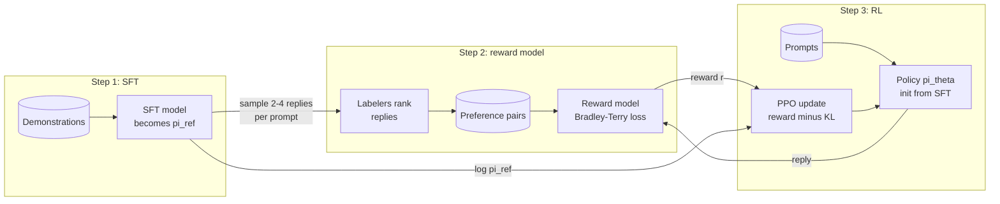

**Reading the diagram.** The SFT model from step 1 is also the frozen reference $\pi_\text{ref}$. Step 2 samples replies from it, collects human rankings through an asynchronous labeling pipeline (Chapter 63) and trains the reward model. Step 3 loops synchronously: generate, score, compute the KL term from the reference, update with PPO. Four models are live at once (policy, reference, reward and PPO's value model), the main systems cost. Failure points: **reward hacking**, where the policy finds outputs the reward model overrates (long, flattering replies), and labeler disagreement capping reward-model accuracy.

### 76.10.2 The reward model: Bradley–Terry

::: formula
**Bradley–Terry preference model and reward-model loss**

$$P(y_w \succ y_l \mid x) = \sigma\big(r_\phi(x, y_w) - r_\phi(x, y_l)\big) \qquad \mathcal{L}_\text{RM} = -\,\mathbb{E}\left[\log \sigma\big(r_\phi(x, y_w) - r_\phi(x, y_l)\big)\right]$$

| Symbol | Meaning | Units |
|---|---|---|
| $x$ | Prompt (conversation so far) | — |
| $y_w$, $y_l$ | Preferred ("winner") and dispreferred ("loser") replies | — |
| $r_\phi(x, y)$ | Scalar reward from the reward model with parameters $\phi$ | reward units |
| $\sigma(z)$ | Logistic function $1/(1 + e^{-z})$ | — |
| $\mathcal{L}_\text{RM}$ | Negative log-likelihood of the observed preferences | nats |
:::

::: example
**Worked example — One comparison.** For a late-order complaint, labelers prefer the reply that apologizes once and proposes the delivery-fee refund with a citation. The reward model scores it 1.2 and the three-sentence apology without an action 0.4.

1. $P(y_w \succ y_l) = \sigma(1.2 - 0.4) = \sigma(0.8) = 1/(1 + e^{-0.8}) = 0.690$.
2. Loss: $-\ln 0.690 = 0.371$ nats. Had the scores been reversed, $-\ln \sigma(-0.8) = -\ln 0.310 = 1.171$.
3. Rewards are only defined up to a constant: scores of 11.2 and 10.4 give the same loss. Normalize rewards before using them in RL.

**Interpretation.** The reward model learns score *differences* that reproduce labelers' choice frequencies. **Engineering implication.** Its accuracy cannot exceed labeler agreement; InstructGPT reported inter-labeler agreement of about 73% [Ouyang et al. 2022], so track agreement (§63.6) and treat a reward model far above it on held-out pairs as a red flag for leakage.
:::

### 76.10.3 PPO with a KL penalty

The RL step maximizes reward while staying close to the reference model, because an unconstrained policy drifts into text the reward model has never seen and overrates. **PPO** (proximal policy optimization) keeps each update small by clipping the probability ratio between the new and old policy [Schulman et al. 2017].

::: formula
**KL-regularized RLHF objective and PPO's clipped surrogate**

$$\max_{\theta}\; \mathbb{E}_{x,\, y \sim \pi_\theta}\!\left[r_\phi(x, y) - \beta \log \frac{\pi_\theta(y \mid x)}{\pi_\text{ref}(y \mid x)}\right] \qquad L^\text{CLIP} = \mathbb{E}\!\left[\min\big(\rho\, \hat A,\; \text{clip}(\rho, 1 - \epsilon, 1 + \epsilon)\, \hat A\big)\right]$$

| Symbol | Meaning | Units |
|---|---|---|
| $\pi_\theta$, $\pi_\text{ref}$ | Policy being trained; frozen reference (the SFT model) | — |
| $\beta$ | KL penalty strength | — |
| $\log \frac{\pi_\theta}{\pi_\text{ref}}$ | Log-probability ratio of the reply under policy and reference; its expectation is the KL divergence | nats |
| $\rho$ | Probability ratio of an action (token) under the new versus the old policy | — |
| $\hat A$ | Advantage estimate: how much better than expected the action was | reward units |
| $\epsilon$ | Clip range, typically 0.2 | — |
:::

::: example
**Worked example — The KL penalty as a budget.** $\beta = 0.05$. Reply A has reward 2.0 and log-probabilities $-30$ (policy) and $-36$ (reference). Reply B, longer and more effusive, has reward 2.4 and log-probabilities $-28$ and $-42$.

1. A: log ratio $= -30 - (-36) = 6$; penalized reward $2.0 - 0.05 \times 6 = 1.70$.
2. B: log ratio $= 14$; penalized reward $2.4 - 0.05 \times 14 = 1.70$.
3. The extra 0.4 of reward for B is exactly offset by its distance from the reference; at $\beta = 0.1$, A wins ($1.40$ versus $1.00$).
4. Clipping: a token with $\rho = 1.5$ and $\hat A = +2$ contributes $\min(3.0,\, 1.2 \times 2) = 2.4$, so one batch cannot push its probability up by more than 20%.

**Interpretation.** $\beta$ prices drift: the policy may leave the reference only where the reward gain pays for it. **Engineering implication.** Monitor KL to the reference, reply length and reward together during training; rising reward with rising length and KL is the signature of reward hacking [Gao et al. 2023], and the fix is a larger $\beta$, a better reward model or early stopping.
:::

### 76.10.4 DPO: preferences without a reward model

Rafailov et al. showed that the optimal policy of the KL-regularized objective above has a closed form, $\pi^*(y \mid x) \propto \pi_\text{ref}(y \mid x) \exp(r(x, y)/\beta)$, so the reward can be written in terms of the policy: $r(x, y) = \beta \log \frac{\pi^*(y \mid x)}{\pi_\text{ref}(y \mid x)} + \text{const}$. Substituting into the Bradley–Terry loss gives a classification-style loss on the policy itself [Rafailov et al. 2023]. No reward model is trained, no sampling happens during training, and no RL loop is needed: DPO trains like SFT, on fixed (prompt, chosen, rejected) triples.

::: formula
**DPO loss**

$$\mathcal{L}_\text{DPO} = -\,\mathbb{E}\left[\log \sigma\!\left(\beta \left[\log \frac{\pi_\theta(y_w \mid x)}{\pi_\text{ref}(y_w \mid x)} - \log \frac{\pi_\theta(y_l \mid x)}{\pi_\text{ref}(y_l \mid x)}\right]\right)\right]$$

| Symbol | Meaning | Units |
|---|---|---|
| $\log \pi(y \mid x)$ | Sum of token log-probabilities of reply $y$ (response tokens only) | nats |
| $\beta$ | Strength of the implicit KL constraint; typical 0.1–0.5 | — |
| $\beta \log \frac{\pi_\theta}{\pi_\text{ref}}$ | DPO's **implicit reward** for a reply | reward units |
| $\mathcal{L}_\text{DPO}$ | Loss over preference triples | nats |
:::

::: example
**Worked example — One DPO pair.** Chosen reply: $\log \pi_\theta = -42$, $\log \pi_\text{ref} = -44$. Rejected: $\log \pi_\theta = -47$, $\log \pi_\text{ref} = -46$. $\beta = 0.1$.

1. Chosen log ratio $= -42 + 44 = 2$; rejected log ratio $= -47 + 46 = -1$.
2. Margin $= 0.1 \times (2 - (-1)) = 0.3$; $\sigma(0.3) = 0.574$; loss $= -\ln 0.574 = 0.554$.
3. The gradient is weighted by $\sigma(-0.3) = 0.426$: pairs the model already orders correctly by a wide margin contribute little, pairs it gets wrong contribute most.
4. Compute per pair: policy forward and backward on both replies plus two reference forwards. With 8,000 pairs, two sequences of about 2,000 tokens each per pair and two epochs: $D = 8{,}000 \times 4{,}000 \times 2 = 6.4 \times 10^7$ tokens; $(6 + 2) \times 6.74 \times 10^9 \times 6.4 \times 10^7 = 3.45 \times 10^{18}$ FLOPs, 2.4 GPU-hours, \$6. Reference log-probabilities can be precomputed once.

**Interpretation.** DPO increases the chosen reply's probability *relative to the reference* and decreases the rejected one's; absolute probabilities can both fall. **Engineering implication.** Log chosen and rejected log-probabilities separately during training, and with LoRA use the base with the adapter disabled as $\pi_\text{ref}$, which avoids holding a second model.
:::

#### Code example: Bradley–Terry and DPO losses, and what $\beta$ controls

```python
import torch
import torch.nn.functional as F

torch.manual_seed(0)

def bradley_terry_loss(r_chosen, r_rejected):
    """Reward-model loss: -log sigma(r_w - r_l), averaged over pairs."""
    return -F.logsigmoid(r_chosen - r_rejected).mean()

def dpo_loss(pi_w, pi_l, ref_w, ref_l, beta, weight=None):
    """Inputs: summed log-probs of whole responses (response tokens only)."""
    margin = beta * ((pi_w - ref_w) - (pi_l - ref_l))
    losses = -F.logsigmoid(margin)
    if weight is not None:
        return (weight * losses).sum() / weight.sum(), margin
    return losses.mean(), margin

# 1) The worked example from the text: one pair.
loss, m = dpo_loss(torch.tensor([-42.0]), torch.tensor([-47.0]),
                   torch.tensor([-44.0]), torch.tensor([-46.0]), beta=0.1)
print(f"one pair: margin {m.item():.2f}, loss {loss.item():.4f}")
bt = bradley_terry_loss(torch.tensor([1.2]), torch.tensor([0.4]))
print(f"Bradley-Terry loss, rewards 1.2 vs 0.4: {bt.item():.4f}")

# 2) A toy policy: one prompt, four candidate replies, softmax over learnable logits.
#    0 = polite and cites policy; 1 = polite, no citation; 2 = curt; 3 = promises an invalid refund.
ref_logits = torch.tensor([0.0, 0.5, 0.3, 0.2])              # the SFT model is the reference
ref_logp = F.log_softmax(ref_logits, dim=0)
# (a, b, votes for a, votes for b) from 100 labeler comparisons per pair: labelers disagree.
votes = [(0, 1, 70, 30), (0, 2, 80, 20), (0, 3, 95, 5),
         (1, 2, 60, 40), (1, 3, 90, 10), (2, 3, 85, 15)]
w_idx = torch.tensor([a for a, b, va, vb in votes] + [b for a, b, va, vb in votes])
l_idx = torch.tensor([b for a, b, va, vb in votes] + [a for a, b, va, vb in votes])
weight = torch.tensor([float(va) for *_, va, vb in votes] + [float(vb) for *_, va, vb in votes])

print("reference policy:", [round(v, 3) for v in ref_logp.exp().tolist()])
for beta in (0.1, 0.5, 2.0):
    logits = ref_logits.clone().requires_grad_(True)            # policy starts at the reference
    opt = torch.optim.Adam([logits], lr=0.05)
    for step in range(3000):
        logp = F.log_softmax(logits, dim=0)
        loss, _ = dpo_loss(logp[w_idx], logp[l_idx], ref_logp[w_idx], ref_logp[l_idx], beta, weight)
        opt.zero_grad(); loss.backward(); opt.step()
    logp = F.log_softmax(logits.detach(), dim=0)
    p = logp.exp()
    kl = (p * (logp - ref_logp)).sum().item()
    reward = beta * (logp - ref_logp)                            # DPO's implicit reward
    reward = reward - reward.mean()
    print(f"beta={beta}: loss {loss.item():.3f} policy {[round(v, 3) for v in p.tolist()]} "
          f"KL {kl:.3f} implicit reward {[round(v, 2) for v in reward.tolist()]}")
```

Output:

```text
one pair: margin 0.30, loss 0.5544
Bradley-Terry loss, rewards 1.2 vs 0.4: 0.3711
reference policy: [0.192, 0.316, 0.259, 0.234]
beta=0.1: loss 0.455 policy [1.0, 0.0, 0.0, 0.0] KL 1.650 implicit reward [1.31, 0.43, -0.01, -1.73]
beta=0.5: loss 0.455 policy [0.722, 0.206, 0.069, 0.002] KL 0.770 implicit reward [1.31, 0.43, -0.01, -1.73]
beta=2.0: loss 0.455 policy [0.33, 0.352, 0.23, 0.088] KL 0.105 implicit reward [1.31, 0.44, -0.01, -1.73]
```

What to notice:

- The first two lines reproduce the worked examples (0.554 and 0.371).
- All three runs reach the same loss and the same implicit rewards: the Bradley–Terry fit of the votes. That is the sense in which "the language model is secretly a reward model".
- $\beta$ decides how far the policy moves to express those rewards: KL 1.65 at $\beta = 0.1$ (almost all mass on reply 0), 0.105 at $\beta = 2$ (still mostly the reference). Small $\beta$ means aggressive optimization.
- Labeler disagreement (70/30 rather than 100/0) keeps the optimum finite. With unanimous votes, DPO can push rejected probabilities toward zero without bound, one reason to regularize and stop early.

### 76.10.5 RLAIF, Constitutional AI and choosing a method

Human comparisons are slow and expensive. **RLAIF** replaces some of them with judgments from a model. In **Constitutional AI**, Bai et al. trained a harmless assistant with a short list of written principles (a "constitution"): a supervised phase in which the model critiques and revises its own responses against the principles, then an RL phase using a preference model trained on AI-generated comparisons, with human labels used for helpfulness [Bai et al. 2022]. The principles make the target behavior explicit and auditable; the risk is that the judge's biases become the policy's.

**Figure 76.12 — RLHF and DPO side by side.**

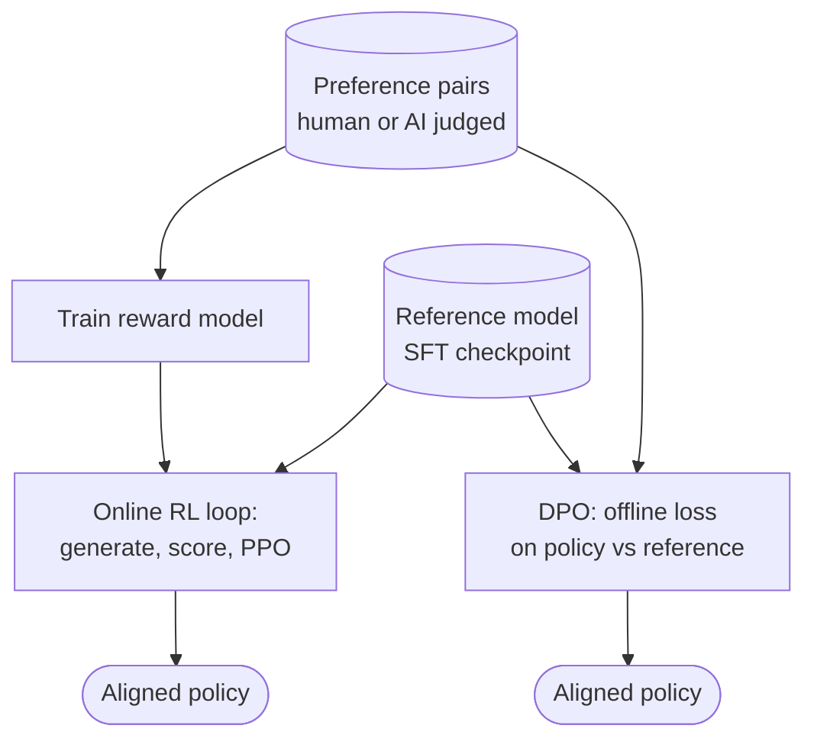

**Reading the diagram.** Both paths read the same stored pairs and frozen reference. RLHF (left) adds a reward model and an online generate-and-score loop: it can explore beyond the dataset but runs four models and is sensitive to tuning. DPO (right) is one offline pass, as cheap and stable as SFT, but learns only from replies in the dataset, so pairs should come from a model close to the one being trained. Failure points: reward hacking on the left, stale pairs on the right.

**Table 76.6 — Preference-alignment methods.**

| Criterion | RLHF with PPO | DPO | RLAIF / Constitutional AI |
|---|---|---|---|
| Models in training | Policy, reference, reward, value | Policy, reference | As either, plus an AI judge |
| Memory, 7B full training | About 2 × 108 GB trained + 2 × 13.5 GB frozen | 108 GB + 13.5 GB (or precomputed) | As chosen method |
| Data | Pairs, plus fresh prompts for RL | Fixed pairs, ideally on-policy | Principles plus AI comparisons |
| Stability | Sensitive; many hyperparameters | Stable, SFT-like | Depends on judge quality |
| Strength | Explores; reusable reward model | Simple, cheap | Scales labels; auditable principles |
| Choose when | Large teams; online reward signals | Most product teams | Label budget is the constraint |

::: industry
**Llama 2-Chat.** Meta's Llama 2 report describes SFT followed by iterative RLHF using rejection sampling and PPO, with separate helpfulness and safety reward models trained on more than a million human binary comparisons, and documents a "ghost attention" technique for following system instructions over many turns. The report also gives a model card, safety evaluations and the release under the Llama 2 Community License, which governs downstream fine-tunes such as QuickBite's.
*Evidence: Primary* — [Touvron et al. 2023]
:::

QuickBite chooses DPO with LoRA: 8,000 comparisons of two replies sampled from its SFT model, judged by trained support leads under written guidelines, at about 90 s per comparison: $8{,}000 \times 90 \times 22/(3{,}600 \times 0.8) = \$5{,}500$.

## 76.11 Training data pipelines for LLM adaptation

### 76.11.1 From logs to a training set

Every method in this chapter is only as good as its data, and the data for a support bot starts as raw conversations full of personal details, duplicates, policy violations and evaluation leakage. The pipeline that turns logs into SFT examples and preference pairs is a batch data pipeline (Chapter 61) with LLM-specific stages.

**Figure 76.13 — QuickBite's adaptation data pipeline.**

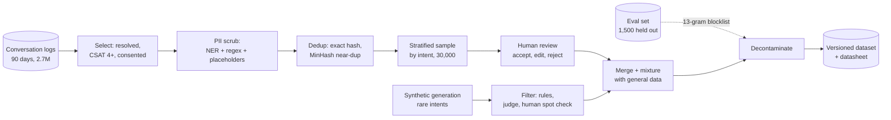

**Reading the diagram.** Logs (the source storage boundary) flow through batch stages: selection by outcome and consent, PII scrubbing, deduplication, stratified sampling, human review. A parallel branch generates and filters synthetic examples for rare intents. Both merge with general replay data, are checked against an evaluation-set blocklist fed asynchronously, and land in a versioned dataset with a datasheet (§63.13). Failure points: surviving PII becomes memorizable (§71.9), near-duplicates over-weight templated replies, evaluation leakage inflates every metric. Stages partition by conversation; human review is the bottleneck.

The stages, briefly:

1. **Collection and consent.** Use conversations whose terms of service and retention policy allow training; honor deletion requests through lineage (§61.12), which means knowing which dataset and which adapter contain a deleted user's data.
2. **PII scrubbing.** Named-entity recognition plus patterns for phone numbers, emails, card fragments and addresses, replaced by typed placeholders (`<ADDRESS>`) rather than deleted, so the model learns the shape of the conversation without the values.
3. **Deduplication.** Exact hashing, then MinHash near-duplicate detection (§75.5.3). Lee et al. found that deduplicating training data reduced memorized output by about ten times and made models train more efficiently [Lee et al. 2022].
4. **Synthetic data** from a larger teacher model: generate customer messages for rare intents, generate replies, then filter by rules, an LLM judge and human spot checks. Self-Instruct showed models can bootstrap instruction data from their own generations [Wang et al. 2023b]; Chapter 63 covers the risks of distribution mismatch and model collapse (§63.12.2).
5. **Decontamination.** Remove training examples that overlap the evaluation set, for example any shared 13-word sequence, the n-gram test GPT-3's authors used [Brown et al. 2020].
6. **Mixture.** Blend domain data with general instruction data so the model keeps its general skills (§76.12).

::: formula
**Token budget of an adaptation dataset**

$$D = E \sum_{s} n_s\, \bar t_s \qquad D_\text{loss} = f_\text{resp}\, D$$

| Symbol | Meaning | Units |
|---|---|---|
| $D$ | Tokens processed in training, all epochs | tokens |
| $E$ | Epochs | — |
| $n_s$, $\bar t_s$ | Sequences from source $s$; mean tokens per sequence | count; tokens |
| $f_\text{resp}$ | Fraction of tokens in assistant responses (in the loss) | — |
| $D_\text{loss}$ | Tokens that contribute to the loss | tokens |
:::

::: example
**Worked example — QuickBite's SFT token budget.** 30,000 conversations/day for 90 days gives 2.7 million.

1. Selection keeps 35% (resolved, CSAT ≥ 4, consented): 945,000. Near-duplicate removal drops 40%: 567,000.
2. A stratified sample of 30,000 is reviewed at 4 minutes each: $30{,}000 \times 240 \times 22/(3{,}600 \times 0.8) = \$55{,}000$; 20,000 are accepted, many after edits.
3. Synthetic: 6,000 generated for rare intents, 4,000 pass the filters. Decontamination removes about 100. Domain total about 24,000 conversations.
4. Each conversation is about 2,000 tokens (150 system, 1,000 sources, 250 order facts, 100 customer turns, 500 replies): $24{,}000 \times 2{,}000 = 48$ million tokens. General replay at 20% of the mixture: 6,000 sequences, 12 million tokens. Per epoch 60 million; $E = 3$: $D = 180$ million.
5. $f_\text{resp} = 500/2{,}000 = 0.25$: $D_\text{loss} = 45$ million tokens.

**Interpretation.** 2.7 million logged conversations become 24,000 training conversations; the 1% that survives is what makes the model better than its logs. **Engineering implication.** Budget review hours, not GPU-hours, and keep every stage versioned so that a deletion request or a contaminated example can be traced to the adapters that contain it.
:::

## 76.12 Continued pre-training and domain adaptation

**Continued pre-training (CPT)**, or domain-adaptive pre-training, runs the next-token objective on large amounts of unlabeled domain text before SFT. Gururangan et al. showed that it improved downstream tasks in four domains (biomedical and computer-science papers, news, reviews), and that further pre-training on task text helped again [Gururangan et al. 2020]. It pays when the domain's vocabulary or style is far from the base model's data and you have billions of tokens; QuickBite's run (§65.9.1) processed 278 times more tokens than its whole SFT budget.

The main risk is **catastrophic forgetting**: narrow training overwrites general abilities [Kirkpatrick et al. 2017]. Defenses are a **replay mixture** (5–30% general text in every batch), a lower peak learning rate, and general benchmarks at every checkpoint. §65.9.1 described QuickBite's mixture as domain text only; a production run should add replay data and an ablation of "SFT on the base" against "SFT on the CPT model". If the ablation shows no gain, drop CPT and save 1,458 GPU-hours per base-model upgrade.

::: mistake
**"Continued pre-training on our documents will make the model know our policies."** It teaches language and associations, not reliably retrievable facts, and policies change. Use CPT for vocabulary and style at scale; use RAG for facts (§76.14).
:::

## 76.13 Distillation from large to small models

LLM distillation applies §67.8 at token level or, more commonly, sequence level: the teacher generates complete responses and the student is fine-tuned on them [Kim and Rush 2016]. QuickBite uses it to generate synthetic SFT data (§76.11) and could train a 1B router that decides whether a message needs the 7B model (Chapter 78). Stanford's Alpaca fine-tuned LLaMA 7B on 52,000 demonstrations generated with a commercial model and was released for research use only because of the teacher's terms and the base license [Taori et al. 2023]: the teacher's license governs its outputs.

::: example
**Worked example — Storing teacher logits for token-level distillation.** The SFT budget is $1.8 \times 10^8$ tokens with a 32,000-token vocabulary.

1. Full distributions in FP16: $1.8 \times 10^8 \times 32{,}000 \times 2 = 1.15 \times 10^{13}$ bytes, 11.5 TB.
2. Top-20 tokens per position, 4-byte ID plus 2-byte probability: $1.8 \times 10^8 \times 20 \times 6 = 21.6$ GB.
3. Sequence-level distillation stores only the teacher's generated text: about the size of the dataset itself, under 1 GB.

**Interpretation.** Full-vocabulary soft targets are impractical to store; top-$k$ captures most of the probability mass at 0.2% of the size. **Engineering implication.** Use sequence-level distillation by default, top-$k$ logits when the student and teacher share a tokenizer and you need the extra signal, and check the teacher's license before generating anything.
:::

## 76.14 RAG versus fine-tuning

### 76.14.1 Two tools for two problems

The two are complements, not rivals: RAG changes what the model *knows at request time*; fine-tuning changes how it *behaves*. Ovadia et al. compared the two for injecting knowledge and found that RAG consistently outperformed unsupervised fine-tuning, both for facts the model had seen in pre-training and for new ones [Ovadia et al. 2024]. Fine-tuning wins where the requirement is behavior that must hold on every request.

**Table 76.7 — RAG versus fine-tuning.**

| Row | RAG (Chapter 75) | Fine-tuning (SFT, LoRA, DPO) |
|---|---|---|
| What it is | Retrieved passages added to each prompt | Weights or adapters updated on examples |
| How it works | Index, retrieve, rerank, build context | Gradient descent on demonstrations or pairs |
| Advantages | Fresh, citable, per-user access control, cheap updates | Consistent format and tone, shorter prompts, learned judgment |
| Disadvantages | Retrieval misses, more tokens and latency, injection surface | Stale facts, no citations, retraining to change, safety regressions |
| Performance | +100–300 ms and +2,000–5,000 prompt tokens | No added latency; can remove prompt tokens |
| Operational complexity | Ingestion, indexes, ACL propagation | Data pipeline, training, evaluation gates, model versions |
| Cost | Per query (tokens, search cluster) | One-off (data review, GPU) plus re-runs per base upgrade |
| Use cases | Policies, help articles, order facts | Output schema, tone, escalation rules, domain phrasing |
| Choose when | Knowledge changes, must be cited or restricted | Behavior must be reliable and is stable |

**Figure 76.14 — QuickBite's combined design: retrieve facts, fine-tune behavior.**

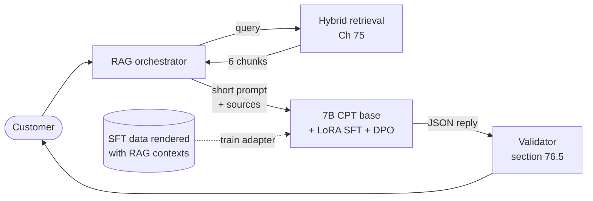

**Reading the diagram.** At request time the path is Chapter 75's synchronous RAG pipeline, with a system prompt shrunk to about 150 tokens because the adapter carries the rules, and validated JSON output. Offline (dotted), the adapter is trained on conversations rendered *with* their retrieved sources, including cases where the sources are irrelevant and the right answer is "I don't know". Failure points: training contexts that differ from production (another chunker or $k$), and policy changes that make trained behavior wrong, which is why facts stay in retrieval.

::: example
**Worked example — QuickBite's decision.** The complaint list from the chapter opening, classified:

1. "Over-apologizes; prose instead of JSON; inconsistent escalation for allergy questions": behavior, stable, testable. **LoRA SFT** on 24,000 reviewed conversations, then **DPO** on 8,000 pairs for tone. One-off cost about \$61,000, almost all review.
2. "Refund thresholds changed on 1 September": knowledge, changing. **RAG** (already in place).
3. "Doesn't know what *kottu roti* is": domain vocabulary. Already covered by CPT; if not, add help-center glossary chunks to retrieval before considering more CPT.
4. "Says it refunded when it only proposed": behavior plus authority. **Structured output** with an `action` field validated in code (§76.5), plus SFT examples.
5. Expected effect on the evaluation set (assumed targets): first-attempt validity $p_1$ from 0.70 to 0.97, calls per request from 1.345 to 1.036, 23% fewer generation calls.

**Interpretation.** Every complaint maps to exactly one primary tool, and none of them needed a bigger model. **Engineering implication.** Classify each requirement as knowledge or behavior before choosing a method, and keep the classification in the design document so later changes go to the right place.
:::

## 76.15 Risks and governance

**Safety regressions.** Fine-tuning can erode a model's safety training. Qi et al. showed that fine-tuning an aligned model on a handful of adversarial examples removed its refusals, and that even fine-tuning on benign data degraded safety measurably [Qi et al. 2024]. Every adapted model therefore re-runs the safety evaluation, and SFT data should include examples of correct refusals.

**Licenses.** Open-weight models come with licenses that bind fine-tunes. The Llama 2 Community License, for example, requires a separate license for products above 700 million monthly active users and restricts using the model's outputs to improve other large language models [Touvron et al. 2023]; teacher models' terms govern distillation (§76.13). Legal review of the base, the teacher and every dataset is part of the pipeline, not an afterthought.

**Provenance.** Record, for every adapter: base model and checksum, dataset versions and datasheets, training code commit, hyperparameters and evaluation results, in the model registry (§69.6.2) with a model card (§71.12). Without it you cannot answer "which models were trained on this deleted user's conversations?" or "which adapters must be retrained for the new base?".

**Memorization and privacy.** Small SFT sets trained for several epochs are memorized more than pre-training data; canary strings planted in training data and extraction tests (§71.9) measure the risk.

**Figure 76.15 — Release gates for an adapted model.**

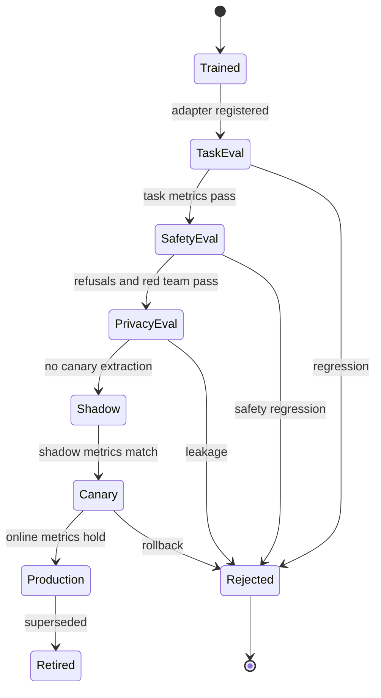

**Reading the diagram.** A trained adapter moves through gates in order, each a set of automated checks with human sign-off where required: task metrics on the held-out evaluation set (Chapter 78), safety evaluation and red-teaming, privacy tests, then shadow traffic and a canary (§69.6.4). Any gate can reject; the canary can roll back by repointing the adapter version, which multi-LoRA serving makes instant (§76.9). The registry stores every state transition with its evidence. Failure points: gates that check averages and miss slices, evaluation sets that leaked into training (§76.11), and manual overrides without records.

## 76.16 Summary and revision notes

::: summary
- Climb the adaptation ladder only on evidence: prompt, few-shot, RAG, fine-tuning, continued pre-training, pre-training. Retrieve for knowledge; fine-tune for behavior.
- For a 7B model, fine-tuning compute is cheap (about 5 GPU-hours for 180 million tokens); curated data and evaluation dominate cost. Token savings repay a fine-tune only at very high volume.
- Prompts are versioned artifacts: stable content first, delimited untrusted content, property-based regression tests on a golden set.
- Structured output layers instructions, constrained decoding (syntax), validation (business rules) and bounded retries; $E[\text{calls}] = 1 + (1 - p_1)\sum_{j<k}(1 - p_r)^j$.
- In-context examples cost tokens, TTFT and context on every request and are order-sensitive; cache static ones.
- SFT: serving chat template, loss on assistant tokens only, quality over quantity. Full fine-tuning of the 7B needs about 108 GB of state.
- LoRA: $N_\text{LoRA} = L\sum r(d_\text{in} + d_\text{out})$, 16.8M parameters (0.249%) at $r = 16$ on attention; QLoRA's NF4 base fits the 7B on a 24 GB GPU.
- Multi-LoRA serving (Punica, S-LoRA) shares one base across many adapters; merge for few, high-volume variants.
- RLHF: Bradley–Terry reward model, then PPO maximizing reward minus $\beta$ KL. DPO optimizes the same objective offline; $\beta$ sets how far the policy moves.
- Data pipelines: consent, PII scrubbing, deduplication, filtered synthetic data, decontamination, replay mixtures, lineage.
- Re-run safety, privacy and task gates for every adapted model; licenses of base and teacher bind the result.
:::

## 76.17 Knowledge checkpoint

1. Classify each as knowledge or behavior: a new refund threshold; replies too long; JSON format; a new restaurant's menu.
2. How many trainable parameters does LoRA with $r = 8$ on $W_Q$ and $W_V$ add to the 7B model?
3. Why is $B$ initialized to zero in LoRA?
4. Why must assistant end-of-turn tokens stay in the SFT loss?
5. With $p_1 = 0.9$, $p_r = 0.5$, $k = 1$, what are $P_\text{fallback}$ and $E[\text{calls}]$?
6. What does constrained decoding guarantee, and what does it not?
7. A reward model scores two replies 0.5 and 2.0. What probability does it assign to the second being preferred?
8. In DPO, what happens to the loss if $\beta$ doubles and log ratios stay fixed?
9. Why is full fine-tuning of the 7B infeasible on one 80 GB GPU?
10. Why can 12 merged variants cost far more than 12 adapters?
11. Name two mitigations for catastrophic forgetting.
12. What does decontamination protect?

<details><summary>Answers</summary>

1. Knowledge, behavior, behavior, knowledge.
2. $32 \times 2 \times 8 \times 8{,}192 = 4{,}194{,}304$ (0.062%).
3. So $\Delta W = 0$ at the start and training begins exactly at the base model.
4. Otherwise the model never learns to stop and generates until the length limit.
5. $0.1 \times 0.5 = 0.05$; $1 + 0.1 = 1.1$.
6. Parseable output matching types and enumerations; not correct values or cross-field rules.
7. $\sigma(1.5) = 0.818$.
8. The margin doubles, so the loss falls for correctly ordered pairs; at the optimum the policy moves less from the reference.
9. About 108 GB of weights, gradients, master weights and Adam moments before activations.
10. Each merged variant needs a full 13.5 GB copy and its own replicas; adapters share one base at tens of MB each.
11. Replay of general data; lower learning rate (also regularization such as EWC, early stopping).
12. The validity of evaluation results, by keeping test items out of training data.

</details>

## 76.18 Interview questions

### Basic

**Q1. When would you fine-tune instead of improving the prompt?**
**Answer.** When a stable, testable behavior still fails after good instructions and examples, you have at least a thousand good examples, and the evaluation shows the gap. Not for facts, which belong in retrieval.

**Q2. What is LoRA and why is it popular?**
**Answer.** A frozen weight plus a trainable low-rank update $BA$. It trains under 1% of parameters, needs a fraction of the memory, produces small adapters and can be merged at zero inference cost.

### Intermediate

**Q3. The bot's JSON fails 5% of the time. Fix it.**
**Answer.** Measure failure types; add constrained decoding for syntax; validate business rules in code; retry once with errors fed back; fall back to handoff; fine-tune on schema-conforming examples; alert on first-attempt validity and size capacity on expected calls.

**Q4. Compare RLHF and DPO for a product team.**
**Answer.** Both optimize reward minus a KL penalty to a reference. RLHF trains a reward model and runs PPO with four models online, which explores but is costly and unstable. DPO trains offline on fixed pairs like SFT. Most teams start with DPO on pairs sampled from their own SFT model.

### Advanced

**Q5. Serve 200 per-tenant fine-tunes of a 7B model.**
**Answer.** LoRA adapters on one base with multi-LoRA serving: adapters in an object-store registry keyed by base checksum, host cache, paging into GPU memory, adapter-affinity routing, per-tenant rate limits and evaluation gates, instant rollback by version pointer, and cost attribution per adapter (Chapter 79).

**Q6. Design the data pipeline for fine-tuning on customer conversations.**
**Answer.** Consent-filtered selection, PII scrubbing with placeholders, exact and near deduplication, stratified sampling and human review, filtered synthetic data for rare intents, decontamination against the eval set, replay mixture, versioned datasets with lineage for deletion, and a datasheet.

## 76.19 Practical exercises

1. Extend the validator of §76.5 to report all errors at once (no early return) and measure the change in $E[\text{calls}]$ in the simulation.
2. Apply `LoRALinear` to every linear layer of the decoder layer from §72.8.2, count trainable parameters, and verify the merged model matches.
3. Add label smoothing to the DPO code and observe what happens with unanimous votes.
4. Compute QLoRA memory for 4,096-token sequences on a 24 GB GPU.

## 76.20 Design challenges

1. **Courier assistant in five languages.** Decide prompt, RAG, per-language adapters or one multilingual fine-tune; plan data and evaluation per language.
2. **Merchant menu writer.** Generate dish descriptions in each restaurant's voice for 50,000 restaurants; choose between few-shot, per-restaurant adapters and one conditioned fine-tune, and estimate cost.
3. **Base model upgrade.** A new base model is released; plan re-running CPT, SFT and DPO, the gates, and the migration of twelve adapters.

## 76.21 References

1. Brown, T., et al. *Language Models are Few-Shot Learners*. NeurIPS, 2020.
2. Wei, J., et al. *Chain-of-Thought Prompting Elicits Reasoning in Large Language Models*. NeurIPS, 2022.
3. Kojima, T., et al. *Large Language Models are Zero-Shot Reasoners*. NeurIPS, 2022.
4. Wang, X., et al. *Self-Consistency Improves Chain of Thought Reasoning in Language Models*. ICLR, 2023. (Cited as Wang et al. 2023a.)
5. Lu, Y., et al. *Fantastically Ordered Prompts and Where to Find Them: Overcoming Few-Shot Prompt Order Sensitivity*. ACL, 2022.
6. Zhao, Z., et al. *Calibrate Before Use: Improving Few-Shot Performance of Language Models*. ICML, 2021.
7. Liu, N. F., et al. *Lost in the Middle: How Language Models Use Long Contexts*. Transactions of the ACL 12, 2024.
8. Willard, B. T., Louf, R. *Efficient Guided Generation for Large Language Models*. arXiv:2307.09702, 2023.
9. OpenAI. *Introducing Structured Outputs in the API*. OpenAI blog, August 2024.
10. Ouyang, L., et al. *Training Language Models to Follow Instructions with Human Feedback*. NeurIPS, 2022.
11. Zhou, C., et al. *LIMA: Less Is More for Alignment*. NeurIPS, 2023.
12. Hu, E. J., et al. *LoRA: Low-Rank Adaptation of Large Language Models*. ICLR, 2022.
13. Dettmers, T., Pagnoni, A., Holtzman, A., Zettlemoyer, L. *QLoRA: Efficient Finetuning of Quantized LLMs*. NeurIPS, 2023.
14. Houlsby, N., et al. *Parameter-Efficient Transfer Learning for NLP*. ICML, 2019.
15. Li, X. L., Liang, P. *Prefix-Tuning: Optimizing Continuous Prompts for Generation*. ACL, 2021.
16. Lester, B., Al-Rfou, R., Constant, N. *The Power of Scale for Parameter-Efficient Prompt Tuning*. EMNLP, 2021.
17. Chen, L., et al. *Punica: Multi-Tenant LoRA Serving*. MLSys, 2024.
18. Sheng, Y., et al. *S-LoRA: Serving Thousands of Concurrent LoRA Adapters*. MLSys, 2024.
19. Christiano, P., et al. *Deep Reinforcement Learning from Human Preferences*. NeurIPS, 2017.
20. Schulman, J., et al. *Proximal Policy Optimization Algorithms*. arXiv:1707.06347, 2017.
21. Gao, L., Schulman, J., Hilton, J. *Scaling Laws for Reward Model Overoptimization*. ICML, 2023.
22. Rafailov, R., et al. *Direct Preference Optimization: Your Language Model is Secretly a Reward Model*. NeurIPS, 2023.
23. Bai, Y., et al. *Constitutional AI: Harmlessness from AI Feedback*. arXiv:2212.08073, 2022.
24. Touvron, H., et al. *Llama 2: Open Foundation and Fine-Tuned Chat Models*. arXiv:2307.09288, 2023.
25. Lee, K., et al. *Deduplicating Training Data Makes Language Models Better*. ACL, 2022.
26. Wang, Y., et al. *Self-Instruct: Aligning Language Models with Self-Generated Instructions*. ACL, 2023. (Cited as Wang et al. 2023b.)
27. Gururangan, S., et al. *Don't Stop Pretraining: Adapt Language Models to Domains and Tasks*. ACL, 2020.
28. Kirkpatrick, J., et al. *Overcoming Catastrophic Forgetting in Neural Networks*. PNAS 114(13), 2017.
29. Kim, Y., Rush, A. M. *Sequence-Level Knowledge Distillation*. EMNLP, 2016.
30. Taori, R., et al. *Alpaca: A Strong, Replicable Instruction-Following Model*. Stanford CRFM, 2023.
31. Ovadia, O., et al. *Fine-Tuning or Retrieval? Comparing Knowledge Injection in LLMs*. EMNLP, 2024.
32. Qi, X., et al. *Fine-tuning Aligned Language Models Compromises Safety, Even When Users Do Not Intend To!* ICLR, 2024.

## 76.22 Open verification items

- Hu et al. 2022: "about 10,000× fewer trainable parameters and 3× less GPU memory" on GPT-3 175B; confirm wording.
- InstructGPT inter-labeler agreement of about 73%; Christiano et al. "less than 1%" feedback figure.
- LIMA 43% figure; Lee et al. "about ten times" memorization reduction; GPT-3's 13-gram decontamination.
- OpenAI 2024 Structured Outputs figures (100% vs under 40%).
- Llama 2 license clauses (700M MAU; output-use restriction) and "more than a million" comparisons.
- Alpaca terms; Ovadia et al. venue (EMNLP 2024).
- All QuickBite numbers new in this chapter (data funnel, review times, $p_1$, $p_r$) are teaching assumptions.
