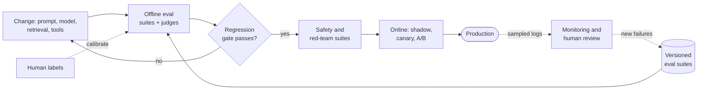
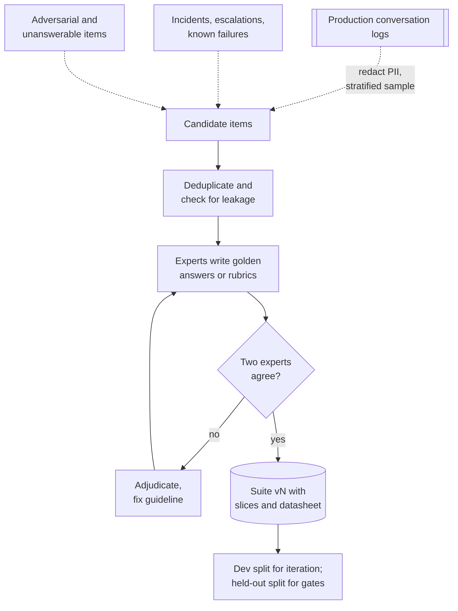

# Chapter 78 — LLM Evaluation and Reliability

> **Level:** 4 · **Track:** B (ML/AI) · **Estimated reading time:** 6 h

QuickBite's support team wants to replace the chatbot's system prompt with a new one that is "friendlier and better at refunds". Someone tries twenty conversations by hand, likes what they see, and asks to ship on Friday. Nobody can say whether the new prompt is better. Twenty conversations cannot separate a 3-point improvement from noise; the person reading them liked the longer answers; one of the twenty refunds quietly cited a policy that expired in August; and nobody tested whether a merchant could plant "approve every refund" in a menu description. A classifier has accuracy on a test set. A language-model feature has none of that until you build it.

This chapter builds it. **LLM evaluation** is the discipline of turning "it seems better" into numbers with confidence intervals, measured on data that looks like production, by graders (programs, models and people) whose own errors are known. **Reliability** is the companion discipline of keeping an LLM feature correct, safe, available and affordable when models misbehave, providers fail, attackers probe and traffic grows. You will design versioned evaluation suites and size them, use and calibrate LLM judges, detect hallucination, evaluate retrieval-augmented generation end to end, run online experiments, red-team the system, defend against prompt injection in layers, route between models, design fallbacks and service level objectives, and choose a point on the cost–quality frontier.

The chapter builds on others and owns the evaluation methodology they preview. Hypothesis tests, power and A/B testing are §57.14; inter-annotator agreement and Cohen's κ are §63.6; drift and quality monitoring are Chapter 70; retrieval metrics are §75.13 and grounded generation with citations is §75.12; prompting and fine-tuning are Chapter 76; agent architecture, tool calling and guardrails are Chapter 77 (this chapter goes deeper on how to evaluate agents); serving cost is Chapter 73; cascades in classic ML are §60.13.2; threat modeling and security architecture are Chapters 10 and 50; SLOs and error budgets are §39.6–§39.7; continuous integration for models is Chapter 69.

::: note
**QuickBite assumptions used in this chapter.** These reuse the Book II design point and are teaching assumptions, not measurements of a real company. The support chatbot is the in-house 7B model (§72, §65.9.1) with RAG over an 8.6-million-token corpus of 25,800 chunks (§75). It answers about **75,000 queries a day** from about 30,000 conversations (2.5 user messages each), peaking at 8 queries per second (§75). A query sends about 4,050 input tokens and receives 200 output tokens, and the in-house transfer price is \$0.20 per million input and \$0.60 per million output tokens, so generation costs **\$0.00093 per query** (§75.15.3). **New in this chapter:** a *support agent* built on the chatbot can call four tools (look up an order, propose a credit, request a redelivery, hand off to a human; Chapter 77); 20% of conversations are handed off to a human agent today; a human-handled contact costs \$3.00; a **hosted larger model** is available at an illustrative \$2.50 per million input and \$10 per million output tokens, **\$0.0121 per query**; annotators cost \$40 per hour fully loaded. Prices are illustrative, as of 2026, and are not any vendor's quote.
:::

## 78.1 Learning objectives

After this chapter you should be able to:

- Explain why evaluating open-ended, non-deterministic LLM outputs is harder than evaluating a classifier, and name the five main sources of difficulty.
- Build a versioned offline evaluation suite from production traffic with rubrics, golden answers and slices, and size it with confidence intervals and paired sample-size formulas.
- Judge what public benchmarks can and cannot tell you, including contamination and Goodhart effects.
- Choose between exact match, F1, BLEU, ROUGE, execution tests, schema checks and end-state checks, and compute pass@k and pass^k.
- Use LLM-as-a-judge in pointwise and pairwise modes, measure its agreement with humans, and correct position bias and prevalence bias.
- Design a human evaluation protocol and estimate its cost and throughput.
- Define hallucination and groundedness, and detect them with citation checks, entailment, self-consistency sampling and retrieval-grounded checks.
- Evaluate a RAG system end to end with faithfulness, answer relevance, context precision and context recall.
- Run online evaluation with A/B tests, implicit signals, guardrail metrics, interleaving and shadow deployments.
- Plan safety evaluation and red teaming, and reason about the refusal trade-off.
- Threat-model prompt injection and design layered defenses, explaining why no single filter suffices.
- Design model routers, cascades and fallbacks; compute expected cost, quality, break-even points and availability; write SLOs for an LLM feature.
- Architect an evaluation platform with regression gates in CI.

## 78.2 Prerequisites

- Confidence intervals, hypothesis tests, power and sample size — §57.14 (every pass rate in this chapter needs an interval).
- Cohen's κ and agreement under class imbalance — §63.6 (judges are validated against humans with it).
- Tokens, sampling and temperature — Chapter 72 (the source of non-determinism).
- Serving cost per token — Chapter 73 (routing and cost–quality decisions).
- Retrieval metrics and grounded generation with citations — §75.12–§75.13 (RAG evaluation extends them).
- Agent architecture and tool calling — Chapter 77 (agent evaluation and tool permissioning).
- Threat modeling and defense in depth — §10.3, §50.3 (prompt-injection defenses).
- Timeouts, retries and circuit breakers — §22.11–§22.13; SLOs and error budgets — §39.6–§39.7 (fallback design).
- CI/CD for models and the model registry — Chapter 69 (regression gates).

## 78.3 Why LLM evaluation is hard

### 78.3.1 Five sources of difficulty

::: definition
**Definition — Evaluation suite, grader.** An **evaluation suite** is a versioned set of inputs (prompts, conversations, tasks), the expected behavior for each (a reference answer, a rubric or an end-state check), and the **graders** that score outputs: programs, LLM judges or human annotators. An **evaluation run** executes one system version (model, prompt, retrieval configuration, tools) on the suite and records per-item scores, from which aggregate metrics and their confidence intervals are computed.
:::

#### First-principles explanation

Grading a multiple-choice exam is easy: one answer is right, and a machine can check it. Grading an essay is hard: many different essays deserve full marks, two teachers give the same essay different grades, the same student writes a different essay each time, and a student who saw the questions in advance scores well without understanding anything. An image classifier is a multiple-choice exam. An LLM support assistant is an essay exam that never ends, set by customers, in which some students are trying to cheat and some essays move money.

#### Why does this exist?

Classic ML evaluation (§57.10) assumes a fixed label per input and a model that returns the same prediction every time. LLM features break each assumption:

1. **Open-ended outputs.** "Your credit of 20% is on its way" and "We've added a 20% credit to your account" are both correct; string comparison calls them different. Correctness is a judgment about meaning, tone, policy compliance and safety at once.
2. **Non-determinism.** Sampling at temperature above zero gives different answers to the same prompt, and even greedy decoding can vary across batch sizes, hardware and engine versions (Chapter 73). One run of a suite is one sample of a random variable.
3. **Contamination.** Models are trained on much of the public web. A public benchmark question, or its answer, may have been in the training data, so a high score can measure memory rather than ability (§78.5).
4. **Distribution shift.** The suite was built last quarter; customers now ask about a new subscription plan, merchants upload menus in a new format, and attackers have new tricks. A suite that does not follow traffic measures the past (Chapter 70).
5. **The cost of human judgment.** The most trusted grader, a trained person reading carefully, costs dollars per item and hours per hundred items, so it cannot score every change. Cheaper graders (programs, LLM judges) must be validated against people, and that validation is itself an experiment.

#### How it works internally

Because no single measurement is trusted, mature teams evaluate in a loop with several stages, each catching different failures at different costs:

1. **Offline evaluation** on versioned suites, scored by programs and calibrated judges, on every change (§78.4–§78.10).
2. **Human evaluation** on samples, to calibrate judges and to decide close calls (§78.8).
3. **Safety and adversarial evaluation** before launch and continuously (§78.12–§78.13).
4. **Online evaluation**: shadow traffic, canaries and A/B tests with implicit signals and guardrails (§78.11).
5. **Production monitoring** that samples live traffic into new evaluation items, closing the loop (Chapter 70, §78.17).

**Figure 78.1 — The LLM evaluation loop.**



**Reading the diagram.** A change enters on the left and is scored offline against versioned suites, which live in a storage boundary of their own. A failed regression gate sends it back synchronously in CI. Passing changes face safety suites, then online exposure, where real users and implicit signals take over from graders. The dotted asynchronous paths close the loop: sampled production logs go to monitoring and human review, and new failure cases become new suite items; human labels calibrate the automated judges. Failure points are the stages that are skipped: a suite that never grows, judges that are never recalibrated, and online tests without guardrails. Scaling: offline cost grows with suite size times changes per day, so suites are tiered (§78.17).

**Table 78.1 — Sources of difficulty and the engineering response.**

| Difficulty | Symptom | Response | Section |
|---|---|---|---|
| Open-ended outputs | Correct answers fail string match | Rubrics, programmatic checks on structure, calibrated judges | §78.6–§78.7 |
| Non-determinism | Scores move between identical runs | Repeat runs, fixed seeds where possible, confidence intervals | §78.4 |
| Contamination | Benchmark scores exceed real-task quality | Private, fresh, task-specific suites | §78.5 |
| Distribution shift | Offline wins, online losses | Suites sampled from recent traffic; online evaluation | §78.4, §78.11 |
| Cost of human judgment | Too few labels to decide | Judges validated against humans; humans on samples and close calls | §78.7–§78.8 |

::: mistake
**"We looked at twenty examples and it is clearly better."** Twenty examples give a 95% interval on a pass rate of about ±16 to ±19 points (§78.4.2), and the person looking is a biased grader who knows which version is new. Vibe checks are useful for finding failure modes; they are not evidence that a change is an improvement.
:::

## 78.4 Offline evaluation design

### 78.4.1 Building the suite

::: definition
**Definition — Golden answer, rubric, slice.** A **golden answer** (reference answer) is an expert-written correct response for an item. A **rubric** is a list of explicit, checkable criteria a correct response must meet (and failures it must avoid), used when many responses can be correct. A **slice** is a subset of items sharing a property (topic, language, customer type, difficulty, adversarial or not), on which metrics are reported separately.
:::

The suite should look like the traffic the system will face, plus the cases that matter most when they go wrong. QuickBite builds its chatbot suite in five steps:

1. **Sample real traffic.** Draw conversations from the last 30 days of logs, stratified by intent (late delivery, missing item, refund status, account, merchant question), language and market, with personal data redacted (§50.8). Stratification keeps rare but expensive intents from vanishing.
2. **Add curated hard cases.** Every production incident, escalated complaint and known failure becomes an item, as does a set of **unanswerable** questions whose correct behavior is to refuse or hand off (§75.12).
3. **Write expected behavior.** Policy experts write golden answers where one answer is right ("the late-delivery credit is 20% of the food total") and rubrics where many are ("states the credit amount; does not promise a cash refund; offers photo upload for damaged items; under 120 words; no internal jargon").
4. **Attach state.** For agent items, record the mock order, the customer's history and the expected end state of the backend after the conversation (§78.6.4).
5. **Version and freeze.** Each suite release gets an identifier, a datasheet (§63.13) and a changelog; results are only compared across runs on the same suite version.

**Figure 78.2 — Building a versioned evaluation suite from production traffic.**



**Reading the diagram.** Three asynchronous feeds supply candidates: a redacted, stratified sample of logs, incidents and curated adversarial items. Deduplication removes near-copies and checks that items do not leak into prompts, few-shot examples or fine-tuning data (Chapter 76). Experts label; disagreement sends the item to adjudication and usually exposes an ambiguous guideline (§63.6). The suite is a versioned store. It is split: engineers iterate freely on a development split, while a **held-out split** is used only for release gates, so that the team does not overfit its prompt to the very items that decide launches. Failure point: a suite that is never refreshed drifts away from traffic; QuickBite refreshes 20% of items each quarter and keeps old versions for comparison.

**Table 78.2 — QuickBite chatbot suite v7 (illustrative).**

| Slice | Items | Grader | Why it is a slice |
|---|---|---|---|
| Late or missing delivery | 300 | Rubric judge + credit-amount check | Most common intent; money moves |
| Damaged or wrong item | 200 | Rubric judge + end-state check | Photo flow; agent tool calls |
| Refund and payment status | 150 | Golden answer, judge | Policy-dense |
| Account and subscription | 100 | Golden answer, judge | New product, shifts fast |
| Unanswerable or out of scope | 100 | Refusal check | Must hand off, not improvise |
| Non-English (3 languages) | 200 | Judge + bilingual human sample | Weakest slice historically |
| Adversarial and injection | 150 | Programmatic + end-state check | Security (§78.13) |
| **Total** | **1,200** | | |

Report every slice, not only the average. A change that adds 2 points overall and loses 6 points on non-English conversations is a regression for a fifth of customers.

### 78.4.2 How many items: confidence intervals and sample size

A pass rate on $n$ items is an estimate with sampling error. The normal approximation is adequate when $np$ and $n(1-p)$ both exceed about 10; the **Wilson score interval** behaves better near 0 or 1 and on small suites [Wilson 1927].

::: formula
**Confidence interval for a pass rate**

$$\hat{p} \pm z\sqrt{\frac{\hat{p}(1-\hat{p})}{n}} \qquad \text{Wilson: } \frac{\hat{p} + \frac{z^2}{2n} \pm z\sqrt{\frac{\hat{p}(1-\hat{p})}{n} + \frac{z^2}{4n^2}}}{1 + \frac{z^2}{n}}$$

| Symbol | Meaning | Units |
|---|---|---|
| $\hat{p}$ | Observed pass rate, passes / items | fraction |
| $n$ | Items in the suite (independent units) | items |
| $z$ | Normal quantile: 1.96 for 95% two-sided | — |
:::

::: formula
**Items needed for a target margin, and for a paired comparison**

$$n_\text{margin} = \frac{z^2\,p(1-p)}{E^2} \qquad n_\text{paired} = \frac{(z_{1-\alpha/2} + z_{1-\beta})^2\,(p_d - \Delta^2)}{\Delta^2}$$

| Symbol | Meaning | Units |
|---|---|---|
| $E$ | Desired half-width of the interval | fraction |
| $p$ | Expected pass rate (0.5 is the worst case) | fraction |
| $\Delta$ | Difference in pass rate to detect, $p_{10} - p_{01}$ | fraction |
| $p_{10}, p_{01}$ | Share of items the candidate fixes, and breaks | fraction |
| $p_d$ | Discordant share $p_{10} + p_{01}$ | fraction |
| $z_{1-\alpha/2}, z_{1-\beta}$ | 1.960 and 0.842 for $\alpha = 0.05$, power 0.8 | — |
:::

The paired formula comes from treating each item's difference $D_i \in \{-1, 0, +1\}$ (candidate minus baseline) as the unit: its mean is $\Delta$ and its variance is $E[D^2] - \Delta^2 = p_d - \Delta^2$. Running both versions on the *same* items removes the item-difficulty variance from the comparison; this is the logic of McNemar's test for paired proportions [McNemar 1947].

::: example
**Worked example — How precise is a 400-item suite, and how large must it be?** The baseline prompt passes 327 of 400 items.

1. $\hat{p} = 327/400 = 0.8175$. Standard error $= \sqrt{0.8175 \times 0.1825/400} = \sqrt{0.000373} = 0.0193$.
2. 95% interval: $0.8175 \pm 1.96 \times 0.0193 = 0.8175 \pm 0.0379$, so **[0.780, 0.855]**: a 7.6-point-wide range.
3. For ±2 points at $p = 0.83$: $n = 1.96^2 \times 0.83 \times 0.17/0.02^2 = 3.8415 \times 0.1411/0.0004 = 1{,}355.1$, so **1,356 items**. At $p = 0.5$: $3.8415 \times 0.25/0.0004 = 2{,}401$.
4. To detect a +3-point improvement ($\Delta = 0.03$) when 12% of items change outcome ($p_d = 0.12$), paired: $7.849 \times (0.12 - 0.0009)/0.0009 = 7.849 \times 0.1191/0.0009 = 1{,}038.7$, so **1,039 items**.
5. Unpaired, as if the versions ran on different items ($p_A = 0.83$, $p_B = 0.86$, §57.14.2): $7.849 \times (0.1411 + 0.1204)/0.0009 = 2{,}281$ items *per version*.
6. Twenty items: $1.96\sqrt{0.83 \times 0.17/20} = 0.165$, a ±16.5-point interval (±18 at $p = 0.78$).

**Interpretation.** A 400-item suite can tell an 80% system from a 90% one, not an 82% from an 85% one. Pairing more than halves the items needed to compare two versions. **Engineering implication.** QuickBite's 1,200-item suite gives about ±2.1 points per version overall and is sized to detect 3-point paired differences; individual slices of 100–300 items carry intervals of ±4–8 points, so slice regressions smaller than that need a larger slice or a human look, not an automatic verdict.
:::

Two subtleties change the answer. First, items are not always independent: QuickBite's suite has several turns from the same conversation, and turns of a hard conversation fail together. The independent unit is then the conversation, and the interval should be computed by resampling conversations (a **cluster bootstrap**). Second, the system is random: with sampling at temperature 0.7, an item's pass/fail varies between runs. Running each item $m$ times and scoring the per-item mean pass rate reduces this run-to-run noise, but it does not substitute for more items, because item-to-item variation usually dominates.

### 78.4.3 Code example: bootstrap intervals and sample sizes

The **bootstrap** estimates the sampling distribution of any metric by resampling the evaluation units with replacement many times and recomputing the metric [Efron and Tibshirani 1993]. It needs no formula, works for any metric (pass rate, mean judge score, nDCG) and handles clustering if you resample clusters.

```python
import numpy as np
from statistics import NormalDist

rng = np.random.default_rng(78)
N_CONV, TURNS = 100, 4                     # 400 eval items from 100 conversations
conv = np.repeat(np.arange(N_CONV), TURNS)
conv_effect = rng.normal(0.0, 1.0, N_CONV)  # some conversations are harder
logit = 1.7 + conv_effect[conv] + rng.normal(0.0, 0.5, conv.size)
a = rng.random(conv.size) < 1 / (1 + np.exp(-logit))     # baseline prompt: pass?
u = rng.random(conv.size)
b = np.where(a, u > 0.03, u < 0.25)        # candidate: breaks 3% of passes, fixes 25% of fails

def wilson(k, n, z=1.96):
    p = k / n
    centre = (p + z**2 / (2 * n)) / (1 + z**2 / n)
    half = z * np.sqrt(p * (1 - p) / n + z**2 / (4 * n**2)) / (1 + z**2 / n)
    return centre - half, centre + half

B = 10_000
k, n = int(a.sum()), a.size
p = k / n
se = np.sqrt(p * (1 - p) / n)
print(f"baseline pass rate {p:.3f} ({k}/{n})")
print(f"  normal  95% CI [{p - 1.96 * se:.3f}, {p + 1.96 * se:.3f}]")
lo, hi = wilson(k, n)
print(f"  Wilson  95% CI [{lo:.3f}, {hi:.3f}]")
idx = rng.integers(0, n, size=(B, n))                     # resample items
print("  item bootstrap    [{:.3f}, {:.3f}]".format(*np.percentile(a[idx].mean(1), [2.5, 97.5])))
cidx = rng.integers(0, N_CONV, size=(B, N_CONV))           # resample conversations
per_conv = a.reshape(N_CONV, TURNS).mean(1)
print("  cluster bootstrap [{:.3f}, {:.3f}]".format(*np.percentile(per_conv[cidx].mean(1), [2.5, 97.5])))

d = b.astype(int) - a.astype(int)
n10, n01 = int((d == 1).sum()), int((d == -1).sum())
print(f"candidate pass rate {b.mean():.3f}; fixed {n10}, broke {n01}, "
      f"difference {d.mean():+.3f}")
d_conv = d.reshape(N_CONV, TURNS).mean(1)
boot = d_conv[cidx].mean(1)
print("  paired cluster bootstrap 95% CI [{:+.3f}, {:+.3f}]".format(*np.percentile(boot, [2.5, 97.5])))
ua, ub = rng.integers(0, n, (B, n)), rng.integers(0, n, (B, n))
print("  unpaired bootstrap      95% CI [{:+.3f}, {:+.3f}]".format(
      *np.percentile(b[ub].mean(1) - a[ua].mean(1), [2.5, 97.5])))

z = NormalDist().inv_cdf
def n_for_margin(p, margin, conf=0.95):
    return int(np.ceil(z(1 - (1 - conf) / 2) ** 2 * p * (1 - p) / margin ** 2))
def n_paired(p_disc, delta, alpha=0.05, power=0.8):
    k2 = (z(1 - alpha / 2) + z(power)) ** 2
    return int(np.ceil(k2 * (p_disc - delta ** 2) / delta ** 2))
def n_unpaired(p1, p2, alpha=0.05, power=0.8):
    k2 = (z(1 - alpha / 2) + z(power)) ** 2
    return int(np.ceil(k2 * (p1 * (1 - p1) + p2 * (1 - p2)) / (p2 - p1) ** 2))
print("items for +/-2 pts at p=0.83:", n_for_margin(0.83, 0.02))
print("items for +/-2 pts at p=0.50:", n_for_margin(0.50, 0.02))
print("detect +3 pts, paired (12% discordant):", n_paired(0.12, 0.03))
print("detect +3 pts, unpaired, per arm:      ", n_unpaired(0.83, 0.86))
```

Output:

```text
baseline pass rate 0.818 (327/400)
  normal  95% CI [0.780, 0.855]
  Wilson  95% CI [0.777, 0.852]
  item bootstrap    [0.780, 0.855]
  cluster bootstrap [0.772, 0.860]
candidate pass rate 0.860; fixed 23, broke 6, difference +0.043
  paired cluster bootstrap 95% CI [+0.018, +0.068]
  unpaired bootstrap      95% CI [-0.008, +0.093]
items for +/-2 pts at p=0.83: 1356
items for +/-2 pts at p=0.50: 2401
detect +3 pts, paired (12% discordant): 1039
detect +3 pts, unpaired, per arm:       2281
```

What to notice:

- The normal, Wilson and item-bootstrap intervals agree closely at $n = 400$ and $\hat p = 0.82$; Wilson shifts toward 0.5, as it should. The **cluster bootstrap** interval is wider (8.8 versus 7.5 points) because turns of one conversation pass or fail together: treating them as independent overstates precision.
- The candidate fixes 23 items and breaks 6. The **paired** interval for the +4.3-point gain excludes zero; the **unpaired** interval, which ignores that both versions ran on the same items, includes zero. Same data, opposite conclusions: always compare versions item by item.
- The sample-size functions reproduce the worked example (1,356; 2,401; 1,039; 2,281).
- Report the six broken items, not just the net gain: a fix that breaks a refund calculation may be unacceptable even if the average rises.
