# Chapter 79 — Production AI Infrastructure

> **Level:** 4–5 · **Track:** B (ML/AI) · **Estimated reading time:** 5.5 h

Chapter 73 served one model well: one engine, one fleet, one set of service-level objectives (SLOs). Real organizations rarely stop at one: within a year there is a support assistant, a batch job enriching catalog data, internal agents calling a frontier API, embedding models behind search, and a dozen teams asking for "just an API key". Each team that builds its own stack repeats the same work: provider keys in config files, retry logic, cost spreadsheets, prompt logs full of customer data, and a GPU fleet idling at 10%.

This chapter is about the **platform layer** that serves many AI applications and teams at once: gateways, routers, multi-model serving, GPU cluster management, token quotas, tenant isolation, multi-region operation, caching, observability, privacy, cost allocation and build versus buy. It reuses the mechanisms of Chapters 22, 40, 44, 47, 50 and 51 and cross-references them. Single-model serving is Chapter 73; *which* model should answer (quality-aware routing, fallbacks, evaluation) is Chapter 78, while this chapter implements routing in the platform; training clusters of 10,000+ GPUs are Chapter 80.

::: note
**Assumptions used in this chapter.** These extend the Book II design point and are teaching assumptions, not measurements of any real company. Units are SI (1 GB = 10⁹ bytes). GPUs are NVIDIA H100 80 GB at an illustrative \$2.50 per GPU-hour (§60.11). From Chapter 73 (§73.15), the self-hosted **7B chatbot model** in FP16 on one H100 costs **28.3 µs of GPU time per uncached prompt token** and **0.567 ms per output token** at its memory-limited batch of 46 (decode step 26.1 ms); the **70B option** on four GPUs costs 283 µs per prompt token and 0.586 ms per output token per GPU. **Support chatbot** (Chapter 75): 75,000 retrieval-augmented generation (RAG) queries a day, peak 8 queries/s, each about 4,500 input tokens (of which a 700-token system prompt is prefix-cached) and 230 output tokens. **New in this chapter**, QuickBite consolidates its AI workloads onto one **AI platform** with the tenants of Table 79.1. External API prices are illustrative round numbers, not any provider's price list: a **frontier API** at \$3.00 per million input tokens and \$15.00 per million output tokens, and a **small-model API** at \$0.15 and \$0.60. Regions are those of Chapter 44: United States (Virginia), European Union (Frankfurt) and Asia-Pacific (Tokyo).
:::

**Table 79.1 — QuickBite AI platform tenants (assumptions).**

| Tenant | Workload | Volume per day | Tokens per call (in / out) | Model | Class |
|---|---|---|---|---|---|
| T1 `support-chat` | RAG answers to customers (Ch 75) | 75,000 queries, peak 8/s | 4,500 / 230 | Self-hosted 7B + support adapter | Online, priority P0 |
| T2 `menu-enrich` | Dish descriptions and allergen tags | 100,000 dish updates | 600 / 150 | Self-hosted 7B + menu adapter | Batch by 06:00, P2 |
| T3 `review-tags` | Tagging the 20,000 daily reviews (Ch 63) | 20,000 reviews | 400 / 60 | Self-hosted 7B + tagging adapter | Near-real-time within 1 h, P2 |
| T4 `ops-agents` | Internal agents for courier and fraud operations (Ch 77) | 4,000 tasks × 8 steps = 32,000 calls | 6,000 / 300 | Frontier external API | Online, P1 |
| T5 `search-embed` | Query embeddings for search and RAG | ~2,000 searches/s at peak | 12 / — (vector out) | Self-hosted encoder | Online, P0 |

## 79.1 Learning objectives

After this chapter you should be able to:

- Explain why organizations centralize AI serving, and draw a reference architecture that separates the control plane from the data plane.
- Design a model gateway that normalizes requests across providers, streams responses, retries safely and fits within an overhead budget you can compute.
- Compare round-robin, least-outstanding-tokens and prefix-affinity routing for LLM pools, and reproduce their trade-offs with a simulator.
- Place many models and LoRA adapters on shared GPUs, size node pools and MIG partitions, autoscale on LLM signals, and plan for cold starts of large models.
- Enforce quotas in tokens per minute with estimated-then-reconciled accounting, reservations and priority tiers.
- Isolate tenants on shared GPUs with per-tenant queues, fair scheduling, data isolation and dedicated capacity tiers.
- Operate across regions under GPU scarcity and residency rules, and decide where caching pays.
- Instrument tokens, time to first token (TTFT), time per output token (TPOT) and cost; protect prompts; allocate cost to teams; and compute the self-host versus API break-even.

## 79.2 Prerequisites

- LLM serving engines, continuous batching, prefix caching and per-GPU capacity — §73.6, §73.8, §73.15; TTFT and TPOT — §73.4.
- Model servers, multi-model serving, autoscaling and model loading — §66.8, §66.9, §66.10; the model registry — §69.8.
- Tenancy models, noisy neighbors, quotas and fair queuing — §47.4, §47.7, §47.8; per-tenant cost attribution — §47.11.
- Token bucket and distributed rate limiting — §22.4, §22.8; timeouts, retries and circuit breakers — §22.11–§22.13.
- Load-balancing algorithms and session affinity — §19.4, §19.6; caching fundamentals — §20.3.
- Kubernetes scheduling, autoscaling and the Gateway API — §42.10, §42.12, §42.13; GPU sharing with MIG — §64.15.
- Multi-region traffic management and data residency — §44.5, §44.9; tracing and OpenTelemetry — §40.6, §40.7.
- De-identification and privacy engineering — §50.10; unit economics and build versus buy — §51.4, §51.9.

## 79.3 From one model to an AI platform

### 79.3.1 Why centralize

::: definition
**Definition — AI platform.** A shared, internally operated service that gives many applications and teams access to many models (self-hosted and external) through one API, and enforces organization-wide controls on that access: identity, quotas, routing, safety and privacy policy, logging, observability and cost accounting. Its users are **product teams** (online features), **agents** (multi-step programs that call models and tools, Chapter 77) and **batch jobs** (offline generation, tagging, embedding).
:::

#### First-principles explanation

Think of a hospital pharmacy. Every ward could keep its own drug cabinet, but then nobody knows what is stocked, controlled substances are untracked and each ward pays retail. A central pharmacy buys in bulk, tracks every dose to a patient and enforces who may dispense what. An AI platform is the central pharmacy for model calls: it knows every model, caller and token, and the rules that apply to each.

#### Why does this exist?

Three pressures push organizations from per-team stacks to a platform:

1. **Governance.** Prompts carry customer data. Without a single path to models, nobody can answer "which external providers received EU customers' addresses last month?" or turn off a model that misbehaves. A platform gives one enforcement point for provider allow-lists, data-residency rules, redaction, retention and audit (§79.14).
2. **Cost.** GPU fleets sized per team idle most of the day; QuickBite's chatbot alone needs three GPUs to do about one GPU's work (§73.15). Pooling tenants with different peaks (online by day, batch by night) raises utilization, and one negotiated contract per provider beats twenty credit-card accounts. Spend becomes visible per team (§79.15).
3. **Reuse.** Retries, fallbacks, streaming, token counting, caching, evaluation hooks and dashboards are the same for every team. Built once, they are built better.

#### Advantages and disadvantages

A platform gives one enforcement point, pooled capacity, consistent observability and negotiated prices. It costs a platform team, a new hop on every request (§79.5), a shared fate (a gateway bug breaks every AI feature at once) and a temptation to standardize too early on one provider's API shape. Most organizations start with a thin gateway (keys, quotas, logs) and add routing, caching and self-hosted pools as volume justifies them.

::: mistake
**Misconception — "A platform means self-hosting everything."** Most platforms route the majority of tokens to external APIs at first. The platform's value is the control point, not the GPUs; self-hosting is a separate, per-model decision made with the break-even analysis of §79.16.
:::

## 79.4 Reference architecture

### 79.4.1 Control plane and data plane

::: definition
**Definition — AI platform control plane and data plane.** The **data plane** carries requests and tokens: clients, model gateway, inference router, serving pools (self-hosted engines on GPU clusters and external providers), caches and the request log stream. The **control plane** decides how the data plane behaves and is off the request path: the model registry and deployment catalog, policy (who may call what, with which data controls), quota and tenant configuration, the billing and usage ledger, and the controllers that place models on GPUs and scale them (§47.10).
:::

The split matters for availability: the data plane must keep serving if the control plane is down, so gateways cache keys, quotas and routing tables and keep the last good configuration, as service-mesh sidecars do (§34.10).

**Figure 79.1 — Reference architecture of an AI platform.**

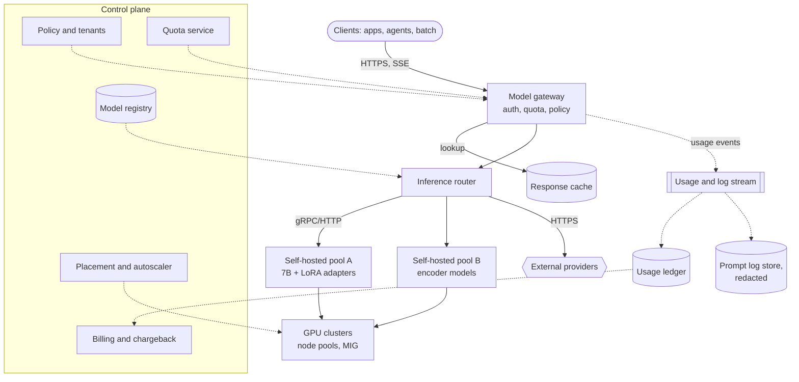

**Reading the diagram.** The data plane runs top to bottom: clients send HTTPS requests, streamed back as Server-Sent Events (SSE, §9.5); the gateway authenticates, checks quotas and policy and may answer from the response cache; the router chooses between self-hosted pools (gRPC or HTTP) and external providers (HTTPS). Usage and log events flow asynchronously (dotted) into the usage ledger and a redacted prompt log store, the two main storage boundaries. The control plane pushes configuration asynchronously: registry to router, policy and quotas to gateway, ledger to billing, placement to GPUs. Failure points: the gateway and router are on every request and must be replicated per region; the quota service must fail open or closed by policy (§79.9); external providers fail independently and need fallbacks. Scaling: gateways scale horizontally on CPU; pools scale on LLM signals (§79.8).

#### How it works internally

1. **Registration.** A team registers a model version in the registry (§69.8) with its serving metadata: engine, GPU type, memory, context length, adapters, evaluation results and data-handling class.
2. **Deployment.** The placement controller creates or updates a serving pool, the router learns its endpoints, and an alias (`support-default → qb-7b@v14 + support-lora@v6`) is published.
3. **Serving.** Requests flow gateway → router → pool, with fallbacks to other pools or providers.
4. **Metering.** Usage events (tenant, alias, deployment, input, cached and output tokens, latency, status) land in the ledger within seconds; quotas reconcile against them (§79.9).
5. **Accounting.** Billing aggregates the ledger monthly and produces showback or chargeback (§79.15).

::: industry
**Open-source platform building blocks.** As of 2026, several open-source projects implement parts of this architecture. LiteLLM provides a Python SDK and a proxy server that expose many providers behind an OpenAI-compatible API, with virtual keys, per-key and per-team budgets, tokens-per-minute and requests-per-minute limits, fallbacks and spend tracking [LiteLLM Docs]. Envoy AI Gateway extends Envoy Gateway with a unified API to multiple providers, upstream credential injection and token-usage-based rate limiting [Envoy AI Gateway Docs]. The Kubernetes Gateway API Inference Extension adds LLM-aware endpoint selection to Kubernetes gateways (§79.6.3) [Kubernetes Blog 2025], and KServe provides Kubernetes custom resources for deploying and autoscaling model servers, including LLM runtimes [KServe Docs].
*Evidence: Primary* — project documentation.
:::

#### Alternatives and trade-offs

**Table 79.2 — Ways to give teams access to models.**

| Option | How it works | Advantages | Disadvantages | Choose when |
|---|---|---|---|---|
| Direct provider access | Each team holds keys, calls providers | Fastest start, no platform team | No central policy, cost or audit; duplicated code | One or two experimental teams |
| Shared client library | Common SDK wraps providers | Reuse without a new hop | Policy bypassable; upgrades need every team to redeploy | Few languages, high trust |
| Central gateway | All calls pass one proxy | Enforceable policy, metering, keys never leave platform | Extra hop and shared fate | Several teams, customer data in prompts |
| Full AI platform | Gateway + router + self-hosted pools + billing | Pooled GPUs, chargeback, multi-region | Largest investment | Large or regulated token volumes |

## 79.5 Model gateways

### 79.5.1 One API in front of many models

::: definition
**Definition — Model gateway.** A reverse proxy specialized for model inference (also called an **LLM gateway** or **AI gateway**). It exposes one API to clients, authenticates them, maps credentials to tenants, enforces quotas and policy, **normalizes** requests and responses across providers and engines, streams tokens, applies timeouts, retries and fallbacks, and emits usage and log events. It differs from a general API gateway (§22.3) in that it understands the payload: it counts tokens, parses streamed events and knows that a request's cost is unknown until it finishes.
:::

#### First-principles explanation

The gateway is a travel adapter plus a meter: whatever the socket (a vLLM pool, a frontier provider, an embedding service), the client's plug stays the same, and every unit of electricity is counted and billed to a room.

#### Why does this exist?

Provider APIs differ in small, expensive ways: where the system prompt goes, how tool calls are represented, the names of streaming events, how usage is reported, which errors mean "retry". A platform that wants fallbacks across providers must translate on the fly. And provider keys spread across services leak and cannot be revoked per team. The gateway holds provider keys and hands teams **virtual keys** that map to a tenant, a budget and a set of allowed models.

#### How it works internally

A request passes a chain of filters, each cheap and ordered so that the cheapest rejections happen first:

1. **Terminate TLS and authenticate.** Validate the virtual key or workload identity (§50.5) from a local cache; resolve tenant, team and data-handling class.
2. **Parse and validate.** Check the schema, model alias and maximum context; reject oversized prompts before spending anything.
3. **Count or estimate tokens.** Tokenize with the target model's tokenizer when it is known (self-hosted models), or estimate (about four characters per English token) for providers whose tokenizers are not public; the estimate is reconciled later (§79.9).
4. **Admission.** Check the tenant's requests-per-minute (RPM) and tokens-per-minute (TPM) buckets and reserve tokens.
5. **Policy.** Enforce allowed models and regions, apply input redaction (§79.14), and run cheap input guardrails (Chapter 78 owns prompt-injection defenses).
6. **Cache lookup.** Exact response cache where the tenant opted in (§79.12).
7. **Normalize and route.** Translate the request into the target's format and hand it to the router (§79.6).
8. **Stream back.** Relay tokens as they arrive without buffering, translating each streamed event into the client format and counting output tokens.
9. **Finalize.** Read the provider's reported usage, reconcile the quota reservation, emit the usage event and the (redacted) log record asynchronously.

**Figure 79.2 — Request lifecycle through the gateway, with a fallback before the first token.**

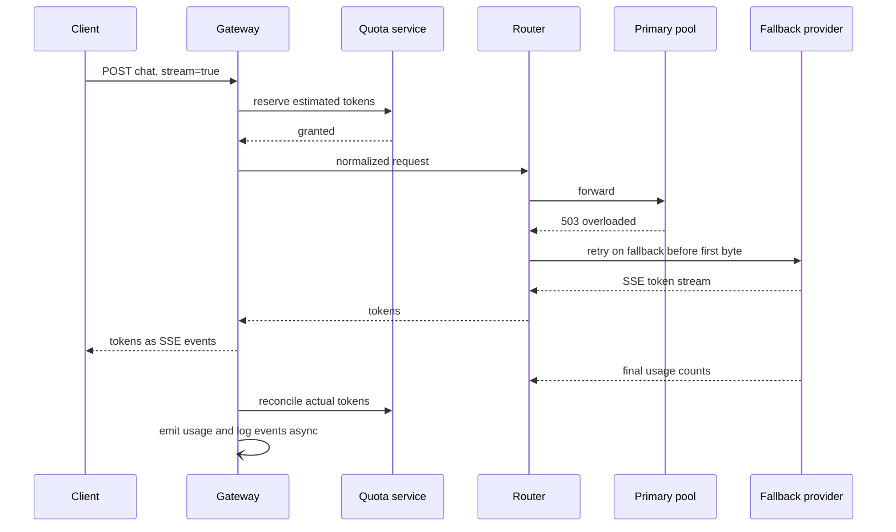

**Reading the diagram.** The client opens one streaming HTTPS request. The gateway reserves an *estimated* token count with the quota service (a fast in-memory store, §22.8) before any GPU work. The primary pool rejects the request with 503 before producing a token, so the router retries on a fallback provider; this is safe because the client has received nothing yet. Tokens then stream back hop by hop as SSE events, each hop relaying without buffering. When the provider reports final usage, the gateway reconciles the reservation with actual tokens and emits usage and log events asynchronously (open arrowhead), off the client's latency path. Failure points: a fallback after the first token would duplicate or contradict text already shown, so mid-stream failures are surfaced to the client instead; the quota service must answer within a millisecond or two, or the gateway falls back to local limits.

#### Normalization, streaming, retries and timeouts

**Normalization** maps a canonical request (messages, tools, response format, sampling parameters, `max_tokens`) to each target and back. Most platforms choose the OpenAI-style chat-completions schema, which open-source engines such as vLLM also expose (as of 2026) [vLLM Docs]. A parameter a target lacks is either rejected or dropped with a warning header, never silently. Some differences are features (cached-token discounts, structured-output modes), so pass explicitly marked extensions through rather than flattening to the lowest common denominator.

**Streaming** makes TTFT the user-visible number (§73.4). Never buffer the body (an output guardrail needing the whole text must run on chunks or after the fact), flush each event, and count tokens from the provider's final usage report rather than by re-tokenizing streamed text.

**Timeouts** come in three kinds for LLM calls: a **TTFT timeout** (no first token within, say, 5 s means the replica is stuck or the queue is deep), an **idle-stream timeout** (no token for 10 s during decode), and an overall **deadline** propagated from the caller (§22.11). A single 60 s request timeout is wrong both ways: too long to detect a stuck queue, too short for a 3,000-token answer.

**Retries** (§22.12) are safe only before the first byte reaches the client, and only for errors that mean "not processed": connection failures, 429 and 503 from a pool, provider overload codes. A retry after output has started bills tokens again and may produce different text. Retries draw on a per-tenant retry budget and go to a *different* pool or provider (a fallback, Chapter 78).

#### Mathematical foundations: the gateway overhead budget

::: formula
**Gateway overhead budget**

$$B_\text{gw} = S_\text{TTFT} - T_\text{net} - T_\text{engine,p95} - M \qquad T_\text{gw} = \sum_{k} t_k \le B_\text{gw}$$

| Symbol | Meaning | Units |
|---|---|---|
| $S_\text{TTFT}$ | TTFT objective at p95, measured at the client | ms |
| $T_\text{net}$ | Network time client → gateway → pool and first token back | ms |
| $T_\text{engine,p95}$ | Engine TTFT at p95 under peak load: queueing plus prefill | ms |
| $M$ | Safety margin for variance and future filters | ms |
| $B_\text{gw}$ | Time the gateway may add on the critical path | ms |
| $t_k$ | Latency of filter $k$ on the critical path (auth, quota, tokenize, redact, route) | ms |
:::

::: example
**Worked example — QuickBite's support-chat gateway budget.** TTFT objective 1,000 ms at p95; mobile client round trip plus in-cluster hops $T_\text{net} = 60$ ms; engine TTFT p95 at peak 750 ms (queueing plus prefill of 3,800 uncached tokens, $3{,}800 \times 28.3\ \mu\text{s} = 108$ ms of it); margin $M = 100$ ms.

1. Budget: $B_\text{gw} = 1{,}000 - 60 - 750 - 100 = 90$ ms.
2. Filters (assumed measurements): key lookup from local cache 0.2 ms; quota reservation in an in-memory store, one round trip 1 ms; tokenizing 4,500 tokens at an assumed 1 µs per token 4.5 ms; regex redaction 1 ms; routing decision including an endpoint-picker call 2 ms; normalization 0.3 ms.
3. Sum: $0.2 + 1 + 4.5 + 1 + 2 + 0.3 = 9.0$ ms, 10% of the budget.
4. Adding a named-entity-recognition (NER) PII model on CPU at an assumed 25 ms gives 34 ms, still within budget; an LLM-based input guardrail at an assumed 150 ms would not fit.
5. A retry after a 300 ms primary timeout costs 300 ms plus a second TTFT: the budget cannot absorb it, so the TTFT objective holds only if retries are rare (under 5% of requests at p95).

**Interpretation.** A well-built gateway is cheap relative to LLM latency, so the budget is spent by optional filters (model-based redaction and guardrails) and by retries, not by proxying. **Engineering implication.** Put every filter in the budget with a measured p99; run expensive checks on a sampled or asynchronous path, or in parallel with prefill when a failed check can still cancel the stream before tokens reach the user.
:::

#### Failure scenarios

| What goes wrong | Why | Detection | Recovery | Prevention |
|---|---|---|---|---|
| Users see answers pause, then appear all at once | A filter or proxy buffers SSE | TTFT at gateway ≫ TTFT at engine | Disable buffering filter | Streaming integration test per release |
| Double billing and duplicated text | Retry after first token | Two usage events per request ID | Refund; fix retry policy | Retry only before first byte |
| Retry storm during provider outage | Every client and gateway retries | Request rate to provider ≫ client rate | Circuit breaker opens (§22.13) | Retry budgets; fallback to other provider |

## 79.6 Inference routers

### 79.6.1 Two decisions: which deployment, which replica

::: definition
**Definition — Inference router.** The component that turns a model alias into a concrete target in two steps. **Deployment selection** picks a model version, pool or provider and region, using policy and cost (the *what* and *where*). **Endpoint selection** picks one replica inside the chosen pool, using live engine state such as outstanding tokens, queue depth, KV-cache usage and which prompt prefixes each replica holds (the *which*). **Prefix-aware** (or **KV-cache-aware**) routing prefers replicas that already hold a request's prompt prefix in their KV cache; **session affinity** pins a conversation to one replica (§19.6).
:::

#### First-principles explanation

A triage desk decides first *which department*, then *which doctor*: the one who is free, or the one who saw this patient yesterday and skips twenty minutes of reading notes. An LLM replica that already holds a conversation's KV cache skips its prefill.

#### Why does this exist?

Classic load balancing (Chapter 19) assumes requests are short and alike. LLM request cost varies by 100× and is unknown at arrival, because output length is unknown; and replicas are *stateful*: a prefix cache (§73.8) makes the same request several times cheaper on one replica than another.

#### How it works internally

**Deployment selection** evaluates rules in order:

1. **Model and version.** Resolve the alias through the registry, including traffic splits for canaries (§66.12) and per-tenant pins.
2. **Policy and region.** Keep only deployments the tenant's data class allows (residency, provider allow-list, §79.11).
3. **Health and capacity.** Drop deployments whose circuit breaker is open or whose queue exceeds a threshold; external providers also have *their* rate limits, tracked per platform account.
4. **Latency objective and priority.** P0 traffic goes to pools with headroom; P2 batch may go to cheaper, slower pools or the provider's discounted batch interface.
5. **Cost.** Among the remaining, choose the cheapest that meets the objective. Quality-aware routing that sends easy prompts to a smaller model (RouteLLM [Ong et al. 2024]) is a model-selection decision evaluated in Chapter 78; the router implements it as one more rule.

**Endpoint selection** inside an LLM pool uses engine signals:

- **Least outstanding tokens:** send to the replica with the fewest prompt-plus-expected-output tokens assigned and not yet finished. It adapts to slow replicas and long requests, which round robin cannot.
- **Queue depth and KV-cache usage**, scraped from engine metrics every few hundred milliseconds, identify replicas about to preempt (§73.14).
- **Prefix affinity:** score replicas by how many of the request's leading tokens they hold. Routers keep an approximate per-replica prefix tree built from the requests they sent there, since engines evict independently [Zheng et al. 2024].
- **Bounded affinity:** follow the cache only while the target is not overloaded relative to the pool; otherwise fall back to least-loaded. Without the bound, one hot prefix (a batch job's shared system prompt) piles onto one replica. **Session affinity**, hashing a conversation ID (§19.6), is the simple special case; both need consistent hashing with bounded loads (§14.8).

**Figure 79.3 — Router decision flow.**

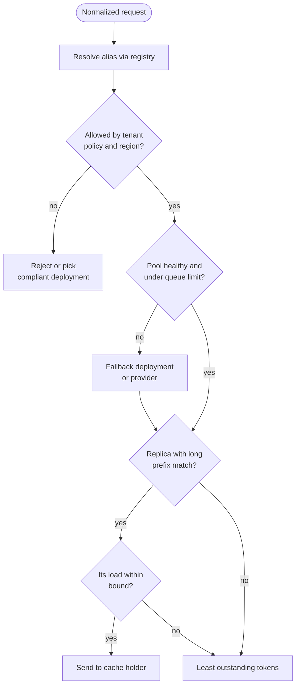

**Reading the diagram.** The top half is deployment selection, evaluated synchronously from cached registry and policy tables: forbidden requests are rejected or redirected, and an unhealthy pool sends traffic to a fallback. The bottom half is endpoint selection: prefer the longest prefix holder within a load bound, else least outstanding tokens. Router state is soft and rebuilt from traffic; the only storage boundary is the cached registry. Failure points: stale load data sends bursts to one replica, and several router instances with independent views can all choose the same replica, which power-of-two-choices sampling mitigates (§19.4).

#### Mathematical foundations: bounded affinity

::: formula
**Bounded prefix affinity**

$$k^\star = \arg\max_k \; m_k(x) \quad \text{subject to} \quad L_{k^\star} \le \max\!\left(A,\; \beta \min_j L_j\right), \text{ else } k^\star = \arg\min_k L_k$$

| Symbol | Meaning | Units |
|---|---|---|
| $m_k(x)$ | Prompt tokens of request $x$ already cached on replica $k$ | tokens |
| $L_k$ | Outstanding tokens assigned to replica $k$ | tokens |
| $A$ | Absolute load below which affinity is always allowed | tokens |
| $\beta$ | Allowed ratio of the chosen replica's load to the least-loaded replica's | dimensionless |
| $k^\star$ | Chosen replica | — |
:::

::: example
**Worked example — When affinity yields to load.** Four replicas have $L = (52{,}000;\ 18{,}000;\ 21{,}000;\ 15{,}000)$ outstanding tokens. A conversation turn has 1,700 cached tokens on replica 1 and only the 1,200-token system prompt on the others; $A = 40{,}000$, $\beta = 1.5$.

1. Bound: $\max(40{,}000,\ 1.5 \times 15{,}000) = \max(40{,}000,\ 22{,}500) = 40{,}000$.
2. Replica 1 has $52{,}000 > 40{,}000$: affinity is refused; the request goes to replica 4 (15,000).
3. Cost of refusing: 500 extra prefill tokens, $500 \times 28.3\ \mu\text{s} = 14$ ms of GPU.
4. Cost of accepting: replica 1 holds $52{,}000 - 15{,}000 = 37{,}000$ more tokens of work than replica 4; at a few thousand tokens per second per replica that is seconds of extra queueing.

**Interpretation.** A cache hit saves milliseconds; a hot spot costs seconds. **Engineering implication.** Set $A$ near the load at which TTFT starts to rise (from load tests), and $\beta$ between 1.2 and 2; tune by watching the TTFT p99 and the token-weighted hit ratio together.
:::

#### Code example: routing policies compared

The simulator models four replicas of the 7B chatbot, one on an older, half-speed GPU node. Each runs continuous batching with a 4,096-token prefill budget per iteration and a 60,000-token LRU prefix cache. Traffic: three support conversations per second, each four turns resending a growing history behind a 1,200-token system prompt, plus a batch tenant sending 40 requests with a shared 2,000-token system prompt every minute. Costs come from Chapter 73.

```python
import heapq, random, zlib
from collections import OrderedDict

C_PF = 28.3e-6            # GPU-seconds per uncached prompt token (7B, H100, Ch 73)
T0, T_B = 0.0072, 0.00041 # decode step time = T0 + T_B * batch  (26.1 ms at 46)
MAX_BATCH, CACHE_TOK, PF_BUDGET = 48, 60_000, 4096
SYS = {"chat": 1200, "batch": 2000}   # shared system-prompt lengths

class Replica:
    def __init__(self, speed=1.0):
        self.speed = speed
        self.wait, self.run, self.busy = [], [], False
        self.cache = OrderedDict()        # prefix key -> tokens, LRU order
        self.cached_tok = 0
        self.outstanding = 0              # router's view: queued + running tokens
    def match(self, req):                 # prompt tokens already cached here
        hit = SYS[req["app"]] if ("sys", req["app"]) in self.cache else 0
        if ("conv", req["conv"]) in self.cache:
            hit += req["hist"]
        return hit
    def insert(self, key, tok):
        if key in self.cache:
            self.cache.move_to_end(key); return
        self.cache[key] = tok; self.cached_tok += tok
        while self.cached_tok > CACHE_TOK:
            _, t = self.cache.popitem(last=False); self.cached_tok -= t

def workload(seed, minutes=10, conv_per_s=3.0):
    rng, reqs, T = random.Random(seed), [], minutes * 60
    t, cid = 0.0, 0
    while t < T:                                   # support conversations, 4 turns
        t += rng.expovariate(conv_per_s); cid += 1; hist, ta = 0, t
        for turn in range(4):
            out = min(1024, int(rng.lognormvariate(5.2, 0.6)))   # mean ~ 215
            reqs.append(dict(t=ta, app="chat", conv=cid, hist=hist,
                             new=150, out=out))
            hist += 150 + out; ta += 15 + rng.expovariate(1 / 15)
    for b in range(minutes):                       # batch tenant: burst each minute
        for i in range(40):
            reqs.append(dict(t=b * 60 + 30 + i * 0.05, app="batch", conv=-1,
                             hist=0, new=300, out=100))
    return sorted(reqs, key=lambda r: r["t"])

def simulate(policy, reqs, n_rep=4, abs_thr=40_000, rel_thr=1.5):
    reps, ev, rr = [Replica(1.0 if j else 0.5) for j in range(n_rep)], [], 0
    for i, r in enumerate(reqs):
        heapq.heappush(ev, (r["t"], 0, i))
    prompt_tok = hit_tok = 0
    def est(r): return SYS[r["app"]] + r["hist"] + r["new"] + 200
    def start(k, now):
        rep = reps[k]; nonlocal prompt_tok, hit_tok
        pf = 0
        while rep.wait and len(rep.run) < MAX_BATCH:
            r = rep.wait[0]
            plen = SYS[r["app"]] + r["hist"] + r["new"]
            hit = rep.match(r)
            if pf and pf + plen - hit > PF_BUDGET:
                break                                  # prefill budget used up
            rep.wait.pop(0); prompt_tok += plen; hit_tok += hit
            pf += plen - hit
            rep.insert(("sys", r["app"]), SYS[r["app"]])
            if r["conv"] >= 0:
                rep.insert(("conv", r["conv"]), r["hist"] + r["new"] + r["out"])
            r["left"] = r["out"]; rep.run.append(r)
        if not rep.run:
            rep.busy = False; return
        rep.busy = True
        dt = (T0 + T_B * len(rep.run) + pf * C_PF) / rep.speed
        heapq.heappush(ev, (now + dt, 1, k))
    while ev:
        now, kind, x = heapq.heappop(ev)
        if kind == 0:                                  # arrival: route it
            r = reqs[x]; loads = [p.outstanding for p in reps]
            if policy == "round_robin":
                k = rr % n_rep; rr += 1
            elif policy == "least_tokens":
                k = min(range(n_rep), key=lambda j: loads[j])
            else:                                      # prefix affinity
                key = r["conv"] if r["conv"] >= 0 else r["app"]
                home = zlib.crc32(str(key).encode()) % n_rep
                best = max(range(n_rep),
                           key=lambda j: (reps[j].match(r), j == home, -loads[j]))
                k = best if reps[best].match(r) > SYS[r["app"]] else home
                if policy == "affinity_bounded":
                    lo = min(loads)
                    if loads[k] > max(abs_thr, rel_thr * lo):
                        k = min(range(n_rep), key=lambda j: loads[j])
            r["rep"], r["est"] = k, est(r)
            reps[k].outstanding += r["est"]; reps[k].wait.append(r)
            if not reps[k].busy:
                start(k, now)
        else:                                          # iteration finished
            rep, keep = reps[x], []
            for r in rep.run:
                if "ttft" not in r:
                    r["ttft"] = now - r["t"]
                r["left"] -= 1
                if r["left"] > 0:
                    keep.append(r)
                else:
                    r["done"] = now; rep.outstanding -= r["est"]
            rep.run = keep
            start(x, now)
    return reqs, hit_tok / prompt_tok, (prompt_tok - hit_tok) * C_PF

def pct(v, q):
    v = sorted(v); return v[min(len(v) - 1, int(q * len(v)))]

base = workload(seed=7)
print(f"{len(base)} requests in 10 min; 4 replicas, replica 0 at half speed")
print(f"{'policy':<17}{'hit':>5}{'prefill GPU-s':>14}{'TTFT p50':>9}{'TTFT p99':>9}"
      f"{'E2E p99':>8}{'slow-replica share':>19}")
for pol in ["round_robin", "least_tokens", "affinity", "affinity_bounded"]:
    reqs = [dict(r) for r in base]
    out, hit, pf_s = simulate(pol, reqs)
    tt = [r["ttft"] for r in out]
    e2e = [r["done"] - r["t"] for r in out]
    slow = sum(1 for r in out if r["rep"] == 0) / len(out)
    print(f"{pol:<17}{hit:>5.0%}{pf_s:>14.0f}{pct(tt,.5):>8.2f}s{pct(tt,.99):>8.2f}s"
          f"{pct(e2e,.99):>7.1f}s{slow:>19.0%}")
```

Output:

```text
7616 requests in 10 min; 4 replicas, replica 0 at half speed
policy             hit prefill GPU-s TTFT p50 TTFT p99 E2E p99 slow-replica share
round_robin        67%           134    0.04s    0.15s   21.5s                25%
least_tokens       67%           136    0.04s    0.12s   10.6s                15%
affinity           92%            34    0.02s    4.22s   20.5s                29%
affinity_bounded   91%            38    0.02s    0.07s   13.2s                21%
```

What to notice:

- **Round robin** gives the half-speed replica 25% of requests, doubling end-to-end p99 (21.5 s versus 10.6 s). Counting outstanding *tokens* cuts its share to 15% without being told it is slow.
- Load-aware policies leave the cache to chance: 67% of prompt tokens hit, mostly the shared system prompt. **Pure affinity** reaches 92% and cuts prefill GPU time 4× (134 to 34 GPU-s), but sends every batch request to one replica: TTFT p99 jumps to 4.2 s.
- **Bounded affinity** keeps 91% of the hits with the lowest TTFT p99 (0.07 s); its end-to-end p99 sits between the others because conversations hashed to the slow replica stay there; weighting $L_k$ by replica speed would close the gap.
- The router reads caches exactly and there is no preemption; the ranking of policies, not the absolute numbers, is the result.

### 79.6.2 Load-aware routing for LLM pools

Request counts are a weak signal for LLMs; outstanding tokens, queue depth and KV-cache usage are better (§73.15). Two refinements matter at scale. **Weight prompt and output tokens by cost**: in the 7B chatbot an output token costs 20× a prompt token in GPU time (0.567 ms versus 28.3 µs), so a fair "outstanding work" counter weights them accordingly. **Account for in-flight migration**: Llumnix showed that live-migrating requests (and their KV cache) between instances at runtime can rebalance load, reduce fragmentation and prioritize requests better than placement-only routing [Sun et al. 2024]; Preble studied scheduling prompts across GPUs to balance prefix reuse against load [Srivatsa et al. 2025].

### 79.6.3 Routing inside Kubernetes

::: industry
**Gateway API Inference Extension.** A Kubernetes SIG Network project that extends Gateway API (§42.10) for self-hosted model servers. An **InferencePool** resource groups model-server pods, like a Service, and names an **Endpoint Picker** (EPP): for each request the gateway asks the picker which pod to use, and the picker decides from model-server metrics such as queue length, KV-cache utilization and active LoRA adapters, with prefix-cache-aware scoring among its plugins. A further resource maps client-facing model names to pools with a criticality level, so the picker can shed less critical traffic first [Kubernetes Blog 2025; Gateway API Inference Extension Docs].
*Evidence: Primary* — Kubernetes project documentation and blog (API names change between versions; as of 2026).
:::

**Figure 79.4 — Endpoint selection with the Gateway API Inference Extension.**

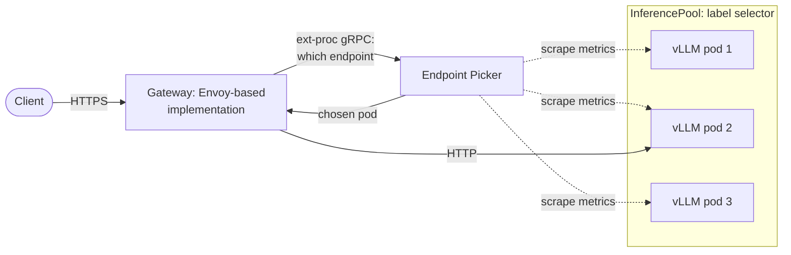

**Reading the diagram.** The client calls the gateway over HTTPS. For each request, the gateway calls the Endpoint Picker synchronously through Envoy's external-processing gRPC interface, sending the request's metadata; the picker answers with a pod chosen from metrics it scrapes asynchronously (dotted) from every model server in the InferencePool, then the gateway forwards the request over HTTP to that pod. The pool is a label selector, so pods join and leave as the autoscaler changes replicas. Failure points: if the picker is down, the gateway must fail open to plain balancing or fail closed by configuration; stale metrics cause herding. Scaling: run several picker replicas and keep their scrape interval short (sub-second) relative to request duration.

Other systems implement the same idea: SGLang's router combines cache-aware and load-balanced routing across SGLang workers [SGLang Docs], and, as of 2026, NVIDIA Dynamo and the llm-d project offer KV-cache-aware routing as part of distributed inference stacks.

#### Failure scenarios

| What goes wrong | Why | Detection | Recovery | Prevention |
|---|---|---|---|---|
| One replica at 100% KV, others idle | Unbounded affinity on a hot prefix | Per-replica queue spread | Drain hot replica, rebalance | Bounded affinity |
| Tail latency doubles after scaling out | New replicas get affinity misses and full load | TTFT p99 rises with replica count changes | Ramp new replica weight | Slow start (§19.5) |
| Herding onto the least-loaded replica | Many routers see the same stale metric | Load oscillates between replicas | Randomize | Power of two choices; shorter scrape interval |
| Requests routed to a region the tenant may not use | Fallback rule ignores policy | Residency audit query | Block and purge logs | Policy filter before fallback (Figure 79.3) |

## 79.7 Multi-model serving and model registries

### 79.7.1 Many models, shared GPUs

::: definition
**Definition — Multi-model and multi-LoRA serving.** **Multi-model serving** places many models on a shared fleet, loading and evicting them by demand (§66.8). **Multi-LoRA serving** keeps one base model's weights in GPU memory and serves many low-rank adapters (LoRA, §76.9) on top of it, applying each request's adapter during the forward pass so that requests for different adapters share one batch.
:::

#### Why does this exist?

Platforms accumulate models faster than traffic: team fine-tunes, rollback versions, evaluation candidates, encoders. QuickBite's T1–T3 each fine-tune the same 7B base; three dedicated pools would hold three copies of 13.5 GB of weights and three sets of idle redundancy; one pool with three adapters holds one copy.

#### How it works internally

1. **Registry as source of truth.** Each registry entry (§69.8) carries serving metadata the platform needs: base model and adapter lineage, engine and version, precision, GPU memory at the target context, required GPU type, evaluation status, data-handling class and an owner. Aliases (`support-default`) point to entries; changing an alias is a deployment.
2. **Placement.** A controller assigns models to pools using demand, memory and SLO class. Hot models get dedicated replicas; warm models share replicas; cold models load on demand.
3. **Loading and eviction.** A replica loads weights from a node-local cache or object storage, warms up and joins the router; under memory pressure it evicts the least recently used model or adapter (Figure 79.5).
4. **Adapters.** Engines such as vLLM load LoRA adapters at runtime and batch requests for different adapters together; S-LoRA stores adapters in a unified paged memory pool with the KV cache and uses custom kernels for heterogeneous-adapter batches, serving thousands of adapters on one GPU [Sheng et al. 2024a]; Punica introduced a batched kernel (SGMV) for the same purpose [Chen et al. 2024]. The router should prefer replicas that already hold the requested adapter, a filter the Endpoint Picker of §79.6.3 also applies.
5. **Model parallelism as multiplexing.** AlpaServe showed that splitting models across GPUs with model parallelism, even when each fits on one GPU, lets several models share a larger GPU group and absorb each other's bursts, improving SLO attainment for bursty multi-model workloads [Li et al. 2023].

**Figure 79.5 — Lifecycle of a model on a serving replica.**

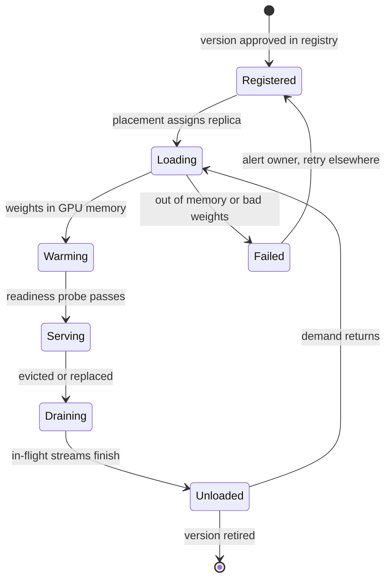

**Reading the diagram.** A version is registered once and may be loaded on many replicas. Loading copies weights from storage (the storage boundary: node cache, then object store) into GPU memory; warming profiles memory and captures CUDA Graphs (§73.15); the router adds the replica only after the readiness probe passes. Eviction goes through draining, so streams in progress finish rather than break. Failure points: loading fails on out-of-memory when the placement controller's memory estimate is wrong, and a model flapping between Serving and Unloaded under memory pressure thrashes the cache. Scaling: popular models are held on several replicas; rare ones on one, or none until called.

#### Mathematical foundations: adapter memory

::: formula
**LoRA adapter size and adapters per GPU**

$$S_\text{LoRA} = L \cdot n_\text{mat} \cdot r \cdot (d_\text{in} + d_\text{out}) \cdot b \qquad N_\text{adapters} = \left\lfloor \frac{M_\text{adapters}}{S_\text{LoRA}} \right\rfloor$$

| Symbol | Meaning | Units |
|---|---|---|
| $L$ | Transformer layers adapted | layers |
| $n_\text{mat}$ | Weight matrices adapted per layer | matrices |
| $r$ | LoRA rank | dimensionless |
| $d_\text{in}, d_\text{out}$ | Input and output dimension of each adapted matrix | elements |
| $b$ | Bytes per adapter element | bytes |
| $M_\text{adapters}$ | GPU memory reserved for adapters | bytes |
:::

::: example
**Worked example — QuickBite's three adapters on one H100.** The 7B base has $L = 32$ and hidden size 4,096; adapters of rank $r = 16$ on the four attention projections ($n_\text{mat} = 4$, each 4,096 × 4,096), FP16 ($b = 2$).

1. Per matrix: $r(d_\text{in} + d_\text{out}) = 16 \times 8{,}192 = 131{,}072$ elements.
2. Per adapter: $32 \times 4 \times 131{,}072 \times 2 = 33.6$ MB.
3. Three adapters: 101 MB, 0.7% of the base model's 13.5 GB; three full fine-tunes would need 40.5 GB.
4. Reserving 4 GB of the KV budget for adapters holds $\lfloor 4 \times 10^9 / 33.6 \times 10^6 \rfloor = 119$ adapters.

**Interpretation.** Adapters are cheap to hold; the costs are the slight per-token compute overhead of the adapter matmuls and batches split across many adapters. **Engineering implication.** Default to adapters for team-specific variants of one base; give a variant its own full model only when evaluation shows an adapter cannot reach the required quality (§76.9).
:::

## 79.8 GPU cluster management for inference

### 79.8.1 Node pools, bin-packing and partitions

::: definition
**Definition — GPU node pool and bin-packing.** A **node pool** is a group of identical nodes (same GPU type and count, same interconnect) managed together, usually labeled and tainted so that only workloads asking for that GPU land there (§42.13). **Bin-packing** assigns model replicas, each with a GPU-memory and compute requirement, to the fewest GPUs or partitions that satisfy them. **MIG** (Multi-Instance GPU) splits one data-center GPU into isolated instances, up to seven 1g.10gb slices on an H100 80 GB (§64.15) [NVIDIA MIG User Guide].
:::

#### Why does this exist?

Inference models span from a 33M-parameter reranker to a 70B model needing four NVLink-joined GPUs. Whole GPUs for small models waste them; a 70B group split across nodes ruins tensor parallelism (§73.11). Node pools separate the shapes; bin-packing and MIG fill them.

#### How it works internally

1. **Pools by shape.** Kubernetes exposes GPUs through a device plugin as an extended resource (`nvidia.com/gpu`) [Kubernetes Docs: Schedule GPUs]; with MIG enabled, the NVIDIA GPU Operator can expose each slice profile as its own resource. QuickBite runs an **H100 pool** of 8-GPU NVLink nodes for LLMs (whole GPUs, tensor-parallel groups kept inside one node) and a **MIG pool** for encoders.
2. **Pack small models.** First-fit decreasing by memory, subject to each replica's compute share and SLO class; latency-critical models go on MIG slices (hardware isolation), cooperative batch models may share a slice or use time-slicing.
3. **Spread for availability.** Replicas of one model go to different nodes and, where possible, failure zones (topology spread constraints).
4. **Autoscale on LLM signals.** Scale on queue depth, KV-cache usage and TTFT p95, or on tokens per second per replica against a measured capacity at the SLO, not on GPU utilization, which reads near 100% whenever anything runs (§73.15). Schedule pre-scaling for known peaks. Energy-aware controllers such as DynamoLLM also reconfigure instance count, parallelism and GPU frequency as load changes [Stojkovic et al. 2025].
5. **Plan for cold starts.** A new replica needs a node, an image, weights and warm-up; size warm headroom for the time this takes (Figure 79.7).

**Figure 79.6 — QuickBite's inference node pools and MIG layout.**

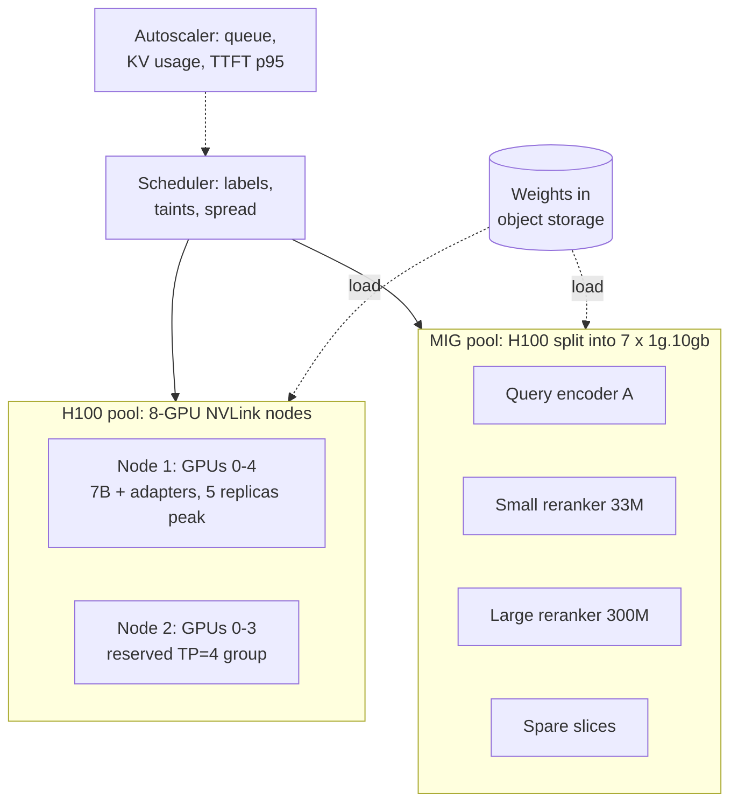

**Reading the diagram.** The scheduler places pods synchronously onto two node pools by label and taint. LLM replicas take whole H100s inside NVLink nodes, and a four-GPU group is held inside one node for tensor parallelism. A second pool partitions H100s with MIG, giving each encoder or reranker an isolated slice with its own memory and compute. The autoscaler adjusts replica counts asynchronously from LLM signals; weights load asynchronously from object storage, the storage boundary and the slowest step of a cold start. Failure points: a node loss takes all replicas on it (spread replicas across nodes); MIG layouts are fixed until reconfigured, which requires the GPU to be idle. Scaling: add nodes to a pool; change MIG profiles only during planned maintenance.

#### Mathematical foundations: capacity and warm headroom

::: formula
**Pool capacity at peak and warm headroom for cold starts**

$$R_\text{peak} = \left\lceil \frac{\lambda_\text{peak}\, g_\text{req}}{\rho} \right\rceil + r \qquad H = \left\lceil \frac{\dot\lambda \, T_\text{ready}\, g_\text{req}}{\rho} \right\rceil$$

| Symbol | Meaning | Units |
|---|---|---|
| $\lambda_\text{peak}$ | Peak request rate | requests/s |
| $g_\text{req}$ | GPU-seconds per request: uncached prompt tokens × 28.3 µs + output tokens × 0.567 ms | GPU-s |
| $\rho$ | Target utilization for online traffic | dimensionless |
| $r$ | Redundant replicas (N+1: $r = 1$) | replicas |
| $\dot\lambda$ | Steepest traffic ramp | requests/s per second |
| $T_\text{ready}$ | Time from scale-out decision to a serving replica | s |
| $H$ | Replicas to keep warm ahead of demand | replicas |
:::

::: example
**Worked example — QuickBite's shared 7B pool.**

1. Support chat: $g_\text{req} = 3{,}800 \times 28.3\ \mu\text{s} + 230 \times 0.567\ \text{ms} = 0.1075 + 0.1304 = 0.238$ GPU-s.
2. Peak: $8 \times 0.238 = 1.90$ busy GPUs; $R_\text{peak} = \lceil 1.90/0.6 \rceil + 1 = \lceil 3.17 \rceil + 1 = 5$ replicas of one GPU. Off-peak the floor is 2 (N+1).
3. Schedule: 5 GPUs for 8 peak hours (lunch and dinner), 2 for the other 16: $5 \times 8 + 2 \times 16 = 72$ GPU-hours a day, 2,160 a month, \$5,400 at \$2.50.
4. Menu enrichment overnight: $100{,}000 \times (600 \times 28.3\ \mu\text{s} + 150 \times 0.567\ \text{ms}) = 1{,}698 + 8{,}505 = 10{,}203$ GPU-s. In a 6-hour window at $\rho = 0.9$ it needs $10{,}203/(0.9 \times 21{,}600) = 0.52$ GPUs, which fit beside night support traffic (about 1 query/s, $0.24$ GPUs) on the two always-on GPUs: zero extra GPU-hours.
5. Review tagging: $20{,}000 \times (400 \times 28.3\ \mu\text{s} + 60 \times 0.567\ \text{ms}) = 907$ GPU-s a day, also absorbed.
6. Warm headroom: lunch ramps from 2 to 8 queries/s in 30 minutes, $\dot\lambda = 6/1{,}800 = 0.0033$ /s². With $T_\text{ready} = 360$ s (new node), demand grows $0.0033 \times 360 = 1.2$ queries/s during a cold start: $H = \lceil 1.2 \times 0.238/0.6 \rceil = \lceil 0.48 \rceil = 1$ replica pre-scaled ahead of the ramp.
7. Utilization: busy GPU-hours are $(17{,}846 + 10{,}203 + 907)/3{,}600 \times 30 = 241$ a month against 2,160 provisioned, 11%.

**Interpretation.** Sharing makes the two batch tenants free at the margin, but the pool is still 89% idle, because its size is set by one tenant's peak plus redundancy. **Engineering implication.** At QuickBite's volume, the pool's economics depend on filling valleys (more batch work, evaluation runs), on smaller GPUs for the 7B model, or on the external-API comparison of §79.16; the chargeback rules of §79.15 make this visible to the teams.
:::

**Figure 79.7 — Cold-start timeline: 7B replica on a warm node versus 70B group on a new node (illustrative).**

```mermaid
gantt
  title Time to a serving replica, seconds
  dateFormat X
  axisFormat %s
  section 7B on warm node
  Pull cached image 5 s       :a1, 0, 5
  Load 13.5 GB weights 14 s   :a2, 5, 19
  Warm-up and graphs 40 s     :a3, 19, 59
  section 70B on new node
  Provision 8-GPU node 180 s  :b1, 0, 180
  Pull 10 GB image 90 s       :b2, 180, 270
  Load 140 GB weights 140 s   :b3, 270, 410
  Warm-up TP=4 90 s           :b4, 410, 500
```

**Reading the diagram.** Each bar is a sequential step of one cold start, with durations that are assumptions rather than measurements: 1 GB/s weight loading, a 10 GB engine image at about 110 MB/s, and a few minutes to provision a GPU node. The 7B replica on a node that already caches the image is ready in about one minute, dominated by warm-up; the 70B group on a new node takes about 500 s, dominated by node provisioning and weight loading from the object store (the storage boundary). Failure points: in a GPU shortage, provisioning may not complete at all (§79.11). Scaling options: keep warm nodes, pre-pull images, stage weights on node-local NVMe, or load from peer GPUs.

## 79.9 Rate limiting and quotas in tokens

### 79.9.1 Why requests are the wrong unit

::: definition
**Definition — Token-based rate limits and quotas.** A **tokens-per-minute (TPM)** limit caps the model tokens (input plus output, sometimes weighted) a tenant may consume per minute; a **requests-per-minute (RPM)** limit caps calls regardless of size. A **quota** caps cumulative use over a longer period (tokens or dollars per day or month, §47.8). Because output length is unknown at admission, the gateway admits on an **estimate** and later **reconciles** the tenant's balance with the **actual** tokens the model reports.
:::

#### First-principles explanation

Limiting tables per hour, not diners, is gamed by a party of forty: one 100,000-token prompt costs as much as a thousand short ones. Limiting tokens charges by the diner, but the bill arrives after the meal, so the host guesses at the door and settles at the till.

#### How it works internally

1. **Two buckets per tenant and model class**: an RPM bucket (protects per-request overheads and connection limits) and a TPM bucket (protects GPU time), both token buckets with a rate and a burst depth (§22.4), stored in a fast shared store with local caching (§22.8).
2. **Estimate at admission.** Reserve $e = n_\text{in} + \hat{o}$: the counted prompt tokens plus an output estimate. Choices for $\hat o$: the request's `max_tokens` (safe, pessimistic), a per-tenant percentile of past outputs (accurate on average), or zero (post-paid).
3. **Reject cheaply.** If the reservation does not fit, return 429 with `Retry-After` computed from the bucket's refill time, before any GPU work.
4. **Reconcile on completion.** Credit back $e - n_\text{actual}$ when the estimate was high, or debit the difference when it was low; a negative balance is a debt that blocks the next admissions until refilled. Streams cut off by the client are charged for tokens actually generated.
5. **Priority tiers.** Separate buckets, or one bucket with reserved shares, for P0 (interactive), P1 (agents) and P2 (batch); P2 is admitted only from capacity P0 leaves unused and is the first shed (§22.9).
6. **Reservations.** Tenants that need guaranteed capacity buy a **reserved** throughput (dedicated tokens per minute backed by dedicated replicas, §79.10); cloud providers sell the same idea as provisioned throughput.

**Figure 79.8 — Token quota lifecycle: reserve, admit, reconcile.**

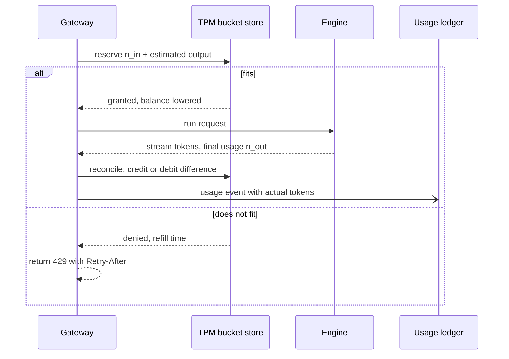

**Reading the diagram.** The gateway makes a synchronous reservation against the bucket store before calling the engine. If granted, the request runs and streams; on completion the gateway adjusts the bucket by the difference between estimate and actual and asynchronously writes the actual usage to the ledger, which is the record billing trusts. If denied, the client receives 429 with a computed retry time and no GPU time is spent. Failure points: if the gateway crashes between reservation and reconciliation the reservation leaks, so reservations carry a TTL; if the bucket store is unreachable, the gateway falls back to local per-node buckets at a fraction of the limit. Scaling: buckets shard by tenant key.

#### Mathematical foundations

::: formula
**Reservation, reconciliation and held quota**

$$e = n_\text{in} + \hat{o} \qquad \Delta = e - (n_\text{in} + n_\text{out}) \qquad U = \lambda\, \tau\, (e - \bar{n})$$

| Symbol | Meaning | Units |
|---|---|---|
| $n_\text{in}$, $n_\text{out}$ | Prompt tokens counted at admission; output tokens reported at completion | tokens |
| $\hat{o}$ | Output estimate used at admission | tokens |
| $e$ | Tokens reserved at admission | tokens |
| $\Delta$ | Reconciliation: credited if positive, debited if negative | tokens |
| $\lambda$ | Admitted request rate | requests/s |
| $\tau$ | Mean request duration (TTFT plus decode) | s |
| $\bar{n}$ | Mean actual tokens per request | tokens |
| $U$ | Quota held by in-flight reservations but not yet used | tokens |
:::

::: example
**Worked example — Sizing support chat's limits.** Peak 8 queries/s; each uses 4,500 input and 230 output tokens, $\bar n = 4{,}730$; the client sends `max_tokens = 4,096`; duration $\tau = 0.75 + 230 \times 0.03 = 7.65$ s.

1. Peak consumption: $8 \times 4{,}730 \times 60 = 2.27$ M TPM. With 1.5× headroom for bursts, the TPM limit is 3.4 M; RPM is $8 \times 60 \times 1.5 = 720$.
2. Reserving `max_tokens`: $e = 4{,}500 + 4{,}096 = 8{,}596$ per request, 1.82× actual use.
3. Held quota: $U = 8 \times 7.65 \times (8{,}596 - 4{,}730) = 236{,}600$ tokens, about 4.2 s of the 3.4 M TPM refill (56,800 tokens/s).
4. Reconciliation per request: $\Delta = 8{,}596 - 4{,}730 = +3{,}866$ tokens credited back.
5. With $\hat o = 400$ (the tenant's p90 output) instead: $e = 4{,}900$, $U = 8 \times 7.65 \times 170 = 10{,}400$ tokens, and only requests with outputs above 400 tokens (10%) are debited.

**Interpretation.** Reserving the maximum is safe but holds quota that nobody uses; with a burst depth of a few seconds it causes false 429s exactly at peak. **Engineering implication.** Reserve a per-tenant output percentile, reconcile with debt allowed, and clamp `max_tokens` at the gateway to a sensible per-alias ceiling.
:::

#### Code example: accounting modes compared

A tenant with a 100,000-TPM limit (bucket depth 15 seconds of tokens) sends about 1.5× its limit: prompts of 1,000–3,000 tokens, `max_tokens = 4,096`, actual outputs with a mean near 250. Four accounting modes are compared by the tokens the tenant *actually* consumed per minute.

```python
import heapq, random

TPM = 100_000                 # tenant limit: tokens per minute (input + output)
RATE, BURST = TPM / 60, TPM / 4   # refill per second; depth = 15 s of tokens
MAX_TOKENS = 4_096            # client's max_tokens on every request

class TokenBucket:
    def __init__(self):
        self.level, self.t = BURST, 0.0
    def refill(self, now):
        self.level = min(BURST, self.level + (now - self.t) * RATE); self.t = now
    def try_take(self, now, n):          # admit only if the reservation fits
        self.refill(now)
        if self.level >= n:
            self.level -= n; return True
        return False
    def adjust(self, now, delta):        # refund (delta > 0) or debit (< 0)
        self.refill(now); self.level = min(BURST, self.level + delta)

def workload(seed, minutes=30, rps=1.1):
    rng, t, reqs = random.Random(seed), 0.0, []
    while t < minutes * 60:
        t += rng.expovariate(rps)
        n_in = rng.randint(1_000, 3_000)
        n_out = min(MAX_TOKENS, int(rng.lognormvariate(5.2, 0.8)))  # mean ~250
        reqs.append((t, n_in, n_out))
    return reqs

def run(mode, reqs, est_out=400):
    tb, done, used = TokenBucket(), [], {}
    admitted = 0
    for t, n_in, n_out in reqs:
        while done and done[0][0] <= t:           # completions before t
            tc, delta = heapq.heappop(done); tb.adjust(tc, delta)
        reserve = {"input_only": n_in,
                   "reserve_max": n_in + MAX_TOKENS,
                   "post_debit": n_in,
                   "estimate_reconcile": n_in + est_out}[mode]
        if not tb.try_take(t, reserve):
            continue                              # HTTP 429 with Retry-After
        admitted += 1
        t_done = t + 0.4 + n_out * 0.03           # TTFT + TPOT x output
        actual = n_in + n_out
        delta = 0 if mode == "input_only" else reserve - actual  # post_debit: -n_out
        heapq.heappush(done, (t_done, delta))
        m = int(t_done // 60)                     # meter actual tokens by minute
        used[m] = used.get(m, 0) + actual
    full = [used.get(m, 0) for m in range(5, 30)] # steady state minutes
    return admitted / len(reqs), sum(full) / len(full), max(full)

reqs = workload(seed=42)
offered = sum(n_in + n_out for _, n_in, n_out in reqs) / 30
print(f"{len(reqs)} requests; offered load {offered:,.0f} tokens/min "
      f"against a limit of {TPM:,}")
print(f"{'accounting mode':<20}{'admitted':>9}{'mean used/min':>15}{'worst minute':>14}")
for mode in ["input_only", "post_debit", "reserve_max", "estimate_reconcile"]:
    adm, mean_u, worst = run(mode, reqs)
    print(f"{mode:<20}{adm:>9.0%}{mean_u:>15,.0f}{worst:>14,.0f}"
          f"  ({worst / TPM:.0%} of limit)")
```

Output:

```text
1963 requests; offered load 147,351 tokens/min against a limit of 100,000
accounting mode      admitted  mean used/min  worst minute
input_only                80%        112,730       125,865  (126% of limit)
post_debit                72%         99,944       115,696  (116% of limit)
reserve_max               64%         92,731       109,176  (109% of limit)
estimate_reconcile        71%         99,987       112,495  (112% of limit)
```

What to notice:

- **Input only** never charges output: the tenant consumes 113% of its limit.
- **Post-debit** (output charged afterwards) is accurate on average but lets bursts run ahead of the debit (worst minute 116%).
- **Reserve max** holds 4,096 tokens per request in flight: it admits only 64% and uses 93% of the limit, rejecting traffic it could have served.
- **Estimate and reconcile** uses exactly the limit on average with a lower worst minute (112%). Minutes above 100% are the 15-second burst allowance, policy rather than leakage.

::: industry
**Token limits in gateways and provisioned capacity.** LiteLLM documents TPM and RPM limits per virtual key, team and model deployment [LiteLLM Docs]. Envoy AI Gateway extracts token usage from model responses into request metadata and applies Envoy Gateway's global rate limits to it, so the debit happens after the response, the post-debit mode above [Envoy AI Gateway Docs]. For guaranteed capacity, Azure OpenAI sells provisioned throughput units and Amazon Bedrock sells provisioned throughput for selected models (as of 2026) [Microsoft Learn: Provisioned throughput; AWS Docs: Bedrock Provisioned Throughput].
*Evidence: Primary* — vendor and project documentation.
:::

#### Failure scenarios

| What goes wrong | Why | Detection | Recovery | Prevention |
|---|---|---|---|---|
| Tenant exceeds TPM yet never sees 429 | Output tokens not charged | Ledger tokens ≫ limit | Enable reconciliation | Post-debit or reconcile mode |
| False 429s at peak | `max_tokens` reservations held in flight | High 429 rate with spare GPU | Lower $\hat o$ | Percentile estimates; clamp `max_tokens` |
| Reservations leak after crashes | No reconciliation for lost requests | Bucket balance drifts down | Expire reservations by TTL | TTL on every reservation |
| Limits differ per gateway node | Local buckets only | Tenant throughput scales with node count | Central store | Shared store with local cache (§22.8) |

## 79.10 Tenant isolation

### 79.10.1 Noisy neighbors on shared GPUs

::: definition
**Definition — Tenant isolation on an AI platform.** The guarantee that one tenant's load, failures or data cannot degrade another tenant's latency, availability or confidentiality. **Performance isolation** comes from per-tenant queues, fair scheduling, priority and dedicated capacity; **data isolation** comes from separating prompts, caches, logs and adapters per tenant (§47.5, §47.12).
:::

#### Why does this exist?

All tenants share one continuous batch, so a flooding batch tenant raises *everyone's* decode step time (§73.6) and fills the KV cache, forcing preemptions, even while every tenant is within its rate limit (§47.8). And a shared prefix cache is a timing side channel: tenant B can probe whether tenant A recently sent a prefix.

#### How it works internally

1. **Per-tenant queues** in front of each pool, and a scheduler that picks the next request to admit into the batch.
2. **Fair scheduling in cost units.** The scheduler tracks each tenant's service in GPU-cost units and admits from the backlogged tenant with the least weighted service. The Virtual Token Counter (VTC) applies this idea to LLM serving, counting weighted input and output tokens per client and lifting a newly active client's counter so it cannot bank unused share [Sheng et al. 2024b].
3. **Priority on top of fairness.** Fair share divides throughput; it does not protect latency. P0 tenants get a cap on how many batch slots and KV blocks P2 work may hold, and P2 requests are preempted first.
4. **Data isolation.** Prefix caches are partitioned or salted per tenant (or sharing is limited to platform-owned prompts); logs and adapters are stored per tenant with their own access controls and keys (§79.14).
5. **Dedicated tiers.** Tenants with strict objectives or contracts get dedicated replicas or node pools.

**Figure 79.9 — Per-tenant queues, fair scheduler and dedicated tier.**

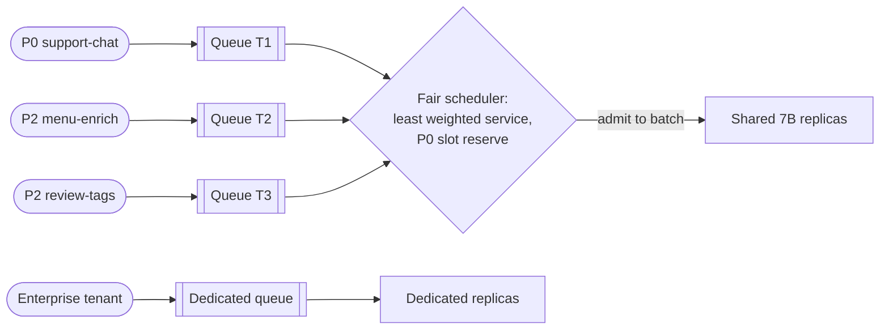

**Reading the diagram.** Each shared tenant's requests wait in its own queue; the fair scheduler admits synchronously into the shared replicas' running batch, choosing the backlogged tenant with the least weighted service while keeping a reserve of batch slots for P0. A tenant on the dedicated tier bypasses the shared scheduler entirely. Queues live in the engine or router memory, so a replica crash loses queued requests, which clients retry. Failure points: a weight misconfiguration starves a tenant; dedicated replicas idle when their tenant is quiet. Scaling: add shared replicas for the pool, dedicated replicas per contract.

::: formula
**Weighted service in GPU-cost units**

$$s_i \mathrel{+}= \frac{c_\text{in}\, n_\text{in}^\text{uncached} + c_\text{out}\, n_\text{out}}{\phi_i} \qquad \text{admit from } \arg\min_{i \in \text{backlogged}} s_i$$

| Symbol | Meaning | Units |
|---|---|---|
| $s_i$ | Weighted service received by tenant $i$ | GPU-s |
| $c_\text{in}$, $c_\text{out}$ | GPU cost per uncached prompt token and per output token | GPU-s/token |
| $n_\text{in}^\text{uncached}$, $n_\text{out}$ | Tokens of the admitted request | tokens |
| $\phi_i$ | Tenant weight | dimensionless |
:::

::: example
**Worked example — Support chat and a menu backlog at dinner peak.** Five replicas give 5 GPU-s of service per second. Support chat ($\phi = 4$) needs $8 \times 0.238 = 1.90$ GPU-s/s; a menu backlog ($\phi = 1$) wants unlimited service. A menu request costs $600 \times 28.3\ \mu\text{s} + 150 \times 0.567\ \text{ms} = 0.102$ GPU-s.

1. Weighted fair shares: support $4/5 \times 5 = 4.0$ GPU-s/s, menu 1.0.
2. Support's demand (1.90) is below its share, so max–min fairness serves it fully and gives the remaining $5 - 1.90 = 3.10$ GPU-s/s to menu: about $3.10/0.102 = 30$ menu requests/s.
3. Counting *requests* instead of GPU-seconds would treat a menu call (0.102 GPU-s) and a support call (0.238 GPU-s) as equal and misallocate by 2.3×; counting tokens unweighted would treat an output token as equal to a prompt token, though it costs $0.567/0.0283 = 20$ times more.
4. Latency: with menu filling 30 more requests/s into the batches, decode steps lengthen; capping P2 at, say, 40% of batch slots keeps support's TPOT within objective.

**Interpretation.** Fair share protects support chat's *throughput* even against an unlimited backlog; its *latency* needs the slot cap. **Engineering implication.** Weight tokens by measured GPU cost per model, and combine fairness with priority caps rather than relying on either alone.
:::

**Table 79.3 — Isolation tiers for AI tenants.**

| Tier | How it works | Isolation | Cost | Choose when |
|---|---|---|---|---|
| Shared best-effort | Shared pool, fair scheduler | Throughput share only | Lowest | Batch, internal tools |
| Shared with priority | Shared pool, P0 slot and KV reserve | Latency protected within pool | Low | Customer-facing features |
| Dedicated replicas | Tenant-pinned replicas in shared cluster | Compute isolated; node shared | Medium | Contractual SLOs, large steady tenants |
| Dedicated pool or cluster | Own nodes, keys, logs, network | Strongest short of separate account | High | Regulated data, enterprise contracts |

## 79.11 Multi-region AI systems

### 79.11.1 Scarce capacity, residency and failover

::: definition
**Definition — Multi-region AI serving.** Running gateways, routers and model capacity in several regions (§44.6) so that each request is served in an allowed region with acceptable latency, and so that a regional outage or capacity shortage shifts traffic to another region, another provider or a fallback model without breaking **data-residency** rules for prompts and logs (§44.9).
:::

#### Why does this exist?

**GPU capacity is scarce and uneven**: a region's on-demand capacity can run out, so "scale out in the failover region" may fail. **Prompts are personal data**: sending an EU customer's chat to a US region may break residency policy. **Latency is forgiving**: an extra 90 ms round trip (§44.4) matters little against a 1 s TTFT, so residency and capacity, not distance, are binding.

#### How it works internally

1. **Regional gateways** terminate traffic close to users (GeoDNS or anycast, §44.5) and tag each request with its data class and allowed regions.
2. **Region-aware routing**: the router's policy filter (Figure 79.3) keeps only compliant deployments; then it prefers the local pool, then a compliant remote pool, then a compliant external provider endpoint.
3. **Failover tiers**: within-region replica failover (seconds); cross-region shift within the same jurisdiction; spillover to a provider's regional endpoint; finally a degraded mode (smaller model, canned answers, hand-off to humans).
4. **Residency of everything**: logs, caches, quota stores and evaluation samples for EU prompts stay in the EU, not only the inference.

**Figure 79.10 — Region-aware routing with residency and spillover.**

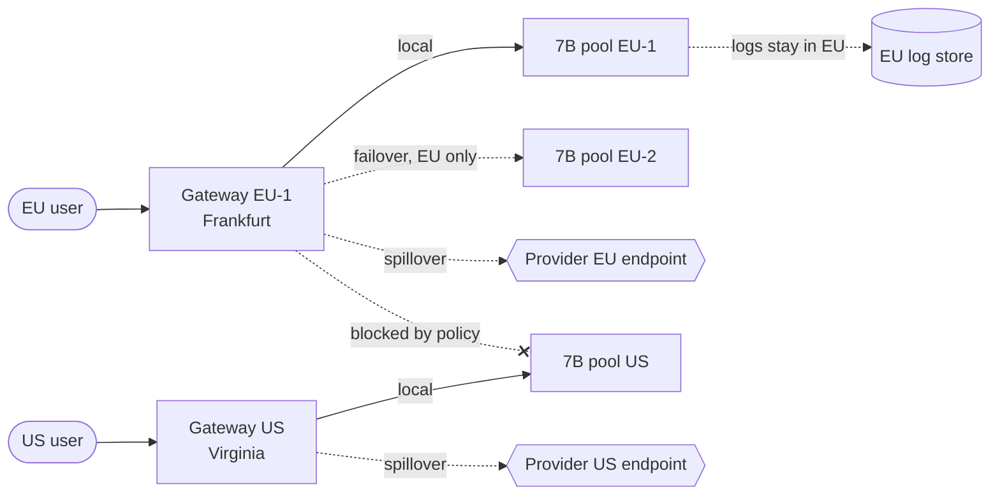

**Reading the diagram.** Each user reaches the nearest gateway. The EU gateway sends traffic synchronously to its local pool and fails over (dotted, used only on failure) to a second EU region or to a provider's EU endpoint; the crossed edge shows that policy forbids sending EU prompts to the US pool even when it has spare GPUs. The US gateway has its own pool and spillover. Logs are written to a store inside the jurisdiction, a storage boundary that must follow the same rules as inference. Failure points: a provider's regional endpoint may hit its own capacity limits during a wide outage; a fallback model may answer worse (Chapter 78). Scaling: add regions per jurisdiction; spillover absorbs short peaks without owning GPUs.

::: formula
**Standby capacity versus spillover**

$$C_\text{standby} = n_\text{gpu}\, H\, p_\text{gpu} \qquad C_\text{spill} = f\, T_\text{out}\, \lambda\, c_\text{req}$$

| Symbol | Meaning | Units |
|---|---|---|
| $n_\text{gpu}$ | GPUs kept warm in the failover region | GPUs |
| $H$ | Hours per month | h |
| $p_\text{gpu}$ | Price per GPU-hour | \$/GPU-h |
| $f$ | Regional incidents per month | 1/month |
| $T_\text{out}$ | Incident duration | h |
| $\lambda$ | Traffic to move, in requests per hour | requests/h |
| $c_\text{req}$ | External price per request | \$ |
:::

::: example
**Worked example — EU support chat failover.** EU traffic is 30% of peak support chat: $0.3 \times 8 = 2.4$ queries/s. Using Chapter 44's incident rate, 2 incidents per region-year of 3 hours each, $f\,T_\text{out} = 6/12 = 0.5$ h/month.

1. Standby: two warm H100s in EU-2, $2 \times 730 \times 2.50 = \$3{,}650$ per month.
2. Spillover price per query on a small-model API with an EU endpoint: $4{,}500 \times 0.15 \times 10^{-6} + 230 \times 0.60 \times 10^{-6} = \$0.000813$.
3. Traffic per hour at peak: $2.4 \times 3{,}600 = 8{,}640$ queries, $\$7.02$ per hour.
4. Expected spillover: $0.5 \times 7.02 = \$3.51$ per month, a thousandth of the standby cost; even a 10-hour incident at peak costs \$70.

**Interpretation.** For a modest, latency-tolerant workload, renting failover capacity per token is far cheaper than owning idle GPUs. **Engineering implication.** Pre-approve and evaluate a compliant fallback model, keep its contract and quotas sized for full failover traffic, and test the path regularly (§39.11); keep standby GPUs only where no compliant provider exists or the custom model cannot be replaced.
:::

## 79.12 Caching

### 79.12.1 Four caches and their economics

::: definition
**Definition — Caches on an AI platform.** An **exact response cache** returns a stored response when the normalized request (model version, parameters, full prompt) matches byte for byte. A **semantic cache** returns a stored response when a new prompt's embedding is close to a cached prompt's. A **prefix (KV) cache** reuses the attention keys and values of a shared prompt prefix inside the engine or provider (§73.8), so the model still generates a fresh answer. An **embedding cache** stores vectors for repeated inputs to an embedding model.
:::

#### Why does this exist?

Model calls are expensive and often repeated: chains list the same dish in many branches, agents resend growing contexts, search users repeat queries. But an answer correct for one customer can be wrong for another, and each cache type trades savings against that risk differently.

::: formula
**Expected saving of a response cache, with false hits**

$$S = h\,C_\text{gen} - C_\text{lookup} - h\,f\,C_\text{err} \qquad f^\star = \frac{h\,C_\text{gen} - C_\text{lookup}}{h\,C_\text{err}}$$

| Symbol | Meaning | Units |
|---|---|---|
| $h$ | Cache hit ratio | dimensionless |
| $C_\text{gen}$ | Cost of generating a response | \$/request |
| $C_\text{lookup}$ | Cost of a lookup, paid on every request | \$/request |
| $f$ | Fraction of hits that return a wrong answer for this request | dimensionless |
| $C_\text{err}$ | Business cost of a wrong answer | \$ |
| $S$ | Expected saving per request | \$/request |
| $f^\star$ | False-hit rate at which the cache stops paying | dimensionless |
:::

::: example
**Worked example — A semantic cache for support chat.** Generation plus retrieval costs $C_\text{gen} = \$0.0012$ per query (Chapter 75); lookup (an embedding and a vector search) $C_\text{lookup} = \$0.00002$. Generic first questions give $h = 0.12$; offline tests show $f = 0.04$ (answers about the wrong order or an outdated policy). A wrong answer leads to a human contact half the time at \$3, so $C_\text{err} = \$1.50$.

1. Gross saving: $0.12 \times 0.0012 = \$0.000144$.
2. Error cost: $0.12 \times 0.04 \times 1.50 = \$0.0072$.
3. $S = 0.000144 - 0.00002 - 0.0072 = -\$0.0071$ per query, $-\$531$ a day over 75,000 queries.
4. Break-even: $f^\star = (0.000144 - 0.00002)/(0.12 \times 1.50) = 0.00069$, under one false hit in 1,400.
5. Exact caching of menu enrichment instead: 40% of dish updates are duplicates across a chain's branches (assumed), and an exact match with temperature 0 and a pinned model version has $f = 0$, saving $0.4 \times 10{,}203 = 4{,}081$ GPU-s a day.

**Interpretation.** When answers are cheap and mistakes are expensive, a semantic cache of *answers* loses money at any realistic false-hit rate. **Engineering implication.** Use exact caches for deterministic, non-personalized calls; use semantic caching for retrieval results or for platform-owned, non-personal content with a strict threshold; and spend most effort on prefix caching, which saves compute without ever returning a wrong answer.
:::

**Prefix caching across requests** is the safest large saving. Inside self-hosted engines it depends on prefix affinity (§79.6). External providers publish prompt-caching features in which repeated prompt prefixes are billed at a discount, with conditions on minimum length and cache lifetime (as of 2026) [Anthropic Docs: Prompt caching; OpenAI Docs: Prompt caching]. Put stable content (system prompt, tools, documents) first and variable content last; a timestamp at the top of a system prompt silently disables every prefix cache.

**Embedding caches** are nearly free wins for search: heavy-tailed queries keyed by normalized text and model version serve much of T5's traffic with no wrong hits. GPTCache is one open-source library for semantic and exact LLM caching [Bang 2023].

**Table 79.4 — Cache types compared.**

| Cache | Key | Saves | Risk | Use for |
|---|---|---|---|---|
| Exact response | Model version, parameters, full prompt hash | Whole call | Stale after template change | Deterministic batch, repeated tool calls |
| Semantic | Prompt embedding within threshold | Whole call | Wrong answer for a different question | Non-personal FAQ content, retrieval results |
| Prefix KV | Token prefix (block hashes) | Prefill compute and TTFT | Cross-tenant timing leak if shared | Every LLM workload; agents most |
| Embedding | Input text, model version | Encoder compute | Mixing model versions | Search queries, document re-indexing |

## 79.13 AI observability

### 79.13.1 Tokens, latency phases, cost and traces

::: definition
**Definition — AI observability.** The metrics, logs and traces (§40.3) needed to operate model-backed features: per-request token counts (input, cached, output), latency phases (queueing, TTFT, TPOT, end-to-end, §73.4), cost, model and deployment identity, finish reason, and the causal trace that links the many model and tool calls of one agent task. It adds content observability (prompts and responses) under privacy controls.
:::

#### Why does this exist?

"200 OK in 6.2 s" says nothing useful: was it queueing, a slow first token or a 900-token answer? Which adapter answered, did the prefix cache hit, and whose budget pays? Without a trace across an agent's calls, nobody can tell which step looped.

#### How it works internally

1. **One usage record per model call**, emitted by the gateway: tenant, alias, resolved deployment and version, region, input/cached/output tokens (provider-reported), TTFT, TPOT, end-to-end latency, finish reason, retries and fallbacks, cache status and computed cost.
2. **Standard attribute names.** The OpenTelemetry semantic conventions for generative AI define span attributes such as `gen_ai.operation.name`, `gen_ai.request.model`, `gen_ai.response.model`, `gen_ai.usage.input_tokens` and `gen_ai.usage.output_tokens`, and metrics for token usage and operation duration, plus server-side TTFT and time-per-output-token metrics; they were still marked as in development as of 2026 [OpenTelemetry: GenAI semantic conventions].
3. **Traces across agent steps.** The agent framework opens a root span per task; each model call, tool call and retrieval is a child span carrying the same trace context through the gateway (§40.6), so cost and latency roll up per task.
4. **Content logging under policy.** Prompts and responses go to a separate, redacted, access-controlled store with short retention, sampled for most tenants (§79.14); metrics and traces carry no content.
5. **Dashboards and alerts** per tenant and per deployment (Table 79.5).

**Figure 79.11 — Tracing one agent task across model and tool calls.**

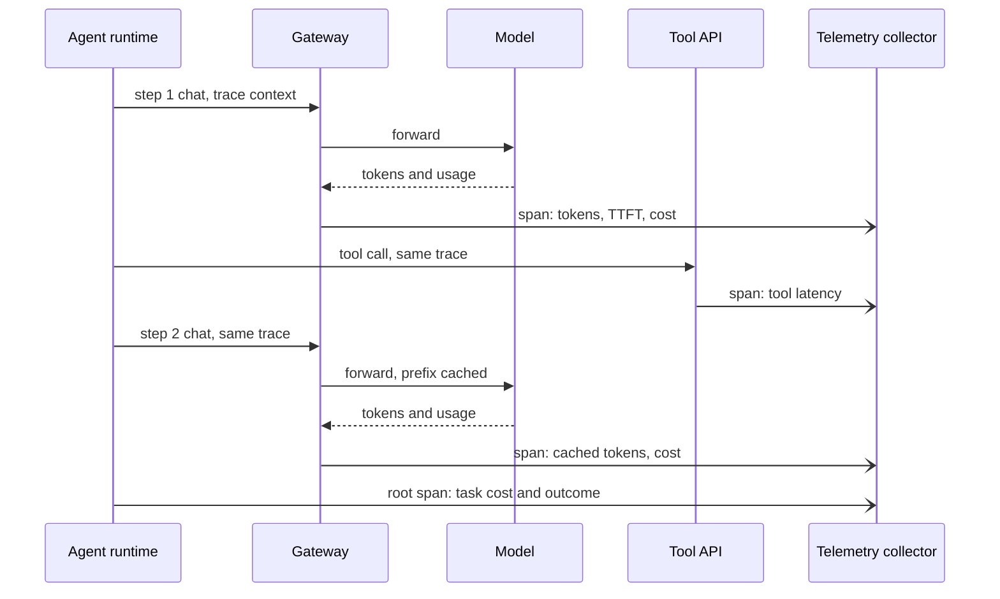

**Reading the diagram.** The agent runtime propagates one trace context through every call. The gateway forwards model calls synchronously and emits a span per call asynchronously to the telemetry collector, with token counts, TTFT and cost; tools emit their own spans; the runtime closes a root span with the task's total cost and outcome. The collector feeds the metrics and trace stores, the storage boundary. Failure points: a tool or provider that drops the trace header breaks the chain; high-cardinality attributes (user IDs, prompt hashes) on metrics explode storage, so they belong on traces and logs. Scaling: sample traces by tenant and by outcome, keeping all errors.

::: formula
**Cost of one model call and of one task**

$$c_\text{call} = n_\text{in}^\text{new}\,p_\text{in} + n_\text{in}^\text{cached}\,p_\text{cached} + n_\text{out}\,p_\text{out} \qquad c_\text{task} = \sum_{\text{steps}} c_\text{call} + \sum_{\text{tools}} c_\text{tool}$$

| Symbol | Meaning | Units |
|---|---|---|
| $n_\text{in}^\text{new}$, $n_\text{in}^\text{cached}$ | Uncached and cached input tokens | tokens |
| $n_\text{out}$ | Output tokens | tokens |
| $p_\text{in}$, $p_\text{cached}$, $p_\text{out}$ | Prices or internal transfer prices per token | \$/token |
| $c_\text{tool}$ | Cost of a tool call | \$ |
:::

::: example
**Worked example — Cost of one ops-agent task.** Eight steps of 6,000 input and 300 output tokens on the frontier API (\$3 and \$15 per million); from step 2 on, about 80% of each prompt is the previous step's context. Assume cached input billed at 10% of the input price (illustrative).

1. Without caching, per step: $6{,}000 \times 3 \times 10^{-6} + 300 \times 15 \times 10^{-6} = 0.018 + 0.0045 = \$0.0225$; per task $8 \times 0.0225 = \$0.180$.
2. With caching, per step: $1{,}200 \times 3 \times 10^{-6} + 4{,}800 \times 0.3 \times 10^{-6} + 0.0045 = 0.0036 + 0.00144 + 0.0045 = \$0.00954$; per task \$0.076 (treating step 1 like the rest for simplicity).
3. Monthly at 4,000 tasks a day: \$21,600 without caching, \$9,158 with it.

**Interpretation.** Output tokens are 5% of the tokens but, with caching, 47% of the cost; cached-token counts belong in every usage record. **Engineering implication.** Alert on the cached-token ratio per alias: a template change that breaks prefix stability more than doubles this tenant's bill overnight.
:::

**Table 79.5 — Core dashboards and alerts.**

| Signal | Granularity | Alert when |
|---|---|---|
| TTFT p95, TPOT p95 | Alias, deployment, region | Above objective for 10 min |
| Queue depth, KV-cache usage, preemptions | Replica, pool | Sustained above scale-out threshold |
| Error and fallback rate, by cause | Alias, provider | Fallback rate > 5% |
| Tokens per minute and 429 rate | Tenant | Near limit; 429s on P0 |
| Cost per day and per task | Tenant, alias | Above budget forecast (§51.5) |
| Cached-token ratio | Alias | Drops by > 20 points |
| Finish reason `length` share | Alias | Rising (answers truncated) |

## 79.14 Data privacy and security

### 79.14.1 Prompts are data

::: definition
**Definition — Prompt and response data protection.** The controls that govern personal and confidential data in model traffic: **redaction** or **pseudonymization** before data leaves a trust boundary (§50.10), **retention** limits for prompts, responses and derived artifacts (logs, caches, evaluation sets), **encryption** in transit and at rest, **access control** on who may read content, **provider data controls** such as zero-data-retention modes, and an **audit** trail of every access and every flow.
:::

#### Why does this exist?

Support prompts contain names, addresses and orders; agent prompts may hold courier location trails. Every copy needs protection: gateway logs, prompt stores, caches, evaluation sets, provider logs and fine-tuning sets. GDPR erasure requests (§50.9) reach all of them.

#### How it works internally

1. **Classify** each tenant and alias with a data class (public, internal, personal, sensitive) that drives every later control.
2. **Redact or pseudonymize at the gateway** before external providers and before logging: pattern matchers for structured identifiers (phones, emails, card numbers), NER models for names and addresses, and reversible tokens from a vault (`<CUSTOMER_1>`) where the model needs to refer to an entity and the response must be re-identified for the user.
3. **Choose provider data controls** per data class. As published in 2026: OpenAI documents that API abuse-monitoring logs are retained for up to 30 days by default, with Modified Abuse Monitoring or Zero Data Retention available to approved customers on eligible endpoints [OpenAI Docs: Your data]; Anthropic documents zero data retention as available on request through its account team, with listed exceptions [Anthropic Docs: API and data retention]; Google documents data-governance and zero-data-retention conditions for generative AI on Vertex AI [Google Cloud Docs: Vertex AI data governance]. Terms change; the platform's provider registry records the contract actually signed, and the router enforces it (Figure 79.3).
4. **Retain briefly, by tier.** Usage records (no content) for years for billing; redacted content for days to weeks for debugging; unredacted content only in break-glass scenarios with approval.
5. **Encrypt and separate.** TLS everywhere; content stores encrypted with per-tenant keys so that deleting a key erases a tenant's logs (crypto-shredding).
6. **Control and audit access.** Reading prompts requires a role, a reason and leaves an audit record; dashboards show aggregates only.

**Figure 79.12 — Privacy controls on the prompt path.**

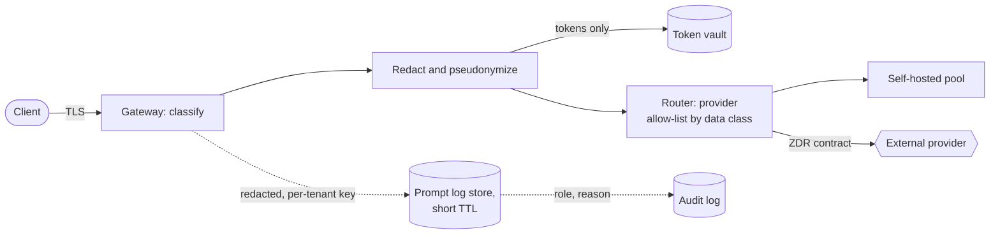

**Reading the diagram.** The gateway classifies the request and replaces identifiers with reversible tokens, storing the mapping in a vault, the most sensitive storage boundary. The router sends personal data only to self-hosted pools or to providers whose contract (for example zero data retention) the data class allows. A redacted copy goes asynchronously to the prompt log store under a per-tenant key and short TTL, and every read of that store is recorded in the audit log. Failure points: redaction misses (NER recall is never 100%), so the provider control is defense in depth, not a substitute; the vault and keys must be as available as the gateway. Scaling: redaction runs on gateway CPUs; NER models may need their own pool.

::: warning
**Warning — Retention hides in derived copies.** Zero data retention at the provider does nothing for your own gateway logs, caches, traces and evaluation sets. Inventory every store that holds content, give each a TTL and an erasure path, and test erasure end to end.
:::

#### Failure scenarios

| What goes wrong | Why | Detection | Recovery | Prevention |
|---|---|---|---|---|
| Names reach provider logs | NER misses a name | Sampled audits of outbound prompts | Request deletion under contract | Layered controls; ZDR for personal data |
| Debug logging stores raw prompts | Verbose mode enabled in production | Content in metric or trace stores | Purge; rotate keys | Content only through the logging API |
| Engineer browses customer chats | Broad read access | Audit log anomaly | Revoke | Role, reason and approval for content reads |
| Erasure request incomplete | Copy in cache or eval set | Erasure test fails | Purge copies | Per-tenant keys and data inventory |

## 79.15 Cost allocation and chargeback

### 79.15.1 From GPU-hours and invoices to team bills

::: definition
**Definition — Showback and chargeback.** **Showback** reports each team's share of platform cost without moving money; **chargeback** bills it to the team's budget (§51.5). Both need **metering** (who used what, §79.13), **unit rates** (cost per token by model, per GPU-hour, per request) and **allocation rules** for shared and idle cost.
:::

#### Why does this exist?

API costs are easy to attribute: the invoice is in tokens. A GPU-hour serves several tenants and idles between peaks, and someone must pay for idle hours. The allocation rule is also an incentive: it decides whether moving a batch job to 3 a.m. saves a team money.

#### How it works internally

1. **Meter** every call in the usage ledger with tokens and GPU-seconds estimated from per-token costs of the deployment.
2. **Price external usage** from provider rates, including cached-token discounts, reconciled monthly to invoices.
3. **Allocate pool cost.** Either by **usage share** (each tenant pays its fraction of busy GPU-seconds, idle included), or by **cost driver**: tenants that set the pool's size (online peaks) pay for capacity, while tenants that only fill valleys pay the busy rate for what they consume.
4. **Allocate platform overhead** (gateways, logging, observability, on-call) by requests or by tokens.
5. **Publish rates** per alias, so teams can forecast: dollars per million input, cached and output tokens.

**Figure 79.13 — Cost allocation pipeline.**

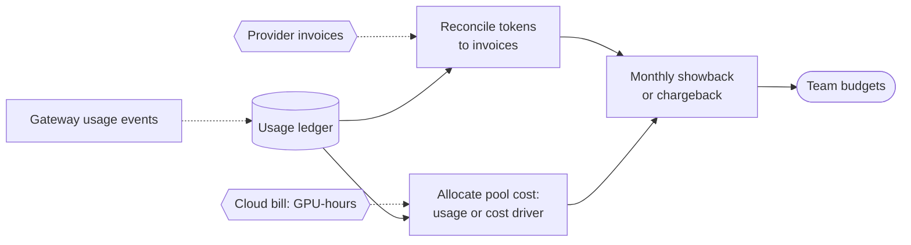

**Reading the diagram.** Usage events flow asynchronously into the ledger, which is the system of record. Provider invoices are reconciled against the ledger's token counts; the cloud bill's GPU-hours are allocated to tenants using the ledger's GPU-second estimates and an allocation rule. Both feed a monthly bill per team. Failure points: ledger gaps (dropped usage events) make bills disagree with invoices, so a reconciliation tolerance (for example 1%) is monitored; changing the allocation rule mid-quarter breaks forecasts. Scaling: the ledger is an append-only table partitioned by day and tenant, aggregated daily.

::: formula
**Self-hosted cost per million tokens and cost-driver allocation**

$$c_\text{1M} = \frac{p_\text{gpu}\, g_\text{tok}\, 10^6}{3{,}600\, u} \qquad A_\text{valley} = p_\text{gpu}\, G_\text{valley} \qquad A_\text{driver} = C_\text{pool} - \sum A_\text{valley}$$

| Symbol | Meaning | Units |
|---|---|---|
| $p_\text{gpu}$ | Price per GPU-hour | \$/GPU-h |
| $g_\text{tok}$ | GPU-seconds per token of a type (input, output) | GPU-s |
| $u$ | Pool utilization (busy over provisioned GPU-hours) | dimensionless |
| $c_\text{1M}$ | Loaded cost per million tokens | \$ |
| $G_\text{valley}$ | Busy GPU-hours of tenants that run only in idle capacity | GPU-h |
| $C_\text{pool}$ | Pool cost for the month | \$ |
| $A$ | Amount allocated | \$ |
:::

::: example
**Worked example — QuickBite's monthly allocation.** Pool: 2,160 GPU-hours, $C_\text{pool} = \$5{,}400$ (§79.8); busy GPU-hours T1 148.7, T2 85.0, T3 7.6 (total 241.3, $u = 0.112$). Ops agents' API bill with prefix caching: \$9,158 (§79.13). Platform overhead \$2,600, allocated by requests: T1 75,000, T2 100,000, T3 20,000, T4 32,000 a day.

1. Unit rates at 100% busy: input $2.50 \times 28.3 \times 10^{-6} \times 10^6/3{,}600 = \$0.0197$ per million; output $2.50 \times 567/3{,}600 = \$0.394$. Loaded at $u = 0.112$: \$0.176 and \$3.52.
2. Usage-share allocation of the pool: T1 61.6% → \$3,328; T2 35.2% → \$1,903; T3 3.1% → \$169.
3. Cost-driver allocation: valley tenants pay the busy rate, T2 $85.0 \times 2.50 = \$213$ and T3 $7.6 \times 2.50 = \$19$; T1, which sets the pool's size, pays $5{,}400 - 213 - 19 = \$5{,}169$.
4. Overhead by request share: T1 33.0% → \$859; T2 44.1% → \$1,145; T3 8.8% → \$229; T4 14.1% → \$367.

**Table 79.6 — Monthly chargeback, cost-driver rule (rounded).**

| Tenant | Pool | External API | Overhead | Total |
|---|---|---|---|---|
| T1 `support-chat` | \$5,169 | — | \$859 | \$6,028 |
| T2 `menu-enrich` | \$213 | — | \$1,145 | \$1,358 |
| T3 `review-tags` | \$19 | — | \$229 | \$248 |
| T4 `ops-agents` | — | \$9,158 | \$367 | \$9,525 |
| **Total** | \$5,400 | \$9,158 | \$2,600 | \$17,158 |

**Interpretation.** The rule moves T2's pool bill by 9× (\$1,903 versus \$213). Under usage share, the menu team subsidizes support chat's idle peak capacity and gains nothing by running at night; under cost driver, support chat sees its true cost, \$0.0027 per query, and the menu team is rewarded for filling valleys. **Engineering implication.** Allocate idle capacity to the tenants whose peaks and SLOs create it, charge valley tenants the busy rate, publish per-alias rates, and review the rule when the tenant mix changes. Overhead by requests over-charges batch tenants with many small calls; by tokens is the alternative.
:::


## 79.16 Build versus buy for AI platforms

### 79.16.1 Self-hosting versus API providers

::: definition
**Definition — Build versus buy for model serving.** The per-model decision between **self-hosting** (running open-weight or custom models on GPUs you rent or own, with your engines and operations) and **buying** inference from API providers (paying per token, possibly with provisioned capacity), and, at the platform level, between building the gateway and control plane and adopting an open-source or managed one (§51.9, §69.15).
:::

#### Why does this exist?

Self-hosting is cheap per token only when GPUs are busy; APIs charge nothing when idle. The decision turns on volume, utilization, whether the model can be bought at all, data controls and the people who run GPUs at 3 a.m.

::: formula
**Break-even volume between self-hosting and an API**

$$C_\text{self}(V) = F + c\,V \qquad C_\text{api}(V) = p\,V \qquad V^\star = \frac{F}{p - c}$$

| Symbol | Meaning | Units |
|---|---|---|
| $V$ | Tokens served per month | millions of tokens |
| $F$ | Fixed monthly cost of self-hosting: always-on minimum fleet plus operations staff share | \$/month |
| $c$ | Variable self-hosted cost per million tokens at the achieved utilization | \$/M tokens |
| $p$ | Blended API price per million tokens for the workload's input/output mix | \$/M tokens |
| $V^\star$ | Monthly volume above which self-hosting is cheaper | millions of tokens |
:::

::: example
**Worked example — Should QuickBite self-host the support chatbot?** Mix per query: 4,500 input and 230 output tokens (4,730 total). Small-model API: \$0.15 and \$0.60 per million. Self-hosted 7B: 0.238 GPU-s per query. Minimum fleet two H100s always on; an assumed \$8,000 a month for the share of platform engineers and on-call.

1. Blended API price: $p = (4{,}500 \times 0.15 + 230 \times 0.60)/4{,}730 = 813/4{,}730 = \$0.172$ per million.
2. Self-hosted variable cost at 100% busy: $0.238/4{,}730 \times 10^6 = 50.3$ GPU-s per million tokens, $50.3/3{,}600 \times 2.50 = \$0.0349$; at $\rho = 0.6$, $c = \$0.0582$.
3. Fixed cost: $F = 2 \times 730 \times 2.50 + 8{,}000 = 3{,}650 + 8{,}000 = \$11{,}650$.
4. Break-even: $V^\star = 11{,}650/(0.172 - 0.0582) = 11{,}650/0.1137 \approx 102{,}500$ million, about 102.5 billion tokens a month.
5. Actual volume: $75{,}000 \times 4{,}730 \times 30 = 10.6$ billion tokens a month, about a tenth of break-even. The API would cost $10{,}643 \times 0.172 = \$1{,}830$ a month against \$6,028 charged to support chat in Table 79.6.
6. For the ops agents, the comparison is a 70B self-hosted model (minimum two four-GPU replicas, $8 \times 730 \times 2.50 = \$14{,}600$ a month before staff) against \$9,158 of frontier API with caching, and the two are not the same quality (Chapter 78).

**Interpretation.** At QuickBite's volume, buying is cheaper for both workloads by a wide margin. Self-hosting the chatbot is justified only by things the formula omits: the model is QuickBite's own continued-pre-trained 7B (§65.9), which a generic API cannot serve; data controls; and the option to grow. **Engineering implication.** Price the alternatives honestly, including providers that host custom fine-tunes or adapters, and revisit the decision when volume reaches a third of $V^\star$, when GPU prices move, or when the custom model's quality advantage is measured rather than assumed.
:::

**Figure 79.14 — Build-versus-buy decision per model.**

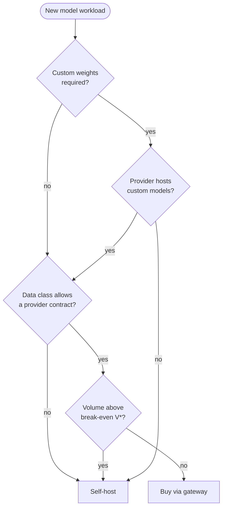

**Reading the diagram.** Each decision is made per model, in order of how binding it is. A workload needing custom weights can be bought only if some provider hosts custom models or adapters; a data class that no provider contract satisfies forces self-hosting; otherwise volume against $V^\star$ decides. Every path goes through the same gateway, so the decision can be reversed by changing a route, not the clients. Failure points: an estimate of $F$ that omits on-call staff, or a $c$ computed at 100% utilization, biases the decision toward building. Scaling: re-run the decision quarterly with the ledger's actual volumes.

**Table 79.7 — Self-hosting versus API providers.**

| Factor | Self-host | API provider |
|---|---|---|
| Cost at low volume | High: idle redundancy | Low: pay per token |
| Cost at high, steady volume | Low per token | Higher per token; discounts and provisioned capacity help |
| Model choice | Open-weight and custom models | Provider's models, sometimes hosted fine-tunes |
| Latency control | Full: engine, batching, placement | Limited: shared capacity, provider limits |
| Data controls | Data stays in your boundary | Contractual (retention, ZDR, regions) |
| Operational complexity | GPUs, engines, upgrades, on-call | Integration, quotas, vendor risk |
| Choose when | Volume ≫ $V^\star$, custom weights or strict data rules | Most new workloads; spiky or small volume |

::: recommendation
**Recommendation — Build the control point, rent the GPUs until the numbers say otherwise.** The gateway, ledger and policy layer are worth owning early because they make every later decision reversible; self-hosted pools are worth owning when a workload's volume, data class or custom model justifies them.
:::
