# Chapter 80 — Large-Scale AI Infrastructure

> **Level:** 5 · **Track:** B (ML/AI) · **Estimated reading time:** 6 h

Chapter 65 showed how to split one training job across thousands of GPUs and how often such a job fails: about every three hours at 16,384 GPUs. This chapter is about the machine underneath: the building, the power feed, the cooling loops, the network fabric, the storage tier, the scheduler and the operations team that together make 10,000 or more accelerators behave like one computer for months.

A web fleet of 16,000 servers and a training cluster of 16,000 GPUs look alike on a floor plan. They are different machines. The web fleet's replicas never wait for each other (§18.4); the training cluster runs one program in lockstep, so one slow GPU slows all of them, one dead link stops all of them, and they all draw power at the same moment. You will learn to size the network, the storage, the power and the spares of such a cluster from first principles, to budget its goodput, and to read what Meta, Google, NVIDIA, ByteDance, OpenAI and Anthropic have actually published about theirs.

This chapter owns cluster and facility design for large training. Parallelism layouts, checkpoint mechanics and the Young/Daly interval belong to Chapter 65; GPU internals and interconnect speeds to Chapter 64; RDMA, InfiniBand, RoCE and parallel file systems to Chapter 49; gang scheduling to Chapter 46; PUE and carbon accounting to Chapter 51. They are summarized here and cross-referenced.

::: note
**Assumptions used in this chapter.** Units are SI (1 GB = 10⁹ bytes; 1 MW = 10⁶ W). The **H100-class GPU** of Chapter 65 is reused: 80 GB HBM, $10^{15}$ dense BF16 FLOP/s, 700 W thermal design power (TDP), one 400 Gb/s (50 GB/s line rate, 40 GB/s achieved) NIC per GPU, 8 GPUs per server, about 10.2 kW maximum per server (DGX H100 class; as of 2026). From Chapter 65: one job interruption per **50,700 GPU-hours** (Llama 3's 419 unexpected interruptions in 54 days on 16,384 GPUs, a job MTBF of 3.1 hours), a synchronous checkpoint stall $\delta = 20$ s, a restart $R = 600$ s, MFU 40% and an illustrative \$2.50 per GPU-hour. The **reference job** is a 405B-parameter dense model trained on 15.6 trillion tokens ($3.8 \times 10^{25}$ FLOPs; §65.4). Prices, power and carbon figures not attributed to a source are illustrative.
:::

## 80.1 Learning objectives

After this chapter you should be able to:

- Explain why synchronous training turns per-device faults, jitter and power draw into cluster-wide problems.
- Draw the layers of a large training cluster and state the bandwidth of each tier.
- Compute bisection bandwidth, oversubscription, hierarchical all-reduce time and ECMP collision effects for a 16,000–24,000-GPU fabric.
- Size checkpoint bandwidth and restart read bandwidth for a 405B-parameter model.
- Estimate the megawatts, cooling flow and rack density of a 16,384-GPU cluster.
- Compute job MTBF from device MTBF, explain silent data corruption and how it is detected.
- Build a goodput budget, simulate it with Monte Carlo, and size hot spares.
- Detect and decide when to evict stragglers.
- Design scheduling and node-health operations for a cluster shared by research and production.
- Summarize published infrastructure from Meta, Google, NVIDIA, ByteDance, OpenAI and Anthropic, and say what has not been published.
- Estimate the cost, energy, carbon and water of a training run.

## 80.2 Prerequisites

- GPU architecture, NVLink, NVSwitch and interconnect bandwidths — §64.14 (the per-GPU constants used throughout).
- Parallelism layouts, $6ND$, checkpointing, Young/Daly, Llama 3 interruption statistics and goodput — §65.4, §65.13, §65.15–§65.17 (this chapter reuses their figures unchanged).
- RDMA, InfiniBand versus RoCEv2, DCQCN, fat trees and dragonflies, parallel file systems — §49.10–§49.11 (the fabric and storage vocabulary).
- Gang scheduling, topology-aware placement and Slurm — §46.10–§46.12 (how a 16,000-GPU gang is admitted).
- PUE, WUE and operational carbon — §51.10–§51.11 (the facility and carbon formulas).
- Little's law — §4.11; series reliability and correlated failures — §39.4 (used for spares and job MTBF).

## 80.3 Why AI clusters are a distinct engineering discipline

### 80.3.1 Synchronous coupling

::: definition
**Definition — Synchronous training cluster.** A cluster whose accelerators run one bulk-synchronous program: every step, every rank computes, then joins collectives (all-reduce, all-gather, reduce-scatter; §65.7) that complete only when all participants arrive. The **scale-up domain** is the group of accelerators joined by a memory-semantic fabric (NVLink and NVSwitch, or TPU inter-chip interconnect); the **scale-out network** (also called the **backend** or **compute fabric**) joins scale-up domains with RDMA.
:::

#### First-principles explanation

Picture a rowing crew of 16,000. The boat moves at the pace of the slowest stroke, and if one rower drops an oar the whole boat stops. A web fleet is instead a taxi company: one slow taxi delays one passenger. Everything distinctive about AI infrastructure follows from that coupling:

1. **The slowest device sets the pace.** Step time is the maximum over ranks, so the tail, not the mean, decides throughput (§65.17).
2. **One failure stops everyone** (§80.8).
3. **Power moves in unison**, so the facility sees load swings of tens of megawatts (§80.7).
4. **The network carries the program.** Collectives run every step at hundreds of gigabits per GPU.
5. **Density is extreme.** About 10 kW per 8-GPU server and 120 kW per 72-GPU liquid-cooled rack, against 5–15 kW for an enterprise rack.

**Figure 80.1 — One synchronous training step: the slowest rank sets the pace.**

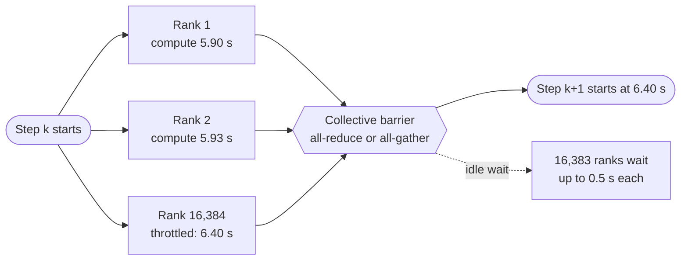

**Reading the diagram.** All ranks start step $k$ together and compute their share; the collective (hexagon) completes only when the last rank arrives, so a single thermally throttled rank delays step $k+1$ for everyone. The dotted edge is the cost: thousands of GPUs idling, invisible in per-GPU utilization dashboards that average it away. Edges are synchronous; there is no storage boundary. Failure point: a rank that never arrives hangs the job until a watchdog timeout (§65.16). Scaling makes it worse: more ranks means a higher chance that some rank is slow on any given step.

#### Mathematical foundations

::: formula
**Expected step time of $N$ ranks with independent jitter**

$$T_\text{step} = \max_{i=1..N} T_i \qquad \mathbb{E}[T_\text{step}] \approx \mu + \sigma\sqrt{2\ln N} \quad (T_i \sim \mathcal{N}(\mu, \sigma^2))$$

| Symbol | Meaning | Units |
|---|---|---|
| $T_i$ | Compute time of rank $i$ in one step | s |
| $N$ | Ranks in the synchronous job | ranks |
| $\mu$, $\sigma$ | Mean and standard deviation of per-rank compute time | s |
| $T_\text{step}$ | Step time, set by the slowest rank | s |
:::

The $\sqrt{2\ln N}$ factor is the standard large-$N$ approximation for the maximum of Gaussian samples. Real stragglers have heavier tails than a Gaussian; §65.17 models them as a probability $q$ of a $\sigma\times$ slowdown, which is worse.

::: example
**Worked example — Jitter tax from 8 to 131,072 GPUs.** Take the reference job's step of $\mu = 5.93$ s (16 million tokens per step on 16,384 GPUs at 40% MFU: $6 \times 4.05 \times 10^{11} \times 1.6 \times 10^7 / (16{,}384 \times 4 \times 10^{14})$) and per-rank jitter $\sigma = 1\%$ of $\mu$ = 0.059 s.

1. $N = 8$: $\sqrt{2\ln 8} = 2.04$; step grows by $2.04 \times 1\% = 2.0\%$.
2. $N = 1{,}024$: $\sqrt{2\ln 1{,}024} = 3.72$; +3.7%.
3. $N = 16{,}384$: $\sqrt{2\ln 16{,}384} = 4.41$; +4.4%, or 0.26 s of every step.
4. $N = 131{,}072$: 4.85; +4.9%.
5. On the reference run (about 29 million GPU-hours, §80.14), 4.4% is 1.3 million GPU-hours, about \$3.2 million at \$2.50.

**Interpretation.** Gaussian jitter costs a few percent and grows slowly with $N$; the expensive cases are heavy tails: one thermally throttled or link-degraded GPU that is slow on *every* step. **Engineering implication.** Engineer the tail: identical firmware and clocks, isolated cores for system daemons, and the straggler detection of §80.10.
:::

### 80.3.2 How an AI cluster differs from a web fleet

**Table 80.1 — A web-serving fleet versus a large training cluster.**

| Aspect | Web-serving fleet | Large training cluster |
|---|---|---|
| Coupling | Independent replicas | One synchronous job across all devices |
| Effect of one failure | Lose $1/N$ of capacity | Job stops; restart from checkpoint |
| Tail that matters | p99 request latency | Slowest rank per step |
| Network | Frontend, mostly north–south, oversubscribed | Dedicated RDMA backend, east–west, near non-blocking |
| Power per rack (as of 2026) | ~5–15 kW, air-cooled | ~40 kW (air, 8-GPU servers) to ~120–130 kW (liquid, 72 GPUs) |
| Power profile | Diurnal, smooth | Flat at high load, with synchronized swings |
| Storage pattern | Many small random reads | Sequential streaming plus periodic multi-terabyte write bursts |
| Scheduling unit | Pod or task | Gang of thousands of GPUs, topology-constrained |
| Key metric | Availability, latency | Goodput × MFU |

::: mistake
**Treating a training cluster as a big web fleet.** Oversubscribed frontend networks, rolling maintenance that drains one node at a time, and "N+1" thinking all assume independent replicas. In a synchronous job, draining one node *is* stopping the job, so maintenance must be batched into planned restarts.
:::

## 80.4 Anatomy of a large training cluster

### 80.4.1 Six layers

::: definition
**Definition — Training cluster layers.** (1) **Compute nodes**: servers with 4–8 accelerators, CPUs, host memory and local NVMe. (2) **Scale-up domain**: accelerators joined by NVLink and NVSwitch (8 GPUs in an HGX H100 server, 72 in a GB200 NVL72 rack) or by TPU inter-chip interconnect (ICI). (3) **Scale-out backend network**: one RDMA NIC per accelerator into a dedicated InfiniBand or RoCE fabric used only for collectives. (4) **Storage tier**: parallel file system or flash-backed object storage for datasets and checkpoints. (5) **Frontend network**: ordinary datacenter Ethernet for storage access, data loading, logging and logins. (6) **Control plane**: schedulers, health services, telemetry and out-of-band management (BMC) networks.
:::

#### Why does this exist?

Each layer answers one bandwidth problem. Tensor parallelism exchanges activations inside every layer and needs terabytes per second, which only a scale-up domain gives. Data parallelism exchanges gradients once per step and is content with hundreds of gigabits per GPU, the scale-out fabric. Data loading and checkpoints need throughput but tolerate milliseconds of latency, so they ride the cheaper frontend. Keeping collective traffic on its own fabric isolates it from everything else: the Meta designs of §80.12 and NVIDIA's DGX SuperPOD both separate the compute fabric from storage and management networks [Gangidi et al. 2024; NVIDIA DGX SuperPOD RA].

**Figure 80.2 — Anatomy of a large training cluster.**

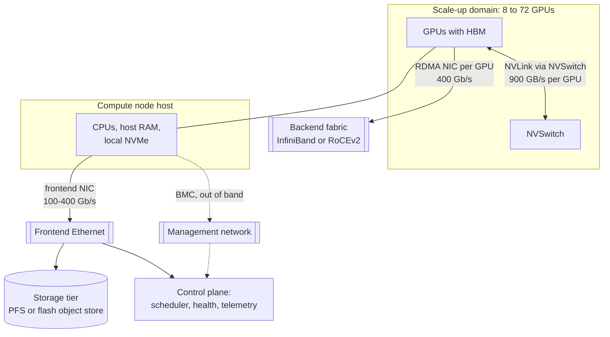

**Reading the diagram.** Inside the scale-up domain, GPUs talk through NVSwitch at about 900 GB/s each (§64.14). Each GPU also has its own RDMA NIC into the backend fabric (subroutine shape: a network), which carries only collectives. The host's CPUs reach storage and the control plane over the frontend Ethernet; the baseboard management controller (BMC) uses a separate out-of-band network (dotted, asynchronous) so a hung host can still be power-cycled. Storage boundary: the storage tier. Failure points: a NIC or NVSwitch fault stops the job; a frontend fault stalls data loading or checkpoints. Scaling: add scale-up domains and backend switch tiers; the storage and frontend tiers are sized separately.

**Table 80.2 — Scale-up domains (as of 2026; vendor and paper figures).**

| System | Accelerators per scale-up domain | Fabric | Larger unit |
|---|---|---|---|
| HGX/DGX H100 | 8 GPUs | NVLink 4 via NVSwitch, 900 GB/s per GPU | Rail-optimized InfiniBand or RoCE |
| GB200 NVL72 | 72 GPUs in one rack | NVLink 5, 1.8 TB/s per GPU | SuperPOD of NVL72 racks |
| Google TPU v4 | 64-chip 4×4×4 cube; up to 4,096 chips per pod over ICI | ICI with optical circuit switches between cubes | Multiple pods over the datacenter network |
| Google TPU v5p | Up to 8,960 chips per pod | ICI, 3D torus | Multiple pods |
| AWS Trn2 UltraServer | 64 Trainium2 chips | NeuronLink | EC2 UltraClusters over EFA |

Sources: [NVIDIA 2022b; NVIDIA GB200 NVL72; Jouppi et al. 2023; Google Cloud 2023; AWS 2024]. A TPU pod is a much larger single-fabric unit than a GPU scale-up domain, which is why Google describes it as a supercomputer of its own (§80.12).

::: example
**Worked example — Counting the parts of a 16,384-GPU cluster.** Assume H100-class 8-GPU servers, one 400 Gb/s backend NIC per GPU, and a non-blocking three-tier fat tree of 64-port 400 Gb/s switches.

1. Servers: $16{,}384/8 = 2{,}048$; at about 4 servers per air-cooled rack, 512 racks.
2. Leaf switches: each uses 32 ports down and 32 up, so $16{,}384/32 = 512$.
3. Spine (aggregation) switches: 512, again 32 down and 32 up.
4. Core switches: the 16,384 uplinks from the spine tier need $16{,}384/64 = 256$ switches. Total 1,280 backend switches.
5. Links: 16,384 per tier × 3 tiers = 49,152 cables; with optics at both ends, about 98,000 transceivers.
6. Add one frontend NIC per server (2,048), storage servers, and a BMC port per server.

**Interpretation.** The backend alone has three cables for every GPU, and every one is a failure point (network switches and cables caused 8.4% of Llama 3's unexpected interruptions; Table 80.6). **Engineering implication.** Budget optics and cabling as first-class capex and failure sources, and prefer topologies that cut tiers (higher-radix switches, larger scale-up domains).
:::

### 80.4.2 Bandwidth tiers

Bandwidth per GPU falls about tenfold at each step outward: HBM about 3 TB/s, NVLink 900 GB/s, backend 50 GB/s, frontend a few GB/s (§64.14). Put the most frequent communication on the fastest tier: tensor parallelism inside the scale-up domain, pipeline and data parallelism across the backend, and across buildings only the infrequent outermost data-parallel reduction (§80.12).

## 80.5 Networking for training

### 80.5.1 Rail-optimized and non-blocking fat trees

::: definition
**Definition — Rail-optimized topology.** A fabric in which NIC $i$ of every server in a group (the GPU of local rank $i$) connects to the same leaf switch or leaf group, called **rail** $i$. Traffic between same-rank GPUs on different servers crosses one leaf; traffic between different ranks first moves over NVLink inside the server to the GPU on the right rail. A **non-blocking** fabric has full bisection bandwidth (§49.10.4); an **oversubscribed** one has less uplink than downlink capacity at some tier.
:::

#### First-principles explanation

Imagine an office tower where everyone on floor 3 of every building needs to talk only to people on floor 3 of the other buildings. You would build one corridor per floor connecting the buildings at that floor, not route everyone through the lobby. In data and pipeline parallelism, GPU $i$ of one server mostly talks to GPU $i$ of other servers, because they hold the same shard of the model. A rail puts those peers one switch hop apart. NCCL exploits rails directly: it runs one ring or tree per NIC, and when a message must reach a different rank it first copies it over NVLink to the GPU on the destination's rail (PXN in NCCL's terms), so cross-rail traffic never enters the spine.

**Figure 80.3 — A rail-optimized scalable unit with 32 servers and 8 rails.**

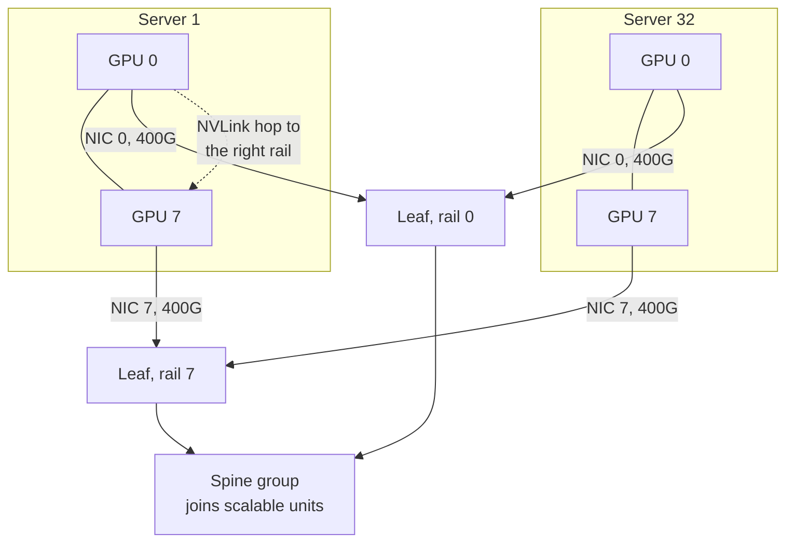

**Reading the diagram.** Each server's GPU 0 connects to the rail-0 leaf, GPU 7 to the rail-7 leaf, and so on; 256 GPUs form one scalable unit in NVIDIA's DGX H100 SuperPOD design [NVIDIA DGX SuperPOD RA]. Same-rail traffic crosses one leaf (synchronous RDMA). Traffic to another rail takes an NVLink hop inside the server first (dotted). Spines join scalable units and, in the reference design, keep the fat tree non-blocking. Failure points: a leaf failure removes one GPU from every server it serves, so one switch touches 32 servers; a single bad NIC slows every ring through it. Scaling: add units under more spine capacity, or a third tier.

### 80.5.2 Oversubscription and the Llama 3 network

Full bisection everywhere is expensive. Meta's Llama 3 paper describes a deliberate compromise for its 24,000-GPU RoCE cluster: full bisection inside a pod, oversubscription between pods [Dubey et al. 2024].

**Figure 80.4 — The three-layer RoCE network used for Llama 3 405B, as published.**

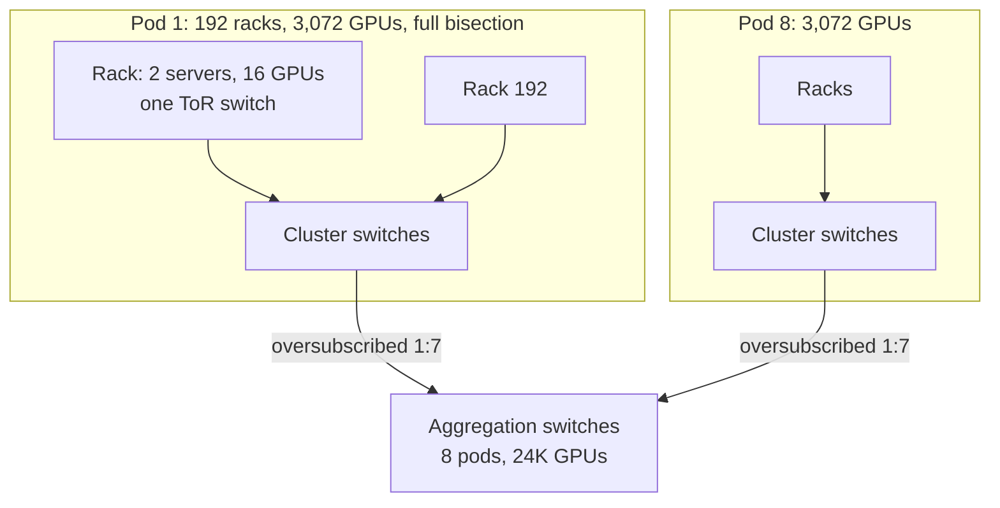

**Reading the diagram.** Each rack holds two 8-GPU servers under one top-of-rack (ToR) switch; 192 racks join through cluster switches into a 3,072-GPU pod with full bisection bandwidth; aggregation switches join eight pods into a 24K-GPU cluster with 1:7 oversubscription between pods [Dubey et al. 2024]. All links carry 400 Gb/s RoCE between GPUs, synchronously. Failure points: a ToR failure takes out 16 GPUs at once; the aggregation tier is the shared bottleneck for cross-pod traffic. Scaling: the paper reports that the job scheduler and collective library were made topology-aware to keep heavy traffic inside pods.

#### Mathematical foundations

::: formula
**Oversubscription and cross-group bandwidth**

$$r = \frac{\text{downlink capacity}}{\text{uplink capacity}} \qquad b_\text{cross} = \frac{b_\text{NIC}}{r} \qquad B_\text{bis} = \frac{H}{2}\cdot\min\!\left(b_\text{NIC}, b_\text{cross}\right)$$

| Symbol | Meaning | Units |
|---|---|---|
| $r$ | Oversubscription ratio at a tier (7 for "1:7") | — |
| $b_\text{NIC}$ | Injection bandwidth per GPU | Gb/s |
| $b_\text{cross}$ | Fair-share bandwidth per GPU when all GPUs send across the tier | Gb/s |
| $H$ | GPUs (endpoints) | count |
| $B_\text{bis}$ | Bisection bandwidth, one direction, cut placed at the oversubscribed tier | Gb/s |
:::

::: example
**Worked example — Bisection and an all-reduce across pods.** Compare a non-blocking 16,384-GPU fat tree with the published 24,576-GPU design; then run the reference job's data-parallel gradient reduction (TP 8 × PP 16 = 128 GPUs per replica; 192 replicas on 24,576 GPUs, 24 per pod) across it.

1. Non-blocking, 16,384 GPUs: $B_\text{bis} = 8{,}192 \times 400 = 3{,}277$ Tb/s, about 410 TB/s.
2. Published design, full bisection would be $12{,}288 \times 400 = 4.9$ Pb/s. With $r = 7$ at the aggregation tier, a four-pods-versus-four-pods cut gives $12{,}288 \times 400/7 = 702$ Tb/s, a seventh.
3. Gradient shard per GPU: $4.05 \times 10^{11} \times 2 / 128 = 6.33$ GB (BF16). Ring all-reduce over 192 replicas: $V = 2 \times \frac{191}{192} \times 6.33 = 12.6$ GB per GPU (§65.6.2).
4. *Rank order ignores topology:* about 7/8 of each pod's 3,072 GPUs send their ring traffic to another pod: demand $2{,}688 \times 400 = 1{,}075$ Tb/s against $3{,}072 \times 400/7 = 176$ Tb/s of pod uplink. Each flow gets about 65 Gb/s (8.2 GB/s), so the reduction takes $12.6/8.2 = 1.5$ s, a quarter of the 5.93 s step.
5. *Rank order follows pods:* each ring visits all 24 replicas of a pod before leaving, so only one hop per ring per pod crosses the tier: 128 rings × 400 Gb/s = 51 Tb/s, well under 176 Tb/s. The reduction runs at NIC speed: $12.6/40 = 0.31$ s, hidden behind backward computation.

**Interpretation.** A 1:7 tier costs nothing for well-placed rings and a factor of five for badly placed ones. **Engineering implication.** Oversubscription is a placement contract: keep tensor, context and pipeline groups inside pods, order data-parallel rings by topology, and reserve full bisection for the patterns that need it, such as mixture-of-experts all-to-all.
:::

### 80.5.3 Collective communication at scale

At 16,000 GPUs the latency terms that Chapter 65 could ignore come back. A flat ring all-reduce has $2(p-1)$ sequential steps (§49.9.2): even at $\alpha = 10$ µs per step, a 16,384-rank ring pays $2 \times 16{,}383 \times 10\ \mu\text{s} = 0.33$ s of pure latency per collective, regardless of message size. NCCL therefore uses trees for large rank counts (latency proportional to $\log p$), in-switch reductions where the hardware has them (InfiniBand SHARP, NVLink SHARP), and above all **hierarchical collectives**.

::: formula
**Hierarchical all-reduce time (α–β model)**

$$T_\text{hier} \approx \underbrace{2\frac{g-1}{g}\frac{S}{B_\text{up}}}_{\text{reduce-scatter and all-gather in scale-up domain}} + \underbrace{2(m-1)\,\alpha + 2\frac{m-1}{m}\frac{S/g}{B_\text{out}}}_{\text{all-reduce of } S/g \text{ across } m \text{ domains}}$$

| Symbol | Meaning | Units |
|---|---|---|
| $S$ | Bytes to all-reduce per GPU | bytes |
| $g$ | GPUs per scale-up domain | GPUs |
| $m$ | Number of scale-up domains in the collective | count |
| $B_\text{up}$, $B_\text{out}$ | Achieved per-GPU bandwidth inside the domain (NVLink) and across it (NIC) | bytes/s |
| $\alpha$ | Per-step latency of the scale-out ring | s |
:::

The structure is what matters: the first stage shrinks the message to $S/g$ per GPU over the fast fabric, so the slow fabric carries $g$ times less per GPU, and every GPU's NIC works in parallel on its own slice.

**Figure 80.5 — A two-level all-reduce on 8-GPU servers.**

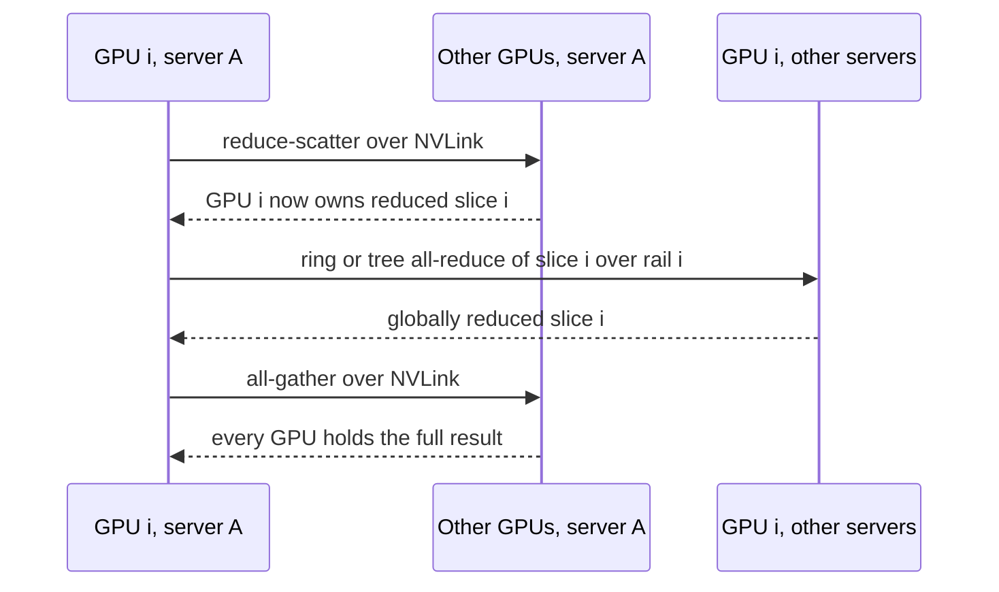

**Reading the diagram.** Stage one is a reduce-scatter inside the server over NVLink: GPU $i$ ends up owning the sum of slice $i$. Stage two runs eight independent all-reduces, one per rail, each over the backend fabric among the same-rank GPUs of all servers. Stage three all-gathers the slices back over NVLink. Every arrow is synchronous; no storage is involved. Failure points: one slow rail slows its slice and therefore the whole collective. Scaling: the cross-server stage carries one-eighth of the bytes per GPU, and with 72-GPU domains, one-seventy-second.

::: example
**Worked example — All-reduce of 2 GB per GPU on 16,384 GPUs.** $S = 2$ GB, $g = 8$, $m = 2{,}048$, $B_\text{up} = 360$ GB/s, $B_\text{out} = 40$ GB/s, $\alpha = 10$ µs.

1. Flat ring over 16,384 GPUs at NIC speed: bandwidth term $2 \times 2/40 = 0.100$ s; latency term $2 \times 16{,}383 \times 10^{-5} = 0.328$ s; total 0.43 s.
2. Hierarchical, stage one and three: $2 \times \frac{7}{8} \times 2/360 = 9.7$ ms.
3. Stage two on $S/g = 0.25$ GB per GPU across 2,048 servers: bandwidth $2 \times 0.25/40 = 12.5$ ms; ring latency $2 \times 2{,}047 \times 10^{-5} = 41$ ms; with a tree instead, $2 \log_2 2{,}048 \times 10^{-5} = 0.22$ ms.
4. Total hierarchical with tree: $9.7 + 12.5 + 0.2 \approx 22$ ms, about 20× faster than the flat ring.

**Interpretation.** At scale the flat ring is latency-bound, and the hierarchy wins twice: fewer bytes on the slow fabric and fewer sequential steps. **Engineering implication.** Let NCCL (or your vendor's library) build hierarchical, topology-aware collectives; check with `nccl-tests` that measured bus bandwidth at full scale is within a few percent of a single scalable unit's.
:::

### 80.5.4 RoCEv2 versus InfiniBand at 24,000-GPU scale

Chapter 49 compared the fabrics in principle (Table 49.3). The largest published head-to-head comparison is Meta's.

::: industry
**Meta's two 24,576-GPU clusters.** In March 2024 Meta described two clusters of 24,576 H100 GPUs each, one with a RoCE fabric built on Arista 7800 and Meta's own Wedge400 and Minipack2 switches, the other with NVIDIA Quantum-2 InfiniBand; both connect 400 Gb/s endpoints and are built on Meta's Grand Teton servers. Meta wrote that it built both to learn about the trade-offs and that, after tuning, both ran large generative-AI jobs, including Llama 3 training on the RoCE cluster, without network bottlenecks. The post also reported that Meta planned to have about 350,000 H100 GPUs by the end of 2024, part of compute equivalent to nearly 600,000 H100s.
*Evidence: Primary* — [Meta Engineering 2024]
:::

::: industry
**RoCE for distributed training at Meta.** Gangidi et al. describe the evolution of Meta's RoCE training networks: a dedicated backend fabric separate from the frontend, a two-stage Clos "AI zone" within which training runs, routing that moved from plain ECMP toward more flows per connection and enhanced ECMP hashing, and congestion control tuned to collective traffic, with the collective library admitting traffic at the receiver rather than relying only on DCQCN. The Llama 3 paper reports the same techniques in use: the collective library opens 16 flows between two GPUs instead of one, enhanced ECMP hashes on additional RoCE header fields to spread them, and deep-buffer spine switches absorb transient congestion from collective patterns [Dubey et al. 2024].
*Evidence: Primary* — [Gangidi et al. 2024; Dubey et al. 2024]
:::

**Table 80.3 — InfiniBand versus RoCEv2 for a 24,000-GPU training fabric.**

| Aspect | InfiniBand (e.g., NDR Quantum-2) | RoCEv2 (Ethernet) |
|---|---|---|
| What it is | RDMA-native fabric with a subnet manager | InfiniBand transport over UDP/IP Ethernet |
| Congestion and loss | Credit-based lossless links; adaptive routing in switches | PFC plus ECN/DCQCN or library-level admission; ECMP or adaptive routing per vendor |
| Advantages | Mature collective offload (SHARP), turnkey for HPC | Multi-vendor, Ethernet tooling and staff, reuse of datacenter operations |
| Disadvantages | Single dominant vendor; separate skills and tools | Tuning burden: PFC risks (§49.10.3), hashing collisions |
| Performance at 24K GPUs | Meta: no network bottleneck after tuning | Meta: no network bottleneck after tuning |
| Operational complexity | Lower for a dedicated cluster | Higher initially; lower if Ethernet is the house standard |
| Choose when | You buy a reference design and want it to work on day one | You operate Ethernet at scale and want vendor choice |

Both work at this scale; the decision is operational more than physical.

### 80.5.5 Congestion and load balancing

Traditional datacenter traffic consists of millions of small flows, so hashing each flow onto one of $n$ equal-cost paths (**ECMP**) averages out. Training traffic is the opposite: a few hundred **elephant flows**, each a long-lived queue pair carrying gigabytes, all starting at the same moment. Hashing a few elephants onto a few uplinks collides often, and because the collective finishes only when its slowest flow does, one collision slows the whole step.

::: formula
**ECMP collisions for $f$ equal flows hashed onto $n$ uplinks**

$$P(\text{no collision}) = \frac{n!}{(n-f)!\; n^{f}} \qquad \mathbb{E}[\text{uplinks used}] = n\left(1 - \left(1 - \frac{1}{n}\right)^{f}\right) \qquad \eta = \frac{f/n}{\mathbb{E}[\max \text{ load}]}$$

| Symbol | Meaning | Units |
|---|---|---|
| $f$ | Flows leaving a switch toward the next tier ($f \le n$ in the first formula) | flows |
| $n$ | Equal-cost uplinks | links |
| $\max$ load | Flows on the busiest uplink | flows |
| $\eta$ | Collective efficiency: achieved fraction of line rate when the slowest flow sets the pace | — |
:::

::: example
**Worked example — Eight elephants on eight uplinks.** A leaf has 8 uplinks and 8 GPUs each sending one flow of equal size to other leaves.

1. $P(\text{no collision}) = 8!/8^8 = 40{,}320/16{,}777{,}216 = 0.24\%$. Nearly every step has a collision.
2. Uplinks used: $8 \times (1 - 0.875^8) = 8 \times 0.656 = 5.25$, so a third of capacity sits idle.
3. Expected busiest uplink (Monte Carlo, 200,000 trials): 2.59 flows. Efficiency $\eta = 1/2.59 = 39\%$: the collective runs at about 155 Gb/s per GPU on 400 Gb/s links.
4. Split each GPU's traffic into 16 flows (128 equal sub-flows): expected busiest uplink 21.9 against an ideal 16, so $\eta = 16/21.9 = 73\%$.
5. Per-packet spraying or switch adaptive routing approaches $\eta \approx 1$, at the cost of out-of-order arrival that the transport must handle.

**Interpretation.** Flow-level hashing turns a non-blocking fabric into an effectively oversubscribed one for elephant traffic. **Engineering implication.** Use many queue pairs per connection and smarter hashing (Meta's approach), adaptive routing (InfiniBand and some Ethernet switches), or packet spraying (SRD, Ultra Ethernet); and measure per-uplink utilization during collectives, not averages.
:::

**Figure 80.6 — ECMP hashing versus adaptive spraying for synchronized flows.**

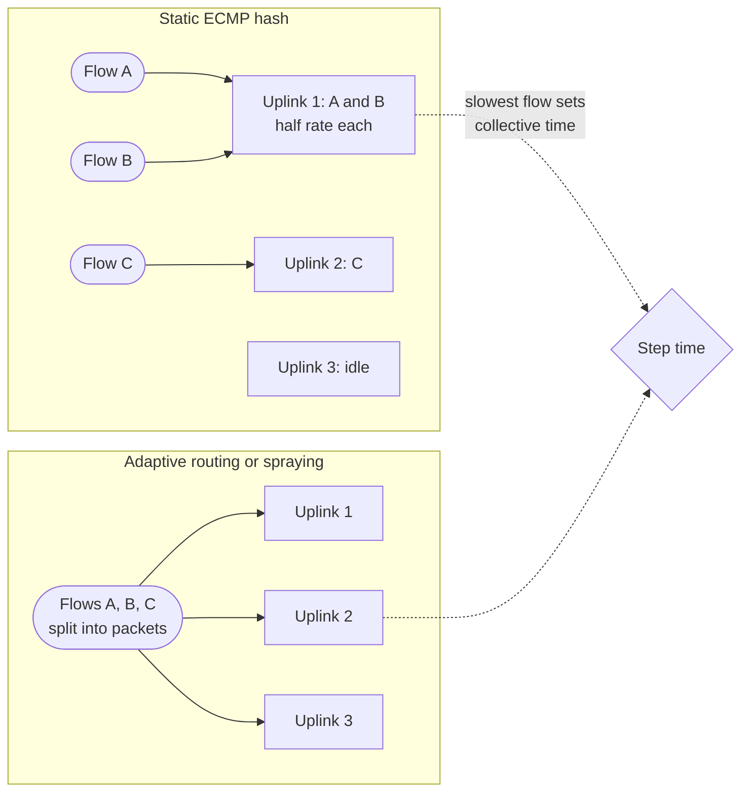

**Reading the diagram.** On the left, a static hash puts flows A and B on uplink 1 and leaves uplink 3 idle; A and B each get half rate, and since the collective waits for them (dotted), the step slows. On the right, the switch or NIC spreads packets of all flows over every uplink according to queue depth, so all three are used evenly. Links are synchronous RDMA paths with no storage boundary. Failure points: spraying needs receivers that tolerate reordering; adaptive routing needs switches that see congestion quickly. Scaling: the more uplinks and the fewer the flows, the worse static hashing gets.

#### Failure scenarios

| What goes wrong | Why | Detection | Recovery | Prevention |
|---|---|---|---|---|
| Bus bandwidth 40% below plan at full scale only | ECMP collisions or cross-pod rank order | `nccl-tests` at scale versus one unit; per-uplink counters | Re-rank by topology; more QPs per connection | Topology-aware scheduler and collective library |
| PFC pause storm freezes part of the fabric | NIC or switch fault sending continuous pauses | Pause-frame counters, PFC watchdog | Disable PFC on the port, drain node | Watchdogs; ECN thresholds below PFC thresholds (§49.10.3) |
| One link flaps or trains down to lower speed | Dirty or failing optic, cable damage | Link-error and speed telemetry; one slow rail | Drain the link or node | Optics burn-in; error-rate thresholds for replacement |
| Job hangs in a collective | Dead NIC or link mid-collective | NCCL watchdog timeout; no step progress | Kill, cordon, restart (§65.16) | Timeouts of minutes; flight-recorder traces |

::: mistake
**Validating the fabric with one job on one scalable unit.** Collisions, cross-pod placement and latency terms appear only at full scale. Acceptance tests must run collectives across the entire cluster, at production message sizes, before the first large job.
:::

## 80.6 Storage for training

### 80.6.1 Two workloads: streaming and bursts

A training cluster asks two very different things of storage. **Dataset streaming** is steady and modest for text: the reference job consumes 16 million tokens per 5.93 s step, 2.7 million tokens/s, which at 4 bytes per token is about 11 MB/s for the whole cluster. Images and video are different: a multimodal job can need tens to hundreds of GB/s of reads plus decoding (§65.17). **Checkpointing** is a burst: every few minutes, every rank writes its shard at once, then nothing. **Restart** is a read burst of the same size or larger.

**Figure 80.7 — Storage tiers and data paths of a training cluster.**

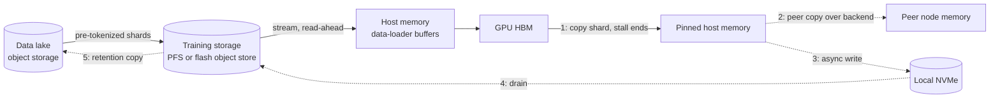

**Reading the diagram.** The read path (solid) moves pre-tokenized shards from the data lake into training storage, then streams them into data-loader buffers in host memory and onto the GPUs. The checkpoint path is numbered: the only synchronous step is the copy from HBM into pinned host memory (§65.15); then asynchronously (dotted) a copy goes to a peer node's memory, to local NVMe and finally to durable training storage, with a retention copy to the data lake. Storage boundaries: HBM, host memory, NVMe, training storage, data lake. Failure points: losing a node loses its host-memory and NVMe copies, hence the peer copy; the training storage must absorb thousands of simultaneous writers. Scaling: write bandwidth grows with nodes until the storage tier saturates.

### 80.6.2 Checkpoint and restart bandwidth

::: formula
**Checkpoint write bandwidth and restart read bandwidth**

$$S_\text{ckpt} = N_p\,(b_\text{state} + b_\text{w}) \qquad B_\text{write} = \frac{S_\text{ckpt}}{T_\text{write}} \qquad B_\text{read} = \frac{k\,S_\text{read}}{T_\text{load}}$$

| Symbol | Meaning | Units |
|---|---|---|
| $N_p$ | Model parameters | parameters |
| $b_\text{state}$ | Bytes of optimizer state per parameter (FP32 master weights plus two Adam moments: 12) | bytes |
| $b_\text{w}$ | Bytes of an extra BF16 weight copy kept for evaluation (2) | bytes |
| $T_\text{write}$, $T_\text{load}$ | Target time to write a checkpoint, and to load one on restart | s |
| $k$ | Read amplification: how many times each byte is read on restart | — |
| $S_\text{read}$ | Bytes of the state that each reader needs | bytes |
:::

::: example
**Worked example — Checkpointing the 405B reference model.** Use the 14 bytes per parameter of §65.15 and the 16,384-GPU job with Young interval 668 s.

1. Size: $4.05 \times 10^{11} \times 14 = 5.67$ TB, an average of 346 MB per GPU (Llama 3 reports per-GPU checkpoint sizes from 1 MB to 4 GB, because layouts are uneven [Dubey et al. 2024]).
2. Finish in 1 minute: $5.67 \times 10^{12}/60 = 94.5$ GB/s. In 10 s: 567 GB/s.
3. To keep a *synchronous* checkpoint's stall under 1% of a 668 s interval ($\delta \le 6.7$ s): 846 GB/s.
4. Against published capability: Llama 3's storage sustains 2 TB/s with a 7 TB/s peak [Dubey et al. 2024]: 2.8 s at sustained rate.
5. Average versus peak: 5.67 TB every 668 s averages 8.5 GB/s, so the tier is sized for a burst about 100 times its average.
6. Restart reads: if every one of 128 data-parallel replicas reads the full BF16 weights itself, $k = 128$: $128 \times 0.81 = 104$ TB, 52 s at 2 TB/s. If one replica reads and broadcasts over the 400 Gb/s backend, storage serves 5.67 TB in 2.8 s.

**Interpretation.** A 405B checkpoint is easy for a 2 TB/s tier when written once, in parallel, by shard; it is hard when restarts amplify reads or when the stall is synchronous. **Engineering implication.** Size storage for the checkpoint burst and the restart read, not the dataset stream; make checkpoints asynchronous so $\delta$ is the host-copy time; and load once per shard, then broadcast over the backend.
:::

::: industry
**Llama 3 training storage.** Meta reports that Llama 3 pre-training used Tectonic, its distributed file system (§49.4.2), providing 240 PB of storage on 7,500 SSD-equipped servers with 2 TB/s sustained and 7 TB/s peak throughput, and that its main challenge was the highly bursty checkpoint writes that saturate the storage fabric for short durations. The goals were to minimize GPU pause time during checkpointing and to checkpoint more often to reduce work lost after a failure. Meta's 2024 infrastructure post adds a FUSE-based client on flash-optimized Tectonic for checkpoints and a parallel NFS deployment developed with Hammerspace for interactive debugging.
*Evidence: Primary* — [Dubey et al. 2024; Meta Engineering 2024]
:::

**Table 80.4 — Storage options for training data and checkpoints.**

| Option | How it works | Advantages | Disadvantages | Choose when |
|---|---|---|---|---|
| Parallel file system (Lustre, Storage Scale) | POSIX, striped over many servers (§49.11) | Highest bandwidth per server; familiar to HPC | Metadata storms; POSIX locking at scale | Dedicated clusters; mixed research use |
| Flash-backed distributed or object store | Sharded blobs over HTTP or a FUSE client | Capacity, durability, multi-cluster sharing | Higher latency; client tuning needed | Hyperscale, many clusters, long retention |
| Node-local NVMe tier | Each node writes its shard locally, drains later | Burst absorbed at local speed | Lost with the node unless replicated | First stage of asynchronous checkpoints |
| Peer host memory | Shards replicated to other nodes' RAM | Restart without storage reads | Bounded by host RAM; lost in a correlated outage | Very large jobs needing minute-scale restarts |

## 80.7 Power, cooling and facilities

### 80.7.1 Rack power density

A GPU turns almost all of its electricity into heat, and modern accelerators concentrate that heat in very little floor space. The facility, not the chip supply, is now often the constraint on how fast a cluster can be built.

**Table 80.5 — Rack power density (as of 2026; approximate, vendor and survey figures).**

| Rack type | Typical power per rack | Cooling | Source |
|---|---|---|---|
| Traditional enterprise or web servers | ~5–15 kW | Air | Industry surveys [Uptime Institute 2024] |
| 8-GPU H100 servers, about 10.2 kW each, 2–4 per rack | ~20–40 kW | Air, sometimes rear-door heat exchangers | [NVIDIA DGX H100 User Guide] |
| GB200 NVL72 (72 GPUs, 36 Grace CPUs, NVSwitch trays) | ~120–132 kW | Direct-to-chip liquid, coolant distribution unit | Vendor rack specifications [NVIDIA GB200 NVL72; Supermicro 2025] |
| Announced next-generation NVIDIA racks | Several hundred kW | Liquid | Vendor roadmap announcements (unverified as built) |

A 120 kW rack is roughly ten traditional racks' worth of power in one footprint. Air cannot carry that heat away at practical speeds, which is why the industry has moved to liquid cooling for the densest systems.

### 80.7.2 Liquid cooling

::: definition
**Definition — Direct-to-chip liquid cooling.** Cold plates mounted on GPUs, CPUs and switch chips carry a coolant (water with additives) that absorbs heat and returns to a **coolant distribution unit (CDU)**, which exchanges heat with the facility water loop through a heat exchanger; the facility loop rejects heat outdoors through dry coolers, cooling towers or chillers. **Immersion cooling** submerges whole servers in a dielectric fluid instead.
:::

::: formula
**Heat carried by a coolant stream**

$$Q = \dot m \, c_p \, \Delta T \qquad \dot V = \frac{\dot m}{\rho}$$

| Symbol | Meaning | Units |
|---|---|---|
| $Q$ | Heat removed (equal to the rack's electrical power at steady state) | W |
| $\dot m$ | Mass flow of coolant | kg/s |
| $c_p$ | Specific heat: water about 4,186; air about 1,005 | J/(kg·K) |
| $\Delta T$ | Temperature rise of the coolant across the rack | K |
| $\rho$, $\dot V$ | Density (water about 1,000; air about 1.2 kg/m³) and volume flow | kg/m³, m³/s |
:::

::: example
**Worked example — Cooling a 120 kW rack with water and with air.**

1. Water, $\Delta T = 10$ K: $\dot m = 120{,}000/(4{,}186 \times 10) = 2.87$ kg/s, about 2.9 L/s or 172 L/min through a hose a few centimeters across.
2. Air, $\Delta T = 15$ K: $\dot m = 120{,}000/(1{,}005 \times 15) = 7.96$ kg/s; $\dot V = 7.96/1.2 = 6.6$ m³/s, about 14,000 cubic feet per minute through one rack's front face.
3. Volume ratio: 6.6 m³/s of air against 0.0029 m³/s of water, about 2,300 times more volume for air.

**Interpretation.** Air at 14,000 CFM per rack is loud, power-hungry and impractical; water carries the same heat in a garden-hose flow. **Engineering implication.** Plan liquid cooling for anything above roughly 40–50 kW per rack: facility water loops, CDUs, leak detection, and plumbing in the critical path of maintenance. Warm-water loops (inlets of 30 °C or more) allow dry coolers instead of evaporative towers, trading some PUE for much lower water use (§80.15).
:::

**Figure 80.8 — Heat path from GPU to outdoors in a liquid-cooled hall.**

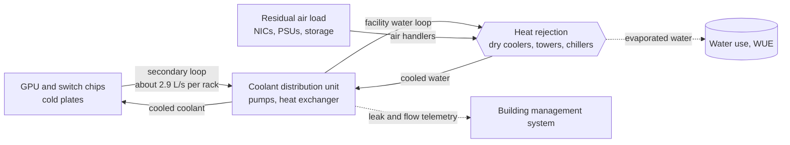

**Reading the diagram.** Heat leaves the chips through cold plates into the secondary loop, which the CDU pumps and cools against the facility loop; the facility loop rejects heat outdoors. A residual 10–20% of the heat (optics, power supplies, storage) still leaves by air. Dotted edges are asynchronous side effects: evaporated water when towers are used, and telemetry to the building management system. Failure points: a CDU pump failure overheats a whole rack within minutes, so CDUs are redundant and GPUs throttle, then shut down; a leak can take a row out of service. Scaling: CDUs come in-rack (hundreds of kW) or in-row (over 1 MW).

### 80.7.3 Power delivery and utility constraints

Power reaches a GPU through a chain: a utility substation steps transmission voltage down to medium voltage; on-site transformers and switchgear feed uninterruptible power supplies (UPSs) and power distribution; busways feed rack power shelves that convert to the DC voltages the boards use. Backup generators cover utility outages. Each stage loses a few percent and each has a capacity limit.

**Figure 80.9 — Power path from utility to GPU.**

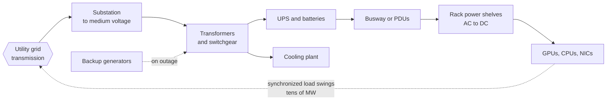

**Reading the diagram.** Energy flows left to right; generators (dotted) take over only during an outage. Cooling draws from the same switchgear, which is why PUE overhead counts against the site's power limit. The dotted edge back to the grid is the AI-specific problem: when all GPUs pause together for a checkpoint or a collective, the load drops by tens of megawatts in moments, then returns, and grid operators and on-site equipment must tolerate it. Failure points: a UPS or switchgear fault takes out a whole power domain, so jobs should span power domains only with their failure in mind. Scaling: utility interconnection capacity, which takes years to add, is the binding limit.

::: industry
**Power swings in Llama 3 training.** Meta reports that during Llama 3 training, the power consumption across the datacenter fluctuated on the order of tens of megawatts when all GPUs waited at the same time for checkpointing or collective communication, or at job start and shutdown, stretching the limits of the power grid; it also observed a diurnal 1–2% throughput variation caused by mid-day temperatures affecting GPU dynamic voltage and frequency scaling [Dubey et al. 2024].
*Evidence: Primary* — [Dubey et al. 2024]
:::

Mitigations include on-site batteries that smooth ramps, firmware that holds a power floor during collectives, staggered job starts and utility contracts that specify ramp rates. Site selection now starts from where 100–1,000 MW can be obtained, and when.

### 80.7.4 Power budget

::: formula
**Facility power of a training cluster**

$$P_\text{IT} = \frac{G}{g}\,P_\text{server} + P_\text{net} + P_\text{storage+other} \qquad P_\text{facility} = \text{PUE} \times P_\text{IT} \qquad p_\text{GPU} = \frac{P_\text{facility}}{G}$$

| Symbol | Meaning | Units |
|---|---|---|
| $G$, $g$ | GPUs in the cluster; GPUs per server | count |
| $P_\text{server}$ | Maximum power of one server, including GPUs, CPUs, NICs, fans | kW |
| $P_\text{net}$ | Backend and frontend switch power, including optics | kW |
| $P_\text{storage+other}$ | Storage servers, control plane, management | kW |
| PUE | Power usage effectiveness (§51.10.1) | — |
| $p_\text{GPU}$ | Facility power per GPU, all-in | kW |
:::

::: example
**Worked example — Megawatts for a 16,384-GPU cluster.** Use the parts count of §80.4 and illustrative device powers.

1. Servers: $2{,}048 \times 10.2$ kW $= 20.9$ MW (GPUs alone: $16{,}384 \times 0.7 = 11.5$ MW).
2. Backend network: 1,280 switches at an illustrative 1.2 kW each including optics: 1.5 MW.
3. Frontend network, storage and control plane: an illustrative 1.3 MW.
4. IT load: $20.9 + 1.5 + 1.3 = 23.7$ MW.
5. Facility at PUE 1.2: $1.2 \times 23.7 = 28.5$ MW, or $p_\text{GPU} = 28.5 \times 10^3/16{,}384 = 1.74$ kW per GPU, about 2.5 times the GPU's own 700 W.
6. Energy for a year at an average 85% of provisioned load: $28.5 \times 0.85 \times 8{,}766$ h $= 212$ GWh.

**Interpretation.** A 16K-GPU H100 cluster is a 25–30 MW facility, consistent with the tens-of-megawatts swings Meta reports. **Engineering implication.** Plan with an all-in figure per GPU (about 1.7 kW here) rather than GPU TDP, provision for peak rather than average, and remember that a 100,000-GPU cluster at this ratio needs about 170 MW, a power-plant-scale request to a utility.
:::

## 80.8 Reliability at scale

### 80.8.1 Job MTBF versus device MTBF

#### First-principles explanation

A single light bulb that lasts ten years seems reliable. String 16,384 of them in series, so that the string goes dark if any one fails, and the string goes dark every few hours. A synchronous job is that string.

::: formula
**Job MTBF from device MTBF**

$$\frac{1}{M_\text{job}} = \sum_{c} \frac{n_c}{M_c} \quad\Rightarrow\quad M_\text{job} \approx \frac{M_\text{device}}{N} \qquad P(\text{no failure in } t) = e^{-t/M_\text{job}}$$

| Symbol | Meaning | Units |
|---|---|---|
| $M_\text{job}$ | Mean time between failures of the whole job | h |
| $n_c$, $M_c$ | Count and MTBF of component type $c$ (GPU, NIC, switch, host) | count, h |
| $M_\text{device}$ | MTBF per device when all components are lumped per GPU | h |
| $N$ | Devices (GPUs) in the job | count |
| $t$ | Interval of interest | h |
:::

The formula assumes independent failures with constant rates (exponential lifetimes); correlated failures (a power domain, a switch serving 32 servers) make it optimistic (§39.4).

::: example
**Worked example — From one GPU to a 100,000-GPU job.** The Llama 3 figure of one interruption per 50,700 GPU-hours (§65.15) is an all-causes per-GPU MTBF of 50,700 h, 5.8 years.

1. 16,384 GPUs: $M_\text{job} = 50{,}700/16{,}384 = 3.09$ h, matching the 3.1 hours of §65.15.
2. Probability of a 24-hour failure-free run: $e^{-24/3.09} = 0.04\%$.
3. GPU-only causes (58.7% of interruptions): per-GPU MTBF $= 16{,}384 \times 1{,}296\ \text{h}/(0.587 \times 419) = 86{,}300$ h, about 10 years; a GPU that fails once a decade still interrupts the job every 5.3 h on its own.
4. 100,000 GPUs: $M_\text{job} = 0.507$ h, 30 minutes.
5. 1,024 GPUs: 49.5 h, two days.

**Interpretation.** Device reliability that is excellent by datacenter standards becomes a failure every few hours at 16K and every half hour at 100K. **Engineering implication.** At these sizes reliability engineering is a throughput problem: either restarts become very fast (§80.9) or the job tolerates failures without restarting (in-memory redundancy, elastic data parallelism).
:::

### 80.8.2 What fails

**Table 80.6 — Root causes of Llama 3 405B unexpected interruptions, 54 days, 16,384 GPUs [Dubey et al. 2024].**

| Category | Share of 419 unexpected interruptions |
|---|---|
| Faulty GPU (including NVLink) | 30.1% |
| GPU HBM3 memory | 17.2% |
| Software bugs | 12.9% |
| Network switch or cable | 8.4% |
| Host maintenance | 7.6% |
| All GPU-related categories combined | 58.7% |
| Silent data corruption | 1.4% |
| Confirmed or suspected hardware, all categories | About 78% |

Accelerators and their memory dominate, software is the second-largest single cause, and the network contributes a steady share through thousands of optics and cables.

### 80.8.3 Silent data corruption

::: definition
**Definition — Silent data corruption (SDC).** A hardware fault that produces a wrong result without raising any error: no machine-check exception, no ECC report, no crash. In training it shows up, if at all, as a loss spike, NaNs, diverging replicas or a subtly worse model.
:::

::: industry
**Published reports of silent data corruption.** Google reported "mercurial cores", CPU cores that intermittently compute wrong results, at a rate of a few per several thousand machines, often for specific instructions and conditions [Hochschild et al. 2021]. Meta reported SDCs across hundreds of CPUs in its fleet, including a case in which a defective core miscomputed during decompression so that files were silently omitted from a database, and described fleet-wide test infrastructure to find them [Dixit et al. 2021]. For accelerators, the Gemini report states that, at its scale, SDC events could be expected to affect training every week or two, and describes deterministic replay to isolate incorrect computations and proactive SDC scanners on idle machines and hot standbys [Gemini Team 2023]. Llama 3 attributes 1.4% of its unexpected interruptions to SDC [Dubey et al. 2024].
*Evidence: Primary* — [Hochschild et al. 2021; Dixit et al. 2021; Gemini Team 2023; Dubey et al. 2024]
:::

#### How detection works

1. **Burn-in before service.** New and repaired nodes run stress and correctness tests (vendor diagnostics such as NVIDIA DCGM at extended levels, GEMM checks against known answers, `nccl-tests` across the rack).
2. **Between-job and idle scanning.** Short correctness tests run on idle nodes and hot spares, as Gemini and Meta describe.
3. **In-job invariants.** Data-parallel replicas must hold bitwise-identical weights after each optimizer step; hashing parameters periodically and comparing across replicas catches a divergent rank. Loss and gradient-norm monitors catch spikes.
4. **Deterministic replay.** Re-running a suspect step from the last checkpoint on different hardware separates a numerical instability (reproduces everywhere) from a faulty device (reproduces only on one).
5. **Checksums on data at rest and in flight.** Checkpoint shards carry checksums verified on load, so a corrupt shard does not silently poison a restart.

**Figure 80.10 — Detecting silent data corruption in a training job.**

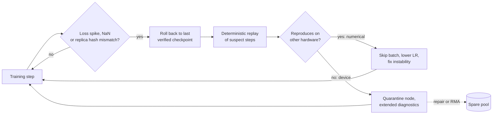

**Reading the diagram.** Each step is checked (decision node) for loss spikes, NaNs or a mismatch in periodic parameter hashes across data-parallel replicas. On a hit, training rolls back to the last checkpoint whose checksums verify and replays the suspect steps deterministically. If the anomaly reproduces on other hardware it is numerical, handled in the training recipe; if not, the device is quarantined and repaired asynchronously (dotted) before rejoining the spare pool. Storage boundaries: checkpoints and the spare pool's records. Failure point: corruption that never shows in loss or hashes is invisible, which is why proactive scanning complements this loop. Scaling: hashing costs a few seconds per check, so it runs every few hundred steps, not every step.

#### Failure scenarios

| What goes wrong | Why | Detection | Recovery | Prevention |
|---|---|---|---|---|
| GPU falls off the bus mid-step | Hardware fault, HBM error | Driver Xid error; NCCL timeout | Cordon, restart with spare | Burn-in; error-rate-based retirement |
| Correlated loss of 32 servers | Leaf switch or power-domain failure | Simultaneous rank failures | Restart on spares from other domains | Spread spares across domains |
| Model quality quietly degrades | SDC in a reduction | Replica hash mismatch; replay | Roll back to verified checkpoint | Proactive scanning; checksums |
| Same node fails again after repair | Intermittent fault not reproduced in diagnostics | Repeat-offender tracking | Retire or RMA | Track failure history per serial number |

::: mistake
**Assuming ECC makes memory errors visible.** ECC corrects and reports single-bit errors in HBM, but logic faults in compute units, wrong results from marginal timing and some multi-bit faults are not covered. "No errors in the logs" is not evidence of correct results.
:::

## 80.9 Goodput and its components

### 80.9.1 The goodput budget

::: definition
**Definition — Goodput components.** Training goodput (§65.16) is the fraction of wall-clock time producing progress that is kept. Its losses are: **scheduling overhead** (waiting for a full gang, rendezvous, initialization); **checkpoint stalls** ($\delta$ per checkpoint); **lost work** (progress since the last checkpoint, discarded at each failure); **restart time** (detection, replacement, reload, warm-up); **stragglers and degraded performance** (steps slower than nominal); and **planned maintenance**. **Effective utilization** is goodput × MFU.
:::

::: formula
**Expected goodput with failures during work and restart [Daly 2006]**

$$\Gamma = \frac{\tau}{M\,e^{R/M}\left(e^{(\tau+\delta)/M} - 1\right)} \;\approx\; 1 - \frac{\delta}{\tau} - \frac{\tau/2 + R}{M} \qquad \Gamma_\text{total} = \Gamma \times (1 - s) \times (1 - m)$$

| Symbol | Meaning | Units |
|---|---|---|
| $\Gamma$ | Goodput from checkpointing, lost work and restarts | — |
| $\tau$, $\delta$ | Checkpoint interval and stall | s |
| $M$ | Job MTBF | s |
| $R$ | Restart time | s |
| $s$ | Fractional slowdown from stragglers and degraded nodes | — |
| $m$ | Fraction of time in planned maintenance and scheduling gaps | — |
:::

The exact expression assumes exponential failures that can also strike during a restart; the approximation on the right is the first-order waste of §65.15 and is accurate while $\tau + R \ll M$.

::: example
**Worked example — A goodput budget for the 16,384-GPU job.** $M = 11{,}160$ s. Baseline: $\delta = 20$ s, $R = 600$ s, $\tau = 668$ s (Young). Improved: asynchronous checkpoints with a 1 s stall, hot spares and a fast reload giving $R = 120$ s, $\tau = \sqrt{2 \times 1 \times 11{,}160} = 149$ s. Both: straggler slowdown $s = 2\%$, maintenance and gaps $m = 2\%$ (illustrative).

1. Baseline checkpoint stalls: $20/668 = 3.0\%$. Lost work: $334/11{,}160 = 3.0\%$. Restarts: $600/11{,}160 = 5.4\%$. First-order $\Gamma = 88.6\%$; exact 89.2%.
2. Improved: stalls $1/149 = 0.7\%$; lost work $74.5/11{,}160 = 0.7\%$; restarts $120/11{,}160 = 1.1\%$; $\Gamma = 97.6\%$.
3. Totals: baseline $0.892 \times 0.98 \times 0.98 = 85.7\%$; improved $0.976 \times 0.98 \times 0.98 = 93.7\%$.
4. On a 26.4-million-GPU-hour ideal run (§80.14), the gap is $26.4/0.857 - 26.4/0.937 = 30.8 - 28.2 = 2.6$ million GPU-hours, about \$6.6 million at \$2.50.

**Interpretation.** At 16K GPUs, restarts are the largest single loss; asynchronous checkpoints and minute-scale restarts recover about 8 points of goodput. **Engineering implication.** Publish a goodput budget per run with each component measured, and spend engineering on the largest line first.
:::

### 80.9.2 Monte Carlo simulation of goodput

The program below simulates a 30-day training job with exponential failures at Llama 3's per-GPU rate, a checkpoint every $\tau$ seconds and a restart after each failure, during which another failure may strike. It reports goodput versus cluster size at the Young interval and versus the checkpoint interval at 16,384 GPUs, and compares the simulation with the exact and first-order formulas.

```python
"""Monte Carlo goodput of a long synchronous training job (CPU only, seconds to run)."""
import math
import numpy as np

GPU_HOURS_PER_FAILURE = 50_700   # Llama 3: 419 unexpected interruptions, 54 days, 16,384 GPUs (§65.15)
IDEAL_WORK_H = 720               # 30 days of failure-free training compute
REPS = 20                        # independent runs per configuration


def job_mtbf_s(n_gpus):
    """Job MTBF in seconds: one failure per 50,700 GPU-hours, spread over n_gpus."""
    return GPU_HOURS_PER_FAILURE * 3600 / n_gpus


def simulate(n_gpus, tau, delta, restart, rng):
    """Return (goodput, failures) for one run.

    The job computes tau seconds, then stalls delta seconds to checkpoint.
    A failure (exponential, memoryless) at any moment discards work since
    the last completed checkpoint and costs `restart` seconds; failures can
    also strike during a restart, which then starts over.
    """
    m = job_mtbf_s(n_gpus)
    work, done, t, failures = IDEAL_WORK_H * 3600, 0.0, 0.0, 0
    next_fail = rng.exponential(m)
    while done < work:
        seg = min(tau, work - done)
        if t + seg + delta <= next_fail:          # segment and checkpoint succeed
            t += seg + delta
            done += seg
            continue
        t = next_fail                              # failure: lose the segment
        failures += 1
        while True:                                # restart, possibly interrupted
            next_fail = t + rng.exponential(m)
            if t + restart <= next_fail:
                t += restart
                break
            t = next_fail
            failures += 1
    return work / t, failures


def first_order(n_gpus, tau, delta, restart):
    m = job_mtbf_s(n_gpus)
    return 1 - (delta / tau + (tau / 2 + restart) / m)   # 1 - w, §65.15


def exact(n_gpus, tau, delta, restart):
    """Expected goodput for exponential failures, failures allowed during restart [Daly 2006]."""
    m = job_mtbf_s(n_gpus)
    return tau / (m * math.exp(restart / m) * (math.exp((tau + delta) / m) - 1))


def young(n_gpus, delta):
    return math.sqrt(2 * delta * job_mtbf_s(n_gpus))


def mean_goodput(n_gpus, tau, delta, restart, seed):
    rng = np.random.default_rng(seed)
    runs = [simulate(n_gpus, tau, delta, restart, rng) for _ in range(REPS)]
    return np.mean([g for g, _ in runs]), np.mean([f for _, f in runs])


scenarios = {"baseline: sync ckpt 20 s, restart 10 min": (20.0, 600.0),
             "improved: async ckpt 1 s, restart 2 min": (1.0, 120.0)}
sizes = [1_024, 4_096, 16_384, 65_536, 131_072]

print("Part 1: goodput at the Young interval versus cluster size")
for name, (delta, restart) in scenarios.items():
    print(f"  {name}")
    print("    GPUs     job MTBF  tau_Young  failures  simulated  exact  first-order")
    for i, n in enumerate(sizes):
        tau = young(n, delta)
        g, f = mean_goodput(n, tau, delta, restart, seed=100 + i)
        print(f"    {n:>7,}  {job_mtbf_s(n)/3600:>6.2f} h  {tau:>7.0f} s  {f:>8.0f}"
              f"  {g:>8.1%}  {exact(n, tau, delta, restart):>6.1%}"
              f"  {first_order(n, tau, delta, restart):>9.1%}")

print("\nPart 2: goodput versus checkpoint interval, 16,384 GPUs, baseline")
print("    interval   simulated  exact  first-order")
for j, minutes in enumerate([2, 5, 11.1, 30, 60, 120]):
    tau = minutes * 60
    g, _ = mean_goodput(16_384, tau, 20.0, 600.0, seed=200 + j)
    print(f"    {minutes:>6} min  {g:>8.1%}  {exact(16_384, tau, 20.0, 600.0):>6.1%}"
          f"  {first_order(16_384, tau, 20.0, 600.0):>9.1%}")
```

Output (Python 3.13, NumPy 2; under a second on one CPU core):

```text
Part 1: goodput at the Young interval versus cluster size
  baseline: sync ckpt 20 s, restart 10 min
    GPUs     job MTBF  tau_Young  failures  simulated  exact  first-order
      1,024   49.51 h     2670 s        15     98.2%   98.2%      98.2%
      4,096   12.38 h     1335 s        59     95.8%   95.7%      95.7%
     16,384    3.09 h      668 s       259     89.2%   89.2%      88.6%
     65,536    0.77 h      334 s      1314     71.2%   71.3%      66.5%
    131,072    0.39 h      236 s      3406     54.6%   54.6%      40.0%
  improved: async ckpt 1 s, restart 2 min
    GPUs     job MTBF  tau_Young  failures  simulated  exact  first-order
      1,024   49.51 h      597 s        15     99.6%   99.6%      99.6%
      4,096   12.38 h      299 s        56     99.1%   99.1%      99.1%
     16,384    3.09 h      149 s       236     97.6%   97.6%      97.6%
     65,536    0.77 h       75 s      1002     93.2%   93.2%      93.0%
    131,072    0.39 h       53 s      2087     88.4%   88.3%      87.6%

Part 2: goodput versus checkpoint interval, 16,384 GPUs, baseline
    interval   simulated  exact  first-order
         2 min     80.8%   80.7%      77.4%
         5 min     87.5%   87.6%      86.6%
      11.1 min     89.1%   89.2%      88.6%
        30 min     86.4%   86.3%      85.4%
        60 min     80.0%   79.8%      77.9%
       120 min     66.9%   67.2%      62.0%
```

What to notice:

- The simulation and Daly's exact expression agree to within 0.3 points everywhere, which validates both; the first-order formula of §65.15 is accurate to 16,384 GPUs and turns pessimistic at 65K and beyond, where $\tau + R$ is no longer small against $M$ (it predicts 40.0% at 131K against a true 54.6%).
- With a 10-minute restart, goodput falls from 98% at 1K GPUs to 55% at 131K: the job spends nearly half its time recovering. Cutting restart to 2 minutes and the checkpoint stall to 1 s holds 88% at 131K. Recovery speed, not device reliability, is what lets jobs grow.
- Part 2 shows a flat optimum: anywhere from 5 to 30 minutes is within 3 points of the best at 16K GPUs, so the interval can be rounded to an operational convenience, but checkpointing hourly costs 9 points.

### 80.9.3 Strategies: hot spares, in-memory checkpoints and fast restart

**Hot spares.** Keep pre-validated idle nodes in the cluster so that a failed node is replaced in seconds by a scheduler action rather than in days by a repair. How many? The number of nodes out of service at any moment follows Little's law (§4.11): the rate at which nodes go to repair times how long each repair takes.

::: formula
**Hot-spare pool size**

$$L = \lambda_\text{node}\,W_\text{repair} \qquad s = \min\{k : P(X \le k) \ge 1 - \epsilon\},\; X \sim \text{Poisson}(L)$$

| Symbol | Meaning | Units |
|---|---|---|
| $\lambda_\text{node}$ | Rate at which nodes leave service for repair | nodes/day |
| $W_\text{repair}$ | Mean time a node spends out of service (diagnose, repair, burn-in) | days |
| $L$ | Mean number of nodes out of service | nodes |
| $s$ | Spares needed so that a job can be refilled with probability $1-\epsilon$ | nodes |
| $\epsilon$ | Accepted probability of running short of spares | — |
:::

::: example
**Worked example — Spares for 2,048 nodes.** From Llama 3, $419/54 = 7.8$ interruptions a day, of which about 78% are hardware: $\lambda_\text{node} = 6.05$ nodes/day. Assume a 3-day repair turnaround (illustrative).

1. $L = 6.05 \times 3 = 18.2$ nodes out of service on average.
2. Poisson quantiles: 99% → 29 nodes; 99.9% → 33 nodes.
3. A pool of 33 spare nodes (264 GPUs) is 1.6% of the cluster.
4. Halving repair time to 1.5 days halves $L$ to 9.1 and the 99.9% pool to about 20 nodes.

**Interpretation.** About 1–2% spare capacity turns most failures into a minute-scale node swap. **Engineering implication.** Size spares from measured failure rates and repair times, spread them across power and network domains, and run SDC scans on them while idle (§80.8.3); faster repair is cheaper than more spares.
:::

**In-memory and peer checkpoints.** Instead of reloading from storage, keep redundant copies of each shard in other nodes' memory and restart from the intact copy. The Gemini report states that maintaining high goodput would have been impossible with conventional periodic checkpointing to persistent storage, and that using redundant in-memory copies of model state, recovering directly from an intact replica after unplanned failures, raised goodput for the largest job from 85% to 97% [Gemini Team 2023]. The same idea appears in data-parallel training as "recover from a sibling replica", because every replica already holds identical weights.

**Fast restart.** Restart time is a sum: detect (seconds with watchdogs and health agents, not a 30-minute NCCL default timeout), replace (hot spare), relaunch (pre-pulled container images, a pre-warmed Python environment), rendezvous (thousands of ranks registering, §65.16), reload (peer memory or one-read-then-broadcast, §80.6) and warm up (JIT compilation caches, data-loader prefetch). Each needs its own engineering; MegaScale and Llama 3 both report work on reducing job startup and checkpoint time [Jiang et al. 2024; Dubey et al. 2024].

**Figure 80.11 — Timeline of one failure and recovery in a 16,384-GPU job (illustrative durations).**

```mermaid
gantt
  title One failure 9 minutes after a checkpoint
  dateFormat HH:mm
  axisFormat %H:%M
  section Training
  Training kept               :done, t1, 00:00, 11m
  Checkpoint stall            :crit, c1, 00:11, 1m
  Training later discarded    :active, t2, 00:12, 9m
  section Recovery
  Detect via watchdog         :crit, r1, 00:21, 1m
  Swap in hot spare           :r2, 00:22, 1m
  Relaunch and rendezvous     :r3, 00:23, 3m
  Reload from peer memory     :r4, 00:26, 2m
  Replay lost 9 minutes       :active, r5, 00:28, 9m
  section Training resumes
  New progress                :done, t3, 00:37, 10m
```

**Reading the diagram.** The job trains, stalls briefly to checkpoint at minute 11, then trains for 9 more minutes that are lost when a GPU fails at minute 21. Recovery steps run in sequence: detection, swapping a hot spare, relaunch and rendezvous, reloading state, then replaying the 9 lost minutes before new progress resumes at minute 37. Of the 37 minutes, 20 produce kept progress (the first 11 and the 9 replayed); the 1-minute stall, the 9 discarded minutes and 7 minutes of recovery, 17 in all, are goodput loss. Storage boundary: the checkpoint (here held in peer memory). Failure points: a failure during recovery restarts it, which the Monte Carlo of §80.9.2 models. Scaling: every box except the replay shrinks with engineering, and the replay shrinks with more frequent asynchronous checkpoints.

## 80.10 Stragglers and performance variability

A **straggler** is a rank that is persistently or intermittently slower than its peers while still working correctly, so it never trips a failure detector. Common causes:

- **Thermal and power throttling.** A GPU with a failing fan, a poorly seated cold plate or a hot aisle lowers its clocks; Llama 3's diurnal 1–2% variation is the cluster-wide version (§80.7.3).
- **Degraded links.** An optic with a rising bit-error rate retransmits; a link trains down to a lower speed; a PCIe link negotiates fewer lanes.
- **Slow hosts.** A bad DIMM, a CPU core busy with a runaway daemon, host-side Python garbage collection pauses, or a data loader starved by a slow storage client.
- **Software and placement.** An unlucky rank ordering that sends a ring across an oversubscribed tier (§80.5.2), or a collective that a misconfigured process group runs on the wrong fabric.

### 80.10.1 Detection

Detection compares ranks with each other, since a straggler is defined relative to its peers. Each rank records per-step compute time and per-collective wait time; the rank that arrives last at collectives, while others wait for it, is the straggler. Llama 3 describes tooling that traces collective operations to locate stragglers and hangs quickly among thousands of ranks [Dubey et al. 2024], and MegaScale describes collecting fine-grained timing from CUDA events on every rank, visualized across the job, to find slow machines [Jiang et al. 2024].

**Figure 80.12 — Straggler detection and eviction loop.**

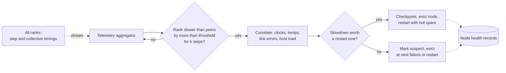

**Reading the diagram.** Every rank streams timings asynchronously (dotted) to an aggregator that flags a rank only after it lags its peers for several consecutive steps, avoiding reacting to one-off noise. Diagnosis correlates the rank with hardware telemetry. A decision node then applies the eviction rule below: evict now with a deliberate checkpoint-and-restart onto a hot spare, or mark the node and swap it at the next restart, which at 16K GPUs comes within hours anyway. Both outcomes are recorded in node health storage, which feeds the pipeline of §80.11. Failure points: thresholds too tight cause needless restarts; too loose waste days. Scaling: aggregation is per job and per step, so its cost is independent of how slow any rank is.

::: formula
**When to evict a straggler**

$$\text{evict now if}\quad s \cdot T_\text{wait} > R + \delta \qquad \text{with } T_\text{wait} \approx M_\text{job} \;\Rightarrow\; s^* = \frac{R + \delta}{M_\text{job}}$$

| Symbol | Meaning | Units |
|---|---|---|
| $s$ | Fractional slowdown of the whole job caused by the straggler | — |
| $T_\text{wait}$ | Expected time until the next restart, when the node could be swapped for free | s |
| $R$, $\delta$ | Restart time and checkpoint stall of a deliberate restart | s |
| $s^*$ | Break-even slowdown above which immediate eviction pays | — |
:::

::: example
**Worked example — A 3% straggler at 16,384 GPUs.** $M_\text{job} = 11{,}160$ s.

1. Baseline restart, $R = 600$ s, $\delta = 20$ s: $s^* = 620/11{,}160 = 5.6\%$. A 3% straggler is not worth a restart; swap it at the next failure.
2. Fast restart, $R = 120$ s, $\delta = 1$ s: $s^* = 121/11{,}160 = 1.1\%$. Evict the 3% straggler now.
3. At 1,024 GPUs ($M_\text{job} = 49.5$ h $= 178{,}000$ s) with the baseline restart: $s^* = 0.35\%$. Failures are rare, so waiting is expensive and even small stragglers should be evicted.

**Interpretation.** The faster your restarts, the more aggressively you can remove slow nodes, so fast restart improves goodput twice. **Engineering implication.** Encode the rule in the job controller with measured $R$ and $M_\text{job}$ rather than leaving eviction to human judgment at 3 a.m.
:::

## 80.11 Scheduling and cluster operations

### 80.11.1 Gang scheduling huge jobs

Chapter 46 covers gang scheduling and topology-aware placement in general (§46.10–§46.12). Jobs of 10,000 GPUs add three problems.

1. **Fragmentation.** A 16,384-GPU job needs whole pods, not 16,384 GPUs scattered around the cluster. The scheduler must reserve and drain capacity ahead of time. Draining is expensive: if the jobs occupying the target pods have a mean remaining runtime of 3 hours, 16,384 GPUs sit idle for up to $16{,}384 \times 3 = 49{,}000$ GPU-hours unless the gap is backfilled with short or preemptible jobs (§46.12.2).
2. **Preemption.** Production jobs (the flagship pre-training run, inference capacity) preempt research jobs. Preemption must deliver a signal, a grace period long enough to checkpoint, and a requeue, or each preemption throws away hours of work.
3. **Global placement.** Very large organizations run many clusters, so the decision of *which* cluster gets a job, given where its data and its checkpoints live, is itself a scheduling problem. Meta's Llama 3 jobs were scheduled with MAST, its global-scale training scheduler [Dubey et al. 2024], whose design for scheduling training across geo-distributed datacenters is published [Choudhury et al. 2024].

A common structure for sharing one cluster: a **production tier** with guaranteed quota and the highest priority; a **research tier** with fair-share quota that can borrow idle capacity; and a **preemptible tier** that fills gaps and gets evicted first. Kubernetes with Kueue or Slurm with partitions and QOS both express this (§65.18).

### 80.11.2 Node health pipeline

At 2,048 nodes with about six hardware failures a day, node health is a production line, not an occasional repair.

**Figure 80.13 — Node lifecycle in a training cluster.**

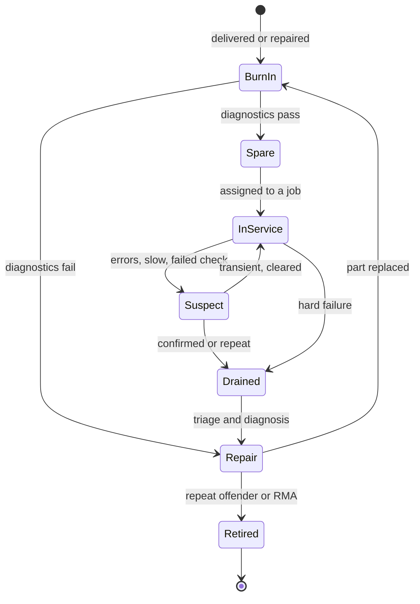

**Reading the diagram.** New or repaired nodes enter **burn-in**: extended GPU diagnostics, memory tests, GEMM correctness checks, NVLink and NIC loopback, and `nccl-tests` with neighbors. Passing nodes wait as **spares** until assigned. In service, a node becomes **suspect** on correctable-error growth, straggler flags, thermal warnings or a failed between-job check; suspicion either clears or leads to **draining**, which a hard failure causes directly. Drained nodes are triaged and repaired; nodes that fail repeatedly are **retired** or returned to the vendor (RMA). Transitions are asynchronous events from the health service. Failure points: skipping burn-in after repair returns bad nodes to jobs; lenient "suspect" thresholds create repeat offenders. Scaling: every step is automated, with humans only in physical repair.

::: recommendation
**Operate the cluster as a reliability product.** Track per-node failure history by serial number; run health checks before every job start and between jobs; keep repair turnaround as a measured SLO (it sets the spare-pool size, §80.9.3); and schedule planned maintenance as batched cluster-wide windows coordinated with checkpoints rather than rolling drains.
:::

## 80.12 Publicly documented infrastructure

Only what each organization has published is reported here.

**Table 80.7 — Published large-training infrastructure (as reported; as of 2026).**

| System | Scale reported | Scale-up / scale-out | Notable published facts |
|---|---|---|---|
| Meta 24K clusters (2024) | 2 × 24,576 H100 | 8-GPU Grand Teton; RoCE and InfiniBand at 400 Gb/s | Both tuned to run without network bottlenecks |
| Llama 3 405B training | Up to 16,384 H100 | 3-tier RoCE Clos; 3,072-GPU pods; 1:7 above pods | 466 interruptions in 54 days; >90% effective training time |
| Google TPU v4 | 4,096 chips per pod | 64-chip cubes joined by optical circuit switches | OCS under 5% of system cost, under 3% of power |
| Google Gemini training | Multiple TPU SuperPods across datacenters | Model parallel within, data parallel across pods | In-memory replicas lifted goodput from 85% to 97% |
| NVIDIA DGX SuperPOD (H100) | 32-node scalable units; 4 SUs = 128 nodes; larger by design | Rail-optimized non-blocking NDR InfiniBand | Separate compute, storage and management fabrics |
| ByteDance MegaScale | 12,288 GPUs | Megatron-style 3D parallelism | 55.2% MFU on a 175B model |

::: industry
**Llama 3 training infrastructure.** Meta trained Llama 3 405B on up to 16,384 H100 GPUs (700 W TDP, 80 GB HBM3) in Grand Teton servers of 8 GPUs and 2 CPUs joined by NVLink, scheduled by MAST. The 405B model used the RoCE fabric of Figure 80.4; smaller models used an InfiniBand fabric. The paper reports 38–43% BF16 MFU, 466 interruptions in a 54-day snapshot of which 419 were unexpected, about 78% attributed to confirmed or suspected hardware, only three needing significant manual intervention, and effective training time above 90% [Dubey et al. 2024].
*Evidence: Primary* — [Dubey et al. 2024]
:::

::: industry
**Google TPU v4 and optical circuit switches.** A TPU v4 supercomputer has 4,096 chips. Each rack is a 4×4×4 cube of 64 chips with electrical inter-chip links inside; the cubes' faces connect through 48 optical circuit switches (OCSes) that set up light paths between cubes. Because the wiring between cubes is programmable, the system can form a slice of the size and shape a job needs (including twisted tori), route around failed cubes, and be deployed incrementally. Jouppi et al. report that the OCSes and their optics cost under 5% of the system and draw under 3% of its power, and that TPU v4 is 2.1× faster than TPU v3 with 2.7× better performance per watt [Jouppi et al. 2023]. PaLM trained on 6,144 TPU v4 chips across two pods, data parallel between pods over the datacenter network [Chowdhery et al. 2022].
*Evidence: Primary* — [Jouppi et al. 2023; Chowdhery et al. 2022]
:::

**Figure 80.14 — TPU v4: cubes joined by optical circuit switches into job slices.**

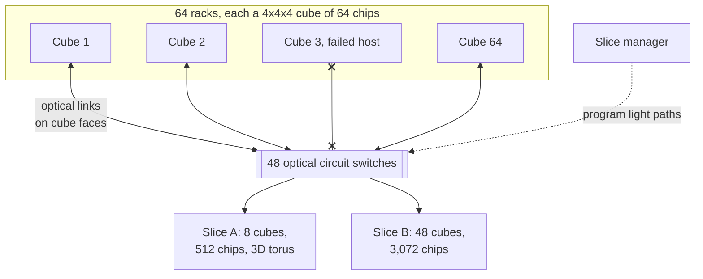

**Reading the diagram.** Each cube of 64 chips is wired electrically inside; optical links on its faces go to the 48 OCSes. A slice manager (dotted, control path) programs the switches to connect chosen cubes into a torus-shaped slice for each job; cube 3, with a failed host, is simply left out. Traffic inside a slice is synchronous ICI traffic. Failure points: an OCS failure affects the light paths through it; a failed cube costs 64 chips until repaired, but no job needs to wait for that specific cube. Scaling: cubes can be added before the whole pod is built. The slice sizes shown are illustrative.

::: industry
**Gemini training reliability.** The Gemini report describes training Gemini Ultra on TPU v4 across multiple datacenters, with model parallelism inside 4,096-chip SuperPods and data parallelism across them, and the in-memory recovery and SDC handling summarized in §80.8.3 and §80.9.3 [Gemini Team 2023].
*Evidence: Primary* — [Gemini Team 2023]
:::

::: industry
**NVIDIA DGX SuperPOD reference architecture (DGX H100).** NVIDIA's reference design builds clusters from scalable units (SUs) of 32 DGX H100 systems (256 GPUs). The compute fabric is rail-optimized, non-blocking NDR 400 Gb/s InfiniBand on QM9700 switches, eight connections per system, beside separate storage, in-band and out-of-band management networks. The reference configuration has 4 SUs (128 systems, 1,024 GPUs) with 48 compute-fabric switches, and the design scales further [NVIDIA DGX SuperPOD RA].
*Evidence: Primary* — [NVIDIA DGX SuperPOD RA]
:::

::: industry
**ByteDance MegaScale.** Jiang et al. describe a production system for training LLMs on more than 10,000 GPUs, reporting 55.2% MFU training a 175B model on 12,288 GPUs, 1.34× the MFU of Megatron-LM in their comparison. Its robustness design includes node heartbeats, automated diagnostics that isolate faulty nodes, fast checkpoint recovery and straggler monitoring [Jiang et al. 2024].
*Evidence: Primary* — [Jiang et al. 2024]
:::

::: industry
**OpenAI and Anthropic: what is and is not published.** Microsoft announced in 2020 a supercomputer built for OpenAI with more than 285,000 CPU cores, 10,000 GPUs and 400 Gb/s of network connectivity for each GPU server [Microsoft 2020]. OpenAI has described running Kubernetes clusters of up to 7,500 nodes for training work [OpenAI 2021] and stated that it co-designed a supercomputer with Azure for GPT-4 [OpenAI 2023]. Anthropic announced in October 2025 that it would expand its use of Google Cloud TPUs to up to one million chips, with well over a gigawatt of capacity coming online in 2026, and described a strategy spanning Google TPUs, Amazon Trainium and NVIDIA GPUs [Anthropic 2025]; AWS has described Project Rainier, a Trainium2 cluster built for Anthropic [AWS 2024]. Neither OpenAI nor Anthropic has published cluster topologies, failure statistics or goodput figures comparable to Meta's or Google's, so none are given here.
*Evidence: Primary* — [Microsoft 2020; OpenAI 2021; OpenAI 2023; Anthropic 2025; AWS 2024]
:::

## 80.13 Inference at very large scale

Large inference fleets now rival training clusters in size, but they are different machines (Chapters 66 and 73 own serving).

**Table 80.8 — Training clusters versus inference fleets.**

| Aspect | Training cluster | Inference fleet |
|---|---|---|
| Coupling | One job, all devices | Many independent replicas, each 1–72 GPUs |
| Failure blast radius | Whole job | One replica; traffic shifts |
| Network that matters | Backend scale-out fabric | Scale-up domain (model replica) and frontend |
| Load | Flat, saturated | Diurnal, bursty, SLO-bound (TTFT, TPOT) |
| Location | Few very large sites, power-driven | Many regions, latency- and residency-driven |
| Utilization lever | Goodput and MFU | Batching and autoscaling (§73.6) |

Sharing capacity between them is constrained. A synchronous pre-training job cannot shrink by night and grow by day; what can share is flexible work (evaluation, fine-tuning, reinforcement-learning rollouts, batch inference) running in a preemptible pool that borrows serving capacity off-peak and is reclaimed instantly at peak. Hardware also differs at the margin: inference fleets favor memory capacity and bandwidth per dollar and need no backend fabric for models that fit one scale-up domain, so a cluster built for training is an expensive inference fleet.

## 80.14 Economics

::: formula
**Cost per GPU-hour and cost per training run**

$$c_\text{GPU-h} = \frac{1}{u}\left(\frac{K}{L_h} + p_\text{GPU}\,c_e + f + o\right) \qquad C_\text{run} = \frac{6ND}{R\cdot\text{MFU}\cdot 3600} \cdot \frac{c_\text{GPU-h}}{\Gamma_\text{total}}$$

| Symbol | Meaning | Units |
|---|---|---|
| $K$ | All-in capex per GPU (server share, network, storage, fit-out) | \$ |
| $L_h$ | Depreciation life | h |
| $p_\text{GPU}$ | Facility power per GPU, all-in (§80.7.4) | kW |
| $c_e$ | Electricity price | \$/kWh |
| $f$, $o$ | Facility (space, power and cooling infrastructure) and operations cost per GPU-hour | \$/h |
| $u$ | Fraction of hours the GPU is allocated to useful jobs | — |
| $N$, $D$, $R$, MFU | Parameters, tokens, peak FLOP/s, achieved fraction (§65.4) | —, —, FLOP/s, — |
| $\Gamma_\text{total}$ | Goodput including stragglers and maintenance (§80.9) | — |
| $C_\text{run}$ | Cost of the training run | \$ |
:::

::: example
**Worked example — What a 16,384-GPU cluster costs per hour and per run.** All prices illustrative.

1. Capex \$50,000 per GPU over 4 years ($L_h = 35{,}064$ h): \$1.43 per GPU-hour.
2. Power: 1.74 kW × \$0.08/kWh = \$0.14.
3. Facility at \$150 per kW-month: $1.74 \times 150/730 = \$0.36$.
4. Operations and maintenance at 10% of capex a year: $5{,}000/8{,}766 = \$0.57$.
5. Sum at $u = 1$: \$2.49; at $u = 0.8$: \$3.12. The \$2.50 used across Chapters 60–65 corresponds to a fully used owned cluster or a discounted committed rental.
6. Reference run: ideal GPU-hours $= 3.8 \times 10^{25}/(4 \times 10^{14} \times 3{,}600) = 26.4$ million; at $\Gamma_\text{total} = 0.90$, 29.3 million GPU-hours, 74.6 days on 16,384 GPUs, \$73 million at \$2.50 (Meta's model card reports 30.84 million GPU-hours for Llama 3.1 405B [Meta 2024]).
7. For contrast, QuickBite's support-chatbot continued pre-training (7B model, 50B tokens, §65.9.1): $6 \times 7 \times 10^9 \times 5 \times 10^{10}/(4 \times 10^{14} \times 3{,}600) = 1{,}458$ GPU-hours, about \$3,650: 20,000 times smaller.

**Interpretation.** Capex dominates, so idle hours are the most expensive hours; one point of goodput on the reference run is worth about \$0.8 million. **Engineering implication.** Track utilization ($u$), goodput and MFU as one product. A company of QuickBite's size should rent GPU-hours, not build clusters: its training needs fit in a day on 64 rented GPUs.
:::

**Utilization targets.** Owned clusters aim for allocation above 80–90% and goodput above 90%. Build versus rent follows the total-cost-of-ownership method of §51.9: building wins with sustained demand and the staff to run it; renting wins for bursty demand and anyone who cannot secure power and hardware quickly.

## 80.15 Sustainability at AI scale

::: formula
**Energy, carbon and water of a training run**

$$E = H_\text{GPU} \cdot \bar p_\text{IT} \cdot \text{PUE} \qquad C = E \cdot I \qquad V = H_\text{GPU} \cdot \bar p_\text{IT} \cdot \text{WUE}$$

| Symbol | Meaning | Units |
|---|---|---|
| $H_\text{GPU}$ | GPU-hours of the run, including goodput losses | GPU-h |
| $\bar p_\text{IT}$ | Average IT power per GPU (server share, network, storage) | kW |
| PUE, WUE | Facility overhead and site water per IT kWh (§51.10.1) | —, L/kWh |
| $I$ | Carbon intensity of the electricity, location- or market-based (§51.10.2) | kgCO₂e/kWh |
| $E$, $C$, $V$ | Facility energy, operational carbon, site water | kWh, kgCO₂e, L |
:::

::: example
**Worked example — Energy and carbon of a 405B run.** Use the 30.84 million GPU-hours reported for Llama 3.1 405B [Meta 2024].

1. GPU TDP only: $30.84 \times 10^6 \times 0.7$ kW $= 21.6$ GWh.
2. With server overhead (10.2 kW per 8 GPUs = 1.275 kW per GPU) and PUE 1.1: $30.84 \times 10^6 \times 1.275 \times 1.1 = 43.3$ GWh.
3. At an illustrative 400 gCO₂e/kWh: $43.3 \times 10^6 \times 0.4 = 17{,}300$ tCO₂e. Meta's model card reports 8,930 tCO₂e location-based for 405B (its estimate uses GPU power), and zero market-based because of renewable-energy matching [Meta 2024].
4. Water at an illustrative WUE of 1.8 L/kWh (§51.10.1): $30.84 \times 10^6 \times 1.275 \times 1.8 = 71$ million liters; near zero on-site with closed-loop dry cooling.

**Interpretation.** The same run is 21.6 or 43.3 GWh, and 0, 8,930 or 17,300 tonnes, depending on boundary and accounting method. **Engineering implication.** Always state the boundary (GPU, server, facility), PUE, location- versus market-based intensity and whether embodied emissions are included when quoting AI footprints.
:::

**Table 80.9 — Published estimates of training footprints.**

| Model | Energy | Emissions | Notes | Source |
|---|---|---|---|---|
| GPT-3 (175B) | 1,287 MWh | 552 tCO₂e | Estimated from published training compute | [Patterson et al. 2021] |
| BLOOM (176B) | 433 MWh | 24.7 tCO₂e dynamic; about 50.5 t including embodied and idle | French grid, 57 gCO₂e/kWh | [Luccioni et al. 2023] |
| Llama 3.1 family | 39.3 million GPU-hours | 11,390 tCO₂e location-based; 0 market-based | 405B: 30.84 million GPU-hours, 8,930 t | [Meta 2024] |
| GPT-3 water | About 700,000 L on-site (estimate) | — | Model-based estimate for US datacenters | [Li et al. 2023] |

Patterson et al. also show that choices of model architecture, processor, datacenter efficiency and location can change a run's footprint by 100–1,000 times [Patterson et al. 2021]; BLOOM's low emissions come mostly from a low-carbon grid.

### 80.15.1 Limits of carbon-aware scheduling for synchronous training

Chapter 51 shows how flexible jobs shift in time and place to cleaner hours (§51.11.2). Large synchronous training resists both:

1. **Pausing is expensive.** Capex accrues whether or not the cluster runs: pausing a 16,384-GPU cluster for 4 hours a day forgoes 17% of its depreciation-dominated cost (§80.14), far more than any carbon saving is usually worth in money.
2. **Power swings hurt the grid.** Shrinking and growing tens of megawatts on a schedule is exactly what Llama 3 found difficult (§80.7.3).
3. **Moving is coarse.** A job lives where its checkpoints and its pods are; spatial shifting happens at job granularity, not hour by hour.

The levers that work are therefore structural: choose sites with low-carbon power and contract new clean supply; raise goodput and MFU, since every wasted GPU-hour carries its full carbon cost; extend hardware lifetimes to spread embodied carbon; use dry or warm-water cooling in water-stressed regions; and reserve temporal shifting for the flexible work of §80.13.

## 80.16 Summary and revision notes

::: summary
- Synchronous training couples every device: the slowest rank sets step time ($\mu + \sigma\sqrt{2\ln N}$ for Gaussian jitter), any failure stops the job, and power swings in unison.
- A cluster has six layers: nodes, scale-up domain (8–72 GPUs or TPU pods), a dedicated RDMA backend with one 400 Gb/s NIC per GPU, storage, frontend and control plane.
- Rail-optimized, non-blocking fat trees keep same-rank traffic one hop apart; oversubscription (Llama 3: 1:7 above 3,072-GPU pods) is a placement contract. Hierarchical, topology-aware collectives cut both bytes and latency at 16K GPUs.
- Elephant flows collide under ECMP (8 flows on 8 links: 39% efficiency); more flows, adaptive routing or spraying fix it. RoCE and InfiniBand both work at 24K GPUs after tuning.
- Storage is sized by checkpoint bursts and restart reads: 5.67 TB for 405B, 2.8 s at 2 TB/s; avoid 128× restart read amplification.
- A 16K-GPU H100 cluster is about 25–30 MW (1.7 kW per GPU all-in); dense racks need liquid cooling ($Q = \dot m c_p \Delta T$).
- $M_\text{job} \approx M_\text{device}/N$: 3.1 h at 16K, 30 min at 100K. GPUs and HBM cause most interruptions; SDC needs scanning, replica hashes and replay.
- Goodput $= \tau/(M e^{R/M}(e^{(\tau+\delta)/M} - 1))$; restart time dominates at scale. Async checkpoints, hot spares (Little's law sizing), in-memory replicas (Gemini: 85% to 97%) and fast restart keep goodput high.
- Evict a straggler when its slowdown exceeds $(R+\delta)/M_\text{job}$.
- Cost per run $= 6ND/(R\,\text{MFU}) \times c_\text{GPU-h}/\Gamma$: about \$73 million for the reference run. Quote energy and carbon with boundary, PUE and accounting method.
:::

## 80.17 Knowledge checkpoint

1. Why does one throttled GPU slow a 16,384-GPU job but not a web fleet?
2. Name the six layers of a training cluster.
3. What does rail-optimized mean, and how does NCCL use it?
4. Compute cross-pod per-GPU bandwidth with 400 Gb/s NICs and 1:7 oversubscription.
5. Why does a flat ring all-reduce perform poorly at 16,384 GPUs even for large messages?
6. What fraction of uplinks carry traffic when 8 flows hash onto 8 uplinks?
7. Size a 405B checkpoint at 14 bytes/parameter and its write time at 1 TB/s.
8. Water flow to remove 60 kW with $\Delta T = 10$ K?
9. Job MTBF of 32,768 GPUs at 50,700 GPU-hours per failure?
10. Why can ECC not rule out silent data corruption?
11. At 131,072 GPUs, why does the first-order waste formula fail?
12. Spares needed (mean) if 4 nodes/day fail and repairs take 2 days?
13. Break-even straggler slowdown with $R = 300$ s, $\delta = 5$ s, $M = 6$ h?
14. Why is temporal carbon shifting hard for pre-training?

<details><summary>Answers</summary>

1. Collectives complete only when every rank arrives; web replicas never wait for each other.
2. Compute nodes, scale-up domain, backend fabric, storage, frontend, control plane.
3. NIC $i$ of every server goes to the same leaf; NCCL runs a ring per rail and moves cross-rail data over NVLink first.
4. $400/7 = 57$ Gb/s.
5. Its latency term, $2(p-1)\alpha$, is 0.33 s at 10 µs per step.
6. $8(1 - 0.875^8) = 5.25$ uplinks, 66%.
7. 5.67 TB; 5.7 s.
8. $60{,}000/(4{,}186 \times 10) = 1.43$ kg/s, about 86 L/min.
9. 1.55 h.
10. ECC covers stored bits, not logic errors in compute units.
11. $\tau + R$ is no longer small against $M$; it double-counts failures during restarts.
12. $L = 4 \times 2 = 8$ nodes on average, more for a high quantile.
13. $305/21{,}600 = 1.4\%$.
14. Capex accrues while paused, power swings stress the grid, and jobs cannot move cheaply.

</details>

## 80.18 Interview questions

### Basic

**Q1. Why do AI clusters have a separate backend network?**
**Answer.** Collectives run every step at hundreds of gigabits per GPU and need RDMA, low loss and predictable latency. Isolating them from storage, logging and user traffic avoids interference, and the backend can be built non-blocking without paying for that everywhere.

**Q2. What is goodput and why is it not 100%?**
**Answer.** The fraction of wall time producing kept progress. Checkpoint stalls, work lost since the last checkpoint, restarts, stragglers and maintenance reduce it.

### Intermediate

**Q3. Your 16K-GPU job reaches 60% of the bus bandwidth that one scalable unit achieves. Diagnose it.**
**Answer.** Check rank ordering against topology (cross-pod rings), ECMP collisions in per-uplink counters, latency terms (ring versus tree), and one slow rail or link via per-rail `nccl-tests`. Fix with topology-aware placement, more QPs per connection or adaptive routing, and draining bad links.

**Q4. Size checkpoint storage for a 405B job on 16K GPUs.**
**Answer.** 5.67 TB per checkpoint; with async checkpoints the write may take a minute (95 GB/s), but restart reads must avoid amplification: read once per shard and broadcast. Keep several checkpoints plus retention copies; provision for burst, not average.

### Advanced

**Q5. Design reliability for a 100,000-GPU training run.**
**Answer.** Job MTBF about 30 minutes, so periodic storage checkpoints and 10-minute restarts would give roughly 60% goodput. Use in-memory peer replicas, sub-second async snapshots, 1–2% hot spares across failure domains, second-scale detection, pre-warmed relaunch, straggler eviction by rule, SDC scanning and replica hashing, and a measured goodput budget.

**Q6. A utility allows 30 MW. How many H100-class GPUs can you install, and what changes with liquid-cooled 72-GPU racks?**
**Answer.** At 1.74 kW per GPU all-in, about 17,000. Liquid cooling may lower PUE and enables larger NVLink domains, but newer GPUs draw more, so recompute from server specifications; power, not floor space, is the limit.

## 80.19 Practical exercises

1. Extend the Monte Carlo of §80.9.2 with hot spares that run out: when the pool is empty, restart waits for a repair. Find the pool size where goodput stops improving.
2. Add correlated failures (a leaf switch takes out 32 servers) and compare goodput with the independent model.
3. Simulate ECMP with 16 flows per GPU on 8 uplinks over many steps and plot the distribution of collective efficiency.
4. Recompute §80.7.4 for 72-GPU racks at 132 kW and PUE 1.15.

## 80.20 Design challenges

1. **A 32K-GPU cluster on a 60 MW site.** Choose rack type, cooling, fabric tiers and oversubscription; size storage and spares; produce a goodput budget.
2. **Shared research and production cluster.** Design quotas, preemption and reservations so a 16K-GPU flagship run starts within a day while research keeps 30% of capacity.
3. **QuickBite's GPU strategy.** Decide between renting and building for its chatbot, ETA and recommendation training and serving, with cost and carbon estimates.

## 80.21 References

1. Dubey, A., et al. (Llama Team, Meta). *The Llama 3 Herd of Models*. arXiv:2407.21783, 2024.
2. Lee, K., Gangidi, A., Oldham, M. *Building Meta's GenAI Infrastructure*. Meta Engineering blog, March 2024. https://engineering.fb.com/2024/03/12/data-center-engineering/building-metas-genai-infrastructure/ (cited as Meta Engineering 2024)
3. Gangidi, A., et al. *RDMA over Ethernet for Distributed Training at Meta Scale*. ACM SIGCOMM, 2024.
4. Jouppi, N. P., et al. *TPU v4: An Optically Reconfigurable Supercomputer for Machine Learning with Hardware Support for Embeddings*. ISCA, 2023.
5. Jiang, Z., et al. *MegaScale: Scaling Large Language Model Training to More Than 10,000 GPUs*. USENIX NSDI, 2024.
6. Hochschild, P. H., et al. *Cores That Don't Count*. HotOS, 2021.
7. Dixit, H. D., et al. *Silent Data Corruptions at Scale*. arXiv:2102.11245, 2021.
8. Gemini Team, Google. *Gemini: A Family of Highly Capable Multimodal Models*. arXiv:2312.11805, 2023.
9. NVIDIA. *NVIDIA DGX SuperPOD: Next Generation Scalable Infrastructure for AI Leadership, Reference Architecture (DGX H100)*. docs.nvidia.com, accessed 2026. (cited as NVIDIA DGX SuperPOD RA)
10. NVIDIA. *DGX H100 User Guide* and *H100 Tensor Core GPU Architecture* whitepaper, 2022. (cited as NVIDIA DGX H100 User Guide; NVIDIA 2022b)
11. NVIDIA. *GB200 NVL72* product specifications, accessed 2026. (cited as NVIDIA GB200 NVL72)
12. Supermicro. *SuperCluster GB200 NVL72* datasheet, 2025.
13. Google Cloud. *Introducing Cloud TPU v5p and AI Hypercomputer*. Google Cloud blog, December 2023.
14. Amazon Web Services. Announcement of Trn2 UltraServers and Project Rainier, re:Invent, December 2024. (cited as AWS 2024)
15. Anthropic. *Anthropic to Expand Use of Google Cloud TPUs and Services*. Announcement, October 2025.
16. Microsoft. *Microsoft announces new supercomputer, lays out vision for future AI work*. Microsoft Source, May 2020.
17. OpenAI. *Scaling Kubernetes to 7,500 nodes*. OpenAI blog, 2021.
18. OpenAI. *GPT-4*. OpenAI research announcement, March 2023.
19. Chowdhery, A., et al. *PaLM: Scaling Language Modeling with Pathways*. JMLR 24, 2023.
20. Choudhury, A., et al. *MAST: Global Scheduling of ML Training across Geo-Distributed Datacenters at Hyperscale*. USENIX OSDI, 2024.
21. Young, J. W. *A First Order Approximation to the Optimum Checkpoint Interval*. CACM 17(9), 1974.
22. Daly, J. T. *A Higher Order Estimate of the Optimum Checkpoint Interval for Restart Dumps*. Future Generation Computer Systems 22(3), 2006.
23. Patterson, D., et al. *Carbon Emissions and Large Neural Network Training*. arXiv:2104.10350, 2021.
24. Luccioni, A. S., Viguier, S., Ligozat, A.-L. *Estimating the Carbon Footprint of BLOOM, a 176B Parameter Language Model*. JMLR 24(253), 2023.
25. Li, P., Yang, J., Islam, M. A., Ren, S. *Making AI Less "Thirsty": Uncovering and Addressing the Secret Water Footprint of AI Models*. arXiv:2304.03271, 2023.
26. Meta. *Llama 3.1 model card* (training energy and emissions). GitHub meta-llama, 2024. (cited as Meta 2024)
27. Barroso, L. A., Hölzle, U., Ranganathan, P. *The Datacenter as a Computer*, 3rd ed. Morgan & Claypool, 2018.
28. Uptime Institute. *Global Data Center Survey 2024*.

## 80.22 Open verification items

- Llama 3 Table 5: the paper lists 148 faulty-GPU interruptions at 30.1%, inconsistent with 419 total; only percentages are used. Confirm network, storage (240 PB, 7,500 servers, 2/7 TB/s) and the 16M-token final batch.
- Gemini "85% to 97%" goodput and "SDC every week or two" wording; the brief's "Wang et al. 2023" is cited as Gemini Team 2023.
- Gangidi et al.: receiver-driven admission versus DCQCN details.
- DGX SuperPOD switch counts (48/16); GB200 NVL72 rack power (120–132 kW, vendor sheets).
- Llama 3.1 model card GPU-hours and emissions; Li et al. 700,000 L figure.
- Titles and dates of AWS 2024, Microsoft 2020, OpenAI 2021/2023, Google Cloud 2023 posts; Ultra Ethernet 1.0 (2025).
- Server, switch, capex and price figures are illustrative.
