# Chapter 81 — Case Studies VI: Recommendation, Search and Ads

> **Level:** 3–5 · **Track:** B (ML/AI) · **Estimated reading time:** 7 h

Recommendation, search and advertising are the three largest families of ranking systems in production, and between them they decide most of what billions of people see on a screen each day. They share one skeleton, taught in Chapter 68: a funnel that narrows a huge corpus to a few candidates, a ranker that scores those candidates with a learned model, a re-ranker that applies policy and diversity, and a logging loop that turns what was shown into tomorrow's training data. Chapter 56 then designed the serving infrastructure for that skeleton (§56.4 for search, §56.5 for a recommender) with the models treated as black boxes. This chapter opens the boxes. Each case is a complete ML system design, from the business objective and the label to the training pipeline, the serving fleet and the online experiment, and each case is chosen because one hard problem dominates it.

**Table 81.1 — The seven cases and their distinctive hard problems.**

| Case | Distinctive hard problem |
|---|---|
| §81.4 Video recommendations (YouTube-scale) | Retrieving from hundreds of millions of videos in milliseconds, and choosing an objective (watch time, satisfaction) that clicks cannot game |
| §81.5 Feed and Explore recommendations (Instagram-style) | Merging social-graph and interest-graph candidates, using engagement signals seconds old, and removing harmful content *before* ranking amplifies it |
| §81.6 Homepage recommendations (Netflix-style) | Constructing a whole page of rows, personalizing the artwork for each title, and trusting offline results that disagree with online ones |
| §81.7 Search ranking | Understanding a short query, fusing lexical and semantic retrieval, and learning to rank from clicks distorted by position bias |
| §81.8 E-commerce product recommendation | Sparse interactions, new products with no history, anonymous sessions, and business constraints such as inventory |
| §81.9 Personalized advertising | Calibrated click and conversion prediction feeding a real-money auction at extreme request rates, with budget pacing and delayed conversions |
| §81.10 Large-scale recommendation platform | Sharing embeddings, features, training, serving and experimentation across dozens of product teams without coupling them |

## 81.1 Learning objectives

After this chapter you should be able to:

- Translate a ranking product's business objective into an ML formulation (prediction targets, labels, label delay, task type) and defend why the chosen objective resists gaming, for example watch time over click-through rate.
- Size a multi-stage ranking system end to end: request rates, candidate volumes, ANN index and embedding-table memory, feature-store reads, training-data volume, training GPU-hours and the serving fleet, using the formulas of §60.11, §68.4 and §68.8.
- Design candidate generation that merges several sources (two-tower ANN retrieval, social graph, item-to-item, trending, lexical) under one latency budget, and multi-objective rankers whose heads are fused into one value.
- Design integrity filtering, business constraints and diversity as explicit stages of the funnel rather than afterthoughts.
- Choose and defend offline metrics (recall@K, NDCG, calibration) and an online experiment design (A/B test, interleaving, long-term holdout) for each kind of ranking system.
- Explain position bias and click models in search, calibration and budget pacing in advertising, and the offline–online evaluation gap in page-level recommenders, with numbers.
- Design a shared recommendation platform with multi-tenant quotas, versioned shared embeddings and a layered experimentation system.
- Run each design as a 45-minute interview, including the follow-ups that separate senior from staff answers.

## 81.2 Prerequisites

**Table 81.2 — Concept chapters each case applies.**

| Case | Concept chapters it leans on |
|---|---|
| All | ML problem framing — §59.4; ML system architecture, latency budgets and fleet sizing — §60.6–§60.11; recommendation funnel, two-tower models, ranking, embedding tables, exploration and feedback loops — Chapter 68; feature stores and training–serving skew — Chapter 62; ranking metrics and A/B tests — §57.12–§57.14; model serving and optimization — Chapters 66–67; monitoring — Chapter 70; data pipelines — Chapter 61 and §29.8 |
| §81.4 Video | Two-tower retrieval and sampling-bias correction — §68.6; multi-task ranking and MMoE — §68.7.4; embedding sharding — §68.8; ANN search — Chapter 74; the YouTube platform case — §54.4 |
| §81.5 Feed and Explore | News-feed fan-out and staged ranking — §53.7.8; Instagram media case — §53.6; real-time personalization — §68.13; content safety and fairness — Chapter 71; stream processing — §29.8 |
| §81.6 Homepage | Re-ranking and business logic — §68.10; contextual bandits — §68.11; interleaving and long-term holdouts — §68.14; the Netflix platform case and its personalization hand-off — §54.5.8 |
| §81.7 Search ranking | Inverted indexes and BM25 — §16.3–§16.5; hybrid search — §16.11; the web search serving system — §56.4; learning to rank — §68.7.1; inverse propensity scoring — §68.12.2; vector search — Chapter 74 |
| §81.8 E-commerce | Item-to-item collaborative filtering — §68.5.3; cold start — §68.15; the e-commerce platform and its recommendations hand-off — §55.7.8; batch processing and skew — §29.6 |
| §81.9 Advertising | Calibration and negative downsampling — §68.7.5; label delay — §63.4.2; log loss and calibration metrics — §57.10.3; payments and exactly-once money movement — §55.9; rate limiting — Chapter 22 |
| §81.10 Platform | MLOps, registry and continuous training — Chapter 69; published platforms — §69.14 and §62.13; multi-tenancy — Chapter 47; GPU clusters and scheduling — Chapters 64, 79–80; experimentation statistics — §57.14 |

## 81.3 How to use these case studies

Work through each case with the method of §52.3: read the problem statement, close the book, write your own requirements, estimates and architecture, then compare; treat every number as an assumption to challenge; follow cross-references instead of expecting concepts to be re-taught; and rehearse the 45-minute plan in each case's §N.15 against a clock. ML cases add three habits. First, write down the **label** and its **delay** before drawing any boxes, because the label decides what the system can learn and how fast it can notice that it is wrong (§63.4.2). Second, draw the **feedback loop**: every system in this chapter trains on data its own previous version chose to show, so ask what that loop amplifies (§68.12). Third, separate **offline metrics** that filter candidate models from the **online experiment** that decides launches (§57.13). Every architecture here is a teaching design (*Evidence: Illustrative*); company facts appear only in `industry` callouts with their published source. Capacity estimates use decimal units (1 GB = 10⁹ bytes).

## 81.4 Video recommendations (YouTube-scale)

### 81.4.1 Problem statement

Design the recommender behind the home feed and the "up next" list of a global video platform. A viewer opens the app and sees twenty videos chosen from hundreds of millions; when a video ends, another twenty appear beside it. The platform is the one whose storage and delivery were designed in §54.4: about 1 billion watch-hours a day, 7.2 million new uploads a day. That case explicitly left the recommender out of scope; this case designs it.

**Business objective.** Maximize long-term viewer satisfaction, measured as returning viewers and *satisfied* watch time, not raw clicks. A recommender that maximizes clicks learns to promote misleading thumbnails: viewers click, abandon after ten seconds and trust the feed less next time.

**ML formulation.** Two learned stages, following the published YouTube design [Covington et al. 2016]:

1. **Candidate generation** is posed as extreme multiclass classification: given the viewer's history and context, predict which video they will watch next among $V \approx 5 \times 10^8$ classes. In practice it is a two-tower model (§68.6) whose item tower embeds every video once and whose user tower embeds the request; retrieval is an ANN search (Chapter 74). Label: the next watched video (implicit positive). Task: retrieval, measured by recall@K.
2. **Ranking** scores about 500 candidates with a multi-task model that predicts several outcomes per impression: click, expected watch time given a click, like, dismissal ("not interested") and, for a small sample, a post-watch satisfaction survey response. The heads are fused into one value (§68.7.4). Labels arrive with delays from seconds (click) to minutes (watch time, known when the session ends) to days (survey).

**Why ML (§59.3).** The catalog is too large and preferences too heterogeneous for rules; popularity lists serve the head but cannot find the niche video that one viewer in a million wants; and the signal (billions of watches a day) is abundant enough to learn from.

### 81.4.2 Functional requirements

1. **Home feed.** Given a viewer, device and context, return a ranked page of 20 videos with a recommendation token; subsequent pages on scroll.
2. **Up next.** Given a viewer and the video being watched (the **seed**), return 20 related videos, the first of which may autoplay.
3. **Freshness of the corpus.** A new upload is eligible for recommendation within 15 minutes, once it has passed policy review.
4. **In-session adaptation.** A watch, skip or dismissal changes the next page within seconds.
5. **Viewer controls.** "Not interested" and "Don't recommend channel" take effect on the next request and persist.
6. **Policy compliance.** Removed videos never appear; borderline content (close to but not violating policy) is demoted by a policy signal consumed from the trust-and-safety system.
7. **Logging and experimentation.** Every impression is logged with the features used to score it; any stage can be A/B tested.

Out of scope: upload, transcoding and delivery (§54.4), search ranking (§81.7), ads (§81.9), and how policy classifiers are trained (Chapter 82).

### 81.4.3 Non-functional requirements

**Table 81.3 — Video recommender non-functional and model-quality requirements.**

| Property | Target | Why |
|---|---|---|
| Availability | 99.95% personalized; 99.99% *some* page (popular-in-region fallback) | An empty home feed is an outage; a less personal one is a degradation |
| Server-side latency | p50 ≤ 80 ms, p99 ≤ 200 ms for 20 items | The feed renders on app open |
| Feature freshness | Watch history and session counters ≤ 60 s; video engagement counters ≤ 5 min | In-session adaptation; new videos change fast |
| Corpus freshness | New video embedded and indexed ≤ 15 min after it is eligible | Creators expect distribution of new uploads |
| Model freshness | Rankers retrained daily, warm-started; candidate model weekly with daily item-tower refresh | Tastes and the corpus drift daily |
| Offline gates | Retrieval recall@500 not below production; ranker per-head log loss and AUC not worse; calibration ratio 0.95–1.05 per head | Filters candidates before costly experiments |
| Online guardrails | Satisfied watch time per viewer (primary); dismissal rate, survey score, creator coverage, p99 latency (guardrails) | Prevent clickbait and concentration |
| Logging completeness | ≥ 99.9% of impressions joined to outcomes | Missing logs bias training |

### 81.4.4 Capacity estimation

Assumptions are illustrative and consistent with §54.4: 1 billion watch-hours a day and 6-minute average views give $10^{10}$ views a day.

::: example
**Worked example — Request rate and serving fleet.** Assumptions: 800 million daily active viewers (12.5 views each, matching $10^{10}$ views); 25 recommendation requests per viewer per day (home pages plus up-next lists); peak-to-average ratio 2; funnel of 1,500 candidates from all sources → light ranker → 500 into the heavy ranker → 20 returned.

1. Requests: $8 \times 10^8 \times 25 = 2 \times 10^{10}$ per day; average $2 \times 10^{10} / 86{,}400 = 231{,}481$ requests/s; peak **462,963 requests/s**.
2. Light ranker on CPU at 5 µs per item: $1{,}500 \times 5\ \mu\text{s} = 7.5$ ms of CPU per request; by the funnel formula of §68.4.1 at 50% utilization, $462{,}963 \times 0.0075 / 0.5 = 6{,}944$ cores.
3. Retrieval: three ANN sources at about 2 ms of CPU each: $462{,}963 \times 0.006 / 0.5 = 5{,}556$ cores.
4. Heavy ranker on GPU: assume 200 MFLOPs per scored item (an MMoE network over hundreds of features), so $500 \times 2 \times 10^8 = 10^{11}$ FLOPs per request and $10^{11} \times 462{,}963 = 4.63 \times 10^{16}$ FLOP/s at peak. At an effective 150 TFLOP/s per GPU (batched, mixed precision, §66.6–§66.7), 309 GPUs are busy; at $u = 0.6$, **515 GPUs**.
5. Three serving regions, any two of which must carry the global peak: $515/2 = 257.2$, so 258 GPUs per region, **774** in total.

**Interpretation.** The heavy ranker's input size sets the GPU bill: halving 500 to 250 halves step 4. The CPU tiers are of the same order in cost as the GPUs. **Engineering implication.** Spend effort on the light ranker's recall of the heavy ranker's top items (distillation, §68.4.1), because that is what allows a smaller heavy-ranker input.
:::

::: example
**Worked example — Index and embedding memory.** Assumptions: $5 \times 10^8$ recommendable videos (of several billion stored, after removing private, removed and long-dead videos); retrieval embeddings of 128 dimensions; 2 billion viewer IDs and $5 \times 10^8$ video IDs in the ranker's ID embedding tables at 64 dimensions in FP32.

1. ANN index: FP32 vectors $5 \times 10^8 \times 128 \times 4 = 256$ GB; INT8 64 GB; product quantization at 32 bytes per vector (§74.9.1) 16 GB, plus graph or list overhead. A PQ index with full-precision re-scoring of the top few thousand fits one large-memory server per replica.
2. New videos to embed: $7.2 \times 10^6 / 86{,}400 = 83$ per second, trivial for an item-tower service; the challenge is inserting them into the live index (§74.12), not computing them.
3. Ranker ID tables: viewers $2 \times 10^9 \times 64 \times 4 = 512$ GB; videos $5 \times 10^8 \times 64 \times 4 = 128$ GB; row-wise Adagrad state adds $2.5 \times 10^9 \times 4 = 10$ GB (§68.8).

**Interpretation.** The retrieval index is small enough to replicate widely; the ranker's ID tables are not. **Engineering implication.** Shard ID tables row-wise across GPUs for training (§68.8), and at serving fetch the single viewer row from a sharded embedding service once per request while video rows for the 500 candidates are cached in each ranker replica (the hot set is small because views are concentrated, §54.4.4).
:::

::: example
**Worked example — Training data and compute.** Assumptions: 20 impressions per request; 5% of impressions clicked; all positives kept, 2% of negatives kept (negative downsampling, corrected in serving, §68.7.5); 1 KB per stored example (feature IDs and values, labels); training FLOPs ≈ 3 × forward FLOPs per example (§65.4).

1. Impressions: $2 \times 10^{10} \times 20 = 4 \times 10^{11}$ per day; positives $2 \times 10^{10}$; kept negatives $3.8 \times 10^{11} \times 0.02 = 7.6 \times 10^9$; examples $2.76 \times 10^{10}$ per day.
2. Storage: $2.76 \times 10^{10} \times 1{,}000 = 27.6$ TB per day; a 60-day training window holds 1.66 PB.
3. Dense compute per day: $3 \times 2 \times 10^8 \times 2.76 \times 10^{10} = 1.66 \times 10^{19}$ FLOPs, about 31 GPU-hours at 150 TFLOP/s.

**Interpretation.** Dense FLOPs are cheap; what dominates training time is moving sparse features and embedding rows (the all-to-all of §68.8) and reading 27.6 TB of new data per day. **Engineering implication.** Size the training cluster by input-pipeline throughput and embedding memory, not by FLOPs, and warm-start daily from yesterday's checkpoint rather than retraining on 60 days.
:::

### 81.4.5 API design

```protobuf
service VideoRecommender {
  rpc Recommend(RecommendRequest) returns (RecommendResponse);
  rpc LogFeedback(FeedbackEvent) returns (Ack);      // dismiss, not-interested
}
message RecommendRequest {
  string viewer_id = 1;            // or anonymous device id
  Surface surface = 2;             // HOME, UP_NEXT
  string seed_video_id = 3;        // UP_NEXT only
  Context ctx = 4;                 // device, locale, network, local time
  string page_cursor = 5;          // excludes items already served this session
  int32 page_size = 6;             // default 20
}
message RecommendResponse {
  repeated RankedVideo videos = 1; // video_id, position, reason code
  string rec_token = 2;            // joins impressions to later events
  string next_cursor = 3;
  bool degraded = 4;               // fallback path used
}
message FeedbackEvent {
  string rec_token = 1; string video_id = 2;
  EventType type = 3;              // IMPRESSION, CLICK, WATCH_PROGRESS, LIKE, DISMISS, SURVEY
  double value = 4;                // seconds watched, survey score
  int64 client_ts_ms = 5;
}
```

Watch progress is reported by the player's heartbeats (§54.4.8), not by this API; the logging pipeline joins them to impressions by `rec_token`. `degraded` lets dashboards separate fallback traffic from model traffic.

### 81.4.6 Data model and database schema

**Table 81.4 — Features, entity keys and freshness.**

| Feature group | Entity key | Examples | Store | Freshness |
|---|---|---|---|---|
| Watch history | viewer_id | Last 200 watched video IDs with watch fraction | Wide-column store, key `viewer_id`, newest first | ≤ 60 s (stream) |
| Search and dismiss history | viewer_id | Last 50 query tokens; dismissed channels | Same | ≤ 60 s |
| Viewer profile | viewer_id | Locale, device mix, age bucket, subscriptions | Online feature store (Chapter 62) | Daily batch |
| Video metadata | video_id | Channel, language, duration, upload time, topic embeddings | Feature store plus in-process cache | On publish |
| Video engagement | video_id | Impressions, CTR, mean watch fraction, likes per view, by region, decayed counters (§68.13) | Stream-updated key–value | ≤ 5 min |
| Viewer × channel | (viewer_id, channel_id) | Past watches of this channel, time since last watch | Computed at request from history | Request time |
| Context | request | Hour, day of week, device, network | Request | Request time |

**Labels and delay.** Click: seconds. Watch time: known when playback stops, typically within the session (minutes); the join window is 6 hours to catch backgrounded sessions. Like and dismissal: minutes to hours. Survey: hours to days, on under 1% of impressions. The training example is written once the 6-hour window closes; survey labels are joined later by a separate job into a separate head's dataset (§63.4.2).

```sql
-- Training example, one row per logged impression (offline lakehouse table)
CREATE TABLE rec_examples (
  rec_token       STRING,     -- request identity
  viewer_id       STRING,
  video_id        STRING,
  surface         STRING,
  position        INT,        -- for the position-bias tower, not a serving input
  served_ts       TIMESTAMP,
  features        MAP<STRING, ARRAY<FLOAT>>,  -- as served, logged at serving time
  sample_weight   FLOAT,      -- 1/0.02 for kept negatives in evaluation
  clicked         BOOLEAN,
  watch_seconds   FLOAT,
  liked           BOOLEAN,
  dismissed       BOOLEAN,
  model_version   STRING
) PARTITIONED BY (date STRING, hour INT);
```

The ANN index is laid out by region (each regional index holds videos eligible there), versioned with the candidate model, and receives incremental inserts from the item-tower service. Features are logged *as served* to avoid training–serving skew (§62.9).

### 81.4.7 High-level architecture

**Figure 81.1 — Video recommender: serving, logging and training.**

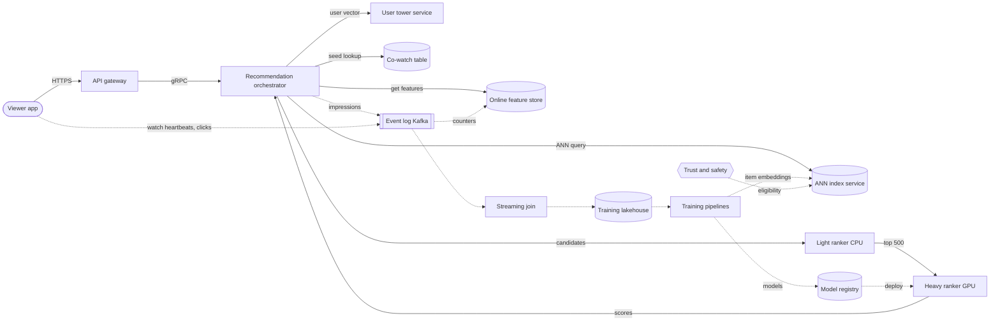

**Reading the diagram.** Solid arrows are the synchronous request path; dotted arrows are asynchronous. The orchestrator fetches viewer features once, obtains a user vector from the user tower, and queries the ANN index service and the co-watch table in parallel (gRPC, sub-10 ms each). Candidates pass a CPU light ranker and the top 500 a GPU heavy ranker; the orchestrator re-ranks for diversity and policy and returns 20. Impressions go to Kafka asynchronously so that logging never blocks serving; the app's watch heartbeats and clicks join them in a streaming job keyed by `rec_token` (§29.8), producing examples in the lakehouse. Training pipelines publish rankers to the registry and item embeddings to the index. Trust and safety pushes eligibility changes (removals within minutes) into the index and filters. Storage boundaries: feature store, index, co-watch table, Kafka, lakehouse, registry. Failure points: the ANN service (fall back to co-watch and popular sources), the GPU tier (serve light-ranker order), the join (training data delayed, serving unaffected). Each tier scales horizontally and independently.

### 81.4.8 Detailed component design

#### Training data: predicting the *next* watch, without leaking the future

Covington et al. report two choices that matter more than architecture [Covington et al. 2016]. First, train candidate generation to predict the **next** watch from the history *before* it, rather than a randomly held-out watch from the whole history: consumption is sequential (episode 2 follows episode 1), and a held-out formulation leaks future watches into the input, which looks good offline and fails online, a form of label leakage (§57.6.3). Second, add an **example age** feature (time since the training example was logged) and set it to zero at serving: the model then learns how popularity changes with a video's age instead of averaging over the training window, which otherwise biases it toward old videos. They also cap the number of training examples per viewer so that heavy viewers do not dominate the loss.

The pipeline therefore logs features as served, joins labels after the 6-hour window, writes examples partitioned by hour, and builds each training set by **time**: train on days $d-60 \ldots d-1$, validate on day $d$ (§68.14.1). The light ranker's training data includes logged *full candidate sets* for a 1% sample of requests, so it learns to imitate the heavy ranker on candidates the viewer never saw (§68.4.1).

#### Candidate generation: several sources, one deadline

**Table 81.5 — Candidate sources for the video recommender.**

| Source | Finds | Mechanism | Quota |
|---|---|---|---|
| Two-tower ANN | Videos near the viewer's interests | User tower over history and context; ANN over item embeddings | 600 |
| Seed co-watch (up next) | Videos watched after the seed | Item-to-item table from sessions (§68.5.3) | 400 |
| Subscriptions | New uploads from subscribed channels | Per-viewer inbox, fan-out on write (§53.7.8) | 200 |
| Topic and language trending | Rising videos in the viewer's topics | Decayed counters per topic and region | 150 |
| Fresh-upload exploration | New videos with little data | Content embedding plus exploration slots (§68.11) | 150 |

The two-tower model is trained with in-batch sampled softmax, whose bias toward popular items is corrected by subtracting the log of each item's sampling probability, estimated by a streaming frequency estimator; Yi et al. describe exactly this correction for YouTube's retrieval [Yi et al. 2019] (§68.6.1 owns the mathematics). The viewer's history enters the user tower as the average of watched-video embeddings, weighted by watch fraction, plus recent search tokens, which is how Covington et al. folded search into recommendation.

Merging is by rank within each source's quota, with provenance logged, and every source must answer within 25 ms or be dropped (§56.5.8). A source's value is its **marginal recall**: the share of eventually-watched videos only it retrieved.

#### Ranking: watch time instead of clicks

A click model maximizes the chance of a click. The published alternative is to rank by **expected watch time**, learned with a weighted logistic regression in which clicked impressions are weighted by their watch time and unclicked impressions by 1 [Covington et al. 2016].

::: formula
**Weighted logistic regression for expected watch time** [Covington et al. 2016]

$$\text{odds} = e^{\mathbf{w}^\top \mathbf{x} + b} \;\approx\; \frac{\sum_{i \in \text{clicked}} T_i}{N - k} \;=\; \frac{\mathbb{E}[T]}{1 - P} \;\approx\; \mathbb{E}[T]\,(1 + P)$$

| Symbol | Meaning | Units |
|---|---|---|
| $\mathbf{x}$, $\mathbf{w}$, $b$ | Impression features, learned weights and bias | — |
| $T_i$ | Watch time of clicked impression $i$ (its training weight) | minutes |
| $N$, $k$ | Impressions and clicked impressions in a feature cell | count |
| $P = k/N$ | Click-through rate | probability |
| $\mathbb{E}[T]$ | Expected watch time per impression, $\sum T_i / N$ | minutes |
:::

::: example
**Worked example — A good video versus clickbait.** Video A: 1,000 impressions, 100 clicks, 600 minutes watched. Video B: 1,000 impressions, 200 clicks, 1 minute watched on average (200 minutes).

1. Click-through rate: A 0.10, B 0.20. A click model ranks B first.
2. Learned odds for A: $600/(1{,}000 - 100) = 0.667$; true expected watch time per impression $600/1{,}000 = 0.600$ min; ratio $1/(1 - 0.1) = 1.111 = 1 + P$ to first order.
3. B: odds $200/800 = 0.250$; expected watch time $0.200$ min.
4. Ranking by odds puts A first by a factor of 2.7.

**Interpretation.** Weighting positives by watch time makes the model's odds approximate expected watch time per impression, inflated by $1/(1 - P)$, which is small when click-through rates are low. **Engineering implication.** Serve $e^{\mathbf{w}^\top\mathbf{x} + b}$ as the score, not the sigmoid; and remember that watch time favors long videos, so the fusion weights below add satisfaction signals that do not.
:::

Watch time alone still has failure modes: it rewards long videos and binge loops, and it cannot tell a viewer who enjoyed a video from one who left it playing. Zhao et al. describe the next step for YouTube's "what to watch next": an MMoE multi-task ranker with **engagement** heads (click, watch time) and **satisfaction** heads (like, dismissal, survey-based), whose outputs are combined with weights tuned online, plus a shallow tower that absorbs **position bias** in training and is dropped at serving [Zhao et al. 2019; Ma et al. 2018]. The architecture and fusion arithmetic are in §68.7.4 (Figure 68.8); this case only fixes its heads: $P(\text{click})$, $\mathbb{E}[\text{watch} \mid \text{click}]$, $P(\text{like} \mid \text{watch})$, $P(\text{dismiss})$ and $P(\text{satisfied} \mid \text{watch})$, the last trained on the sparse survey labels with importance weights because surveys are shown non-uniformly.

**Diversity and re-ranking.** Twenty videos from one channel maximize the sum of independent scores and minimize the page's value. The re-ranker caps items per channel, interleaves topics with MMR (§68.10), and enforces policy demotions. Wilhelm et al. describe replacing heuristic diversification on YouTube with a determinantal point process over item similarities, trained on how users actually respond to diverse pages [Wilhelm et al. 2018].

#### Evaluation and the online experiment

Offline: recall@500 for retrieval on next-day watches; per-head log loss, AUC and calibration ratio on a time-split day; a **watch-time-weighted** ranking metric for the fused score. All of these are computed on logs of the old policy, so they filter rather than decide (§57.13).

Online: an A/B test randomized by viewer, primary metric satisfied watch time per viewer (watch time on videos with no dismissal and above a completion threshold), guardrails dismissals, survey scores, daily active viewers, and creator-side metrics (share of watch time reaching channels outside the top 1%). Run tests at least two weeks because novelty inflates week one (§57.14.3), and keep a long-term holdout of about 1% of viewers on last quarter's stack to measure slow effects such as fatigue [Hohnhold et al. 2015].

::: industry
**YouTube's published recommender architecture.** Covington et al. describe a two-stage system in which candidate generation narrows a corpus of millions to hundreds with a deep network trained as extreme multiclass classification over videos, served by nearest-neighbor search, and a ranking network scores the candidates with hundreds of features, trained with watch-time-weighted logistic regression because ranking by click-through rate "often promotes deceptive videos". Zhao et al. later published the multitask MMoE ranker with a shallow tower for selection bias, and Chen et al. described treating the candidate generator as a policy trained with off-policy-corrected REINFORCE.
*Evidence: Primary* — [Covington et al. 2016; Zhao et al. 2019; Chen et al. 2019]
:::

### 81.4.9 Data flow

**Figure 81.2 — Training path: from watch events to deployed models.**

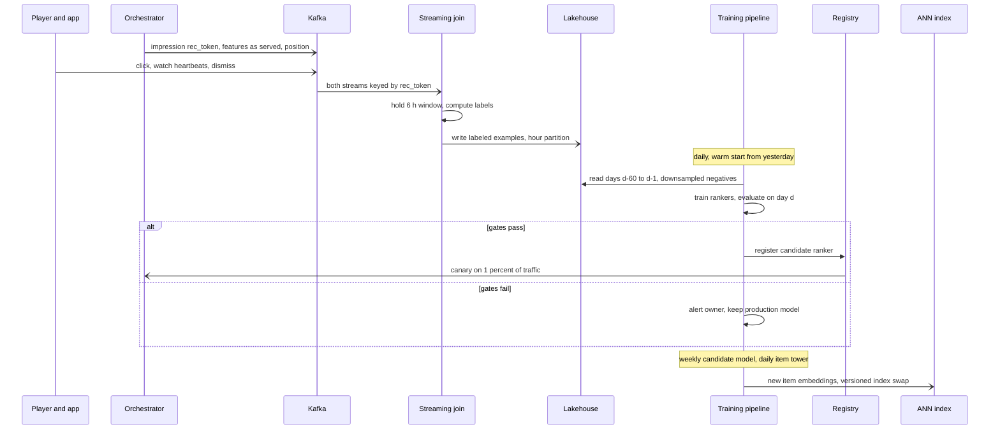

**Reading the diagram.** Half arrows are asynchronous. The orchestrator logs impressions with the exact features used, and the client logs outcomes; both land in Kafka partitioned by `rec_token` so the join is local. The join holds each impression for 6 hours, computes click, watch-time, like and dismissal labels, and writes examples by hour; impressions with no event become negatives only after the window closes, never earlier (§56.5.8). Daily training warm-starts from yesterday, evaluates against a held-out next day and must pass the offline gates of Table 81.3 before registration; the registry then drives a canary. Embedding refreshes require a coordinated swap: user tower and item index from the *same* candidate-model version, otherwise their vectors live in different spaces. Failure points: join lag (training delayed), a gate failure (model held), version mismatch (prevented by version-pinned swaps).

**Figure 81.3 — Serving path: one home-feed request.**

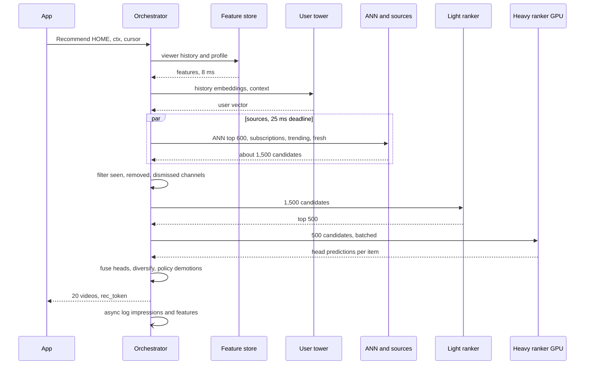

**Reading the diagram.** All calls are synchronous except the final log. The deadline is propagated: features 10 ms, user tower 10 ms, sources 25 ms in parallel, filter 5 ms, light ranker 15 ms, heavy ranker 60 ms, fusion and re-rank 10 ms, leaving 65 ms of the 200 ms p99 as slack for network and queueing. Each step has a degraded mode: missing features use defaults (flagged in the log), a late source is dropped, a heavy-ranker timeout returns the light-ranker order. The filter step uses a per-session seen-set carried in the cursor and a dismissed-channel set from the feature store.

### 81.4.10 Bottlenecks

1. **Heavy-ranker GPUs.** Cost scales with candidates × FLOPs per item; mitigate by distilling into the light ranker, INT8 or FP8 inference (§67.4), and caching viewer-side computations (the user half of the network is computed once per request, not per candidate).
2. **ANN index updates.** 83 inserts per second plus deletions for removed videos; graph indexes degrade with deletes, so rebuild hourly and serve a small delta index for fresh uploads (§74.12).
3. **Viewer embedding row fetch.** 463,000 reads per second from a 512 GB table; shard by viewer and cache per region.
4. **Streaming join state.** Six hours of impressions at $4 \times 10^{11}$ per day is $10^{11}$ pending impressions; keep only keys and a small payload in the join state and the full features in the lakehouse, joined later by `rec_token`.
5. **Hot videos.** A viral video appears in millions of candidate lists; its features must come from the in-process cache, not the feature store.

### 81.4.11 Failure scenarios

**Table 81.6 — Video recommender failure scenarios.**

| What fails | Impact | Detection | Recovery | Prevention |
|---|---|---|---|---|
| Training–serving skew (watch fraction computed differently online) | Ranker quality drops silently | Skew detector comparing logged vs recomputed features (§62.9.2) | Roll back model; fix feature | Log features as served; one definition |
| Clickbait feedback loop | CTR rises, satisfaction falls | Dismissal and survey guardrails; satisfied-watch ratio | Raise satisfaction weights | Watch-time and satisfaction heads; long-term holdout |
| Popularity concentration (rich get richer) | Niche and new creators starve | Creator coverage, Gini of impressions | Increase exploration quota | Sampling-bias correction; exploration slots (§68.11) |
| Stale item embeddings or version mismatch | New videos never retrieved; garbage neighbors | Age of newest indexed video; recall on canary queries | Re-pin to last consistent pair | Version-pinned user tower and index swap |
| Label leakage (future watches in features) | Offline gains that vanish online | Offline–online gap on launch | Revert feature | Time-split evaluation; next-watch formulation |
| GPU ranker overload or outage | Latency SLO breach | p99, queue depth | Serve light-ranker order (degraded) | Headroom for N−1 region; load shedding |
| Adversarial adaptation (view farms, misleading thumbnails) | Spam rises in feeds | Anomalous engagement velocity; invalid-traffic filters | Exclude traffic from training; demote | Trust-and-safety signals in eligibility |
| Bad calibration after a sampling change | Fusion weights silently distorted | Per-head calibration ratio | Refit calibration layer | Correction in the serving graph (§68.7.5) |

### 81.4.12 Scaling strategy

**At 10× requests** (4.6 million per second), the funnel scales linearly; the levers are cheaper heavy-ranker inference (quantization, distillation to a smaller student), caching the user-side part of the network for a session, and precomputing home-feed candidates for active viewers between sessions. **At 10× corpus** ($5 \times 10^9$ videos), the index moves to SSD-resident graphs or IVF-PQ with re-scoring (§74.10), retrieval shards by region and language, and more candidate sources run per shard. **At 100×**, the funnel itself is reconsidered: generative retrieval and sequence models over long histories replace some sources, and training moves to continuous fine-tuning with checkpoint promotion every hour, with the risk controls of §68.13.

### 81.4.13 Trade-offs

**Table 81.7 — Video recommender trade-offs.**

| Decision | Choice | Alternative | Why |
|---|---|---|---|
| Ranking objective | Fused engagement + satisfaction heads | CTR only | CTR rewards clickbait |
| Candidate model target | Next watch | Held-out watch | Avoids leaking the future |
| Heavy-ranker input | 500 | 1,500 | 3× GPU cost for marginal recall |
| Retrieval index | PQ with re-scoring | Exact FP32 | 16 GB vs 256 GB per replica |
| Model update | Daily warm start | Online learning | Offline gates before exposure |
| Diversity | Learned re-ranker with caps | Pure score order | Page value is not a sum of item values |

### 81.4.14 Alternative designs

- **Single-stage brute-force ranking** works for catalogs up to about $10^5$ items (QuickBite, §68.4) but costs 10⁶× more here.
- **Pure item-to-item recommendations** (co-watch only) are cheap and explainable but cannot serve the home feed of a viewer with no seed.
- **Reinforcement learning for slate optimization** treats the session, not the impression, as the unit of reward; it is promising for long-term objectives but harder to evaluate offline [Chen et al. 2019].
- **Precomputing all feeds nightly** reduces serving cost but loses in-session adaptation, the main quality lever for video.

### 81.4.15 Interview discussion

**Table 81.8 — 45-minute pacing plan for the video recommender.**

| Minutes | Focus | What to produce |
|---|---|---|
| 0–5 | Scope and objective | Home and up next; satisfied watch time, not CTR |
| 5–10 | ML formulation and labels | Retrieval as next-watch classification; multi-task ranking; label delays |
| 10–15 | Estimates | 463k requests/s peak; ~500 GPUs for 500 items × 200 MFLOPs; 16 GB PQ index |
| 15–25 | Architecture | Figure 81.1; sources and funnel with latency budget |
| 25–37 | Deep dive | Watch-time weighting and MMoE heads; sampling-bias-corrected two-tower; training data |
| 37–45 | Evaluation and failures | Offline gates, A/B design, holdout; clickbait loop, skew, index versioning |

**Likely follow-ups.**

- *"Why not optimize clicks?"* Clicks reward misleading thumbnails; watch-time weighting makes the score approximate expected minutes, and satisfaction heads catch long-but-unhappy watches.
- *"How does a new video get recommended?"* Content-based item tower embeds it at upload; fresh-upload source and exploration slots give it impressions; decayed counters update its engagement within minutes.
- *"How do you keep the user tower and index consistent?"* Version them together and swap atomically per region; never mix versions.
- *"How would you know the model got worse?"* Per-head calibration and online guardrails within hours; satisfaction surveys and holdout over weeks.

**What distinguishes senior and staff answers.** A senior answer gets the funnel, the two-tower retrieval and a multi-task ranker right with numbers. A staff answer argues the objective (why watch time, why satisfaction heads, how weights are set by experiments), designs the training data against leakage and position bias, puts costs on the heavy-ranker input, and treats feedback loops and creator-side effects as first-class guardrails.

### 81.4.16 Production considerations

- **Monitoring (Chapter 70).** Per-head calibration ratio by surface and region; feature freshness; candidate-source marginal recall; embedding-norm and neighbor-stability drift (§70.7.4); degraded-response rate; age of newest indexed video.
- **Retraining.** Rankers daily with warm start and automatic gates; candidate model weekly; item embeddings for new uploads continuously; emergency retrain path for policy changes.
- **Responsible ML (Chapter 71).** Exposure metrics per creator group and language; borderline-content demotion audited; viewer controls honored within one request; teen-account constraints applied in eligibility, not in ranking.
- **Cost.** The heavy-ranker GPU fleet and the training input pipeline dominate; report cost per 1,000 recommendations (§60.11) and per percentage point of watch time gained.

## 81.5 Feed and Explore recommendations (Instagram-style)

### 81.5.1 Problem statement

Design the ranking systems behind two surfaces of a photo-and-video social app: the **home feed**, which mixes posts from accounts the viewer follows with recommended posts from accounts they do not, and **Explore**, a grid of recommended posts from accounts the viewer does not follow. The app is the one designed in §53.6 (500 million daily active users, 100 million new posts and 250 million stories a day); that case built the media pipeline and fan-out; §53.7.8 sketched staged ranking for a news feed. This case designs the ranking.

Three problems distinguish it from the video recommender of §81.4:

1. **Two graphs.** Candidates come from the **social graph** (whom you follow, whose posts you liked) and the **interest graph** (what topics and styles you engage with, regardless of who posted). Their candidates have different features, volumes and freshness, and the feed must decide how much of each to show.
2. **Real-time engagement.** Posts live for hours to days, not years. A post's first 30 minutes of likes, comments and shares is the best signal of its quality, so features must be seconds old, and they are easily gamed.
3. **Integrity before ranking.** An engagement-optimized ranker amplifies whatever engages, including content that violates policy or is borderline. Filtering must happen *before* ranking and be measured as a rate of exposure, not only as a count of removals.

**ML formulation.** For each (viewer, post) pair predict a vector of action probabilities: like, comment, share, save, follow the author, dwell over a threshold, "see fewer posts like this", and report. Combine them into one value with weights (positive for wanted actions, negative for negative feedback), the same fusion as §68.7.4. Labels are implicit and arrive within minutes, except reports, which are rare and delayed. Candidate retrieval for the interest graph is a two-tower model trained on engagement; integrity classifiers are separate models owned by the trust-and-safety organization (Chapter 82) whose outputs this system consumes.

### 81.5.2 Functional requirements

1. **Home feed.** Return pages of 10 posts mixing connected (followed) and unconnected (recommended) posts; never show a post twice to the same viewer within 7 days unless it has new activity.
2. **Explore grid.** Return 24 posts from unconnected accounts, with topic diversity.
3. **Freshness.** A new post from a followed account is eligible within 1 minute; a new post is eligible for recommendation to non-followers only after it has passed integrity checks and has initial engagement (or a content-quality score) to rank on.
4. **Integrity.** Removed content never appears; borderline content is never *recommended* to non-followers and is demoted in connected feeds; viewer sensitivity settings apply.
5. **Viewer controls.** "Not interested", snooze, mute and unfollow apply on the next request.
6. **Logging and experimentation.** As in §81.4.

### 81.5.3 Non-functional requirements

**Table 81.9 — Feed and Explore requirements.**

| Property | Target | Why |
|---|---|---|
| Availability | 99.95% ranked; 99.99% some feed (chronological connected posts as fallback) | Users open the app many times a day |
| Server-side latency | Feed p99 ≤ 250 ms; Explore p99 ≤ 300 ms | Feed renders on app open; Explore tolerates slightly more |
| Engagement feature freshness | Post counters ≤ 30 s; viewer session features ≤ 10 s | Early engagement is the best quality signal |
| Integrity latency | Classifier scores before a post is eligible for recommendation; removals propagated ≤ 5 min | Exposure, not removal count, is the harm |
| Violating-content prevalence | ≤ 0.02% of recommended impressions per policy area (illustrative target) | Measured by sampled human labeling |
| Model freshness | Rankers retrained daily; two-tower item embeddings for new posts within 5 min | Posts are short-lived |
| Offline gates | Per-head normalized entropy and AUC not worse; calibration 0.95–1.05 | Fusion requires calibrated heads |
| Online guardrails | Daily active users, sessions, time spent; negative-feedback rate; prevalence; connected-content share | Prevent recommendation crowding out friends |

### 81.5.4 Capacity estimation

::: example
**Worked example — Request rates and ranking compute.** Assumptions (consistent with §53.6): 500 million DAU; 20 feed loads per user per day; 40% of DAU (200 million) open Explore 10 times a day; peak-to-average 3. Feed heavy ranker scores 500 candidates per request; Explore follows a published funnel of 500 → 150 → 50 → 25 (Industry callout below), so its heavy ranker scores 50. Assume 50 MFLOPs per item for the heavy ranker.

1. Feed: $5 \times 10^8 \times 20 = 10^{10}$ requests/day; 115,741/s average; **347,222/s peak**.
2. Explore: $2 \times 10^8 \times 10 = 2 \times 10^9$/day; 23,148/s average; **69,444/s peak**.
3. Heavy-ranker FLOPs at peak: $(347{,}222 \times 500 + 69{,}444 \times 50) \times 5 \times 10^7 = 8.85 \times 10^{15}$ FLOP/s; at 150 TFLOP/s effective, 59 GPUs busy; at $u = 0.6$, 98.
4. Three regions, two carry the peak: $98.4/2 = 49.2$, so 50 per region, **150 GPUs**.
5. Per-candidate feature lookups at peak: $347{,}222 \times 500 + 69{,}444 \times 150 = 1.84 \times 10^8$ per second.

**Interpretation.** The GPU fleet is modest; the per-candidate feature fetch, 184 million lookups per second, is the real load. **Engineering implication.** Co-locate post and author features with the ranker in a sharded in-memory cache keyed by post ID, refreshed by the streaming counters, and fetch only the viewer's features remotely.
:::

::: example
**Worked example — Engagement events and integrity compute.** Assumptions: 10 posts rendered per feed load; 20 likes per user per day; 200 bytes of decayed counters per active post (several actions × three time constants, §68.13); 700 million posts active in the last 7 days; five integrity classifiers at 20 GFLOPs each per media item.

1. Impressions: $10^{10} \times 10 = 10^{11}$ per day; 1.16 million/s average, **3.47 million/s peak**.
2. Likes: $5 \times 10^8 \times 20 = 10^{10}$ per day; 115,741/s average; 347,222/s peak.
3. Counter store: $7 \times 10^8 \times 200 = 140$ GB, held in memory across a sharded cluster.
4. New media: $(10^8 + 2.5 \times 10^8) / 86{,}400 = 4{,}051$ items/s; integrity compute $3.5 \times 10^8 \times 5 \times 2 \times 10^{10} = 3.5 \times 10^{19}$ FLOPs per day, about 65 GPU-hours at 150 TFLOP/s.

**Interpretation.** Classifying every upload is cheaper than one hour of the ranking fleet; there is no cost argument for classifying late. **Engineering implication.** Classify at upload, before eligibility, and store scores with the post; re-score only when classifiers change.
:::

### 81.5.5 API design

```protobuf
service FeedRanking {
  rpc GetFeed(FeedRequest) returns (FeedResponse);
  rpc GetExplore(ExploreRequest) returns (ExploreResponse);
}
message FeedRequest {
  string viewer_id = 1; Context ctx = 2;
  string cursor = 3;              // carries seen-set digest
  int32 page_size = 4;            // 10
}
message FeedResponse {
  repeated RankedPost posts = 1;  // post_id, source (CONNECTED | RECOMMENDED), reason
  string rec_token = 2; string next_cursor = 3; bool degraded = 4;
}
// Consumed from trust and safety; pushed, not pulled per request
message IntegrityVerdict {
  string post_id = 1;
  map<string, float> policy_scores = 2;   // per policy area
  Eligibility eligibility = 3;            // ELIGIBLE, NOT_RECOMMENDABLE, DEMOTE, REMOVED
  string classifier_version = 4; int64 ts_ms = 5;
}
```

Engagement events (`view`, `like`, `comment`, `share`, `save`, `see_fewer`, `report`) are logged by the client against `rec_token` as in §81.4.5.

### 81.5.6 Data model and database schema

**Table 81.10 — Feature groups for feed ranking.**

| Group | Key | Examples | Freshness |
|---|---|---|---|
| Viewer–author affinity | (viewer_id, author_id) | Likes, comments, profile visits, DMs to the author in 7 and 90 days | Minutes (stream) |
| Post engagement | post_id | Decayed likes, comments, shares, saves, see-fewer per impression | ≤ 30 s |
| Post content | post_id | Image and caption embeddings, topic, language, media type | On upload |
| Integrity | post_id | Policy scores, eligibility, classifier version | On upload; pushed on change |
| Author | author_id | Follower count, posting rate, account age, integrity history | Hourly |
| Viewer session | viewer_id | Topics engaged in the last 10 minutes, scroll speed | ≤ 10 s |
| Account embedding | account_id | Embedding of accounts co-engaged in sessions | Daily |

Affinity is the most important connected-feed feature and also the most expensive: it is keyed by a *pair*. Store it as a per-viewer row containing the top 1,000 authors by affinity (a few KB), updated by a stream job; a pair absent from the row has affinity zero.

**Labels.** Like, comment, share, save and dwell are known within the session (join window 1 hour); "see fewer" and reports within hours. Reports are rare and are used mainly as an integrity signal and a negative head, with importance weights.

The eligibility index is a key–value table `post_id → eligibility, version`, replicated to every ranking region and consulted by every candidate source; removal updates are pushed through a dedicated high-priority stream so that a takedown does not wait behind counter updates.

### 81.5.7 High-level architecture

**Figure 81.4 — Feed and Explore ranking with integrity before ranking.**

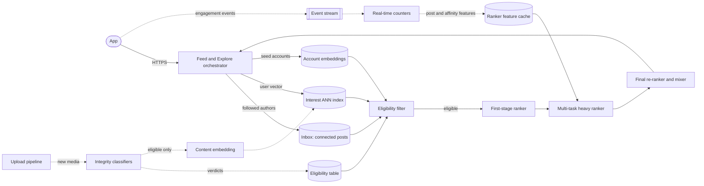

**Reading the diagram.** Solid arrows are synchronous within the request; dotted arrows are asynchronous pipelines. The orchestrator gathers connected candidates from the viewer's inbox (fan-out on write of followed accounts' posts, §53.7.8) and unconnected candidates from the interest ANN index and from accounts similar to those the viewer engages with. All candidates pass the **eligibility filter**, a local lookup against a replicated eligibility table, before any ranking. Two ranking stages follow, then a final re-ranker that mixes connected and recommended posts and applies diversity. Upstream, new media pass integrity classifiers *before* being embedded into the recommendation index, so ineligible posts never become candidates for non-followers. Engagement events flow through a stream to real-time counters and on to a ranker-local feature cache. Failure points: the eligibility table (fail closed for recommendations: no table, no unconnected candidates), the counter stream (features age; ranking continues), the heavy ranker (serve first-stage order). Scaling: sources and rankers by request rate; counters by event rate.

### 81.5.8 Detailed component design

#### Integrity filtering before ranking

Why before? An engagement ranker scores borderline content highly precisely because it engages, so whatever the integrity system misses is not shown at its base rate but **amplified**. Filtering after ranking is also wasteful (the heavy ranker scored items it can never show) and leaves the training data full of impressions of content that should not have been shown, which teaches the next model that such content performs.

::: formula
**Violating impressions after filtering and ranking**

$$V = I \cdot \pi \cdot (1 - r) \cdot \alpha \qquad \text{prevalence} = V / I$$

| Symbol | Meaning | Units |
|---|---|---|
| $I$ | Impressions served per day | impressions |
| $\pi$ | Share of candidates that violate a policy | fraction |
| $r$ | Recall of the pre-ranking filter (share of violating candidates removed) | fraction |
| $\alpha$ | Amplification: violating items' impression share relative to their candidate share after ranking | ratio |
| $V$ | Violating impressions served per day | impressions |
:::

::: example
**Worked example — Why recall before ranking matters.** $I = 10^{11}$ impressions per day; $\pi = 0.1\%$ of candidates violate; the ranker amplifies them by $\alpha = 2$.

1. No filter ($r = 0$): $V = 10^{11} \times 0.001 \times 1 \times 2 = 2 \times 10^8$ violating impressions per day, prevalence 0.2%.
2. Filter with $r = 0.9$: $V = 2 \times 10^7$, prevalence 0.02%.
3. Filter with $r = 0.97$: $V = 6 \times 10^6$, prevalence 0.006%.

**Interpretation.** Each point of recall removes millions of exposures a day, and amplification doubles every miss. **Engineering implication.** Put the filter before ranking, measure prevalence by sampling and human-labeling served impressions (not by counting removals), and also add a negative head for reports and "see fewer" so that the ranker itself stops amplifying borderline items.
:::

Three tiers keep this cheap. (1) **At upload**, classifiers score each item and write a verdict; items above the removal threshold are removed, items in a borderline band are marked *not recommendable* (still visible to followers, demoted). (2) **At candidate time**, every source consults the replicated eligibility table; recommendation sources fail closed. (3) **After serving**, sampled impressions are labeled by humans to measure prevalence per policy area, the ground truth for both the integrity classifiers and this system's guardrail. Classifier updates trigger a re-scoring backfill of recent posts and push changed verdicts through the priority stream.

::: industry
**Prevalence as the integrity metric.** Meta's Community Standards Enforcement Reports define **prevalence** as the estimated share of content views that contained violating content, measured by sampling and labeling views, and report it alongside counts of content actioned. The views-based definition is the one this design adopts as a guardrail, because it captures how much harmful content ranking actually distributed.
*Evidence: Primary* — [Meta Transparency Center: Community Standards Enforcement Report]
:::

#### Merging the social graph and the interest graph

Connected candidates are posts from followed accounts since the last visit, typically a few hundred, retrieved from the inbox. Unconnected candidates come from three sources: the interest two-tower ANN (§68.6); **seed-account expansion**, which takes accounts the viewer recently engaged with and retrieves posts from accounts nearby in an account-embedding space learned from co-engagement sequences; and topic trending. The final mixer controls the share of recommended posts per page with a **value threshold**: a recommended post displaces a connected one only if its predicted value exceeds the connected post's by a margin, tuned by experiment against the guardrail on connected-content share. Without this, recommendations, which are selected from a vastly larger pool, would crowd out friends.

Because connected and unconnected candidates have different feature coverage (affinity is zero for unconnected authors), train one heavy ranker with a source indicator and source-specific calibration, and evaluate it per source.

::: industry
**Instagram Explore as published (2019).** Meta engineers described Explore's pipeline: candidate retrieval written in IGQL, a domain-specific language for composing retrieval queries, with account embeddings (ig2vec) trained like word embeddings on sequences of accounts users interact with, and seed accounts used to find similar accounts. For each request, 500 candidates are sampled and ranked in three passes: a distillation model trained to imitate the heavier rankers selects 150, a lightweight neural network selects 50, and a deep network selects the 25 shown, ordered by a value model combining predicted actions. A 2023 post described the later system's stages of retrieval, first-stage ranking, second-stage ranking and final re-ranking.
*Evidence: Primary* — [Medvedev et al. 2019; Vorotilov and Shugaepov 2023]
:::

#### Real-time engagement signals

A post's quality is mostly unknown at upload and mostly known an hour later. Decayed counters (§68.13) of likes, comments, shares, saves and "see fewer" per impression, at time constants of 10 minutes, 1 hour and 1 day, are maintained by a stream job keyed by post ID and pushed to the ranker-local feature cache within 30 seconds. Ratios, not counts, are the features: likes per impression normalizes for distribution already received, and a Beta prior from the author's history (§68.15) stabilizes ratios for posts with few impressions.

Fresh signals are also the easiest to manipulate. The stream job drops events from accounts flagged as automated, caps each account's contribution per author per hour, and computes velocity features only over viewers who received the post organically (not from paid promotion). Engagement from the post's own followers and from non-followers is counted separately, because a post that only followers like is not yet evidence for recommending it to strangers.

#### Ranking and evaluation

The heavy ranker is a multi-task network (§68.7.4) with heads for like, comment, share, save, follow, long dwell, see-fewer and report, fused as $\sum_k w_k \hat{p}_k$ with negative weights on the last two. Meta has described Facebook's feed ranking in the same terms: predicting the probability of several actions per post and combining them into one relevance score [Lada et al. 2021]. Offline gates use per-head normalized entropy (log loss relative to a constant predictor, [He et al. 2014]) and calibration. Online: A/B by viewer, with daily active users and sessions as primary metrics, and prevalence, negative-feedback rate and connected-content share as guardrails. Because content and authors are shared between arms, a ranker that sends more distribution to some creators changes what they post next week; for creator-facing changes, add creator-side randomization or long tests.

::: industry
**How Instagram describes its ranking publicly.** Instagram's head has explained that Feed, Stories, Explore and Reels each use their own ranking, informed by signals about the post, the person who posted, the viewer's activity and the viewer's history of interacting with the poster, and that the app predicts the likelihood of actions such as spending time on, commenting on, liking, sharing and tapping a post.
*Evidence: Primary* — [Mosseri 2021]
:::

### 81.5.9 Data flow

**Figure 81.5 — Write path: a new post becomes rankable.**

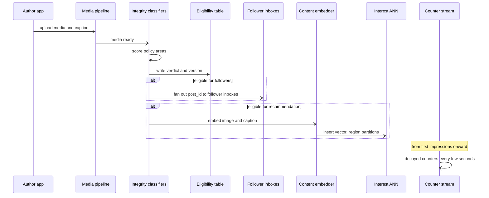

**Reading the diagram.** The upload itself is synchronous only until the media is durably stored (§53.6.9); everything after is asynchronous. The integrity classifiers write a verdict *before* any distribution: followers' inboxes receive the post only if it is eligible for followers, and the interest index receives its embedding only if it is eligible for recommendation. A verdict change later (appeal, new classifier) is pushed to the eligibility table, which every source consults, so a late removal takes effect without rebuilding indexes. Engagement counters start with the first impressions. Failure points: a classifier backlog delays distribution (alert on queue age; never bypass for recommendations), embedding lag delays recommendation but not the followers' feed.

**Figure 81.6 — Read path: one home-feed request.**

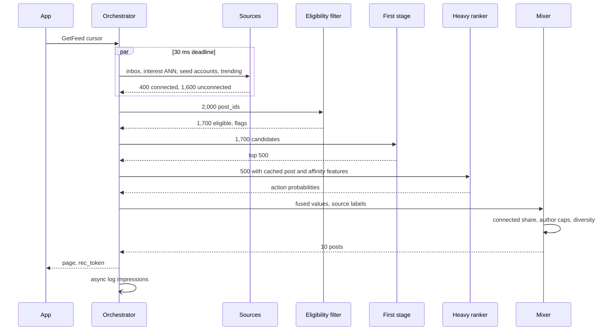

**Reading the diagram.** All calls are synchronous RPCs except the final log. Sources answer in parallel within 30 ms; the eligibility filter is an in-memory lookup on the orchestrator host or a co-located sidecar (under 5 ms for 2,000 IDs). The first stage is a distilled model (§68.4.1). The heavy ranker reads post and affinity features from its local cache, so per-candidate features do not cross the network. The mixer enforces connected-share and per-author caps. Degraded modes: no eligibility table, connected-only feed; heavy ranker down, first-stage order; everything down, recent connected posts in reverse chronological order.

### 81.5.10 Bottlenecks

1. **Per-candidate features.** 184 million lookups per second; shard the feature cache by post ID with the ranker, or replicate hot-post features everywhere.
2. **Viewer–author affinity.** Pair-keyed data; truncate to top-N authors per viewer.
3. **Celebrity posts.** A post by an account with 500 million followers is pulled at read time rather than fanned out (§53.7.8), and its counters are hot keys; split counters across sub-keys and merge.
4. **Integrity backlog at peaks.** Uploads spike during events; classifier capacity must absorb the peak or recommendations of new posts lag.
5. **Eligibility propagation.** Takedowns must reach every region in minutes; a priority stream with its own lag alert.

### 81.5.11 Failure scenarios

**Table 81.11 — Feed and Explore failure scenarios.**

| What fails | Impact | Detection | Recovery | Prevention |
|---|---|---|---|---|
| Integrity classifier regression (new version misses a policy area) | Prevalence rises; harm amplified | Sampled prevalence labeling; score-distribution drift | Roll back classifier; re-score backfill | Shadow-test classifiers on labeled sets; canary |
| Eligibility table stale in a region | Removed posts shown | Lag on priority stream; canary "removed" post probes | Fail closed for recommendations | Dedicated stream; per-region freshness alert |
| Engagement-bait feedback loop | Comment-bait and outrage rise | Negative-feedback rate; survey; prevalence of borderline | Increase negative weights; demote | Negative heads; integrity before ranking |
| Bot-driven counters | Spam recommended widely | Velocity anomalies; share of engagement from new accounts | Purge events; recompute counters | Bot filters in stream; per-account caps |
| Stale counters (stream lag) | Fresh posts under-ranked | Counter age metric | Rank with older counters; scale stream | Lag alerts below freshness SLO |
| Training–serving skew on affinity (top-N truncation only online) | Connected ranking degrades | Skew detector | Align truncation | Same truncated row logged and trained |
| Recommendations crowd out friends | Long-term retention falls | Connected-content share guardrail; holdout | Raise displacement margin | Value threshold in mixer |
| Fairness: some creator groups under-distributed | Creator churn, harm | Exposure by creator segment (§71.5) | Adjust exploration and caps | Exposure monitoring per segment |

### 81.5.12 Scaling strategy

At **10× viewers**, ranking scales linearly; the eligibility table and counter store scale with *content*, not viewers, so they barely change. At **10× content** (a short-video surface with far more uploads), integrity compute and the interest index grow tenfold; move classifiers to cheaper cascades (a small model first, the large one only on uncertain items, §60.13.2) and shard the index by language and region. At **100×**, per-viewer precomputation between sessions and sequence models over long engagement histories replace some request-time sources, and the ranker-local feature cache becomes the dominant memory cost.

### 81.5.13 Trade-offs

**Table 81.12 — Feed and Explore trade-offs.**

| Decision | Choice | Alternative | Why |
|---|---|---|---|
| Integrity placement | Before ranking, fail closed for recommendations | After ranking | Amplification; training-data pollution |
| Borderline content | Visible to followers, not recommended | Remove everything borderline | Proportionate response to uncertain classifiers |
| Feature placement | Post features cached with ranker | Remote feature store per candidate | 184 million lookups/s |
| Connected vs recommended | Value threshold with margin | Pure value ranking | Protect the social core of the product |
| Counter freshness | 30 s | 1 s | Cost and bot-filtering time |
| Fallback | Chronological connected feed | Empty or error | Always meaningful to the viewer |

### 81.5.14 Alternative designs

- **Chronological feeds** remove ranking entirely: transparent and impossible to game by engagement, but viewers miss most posts once they follow many accounts.
- **Graph-based candidate generation** by random walks over a user–post graph (as in Pinterest's Pixie, §56.5.8) can replace the ANN source for interest candidates.
- **Separate rankers per source** simplify features but make connected and recommended scores incomparable, complicating the mixer.
- **Integrity as a ranking feature only** (no hard filter) is simpler but lets a strong engagement prediction outweigh a policy score.

### 81.5.15 Interview discussion

**Table 81.13 — 45-minute pacing plan for feed and Explore.**

| Minutes | Focus | What to produce |
|---|---|---|
| 0–5 | Scope | Feed (connected + recommended) and Explore; integrity in scope |
| 5–10 | Formulation | Multi-action heads, fused value with negative weights; label delays |
| 10–15 | Estimates | 347k feed requests/s; 184M feature lookups/s; 3.5M impressions/s |
| 15–25 | Architecture | Figure 81.4: two graphs, eligibility filter, staged ranking, mixer |
| 25–37 | Deep dives | Integrity before ranking with prevalence; real-time counters and gaming |
| 37–45 | Evaluation and failures | A/B metrics and guardrails; classifier regression; stale eligibility |

**Likely follow-ups.**

- *"Why not filter after ranking?"* The ranker amplifies misses, wastes compute, and pollutes training data; filtering is a cheap lookup if verdicts are precomputed.
- *"How do you rank a post that is two minutes old?"* Content embedding and author priors for the first impressions; decayed counters with a Beta prior as engagement arrives.
- *"How do you stop recommendations replacing friends?"* A displacement margin and a connected-share guardrail, tuned by experiment and watched in the holdout.

**What distinguishes senior and staff answers.** Senior answers design the staged funnel and fusion correctly. Staff answers make integrity a measured property of the ranking system (prevalence, amplification), design anti-gaming into the real-time feature path, and recognize the two-sided effects of ranking changes on creators.

### 81.5.16 Production considerations

- **Monitoring.** Prevalence per policy area from sampled labeling; eligibility-stream lag; counter freshness; per-head calibration by source (connected and recommended); connected share; negative-feedback rate.
- **Retraining.** Rankers daily; first-stage distillation retrained after each heavy-ranker update; integrity classifiers on their own cadence with re-scoring backfills.
- **Responsible ML.** Viewer sensitivity controls applied as eligibility, not as ranking features; teen protections in eligibility; creator exposure parity monitored (§71.5); transparency notes for "why am I seeing this".
- **Cost.** Feature cache memory and the event stream dominate, then GPUs; integrity compute is small relative to the harm it prevents.

## 81.6 Homepage recommendations (Netflix-style)

### 81.6.1 Problem statement

Design the personalization behind the home page of a subscription video service: the grid of rows ("Continue watching", "Top picks for you", "Because you watched…", genre rows) that a member sees when they open the app, and the image (artwork) that represents each title. This is the service whose streaming platform was designed in §54.5; that case drew the hand-off boundary in §54.5.8, where precomputed candidate rows per profile are read from a key–value store and re-ranked with live context. This case designs what is behind the boundary.

The distinctive problems are three:

1. **The unit of recommendation is a page, not an item.** The page is two-dimensional (rows × positions), rows have themes that explain themselves, the same title can appear in several rows, and the value of a row depends on the rows above it.
2. **Presentation is part of the recommendation.** The same title shown with different artwork gets different play rates, and the best artwork differs by member.
3. **Offline metrics disagree with online outcomes.** The business metric is **retention**: whether a member keeps paying next month. It is slow and noisy; offline ranking metrics are fast but only loosely correlated with it, so experimentation strategy is a design concern.

**ML formulation.** (a) A **title ranker** predicts, for each (profile, title), the probability of a qualified play (playing beyond a few minutes) in the next session; label from viewing logs, delay of a session to days. (b) **Row generators** produce candidate rows, each a themed, ranked list. (c) A **page constructor** selects and orders rows to maximize expected page value under diversity and business constraints. (d) An **artwork selector** is a contextual bandit choosing one of several images per (profile, title) with reward = qualified play. The North-star outcome, retention, is measured only in A/B tests.

### 81.6.2 Functional requirements

1. **Home page.** Return up to 40 rows of up to 75 titles for a profile, device and time, with the first screen within the latency budget and lower rows lazily.
2. **Row variety.** Personalized, contextual (time of day, device), editorial and continue-watching rows; de-duplicate titles within the visible area.
3. **Artwork.** For each title on the page, choose an image variant; respect maturity settings and territory rights.
4. **Availability rules.** Show only titles licensed in the member's country and allowed by the profile's maturity rating.
5. **Fresh signals.** A title just finished disappears from "Continue watching" and influences "Because you watched" on the next page load.
6. **Experimentation.** A/B tests at member level for months; interleaving for rankers.

Out of scope: playback, encoding and CDN (§54.5), search (§81.7).

### 81.6.3 Non-functional requirements

**Table 81.14 — Homepage personalization requirements.**

| Property | Target | Why |
|---|---|---|
| Availability | 99.99% for some home page (fallback: popular-in-territory rows) | The home page is the product's front door |
| Server-side latency | p99 ≤ 150 ms for the first 10 rows | App start time is a key experience metric (§54.5) |
| Freshness | Continue-watching and recent plays ≤ 1 min; candidate rows recomputed nightly and on significant activity | Stale "continue watching" is visibly wrong |
| Correctness | Zero unlicensed or maturity-violating titles | Contractual and trust obligations |
| Offline gates | Title ranker recall and NDCG on next-week plays not worse; page simulator value not worse | Cheap filters before online tests |
| Online primary metric | Retention and streaming hours per member over at least one billing cycle | Subscription business |
| Online guardrails | Play-start latency, browse time before first play, catalog coverage | Detect pages that are confusing or narrow |

### 81.6.4 Capacity estimation

::: example
**Worked example — Page traffic, precomputation and storage.** Assumptions (consistent with §54.5): 150 million daily active profiles; 4 home-page loads per profile per day; peak 2.5× average; 300 million profiles active in the last 30 days are precomputed nightly; 6,000 titles in a territory's catalog; the title ranker costs 10 µs of CPU per (profile, title); 50 KB stored per profile (about 150 candidate rows with title IDs and scores).

1. Page loads: $1.5 \times 10^8 \times 4 = 6 \times 10^8$ per day; 6,944/s average; **17,361/s peak**.
2. Nightly scoring: $3 \times 10^8 \times 6{,}000 = 1.8 \times 10^{12}$ (profile, title) pairs; $1.8 \times 10^{12} \times 10\ \mu\text{s} = 5{,}000$ core-hours, or **833 cores** for a 6-hour batch window.
3. Candidate-row store: $3 \times 10^8 \times 50$ KB $= 15$ TB; reads at peak $17{,}361 \times 50$ KB $= 0.87$ GB/s.
4. Artwork decisions for about 48 titles visible on the first screen: $17{,}361 \times 48 = 833{,}333$ per second at peak if computed online; precomputing for the 500 most likely titles per profile is $1.5 \times 10^{11}$ decisions per night.

**Interpretation.** Exhaustive scoring of every title for every profile is affordable because the catalog is small (thousands, not hundreds of millions as in §81.4); the request rate is low too. The constraint is not compute but *context*: a nightly ranking does not know it is Saturday morning on a TV. **Engineering implication.** Precompute candidates and scores nightly, then re-rank and construct the page online with context in a few milliseconds; precompute artwork choices but re-decide online for titles whose image set changed.
:::

### 81.6.5 API design

```protobuf
service Homepage {
  rpc GetPage(PageRequest) returns (Page);
  rpc GetRows(RowsRequest) returns (Page);     // lazy loading below the fold
}
message PageRequest {
  string profile_id = 1; string country = 2;
  Device device = 3; int64 local_time_ms = 4;
  int32 first_rows = 5;                        // e.g. 10
}
message Page {
  repeated Row rows = 1; string page_token = 2; bool degraded = 3;
}
message Row {
  string row_id = 1; string row_type = 2;      // CONTINUE, TOP_PICKS, BYW, GENRE, TRENDING
  string title_text = 3;                       // "Because you watched X"
  repeated Tile tiles = 4;
}
message Tile { string title_id = 1; string artwork_id = 2; float propensity = 3; }
```

The `propensity` is the probability with which the artwork bandit chose that image; logging it is what makes the offline replay evaluation of §81.6.8 possible. Plays, browse events and row scrolls are logged against `page_token`.

### 81.6.6 Data model and database schema

**Table 81.15 — Data for homepage personalization.**

| Data | Key | Content | Freshness |
|---|---|---|---|
| Viewing history | profile_id | Title, episode, seconds, completion, device, time | ≤ 1 min (stream) |
| Candidate rows | profile_id | ~150 rows: row type, theme, ranked title IDs, scores, model version | Nightly + event-triggered |
| Title metadata | title_id | Genres, tags, cast, maturity, availability windows per country | On change |
| Artwork set | title_id | Image variants with visual tags (cast shown, tone) | On change |
| Artwork policy state | (title_id, context bucket) | Bandit parameters | Hourly |
| Page impressions | page_token | Rows, positions, tiles, artwork, propensities | Logged at serve |

**Labels.** Qualified play (beyond a threshold, for example 2 minutes) attributed to the tile that was clicked; completion over days; retention only per member per month. The training example for the title ranker is (profile, title, context, impression position, label), built from page impressions joined to plays within a 24-hour window. Because most titles on a page are never looked at, impressions below the visible area are excluded unless the client reports they were rendered on screen.

### 81.6.7 High-level architecture

**Figure 81.7 — Homepage personalization: offline, nearline and online.**

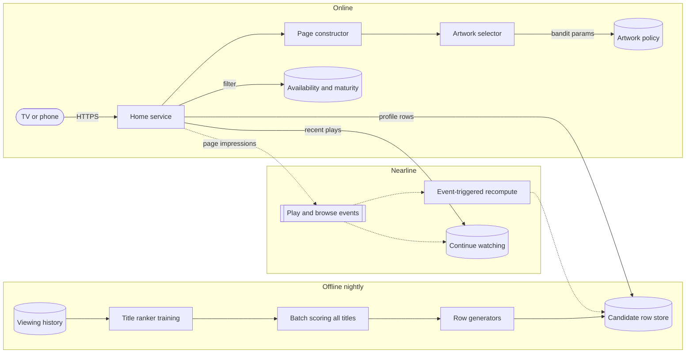

**Reading the diagram.** Three tiers, following the offline–nearline–online split of §60.7. Offline, nightly jobs train the title ranker, score every catalog title for every recently active profile, and generate ~150 candidate rows per profile into a key–value store. Nearline, events trigger recomputation for profiles that just watched something significant and update continue-watching within a minute (dotted, asynchronous). Online, the home service reads the profile's candidate rows and recent plays, filters by availability and maturity, constructs the page with context, and asks the artwork selector for an image per visible tile; impressions are logged asynchronously. Failure points: the candidate store (fallback to territory-popular rows), the artwork selector (default artwork), nearline lag (yesterday's rows). Scaling: offline by catalog × profiles, online by page loads.

### 81.6.8 Detailed component design

#### Title ranker, new titles and context

The title ranker is a pointwise model of qualified play over profile features (genre and cast affinities from viewing history, recency of activity, household device mix), title features (genres, tags, popularity in the territory over 1, 7 and 28 days, age since launch) and their crosses. A gradient-boosted baseline (§68.7.2) is hard to beat at this catalog size; a sequence model over the profile's last few hundred plays is the usual next step. Two details are specific to subscription catalogs. First, **new titles** launch on a known date with heavy marketing, so the cold-start problem is predictable: the ranker uses content features and a launch-day prior estimated from comparable past launches (§68.15), and a "New releases" row guarantees exposure. Second, **context changes the answer** more than in most recommenders: the same profile on a TV on Saturday morning (often children watching) and on a phone at night wants different titles. The nightly scores are context-free; the online re-ranker multiplies each title's score by a context model's adjustment for device, time of day and day of week, which costs microseconds per title because it is a small table lookup plus a few multiplications. Profiles shared by a household are the hardest case; the re-ranker leans on the most recent session's genre signals when history is mixed.

#### Page construction

Rows are **candidate generators with a label**. Each row generator (top picks, because-you-watched for each of the last few titles, genre rows, trending, new releases) proposes a ranked list. The page constructor chooses which rows and in what order, and which titles survive in each row, using an attention model of where members look.

::: formula
**Expected page value with position attention and de-duplication**

$$V(\text{page}) = \sum_{r=1}^{R} \sum_{j=1}^{J} a_r \, b_j \, p(t_{rj}) \cdot \mathbf{1}[t_{rj} \text{ first occurrence}]$$

| Symbol | Meaning | Units |
|---|---|---|
| $a_r$ | Probability a member looks at row position $r$ | probability |
| $b_j$ | Probability a member looks at column $j$ given they look at the row | probability |
| $t_{rj}$ | Title in row $r$, column $j$ | — |
| $p(t)$ | Probability of a qualified play of $t$ if seen | probability |
| $V$ | Expected qualified plays from the page | plays |
:::

::: example
**Worked example — Row order matters.** Attention $a = (1.0, 0.7, 0.45)$ by row, $b = (1.0, 0.6, 0.35)$ by column. Row X has play probabilities $(0.12, 0.11, 0.09)$; row Y $(0.06, 0.10, 0.05)$; the middle row is fixed.

1. Row values at full attention: X $= 0.12 + 0.6 \times 0.11 + 0.35 \times 0.09 = 0.2175$; Y $= 0.06 + 0.06 + 0.0175 = 0.1375$.
2. X in row 1, Y in row 3: $0.2175 + 0.45 \times 0.1375 = 0.2794$ (plus the fixed middle row).
3. Y in row 1, X in row 3: $0.1375 + 0.45 \times 0.2175 = 0.2354$.
4. The better order yields 0.044 more expected plays per page, a 19% gain on these two rows.

**Interpretation.** Because attention decays down the page, the order of rows matters as much as their contents, and a title repeated in a lower row adds nothing. **Engineering implication.** Construct pages greedily by marginal value, estimate attention from logged scroll and impression data by device (TV pages are browsed very differently from phones), and evaluate page constructors by simulated page value offline before testing online.
:::

The greedy constructor adds, at each step, the row that most increases $V$ given the rows already placed, then removes duplicates within the visible area. Constraints (continue-watching first if non-empty; at most two genre rows in a row; one editorial row in the first five) are applied as hard filters on the choice.

```python
# Greedy page construction with de-duplication (toy data; attention values assumed)
rows = {
    "Continue watching":     [("A", .30), ("B", .25), ("C", .05)],
    "Top picks":             [("A", .30), ("D", .12), ("E", .10)],
    "Because you watched X": [("D", .12), ("F", .11), ("G", .09)],
    "Trending now":          [("H", .06), ("E", .10), ("I", .05)],
    "Comedies":              [("J", .04), ("K", .04), ("L", .03)],
}
ROW_ATT, COL_ATT = [1.0, 0.7, 0.45, 0.3], [1.0, 0.6, 0.35]

def page_value(page):
    seen, v = set(), 0.0
    for r, name in enumerate(page):
        for c, (t, p) in enumerate(rows[name]):
            if t not in seen:                      # repeats add nothing
                v += ROW_ATT[r] * COL_ATT[c] * p
                seen.add(t)
    return v

def greedy(n_rows):
    page = []
    for _ in range(n_rows):
        page.append(max((r for r in rows if r not in page),
                        key=lambda r: page_value(page + [r])))
    return page

independent = sorted(rows, key=lambda r: -sum(p for _, p in rows[r]))[:4]
print("independent:", independent, round(page_value(independent), 4))
print("greedy:     ", greedy(4), round(page_value(greedy(4)), 4))
```

Output:

```text
independent: ['Continue watching', 'Top picks', 'Because you watched X', 'Trending now'] 0.6095
greedy:      ['Continue watching', 'Because you watched X', 'Trending now', 'Comedies'] 0.704
```

What to notice:

- Ranking rows independently puts "Top picks" second because its titles score well, but its best title (A) duplicates "Continue watching", so its contribution collapses once A is removed.
- The greedy constructor values each row by what it *adds*, and gains 15.5% expected plays on this toy page by choosing a lower-scoring but non-overlapping row.
- Real constructors learn row-level models of $V$ instead of a fixed attention table, but keep the marginal-value logic [Alvino and Basilico 2015].

#### Artwork personalization as a contextual bandit

For each title the studio provides several images (a romantic still, an action still, a close-up of a well-known actor). A member who watches many romances may respond to the romantic still; one who follows an actor responds to the close-up. The selector is a contextual bandit (§68.11.2): context = profile features (genre affinities, cast affinities, device, country), arms = images, reward = qualified play after an impression. Two system constraints shape it: decisions must be cheap (833,333 per second at peak if made online) and must log **propensities**.

**Offline evaluation by replay.** A logged dataset where images were chosen *uniformly at random* (an exploration slice) allows unbiased evaluation of any new policy: keep only the impressions where the new policy would have chosen the same image as the logged one, and average their rewards [Li et al. 2011]. With $K$ images, about $1/K$ of records match. For example, 1,000,000 logged random impressions of titles with $K = 8$ images give about 125,000 matches; if 2,750 of them led to plays, the new policy's estimated take rate is 2.2% with a standard error of $\sqrt{0.022 \times 0.978 / 125{,}000} = 0.04$ percentage points, precise enough to compare with the logging policy's 2.0%. Non-uniform logging uses the IPS estimator of §68.12.2 with the logged propensities.

::: industry
**Artwork personalization at Netflix.** Netflix described selecting the artwork for each title per member with contextual bandits, using members' viewing history (for example, genres and actors they watched) as context, with randomized exploration data and a replay metric for offline evaluation, and noted the need to avoid clickbait images that attract plays the content does not satisfy.
*Evidence: Primary* — [Chandrashekar et al. 2017]
:::

#### The offline–online gap and experimentation

Offline, the title ranker is evaluated by recall and NDCG on plays in the following week, and page constructors by simulated page value. Both use logs from the current production policy, so they reward resembling it (§57.13), and neither measures retention. Online, a member-level A/B test runs for at least one billing cycle, because a change that increases this week's plays by recommending familiar titles can reduce discovery and retention later.

The practical answer is a two-stage funnel of experiments (§68.14.2): **interleaving** to prune many ranker variants quickly, because each member sees both rankers' titles and member-to-member variance cancels, then a **full A/B test** on retention and streaming hours for the few survivors, with a **long-term holdout** for slow effects.

::: industry
**Netflix on business value and interleaving.** Gomez-Uribe and Hunt describe the Netflix recommender as a collection of algorithms (personalized video ranker, top-N ranker, trending, continue watching, video–video similarity and page generation), report that recommendations influence about 80% of hours streamed, and explain that offline metrics were used to choose candidates for A/B tests whose primary metrics were member engagement and retention. Netflix later described using interleaving as a first-stage experiment that identifies the better ranking algorithm with far fewer members than an A/B test, followed by traditional A/B tests on core metrics.
*Evidence: Primary* — [Gomez-Uribe and Hunt 2015; Parks et al. 2017]
:::

### 81.6.9 Data flow

**Figure 81.8 — Training and precompute path: nightly and event-triggered.**

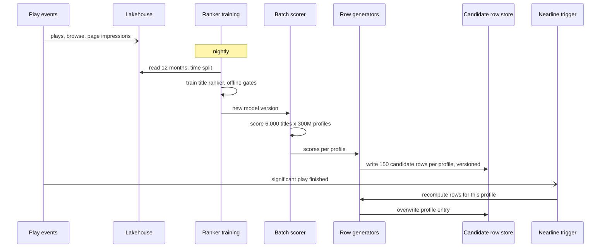

**Reading the diagram.** Plays and page impressions flow asynchronously into the lakehouse. Nightly, the ranker is retrained, gated offline, and used by a batch scorer over all (profile, title) pairs; row generators turn scores into themed rows and write them to the candidate store with a version, so the home service can detect and reject entries from a rolled-back model. Nearline, a significant play (a title finished) triggers recomputation of just that profile's rows within minutes. Failure points: the batch window overrunning (serve yesterday's rows, which are still valid for most profiles), and partial writes (versioned entries are atomic per profile).

**Figure 81.9 — Serving path: one home-page load.**

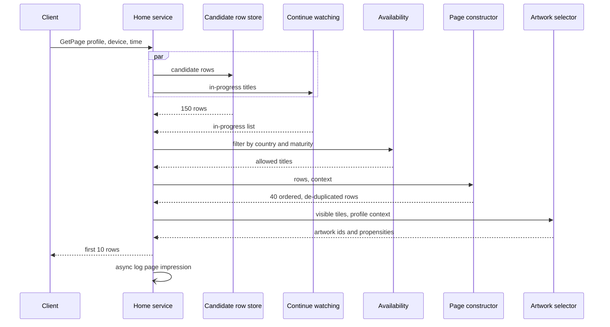

**Reading the diagram.** All calls are synchronous except the final log. The two reads run in parallel; availability filtering is mandatory and fails closed (a title whose rights cannot be confirmed is not shown); the page constructor re-ranks with context (device, time) in a few milliseconds; the artwork selector returns an image and the propensity used. Only the first 10 rows are sent; the rest are served by `GetRows` as the member scrolls, which spreads work and lets the second request use signals from the first screen. Fallbacks: store miss, territory-popular rows; artwork selector miss, default artwork with propensity 1.

### 81.6.10 Bottlenecks

1. **Nightly batch window.** $1.8 \times 10^{12}$ scorings must finish before morning peaks in every time zone; run per region on that region's night.
2. **Candidate-store hot partitions** at a global premiere, when every profile is recomputed nearline; rate-limit event-triggered recomputation and batch it.
3. **Artwork decisions online**; precompute for likely titles.
4. **Experiment capacity.** Retention tests need large samples for weeks; interleaving reserves A/B capacity for finalists.

### 81.6.11 Failure scenarios

**Table 81.16 — Homepage personalization failure scenarios.**

| What fails | Impact | Detection | Recovery | Prevention |
|---|---|---|---|---|
| Unlicensed title shown in a country | Contract breach | Availability audit of served pages | Purge rows; hotfix filter | Fail-closed availability filter at serve time |
| Offline gain, online loss | Wasted launch; retention dip | A/B results contradict offline | Roll back | Interleaving stage; holdout |
| Clickbait artwork | Plays rise, completion and retention fall | Completion per artwork; bandit reward audit | Exclude image; change reward | Reward on qualified play, not click |
| Bandit without exploration data | Biased evaluation, frozen choices | Propensity distribution near 0 or 1 | Restore random slice | Minimum exploration rate |
| Nightly batch fails | Stale rows | Store version age | Serve previous version | Versioned atomic writes; alert on age |
| Feedback loop: popular titles everywhere | Catalog coverage collapses | Coverage and long-tail play share | Exploration rows | Coverage guardrail |
| Continue-watching stale | Finished titles shown | Event lag | Recompute | Nearline path with lag alert |

### 81.6.12 Scaling strategy

At **10× members**, nightly scoring and storage scale linearly ($5{,}000 \to 50{,}000$ core-hours); still affordable, but the batch window forces per-region scheduling and incremental scoring only for profiles with new activity. At **10× catalog** (many short-form or game titles), exhaustive scoring stops being affordable; add a retrieval stage (two-tower, §68.6) and score only a few hundred candidates per profile. At **100×**, the whole page model moves online with request-time context and the nightly tier becomes a cache.

### 81.6.13 Trade-offs

**Table 81.17 — Homepage trade-offs.**

| Decision | Choice | Alternative | Why |
|---|---|---|---|
| Compute placement | Nightly precompute + online page construction | All online | Small catalog; context matters only at the end |
| Page model | Greedy marginal value | Rank rows independently | Duplicates and attention decay |
| Artwork | Contextual bandit with logged propensities | A/B test per title | Thousands of titles, personal preferences |
| Experiment funnel | Interleave, then A/B on retention | A/B everything | Retention tests are slow and large |
| Fallback | Territory-popular rows | Error | Front door must always render |

### 81.6.14 Alternative designs

- **Single ranked list** (one row) is simpler but loses the explanatory row titles and the browsing structure members rely on.
- **Fully online ranking per request** with a retrieval stage works at larger catalogs; it costs more and complicates availability guarantees.
- **Reinforcement learning over whole sessions** could optimize page sequences for retention directly, but evaluation becomes harder.
- **Deep sequence models** over viewing history improve the title ranker; Netflix has published lessons from adopting deep learning for recommendations [Steck et al. 2021].

### 81.6.15 Interview discussion

**Table 81.18 — 45-minute pacing plan for homepage recommendations.**

| Minutes | Focus | What to produce |
|---|---|---|
| 0–5 | Scope | Rows × titles, artwork, retention as the goal |
| 5–10 | Formulation | Title ranker, row generators, page constructor, artwork bandit |
| 10–15 | Estimates | 17k pages/s; $1.8 \times 10^{12}$ nightly scorings; 15 TB store |
| 15–23 | Architecture | Figure 81.7, offline–nearline–online split |
| 23–35 | Deep dives | Page value and greedy construction; artwork bandit with replay |
| 35–45 | Evaluation | Offline–online gap; interleaving then A/B; holdout; failures |

**Likely follow-ups.**

- *"Why not just rank all titles and show them in order?"* A page has attention structure and themes; row ordering and de-duplication change expected plays by double-digit percentages in the example.
- *"How do you evaluate a new artwork policy without deploying it?"* Replay on uniformly randomized logs, or IPS with logged propensities.
- *"Why is your A/B test six weeks long?"* Retention is monthly; novelty fades; effects on discovery appear slowly.

**What distinguishes senior and staff answers.** Senior answers place computation correctly (offline vs online) and know the page is not a list. Staff answers design the experimentation strategy as part of the system, log propensities for counterfactual evaluation, and argue explicitly about which metric can be trusted for which decision.

### 81.6.16 Production considerations

- **Monitoring.** Store version age; availability-filter rejections; page value by device; artwork exploration rate and propensity distribution; coverage of the catalog.
- **Retraining.** Title ranker nightly; bandit parameters hourly; attention models monthly per device.
- **Responsible ML.** Maturity filters as hard constraints; artwork that misrepresents a title's content excluded by policy; no use of sensitive inferences for artwork targeting without review (§71.9).
- **Cost.** Batch scoring and storage are modest; the expensive resource is experimentation traffic and time, which interleaving conserves.

## 81.7 Search ranking

### 81.7.1 Problem statement

Design the ranking models for a general web search engine: given a query of two to five words, order the documents so that the most useful result is first. The serving system is the one designed in §56.4: 5 billion queries a day, a document-partitioned index of $3 \times 10^{10}$ pages over 300 shards, a root–mixer–leaf tree, and a ranking funnel of retrieval (L0) and first-pass ranking (L1) on the leaves, second-pass ranking (L2) at the root over 3,000 merged candidates, and final re-ranking to 10 (Table 56.5). That case stopped at the hand-off ("what the models learn is Chapter 81's job"); this case designs what the models learn and how.

Search differs from the recommenders of §81.4–§81.6 in one decisive way: the user states an **intent** in a few ambiguous words. The hard problems are therefore (1) **query understanding** (spelling, intent, rewriting), (2) **retrieval** that matches meaning and not only words, without losing exact matches, (3) **learning to rank** with labels from two imperfect sources, expensive human judgments and plentiful but **position-biased clicks**.

**ML formulation.** A cascade of rankers, each a function $s(q, d)$ trained to order documents for a query. L1 is a small model on cheap features; L2 a gradient-boosted listwise ranker (LambdaMART) over a few hundred features; L3 a transformer **cross-encoder** that reads query and document text together, applied to the top 30. Labels: graded human relevance judgments (0 = off-topic to 4 = perfect) and click-derived preferences corrected for position bias. Metric: NDCG@10 offline (§57.12); online, click and satisfaction metrics in interleaving and A/B tests.

### 81.7.2 Functional requirements

1. **Query understanding.** Normalize, correct spelling ("recieve" → "receive"), classify intent (navigational, informational, transactional, local, fresh), detect language, and produce rewrites and synonyms.
2. **Hybrid retrieval.** Retrieve by lexical match (BM25 over fields, §16.5) and by dense semantic match over the high-quality tier; fuse.
3. **Ranking.** Order candidates by relevance and quality through L1, L2 and L3.
4. **Freshness-aware ranking.** For fresh-intent queries, boost recent documents from the real-time tier (§56.4.8).
5. **Feedback.** Log impressions with positions and features, clicks, dwell time and reformulations.
6. **Evaluation.** Maintain judged query sets; run interleaving and A/B experiments.

Out of scope: crawling, indexing and serving infrastructure (§56.4), ads (§81.9), personalization beyond locale and language.

### 81.7.3 Non-functional requirements

**Table 81.19 — Search ranking requirements.**

| Property | Target | Why |
|---|---|---|
| Ranking latency budget | Query understanding ≤ 20 ms; L2 ≤ 40 ms; L3 ≤ 50 ms, within the 300 ms p99 of §56.4.3 | Ranking shares the end-to-end budget |
| Availability | Ranking degrades, never fails: L3 or L2 failure returns the previous stage's order | Search must answer |
| Offline quality gate | NDCG@10 on judged sets not worse overall or on any major slice (navigational, long-tail, each top language) | Averages hide regressions |
| Online primary metric | Sessions with a satisfied click (dwell ≥ 30 s, no quick return) per query; abandonment and reformulation as guardrails | Clicks alone are biased and gameable |
| Model freshness | L2 and L3 retrained weekly; query-understanding dictionaries daily; fresh-intent classifier hourly | Language and news change |
| Judgment freshness | Judged query sets refreshed quarterly; 10% of queries rotated monthly | Avoid overfitting a stale set |

### 81.7.4 Capacity estimation

Traffic comes from §56.4.4: 115,741 queries/s at peak, of which 81,019 reach ranking after the results cache.

::: example
**Worked example — Ranking compute per stage.** Assumptions: query encoder of 22 million parameters over 16 tokens; L2 is LambdaMART with 1,000 trees costing 10 µs per document on CPU; L3 is a distilled 6-layer cross-encoder of 22 million parameters over 128 tokens (query plus a document passage) applied to the top 30; 150 TFLOP/s effective per GPU; utilization 0.5 for CPU and 0.6 for GPU.

1. Query encoder: $2 \times 2.2 \times 10^7 \times 16 = 7.0 \times 10^8$ FLOPs per query; $\times 81{,}019 = 5.7 \times 10^{13}$ FLOP/s, under half a GPU.
2. L2: $3{,}000 \times 10\ \mu\text{s} = 30$ ms of CPU per query; $81{,}019 \times 0.03 / 0.5 = $ **4,861 cores** at the roots.
3. L3: $2 \times 2.2 \times 10^7 \times 128 = 5.6 \times 10^9$ FLOPs per pair; $\times 30 = 1.69 \times 10^{11}$ per query; $\times 81{,}019 = 1.37 \times 10^{16}$ FLOP/s; 91 GPUs busy, **152** at $u = 0.6$.
4. The same L3 at BERT-base size (110 million parameters) is five times the FLOPs: **760 GPUs**.

**Interpretation.** Query understanding is nearly free; L2 is a moderate CPU cost; the cross-encoder is the expensive stage, and its cost is linear in model size and in how many documents it reads. **Engineering implication.** Distill the large cross-encoder into a small one (Chapter 67), apply it to the top 30 only, and cache L3 scores for frequent (query, document) pairs, since head queries repeat.
:::

::: example
**Worked example — Labels and indexes.** Assumptions: 20,000 judged queries per quarter with 30 documents each; 0.6 clicks per query; a dense index over the $5 \times 10^9$-document quality tier with 64-byte PQ codes.

1. Human judgments: $20{,}000 \times 30 = 600{,}000$ per quarter.
2. Clicks: $5 \times 10^9 \times 0.6 = 3 \times 10^9$ per day.
3. Dense index: $5 \times 10^9 \times 64 = 320$ GB, about 1.07 GB per shard across 300 leaves, beside each leaf's 120 GB of postings (§56.4.4).

**Interpretation.** Clicks outnumber judgments by about 450,000 to 1 *per day*; judgments are the trustworthy, scarce signal and clicks the plentiful, biased one. **Engineering implication.** Use judgments to evaluate and to anchor training, and clicks, debiased, for volume and freshness.
:::

### 81.7.5 API design

```protobuf
service QueryUnderstanding {
  rpc Analyze(RawQuery) returns (QueryPlan);
}
message QueryPlan {
  string normalized = 1; string corrected = 2; float correction_conf = 3;
  repeated string rewrites = 4;            // synonyms, expansions
  map<string, float> intents = 5;          // navigational, fresh, local, ...
  string language = 6;
  bytes query_embedding = 7;               // for dense retrieval at leaves
}
service Ranker {
  rpc Rank(RankRequest) returns (RankResponse);   // L2 or L3 at the root
}
message RankRequest {
  QueryPlan plan = 1;
  repeated Candidate candidates = 2;       // doc_id + features shipped from leaves
  int32 keep = 3; int64 deadline_ms = 4;
}
message ClickEvent {                        // logged by the results page
  string query_id = 1; string doc_id = 2; int32 position = 3;
  int64 dwell_ms = 4; bool returned_to_results = 5; bool randomized_slot = 6;
}
```

`randomized_slot` marks impressions served under the position-randomization experiment of §81.7.8; they are the only clean source of propensity estimates.

### 81.7.6 Data model and database schema

**Table 81.20 — Search ranking features.**

| Group | Key | Examples | Where computed |
|---|---|---|---|
| Lexical match | (q, d) | BM25 per field (title, body, anchors, URL), term proximity, exact-phrase match | Leaf, from postings |
| Semantic match | (q, d) | Dense cosine, cross-encoder score | Leaf (dense), root (L3) |
| Document quality | d | Link-based authority, spam score, freshness, page speed | Offline, in forward index |
| Query | q | Intent probabilities, length, language, historical click entropy | Query understanding |
| Query–document history | (q, d) | Debiased historical CTR, satisfied-click rate for head queries | Offline aggregate, keyed by normalized query |
| Context | request | Locale, device, time | Request |

```sql
CREATE TABLE judgments (
  query_id STRING, query_text STRING, doc_id STRING,
  grade TINYINT,              -- 0..4 from guidelines
  rater_id STRING, judged_at TIMESTAMP, guideline_version STRING
);
CREATE TABLE ltr_examples (    -- one row per (query impression, candidate)
  query_id STRING, doc_id STRING, position INT, randomized_slot BOOLEAN,
  features ARRAY<FLOAT>,       -- as served at L2
  clicked BOOLEAN, dwell_ms INT, propensity FLOAT
) PARTITIONED BY (date STRING);
```

Labels from judgments have no delay but cost money and age; click labels arrive within seconds but satisfied-click labels need the dwell window (minutes). Query–document history features are a leakage risk: computing them over a window that includes the evaluation day inflates offline NDCG (§57.6.3).

### 81.7.7 High-level architecture

**Figure 81.10 — Search ranking: query understanding, hybrid retrieval and the ranking cascade.**

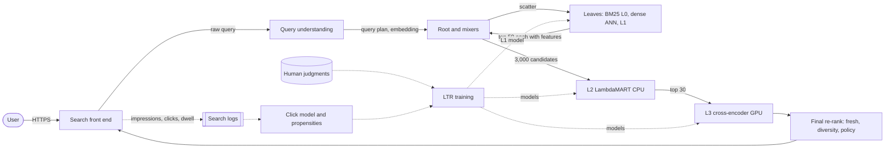

**Reading the diagram.** The synchronous path (solid) starts at query understanding, which produces a query plan with corrections, rewrites, intents and an embedding. The root scatters the plan to the leaves (§56.4.8), where each leaf retrieves lexically (BM25 over fields) and semantically (ANN over its shard's dense vectors), unions the candidates, scores them with L1 and returns its top 50 with their features. The root merges about 3,000 candidates, runs L2 on CPU and L3 on a GPU pool, then the final re-rank applies freshness, site diversity and policy. Asynchronously (dotted), logs feed a click-model job that estimates position propensities and debiased labels; with human judgments these train all three rankers. Failure points: query understanding (fall back to the raw query), L3 pool (skip L3), stale propensities (training bias, not serving failure). Scaling: L2 with root CPUs, L3 with GPUs, both linear in query rate.

### 81.7.8 Detailed component design

#### Query understanding

Query understanding turns "cheap flights nyc to lax tmrw" into a plan: normalized tokens, "tmrw" expanded to tomorrow's date, "nyc" and "lax" recognized as locations, transactional and fresh intents, and an embedding. Its components are classifiers and sequence models trained on query logs: spelling correction learned from users' own reformulations (a query followed within seconds by a corrected one), intent classifiers trained on which result types satisfied past queries, and rewrites mined from queries that led to clicks on the same documents. Each output carries a confidence so that downstream stages can hedge: a low-confidence correction retrieves for both the original and the corrected query and lets ranking decide. Because head queries repeat, plans are cached; the long tail (a large share of distinct queries are new each day) needs the models.

#### Hybrid retrieval

Lexical retrieval is precise for names, codes and rare words ("error 0x80070005") but misses paraphrases; dense retrieval finds paraphrases but blurs exact identifiers [Karpukhin et al. 2020]. Each leaf runs both and unions the candidates before L1, so neither can veto the other. Where lists must be merged by rank, reciprocal rank fusion (§75.8.3) avoids comparing incomparable scores [Cormack et al. 2009]. Dense retrieval covers only the quality tier to keep the vector index at 320 GB; the long tail stays lexical-only. Recall of the union, measured on judged relevant documents, is the gate for any retrieval change: a better ranker cannot recover a document the leaves never returned (§56.4.8).

#### Learning to rank with LambdaMART

LambdaMART trains gradient-boosted trees with gradients ("lambdas") that are pairwise logistic gradients scaled by how much swapping the pair would change NDCG, so errors near the top cost more than errors deep in the list [Burges 2010]. §68.7.1 introduces listwise learning to rank; here is the quantity that makes it listwise.

::: formula
**LambdaMART gradient for a pair** [Burges 2010]

$$\lambda_{ij} = \frac{\sigma\, \lvert \Delta \text{NDCG}_{ij} \rvert}{1 + e^{\sigma (s_i - s_j)}} \qquad \lambda_i = \sum_{j:\, g_i > g_j} \lambda_{ij} - \sum_{j:\, g_j > g_i} \lambda_{ji}$$

| Symbol | Meaning | Units |
|---|---|---|
| $s_i$, $s_j$ | Current model scores of documents $i$ and $j$ for one query | score |
| $g_i$, $g_j$ | Relevance grades, with $g_i > g_j$ for the pair $(i, j)$ | grade |
| $\lvert \Delta \text{NDCG}_{ij} \rvert$ | Change in the query's NDCG if $i$ and $j$ swapped positions | dimensionless |
| $\sigma$ | Shape parameter of the logistic | 1/score |
| $\lambda_i$ | Total push on document $i$'s score (up if positive) | gradient units |
:::

::: example
**Worked example — Why an error at rank 1 matters more.** A query's current ranking has grades $(0, 3, 2, 1)$ at positions 1–4. With exponential gain (§57.12), IDCG $= 7 + 3/1.585 + 1/2 = 9.393$ and DCG $= 7/1.585 + 3/2 + 1/2.322 = 6.347$, so NDCG $= 0.676$.

1. Swap positions 1 and 2 (grades 3 and 0): DCG $= 7 + 0 + 1.5 + 0.431 = 8.931$, NDCG $0.951$, $\lvert\Delta\rvert = 0.275$.
2. Swap positions 1 and 4 (grades 1 and 0): DCG $= 1 + 4.417 + 1.5 + 0 = 6.917$, NDCG $0.736$, $\lvert\Delta\rvert = 0.061$.
3. If both pairs are mis-scored by the same margin, $s_i - s_j = -0.5$ with $\sigma = 1$: logistic factor $1/(1 + e^{-0.5}) = 0.622$; $\lambda = 0.171$ for the first pair and $0.038$ for the second.

**Interpretation.** The same score error receives 4.5 times more gradient when it puts an off-topic document above a perfect one at the top. **Engineering implication.** LambdaMART spends its capacity where users look; train it on query groups with graded labels, and use pointwise rankers only where calibrated probabilities are needed (ads, §81.9).
:::

#### Position bias and click models

Users click what they see, and they see the top. A document at rank 1 receives more clicks than a better document at rank 5, so raw click-through rates reproduce the current ranking: the feedback loop of §68.12. **Click models** describe how clicks arise: the **position-based model** factors a click into examination of a position times attractiveness of the document; the **cascade model** assumes users scan from the top and stop at the first satisfying result [Craswell et al. 2008; Chuklin et al. 2015]. Under the position-based model, dividing clicks by the **examination propensity** of their position gives unbiased relevance estimates (IPS, §68.12.2) [Joachims et al. 2017]. The propensities are estimated by small randomized interventions, such as swapping the result at rank 1 with the result at rank $k$ on a sliver of traffic; because the same document is observed at both positions, its relevance cancels in the ratio [Joachims et al. 2017; Wang et al. 2018].

```python
import numpy as np
rng = np.random.default_rng(7)
Q, K, IMPR = 500, 10, 2_000             # queries, results per page, impressions per query
true_exam = 1.0 / np.arange(1, K + 1)    # hidden examination probability by rank (eta = 1)
rel = rng.beta(1, 3, size=(Q, K))        # hidden click probability if examined
# Production order: noisy sort by true relevance (an imperfect ranker)
order = np.argsort(-(rel + rng.normal(0, 0.3, size=(Q, K))), axis=1)

def clicks(pos_of_doc, n):
    p = true_exam[pos_of_doc] * rel       # P(click) = P(examined) * P(relevant)
    return rng.binomial(n, p)

pos = np.argsort(order, axis=1)           # pos[q, d] = rank of doc d in production
c_norm = clicks(pos, IMPR)                # normal traffic

swap_n = IMPR // 10                       # randomized swap traffic: top doc moved to rank k
ratio = np.ones(K)
for k in range(1, K):
    top = order[:, 0]
    p_at_1 = c_norm[np.arange(Q), top].sum() / (Q * IMPR)
    moved = rng.binomial(swap_n, true_exam[k] * rel[np.arange(Q), top])
    ratio[k] = (moved.sum() / (Q * swap_n)) / p_at_1   # estimates exam[k] / exam[0]

def ndcg(scores):
    disc = 1 / np.log2(np.arange(2, K + 2))
    out = []
    for q in range(Q):
        ranked = rel[q][np.argsort(-scores[q])]
        out.append((ranked * disc).sum() / (np.sort(rel[q])[::-1] * disc).sum())
    return np.mean(out)

naive = c_norm / IMPR                     # raw click-through rate per document
ips = naive / ratio[pos]                  # divide by estimated examination propensity
print("estimated propensity ratios:", np.round(ratio[:5], 3), "true:", np.round(true_exam[:5], 3))
print(f"NDCG@10 production order   {ndcg(-pos.astype(float)):.4f}")
print(f"NDCG@10 rank by naive CTR  {ndcg(naive):.4f}")
print(f"NDCG@10 rank by IPS CTR    {ndcg(ips):.4f}")
```

Output:

```text
estimated propensity ratios: [1.    0.495 0.334 0.254 0.2  ] true: [1.    0.5   0.333 0.25  0.2  ]
NDCG@10 production order   0.8947
NDCG@10 rank by naive CTR  0.9571
NDCG@10 rank by IPS CTR    0.9983
```

What to notice:

- The swap experiment recovers the hidden examination curve (0.495 against 0.5 at rank 2) from 10% extra traffic, without knowing any document's relevance.
- Raw CTR improves on the production order but stays anchored to it, because a document's CTR is multiplied by the examination of the slot it happened to occupy.
- Dividing by the estimated propensity nearly recovers the true order (NDCG 0.998). Real logs add noise, trust bias and presentation effects (snippets, rich results), so production systems also learn propensities per device and result type.

#### Evaluation: judgments, interleaving and A/B tests

Offline, NDCG@10 on judged sets is the gate, reported per slice. Human judgments follow written guidelines, are double-rated on a sample to measure agreement (Cohen's κ, §63.6.2), and increasingly are pre-labeled by an LLM with human review (§63.14.4). Online, rankers are compared first by **interleaving**, which for search was shown to agree with A/B outcomes using far less traffic [Chapelle et al. 2012], then by A/B tests on satisfied-click sessions with abandonment and reformulation as guardrails.

::: industry
**Learning to rank in production search at Airbnb.** Haldar et al. describe Airbnb's move from gradient-boosted tree ranking to neural networks for search ranking, including the lesson that offline NDCG gains did not always translate into online bookings and that a debiasing treatment of position was needed when training on logged search results.
*Evidence: Primary* — [Haldar et al. 2019]
:::

### 81.7.9 Data flow

**Figure 81.11 — Training path: from logs and judgments to new rankers.**

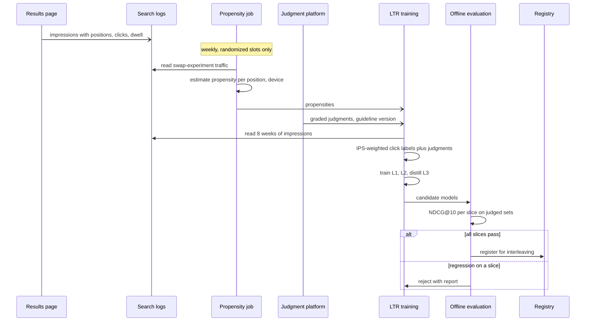

**Reading the diagram.** Logging is asynchronous. A weekly job estimates position propensities only from randomized traffic, by device and result type. Training combines two label sources: judgments (clean, small) and IPS-weighted clicks (large, debiased). All three rankers are trained together so that L1 is distilled from L2 and the small L3 from a large teacher. Offline evaluation gates per slice; passing models go to interleaving before any A/B test. Failure points: the randomized slice being too small (noisy propensities), stale judgments, and leakage through query–document history features computed over the evaluation period.

**Figure 81.12 — Serving path: ranking one query.**

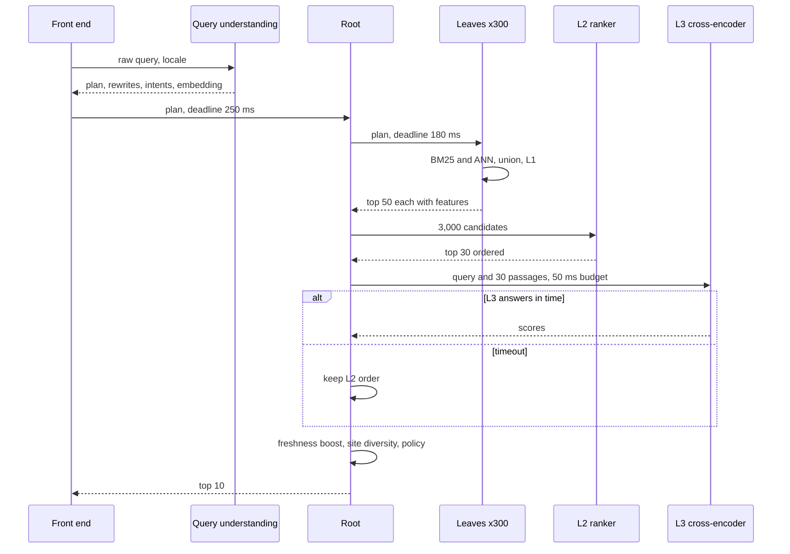

**Reading the diagram.** All calls are synchronous. Query understanding runs before scatter because the leaves need the rewrites and the embedding; its 20 ms is the first slice of the budget. Leaves retrieve and rank in parallel (§56.4.9 shows the tree in full). L2 runs on root CPUs; L3 is a call to a GPU pool with its own deadline and a defined fallback. The final re-rank enforces at most two results per site and boosts fresh documents for fresh-intent queries.

### 81.7.10 Bottlenecks

1. **L3 GPU cost** grows with model size × documents × query rate; distill, cap at 30 documents, cache head-query scores.
2. **Feature shipping** from 300 leaves: 3,000 candidates × a few hundred features; send compact feature vectors, compute expensive features only at the root for survivors.
3. **Judgment throughput**: 600,000 per quarter limits how many slices can be measured reliably; use active sampling of informative queries (§63.9).
4. **Randomization traffic**: propensity estimation costs a little quality on randomized slots; keep it below 1–2% of queries.

### 81.7.11 Failure scenarios

**Table 81.21 — Search ranking failure scenarios.**

| What fails | Impact | Detection | Recovery | Prevention |
|---|---|---|---|---|
| Spelling correction overconfident | Correct rare terms "fixed" into wrong ones | Reformulation rate after correction | Lower confidence; retrieve both | Confidence-gated corrections |
| Position-biased training (propensities stale) | New ranker re-learns old order | Interleaving shows no gain despite offline gains | Re-estimate propensities | Continuous randomized slice |
| Label leakage via history features | Offline NDCG gain, online loss | Offline–online gap | Rebuild features point-in-time | As-of joins (§62.8) |
| SEO and adversarial content | Spam ranks highly | Spam rate on judged samples | Demote via quality signals | Spam features; adversarial evaluation set |
| Dense retrieval drift after encoder update | Recall drops on tail queries | Union recall on judged set | Roll back encoder and index together | Version encoder and index as a pair |
| Slice regression hidden by average | One language or query type worse | Per-slice NDCG | Block launch | Slice gates in Table 81.19 |
| L3 timeout storm | Quality falls to L2 level | L3 fallback rate | Shed L3 for tail queries | GPU headroom; budget-aware batching |

### 81.7.12 Scaling strategy

At **10× queries**, L2 cores and L3 GPUs grow tenfold; the levers are score caching for head queries (which grow faster than the tail), smaller distilled cross-encoders, and applying L3 only to queries whose L2 margin between the top results is small. At **10× corpus**, retrieval recall becomes the binding constraint: more dense coverage, learned sparse retrieval, and larger per-leaf candidate counts, with L2 cost growing with merged candidates. At **100×**, LLM-based rankers and answer generation (Chapter 75) take over the top of the funnel for some intents, at a cost per query that makes caching and intent routing essential.

### 81.7.13 Trade-offs

**Table 81.22 — Search ranking trade-offs.**

| Decision | Choice | Alternative | Why |
|---|---|---|---|
| Retrieval | Lexical + dense union per leaf | Dense only | Exact identifiers and rare terms |
| L2 model | LambdaMART | Deep listwise network | Strong on heterogeneous features; cheap on CPU |
| L3 model | Distilled 6-layer cross-encoder, top 30 | BERT-base on top 100 | 152 vs thousands of GPUs |
| Labels | Judgments + IPS-weighted clicks | Clicks only | Clicks are biased and gameable |
| Propensity estimation | Randomized swaps | EM on observational logs | Simpler and unbiased, at a small quality cost |
| Launch path | Slice gates → interleaving → A/B | A/B only | Faster and more sensitive pruning |

### 81.7.14 Alternative designs

- **Pure lexical with hand-tuned scoring** is transparent and cheap and still right for small vertical search (Chapter 16), but cannot handle paraphrase.
- **Late-interaction retrieval** (per-token embeddings) sits between bi-encoders and cross-encoders in quality and cost.
- **Click-model-only labels** (no judgments) work for very high-traffic head queries but fail on the tail, where clicks are sparse.
- **LLM rankers** that read the query and several documents at once can outperform cross-encoders on hard queries at many times the cost; route only those queries to them.

### 81.7.15 Interview discussion

**Table 81.23 — 45-minute pacing plan for search ranking.**

| Minutes | Focus | What to produce |
|---|---|---|
| 0–5 | Scope | Ranking half of web search; serving from §56.4 assumed |
| 5–10 | Formulation | Cascade L1/L2/L3; graded judgments and clicks; NDCG@10 |
| 10–15 | Estimates | 81k ranked queries/s; L2 4,861 cores; L3 152 GPUs vs 760 |
| 15–22 | Architecture | Figure 81.10; query understanding before scatter |
| 22–35 | Deep dives | LambdaMART lambdas; position bias, swaps and IPS |
| 35–45 | Evaluation and failures | Slice gates, interleaving, A/B; leakage, spam, stale propensities |

**Likely follow-ups.**

- *"Why not train on clicks directly?"* Clicks are a product of examination and relevance; without correction the model learns the old ranking.
- *"How do you get propensities without hurting users?"* Small randomized swaps on 1% of traffic, limited to adjacent or near-top positions.
- *"Why LambdaMART and not a neural network everywhere?"* Strong accuracy on hand-engineered features at 10 µs per document; neural models are used where text understanding matters (L3).

**What distinguishes senior and staff answers.** Senior answers describe the cascade, hybrid retrieval and NDCG. Staff answers treat labels as the core design problem (judgments versus debiased clicks, propensity estimation), put a price on each ranking stage, and guard against slice regressions and leakage in the evaluation process itself.

### 81.7.16 Production considerations

- **Monitoring.** NDCG on a rotating judged set weekly; L3 fallback rate; correction acceptance rate; abandonment and reformulation by intent; propensity curve stability.
- **Retraining.** Weekly rankers; daily dictionaries; propensities weekly from randomized traffic.
- **Responsible ML.** Query logs are personal data: minimum-user thresholds for mined rewrites, retention limits (§50.8); audit ranking for systematic demotion of languages or regions (§71.5).
- **Cost.** L3 GPUs and L2 cores dominate; the cost per 1,000 queries tracks documents read by the cross-encoder.

## 81.8 E-commerce product recommendation

### 81.8.1 Problem statement

Design the recommendations of a large online store: "recommended for you" on the home page, "similar items" and "frequently bought together" on the product page, "customers who viewed this also viewed", and add-on suggestions in the cart. The store is the platform of §55.7 (100 million daily active customers, 500 million products, 10 million orders a day), which consumes recommendations as optional widgets with strict timeouts (§55.7.8). This case designs the system behind those widgets.

E-commerce has a different shape from media. A customer buys a refrigerator once a decade, so last week's purchase is a reason *not* to recommend another; most products have almost no interactions; a large share of sessions are anonymous; new products arrive by the million; and every recommendation must respect facts the model does not own, such as stock at the customer's location. The distinctive problems are **sparsity**, **cold start for new products**, **session-based recommendation**, **complementary versus substitute relations** ("frequently bought together" is not "similar") and **business constraints**.

**ML formulation.** Several models, each matched to a widget: (a) item-to-item relations from co-view and co-purchase statistics (substitutes from co-view, complements from co-purchase); (b) a two-tower retrieval model over customer history and product content for the home page; (c) a session model predicting the next product of interest from the current session's sequence of views; (d) a ranker predicting purchase probability per (customer, product) in context, trained on impressions with purchase labels whose delay ranges from minutes to days. The business objective is long-run gross merchandise value and customer satisfaction, so the ranker's value is purchase probability multiplied by a value term, subject to constraints.

### 81.8.2 Functional requirements

1. **Product page.** Similar items (substitutes) and frequently bought together (complements) for any product, including products listed today.
2. **Home page.** Personalized rows for signed-in customers; session-based rows for anonymous visitors from their first few clicks.
3. **Cart add-ons.** Complements of items in the cart, excluding items already owned or in the cart.
4. **Constraints.** Recommend only products in stock and deliverable to the customer's address; respect age restrictions and regional legal limits; collapse variants (sizes, colors) into one item; keep sponsored placements separate and labeled (§81.9).
5. **Repurchase awareness.** Do not recommend durable goods the customer just bought; do recommend consumables near their repurchase cycle.
6. **Logging and experiments.** Impressions with widget, position and features; attribution of purchases to widgets.

### 81.8.3 Non-functional requirements

**Table 81.24 — E-commerce recommendation requirements.**

| Property | Target | Why |
|---|---|---|
| Latency | Product-page widgets p99 ≤ 50 ms; home rows p99 ≤ 120 ms | Optional widgets with strict timeouts (§55.7.8) |
| Availability | Widget may be omitted; never block the page | Commerce path must not depend on recommendations |
| Stock correctness | ≤ 0.5% of recommended items out of stock at the address when shown | Out-of-stock recommendations waste the slot and frustrate |
| New-product coverage | New listings recommendable within 1 hour | Sellers expect visibility |
| Session freshness | Anonymous session features ≤ 5 s | Session models are useless if slow |
| Offline gates | Recall@50 for next-purchase by widget; NDCG for ranker; calibration of purchase head | Filters before A/B |
| Online metrics | Revenue per session and purchases attributed (primary); return rate, out-of-stock clicks, seller concentration (guardrails) | Prevent pushing items people return |

### 81.8.4 Capacity estimation

::: example
**Worked example — Traffic and serving compute.** Assumptions (from §55.7.4): 100 million daily active customers; 20 product page views and 3 home-page loads per customer per day; sales-event peak 5× average. Home rows rank 500 candidates at 20 µs each; product-page widgets re-rank 100 precomputed neighbors at 5 µs each.

1. Product pages: $10^8 \times 20 = 2 \times 10^9$ per day; 23,148/s average; **115,741/s at peak**.
2. Home loads: $3 \times 10^8$ per day; 3,472/s average; **17,361/s at peak**.
3. Home ranking: $17{,}361 \times 500 \times 20\ \mu\text{s} / 0.5 = 347$ cores. Product-page re-ranking: $115{,}741 \times 100 \times 5\ \mu\text{s} / 0.5 = 116$ cores.

**Interpretation.** Serving compute is small: most work is precomputed per item, and the request path is lookups plus light re-ranking. **Engineering implication.** The capacity problems are in the batch jobs and in the constraint lookups (stock by address), not in the models.
:::

::: example
**Worked example — Sparsity, pair counting and the item-to-item table.** Assumptions: 2.5 items per order; a 90-day window; 20 product views per session; 100 million products with enough signal to have neighbors, top 50 neighbors at 12 bytes each (8-byte ID, 4-byte score).

1. Purchased items in 90 days: $10^7 \times 2.5 \times 90 = 2.25 \times 10^9$. Over $10^8$ customers × $5 \times 10^8$ products ($5 \times 10^{16}$ cells), the purchase matrix has density $4.5 \times 10^{-8}$.
2. Co-view pairs per day: a session of 20 views yields $20 \times 19/2 = 190$ pairs; $10^8 \times 190 = 1.9 \times 10^{10}$ pair increments; at 16 bytes per record before combining, 304 GB of shuffle per day.
3. Item-to-item table: $10^8 \times 50 \times 12 = 60$ GB, replicated in memory in each serving region.

**Interpretation.** Purchases alone are far too sparse to relate most products; views are 100 times denser and supply most of the signal, at the cost of measuring interest rather than satisfaction. **Engineering implication.** Count pairs with map-side combining and salting for hot products (§29.6.3), cap sessions, and blend co-view (dense, noisy) with co-purchase (sparse, strong).
:::

::: example
**Worked example — Exploration budget for new products.** Assumptions: 2 million new listings per day (23 per second); each needs about 200 impressions in recommendation widgets to estimate its purchase rate against a category prior (§68.15); widgets show 3 rows of 8 items on each product page.

1. Exploration impressions needed: $2 \times 10^6 \times 200 = 4 \times 10^8$ per day.
2. Widget impressions available: $2 \times 10^9 \times 3 \times 8 = 4.8 \times 10^{10}$ per day.
3. Share: $4 \times 10^8 / 4.8 \times 10^{10} = 0.83\%$.

**Interpretation.** Giving every new product a fair trial costs under 1% of slots. **Engineering implication.** Reserve exploration slots with a budget per category and allocate them by Thompson sampling over priors from content similarity, so that promising new products earn exposure quickly and poor ones stop consuming slots.
:::

### 81.8.5 API design

```protobuf
service ProductRecs {
  rpc Widget(WidgetRequest) returns (WidgetResponse);
}
message WidgetRequest {
  WidgetType type = 1;           // SIMILAR, FBT, ALSO_VIEWED, FOR_YOU, CART_ADDONS
  string customer_id = 2;        // empty if anonymous
  string session_id = 3;         // always present
  repeated string anchor_ids = 4;// product on page, or cart contents
  string ship_to_region = 5;     // drives stock and delivery filters
  int32 count = 6; int64 deadline_ms = 7;
}
message WidgetResponse {
  repeated Rec items = 1;        // product_id, variant_group, reason, propensity
  string rec_token = 2; bool degraded = 3;
}
```

Session events (`view`, `add_to_cart`, `search`) are streamed by the client; purchases and returns arrive from the order system (§55.7) and are joined by `rec_token` and product ID with an attribution window of 7 days.

### 81.8.6 Data model and database schema

**Table 81.25 — Data for e-commerce recommendations.**

| Data | Key | Content | Freshness |
|---|---|---|---|
| Item neighbors (substitutes) | product_id | Top 50 co-viewed products, normalized | Daily, plus hourly deltas |
| Item complements | product_id | Top 20 co-purchased with lift and support | Daily |
| Product content | product_id | Title and description embedding, image embedding, category path, brand, price band | On listing |
| Content neighbors | product_id | Top 50 by content embedding (for new products) | Within 1 hour of listing |
| Customer history | customer_id | Purchases with timestamps, views, returns | Minutes |
| Session state | session_id | Last 30 events | ≤ 5 s |
| Stock and delivery | (product_id, region) | Available quantity, delivery promise | Seconds (event-driven from inventory, §55.7.8) |
| Repurchase cycle | category | Median days between purchases | Monthly |

**Labels.** Click (seconds), add-to-cart (minutes), purchase (minutes to days, 7-day attribution), return (up to 30 days). Returns are a negative label for the ranker's value term, which means its training data for the value head lags a month; the purchase head uses a 7-day window and is retrained daily.

The complement table stores support and lift, not only a score, so that thresholds can be changed without recomputation:

```sql
CREATE TABLE item_complements (
  product_id     BIGINT,
  complement_id  BIGINT,
  support        INT,      -- orders containing both, 90 days
  confidence     FLOAT,    -- P(complement | product)
  lift           FLOAT,
  same_category  BOOLEAN,  -- likely substitute if true
  computed_on    DATE,
  PRIMARY KEY (product_id, complement_id)
);
```

### 81.8.7 High-level architecture

**Figure 81.13 — E-commerce recommendation system.**

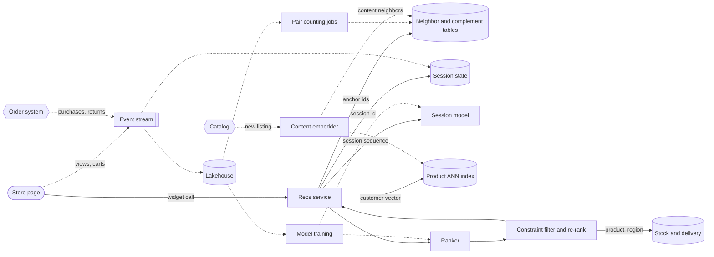

**Reading the diagram.** Solid arrows are synchronous within a widget call. The recs service gathers candidates from precomputed tables keyed by the anchor product, from a session model over the visitor's recent events, and from ANN retrieval for signed-in customers; the ranker scores them, and the constraint filter checks stock and delivery for the customer's region before re-ranking. Asynchronously, client events and the order system's purchases and returns update session state and land in the lakehouse; daily pair-counting jobs rebuild neighbor and complement tables; new listings from the catalog are embedded within minutes, inserted into the ANN index and given content neighbors. Failure points: the stock service (fail toward omitting items), the session model (fall back to anchor neighbors), stale tables (yesterday's are acceptable). Scaling: tables replicate per region; services scale with page views.

### 81.8.8 Detailed component design

#### Substitutes, complements and "frequently bought together"

Item-to-item collaborative filtering (§68.5.3) [Linden et al. 2003] produces neighbors, but which *relation* it captures depends on the signal. Products viewed in the same session are usually **substitutes** (two similar jackets compared); products bought in the same order are often **complements** (a camera and its memory card). Showing substitutes after a purchase or complements before one confuses customers. Co-purchase needs a statistic that corrects for popular items that are in every basket, which association-rule mining provides [Agrawal and Srikant 1994].

::: formula
**Association-rule statistics for "frequently bought together"**

$$\text{supp}(A, B) = \frac{n_{AB}}{N} \qquad \text{conf}(A \to B) = \frac{n_{AB}}{n_A} \qquad \text{lift}(A \to B) = \frac{\text{conf}(A \to B)}{n_B / N}$$

| Symbol | Meaning | Units |
|---|---|---|
| $N$ | Orders in the window | orders |
| $n_A$, $n_B$ | Orders containing $A$; containing $B$ | orders |
| $n_{AB}$ | Orders containing both | orders |
| conf | Probability an order with $A$ also contains $B$ | probability |
| lift | How many times more likely $B$ is in an order with $A$ than in an average order | ratio |
:::

::: example
**Worked example — Phone case: screen protector or cable?** $N = 10^7$ orders; phone case A in 20,000; screen protector B in 50,000; popular USB cable C in 500,000; A with B in 6,000 orders; A with C in 8,000.

1. $\text{conf}(A \to B) = 6{,}000/20{,}000 = 0.30$; base rate of B $= 50{,}000/10^7 = 0.005$; lift $= 60$.
2. $\text{conf}(A \to C) = 8{,}000/20{,}000 = 0.40$; base rate of C $= 0.05$; lift $= 8$.
3. Support of (A, B): $6{,}000/10^7 = 0.06\%$, comfortably above a minimum of, say, 50 orders.

**Interpretation.** Confidence prefers the cable because everyone buys cables; lift reveals that the screen protector is specifically associated with this case. **Engineering implication.** Rank complements by lift with a minimum support (which also prevents tiny-sample rules and protects privacy, since a rule supported by three orders can reveal individuals' purchases), exclude same-category pairs (substitutes), and let the ranker re-order the survivors by predicted purchase.
:::

Amazon's own retrospective describes how item-to-item relations were refined over two decades, including the observation that what counts as "related" depends on time and context: a purchase of one book in a series makes the next book relevant, while some purchases make similar items irrelevant [Smith and Linden 2017].

#### Cold start for new products

A product listed today has no co-views and no purchases, so collaborative tables cannot contain it. Three mechanisms cover it:

1. **Content embeddings.** A content tower embeds title, description, image and category into the same space as the two-tower item tower (§68.6), so a new product is retrievable by ANN within minutes and has content neighbors for the product page.
2. **Side-information embeddings.** Alibaba described learning item embeddings from session graphs with side information (category, brand, shop) aggregated into the item embedding, so that new items inherit an embedding from their attributes [Wang et al. 2018].
3. **Exploration slots.** A budgeted share of widget slots, under 1% by the estimate above, goes to new products by Thompson sampling over a category prior (§68.11, §68.15).

The reverse direction matters too: a new product should appear in *other* products' widgets. Insert it as a content neighbor of its nearest products, with a decaying boost until collaborative signal accumulates.

#### Session-based recommendation for anonymous visitors

Perhaps 40% of sessions (an assumption) are anonymous or from customers with no relevant history. Their only signal is the session itself: the last few views, searches and cart additions. Session models treat the sequence as language: GRU4Rec applied recurrent networks to predict the next click in a session [Hidasi et al. 2016], and self-attentive models such as SASRec predict the next item from the sequence with a transformer [Kang and McAuley 2018]. Served as a user tower whose input is the session sequence, the model emits a vector for ANN retrieval after each event; the session state store holds the last 30 events with 5-second freshness. Target attention over the session (weighting history items by relevance to each candidate) is the ranking-side counterpart [Zhou et al. 2018].

#### Business constraints and re-ranking

**Table 81.26 — Business constraints applied after ranking.**

| Constraint | Rule | Where enforced | Failure mode if missing |
|---|---|---|---|
| Stock and delivery | In stock at the customer's region with a delivery promise | Constraint filter, live lookup | Wasted slot; frustration |
| Variant collapse | One tile per variant group | Candidate merge | Six sizes of one shirt |
| Repurchase cycle | Suppress durables bought recently; boost consumables near cycle | Re-ranker with customer history | "You bought a fridge; here are fridges" |
| Legal and age | Region and age restrictions | Eligibility filter | Compliance breach |
| Sponsored separation | Ads only in labeled ad slots (§81.9) | Page assembly | Undisclosed advertising |
| Seller diversity | At most 3 items per seller per widget | Re-ranker | Concentration; marketplace fairness |
| Return risk | Penalize products with high return rates for this customer segment | Ranker value term | Revenue that reverses |

The ranker's value combines predicted purchase with expected value net of returns: $\text{value} = \hat{p}(\text{purchase}) \times \text{price} \times (1 - \hat{r}_{\text{return}})$, with weights from experiments. Pure revenue optimization favors expensive items; the guardrails on return rate and satisfaction keep it honest.

#### Evaluation

Offline: recall@50 of next-day purchases per widget (time-split), NDCG of the ranker on logged impressions, calibration of the purchase head, and coverage. Online: A/B by customer for signed-in surfaces and by session for anonymous ones, with revenue per session as the primary metric and return rate, out-of-stock click rate and seller concentration as guardrails. Attribution matters: a purchase may follow views of several widgets, so compare total revenue per customer between arms rather than summing per-widget attributed revenue, which double counts.

::: industry
**Item-to-item collaborative filtering at Amazon.** Linden, Smith and York described building a similar-items table offline from customers' purchases, with online cost independent of the number of customers and catalog size; Smith and Linden's 2017 retrospective describes the algorithm's later refinements and its spread across Amazon's pages and e-mails.
*Evidence: Primary* — [Linden et al. 2003; Smith and Linden 2017]
:::

### 81.8.9 Data flow

**Figure 81.14 — Write path: tables and models rebuilt from events.**

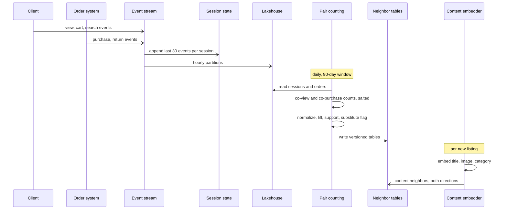

**Reading the diagram.** All writes are asynchronous. Session state updates within seconds; the lakehouse receives hourly partitions; the daily job counts pairs over 90 days with salting for hot items, computes normalized similarities and lift, flags same-category pairs as substitutes, and writes versioned tables that the serving tier swaps atomically. New listings are embedded on arrival and inserted as content neighbors of nearby products, in both directions. Failure points: the daily job's shuffle (skew), late return events (value labels lag), and a bad table version (rolled back by version pin).

**Figure 81.15 — Read path: frequently-bought-together widget.**

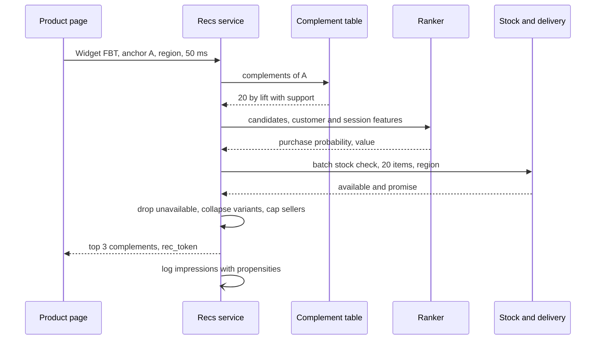

**Reading the diagram.** All calls are synchronous within a 50 ms deadline. The complement table returns candidates by lift; the ranker personalizes their order; a single batched stock call checks all candidates for the customer's region. Items failing constraints are dropped *before* truncation to three, so the widget is rarely empty. If the stock service is slow, the widget is omitted rather than showing possibly unavailable items, because the product page treats it as optional.

### 81.8.10 Bottlenecks

1. **Pair counting skew.** A bestseller co-occurs with millions of products; salt hot keys and cap per-session pairs (§29.6.3).
2. **Stock lookups.** Every widget checks stock for 20–100 items; batch, cache with seconds of TTL, and subscribe to stock-change events for hot items.
3. **Sales-event peaks.** 5× traffic and fast-changing stock at the same time; precompute event-specific candidate lists and widen cache TTLs only for non-stock data.
4. **ANN inserts for new listings.** 23 per second continuously; a delta index merged hourly.

### 81.8.11 Failure scenarios

**Table 81.27 — E-commerce recommendation failure scenarios.**

| What fails | Impact | Detection | Recovery | Prevention |
|---|---|---|---|---|
| Stock data stale during a sale | Recommending sold-out items | Out-of-stock click rate | Shorten TTL; omit widget | Event-driven stock updates |
| Substitutes shown as complements | Odd FBT pairs, lost trust | Same-category share in FBT | Filter | Substitute flag in table |
| Popularity feedback loop | Same bestsellers everywhere | Coverage; Gini of impressions | Raise exploration; lift-based scores | Normalization, exploration slots |
| Cold-start starvation | New sellers churn | Impressions of products < 7 days old | Increase budget | Content neighbors; slot budgets |
| Training–serving skew on price | Ranker misjudges value | Price feature skew detector | Fix join | Log price as served |
| Return-label delay | Value head rewards items later returned | Return rate guardrail | Reweight | Separate, slower value-head training |
| Fake reviews or incentivized purchases | Manipulated co-purchase signals | Anomalous pair growth from new accounts | Purge, recompute | Fraud signals in counting job |

### 81.8.12 Scaling strategy

At **10× catalog** (5 billion products, typical of marketplaces with many sellers), neighbor tables are built only for products with signal and served for the rest by content neighbors; ANN indexes shard by category; variant grouping becomes a model (product matching) rather than seller-supplied metadata. At **10× traffic**, serving scales horizontally and tables replicate further. At **100×**, regional specialization grows (separate tables per country), and session models run on-device to cut latency and protect privacy for anonymous visitors.

### 81.8.13 Trade-offs

**Table 81.28 — E-commerce recommendation trade-offs.**

| Decision | Choice | Alternative | Why |
|---|---|---|---|
| Relations | Separate substitute (co-view) and complement (co-purchase, lift) tables | One similarity table | Different widgets need different relations |
| Complement score | Lift with minimum support | Confidence | Popular items dominate confidence |
| Anonymous visitors | Session sequence model | Popular items only | 40% of sessions |
| Constraints | Filter before truncation | Filter after | Avoid empty widgets |
| Stock failure | Omit widget | Show unchecked items | Optional widget; trust |
| Value | Purchase × price × (1 − return) | Purchase probability only | Align with net revenue |

### 81.8.14 Alternative designs

- **Matrix factorization over purchases** (§68.5.2) is elegant but starved by $4.5 \times 10^{-8}$ density; it works better on views or within categories.
- **Graph neural networks** over a product–customer graph learn embeddings that combine relations and content, at higher training cost.
- **A single foundation sequence model** trained on all customers' event sequences can serve every widget by conditioning on widget type, replacing several tables; operationally heavier and harder to constrain.
- **Rules from merchandisers** remain valuable for launches and seasonal events; run them as a candidate source with quotas rather than overrides.

### 81.8.15 Interview discussion

**Table 81.29 — 45-minute pacing plan for e-commerce recommendations.**

| Minutes | Focus | What to produce |
|---|---|---|
| 0–5 | Scope | Widgets and their relations; constraints in scope |
| 5–10 | Formulation | Substitutes vs complements; session model; purchase ranker with value |
| 10–15 | Estimates | 116k product pages/s; density $4.5 \times 10^{-8}$; 60 GB tables; 0.83% exploration |
| 15–25 | Architecture | Figure 81.13; precompute vs request time |
| 25–37 | Deep dives | Lift for FBT; cold start; session-based recs |
| 37–45 | Constraints and failures | Stock, variants, returns; feedback loops; evaluation and attribution |

**Likely follow-ups.**

- *"Why not use confidence for frequently bought together?"* Popular items appear in every basket; lift divides by their base rate.
- *"How does a product listed an hour ago get recommended?"* Content embedding, content neighbors in both directions, and budgeted exploration slots.
- *"How do you measure a widget's revenue?"* Randomize and compare total revenue per customer; per-widget attribution double counts.

**What distinguishes senior and staff answers.** Senior answers use item-to-item tables and a ranker sensibly. Staff answers distinguish relations by signal, quantify sparsity and the exploration budget, place constraints so widgets do not empty, and design attribution and guardrails so that revenue gains are not returns-in-waiting.

### 81.8.16 Production considerations

- **Monitoring.** Out-of-stock click rate; coverage and new-product impression share; table version age; session-state freshness; calibration of the purchase head; return rate of recommended purchases.
- **Retraining.** Tables daily with hourly deltas; ranker daily; value head weekly once returns mature; session model weekly.
- **Responsible ML.** Minimum support on co-purchase rules (privacy); seller exposure fairness for small sellers; avoid sensitive inferences from purchases (health, pregnancy) in recommendations and e-mail without explicit policy (§71.9).
- **Cost.** Batch pair counting and storage dominate; serving is cheap.
