# Chapter 82 — Case Studies VII: Risk and Trust

> **Level:** 3–5 · **Track:** B (ML/AI) · **Estimated reading time:** 4 h

The four systems in this chapter decide whether to trust someone: a card payment, a loan applicant, an email sender, a post. They share three properties that set them apart from recommendation or forecasting systems. First, **the positive class is rare and expensive**: a fraud in a thousand payments, a spam campaign hidden among billions of legitimate messages, one violating image among millions. Second, **every error has a victim**: a false negative lets a criminal or abuser through, while a false positive declines an honest customer, refuses credit, hides a wanted email or silences a lawful post. Third, **some of the population is an adversary** who watches the decisions and changes behavior to defeat them, so the data distribution moves because of the model itself.

Each case emphasizes a different hard problem, summarized in Table 82.1.

**Table 82.1 — The four cases and their distinctive hard problems.**

| Case | Distinctive hard problem |
|---|---|
| §82.4 Real-time payment fraud | Deciding inside a card authorization in under 100 ms with streaming velocity features, extreme imbalance, cost-sensitive thresholds, chargeback labels that arrive weeks later, and a safe fallback when the model is down |
| §82.5 Credit risk prediction | Producing decisions that a regulator, a validator and the applicant can all examine: adverse-action reasons, monotonic and fair models, reject inference for the applicants you never observed, and model risk governance |
| §82.6 Spam detection | Classifying billions of messages a day cheaply, using sender reputation and near-duplicate campaign detection, learning from noisy user feedback, while keeping legitimate mail out of the spam folder |
| §82.7 Content moderation | Combining hash matching, multimodal classifiers, LLM policy classifiers and thousands of human reviewers under versioned policies, regional law, appeals and latency tiers |

## 82.1 Learning objectives

After this chapter you should be able to:

- Design a real-time fraud decision service for a payment processor: streaming velocity features, a rules-plus-model hybrid, cost-sensitive thresholds from calibrated probabilities, a latency budget inside card authorization and a fallback policy for when the model is unavailable.
- Build fraud training sets that respect chargeback label delay and correct for negative downsampling, and evaluate a model whose labels arrive weeks after its decisions.
- Design a credit-risk scoring system with batch and on-demand paths, monotonic constraints, adverse-action reason codes, fairness testing, reject inference and champion–challenger evaluation under model risk management.
- Design a spam-filtering pipeline for billions of messages a day, with layered rejection, sender reputation, MinHash-based campaign detection and feedback labels weighted by reporter trust.
- Design a content-moderation platform that routes items through hash matching, classifiers, LLM policy classifiers and human review queues, and size the reviewer workforce with queueing arithmetic.
- Explain how adversaries, feedback loops and policy changes break each of these systems, and run each design as a 45-minute interview.

## 82.2 Prerequisites

**Table 82.2 — Concept chapters each case applies.**

| Case | Concept chapters it leans on |
|---|---|
| All | Classification metrics, PR-AUC and calibration — §57.10; A/B testing — §57.14; problem framing and asymmetric costs — §59.4; latency budgets, fleet sizing and fallbacks — §60.10–§60.12; feedback loops — §59.13.2; monitoring with delayed labels — §70.8; fairness and explanations — Chapter 71 |
| §82.4 Payment fraud | Streaming features and freshness — §61.6, §62.5, §62.10; point-in-time joins — §62.8; label delay — §63.4.2; negative downsampling — §63.11.1; Kafka — Chapter 31; stream processing — §29.8–§29.9; serving reliability — §66.14; payment system — §55.9 |
| §82.5 Credit risk | Reason codes — §71.8.1; fairness metrics and proxies — §71.4–§71.5; regulation — §71.13; model risk management — §69.11.2; batch inference — §66.13; shadow and canary — §66.12 |
| §82.6 Spam detection | SimHash — §52.10.8; MinHash — §75.5.3; Count-Min sketch and HyperLogLog — §17.5–§17.6; label noise — §63.10; rate limiting — §22.3; cascades — §60.13.2 |
| §82.7 Content moderation | Labeling pipelines and agreement — §63.5–§63.6; annotator well-being — §63.14.3; Erlang C — §4.10.4; LLM serving — Chapter 73; LLM-as-a-judge and safety evaluation — §78.7, §78.12; privacy and data-subject rights — §50.8–§50.9 |

## 82.3 How to use these case studies

Use the method of §52.3: read the problem statement, close the book and produce your own requirements, estimates and architecture, then compare; treat every number as an assumption; follow cross-references instead of expecting concepts to be re-taught; rehearse each §N.15 pacing plan against a clock. Three habits matter more for trust-and-safety ML than for the other Book II cases. Price both error types in money or harm before choosing any threshold, because the threshold is a business decision that the model only informs. Write down when each label arrives and who produces it, because label delay and selection bias decide what you can train and measure. And for every feature or rule, ask how an adversary would respond once it is deployed.

## 82.4 Real-time payment fraud detection

### 82.4.1 Problem statement

Design the fraud decision system of a large payment processor that authorizes card payments for millions of merchants. When a cardholder pays, the merchant's request travels through the processor to the card network and the issuing bank; somewhere in that chain the processor must decide, in tens of milliseconds, whether to approve, decline or ask for additional authentication. A wrong approval costs the full amount plus a chargeback fee when the real cardholder disputes it weeks later; a wrong decline loses a sale and often a customer.

**ML formulation.** For each authorization attempt, predict the probability that it will become a confirmed fraud (a fraud chargeback, an issuer fraud report or an analyst verdict) within 120 days. The task is binary classification on a stream, with a label that is rare (about 0.1% of transactions in this design), delayed (weeks) and partly censored (declined transactions never get a chargeback). The decision is not the prediction: a **decision policy** turns a calibrated probability, the amount and the merchant's costs into approve, step-up (for example 3-D Secure) or decline. ML is warranted (§59.3) because fraud patterns are high-dimensional, change weekly and interact across cards, devices and merchants; rules alone cannot keep up, but rules remain essential for instant response to a new attack and for merchant-specific policy.

The distinctive hard problem is doing all of this inside the authorization path: **fresh velocity features**, a **cost-sensitive decision under extreme imbalance**, **labels that arrive weeks later**, an **adversary who adapts**, and a **fallback** that keeps payments flowing when the model cannot answer.

*Evidence: Illustrative* — a teaching design for a generic processor; published practices of Stripe and PayPal are cited where used. QuickBite's order-fraud model and its monitoring (§70.8) are a different, smaller problem and are not repeated here.

### 82.4.2 Functional requirements

1. **Score** every card authorization synchronously and return approve, step-up or decline with a risk score and reason codes.
2. **Rules** that risk analysts and merchants can author, test against history and deploy in minutes (block lists, velocity limits, merchant-specific policies).
3. **Streaming features**: counts and amounts per card, device, IP address, email and merchant over windows from 1 minute to 30 days, updated within seconds.
4. **Case review**: send borderline transactions to analysts; their verdicts become fast labels.
5. **Label ingestion**: chargebacks, issuer fraud reports, refunds and disputes, joined to the original decision.
6. **Training and evaluation** on matured labels with point-in-time features; shadow and champion–challenger deployment.
7. **Audit**: every decision is reproducible from its logged features, model version and rule version.

Out of scope: the payment ledger and money movement (§55.9), card network protocols, and merchant onboarding risk.

### 82.4.3 Non-functional requirements

**Table 82.3 — Fraud decision service non-functional requirements.**

| Property | Target | Why |
|---|---|---|
| Latency | p99 ≤ 50 ms server-side; hard deadline 80 ms, then fallback | Authorization round trips allow a second or two end to end; the fraud check gets a small slice of it |
| Availability | 99.995% of authorizations receive a decision (model or fallback) | A fraud outage must never become a payment outage |
| Feature freshness | Velocity counters reflect a transaction within 2 s (p99) | Card-testing attacks fire dozens of attempts per minute |
| Model freshness | Retrained weekly; rules deployable in ≤ 10 min | Fraud changes weekly; rules close a new hole within the hour |
| Model quality | At a 0.5% decline rate, recall ≥ 60% of fraud dollars on matured labels; false-decline rate ≤ 0.3% of legitimate volume | Expressed in dollars because cost is in dollars |
| Calibration | Expected calibration error ≤ 10% relative in each score decile | Thresholds and cost rules assume calibrated probabilities (§57.10.3) |
| Durability and audit | Decision log with features retained 18 months; no loss | Disputes, regulators and model retraining need it |
| Consistency | Counters eventually consistent; at most one lost update per thousand | Exactness is less important than freshness |

### 82.4.4 Capacity estimation

All figures use decimal units and illustrative assumptions.

::: example
**Worked example — Authorization traffic and features.** Assumptions: 100 million authorizations per day; peak-to-average ratio 5 (holiday sales); 0.1% of authorizations are fraud; five entities per transaction (card, merchant, device, IP address, email); six time windows per entity.

1. Average rate: $10^8 / 86{,}400 = 1{,}157$ authorizations/s. Peak: $1{,}157 \times 5 = 5{,}787$/s; design for **6,000/s**.
2. Frauds: $10^8 \times 0.001 = 100{,}000$ per day.
3. Online feature reads: five entity keys per authorization, $5{,}787 \times 5 = 28{,}935$ key reads/s at peak, issued as one batched call per authorization (§62.11.1).
4. Counter updates: $5 \text{ entities} \times 6 \text{ windows} = 30$ per authorization, $5{,}787 \times 30 = 173{,}611$ updates/s at peak.
5. Feature state: 300 million cards + 10 million merchants + 400 million devices + 200 million IP addresses + 300 million emails = 1.21 billion entities; at 500 bytes of aggregates each, **605 GB**, or 1.8 TB with three replicas, in an in-memory key-value store.

**Interpretation.** The request rate is modest; the write rate into the feature state is 30 times larger and is the real load. **Engineering implication.** Size the stream processor and feature store for counter updates, and make feature reads a single batched round trip.
:::

::: example
**Worked example — Training data and serving fleet.** Assumptions: 2 KB logged feature vector per decision; 18-month retention; a 180-day matured training window (§63.4.2); keep all frauds and $\beta = 0.02$ of legitimate rows (§63.11.1); serving cost $c = 6$ ms of vCPU per decision (feature assembly, rules, a gradient-boosted model and a small neural network); 16-vCPU nodes at target utilization $u = 0.4$; three active regions.

1. Decision log: $10^8 \times 2{,}000 = 200$ GB/day; 548 days ≈ **110 TB**.
2. Training window: $180 \times 10^8 = 1.8 \times 10^{10}$ transactions with $1.8 \times 10^7$ frauds. Negatives kept: $1.798 \times 10^{10} \times 0.02 = 3.6 \times 10^8$. Rows: $3.78 \times 10^8$, about **756 GB**; training prevalence $1.8 \times 10^7 / 3.78 \times 10^8 = 4.8\%$.
3. Fleet by §60.11.1: busy vCPU $= 6{,}000 \times 0.006 = 36$; nodes $= 36/(16 \times 0.4) = 5.6$.
4. Region loss: each of three regions must carry half the peak when one fails, $3{,}000 \times 0.006/(16 \times 0.4) = 2.8$, so **3 nodes per region, 9 in total**.

**Interpretation.** Scoring compute is small; the 110 TB decision log and the 1.8 TB of hot feature state are the large resources. **Engineering implication.** Spend engineering on feature freshness and the decision log, and keep the scoring fleet over-provisioned: at nine nodes the redundancy floor, not compute, sets its size.
:::

### 82.4.5 API design

```text
rpc ScoreAuthorization(ScoreRequest) returns (Decision)   // deadline 80 ms
ScoreRequest  { auth_id, merchant_id, card_token, amount_minor, currency, mcc,
                entry_mode, device_id?, ip?, email_hash?, shipping_hash?,
                merchant_risk_settings_version }
Decision      { auth_id, action: APPROVE | STEP_UP | DECLINE, score: 0.0-1.0,
                reasons: ["CARD_VELOCITY_1H", "NEW_DEVICE"], model_version,
                ruleset_version, fallback: bool, latency_ms }

POST /v1/labels            { auth_id, source: CHARGEBACK | ISSUER_TC40 | ANALYST | REFUND,
                             reason_code, label: FRAUD | NOT_FRAUD, event_time }
POST /v1/cases/{auth_id}/verdict   { analyst_id, verdict, notes }
POST /v1/rules             { expression, action, scope, mode: SHADOW | ACTIVE }
       -> 201 { rule_id, backtest: { hits_30d, fraud_hit_rate, $_blocked, $_false_declined } }
```

What to notice: the score request carries tokens and hashes, never raw card numbers or emails, keeping the fraud system out of the card-data scope (§55.9). Every decision names the model and rule versions and whether a fallback answered. Rules are created in **shadow mode** with an automatic backtest, so an analyst sees the false-decline cost before activating one.

### 82.4.6 Data model and database schema

**Online features** live in an in-memory key-value store keyed by entity, one record per entity holding all its windows (one read per entity):

```text
key:   "card:{card_token}"            value: { cnt_1m, cnt_1h, cnt_24h, amt_1h, amt_24h,
                                               distinct_merchants_24h, distinct_countries_7d,
                                               last_seen_ts, first_seen_ts, updated_ts }
key:   "device:{device_id}"           value: { distinct_cards_24h, distinct_cards_30d, ... }
key:   "merchant:{merchant_id}"       value: { decline_rate_1h, cnt_1h_vs_baseline, ... }
```

**Decision log and labels** live in the lakehouse (§61.8), partitioned by day:

```sql
CREATE TABLE decisions (
  auth_id          STRING,        -- unique per attempt
  event_time       TIMESTAMP,     -- authorization time, the as-of time for features
  merchant_id      STRING, card_token STRING, amount_minor BIGINT, currency STRING,
  features         MAP<STRING, DOUBLE>,  -- exactly as served (§59.5.3)
  score            DOUBLE, action STRING, model_version STRING, ruleset_version STRING,
  fallback         BOOLEAN, in_holdout BOOLEAN
) PARTITIONED BY (date(event_time));

CREATE TABLE fraud_labels (
  auth_id STRING, source STRING, reason_code STRING, label STRING,
  label_time TIMESTAMP           -- when we learned it; drives maturity filters
);
```

A **training example** is a decision row joined to its labels as of a cutoff, kept only if `event_time` is older than the maturity window $W_\varepsilon$ (§63.4.2). Features come from the log, not recomputed, which removes one source of training–serving skew (§62.9). For new features with no logged history, a backfill computes them point-in-time from raw events (§62.8).

### 82.4.7 High-level architecture

**Figure 82.1 — Payment fraud decision system.**

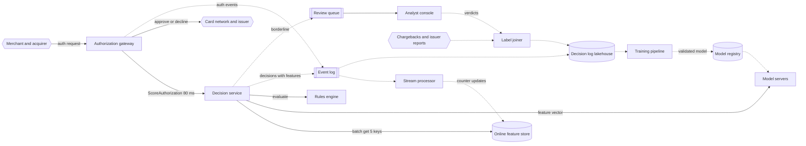

**Reading the diagram.** Solid arrows are the synchronous authorization path: the gateway calls the decision service with an 80 ms deadline; the service reads five entity records from the in-memory online store in one batched call, sends the assembled vector to the model servers and evaluates the rules, then returns a decision that the gateway forwards to the card network. Everything dotted is asynchronous. Authorization events and decisions (with the exact feature values used) go to a Kafka-style event log (Chapter 31), partitioned by card token so that each card's events stay ordered (§31.5.3). A stream processor (§29.9) updates the velocity counters in the online store within seconds. The decision log lands in the lakehouse; the label joiner attaches chargebacks, issuer reports and analyst verdicts as they arrive, weeks later. The training pipeline reads only matured rows and publishes validated models to the registry, from which model servers load them (§69.8). Storage boundaries: the online store holds hot state only; the lakehouse is the system of record for training and audit. Failure points: the online store (missing features), the model servers (timeouts) and stream lag (stale counters); §82.4.11 covers each. Scaling: the decision service and model servers are stateless and scale horizontally; the stream processor scales with event-log partitions.

### 82.4.8 Detailed component design

#### Streaming velocity features

Velocity features answer "how much has this card, device or IP done recently?" — for example, the number of distinct cards used from one device in 24 hours, which jumps when a fraudster tests stolen card numbers. They are the most predictive and the most fragile features in fraud.

1. **Event-time windows.** The stream processor keys events by entity and maintains sliding windows (§29.8.2) with event time, so a delayed event updates the window it belongs to. A watermark of a few seconds bounds lateness (§29.8.3).
2. **Bucketed counters.** A 24-hour sliding count stored exactly would need every event; instead keep per-minute buckets for the 1-hour window and per-hour buckets for the 24-hour and 30-day windows, summed at read time, which approximates a sliding window to within one bucket (§22.7.2).
3. **Distinct counts** (distinct cards per device) use small exact sets below a size cap and HyperLogLog sketches above it (§17.5).
4. **Read-your-own-write gap.** The current transaction is not yet in the counters when it is scored, because its event is published after the decision. Training must match: features in the log are as of just before the transaction, so training and serving agree (§62.9). Systems that update counters synchronously before scoring must train the same way.
5. **Freshness monitoring.** Each record stores `updated_ts`; the decision service logs feature age, and an alert fires when the p99 lag exceeds 2 s (§62.10.1).

During a card-testing burst of 50 attempts in a minute, a 2-second lag means only the first two or three attempts see stale counters. A 5-minute lag, from a stalled consumer, would let all 50 through, which is why consumer lag (§31.7.3) is a paging alert here and not a dashboard.

#### Model, imbalance and calibration

**Baseline first.** The existing rule set is the baseline (§59.9.1): measure its recall and false-decline rate on matured labels before training anything. The first model is gradient-boosted trees on a few hundred features: velocity counters, entity age, amount relative to the card's history, merchant category, device and network signals, and **network features** such as how many cards share this device or email, which link a transaction to past fraud. Gradient-boosted trees are strong on tabular data, fast on CPU and explainable with TreeSHAP (§71.7.2).

**Imbalance.** With 0.1% positives, train on all frauds and a 2% sample of legitimate transactions (§63.11.1), then correct the probabilities. Dal Pozzolo et al. analyzed exactly this case for card fraud: undersampling changes the class prior, so the trained model's probabilities are inflated and must be recalibrated with the same Bayes correction before they are compared with cost-based thresholds [Dal Pozzolo et al. 2015]. Their public dataset illustrates the imbalance: 492 frauds among 284,807 transactions (0.172%). Measure with precision–recall curves and dollar-weighted recall, not accuracy or ROC-AUC alone (§57.10.2).

**Production model.** Large processors move toward neural networks once data volume justifies it. Stripe has published that Radar moved in 2022 from an ensemble of XGBoost and a deep network to a deep-network-only architecture inspired by ResNeXt, which cut training time by more than 85% to under two hours, making faster retraining possible; it also notes that dropping the tree model alone would have cost recall, and that explaining deep-network scores is harder [Drapeau 2023].

::: industry
**Stripe Radar.** Stripe describes Radar as scoring each payment in under 100 ms using signals from across its network, with labels supplied largely by cardholder disputes. The 2022 architecture change from a Wide & Deep ensemble (XGBoost plus a DNN) to a multi-branch DNN was motivated by retraining speed and the ability to use techniques such as embeddings and transfer learning, which the tree component made difficult at scale. The trade-off accepted was harder per-decision explanation.
*Evidence: Primary* — [Drapeau 2023]
:::

::: industry
**PayPal's real-time graph.** PayPal has published that it built a home-grown real-time graph platform linking accounts, devices and other attributes so that relationship features (for example, an account connected to known bad accounts) are available for risk decisions in near real time, because relational queries over its relationship data were too slow.
*Evidence: Primary* — [Zuo et al. 2021]
:::

#### The decision policy: cost-sensitive thresholds, rules and fallback

The model outputs a calibrated probability $p$; the policy decides. Declining is right when the expected loss from approving exceeds the expected cost of declining, the same newsvendor reasoning as §59.4.2 but with costs that depend on the transaction.

::: formula
**Amount-dependent decline threshold**

$$\text{decline if } p > t^{*}(A) = \frac{C_{FP}(A)}{C_{FP}(A) + C_{FN}(A)}, \qquad C_{FN}(A) = A + f, \qquad C_{FP}(A) = gA + k$$

| Symbol | Meaning | Units |
|---|---|---|
| $p$ | Calibrated probability that the transaction is fraud | probability |
| $A$ | Transaction amount | \$ |
| $C_{FN}(A)$ | Cost of approving a fraud: amount lost plus chargeback fee and handling | \$ |
| $f$ | Chargeback fee and handling cost per fraud | \$ |
| $C_{FP}(A)$ | Cost of declining a legitimate payment | \$ |
| $g$ | Lost margin and fees as a fraction of the amount | fraction |
| $k$ | Fixed friction cost of a false decline (support contact, lost future business) | \$ |
| $t^{*}(A)$ | Probability above which declining has lower expected cost | probability |
:::

::: example
**Worked example — Three transactions.** Assume $f = \$25$, $g = 0.15$, $k = \$15$.

1. $A = \$5$: $C_{FP} = 0.75 + 15 = \$15.75$, $C_{FN} = \$30$; $t^{*} = 15.75/45.75 = 0.344$.
2. $A = \$50$: $C_{FP} = \$22.50$, $C_{FN} = \$75$; $t^{*} = 22.5/97.5 = 0.231$.
3. $A = \$500$: $C_{FP} = \$90$, $C_{FN} = \$525$; $t^{*} = 90/615 = 0.146$.

**Interpretation.** A $5 payment must be more than a third likely to be fraud before declining pays, because the fixed friction of insulting a good customer dominates; a $500 payment is declined at 15%. **Engineering implication.** The threshold is a function of business costs that live in versioned configuration, and it only works on calibrated probabilities: a model whose 0.3 means 0.1 makes every threshold wrong. Monitor calibration per decile as a gating metric (§70.9.1).
:::

A third action, **step-up authentication** (3-D Secure or a one-time code), has its own cost (some legitimate customers abandon) and shifts liability for fraud in many card schemes; the policy compares three expected costs instead of two.

The following program trains a model on downsampled synthetic data and compares four policies on a fresh test set.

```python
import numpy as np
from sklearn.linear_model import LogisticRegression

rng = np.random.default_rng(7)

def make(n):
    """Synthetic card transactions with about 0.2% fraud."""
    y = (rng.random(n) < 0.002).astype(int)
    amount = np.where(y == 1, rng.lognormal(4.6, 1.0, n), rng.lognormal(3.6, 1.0, n))
    velocity = rng.poisson(np.where(y == 1, 4.0, 1.0))      # card txns in last hour
    new_device = rng.random(n) < np.where(y == 1, 0.6, 0.05)
    noise = rng.normal(0, 1, (n, 3)) + y[:, None] * 0.4
    X = np.column_stack([np.log(amount), velocity, new_device, noise])
    return X, y, amount

X_tr, y_tr, _ = make(1_000_000)
X_va, y_va, a_va = make(1_000_000)
X_te, y_te, a_te = make(1_000_000)

beta = 0.02                                   # keep all frauds, 2% of legitimate rows
keep = (y_tr == 1) | (rng.random(len(y_tr)) < beta)
model = LogisticRegression(max_iter=1000).fit(X_tr[keep], y_tr[keep])

def scores(X):
    p_s = model.predict_proba(X)[:, 1]
    return p_s, beta * p_s / (beta * p_s + 1 - p_s)   # undo downsampling (§63.11.1)

FEE, G, K = 25.0, 0.15, 15.0                  # chargeback cost, lost margin, friction
def cost(decline, y, amt):
    fn = (~decline) & (y == 1)                # approved fraud: amount plus fee
    fp = decline & (y == 0)                   # declined good customer
    return (amt[fn] + FEE).sum() + (G * amt[fp] + K).sum()

ps_va, p_va = scores(X_va)
ps_te, p_te = scores(X_te)
best = min(np.arange(0.01, 0.9, 0.01), key=lambda t: cost(p_va > t, y_va, a_va))
t_star = (G * a_te + K) / (G * a_te + K + a_te + FEE)

for name, d in [("approve everything", np.zeros(len(y_te), bool)),
                ("raw score > 0.5", ps_te > 0.5),
                (f"calibrated p > {best:.2f} (tuned)", p_te > best),
                ("calibrated p > t*(amount)", p_te > t_star)]:
    tp = (d & (y_te == 1)).sum()
    print(f"{name:<32} declines={d.sum():>6} precision={tp / max(d.sum(), 1):.2f} "
          f"recall={tp / y_te.sum():.2f} cost=${cost(d, y_te, a_te) / 1e3:,.0f}k")
```

Output (`OMP_NUM_THREADS=1 python3`):

```text
approve everything               declines=     0 precision=0.00 recall=0.00 cost=$388k
raw score > 0.5                  declines= 11860 precision=0.12 recall=0.72 cost=$459k
calibrated p > 0.15 (tuned)      declines=  2062 precision=0.46 recall=0.47 cost=$212k
calibrated p > t*(amount)        declines=  1684 precision=0.53 recall=0.44 cost=$212k
```

What to notice:

- Thresholding the uncorrected score at 0.5 costs *more* than approving everything: the downsampled model inflates the odds of fraud by $1/\beta = 50$, so it declines 11,860 customers to catch 72% of fraud.
- After the Bayes correction, a threshold tuned on a separate validation set and the analytic rule $t^{*}(A)$ reach the same cost, but the analytic rule needed no tuning and declined 18% fewer customers, because it spends declines on large amounts.
- Recall is below 50% at the cost optimum. Maximizing recall is not the goal; minimizing total cost is.

**Rules and the hybrid.** Rules run alongside the model in three roles: hard constraints (sanctioned regions, merchant block lists, card-testing limits), fast patches for a new attack before the next retrain, and merchant preferences. Rules are versioned, backtested and shadowed before activation, and their hits are logged as features so that the model learns from them rather than competing with them. A rule set that grows without pruning becomes the debt of §60.14; review each rule's marginal value quarterly.

**Fallback.** If the model servers miss the 80 ms deadline or the feature store is unreachable, the decision service does not fail the payment. It applies a **degraded policy** (§60.12.2): rules only, plus a simple score from features that arrive in the request itself (amount, merchant category, entry mode) and per-merchant limits; above a conservative amount it steps up rather than approves. A circuit breaker (§22.13) stops calling a failing model server, and the decision log marks `fallback=true` so that monitoring and later analysis can separate fallback decisions.

#### Evaluation offline and online

**Offline**: on a matured, time-split test window, report PR-AUC, recall of fraud dollars at the operating decline rate, false-decline rate, total cost under the decision policy, and calibration per decile; slice by merchant category, region, card type and amount band (§59.10.2).

**Online**: a classic A/B test on fraud has two problems. Labels arrive over weeks (§63.4.2, §70.8), and declined transactions never receive labels, so the treatment that declines more has fewer labels to evaluate. The design uses three tools. A **shadow** period scores every transaction with the challenger without acting, so its decisions can be compared with the champion's on the same traffic (§66.12). A **random holdout** of about 0.1% of low-risk-band traffic is approved regardless of score (with a dollar cap), giving unbiased labels for what the model would have declined, at a bounded and budgeted loss. And early proxies (issuer fraud reports within days, step-up failure rates, analyst verdicts) move first, followed by matured chargeback metrics per daily cohort (§70.8.1).

### 82.4.9 Data flow

**Figure 82.2 — Write path: events, counters and labels.**

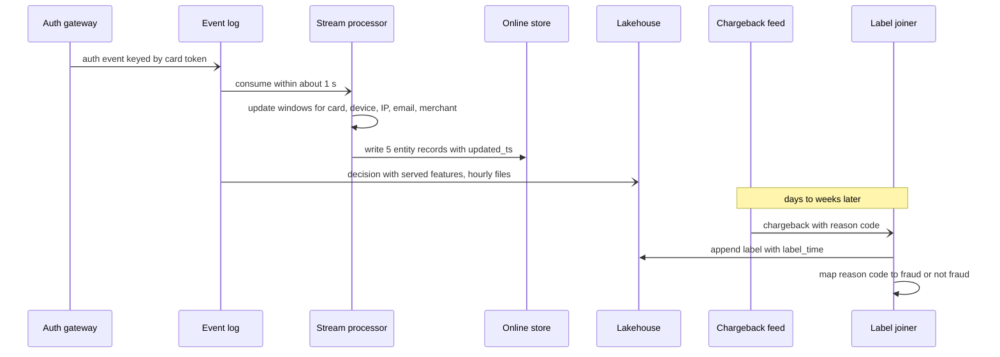

**Reading the diagram.** All hops are asynchronous except the stream processor's write into the online store and the label joiner's append to the lakehouse, which are retried until acknowledged. Events are keyed by card token, so one card's updates arrive in order; device and IP aggregates are computed in a second keyed stage (repartitioning by the other entity), which adds a second or so of lag. The lakehouse receives decisions with the features that were actually served. Labels arrive days to weeks later and are appended, never overwriting the decision; the reason-code mapping matters because many chargebacks are service disputes, not fraud (Table 63.3). Failure points: consumer lag (stale counters), duplicate events after a processor restart (counters double-count unless updates are idempotent per event ID, §31.11), and label joins that miss because the auth ID was not propagated. Scaling: event-log partitions and stream-processor parallelism grow with transaction rate.

**Figure 82.3 — Read path: one authorization decision.**

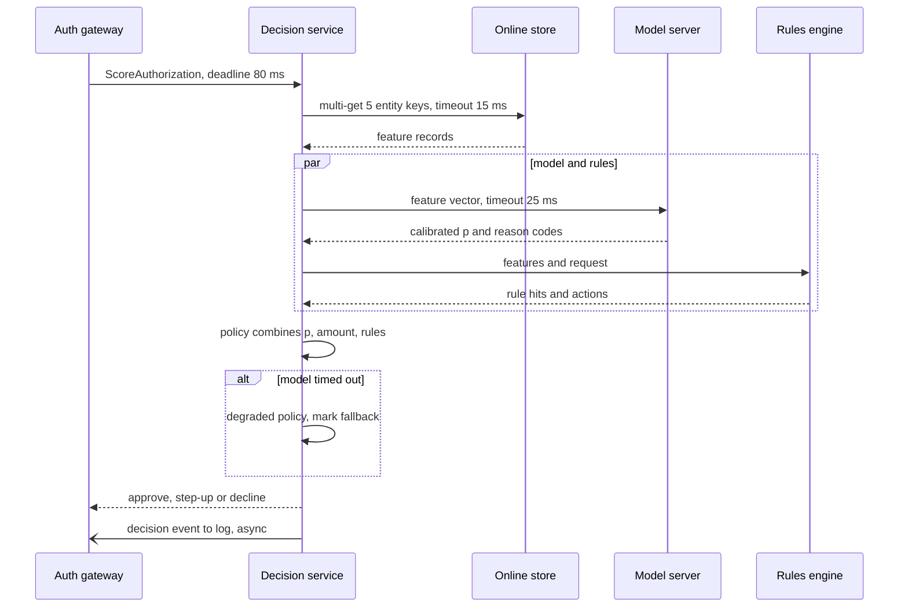

**Reading the diagram.** The decision service owns the 80 ms deadline and splits it: 15 ms for the batched feature read, 25 ms for the model and rules in parallel, a few milliseconds for the policy, and the rest as headroom for network and queueing (§60.10.1). Reason codes come from the model server, using precomputed TreeSHAP for trees or a gradient-based attribution for a neural network, because the merchant dashboard and analysts need them (§71.8.1). If either the feature read or the model call times out, the degraded policy answers and the decision is marked. The log write is asynchronous so it never adds latency. Failure points: a slow feature-store shard (a hot device key shared by thousands of cards), garbage-collection pauses in model servers, and a rules engine with an expensive rule; each has its own timeout. Scaling: stateless services behind load balancers in each region; the online store scales by partitioning keys (§14.7).

### 82.4.10 Bottlenecks

1. **Hot keys.** A shared device or a large merchant receives thousands of updates per second; split its counter into sub-keys and sum on read, or keep merchant aggregates at lower resolution.
2. **Counter write amplification.** 174,000 updates/s at peak; batch updates per entity per second inside the stream processor before writing.
3. **Feature fetch tail latency.** Five parallel reads at p99 set the decision's p99 (§4.8.4); co-locate or replicate the store per region and hedge reads (§23.7).
4. **Label latency** caps how fast the model learns; analyst verdicts and issuer reports are the only fast labels.
5. **Analyst capacity.** Every borderline case sent to review costs analyst time; the review band must be sized to the team, not the other way round.

### 82.4.11 Failure scenarios

**Table 82.4 — Payment fraud failure scenarios.**

| What fails | Impact | Detection | Recovery | Prevention |
|---|---|---|---|---|
| Model servers down or slow | Decisions fall back to rules; fraud rises | Fallback rate > 0.1% alert | Circuit breaker; fail over region | N+1 per region; load-shed review traffic first |
| Stream processor lag | Card-testing bursts pass with stale counters | Feature age p99 > 2 s | Scale consumers; skip to latest for minute windows | Lag alert; capacity for 3× peak |
| Training–serving skew in a new feature | Offline lift, online loss | Logged versus recomputed feature comparison (§62.9.2) | Roll back model | Log-and-train; shadow before launch |
| Immature labels in training | Recent fraud learned as legitimate | Positive rate falls for recent cohorts | Rebuild with maturity filter | Enforce $W_\varepsilon$ in the dataset builder (§63.4.2) |
| Selection bias from declines | Model never sees outcomes of what it declined | Holdout fraud rate diverges from model estimate | Reweight using holdout | Random holdout; analyst sample |
| Adversarial adaptation | Recall falls on a new pattern within days | Early issuer reports, step-up failures, analyst escalations | Emergency rule; retrain with fast labels | Network features hard to fake; rule shadow pipeline |
| Calibration drift after a fraud wave | Thresholds decline too many or too few | Reliability per decile on fast labels | Recalibrate (isotonic on recent data) | Calibration as a release gate (§70.9.1) |
| Bad rule deployed | Thousands of false declines in minutes | Decline-rate spike per merchant | Kill switch per rule | Mandatory shadow and backtest |
| Feedback loop via rules | Rule blocks a segment, model learns segment is safe | No labels from blocked segment | Exploration in holdout | Log rule hits as features |

### 82.4.12 Scaling strategy

**At 10×** (60,000 authorizations/s, 1.7 million counter updates/s): the feature path breaks first. Partition the event log and stream processor further, pre-aggregate per entity per second, and move the online store to a cluster per region with local replicas. Scoring scales linearly to about 60 nodes at the same per-decision cost.

**At 100×** (network scale, 600,000/s): compute per decision becomes a cost line; use a cascade (§60.13.2) in which a cheap model clears most traffic and only the riskiest few percent hit a large network or graph model. Feature state grows to tens of terabytes, so long windows move to a slower tier while minute-level windows stay in memory. Training data, even downsampled, reaches billions of rows: shard training across machines (Chapter 65) and retrain the large model less often while recalibrating the output layer daily.

### 82.4.13 Trade-offs

**Table 82.5 — Payment fraud design trade-offs.**

| Decision | Option chosen | Alternative | Why |
|---|---|---|---|
| Scoring placement | Synchronous in authorization | Asynchronous after approval | Card fraud cannot be recalled once approved |
| Counters | Event-time sliding buckets, ~1–2 s lag | Synchronous update before scoring | Lower latency and simpler; training matches either way |
| Threshold | Cost-based on calibrated $p$, per amount | One fixed score cut-off | Minimizes dollars, not counts |
| Model | GBDT, later DNN | Rules only | Rules cannot capture interactions; rules kept for speed and policy |
| Labels | Matured chargebacks plus fast analyst labels | Only chargebacks | Fast labels cover the 60–120-day blind spot |
| Evaluation | Shadow plus small random holdout | Standard A/B | Declines censor labels; holdout gives unbiased outcomes |
| Fallback | Rules plus request-only score | Fail closed (decline all) or open (approve all) | Payments continue with bounded fraud exposure |

### 82.4.14 Alternative designs

- **Vendor scoring** (a card network's or vendor's score) is faster to launch and benefits from cross-industry data, but cannot use the processor's own features and policies; many processors combine a vendor score as one feature.
- **Graph-based detection** with graph neural networks over the card–device–merchant graph catches rings that per-transaction features miss; it usually runs offline or nearline to produce features, because full graph inference rarely fits 25 ms.
- **Anomaly detection** without labels (isolation forests, autoencoders) flags new patterns before chargebacks exist; it is a complement, routing anomalies to analysts, not a replacement for supervised models.
- **Sequence models** over a card's recent transactions learn velocity-like features directly but need low-latency access to recent history.

### 82.4.15 Interview discussion

**Table 82.6 — 45-minute pacing plan for payment fraud.**

| Minutes | Focus | What to produce |
|---|---|---|
| 0–5 | Scope and framing | Processor, synchronous decision, label definition, costs of FP and FN |
| 5–10 | Estimates | 6,000 auth/s peak; 174,000 counter updates/s; 110 TB decision log |
| 10–20 | Architecture | Figure 82.1; latency budget inside 80 ms |
| 20–30 | Deep dive: features | Velocity windows, freshness, read-your-own-write, skew avoidance |
| 30–38 | Deep dive: decision | Imbalance, calibration, $t^{*}(A)$, rules hybrid, fallback |
| 38–45 | Evaluation and adversaries | Label delay, holdout, shadow, adaptation, monitoring |

**Likely follow-ups.**

- *"Why not optimize accuracy or F1?"* Both treat errors as equal and ignore amounts; cost per decision does not.
- *"How do you train if fraud labels take 90 days?"* Matured windows for the main model, fast labels for recent patterns, and rules for the gap.
- *"What if the model is down?"* Degraded policy with rules and request-only features; never fail the payment.
- *"How do you measure recall of what you declined?"* A small random holdout with a loss budget.
- *"How do fraudsters respond?"* They probe thresholds with small amounts and rotate devices; use features that are expensive to fake (network history, device reputation) and keep reason codes vague to outsiders.

**What distinguishes senior and staff answers.** A senior answer gets the synchronous path, velocity features, imbalance and a fallback right. A staff answer prices both errors and derives the threshold, explains why downsampled probabilities must be corrected, designs evaluation around censored and delayed labels, treats rules and models as one governed system, and quantifies the cost of the holdout.

### 82.4.16 Production considerations

- **Monitoring** (Chapter 70): fallback rate, feature age, score distribution and decline rate per merchant (minutes); early-label precision (days); matured dollar recall and calibration per cohort (weeks). Label-shift estimates from flag rates fill the gap (§70.8.2).
- **Retraining**: weekly on matured windows; daily recalibration; emergency retrain with fast labels after a confirmed new attack (§70.14).
- **Responsible ML**: declines affect people; avoid protected attributes and audit false-decline rates by region and card type (§71.5); reason codes shown to merchants must not teach attackers (§71.8).
- **Security**: tokenized identifiers only; strict access to the decision log; rule changes require two-person approval and are audited.
- **Cost**: the scoring fleet is cheap; the feature state, decision log retention, analyst headcount and the holdout's fraud losses are the real budget lines.

## 82.5 Credit risk prediction

### 82.5.1 Problem statement

Design the credit decision system of a consumer lender that issues credit cards and personal loans online and through partner websites. Applicants first ask "would I qualify?" (a **prequalification** using a soft credit inquiry that does not affect their credit file), then apply; the lender pulls a credit bureau report, decides approve or decline, and sets a credit limit and price. Every month it also reviews existing accounts to raise or lower limits.

**ML formulation.** For each application, predict the **probability of default** (PD): that the account becomes 90 or more days past due, or is charged off, within 12 months of opening. It is binary classification with a label that arrives a year after the decision, observed only for applicants who were approved. The model ranks risk; a **credit policy** (cut-offs, limits, pricing) uses PD, expected loss and profitability to decide. ML is warranted because default depends on hundreds of interacting bureau and application attributes, but the model must remain explainable to applicants, validators and regulators.

The distinctive hard problem is not latency or scale; it is **decisions that others must be able to examine**. A declined applicant in the United States must receive the specific principal reasons (the Equal Credit Opportunity Act and Regulation B); the lender must show it does not discriminate on protected characteristics; an independent validation team must challenge the model before use (SR 11-7); and the training data is biased because the lender never learns what would have happened to the applicants it declined (**reject inference**).

::: warning
**Warning — Not legal advice.** This case names regulations to show their engineering consequences, following §71.13. Which rules apply, and how, depends on jurisdiction, product and counsel's interpretation. Treat every legal statement here as a prompt to ask your compliance team, not as guidance.
:::

*Evidence: Illustrative* — a teaching design; regulations and supervisory guidance are cited from their published texts.

### 82.5.2 Functional requirements

1. **Prequalification**: soft-inquiry decision with an indicative offer, returned within seconds to the lender's site and partner marketplaces.
2. **Application decision**: identity and fraud checks, hard bureau pull, PD score, policy rules, limit and price; manual review for referred cases.
3. **Adverse-action notices** with up to four principal reasons for every decline or less favorable offer, generated from the same model run that made the decision.
4. **Account management**: monthly batch scoring of all open accounts with a behavior model for limit increases, decreases and collections priority; decreases also need reasons.
5. **Performance ingestion**: monthly delinquency status per account, building labels.
6. **Model governance**: inventory, documentation, independent validation, approval, monitoring and periodic revalidation; champion–challenger testing.
7. **Fairness testing** before launch and periodically, with documented searches for less discriminatory alternatives.

### 82.5.3 Non-functional requirements

**Table 82.7 — Credit decision system non-functional requirements.**

| Property | Target | Why |
|---|---|---|
| Latency (prequalification) | p99 ≤ 1.5 s including soft bureau inquiry | Partner marketplaces show offers in real time |
| Latency (model and reasons) | p99 ≤ 100 ms | Leaves the budget to bureau and identity calls |
| Availability | 99.9% for decisions; degraded mode refers to manual review | Lost applications are lost revenue, but not safety-critical |
| Reproducibility | Any decision re-created exactly from stored inputs for at least 25 months (record-retention rules; longer by policy) | Disputes, audits and examinations |
| Explanations | 100% of adverse actions carry specific reasons; reasons stable under re-scoring | Regulation B; consistency builds trust |
| Model quality | AUC ≥ champion on out-of-time test; PD calibrated within ±10% relative per risk band | Pricing and loss forecasting use PD directly |
| Stability | Score PSI < 0.10 month over month without explanation (§70.5.1) | Unexplained shifts trigger review |
| Fairness | Adverse impact ratio per group above a documented screening threshold; disparities investigated | ECOA disparate-treatment and disparate-impact risk |
| Shape constraints | PD monotonic in documented directions for key attributes | Explainability and validator acceptance |

### 82.5.4 Capacity estimation

::: example
**Worked example — Decision volume, storage and compute.** Assumptions: 10 million applications per year; 200 million prequalification calls per year from partners; peak factor 20 for applications (campaigns) and 10 for prequalification; 40% approval; 4% of approved accounts go bad within 12 months; 100 KB stored per application (bureau attributes, application data, features, decision, reasons); 30 million open accounts scored monthly by 3 models; TreeSHAP with $T = 500$ trees, $L = 32$ leaves, depth $D = 5$; bureau hard pull \$1.50 (assumed).

1. Applications: $10^7/365 = 27{,}397$ per day $= 0.32$/s; peak $\approx 6.3$/s.
2. Prequalification: $2 \times 10^8/365 = 547{,}945$ per day $= 6.3$/s; peak $\approx 63$/s.
3. Labels: $10^7 \times 0.4 = 4$ million approved per year; $4 \times 10^6 \times 0.04 = 160{,}000$ bads per year, each known a year after its decision.
4. Storage: $10^7 \times 100$ KB $= 1$ TB per year; 7 TB for seven years of history.
5. Batch scoring: $3 \times 10^7 \times 3 = 9 \times 10^7$ predictions per month. Explanations: $500 \times 32 \times 5^2 = 400{,}000$ operations per account (§71.8.1); $3 \times 10^7 \times 4 \times 10^5 = 1.2 \times 10^{13}$ operations, about **3.3 core-hours** at $10^9$ operations per second.
6. Bureau cost: $10^7 \times \$1.50 = \$15$ million per year.

**Interpretation.** Throughput is trivial: 63 requests per second at peak and a few core-hours a month. The expensive resources are bureau data, a year of label delay, and people (modelers, validators, compliance). **Engineering implication.** Optimize for correctness, reproducibility and governance throughput rather than for compute; cache prequalification results per applicant for a short TTL to avoid repeat bureau inquiries.
:::

The policy turns PD into money with the standard expected-loss decomposition.

::: formula
**Expected loss and the break-even PD cut-off**

$$EL = PD \times LGD \times EAD \qquad \text{approve if } (1 - PD)\,R > PD \times LGD \times EAD \iff PD < PD^{*} = \frac{R}{R + LGD \times EAD}$$

| Symbol | Meaning | Units |
|---|---|---|
| $PD$ | Probability of default within the performance window | probability |
| $LGD$ | Loss given default: fraction of exposure lost after recoveries | fraction |
| $EAD$ | Exposure at default: balance owed when default occurs | \$ |
| $EL$ | Expected credit loss | \$ |
| $R$ | Expected net revenue over the window if the account does not default (interest and fees minus funding and servicing costs) | \$ |
| $PD^{*}$ | PD at which expected profit is zero | probability |
:::

::: example
**Worked example — A card applicant.** $PD = 0.04$, $LGD = 0.85$ (unsecured), $EAD = \$3{,}000$, $R = \$300$.

1. $EL = 0.04 \times 0.85 \times 3{,}000 = \$102$.
2. Expected profit $= 0.96 \times 300 - 102 = \$186$: approve.
3. Break-even: $PD^{*} = 300/(300 + 2{,}550) = 10.5\%$.

**Interpretation.** This is the same structure as the fraud threshold of §82.4.8: a calibrated probability compared with a ratio of costs. **Engineering implication.** PD calibration per risk band is a hard requirement, and the cut-off belongs to the credit policy owners, versioned separately from the model; lowering $EAD$ (a smaller limit) can turn a decline into an approval, which is why limit assignment is part of the decision.
:::

### 82.5.5 API design

```text
POST /v1/prequalifications   { applicant: {name, dob, address, income, ssn_token}, product, channel }
  -> 200 { prequal_id, eligible: true, indicative_offer: {limit, apr_range}, expires_at }
  -> 200 { prequal_id, eligible: false, reasons: [ {code: "R03", text: "Proportion of balances to credit limits is too high"} ] }

POST /v1/applications        Idempotency-Key: ...  { prequal_id?, applicant, product, consent_hard_pull: true }
  -> 201 { application_id, decision: APPROVE | DECLINE | REFER, offer?, reasons?, decision_id }

GET  /v1/decisions/{decision_id}
  -> { inputs_ref, model_version, policy_version, pd, el, reasons, notice_id, created_at }

POST /v1/account-reviews     { run_month, model_set_version }      # batch job submission
POST /internal/performance   { account_id, month, days_past_due, balance, status }   # monthly feed
```

What to notice: the decision record points to an immutable snapshot of its inputs (`inputs_ref`), so the decision can be replayed with the same model and policy versions years later. Reasons are returned as codes with reviewed texts, so notices, support scripts and the applicant portal stay consistent. Applications use idempotency keys (§22.15) because a retried submission must not trigger a second hard inquiry.

### 82.5.6 Data model and database schema

Decisions need transactions and audit, so a relational database holds the decision records; raw bureau responses and feature snapshots go to immutable object storage, referenced by hash (§15.4).

```sql
CREATE TABLE decisions (
  decision_id     VARCHAR(32) PRIMARY KEY,
  application_id  VARCHAR(32) NOT NULL,
  decided_at      TIMESTAMP   NOT NULL,
  inputs_ref      VARCHAR(128) NOT NULL,    -- hash of bureau + application + features snapshot
  model_version   VARCHAR(32) NOT NULL, policy_version VARCHAR(32) NOT NULL,
  pd              DECIMAL(6,5), decision VARCHAR(8), limit_amount BIGINT, apr_bps INT,
  reasons         JSON,                     -- [{code, rank, contribution}]
  assignment      VARCHAR(16)               -- CHAMPION | CHALLENGER | EXPLORATION
);
CREATE TABLE performance (                  -- one row per account per month
  account_id VARCHAR(32), month DATE, days_past_due INT, balance BIGINT, status VARCHAR(16),
  PRIMARY KEY (account_id, month)
);
```

A **training example** is an application snapshot (features exactly as of the decision, §62.8) joined to the account's worst delinquency in months 1–12 after opening. Label delay is the full 12-month **performance window**, so a model trained in 2026 learns from applications made in roughly 2023–2024. Declined applications have no performance rows; they are stored with `label = NULL` and a reject flag for reject inference. The assignment column records whether the decision came from the champion, a challenger or an exploration cell, which later analysis needs to avoid confounding.

### 82.5.7 High-level architecture

**Figure 82.4 — Credit decision system and model governance.**

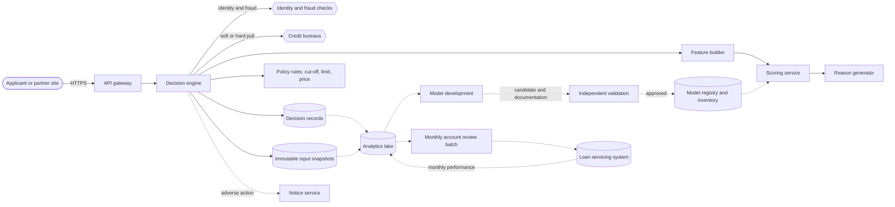

**Reading the diagram.** The synchronous path (solid) runs from the gateway to the decision engine, which orchestrates identity checks, the bureau pull, feature building, scoring with reason generation, and the policy rules that set approve or decline, limit and price; it writes the decision record and the immutable input snapshot before responding. Adverse-action notices are generated asynchronously from the stored reasons. The governance path (dotted) is slow by design: performance data from the servicing system flows monthly to the analytics lake; model developers build candidates with documentation; an **independent validation** team challenges them; only approved versions enter the registry, which doubles as the model inventory (§69.8, §69.11.2), and the scoring service loads only registry versions. The monthly account-review batch scores open accounts and sends limit actions to the servicing system. Failure points: bureau outages (refer or retry), a policy-rule error (wrong cut-offs for every applicant), and a mismatch between the model in the registry and the one serving. Scaling: the online path is small; the governance path scales with the number of models, not requests.

### 82.5.8 Detailed component design

#### Features, labels and point-in-time bureau data

Most predictive power comes from bureau attributes: utilization of revolving credit, number of recent inquiries, age of oldest account, delinquency history, and from application data such as income and requested amount. Two rules keep the data honest. First, features must be computed from the bureau report *as pulled at decision time*; retrieving today's report for a 2024 applicant leaks the future (§57.6.3). Bureaus offer archived "retro" extracts for model development, and the lender stores every pull it makes. Second, the label definition (90+ days past due within 12 months), exclusions (fraud, deceased, accounts closed by the lender) and the **vintage** (month of origination) are fixed in the data contract, because changing them silently changes the bad rate the model learns.

#### Model: scorecard baseline, constrained gradient boosting

The baseline is the industry's traditional **scorecard**: logistic regression on binned attributes, with each bin's contribution expressed as points [Siddiqi 2006; Hand and Henley 1997]. It is transparent, monotonic by construction and well understood by validators. The production challenger is a gradient-boosted tree model with **monotonic constraints**: PD may only rise with utilization and may only fall with income and credit history length. Constraints encode domain knowledge, stop the model from learning noise such as "higher income is riskier in this narrow band," make reason codes coherent, and are much easier to defend in validation.

```python
import numpy as np
from sklearn.ensemble import HistGradientBoostingClassifier
from sklearn.metrics import roc_auc_score

rng = np.random.default_rng(11)
n = 40_000
util = rng.uniform(0, 1, n)                  # revolving utilization
income = rng.lognormal(10.8, 0.5, n) / 1e3   # annual income, $ thousands
months = rng.integers(0, 240, n)             # months since oldest account
logit = -3.2 + 2.5 * util - 0.012 * income - 0.006 * months
y = (rng.random(n) < 1 / (1 + np.exp(-logit))).astype(int)
X = np.column_stack([util, income, months])
tr, te = slice(0, 30_000), slice(30_000, None)

def fit(cst):
    return HistGradientBoostingClassifier(max_iter=300, learning_rate=0.1,
                                          monotonic_cst=cst, random_state=0).fit(X[tr], y[tr])

def violations(m):
    """Share of test applicants whose PD rises when income rises by $5k."""
    up = X[te].copy(); up[:, 1] += 5
    return np.mean(m.predict_proba(up)[:, 1] > m.predict_proba(X[te])[:, 1] + 1e-9)

for name, cst in [("unconstrained", None), ("monotonic", [1, -1, -1])]:
    m = fit(cst)
    auc = roc_auc_score(y[te], m.predict_proba(X[te])[:, 1])
    print(f"{name:<14} test AUC={auc:.3f}  income-up raises PD for {violations(m):.1%}")
print(f"default rate={y.mean():.3f}")
```

Output (`OMP_NUM_THREADS=1 python3`):

```text
unconstrained  test AUC=0.728  income-up raises PD for 20.7%
monotonic      test AUC=0.739  income-up raises PD for 0.0%
default rate=0.047
```

What to notice:

- `monotonic_cst=[1, -1, -1]` forces PD to be non-decreasing in utilization and non-increasing in income and history length.
- Without constraints, raising one in five applicants' income by \$5,000 *raises* their predicted risk: overfitting to noise that an applicant would rightly find absurd and that would generate incoherent reasons.
- Here the constraint also improves test AUC, because it removes variance; on real data the constrained model is usually within a small margin of the unconstrained one, and the trade is worth it.

#### Explanations and adverse-action reasons

Regulation B requires a statement of specific reasons for adverse action [12 CFR 1002.9], and the CFPB has stated that using a complex algorithm does not excuse a creditor from providing specific and accurate reasons [CFPB 2022]. The reason generator follows §71.8.1:

1. Compute attributions for the applicant's PD: exact points for a scorecard; TreeSHAP for trees [Lundberg et al. 2020].
2. Measure contributions relative to a documented reference, such as the score of an applicant who would have been approved, so that "reasons" mean "what pushed you below the cut-off."
3. Group features into reviewed reason codes (all utilization features map to one reason), rank by total adverse contribution, and return the top four.
4. Store attributions, codes and the reference version with the decision so that the notice can be reproduced.
5. Test: the same applicant scored twice gets the same reasons; a counterfactual change to the top reason's features moves the score in the stated direction (§71.7.3).

#### Reject inference and selection bias

The model is trained only on approved applicants, but it is used on everyone. If the old policy declined almost everyone with three recent delinquencies, the training data contains few such applicants, and those it contains were approved for unusual reasons (a large income, a co-signer). The model can then underestimate their risk, a **selection bias** of the kind §59.13.2 describes for feedback loops. **Reject inference** methods try to infer outcomes for declined applicants: assigning them labels from a model (augmentation, parceling) or reweighting approved applicants by the inverse of their probability of approval. Empirical studies find these methods give limited and inconsistent gains [Crook and Banasik 2004], because they rely on assumptions that cannot be checked from the approved data alone.

The reliable fix is data. The design reserves a small **exploration cell**: a random sample of applicants just below the cut-off is approved with a small limit, under a loss budget. At 10,000 such approvals a year, a \$500 limit, PD of 20% and LGD of 0.85, the expected loss is $10{,}000 \times 0.20 \times 0.85 \times 500 = \$850{,}000$ a year: the price of learning whether the cut-off is in the right place. Exploration must itself pass fair-lending review, since it treats similar applicants differently by design.

#### Fairness testing

Lenders generally may not collect race or ethnicity for non-mortgage credit, so fairness testing uses **proxies** such as Bayesian Improved Surname Geocoding, which combines surname and geography into group probabilities [CFPB 2014] (§71.5.2). The test suite computes, per group: approval rates and the **adverse impact ratio** (a group's approval rate divided by the reference group's), PD calibration (is a 5% PD equally accurate across groups?) and error rates among applicants who did repay (§71.4). Where a disparity appears, the team searches for a **less discriminatory alternative**: removing or constraining the features that drive it, retraining, and comparing accuracy loss against disparity reduction [Kozodoi et al. 2022]. Results, alternatives considered and the decision go into the model documentation that validation reviews.

#### Model risk management and champion–challenger

SR 11-7 frames the lifecycle: sound development and documentation, **effective challenge** by an independent validation function, governance with a model inventory, and ongoing monitoring with outcome analysis [Federal Reserve and OCC 2011] (§69.11.2). In this design a new model moves through four stages:

1. **Development** on out-of-time data, with documentation of data, label definition, features, constraints, fairness results and limitations.
2. **Independent validation**: replication, benchmark against the champion, sensitivity and stability tests, review of reasons and fairness.
3. **Shadow scoring** on all live applications for a month: score distributions, approval-rate impact at the proposed cut-off, reason-code mix.
4. **Champion–challenger**: a random 10% of applications are decided by the challenger, with a policy that caps how far approval rates may shift. Because default takes 12 months, the early read uses **early-performance proxies**: first-payment default and delinquency at 3 and 6 months on book, which correlate with 12-month default and arrive sooner. The final read comes when the challenger's first vintages mature.

### 82.5.9 Data flow

**Figure 82.5 — Read path: one application decision.**

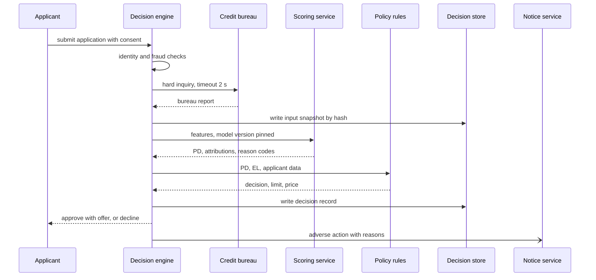

**Reading the diagram.** All calls are synchronous except the notice. The decision engine stores the input snapshot before scoring, so every decision has replayable inputs even if scoring fails midway. The scoring service is called with a pinned model version taken from the registry, and returns PD, attributions and reasons together, so the reasons always explain the same score that drove the decision. The policy then applies cut-offs, limit and pricing rules. If the bureau times out, the application is retried once and then referred to manual review rather than declined, because declining for a system fault would itself be an adverse action that needs a reason. Scaling is not an issue at 6 requests per second; the failure points are the bureau dependency and version mismatches between model and reason catalog.

**Figure 82.6 — Write path: performance, retraining and release.**

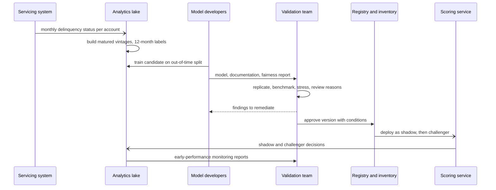

**Reading the diagram.** This path is measured in months. Performance data accumulates monthly; labels mature only after 12 months on book, so each training run uses vintages at least a year old. The validation loop may iterate several times. Approval is recorded in the inventory with any conditions (for example, "not for applicants with thin files"), and deployment follows shadow then challenger stages. Ongoing monitoring sends early-performance reports back to validation, closing the SR 11-7 loop. Failure points: a model deployed without registry approval (blocked by the scoring service, which only loads approved versions), and drift that goes unnoticed because labels are a year away (watch score PSI and early delinquency instead, §70.8).

### 82.5.10 Bottlenecks

1. **Label delay.** Twelve months between decision and label limits how fast any change can be confirmed.
2. **Governance throughput.** Validation of a major model takes weeks to months; tiering by risk (§69.11.2) and automated test reports shorten it without removing independence.
3. **Bureau dependency.** Latency, cost and outages of an external provider sit in the critical path.
4. **Explanation consistency** across model versions: reason-code catalogs must change with the features.

### 82.5.11 Failure scenarios

**Table 82.8 — Credit risk failure scenarios.**

| What fails | Impact | Detection | Recovery | Prevention |
|---|---|---|---|---|
| Label leakage from current bureau data | Inflated offline AUC; poor live performance | Out-of-time gap; leakage audit | Rebuild with point-in-time pulls | Store every pull; retro archives only |
| Population drift (recession, new partner) | PD underestimates risk | Score PSI; early delinquency by vintage | Tighten cut-offs; recalibrate | Stress tests; macro overlays |
| Selection bias from old policy | Overconfident in previously declined segments | Exploration-cell defaults exceed PD | Reweight; extend exploration | Exploration cell; documented limitations |
| Reasons inconsistent with decision | Inaccurate adverse-action notices | Replay test on sampled decisions | Regenerate notices; fix catalog | Same run produces score and reasons |
| Disparity introduced by a new feature | Fair-lending risk | Group metrics in validation and monitoring | Remove or constrain feature | Fairness tests as release gate |
| Unapproved model in production | Governance breach | Serving version not in inventory | Roll back to approved version | Scoring loads only approved versions |
| Bureau outage | Applications stall | Error rate and timeouts | Refer to manual queue; retry | Second bureau as backup |

### 82.5.12 Scaling strategy

**At 10×** (100 million applications or 2 billion prequalification calls a year, around 630 requests per second at peak): bureau rate limits and cost dominate. Cache prequalification decisions per applicant for days, and call the bureau once per applicant per window. The scoring fleet is still small.

**At 100×** (many products, countries and partners): the bottleneck becomes the number of models and the governance around them. Shared feature definitions and reason catalogs, model templates with built-in monotonic constraints and fairness tests, and automated validation evidence (reproducible reports generated by the pipeline) let one validation team cover hundreds of models, with independent humans focused on the highest-risk tier. Each country adds its own rules: GDPR Article 22 limits decisions based solely on automated processing, and the EU AI Act lists creditworthiness assessment as high-risk (§71.13).

### 82.5.13 Trade-offs

**Table 82.9 — Credit risk design trade-offs.**

| Decision | Option chosen | Alternative | Why |
|---|---|---|---|
| Model family | Monotonic GBDT with scorecard benchmark | Deep network | Accuracy close to the best, explanations and validation far easier |
| Explanations | TreeSHAP to reviewed reason codes | Model-agnostic sampling methods | Exact, deterministic and fast enough inline |
| Reject inference | Small exploration cell | Statistical reject inference only | Real outcomes beat unverifiable assumptions |
| Evaluation | Shadow then capped champion–challenger with early proxies | Wait 12 months on full A/B | Faster signal with bounded risk |
| Inputs | Immutable snapshots by hash | Recompute from sources | Exact replay for disputes and audits |
| Bureau failure | Refer to manual review | Decline | A system fault is not a reason to deny credit |

### 82.5.14 Alternative designs

- **Pure scorecard**: simplest to explain and validate, slightly weaker ranking; still common and a valid choice for smaller lenders.
- **Vendor scores as features**: generic bureau scores add signal cheaply but bring their own reason codes, which must be reconciled with the lender's.
- **Cash-flow underwriting** with bank-transaction data (with consent) helps applicants with thin credit files; it adds data-quality and privacy work (§50.8) and new fairness questions.
- **Deep models with post-hoc explanations**: possible, but the explanation must still be specific and accurate, and validators must accept the method; the burden of proof rises.

### 82.5.15 Interview discussion

**Table 82.10 — 45-minute pacing plan for credit risk.**

| Minutes | Focus | What to produce |
|---|---|---|
| 0–5 | Scope | Applications and account reviews; PD label, 12-month window; regulation as a requirement |
| 5–10 | Estimates and economics | 63 requests/s peak; 1 TB/year; EL and break-even PD |
| 10–18 | Architecture | Figure 82.4; snapshot, score, reasons, policy, notice |
| 18–30 | Deep dive: model and reasons | Scorecard baseline, monotonic GBDT, reason codes from attributions |
| 30–38 | Deep dive: data bias and fairness | Reject inference, exploration cell, proxies, less discriminatory alternatives |
| 38–45 | Governance and rollout | Validation, shadow, champion–challenger, early proxies, monitoring |

**Likely follow-ups.**

- *"Why not use the most accurate model?"* Accuracy is one requirement among several; a model whose reasons cannot be stated or defended cannot be used for these decisions.
- *"How do you know the cut-off is right for applicants you decline?"* You do not, without exploration; statistical reject inference is weak.
- *"How do you evaluate a challenger before 12 months?"* Early delinquency proxies, plus approval-rate and score-distribution shifts, with a cap on exposure.
- *"Can you drop protected attributes and be done?"* No; other features can act as proxies, so disparities must be measured with proxy methods and alternatives considered.

**What distinguishes senior and staff answers.** A senior answer designs a correct pipeline with point-in-time features, a calibrated model and reasons. A staff answer treats explainability, fairness and validation as first-class requirements that shape the model choice, quantifies the cost of exploration, separates model from policy ownership, and plans evaluation around a 12-month label.

### 82.5.16 Production considerations

- **Monitoring**: approval rate and score PSI daily; reason-code mix; early delinquency by vintage monthly; PD calibration per band when vintages mature; group fairness metrics quarterly (§70.9.2).
- **Retraining**: typically yearly or on material drift, each time through validation; recalibration of PD levels more often when macro conditions change.
- **Responsible ML**: documented fairness testing, reason-code reviews with compliance, a human review path for referred applications and disputes (§71.14).
- **Security and privacy**: bureau data is highly sensitive; tokenized identifiers, purpose-limited access, retention per policy, deletion workflows where law allows (§50.9).
- **Cost**: bureau fees and credit losses dwarf compute; exploration losses are a planned investment.

## 82.6 Spam detection

### 82.6.1 Problem statement

Design spam filtering for a large email provider with 1.5 billion mailboxes. Every inbound message must end in one of four places: rejected during the SMTP conversation, delivered to the spam folder, delivered to the inbox with a warning (suspected phishing), or delivered to the inbox. The same machinery, with different features, protects chat and messaging products.

**ML formulation.** For each message and recipient, predict the probability that the recipient would consider it unwanted (spam) and, separately, that it is phishing or malware. It is multi-label classification with partly personalized labels: a newsletter one user wants is spam to another. Labels come mostly from users ("Report spam" and "Not spam"), from spam-trap addresses that no person uses, and from analysts. ML is warranted because spammers change content daily, but the strongest signal is not the text at all: it is **who sent it and how others reacted** to that sender's earlier mail.

The distinctive hard problems are **throughput at minimal cost** (billions of messages a day, most of them decided without reading the body), **sender reputation**, **near-duplicate campaign detection**, **noisy and manipulable feedback labels**, and an extreme asymmetry of errors: a missed spam is an annoyance, but a legitimate message in the spam folder (a job offer, a bank alert) may never be seen.

::: industry
**Gmail.** Google has published that its machine-learning and rule-based protections block more than 99.9% of spam, phishing and malware, and that adding TensorFlow models in 2019 blocked about 100 million additional spam messages per day, targeting hard categories such as image-based messages and mail from newly created domains [Kumaran 2019]. In 2023 Google reported that replacing the text vectorizer of Gmail's spam classifier with RETVec, a vectorizer designed to resist character-level manipulation, improved the spam detection rate by 38% over the baseline and reduced the false-positive rate by 19.4% [Bursztein and Zhang 2023]. An earlier Google paper described Gmail's sender-reputation system, which scores senders by authenticated domain using user feedback [Taylor 2006].
*Evidence: Primary* — [Kumaran 2019; Bursztein and Zhang 2023; Taylor 2006]
:::

*Evidence: Illustrative* — the design below is a teaching design, not Gmail's architecture.

### 82.6.2 Functional requirements

1. **Connection-time filtering**: accept, temporarily defer or reject SMTP connections and messages using IP and domain reputation and authentication results.
2. **Message classification**: spam, phishing, malware and legitimate, with per-recipient adjustments (contacts, user filters, past engagement).
3. **Campaign detection**: group near-identical messages across recipients and act on whole campaigns, including moving already-delivered copies out of inboxes.
4. **Feedback**: "Report spam", "Not spam", "Report phishing" and unsubscribe actions, captured as labels.
5. **Sender tools**: postmaster dashboards showing a sender's reputation and spam rate, and an appeal path for blocked senders.
6. **Retraining and evaluation** with daily models and minute-level reputation updates.

### 82.6.3 Non-functional requirements

**Table 82.11 — Spam filtering non-functional requirements.**

| Property | Target | Why |
|---|---|---|
| Throughput | 20 billion inbound messages/day; 470,000/s at peak | Provider scale |
| Latency | Classification p99 ≤ 200 ms of the delivery path; delivery p99 within seconds | Users expect mail at once; SMTP allows retries, so latency is soft |
| False positives | ≤ 0.01% of legitimate mail to spam folder, on human-graded samples | A lost legitimate message is the costliest error |
| Catch rate | ≥ 99.9% of spam kept out of inboxes | Matches the level providers publish |
| Reputation freshness | Sender reputation reflects new reports within 5 minutes | Campaigns burst and finish within hours |
| Model freshness | Content models retrained daily; emergency rules in minutes | Content changes daily |
| Availability | Mail is never lost because a classifier is down (fail to deliver-with-defaults, or defer) | SMTP retry semantics allow brief deferral |
| Privacy | Message content processed by automated systems only; human graders see content only with consent or donated samples | Email is personal data (§50.8) |

### 82.6.4 Capacity estimation

::: example
**Worked example — Message volume and the classification fleet.** Assumptions: 20 billion inbound messages per day; peak factor 2; connection-time reputation rejects half of them before the body is read; 40% of the 10 billion classified messages are spam; feature extraction and the main model cost $c = 3$ ms vCPU per message; 32-vCPU nodes at $u = 0.5$; four regions, any three must carry peak; 5% of messages are uncertain and go to a heavier neural model that sustains 2,000 messages/s per GPU at $u = 0.6$.

1. Inbound: $2 \times 10^{10}/86{,}400 = 231{,}481$/s average; **462,963/s peak**.
2. Classified: $10^{10}/86{,}400 = 115{,}741$/s average; 231,481/s peak.
3. Main fleet by §60.11.1: busy vCPU $= 231{,}481 \times 0.003 = 694$; at $u = 0.5$, 1,389 vCPU $= 43.4$, so 44 nodes. With one region lost: $44 \times 4/3 = 58.7$, so **60 nodes** (15 per region).
4. Heavy model: $231{,}481 \times 0.05 = 11{,}574$/s; GPUs $= 11{,}574/(2{,}000 \times 0.6) = 9.6$, so 10 GPUs plus redundancy.
5. Legitimate mail: $10^{10} \times 0.6 = 6 \times 10^9$/day. At a 0.05% false-positive rate, **3 million** legitimate messages a day go to spam folders; at 0.01%, 600,000.

**Interpretation.** Half the traffic is rejected for the price of a reputation lookup, and a cascade (§60.13.2) keeps the expensive model to 5% of the rest. A false-positive rate that sounds tiny still misplaces hundreds of thousands of wanted messages daily. **Engineering implication.** Spend model capacity on reducing false positives, not on catching the last fraction of spam, and measure false positives on graded samples, since users rarely report them.
:::

::: example
**Worked example — Reputation and campaign state.** Assumptions: 1 billion active sender keys (IP addresses, /24 prefixes, authenticated domains, URL domains) at 200 bytes of decayed counters each; 2 billion messages a day from bulk senders are fingerprinted with 128 MinHash values of 4 bytes; 15 million user spam reports a day.

1. Reputation store: $10^9 \times 200 = 200$ GB, held in memory and replicated per region.
2. MinHash signatures: $128 \times 4 = 512$ bytes; $2 \times 10^9 \times 512 = 1.02$ TB per day, of which only a 24-hour window is kept in the LSH index.
3. Reports: $1.5 \times 10^7/86{,}400 = 174$/s average, each updating the reputation of 3–5 keys.

**Interpretation.** Reputation fits in memory; campaign fingerprints for one day are a terabyte and need a partitioned index. **Engineering implication.** Fingerprint only messages that could be campaigns (bulk senders, many recipients), and expire state aggressively.
:::

### 82.6.5 API design

```text
# Internal, called by the SMTP edge (per connection and per message)
rpc CheckConnection(ip, helo, tls)            -> { ACCEPT | DEFER(4xx) | REJECT(5xx), reason }
rpc ClassifyMessage(msg_ref, envelope, auth: {spf, dkim_domains, dmarc}, recipients[])
    -> { per_recipient: [{ rcpt, verdict: INBOX | SPAM | PHISH_WARN | QUARANTINE, score }],
         campaign_id?, model_version }

# Feedback from mail clients
POST /v1/feedback   { message_id, user_id, action: REPORT_SPAM | NOT_SPAM | REPORT_PHISH | UNSUBSCRIBE,
                      folder_before, ts }

# Retroactive campaign action
rpc ActOnCampaign(campaign_id, verdict, reason)  -> { messages_moved }

# Sender-facing postmaster API
GET /v1/postmaster/domains/{domain}/reputation  -> { spam_rate_7d, auth_pass_rate, reputation_band }
```

What to notice: classification returns a verdict *per recipient*, because personal signals (contacts, filters) differ. Feedback records the folder the message was in, which tells the trainer whether it is a false-negative report (from the inbox) or a false-positive report (from the spam folder). Campaign actions are a separate RPC because they act on messages already delivered.

### 82.6.6 Data model and database schema

```text
Reputation store (in-memory KV, per region, async cross-region replication)
  key: "rep:dkim:{domain}" | "rep:ip:{ip}" | "rep:ip24:{prefix}" | "rep:url:{domain}"
  value: { msgs_ewma, reports_ewma, not_spam_ewma, trap_hits_ewma, bounces_ewma,
           first_seen_ts, updated_ts }           # exponentially decayed counts, half-life 1 day and 30 days

LSH campaign index (partitioned by band hash, 24 h TTL)
  key: (band_index, band_hash) -> [ (message_id, campaign_id, ts) ]
  campaign table: campaign_id -> { size, first_seen, report_count, verdict, verdict_source }

Feedback events (log, then lakehouse)
  { message_id, user_id_hash, action, folder_before, ts, reporter_trust }

Training example
  { message_id, ts, features_as_served, label, label_source: REPORT | TRAP | ANALYST | GRADED,
    label_weight, recipient_segment }
```

Labels arrive within minutes to days (much faster than the chargebacks of §82.4), but they are noisy and self-selected. Each label carries its source and a weight so that training can trust a graded sample more than a single user's click (§63.10).

### 82.6.7 High-level architecture

**Figure 82.7 — Layered spam-filtering pipeline.**

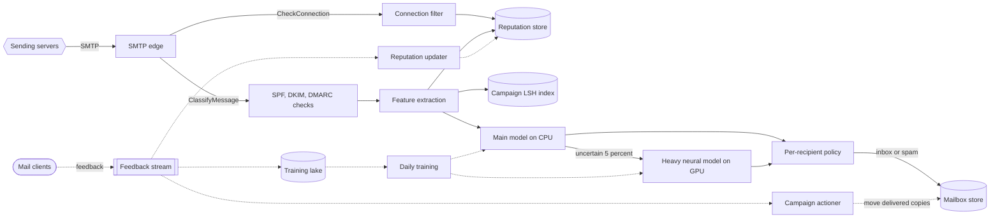

**Reading the diagram.** The synchronous path runs left to right inside the SMTP transaction. The connection filter rejects or defers using IP reputation before the body is transmitted, which is where half the traffic ends. Authentication checks establish which domains are proven (SPF for the envelope sender's IP authorization, DKIM signatures, DMARC alignment) [RFC 7208; RFC 6376; RFC 7489]; reputation is then looked up by *authenticated* identity, so a spammer cannot borrow a bank's reputation by forging its address. Feature extraction combines reputation, content, URLs and campaign membership from the LSH index; the main CPU model decides most messages and sends the uncertain 5% to a heavier GPU model. The per-recipient policy applies contacts, filters and engagement before delivering to the mailbox store. The asynchronous loop (dotted) carries feedback into reputation within minutes, into campaign actions that move already-delivered copies, and into the training lake for daily retraining. Failure points: the reputation store (fall back to cached regional copy), the heavy model (use the main model's verdict), and the campaign actioner (a wrong verdict moves millions of messages; it needs safeguards). Scaling: every stage is stateless except the reputation store and LSH index, which partition by key.

### 82.6.8 Detailed component design

#### Sender reputation

Reputation answers "how did recipients react to this sender's recent mail?" It is the cheapest and strongest feature, and the one spammers attack most.

1. **Keys.** Reputation is kept for the connecting IP, its /24 prefix, each DKIM-authenticated domain, the DMARC-aligned From domain and every URL domain in the body. Keying on authenticated domains rather than IPs follows Taylor's published Gmail design, because shared and changing IPs make IP reputation noisy [Taylor 2006].
2. **Signals.** Message volume, spam reports, "not spam" rescues, spam-trap hits, bounces to non-existent users (a sign of purchased lists) and engagement, each as exponentially decayed counts with a fast (1-day) and slow (30-day) half-life.
3. **Smoothing for new senders.** A domain first seen today has no history; a Beta prior shrinks its report rate toward the population average for new domains, which is itself worse than average. Spammers register new domains constantly, so "domain age" is a feature in its own right.
4. **Heavy hitters and distinct counts.** Count-Min sketches find senders whose volume suddenly spikes and HyperLogLog counts distinct recipients per sender without storing them (§17.5–§17.6).
5. **Published sender requirements** make reputation enforceable: as of 2024, Google asks senders of more than 5,000 messages a day to Gmail to authenticate with SPF, DKIM and DMARC, offer one-click unsubscribe and keep their user-reported spam rate low [Google 2024].

#### Near-duplicate campaign detection

Spam arrives in campaigns: millions of copies with small variations (the recipient's name, a random string, a rotated URL) to defeat exact hashing. Grouping copies lets one decision cover the campaign: when the first few hundred recipients report it, or one analyst labels it, the rest are handled, including copies already delivered.

The pipeline normalizes each candidate message (decode HTML and MIME, strip tracking parameters and personalization tokens, canonicalize URLs), splits it into word shingles and computes a 128-value MinHash signature, which estimates Jaccard similarity between shingle sets (§75.5.3) [Broder 1997]. Locality-sensitive hashing then splits the signature into $b$ bands of $r$ values; two messages become candidates if any band matches exactly.

::: formula
**Probability that two messages become LSH candidates**

$$P(s) = 1 - \left(1 - s^{r}\right)^{b} \qquad s_{\text{threshold}} \approx \left(\frac{1}{b}\right)^{1/r}$$

| Symbol | Meaning | Units |
|---|---|---|
| $s$ | Jaccard similarity of the two messages' shingle sets | fraction |
| $b$ | Number of bands | count |
| $r$ | MinHash values per band ($b \times r$ = signature length) | count |
| $P(s)$ | Probability that at least one band matches | probability |
| $s_{\text{threshold}}$ | Similarity at which $P$ rises most steeply | fraction |
:::

::: example
**Worked example — Choosing bands for 128 MinHash values.** Use $b = 16$, $r = 8$.

1. $s_{\text{threshold}} = (1/16)^{1/8} = 0.707$.
2. $s = 0.9$: $0.9^8 = 0.430$; $1 - (1 - 0.430)^{16} = 0.9999$.
3. $s = 0.8$: $P = 0.947$. $s = 0.7$: $P = 0.613$.
4. $s = 0.5$: $0.5^8 = 0.0039$; $P = 1 - 0.9961^{16} = 0.061$. $s = 0.3$: $P = 0.001$.
5. With $b = 32$, $r = 4$ instead, the threshold falls to $(1/32)^{1/4} = 0.42$ and $P(0.5) = 0.873$: far more candidate pairs.

**Interpretation.** With 16 bands of 8, copies of one campaign (similarity above 0.9) almost always collide, while unrelated messages that share boilerplate (0.3–0.5) rarely do. **Engineering implication.** Choose $(b, r)$ so that the steep part of the curve sits between "same campaign" and "same template," then confirm candidates by computing the actual signature similarity; a campaign verdict acts on millions of messages, so false merges are costly. SimHash with Hamming-distance lookup tables is an alternative with smaller fingerprints (§52.10.8) [Charikar 2002; Manku et al. 2007].
:::

Campaign verdicts are guarded: an automated verdict requires reports from many distinct, trusted reporters, and actions above a size threshold go to an analyst, because a false merge with a legitimate newsletter would hide it from millions.

#### Feedback labels, models and evaluation

**Label quality.** User feedback is plentiful but noisy. Some users report newsletters they subscribed to instead of unsubscribing; spammers control accounts that click "Not spam" on their own campaigns to rescue them. Each reporter therefore has a trust score (agreement with later consensus and graders, account age, past behavior), and labels are weighted by it (§63.10). Spam traps provide clean positives. **Selection bias** is strong: users browse the inbox, so missed spam is reported often, but few users look in the spam folder, so false positives are under-reported. A daily random sample of spam-folder messages from consenting or donated accounts is graded by people to estimate the false-positive rate directly.

**Models.** The baseline is a linear model over hashed tokens and reputation features, in the tradition of Bayesian filters [Graham 2002]. The production main model is gradient-boosted trees over reputation, authentication, URL, structure and campaign features plus a compact text embedding; the heavy model is a small transformer with a character-robust vectorizer, invoked for uncertain messages. Adversaries obfuscate text with look-alike characters, invisible characters and text in images, so robustness to character perturbations and image OCR features matter more than raw accuracy on yesterday's spam [Bursztein and Zhang 2023]. Content models retrain daily; reputation, the fast loop, adapts in minutes.

**Evaluation.** Offline: on a time-split test, the catch rate at a fixed false-positive rate on graded data, sliced by language, sender type and campaign. Online: an A/B test randomized by recipient account (§57.14.3), measuring "Not spam" rescues per 1,000 spam-folder messages (false-positive proxy), "Report spam" per 1,000 inbox messages (false-negative proxy) and graded false-positive rate as a guardrail. Campaigns cross treatment groups, so reputation updates from one arm leak into the other; keep the reputation system shared and test content models only, or accept the dilution.

### 82.6.9 Data flow

**Figure 82.8 — Read path: classifying one inbound message.**

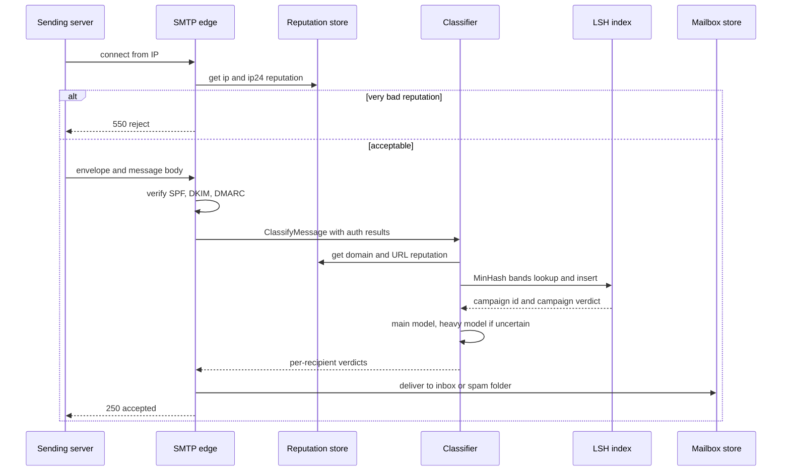

**Reading the diagram.** Everything here is synchronous within the SMTP session, but SMTP tolerates seconds and lets senders retry, so if the classifier is overloaded the edge can return a temporary 4xx deferral instead of guessing. The cheapest decision (IP reputation) comes first and rejects before the body is sent, saving bandwidth. The LSH lookup both reads (is this a known campaign with a verdict?) and inserts (add this message to the index). The message is accepted only after it is durably stored in the right folder, so a classifier failure never loses mail. Failure points: reputation store latency (use the regional cache), heavy-model overload (keep the main model's verdict) and LSH hot buckets for huge campaigns (cap bucket size and sample). Scaling: edges and classifiers scale horizontally; the reputation store and LSH index scale by partitioning.

**Figure 82.9 — Write path: feedback to reputation, campaigns and training.**

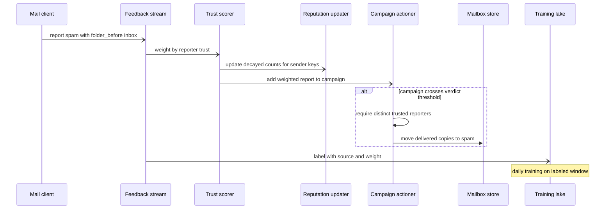

**Reading the diagram.** Feedback travels asynchronously. The trust scorer weights each report before it touches reputation, so a botnet's "Not spam" votes count for little. Reputation counters update within minutes, which changes the next message's verdict immediately; this is the fastest learning loop in the system. The campaign actioner accumulates weighted reports per campaign and, when a threshold of distinct trusted reporters is reached, moves copies already delivered; large actions are reviewed. Labels land in the lake with source and weight for the daily training job. Failure points: a bad campaign verdict (bulk misplacement; make actions reversible), report floods from compromised accounts, and lag in the feedback stream (§31.7.3). Scaling: partition the feedback stream by sender key so reputation updates for one sender are serialized.

### 82.6.10 Bottlenecks

1. **Reputation lookups**: several keys per message at 230,000 messages per second; batch the gets and cache hot senders at the edge.
2. **LSH index hot buckets** for multi-million-copy campaigns; cap and sample.
3. **Heavy-model share**: if adversaries push more messages into the uncertain band, GPU load rises; autoscale and cap, defaulting to the main model's verdict.
4. **Graded labels**: human grading of false positives is slow and limited by privacy rules.

### 82.6.11 Failure scenarios

**Table 82.12 — Spam detection failure scenarios.**

| What fails | Impact | Detection | Recovery | Prevention |
|---|---|---|---|---|
| Legitimate sender sent to spam (bank alerts) | Users miss important mail | Rescue rate per sender; postmaster complaints | Restore sender; move messages back | Graded FP sampling; reputation floors for authenticated senders with long history |
| Compromised good account sends spam | Reputation laundering | Spike in reports for a trusted sender | Per-account throttling; quick reputation drop | Fast half-life; per-sender anomaly detection |
| Botnet "Not spam" votes | Campaign rescued | Rescues from low-trust or new accounts | Discount votes; re-label | Reporter trust weighting |
| Campaign mutation | Copies escape cluster | Report rate rising on new near-variants | Lower band threshold for that campaign | Normalization of templates; URL reputation |
| Wrong campaign merge | Newsletter hidden from millions | Rescue spike after campaign action | Reverse action | Confirmation by true similarity; analyst gate for large actions |
| Model regression after retrain | FP rate jumps | Graded FP guardrail; canary rescues | Roll back model | Canary on 1% of recipients (§66.12) |
| Feedback loop | Messages in spam folder never get positive engagement, so senders decline further | Long-tail senders' reputation decays without reports | Exploration: deliver a small sample to inbox for borderline senders | Treat absence of engagement as weak evidence |
| Classifier outage | Mail delayed | Deferral rate | Deliver using reputation-only rules | Capacity headroom; regional failover |

### 82.6.12 Scaling strategy

**At 10×** (200 billion messages a day, or messaging traffic of similar size): reject more at connection time, fingerprint only bulk-shaped traffic, and push lightweight models to the edge. The main CPU fleet grows to several hundred nodes, so model cost per message becomes the main lever: distill the heavy model into the main model and shrink features.

**At 100×**: per-message work must approach a reputation lookup plus a tiny model. Personalization moves partly on-device for messaging, and campaign detection becomes sharded by language and region, with cross-shard merging of only the largest campaigns.

### 82.6.13 Trade-offs

**Table 82.13 — Spam detection design trade-offs.**

| Decision | Option chosen | Alternative | Why |
|---|---|---|---|
| Primary signal | Authenticated-domain reputation | Content only | Reputation is cheap, strong and harder to fake once authenticated |
| Cascade | CPU model for all, GPU model for 5% | One large model for all | Keeps cost per message low |
| Campaign grouping | MinHash LSH with confirmation | Exact hashes | Survives small mutations |
| Labels | Weighted user feedback plus graded samples | Raw user clicks | Reports are noisy and manipulable |
| Error asymmetry | Optimize catch rate at a fixed low FP rate | Maximize accuracy | Lost legitimate mail is far costlier |
| Overload | Defer with SMTP 4xx | Deliver unclassified | Senders retry; users are protected |

### 82.6.14 Alternative designs

- **Rules and blocklists only** (DNS blocklists, regex rules): cheap and transparent, but brittle against daily content changes.
- **Per-user models only**: capture personal preference but learn slowly and cannot see campaigns across users; the chosen design combines a global model with per-recipient adjustments.
- **Large language models for every message**: strong on subtle phishing but far too costly at this volume; reserve for analyst tooling and the hardest few messages.

### 82.6.15 Interview discussion

**Table 82.14 — 45-minute pacing plan for spam detection.**

| Minutes | Focus | What to produce |
|---|---|---|
| 0–5 | Scope | Verdicts, label sources, FP asymmetry |
| 5–10 | Estimates | 463,000/s inbound peak; 60 CPU nodes; 3 million FPs at 0.05% |
| 10–18 | Architecture | Figure 82.7; layered funnel and cascade |
| 18–28 | Deep dive: reputation | Authenticated keys, decayed counts, new-sender priors |
| 28–37 | Deep dive: campaigns and labels | MinHash LSH, verdict propagation, trust-weighted feedback |
| 37–45 | Adversaries and evaluation | Obfuscation, botnet votes, graded FP, A/B by recipient |

**Likely follow-ups.**

- *"Why look at the sender before the content?"* Most spam is decided from reputation alone, before the body is transmitted, at a fraction of the cost.
- *"How do you measure false positives if users never look in the spam folder?"* Graded random samples from the spam folder under privacy rules.
- *"What stops spammers from clicking 'Not spam'?"* Trust-weighted feedback, distinct-reporter thresholds, and account reputation.
- *"How do you catch a campaign that changes every copy?"* Normalization plus MinHash LSH on shingles, and URL-domain reputation, which changes more slowly than text.

**What distinguishes senior and staff answers.** A senior answer builds a cascade with reputation and a content model. A staff answer quantifies the false-positive volume and designs measurement around it, keys reputation on authenticated identity, sizes LSH bands deliberately, treats feedback as adversarial data, and notices that reputation updates leak across A/B arms.

### 82.6.16 Production considerations

- **Monitoring**: catch-rate and rescue-rate proxies per hour, graded FP rate daily, reputation distribution, campaign action volume, deferral rate (§70.12).
- **Retraining**: content models daily with canary; reputation continuous; emergency rules for outbreaks.
- **Responsible ML and senders**: publish sender requirements, offer postmaster visibility and an appeal path, and avoid penalizing small senders for lack of history alone (§71.3).
- **Privacy and security**: automated processing of content; human access limited to donated or consented samples; feature logs minimized and short-lived (§50.10).
- **Cost**: connection-time rejection and the cascade set cost per message; the heavy model share is the knob to watch.

## 82.7 Content moderation

### 82.7.1 Problem statement

Design content moderation for a social network where users post text, images, videos and comments. The platform's **policies** (its community standards) prohibit categories of content such as child sexual abuse material, terrorist propaganda, credible threats, hate speech, harassment, adult nudity and spam; national laws add obligations that differ by country. For every item the system must decide whether to allow it, remove it, restrict it (age-gate, reduce distribution, withhold in one country) or send it to a human, and it must let users report content and appeal decisions.

**ML formulation.** For each item and each policy, predict the probability that it violates that policy version: a multi-label, multi-modal classification problem. Labels come from trained human reviewers applying written guidelines, from user reports (noisy, adversarial), and from **hash databases** of previously confirmed content. ML is warranted because volume rules out human review of everything, but ML alone is not trusted for the hardest calls, so the system is a **human–machine pipeline** whose largest cost is people.

The distinctive hard problem is orchestration: **hash matching** for known content, **multimodal classifiers** and **LLM policy classifiers** for new content, **human review queues** sized for service levels, **policy versioning** that changes the meaning of labels, **appeals**, **regional law**, **reviewer well-being**, and **latency tiers** that decide what must be stopped before publication and what can be handled after.

*Evidence: Illustrative* — a teaching design; published tools (PhotoDNA, PDQ, Llama Guard) and laws (the EU Digital Services Act) are cited from their published descriptions.

### 82.7.2 Functional requirements

1. **Pre-publish checks** on uploads: block known severe content by hash match; hold or block high-confidence severe violations.
2. **Post-publish classification** of all items per policy and modality; actions: remove, restrict, reduce distribution, label, or send to review.
3. **Human review** with queues by policy, severity, language and region; tools that show context and policy guidance.
4. **User reports** and **appeals**, with a statement of reasons to the affected user.
5. **Policy management**: versioned policies and guidelines; classifiers and prompts tied to versions; re-review when policies change.
6. **Regional compliance**: country-specific restrictions, legal-order handling, transparency reporting.
7. **Hash sharing**: add confirmed severe content to internal databases and participate in industry hash-sharing programs where appropriate.

### 82.7.3 Non-functional requirements

**Table 82.15 — Content moderation non-functional requirements.**

| Property | Target | Why |
|---|---|---|
| Pre-publish latency | Hash match and fast text/image check p99 ≤ 300 ms of upload | Must not make posting feel slow |
| Post-publish detection | p95 ≤ 10 min for classifier actions on new items | Harmful views accumulate per minute online |
| Severe-report review | 99% picked up within 2 min for imminent-harm queues; legal deadlines met per country | Safety and law (for example, 24 hours for manifestly unlawful content under Germany's NetzDG [NetzDG 2017]) |
| Quality | Per-policy precision ≥ 90% for automated removal; recall tracked as **prevalence** (share of views that were violating) | Wrongful removals harm speech; prevalence measures user exposure |
| Availability | 99.95% for pre-publish checks; if unavailable, publish with post-publish backstop except for severe-risk surfaces | Moderation outage must not halt the product, nor open a gap for severe harm |
| Appeals | Decision on appeal within days; every removal has a statement of reasons | EU DSA Articles 17 and 20 |
| Reviewer well-being | Exposure limits per shift; occupancy ≤ 75% on graphic queues | People are the system's most important and vulnerable component |
| Auditability | Every action records policy version, model or reviewer, and evidence | Transparency reports, appeals, regulators |

### 82.7.4 Capacity estimation

::: example
**Worked example — Item volume and classifier fleets.** Assumptions: per day, 500 million posts, 3 billion comments, 300 million images and 20 million videos of 60 s average; peak factor 2; videos sampled at 1 frame per second; a multi-task image model sustains 2,000 images/s per GPU and a text model 5,000 items/s per GPU, both at $u = 0.6$ (§60.11.1); 1% of text items are borderline and go to an LLM policy classifier with 400 input and 20 output tokens each, at a small-model API price of \$0.15 per million input and \$0.60 per million output tokens (as of 2026, Ch 79 assumptions).

1. Items: $5 \times 10^8 + 3 \times 10^9 + 3 \times 10^8 + 2 \times 10^7 = 3.82 \times 10^9$ per day.
2. Text: $3.5 \times 10^9/86{,}400 = 40{,}509$/s; peak 81,019/s; GPUs $= 81{,}019/(5{,}000 \times 0.6) = 27.0$, so 27–28.
3. Images: peak $2 \times 3 \times 10^8/86{,}400 = 6{,}944$/s; GPUs $= 6{,}944/1{,}200 = 5.8$, so 6.
4. Video frames: $2 \times 10^7 \times 60 = 1.2 \times 10^9$ per day; peak 27,778/s; GPUs $= 23.1$, so 24 (plus audio transcription, not sized here).
5. LLM classifier: $3.5 \times 10^7$ items/day $= 405$/s average; tokens $1.4 \times 10^{10}$ input and $7 \times 10^8$ output per day; cost $14{,}000 \times 0.15 + 700 \times 0.60 = \$2{,}520$ per day, about \$0.92 million per year.
6. Decision log at 300 bytes per item: $3.82 \times 10^9 \times 300 = 1.15$ TB/day, about 418 TB/year.

**Interpretation.** Machine classification of every item needs about 60 GPUs at peak, and an LLM on the 1% borderline slice costs under a million dollars a year. **Engineering implication.** Compute is not the constraint; the decision log, and, as the next example shows, human review, are.
:::

::: example
**Worked example — Human review workload.** Assumptions: 3 million items a day reach human review after automation (user reports not auto-resolved, borderline classifier scores, appeals and quality samples); average handle time 45 s; 1,380 productive review hours per reviewer per year (230 days × 6 h, leaving time for breaks, training and well-being).

1. Review hours: $3 \times 10^6 \times 45/3{,}600 = 37{,}500$ hours per day.
2. Reviewers: $37{,}500 \times 365/1{,}380 = 9{,}918$, about **10,000 full-time reviewers**.
3. Automating 10% more of the review volume saves $0.1 \times 9{,}918 \approx 990$ reviewers.

**Interpretation.** Human review is the dominant cost and the dominant capacity constraint, far above GPUs. **Engineering implication.** Classifier work should be judged by how many review hours it removes at equal accuracy, and queue routing (by language, policy and skill) matters as much as model accuracy.
:::

### 82.7.5 API design

```text
rpc PrePublishCheck(item_ref, modality, author_id, surface, country)
    -> { ALLOW | BLOCK | HOLD, matched_hash_set?, policy?, latency_ms }      # deadline 300 ms
rpc ClassifyItem(item_ref, modality, context)                                 # async, post-publish
    -> { scores: { policy_id@version: p }, action, route_to_queue? }
POST /v1/reports   { item_id, reporter_id, policy_hint, free_text? }
POST /v1/appeals   { item_id, user_id, action_id, statement }
    -> { appeal_id, expected_by }
rpc SubmitReview(task_id, reviewer_id, decision: { violates: bool, policy_id@version, action },
                 time_spent_s, confidence)
GET  /v1/actions/{action_id}/statement   -> { policy, automated: bool, reviewed_by_human: bool, how_to_appeal }
```

What to notice: every score and decision names a **policy version** (`policy_id@version`), so labels, models and statements of reasons stay interpretable after a policy changes. The statement-of-reasons endpoint records whether the decision was automated, which the DSA's Article 17 asks platforms to state [EU 2022].

### 82.7.6 Data model and database schema

```sql
CREATE TABLE policies (
  policy_id VARCHAR(32), version INT, effective_from TIMESTAMP,
  definition_ref VARCHAR(128),           -- guidelines document, examples, LLM prompt
  regions VARCHAR(256),                  -- global or list of country codes
  PRIMARY KEY (policy_id, version)
);
CREATE TABLE actions (
  action_id VARCHAR(32) PRIMARY KEY, item_id VARCHAR(32), policy_id VARCHAR(32), policy_version INT,
  action VARCHAR(16),                    -- REMOVE | RESTRICT | AGE_GATE | GEO_WITHHOLD | LABEL
  scope VARCHAR(64),                     -- global or country codes
  source VARCHAR(16),                    -- HASH | MODEL | LLM | REVIEWER | APPEAL
  model_version VARCHAR(32), reviewer_id_hash VARCHAR(64), created_at TIMESTAMP,
  reversed_by VARCHAR(32)                -- appeal or re-review that overturned it
);
CREATE TABLE review_tasks (
  task_id VARCHAR(32) PRIMARY KEY, item_id VARCHAR(32), queue VARCHAR(64),  -- policy+severity+language
  priority INT, enqueued_at TIMESTAMP, sla_at TIMESTAMP, assigned_to VARCHAR(64), state VARCHAR(16)
);
```

**Hash sets** are stored per source and severity: PhotoDNA and PDQ hashes for images, video hashes, and text hashes, in an in-memory index that supports Hamming-distance search. A **training example** is an item's features as served, plus a label with its policy version, label source (reviewer, appeal, hash, report) and reviewer agreement. When a policy version changes, labels under the old version are not silently reused: they are re-reviewed on a sample, mapped where the change is narrow, or retired.

### 82.7.7 High-level architecture

**Figure 82.10 — Content moderation platform.**

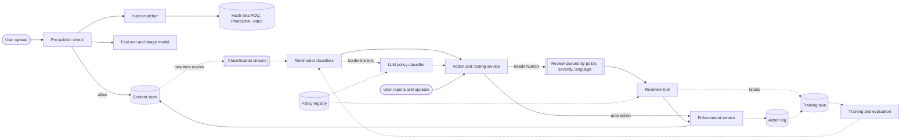

**Reading the diagram.** The pre-publish path (solid, at upload) checks the item against hash sets of known violating content and a fast classifier; it can block, hold or allow publication. Everything else runs after publication. New items flow through a classification stream to multimodal classifiers (text, image, video frames, audio transcripts), which send only borderline text to an LLM policy classifier that reads the policy text directly. The action and routing service combines scores, author history, reports and policy thresholds: high-confidence violations are enforced automatically; uncertain or high-severity items go to review queues partitioned by policy, severity and language. Reviewers decide in a tool that shows the relevant policy version; decisions flow to enforcement and, as labels, to the training lake. The policy registry feeds both the LLM's prompt and the reviewers' guidelines, keeping machine and human on the same version. Failure points: the pre-publish path (fail open for low-risk surfaces with post-publish backstop), queue backlogs, and a policy change that leaves models on the old definition. Scaling: classifiers scale with GPUs; review scales with people and routing.

### 82.7.8 Detailed component design

#### Hash matching for known content

Much of the most severe content is re-uploaded copies of material already identified. **Perceptual hashes** map an image to a short fingerprint that changes little under resizing, re-encoding or small edits, so copies can be found by Hamming distance rather than exact equality. Microsoft's **PhotoDNA**, developed with Dartmouth College, is widely used to find known child sexual abuse imagery [Microsoft PhotoDNA]. Facebook open-sourced **PDQ**, a 256-bit image hash, and **TMK+PDQF** for video in 2019 [Facebook 2019]; matches are declared below a Hamming-distance threshold of roughly 30 of 256 bits [Dalins et al. 2019]. Industry programs share hashes so that a platform can block content another platform has confirmed, without exchanging the content itself.

1. On upload, compute PDQ (and PhotoDNA where licensed) and look up all hashes within the threshold, using multi-index tables in the style of SimHash lookup (§52.10.8).
2. A match against a severe set blocks before publication and triggers legally required reporting; a match against a lower-severity set routes the item to its usual action.
3. When reviewers confirm new severe content, its hash is added within minutes and a **retroactive sweep** searches existing content.
4. Thresholds trade misses (edited copies) against false matches (unrelated images); severe sets use conservative thresholds plus human confirmation of novel matches.

#### Classifiers, LLM policy classifiers and policy versioning

**Multimodal classifiers** produce per-policy scores from text, image, frame and audio-transcript encoders, often with a shared representation of the whole post (text plus image plus context), because many violations are only visible in combination: a harmless photo with a threatening caption. They are trained on reviewer labels with the techniques of Chapter 63: aggregated labels with agreement measures (§63.6), active learning to find rare positives (§63.9) and label-noise detection (§63.10).

**LLM policy classifiers** read the policy text and the item and return a label and a rationale. Llama Guard showed an LLM fine-tuned as a safety classifier over a taxonomy that can be changed in the prompt [Inan et al. 2023]; OpenAI described using GPT-4 to apply a written policy, allowing policy changes to be tested in hours rather than months by comparing model and expert labels on the same examples [OpenAI 2023]. Their strength is **policy agility**: when a policy changes, the prompt changes the same day, whereas a classifier needs new labels. Their weaknesses are cost, latency, prompt-injection risk from user text (§78.13) and inconsistency, so they are used on the borderline slice, calibrated against expert labels (§78.7.3), and versioned with the policy.

**Policy versioning** is a data problem. A policy change (for example, narrowing what counts as a prohibited "threat") changes the meaning of every past label. The registry stores each version with guidelines, examples and prompt; the rollout of a new version follows three steps: (1) experts label a golden set under the new version; (2) the LLM classifier and current models are evaluated against it, and thresholds are reset; (3) classifiers are retrained on re-labeled data, with old labels mapped or retired.

#### Human review: queues, capacity and well-being

Review queues are split by policy, severity, language and region so that reviewers have the right skills and context. Each queue has a service level (pick-up time) and is staffed with the Erlang C model of §4.10.4, with an additional cap on **occupancy**, because a reviewer of graphic content who is busy 95% of the time is neither safe nor accurate.

```python
import math

def erlang_c(c, a):
    """Probability that an arriving item waits (M/M/c, §4.10.4); a = offered load."""
    top = a**c / math.factorial(c) * c / (c - a)
    return top / (sum(a**k / math.factorial(k) for k in range(c)) + top)

def reviewers_needed(per_hour, aht_s, sla_s, target, max_occupancy):
    """Smallest c meeting the pick-up SLA and the wellbeing occupancy cap."""
    lam, mu = per_hour / 3600, 1 / aht_s
    a = lam / mu
    c = max(math.floor(a) + 1, math.ceil(a / max_occupancy))
    while erlang_c(c, a) * math.exp(-(c * mu - lam) * sla_s) > 1 - target:
        c += 1
    return c, a, erlang_c(c, a) * math.exp(-(c * mu - lam) * sla_s)

# Severe-harm queue for one language at its peak hour; 2-minute handle time;
# 99% of items picked up within 2 minutes; reviewers busy at most 75% of the time.
for per_hour in (60, 300, 1200):
    c, a, p = reviewers_needed(per_hour, aht_s=120, sla_s=120, target=0.99,
                               max_occupancy=0.75)
    print(f"{per_hour:>5}/h  load={a:5.1f}  reviewers={c:>3}  "
          f"occupancy={a / c:.0%}  P(wait>2 min)={p:.4f}")
```

Output (`python3`):

```text
   60/h  load=  2.0  reviewers=  5  occupancy=40%  P(wait>2 min)=0.0030
  300/h  load= 10.0  reviewers= 14  occupancy=71%  P(wait>2 min)=0.0032
 1200/h  load= 40.0  reviewers= 54  occupancy=74%  P(wait>2 min)=0.0000
```

What to notice:

- A small queue (one less common language at 60 items an hour) needs 5 reviewers for 2 reviewers' worth of work, 40% occupancy, because the service level, not the workload, sets staffing. Fragmenting queues by language and policy is expensive; cross-train reviewers and pool small queues where policy and law allow (§4.10.4).
- For the largest queue the occupancy cap, not the service level, decides: 54 reviewers instead of the 44 that Erlang C alone would allow.
- These are peak-hour numbers for one queue; a 24-hour, 7-day roster multiplies headcount by shift coverage and shrinkage.

**Reviewer well-being** is a design requirement, not a perk. Measures include exposure limits and rotation off graphic queues, tools that blur or gray-scale images and mute audio by default until the reviewer chooses to see more, hash and classifier pre-screening so that people see fewer severe items, and access to counseling (§63.14.3). Research has documented psychological harm among moderators [Steiger et al. 2021]. Well-being also affects quality: tired reviewers disagree more, which shows up in agreement metrics.

#### Appeals, regional law and evaluation

**Appeals** send the item to a different reviewer, often more senior, who sees the original decision and the user's statement; overturn rates per policy and per model are quality signals, and overturned decisions become corrected labels. In the EU, the DSA requires a statement of reasons for restrictions (Art. 17), an internal complaint-handling system (Art. 20) and access to out-of-court dispute settlement (Art. 21) [EU 2022].

**Regional law** makes enforcement scoped: content legal in one country may be unlawful in another, so actions carry a scope (global or a list of countries) and enforcement applies **geo-withholding** where the policy violation is legal-only. Legal orders enter through a separate, audited workflow.

**Evaluation** has two levels. Offline: per-policy precision and recall on golden sets labeled by experts, with agreement between experts as the ceiling (§63.6). Online: **prevalence**, the estimated share of content views that were violating, measured by reviewing a random sample of viewed content, as Meta reports in its transparency reports [Meta Transparency Center]; plus appeal overturn rates and report volumes. A/B tests of moderation models randomize by item or author and use reviewer-labeled samples as outcomes (§57.14).

**Table 82.16 — Latency tiers.**

| Tier | When | Methods | Example |
|---|---|---|---|
| 0 Pre-publish | Before visible, ≤ 300 ms | Hash match on severe sets; fast classifiers for severe policies | Known abuse imagery blocked at upload |
| 1 Near-real-time | Minutes after publishing | Multimodal classifiers; LLM on borderline | Hate speech removed within minutes |
| 2 Reactive | Hours | User reports; review queues | Harassment reported by the target |
| 3 Retrospective | Days | Sweeps after hash or policy updates | Re-scan after a new hash is added |

### 82.7.9 Data flow

**Figure 82.11 — Write path: upload, pre-publish and post-publish classification.**

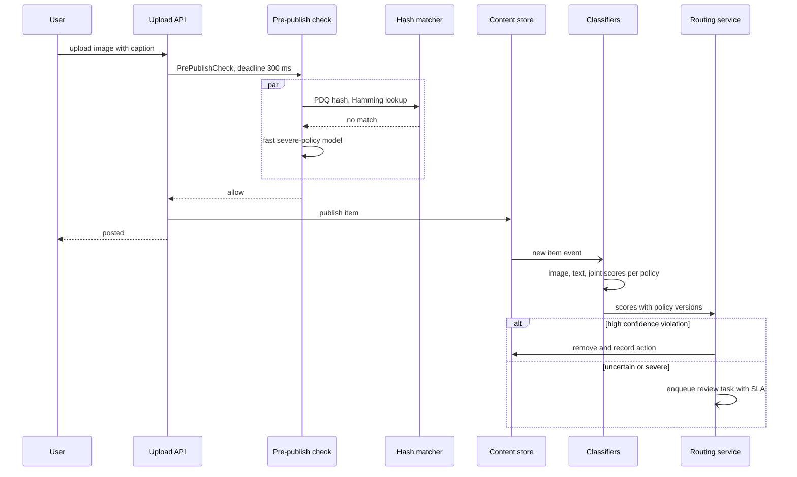

**Reading the diagram.** Pre-publish work is synchronous and limited to what fits in 300 ms: hash matching and a fast model for the most severe policies, run in parallel. If either times out, the item is published and the post-publish tier acts as a backstop, except on surfaces with higher risk (for example, livestreams to large audiences), where the item is held. Post-publish classification is asynchronous and event-driven (Chapter 32), producing per-policy scores tied to policy versions. The routing service either acts automatically or creates a review task with a deadline. Failure points: the hash index (fail to post-publish backstop), classification stream lag (detection slower, prevalence rises), and routing thresholds misconfigured after a policy change. Scaling: GPU fleets per modality; the stream partitions by item ID.

**Figure 82.12 — Read path: report, review, enforcement and appeal.**

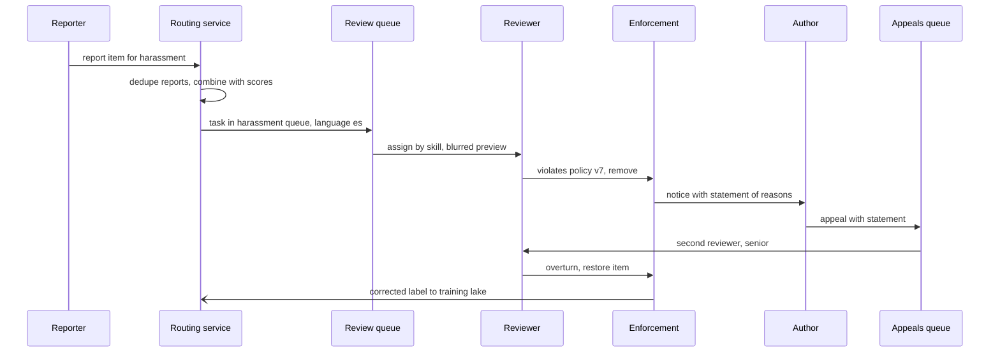

**Reading the diagram.** Reports are deduplicated (a viral item may receive thousands) and combined with classifier scores so that one task represents the item. The queue assigns the task to a reviewer with the right language and policy skills, and the tool shows a blurred preview first. The decision names the policy version and leads to a notice with a statement of reasons; an appeal goes to a different, more senior reviewer. An overturn restores the item and sends a corrected label to training. Failure points: report floods (coordinated mass reporting to silence a user; detect reporter coordination and weight reports), queue backlogs and reviewer inconsistency (monitor agreement on gold items). Scaling: by people, routing and automation of simple cases.

### 82.7.10 Bottlenecks

1. **Reviewer capacity**, especially in less common languages, and its peaks during news events.
2. **Policy-change throughput**: re-labeling and retraining after each policy version.
3. **Video**: frame sampling and audio transcription dominate GPU time; long live videos need streaming classification.
4. **Context**: many violations need conversation or author context, which is expensive to fetch at scale.

### 82.7.11 Failure scenarios

**Table 82.17 — Content moderation failure scenarios.**

| What fails | Impact | Detection | Recovery | Prevention |
|---|---|---|---|---|
| Viral violating item missed | Millions of views | Prevalence and view-weighted sampling | Emergency hash and sweep | Prioritize review by predicted reach |
| Over-enforcement after threshold change | Lawful speech removed at scale | Appeal overturn spike | Roll back threshold; restore items | Shadow mode for threshold changes |
| Policy changed, models not | Wrong label meaning | Model–expert disagreement on golden set | Re-label; retrain; recalibrate | Policy version in every label and score |
| Adversarial evasion (text in images, misspellings, edited copies) | Recall drops | Report volume rises on new patterns | Add OCR, robust text features, new hashes | Red-teaming; monitoring by pattern |
| Prompt injection in user text to the LLM classifier | Misclassification | Disagreement with classifier; canary strings | Strip or isolate inputs | Structured prompts; never act on LLM alone for removal of severe content (§78.13) |
| Coordinated mass reporting | Targeted user silenced | Reporter-graph anomaly | Restore; penalize reporters | Report weighting by trust |
| Review backlog in one language | SLA breach; legal exposure | Queue age per language | Overflow to vendors; prioritize by severity | Pooled, cross-trained staffing |
| Reviewer harm | Burnout, lower accuracy | Agreement drift; well-being surveys | Rotation, support | Exposure limits, blurring, pre-screening |
| Feedback loop | Removed items never get labels outside the model's view | Prevalence sampling shows blind spots | Random sample review | Prevalence measurement independent of models |

### 82.7.12 Scaling strategy

**At 10×** items, machine classification scales linearly with GPUs, but review cannot grow tenfold: automation must absorb the growth, through better models for the most common queues, LLM classifiers for nuanced but frequent cases, and decisions on clusters of identical items (one review applies to all copies, as with spam campaigns in §82.6.8).

**At 100×**: per-item classification moves to cascades (cheap embedding classifiers first), review is reserved for severe and novel items and appeals, and hash sharing and retrospective sweeps become distributed jobs over petabytes. Regional compliance becomes its own platform with per-country rule sets.

### 82.7.13 Trade-offs

**Table 82.18 — Content moderation design trade-offs.**

| Decision | Option chosen | Alternative | Why |
|---|---|---|---|
| Pre- versus post-publish | Pre-publish only for hashes and severe policies | Pre-publish everything | Latency and over-blocking; the post-publish tier is fast enough for most harms |
| LLM classifiers | Borderline slice, calibrated, versioned with policy | All items | Cost and consistency; agility where needed |
| Automation | Auto-act above per-policy precision ≥ 90% | Human review of every action | Volume makes full review impossible |
| Queues | Partitioned by skill, pooled where possible | One global queue | Language and policy expertise versus pooling efficiency |
| Recall metric | Prevalence from random sampling | Model-based recall | Independent of models' blind spots |
| Enforcement scope | Global or per-country | Global only | Laws differ by country |

### 82.7.14 Alternative designs

- **Outsourced moderation vendors** for review capacity: faster to scale and cover languages, with less control over well-being and quality; the platform remains responsible.
- **Community moderation** (subreddit-style moderators, community notes) adds context and scale, but cannot handle severe or illegal content.
- **On-device or client-side scanning**: discussed for end-to-end encrypted messaging; raises privacy and security concerns that are outside this design.

### 82.7.15 Interview discussion

**Table 82.19 — 45-minute pacing plan for content moderation.**

| Minutes | Focus | What to produce |
|---|---|---|
| 0–5 | Scope | Policies, modalities, actions, latency tiers |
| 5–10 | Estimates | 3.8 billion items/day; ~60 GPUs; 10,000 reviewers |
| 10–20 | Architecture | Figure 82.10; hash, classifiers, LLM, routing, review |
| 20–30 | Deep dive: hashing and models | PDQ and PhotoDNA, multimodal models, LLM policy classifiers |
| 30–38 | Deep dive: humans | Queues, Erlang C with occupancy cap, well-being, appeals |
| 38–45 | Policy and law | Versioning, regional scope, prevalence measurement |

**Likely follow-ups.**

- *"Why not check everything before publishing?"* Latency and over-blocking; reserve pre-publish for severe, known content.
- *"How do you measure what you missed?"* Prevalence from random samples of views, reviewed by people.
- *"What happens when the policy changes?"* Golden set under the new version, LLM prompt update, re-labeling and retraining; versions in every label.
- *"How many reviewers do you need?"* Volume × handle time over productive hours, then Erlang C per queue with an occupancy cap.

**What distinguishes senior and staff answers.** A senior answer combines hashes, classifiers and review. A staff answer sizes the human workforce and shows that it dominates cost, designs for policy versioning and regional scope, measures prevalence independently of the models, and treats reviewer well-being and appeals as requirements.

### 82.7.16 Production considerations

- **Monitoring**: prevalence per policy weekly, action volumes and overturn rates daily, queue age per language in real time, classifier score drift (§70.7.4 for embedding drift), reviewer agreement on gold items.
- **Retraining**: per policy as labels accumulate; mandatory evaluation on policy changes; hash sets updated continuously.
- **Responsible ML**: audit enforcement disparities across languages and dialects, since classifiers often over-flag some dialects (§71.5); publish transparency reports.
- **Security and privacy**: severe content is access-controlled and retained only as law requires; reviewer tools log access; user data minimized (§50.8).
- **Cost**: reviewers first, then video processing; automation that preserves precision is the main lever.

## 82.8 Summary and revision notes

::: summary
- Risk and trust systems share rare, costly positives, errors with victims on both sides, and adversaries who adapt. Price both error types before choosing any threshold.
- **Payment fraud** decides inside card authorization: an 80 ms deadline, five batched feature reads, velocity counters updated within seconds by a stream processor, and a degraded rules-only policy when the model cannot answer.
- Downsampled fraud models must be recalibrated before thresholds apply; the decline threshold $t^{*}(A) = C_{FP}/(C_{FP} + C_{FN})$ depends on the amount and minimizes dollars, not counts.
- Fraud labels mature over months and declines censor them: train on matured windows, use fast analyst labels, evaluate with shadow scoring and a small random holdout.
- **Credit risk** is governed rather than fast: point-in-time bureau data, a scorecard baseline, monotonic gradient boosting, reason codes from attributions, fairness tests with proxies, and SR 11-7 validation before champion–challenger rollout with early-performance proxies.
- Expected loss $PD \times LGD \times EAD$ and the break-even $PD^{*}$ connect the model to policy; reject inference is weak without a small, budgeted exploration cell.
- **Spam** is decided mostly by authenticated-sender reputation before the body is read; a CPU model handles most messages and a GPU model the uncertain few.
- MinHash LSH groups campaign copies so that one verdict acts on all of them; bands and rows set the similarity threshold $(1/b)^{1/r}$.
- User feedback is noisy and manipulable: weight by reporter trust and estimate false positives from graded spam-folder samples.
- **Content moderation** layers hash matching (PhotoDNA, PDQ), multimodal classifiers, LLM policy classifiers and human review; humans dominate cost, so size queues with Erlang C plus an occupancy cap for well-being.
- Policy versions belong in every label, score and action; prevalence from random samples measures what the models miss; appeals and regional scope are requirements.
:::

## 82.9 Knowledge checkpoint

1. Why does the fraud system log the feature values it served instead of recomputing them for training?
2. A model trained with 2% of negatives outputs 0.30. What is the corrected probability at the true prior?
3. Compute $t^{*}$ for a \$100 payment with $f = \$25$, $g = 0.15$, $k = \$15$.
4. Why is a standard A/B test a poor way to evaluate a new fraud model, and what replaces it?
5. What should the fraud decision service do when the model servers time out?
6. Why must credit features come from the bureau report pulled at decision time?
7. What problem does reject inference address, and why does the design prefer an exploration cell?
8. Give two reasons to impose monotonic constraints on a credit model.
9. Compute $PD^{*}$ for $R = \$200$, $LGD = 0.8$, $EAD = \$2{,}000$.
10. Why is spam reputation keyed on authenticated domains rather than on the From address?
11. With $b = 20$ bands of $r = 5$, what is the LSH threshold similarity?
12. Why are false positives under-reported in spam feedback, and how is the rate measured?
13. Which content goes to pre-publish checks, and why not everything?
14. Why must every moderation label carry a policy version?
15. A queue receives 300 items an hour with 2-minute handle time. Why does a 75% occupancy cap require at least 14 reviewers?

<details><summary>Answers</summary>

1. Logged values are exactly what the model saw, including stale counters and the read-before-write timing; recomputing would introduce training–serving skew (§62.9).
2. $p = 0.02 \times 0.30/(0.02 \times 0.30 + 0.70) = 0.006/0.706 = 0.0085$.
3. $C_{FP} = 15 + 15 = \$30$; $C_{FN} = \$125$; $t^{*} = 30/155 = 0.194$.
4. Labels arrive over weeks and declined transactions are never labeled, so the arm that declines more has fewer labels. Use shadow scoring, a small random holdout and early proxies, then matured cohorts.
5. Apply a degraded policy (rules, request-only features, merchant limits, step-up above an amount), never fail the payment, and mark the decision as fallback.
6. A later report contains information from after the decision, including the outcome itself, which leaks the label.
7. Outcomes are observed only for approved applicants, biasing the model in declined regions. Statistical reject inference relies on unverifiable assumptions; approving a random sample below the cut-off measures real outcomes at a known cost.
8. They encode domain knowledge and reduce overfitting, and they make reasons coherent and the model easier to validate.
9. $PD^{*} = 200/(200 + 1{,}600) = 11.1\%$.
10. The From address is easily forged; reputation on domains proven by DKIM or aligned SPF cannot be borrowed by a spoofer.
11. $(1/20)^{1/5} = 0.549$.
12. Few users look in the spam folder, so missed legitimate mail is rarely rescued. Graded random samples from the spam folder estimate it.
13. Known severe content (hash matches) and the most severe policies with fast models; full checks would add latency and over-block, while post-publish tiers act within minutes.
14. A policy change changes what a label means; versions keep training data, thresholds and statements of reasons interpretable.
15. Offered load is $300 \times 120/3{,}600 = 10$ busy reviewers; at 75% occupancy, $\lceil 10/0.75 \rceil = 14$.

</details>

## 82.10 Interview questions

### Basic

**Q1. Why is accuracy a poor metric for fraud or spam?** **Answer.** With 0.1% fraud, approving everything is 99.9% accurate. Use precision–recall curves, recall at a fixed false-positive or decline rate, and cost-weighted metrics, with calibration checked separately (§57.10).

**Q2. What is a velocity feature and how is it kept fresh?** **Answer.** A count or sum of recent activity per entity (cards used on a device in 24 hours). A stream processor updates windowed counters from the event log within seconds; feature age is logged and alerted on.

### Intermediate

**Q3. Design the fallback for a fraud model in the authorization path.** **Answer.** A deadline per dependency inside an 80 ms budget; on timeout, a degraded policy of rules, request-only features and merchant limits, with step-up above a conservative amount; circuit breakers; fallback rate as a paging metric; decisions marked for analysis. Never fail open or closed wholesale.

**Q4. How do you generate adverse-action reasons from a gradient-boosted credit model?** **Answer.** Compute TreeSHAP attributions relative to a documented reference, group features into reviewed reason codes, rank by adverse contribution, return the top four, store everything with the decision, and test consistency and direction. Monotonic constraints make reasons coherent.

### Advanced

**Q5. A spam campaign rotates every copy's text and URL. How do you catch it without hurting newsletters?** **Answer.** Normalize templates, MinHash shingles with LSH tuned so that campaign copies collide and shared templates rarely do, confirm by signature similarity, use sender and URL-domain reputation, require reports from distinct trusted reporters before acting, and gate large retroactive actions behind review with reversal.

**Q6. Policy narrows the definition of a prohibited threat. Walk through the system changes.** **Answer.** New policy version in the registry; experts label a golden set; evaluate the LLM classifier with the updated prompt and the current models; reset thresholds; update reviewer guidelines and training; re-label or retire old labels; retrain; monitor overturns and prevalence; statements of reasons cite the new version.

## 82.11 Practical exercises

1. Extend the fraud program of §82.4.8 with a step-up action that costs \$2 per legitimate customer and stops 90% of fraud; derive and test the three-action policy.
2. Simulate a 12-month credit label and a cut-off policy, train only on approved applicants, and measure the bias of PD in the declined region; then add a 1% exploration cell and compare.
3. Implement MinHash with 128 values and LSH with $(b, r) = (16, 8)$ on synthetic campaign messages with random personalization; plot candidate rate against Jaccard similarity and compare with $P(s)$.
4. Use the reviewer program of §82.7.8 to compare one pooled queue for three languages at 100 items an hour each against three separate queues, with and without the occupancy cap.

## 82.12 Design challenges

1. **Account-takeover detection** for a consumer app: login-time risk scoring with device and behavior signals, step-up authentication, and labels from user-confirmed takeovers. Specify the latency budget, label delay and fallback.
2. **Buy-now-pay-later decisioning** at checkout: credit risk within a 300 ms checkout budget, adverse-action reasons and fraud checks in one decision. Show how the credit and fraud designs combine.
3. **Livestream moderation**: detect severe violations in live video within 30 seconds across 100,000 concurrent streams, with human escalation. Size frame sampling, GPUs and reviewer queues.

## 82.13 References

1. Dal Pozzolo, A., Caelen, O., Johnson, R. A., Bontempi, G. *Calibrating Probability with Undersampling for Unbalanced Classification*. IEEE Symposium Series on Computational Intelligence (SSCI), 2015.
2. Drapeau, R. *How We Built It: Stripe Radar*. Stripe Blog, 2023. https://stripe.com/blog/how-we-built-it-stripe-radar
3. Zuo, Q., Zhang, D., Zhang, Y., et al. *How PayPal Uses Real-time Graph Database and Graph Analysis to Fight Fraud*. The PayPal Technology Blog, 2021. https://medium.com/paypal-tech/how-paypal-uses-real-time-graph-database-and-graph-analysis-to-fight-fraud-96a2b918619a
4. Hand, D. J., Henley, W. E. *Statistical Classification Methods in Consumer Credit Scoring: A Review*. Journal of the Royal Statistical Society, Series A 160(3), 1997.
5. Siddiqi, N. *Credit Risk Scorecards: Developing and Implementing Intelligent Credit Scoring*. Wiley, 2006.
6. Crook, J., Banasik, J. *Does Reject Inference Really Improve the Performance of Application Scoring Models?* Journal of Banking & Finance 28(4), 2004.
7. Consumer Financial Protection Bureau. *Using Publicly Available Information to Proxy for Unidentified Race and Ethnicity*. 2014.
8. Consumer Financial Protection Bureau. *Circular 2022-03: Adverse Action Notification Requirements in Connection with Credit Decisions Based on Complex Algorithms*. 2022.
9. Equal Credit Opportunity Act (Regulation B), 12 CFR Part 1002, §1002.9 Notifications.
10. Kozodoi, N., Jacob, J., Lessmann, S. *Fairness in Credit Scoring: Assessment, Implementation and Profit Implications*. European Journal of Operational Research 297(3), 2022.
11. Board of Governors of the Federal Reserve System and Office of the Comptroller of the Currency. *Supervisory Guidance on Model Risk Management* (SR 11-7). 2011.
12. Lundberg, S. M., Erion, G., Chen, H., et al. *From Local Explanations to Global Understanding with Explainable AI for Trees*. Nature Machine Intelligence 2, 2020.
13. Kumaran, N. *Ridding Gmail of 100 Million More Spam Messages with TensorFlow*. Google Cloud Blog, 2019.
14. Bursztein, E., Zhang, M. *Improving Text Classification Resilience and Efficiency with RETVec*. Google Security Blog, 2023. https://security.googleblog.com/2023/11/improving-text-classification.html
15. Taylor, B. *Sender Reputation in a Large Webmail Service*. Conference on Email and Anti-Spam (CEAS), 2006.
16. Google. *Email Sender Guidelines*. Gmail Help, 2024. https://support.google.com/mail/answer/81126
17. Kitterman, S. *Sender Policy Framework (SPF) for Authorizing Use of Domains in Email, Version 1*. RFC 7208, 2014.
18. Crocker, D., Hansen, T., Kucherawy, M. *DomainKeys Identified Mail (DKIM) Signatures*. RFC 6376, 2011.
19. Kucherawy, M., Zwicky, E. *Domain-based Message Authentication, Reporting, and Conformance (DMARC)*. RFC 7489, 2015.
20. Broder, A. Z. *On the Resemblance and Containment of Documents*. Compression and Complexity of Sequences, 1997.
21. Charikar, M. S. *Similarity Estimation Techniques from Rounding Algorithms*. STOC, 2002.
22. Manku, G. S., Jain, A., Das Sarma, A. *Detecting Near-Duplicates for Web Crawling*. WWW, 2007.
23. Graham, P. *A Plan for Spam*. 2002. http://www.paulgraham.com/spam.html
24. Microsoft. *PhotoDNA*. https://www.microsoft.com/en-us/photodna
25. Facebook. *Open-Sourcing Photo- and Video-Matching Technology to Make the Internet Safer* (PDQ and TMK+PDQF). 2019. Code: https://github.com/facebook/ThreatExchange
26. Dalins, J., Wilson, C., Boudry, D. *PDQ & TMK + PDQF — A Test Drive of Facebook's Perceptual Hashing Algorithms*. arXiv:1912.07745, 2019.
27. Inan, H., Upasani, K., Chi, J., et al. *Llama Guard: LLM-based Input-Output Safeguard for Human-AI Conversations*. arXiv:2312.06674, 2023.
28. OpenAI. *Using GPT-4 for Content Moderation*. OpenAI Blog, 2023.
29. Steiger, M., Bharucha, T. J., Venkatagiri, S., Riedl, M. J., Lease, M. *The Psychological Well-Being of Content Moderators*. CHI, 2021.
30. European Parliament and Council. *Regulation (EU) 2022/2065 on a Single Market for Digital Services (Digital Services Act)*. Official Journal of the European Union, 2022.
31. Germany. *Netzwerkdurchsetzungsgesetz (Network Enforcement Act, NetzDG)*. 2017.
32. Meta. *Community Standards Enforcement Report*. Meta Transparency Center. https://transparency.meta.com/reports/community-standards-enforcement/

## 82.14 Open verification items

- Publication year of Drapeau's "How We Built It: Stripe Radar" (2023 assumed; the architecture change is dated mid-2022 in the post) and its exact wording on the under-100 ms latency (stripe.com was unreachable from the authoring environment).
- Publication date (December 2021 per secondary coverage) and full author list of the PayPal graph post.
- Authors of the RETVec Google Security Blog post (Bursztein and Zhang assumed).
- Gmail sender-guideline spam-rate thresholds (0.10% target, 0.30% limit per Postmaster Tools) were not quoted because they could not be confirmed from Google's page.
- Recommended PDQ match threshold (sources cite 30–32 of 256 bits).
- Regulation B record retention (25 months for consumer credit) and the four-reason guidance in the official commentary.
- Typical card-network time limits for fraud chargebacks (120 days assumed in §82.4.1).
