# Chapter 83 — Case Studies VIII: Marketplace Forecasting and Optimization

> **Level:** 3–5 · **Track:** B (ML/AI) · **Estimated reading time:** 4 h

A ride-hailing platform is a **two-sided marketplace**: riders on one side, drivers on the other, and the platform in the middle deciding, minute by minute, where drivers should be, how long things will take and what a trip should cost. Chapter 55 designed the transactional machinery of such a platform: the trip state machine, location ingestion, the supply index and dispatch (§55.4–§55.5), and the routing engine with live traffic (§55.6). Every place where that chapter wrote "the model" or "Chapter 83" is a learned or optimized decision, and this chapter designs three of them.

What sets these systems apart from the recommenders and classifiers of earlier case studies is that **their outputs change the world they predict**. A demand forecast moves drivers, which changes where trips happen. A surge price suppresses demand, which changes what the next forecast learns. An ETA promise changes whether the rider books. Each case therefore emphasizes a different hard problem, summarized in Table 83.1, and each must face the feedback loop in its own way.

**Table 83.1 — The three cases and their distinctive hard problems.**

| Case | Distinctive hard problem |
|---|---|
| §83.4 Ride demand forecasting | Probabilistic forecasts for 150,000 sparse hexagon series every five minutes, coherent across a geographic hierarchy, robust to holidays, events and weather, and backtested honestly |
| §83.5 ETA prediction at ride-hailing scale | Correcting a routing engine with a learned residual at about 230,000 predictions per second, with labels built from map-matched GPS, an asymmetric loss and calibrated uncertainty |
| §83.6 Dynamic (surge) pricing | Closing a real-time control loop between supply, demand and price, estimating elasticity from confounded data, and experimenting when every rider and driver shares one market |

All three cases share one platform, sized in §55.4.4: 30 million completed trips per day, about 1,000 trip requests per second at peak, about 5,200 fare estimates per second, 2 million drivers online at peak and 500,000 location updates per second. Figure 83.1 shows how the three systems feed each other.

**Figure 83.1 — How forecasting, ETA and pricing connect inside the marketplace.**

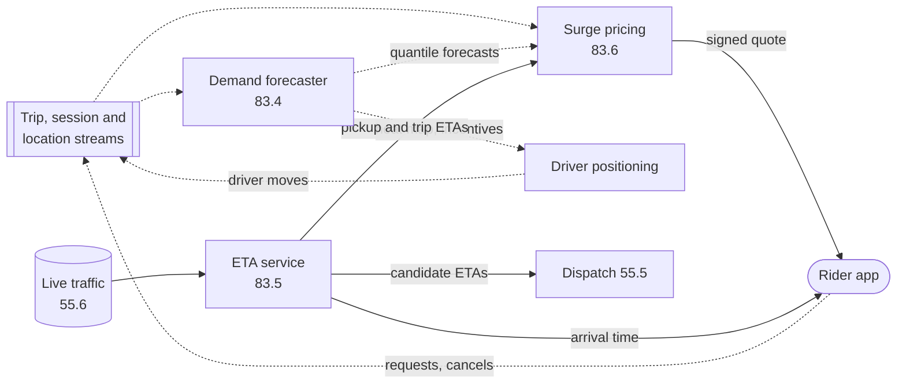

**Reading the diagram.** Dotted arrows are asynchronous: event streams (Kafka, Chapter 31) carry trips, app sessions and driver locations into the demand forecaster and the pricing aggregator, and forecasts are published to stores that pricing and driver positioning read on their own schedules. Solid arrows are synchronous calls inside a request: the ETA service, reading live traffic from the routing tier of §55.6, answers dispatch, pricing and the rider app within milliseconds. The loop closes through the rider app and driver positioning: prices and ETAs change what riders request, positioning changes where drivers go, and both flow back into the streams the models learn from. Failure points are the streams (stale inputs everywhere) and the ETA service (on the synchronous path of every quote and dispatch). Each box scales independently, which is why each is a separate case.

## 83.1 Learning objectives

After this chapter you should be able to:

- Formulate ride demand as a spatiotemporal, probabilistic forecasting problem over H3 hexagons and 15-minute buckets, define unconstrained demand as the target, and evaluate quantile forecasts with pinball loss, coverage and rolling-origin backtests.
- Reconcile forecasts across a geographic hierarchy, and explain why quantiles of children cannot be added to obtain quantiles of the parent.
- Design an ETA system that combines a routing engine with a learned residual model, build its labels from map-matched GPS traces, choose between segment-level and trip-level models, and serve it at hundreds of thousands of predictions per second.
- Choose an asymmetric loss for arrival-time promises and calibrate prediction intervals per slice with conformal methods.
- Design a real-time surge-pricing loop with smoothing, caps and signed quotes; estimate price elasticity without being fooled by confounding; and anticipate the feedback loops between price, supply and the demand forecast.
- Explain why naive user-randomized A/B tests are biased in a shared marketplace, and design and size a switchback experiment.
- Run each design as a 45-minute interview, including what distinguishes senior from staff answers.

## 83.2 Prerequisites

**Table 83.2 — Concept chapters each case applies.**

| Case | Concept chapters it leans on |
|---|---|
| All | Ride-hailing platform, supply index and pricing hand-off — §55.4; H3 — §17.9.5; Little's Law — §4.11; capacity planning — §18.11; ML system architecture and fleet sizing — §60.7, §60.11; streams and windows — §29.8–§29.9; Kafka — Chapter 31; ML monitoring — Chapter 70 |
| §83.4 Demand forecasting | Pinball loss and MAPE pathologies — §57.11; time-based splits — §57.7.1; streaming features and backfills — §61.5–§61.6; point-in-time correctness — §62.8; seasonality in drift tests — §70.6.5; forecasting for capacity — §18.11.4 |
| §83.5 ETA prediction | QuickBite ETA reference design — §60.15; routing, contraction hierarchies, live traffic — §55.6.8; ETA-based dispatch — §55.5.8; asymmetric costs — §59.4.2; serving, batching and fallbacks — §66.6, §66.14, §60.12.2; calibration drift — §70.9.1 |
| §83.6 Dynamic pricing | A/B statistics, power and the unit of randomization — §57.14; feedback loops — §60.3.4; feature freshness — §62.10; fairness and regulation — §71.4, §71.13; feature flags and kill switches — §43.7 |

## 83.3 How to use these case studies

Work through these cases with the method of §52.3: read the problem statement, close the book and produce your own requirements, estimates and architecture, then compare; treat every number as a challengeable assumption rather than a fact about any company; follow cross-references whenever a mechanism is summarized in one sentence; and rehearse each §N.15 pacing plan aloud against a clock. Three things differ for these marketplace cases. First, before drawing boxes, write down the **decision** each model's output drives (move drivers, promise a time, set a price); the right loss function follows from the cost of being wrong in each direction. Second, look for the **feedback loop**: in every case the model's output changes its own future training data. Third, ask how you would **experiment**, because in a shared market the textbook A/B test of §57.14 can give the wrong answer.

## 83.4 Ride Demand Forecasting

### 83.4.1 Problem statement

The platform wants to know, for every neighborhood of every city, how many riders will want a trip in each of the next few 15-minute intervals, and how uncertain that number is. The forecasts drive decisions that must be made *before* demand arrives, because drivers need minutes to reposition and hours to decide to go online: the in-app heat map that guides idle drivers, repositioning incentives, scheduled driver bonuses for tomorrow's rush hours, the supply–demand inputs to surge pricing (§83.6), and capacity planning for the platform's own servers (§18.11.4).

Think of a weather forecaster who must predict rainfall for every street corner in fifteen-minute slots. For the whole city, the forecast is easy and accurate; for one street corner at 4 a.m., most slots have zero and a few have one, and the honest answer is a probability distribution rather than a number.

**ML formulation.** For each H3 resolution-7 hexagon $h$ (5.16 km² on average, §17.9.5) and each 15-minute bucket $t$, predict the distribution of **unconstrained demand** $y_{h,t}$ for horizons of 1 to 8 buckets (two hours) every five minutes, and hourly for the next seven days once a day. The task is probabilistic regression on counts: the outputs are quantiles at 0.1, 0.25, 0.5, 0.75 and 0.9. The label is not "completed trips". Completed trips are capped by supply and suppressed by price, so a hexagon with no drivers shows zero trips even when hundreds of riders opened the app. The label is therefore requests plus an estimate of riders who opened the app and left without requesting because no car was available or the price was high, a **censored-demand** correction discussed in §83.4.8.

**Why ML is warranted** (§57.3.3, §59.4.3). Seasonal rules ("same time last week") work at city level but fail on sparse hexagons, holidays, events and weather, and there are 150,000 series, far too many to hand-tune. A single global model trained across all hexagons shares statistical strength between them, which is exactly what sparse series need.

### 83.4.2 Functional requirements

1. **Short-horizon forecasts.** Every five minutes, publish quantile forecasts for each active resolution-7 hexagon for the next eight 15-minute buckets.
2. **Day-ahead forecasts.** Daily, publish hourly quantile forecasts for seven days per hexagon, for driver incentives and scheduling.
3. **Hierarchy.** Publish coherent forecasts at resolution 5 (252.9 km²), city, country and global levels: children must add up to their parent.
4. **Event awareness.** Ingest holiday calendars, a curated event feed (concerts, sports, conferences with venue location and end time) and weather forecasts; let city operations teams add manual event annotations.
5. **Backtesting.** Any candidate model can be evaluated on a rolling-origin backtest over the last 12 months, with metrics per city, horizon and slice.
6. **Serving.** Consumers read forecasts by hexagon and horizon; pricing reads in bulk each minute, driver apps read heat-map tiles.

Out of scope: the pricing logic (§83.6), the driver-incentive optimizer, and long-range (quarterly) planning forecasts.

### 83.4.3 Non-functional requirements

**Table 83.3 — Demand forecasting non-functional requirements.**

| Property | Target | Why |
|---|---|---|
| Forecast freshness | Short-horizon forecasts at most 10 min old at p99 | Pricing and positioning act on the next 15–60 minutes |
| Input freshness | Request and session counts at most 2 min behind real time | The last few buckets are the most predictive lags |
| Availability of forecast reads | 99.95%; on failure, serve the last good forecast with an age flag | Pricing and heat maps degrade gracefully on slightly stale forecasts |
| Read latency | p99 < 20 ms for a bulk read of one city | Pricing tick runs every minute (§83.6) |
| Offline quality gate | Weighted pinball loss at least 3% better than the current model on the backtest, no city worse by more than 2% | Prevents a global gain hiding a regional regression |
| Calibration | 80% interval coverage between 0.75 and 0.85 per city and horizon | Downstream optimizers trust the quantiles |
| Online guardrails | Driver idle time, rider wait time and unfulfilled-request rate do not worsen in experiment cities | Forecasts matter only through decisions |
| Model freshness | Retrained weekly; event features refreshed hourly | Demand patterns drift with seasons and product changes |

### 83.4.4 Capacity estimation

All figures are decimal and illustrative, built on the §55.4.4 platform.

::: example
**Worked example — Series, forecasts and reads.** Assumptions: 30 million completed trips/day at an 83% fulfillment rate, so 36 million requests/day; 600 cities; 150,000 active resolution-7 hexagons (about 250 per city); 96 buckets/day; 5 quantiles; 8 short horizons refreshed every 300 s; 7 × 24 = 168 day-ahead hourly horizons refreshed daily; 4 bytes per value.

1. Mean demand per hexagon-bucket: $36 \times 10^6 / 96 / 150{,}000 = 2.5$ requests. The distribution is highly skewed: downtown hexagons see dozens, suburban ones mostly zero.
2. Short-horizon values per refresh: $150{,}000 \times 8 \times 5 = 6 \times 10^6$ values (24 MB), or $6 \times 10^6 / 300 = 20{,}000$ values/s written.
3. Hierarchy overhead: each resolution-5 cell holds about $7^2 = 49$ resolution-7 cells, so $150{,}000 / 49 \approx 3{,}061$ parents plus 600 cities and about 50 countries, about 2.5% more series.
4. Day-ahead values: $150{,}000 \times 168 \times 5 = 1.26 \times 10^8$ values/day (504 MB).
5. Driver heat-map reads: 2 million drivers online at peak, refreshing every 60 s: $2 \times 10^6 / 60 = 33{,}333$ reads/s, served from per-hexagon tiles cached at the edge, not from the forecast store.
6. Pricing reads: one bulk read per city per minute, 600/min, trivial.

**Interpretation.** Writes and reads are small; this is not a serving-scale problem. **Engineering implication.** The difficulty is statistical (sparse counts, hierarchy, events) and operational (freshness of inputs), so spend the design effort there, and keep serving simple: a key–value store keyed by city and horizon.
:::

::: example
**Worked example — Data volume and compute.** Assumptions: 5 app sessions per request; 300 bytes per event; one training row per hexagon-bucket with 200 features of 4 bytes; 4:1 columnar compression; two years retained; inference with a gradient-boosted model at 20 µs per row per quantile; training benchmark of 2 hours per quantile model on a 64-core node with 200 million sampled rows.

1. Events: $36 \times 10^6 \times (1 + 5) = 2.17 \times 10^8$ events/day; average $2{,}510$/s, peak at 3× about $7{,}530$/s; $2.17 \times 10^8 \times 300 = 65$ GB/day.
2. Training rows: $150{,}000 \times 96 = 1.44 \times 10^7$ rows/day, $5.26 \times 10^9$/year. Raw $1.44 \times 10^7 \times 800 = 11.5$ GB/day; compressed 2.9 GB/day; two years about 2.1 TB.
3. Inference per refresh: $150{,}000 \times 8 = 1.2 \times 10^6$ rows × 5 quantiles × 20 µs = 120 core-seconds, or 0.4 busy cores averaged over 300 s.
4. Weekly training: 5 quantile models × 2 hours × 64 cores = 640 core-hours.

**Interpretation.** Inference costs less than one core; the event pipeline and feature computation cost far more. **Engineering implication.** Run inference as a micro-batch job inside the streaming platform, not as an online service; the expensive parts to make reliable are the streaming aggregations and the backtest harness.
:::

**Table 83.4 — Demand forecasting capacity summary.**

| Quantity | Value |
|---|---|
| Series (resolution-7 hexagons) | 150,000 plus about 3,700 aggregates |
| Mean demand per hexagon-bucket | 2.5 requests |
| Short-horizon output | 6 million values per 5-minute refresh (20,000/s) |
| Input events | 217 million/day, ~7,500/s at peak, 65 GB/day |
| Training data | 14.4 million rows/day; ~2.1 TB for two years compressed |
| Inference compute | ~0.4 busy cores |
| Training compute | ~640 core-hours/week |

### 83.4.5 API design

```text
# Read: bulk short-horizon forecast for a city (pricing, positioning)
GET /v1/forecast/demand?city=sfo&level=h3r7&horizons=1-8
200 OK
{ "city": "sfo", "issued_at": "2026-11-11T17:05:00Z", "model_version": "dfc-2026-11-08",
  "bucket_minutes": 15, "quantiles": [0.1, 0.25, 0.5, 0.75, 0.9],
  "cells": [ { "h3": "872830828ffffff", "horizon": 1, "bucket_start": "2026-11-11T17:15:00Z",
               "q": [11, 15, 19, 24, 29], "flags": ["event:stadium"] } ],
  "stale": false }

# Read: one cell, any level (dashboards, incentives)
GET /v1/forecast/demand/cell/{h3_or_region_id}?horizon_type=day_ahead

# Write: operations annotation for an unusual event
POST /v1/forecast/events
{ "city": "sfo", "h3_cells": ["872830828ffffff"], "start": "...", "end": "...",
  "kind": "concert", "expected_attendance": 40000, "author": "ops-user-381" }

# Backtest job (offline)
POST /v1/forecast/backtests  { "model_ref": "...", "origins": "weekly:52", "metrics": ["pinball","coverage"] }
```

Two details matter. Every response carries `issued_at` and `model_version`, so a consumer can refuse forecasts older than its tolerance and so prediction logs can be joined to the model that made them. The event annotation endpoint exists because no automated feed knows that a stadium concert was moved to tonight; the annotation becomes a feature, not an override, so the model learns how much to trust it.

### 83.4.6 Data model and database schema

**Table 83.5 — Demand forecasting entities, features and labels.**

| Data | Key | Freshness | Store |
|---|---|---|---|
| Demand label: requests + estimated suppressed sessions per bucket | (h3_r7, bucket_start) | Final 30 min after bucket end (late events) | Lakehouse table (§61.8), partitioned by date and city |
| Lag features: last 8 buckets, same bucket 1–4 weeks ago, rolling means | (h3_r7, bucket_start) | 1–2 min (streaming) | Online feature store (§62.7) and offline mirror |
| Supply and price context: idle drivers, surge multiplier, pickup ETA | (h3_r7, bucket_start) | 1 min | Same |
| Calendar and holiday features | (city, date) | Daily | Batch table |
| Event features: kind, attendance, distance to venue, minutes to end | (h3_r7, hour) | Hourly; immediate for annotations | Batch table plus streaming override |
| Weather forecast: precipitation, temperature | (city grid cell, hour) | Hourly from an external provider | Batch table |
| Static hexagon features: POI counts, airport flag, transit stations | h3_r7 | Monthly | Batch table |
| Published forecasts | (city, issued_at) → cells × horizons × quantiles | 5 min | Key–value store, last 24 h hot; history in the lake |

```sql
-- Training example: one row per hexagon, issue time and horizon (illustrative)
CREATE TABLE demand_training_example (
  h3_r7          CHAR(15)   NOT NULL,
  issued_at      TIMESTAMP  NOT NULL,     -- when the forecast would have been made
  horizon        SMALLINT   NOT NULL,     -- 1..8 buckets ahead
  bucket_start   TIMESTAMP  NOT NULL,     -- target bucket
  features       BINARY     NOT NULL,     -- as-of issued_at, point-in-time correct (§62.8)
  label_requests INT,                     -- observed requests in target bucket
  label_suppressed REAL,                  -- estimated suppressed demand
  label_final_at TIMESTAMP,               -- when the label was declared complete
  PRIMARY KEY (h3_r7, issued_at, horizon)
) PARTITIONED BY (date(issued_at), city);
```

The row is keyed by **issue time and horizon**, not by target bucket alone. A forecast for 18:00 made at 17:55 may use the 17:45 bucket's count; the same forecast made at 16:00 may not. Building features as of `issued_at` with a point-in-time join (§62.8) is what prevents the most common leakage in forecasting: training on lags the model would not have had at prediction time.

### 83.4.7 High-level architecture

**Figure 83.2 — Demand forecasting: streaming features, micro-batch inference and consumers.**

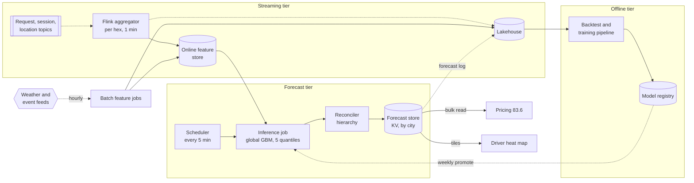

**Reading the diagram.** In the streaming tier, request, session and location events arrive on Kafka topics keyed by city (§31.5.3); a Flink job (§29.9) counts them per hexagon in one-minute event-time windows with watermarks (§29.8.3), writes the latest counts and lags to the online feature store, and archives them asynchronously (dotted) to the lakehouse. Batch jobs pull external weather and event feeds hourly. In the forecast tier, a scheduler starts an inference job every five minutes that reads features in bulk per city, runs the global gradient-boosted model for five quantiles, passes the result through the reconciler and writes one object per city to the forecast store. Consumers read synchronously: pricing in bulk, the driver heat map through cached tiles. Forecasts are logged to the lake so that the backtest pipeline can compare live forecasts with outcomes. Storage boundaries: online store, lakehouse, registry, forecast store. Failure points: the aggregator lagging (stale lags), the external feed failing (missing weather), and the inference job failing (consumers fall back to the last forecast, flagged stale). Scaling: partition the aggregator and the inference job by city.

### 83.4.8 Detailed component design

#### Features, labels and the censored-demand problem

Most of the predictive power comes from four feature families. **Lags** capture momentum: counts in the last eight buckets, the same bucket one to four weeks ago, and exponentially weighted means. **Calendar** features capture the daily and weekly cycles, public holidays and the days around them, school holidays and paydays. **Exogenous** features capture what lags cannot: weather forecasts (rain sharply raises ride demand in many cities), event attendance and end times near a hexagon, airport arrival schedules. **Leading indicators** capture intent before it becomes demand: app opens in the last few minutes precede requests.

The label needs more care than the features. Observed requests are **censored**: when no car is shown or the surge is high, some riders do not request at all. Training on raw requests teaches the model that demand is low exactly where supply was short, and the model then sends drivers elsewhere, which keeps supply short: a self-fulfilling feedback loop (§60.3.4). The fix is to estimate suppressed demand per bucket, for example as sessions that ended without a request while no car was available or the multiplier exceeded a threshold, weighted by the conversion rate observed under normal conditions, and to add the price and supply that prevailed as features so the model can separate "few riders" from "riders deterred".

#### Model choice: baselines, global models and the hierarchy

Start with baselines (§59.9.1) and keep them in the backtest forever: **seasonal naive** (same bucket last week), and **exponential smoothing** per city, both described in Hyndman and Athanasopoulos's standard text [Hyndman and Athanasopoulos 2021]. The production model is a **global** gradient-boosted model trained across all hexagons, with horizon as a feature and one model per quantile trained on the pinball loss of §57.11.2. A global model learns that "rain on a Friday evening near nightlife raises demand" once, from thousands of hexagons, instead of 150,000 times from a handful of rainy Fridays each. Deep sequence models (DeepAR-style probabilistic recurrent networks [Salinas et al. 2020]) are an alternative for the day-ahead horizon, where long input histories matter.

::: industry
**Uber — forecasting extreme events with neural networks.** Laptev and colleagues described forecasting trip demand around holidays and other extreme events at Uber with an LSTM model that learned across many time series, combining a neural feature extractor with the forecaster, and reported that it improved on the earlier per-series approach for such events [Laptev et al. 2017]. Uber has also described forecasting as central to marketplace decisions such as supply positioning and to capacity planning, and built H3 to analyze marketplace data by hexagon [Bell and Smyl 2018; Brodsky 2018]. The design in this section is a teaching design, not Uber's system.
*Evidence: Primary* — [Laptev et al. 2017; Bell and Smyl 2018; Brodsky 2018]
:::

Forecasts at different levels must agree. A city forecast trained on smooth city totals is far more accurate than the sum of 250 noisy hexagon forecasts, but positioning needs hexagons. **Forecast reconciliation** makes all levels coherent while using information from all of them.

**Figure 83.3 — The forecast hierarchy and reconciliation.**

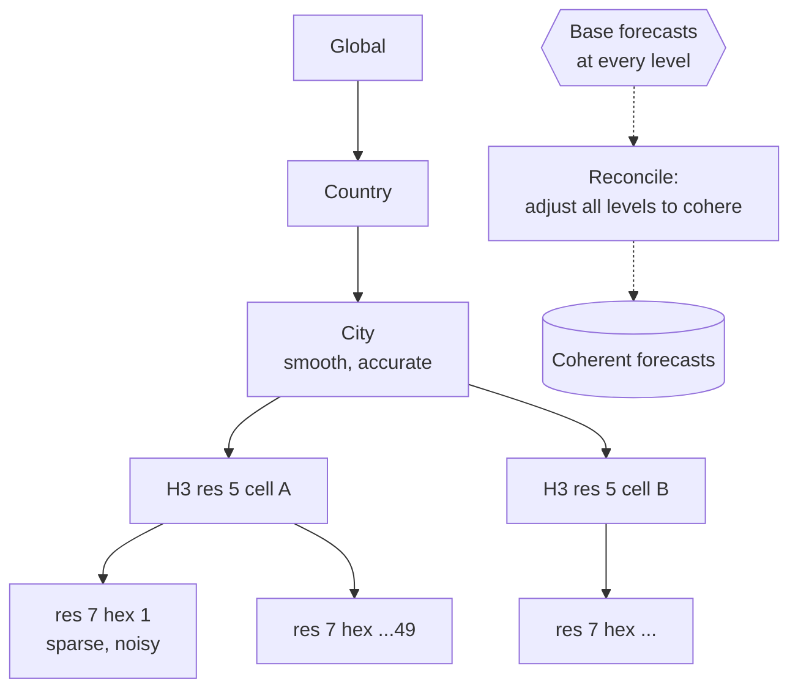

**Reading the diagram.** Solid arrows show aggregation: each resolution-7 hexagon belongs to one resolution-5 cell (approximately, since H3 children do not tile their parent exactly, §17.9.5; the hierarchy uses each hexagon's assigned parent), each resolution-5 cell to one city, and so on. Base forecasts are produced independently at every level (dotted, a batch step), then the reconciler adjusts them so that every parent equals the sum of its children. Accuracy flows both ways: the city level contributes its smoothness to the hexagons, and the hexagons contribute local information, such as an event, to the city. Failure points: a hexagon assigned to the wrong parent after a map update breaks coherence silently. Scaling: reconciliation is per city, so it parallelizes trivially.

::: formula
**Linear forecast reconciliation**

$$\tilde{\mathbf{y}} = S\,G\,\hat{\mathbf{y}}, \qquad G_{\text{OLS}} = (S^\top S)^{-1} S^\top, \qquad G_{\text{MinT}} = (S^\top W^{-1} S)^{-1} S^\top W^{-1}$$

| Symbol | Meaning | Units |
|---|---|---|
| $\hat{\mathbf{y}}$ | Base forecasts for every node of the hierarchy (parents and leaves) | requests per bucket |
| $S$ | Summing matrix: row $i$ marks which leaves add up to node $i$ | 0/1 |
| $G$ | Matrix mapping all base forecasts to reconciled leaf forecasts | dimensionless |
| $\tilde{\mathbf{y}}$ | Reconciled, coherent forecasts for every node | requests per bucket |
| $W$ | Covariance of base-forecast errors (estimated from backtest residuals) | requests² |
:::

::: example
**Worked example — Reconciling a parent and two children.** A city zone has base point forecasts parent $= 100$, child A $= 55$, child B $= 52$ requests per bucket. The children sum to 107, so the levels disagree by 7.

1. $S = \begin{bmatrix}1 & 1\\ 1 & 0\\ 0 & 1\end{bmatrix}$, so $S^\top S = \begin{bmatrix}2 & 1\\ 1 & 2\end{bmatrix}$ and $(S^\top S)^{-1} = \tfrac{1}{3}\begin{bmatrix}2 & -1\\ -1 & 2\end{bmatrix}$.
2. $S^\top \hat{\mathbf{y}} = (100 + 55,\ 100 + 52) = (155,\ 152)$.
3. Reconciled children: A $= (2 \times 155 - 152)/3 = 52.67$; B $= (-155 + 2 \times 152)/3 = 49.67$; parent $= 102.33$.
4. Each of the three nodes moved by $7/3 = 2.33$: the parent up, the children down.

**Interpretation.** OLS reconciliation spreads the disagreement equally. MinT [Wickramasuriya et al. 2019] weights by error covariance, so a noisy hexagon absorbs more of the adjustment than an accurate city total. **Engineering implication.** Reconcile means and medians this way; for other quantiles, reconcile sample paths or means and variances, not the quantiles themselves, as the next code shows.
:::

#### Evaluating probabilistic forecasts by backtest

A forecast is evaluated by **rolling-origin backtesting**: pick an origin date, train only on data before it, forecast the following period, score, move the origin forward and repeat (the time-based split of §57.7.1 applied many times). Scores are the pinball loss averaged over quantiles (a proper scoring rule for quantiles [Gneiting and Raftery 2007]) and interval **coverage**. MAPE is unusable here because a third or more of hexagon-buckets are zero (§57.11.1).

```python
import numpy as np
from scipy.stats import nbinom

rng = np.random.default_rng(83)
H, B, W, K = 49, 96 * 7, 9, 5.0          # 49 res-7 hexes, 672 buckets/week, 9 weeks, dispersion
t = np.arange(B)
daily = 0.3 + 2.0 * np.sin(np.pi * ((t % 96) / 96)) ** 4       # evening-heavy daily cycle
weekly = np.where(t // 96 >= 5, 1.3, 1.0)                       # weekend uplift
scale = rng.lognormal(0.0, 0.8, size=H)                         # busy and quiet hexes
rate = scale[None, :, None] * daily * weekly * (1 + 0.02 * np.arange(W))[:, None, None]
y = rng.poisson(rng.gamma(K, rate / K))                         # over-dispersed counts (W, H, B)

def nb_q(mu, var, q):                       # negative-binomial quantile by moment matching
    p = np.clip(mu / var, 1e-6, 1 - 1e-6)
    return nbinom.ppf(q, mu * p / (1 - p), p)

def pinball(y, f, q):
    d = y - f
    return np.mean(np.maximum(q * d, (q - 1) * d))

Q = (0.1, 0.5, 0.9)
out = {k: [] for k in ("naive", "model", "cov_hex", "pin_par_sumq", "pin_par_rec",
                       "cov_par_sumq", "cov_par_rec")}
for origin in range(5, 9):                  # rolling-origin backtest: forecast each week 5..8
    actual, parent = y[origin], y[origin].sum(axis=0)
    naive = y[origin - 1].astype(float)     # same bucket last week; every quantile identical
    mu = y[origin - 4:origin].mean(axis=0) + 0.05
    fq = {q: nb_q(mu, mu + mu**2 / K, q) for q in Q}
    out["naive"].append(np.mean([pinball(actual, naive, q) for q in Q]))
    out["model"].append(np.mean([pinball(actual, fq[q], q) for q in Q]))
    out["cov_hex"].append(np.mean((actual >= fq[0.1]) & (actual <= fq[0.9])))
    # parent: (a) add the children's quantiles; (b) add means and variances, then take quantiles
    sumq = {q: fq[q].sum(axis=0) for q in Q}
    rec = {q: nb_q(mu.sum(0), (mu + mu**2 / K).sum(0), q) for q in Q}
    out["pin_par_sumq"].append(np.mean([pinball(parent, sumq[q], q) for q in Q]))
    out["pin_par_rec"].append(np.mean([pinball(parent, rec[q], q) for q in Q]))
    out["cov_par_sumq"].append(np.mean((parent >= sumq[0.1]) & (parent <= sumq[0.9])))
    out["cov_par_rec"].append(np.mean((parent >= rec[0.1]) & (parent <= rec[0.9])))

m = {k: np.mean(v) for k, v in out.items()}
print(f"hex level: mean demand {y.mean():.2f}/bucket, zero buckets {np.mean(y == 0):.0%}")
print(f"hex pinball (avg of q=0.1,0.5,0.9): naive {m['naive']:.3f}, NB quantiles {m['model']:.3f}")
print(f"hex 80% interval coverage: {m['cov_hex']:.3f}")
print(f"parent pinball: sum of child quantiles {m['pin_par_sumq']:.3f}, "
      f"aggregate-then-quantile {m['pin_par_rec']:.3f}")
print(f"parent 80% coverage: sum of child quantiles {m['cov_par_sumq']:.3f}, "
      f"aggregate-then-quantile {m['cov_par_rec']:.3f}")
```

Output:

```text
hex level: mean demand 1.54/bucket, zero buckets 42%
hex pinball (avg of q=0.1,0.5,0.9): naive 0.704, NB quantiles 0.360
hex 80% interval coverage: 0.880
parent pinball: sum of child quantiles 7.616, aggregate-then-quantile 2.900
parent 80% coverage: sum of child quantiles 1.000, aggregate-then-quantile 0.775
```

What to notice:

- A simple probabilistic model (four-week mean with an over-dispersed count distribution) halves the pinball loss of seasonal naive, because naive repeats last week's noise and offers no spread.
- Hexagon coverage is 0.88, not 0.80: with small integer counts the inclusive bounds catch extra mass. Report coverage alongside pinball loss; neither alone is enough.
- **Quantiles do not add.** Summing 49 children's 0.9 quantiles gives an interval so wide that it covers 100% of outcomes and scores 2.6 times worse; summing medians of skewed counts is also biased low. Aggregating means and variances (or simulated sample paths) first gives 0.775 coverage.

#### Serving the forecast to decisions

Consumers want different things from the same forecast. Driver positioning wants the median and the upper quantile ("there is a 10% chance of 29 or more requests here"). Pricing (§83.6) wants the forecast gap between demand and expected supply over the next 15–30 minutes. The day-ahead forecast feeds an incentive optimizer that schedules driver bonuses where the 0.75 quantile of demand exceeds expected supply. Each consumer reads the same versioned object and records which `model_version` it used, so a bad forecast can be traced to every decision it touched.

### 83.4.9 Data flow

**Figure 83.4 — Write path: from events to a published forecast.**

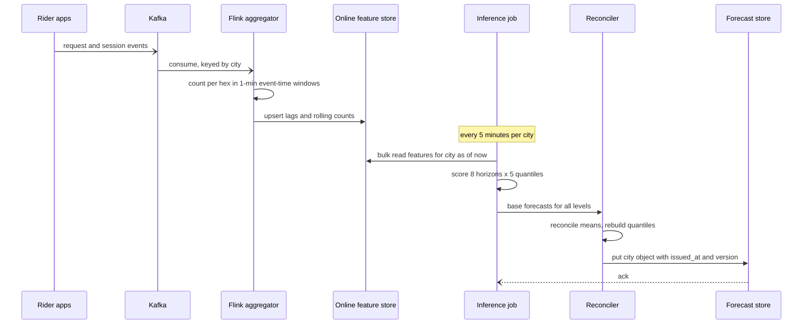

**Reading the diagram.** Apps publish events asynchronously (half arrows) to Kafka; the aggregator consumes them keyed by city, counts per hexagon in event-time windows and upserts features. Late events within the watermark update the counts; later ones go only to the lake, so the online lag features and the eventual training labels can differ slightly, a known skew that the backtest measures. Every five minutes the inference job reads a consistent snapshot of one city's features, scores, reconciles and writes a single object, so readers never see half a city updated. Failure points: aggregator lag (detected by event-time lag metrics), and a failed write (consumers keep the previous object, which carries its age). Scaling: by city partitions in both Flink and the inference job.

**Figure 83.5 — Read path: pricing and the driver heat map consume a forecast.**

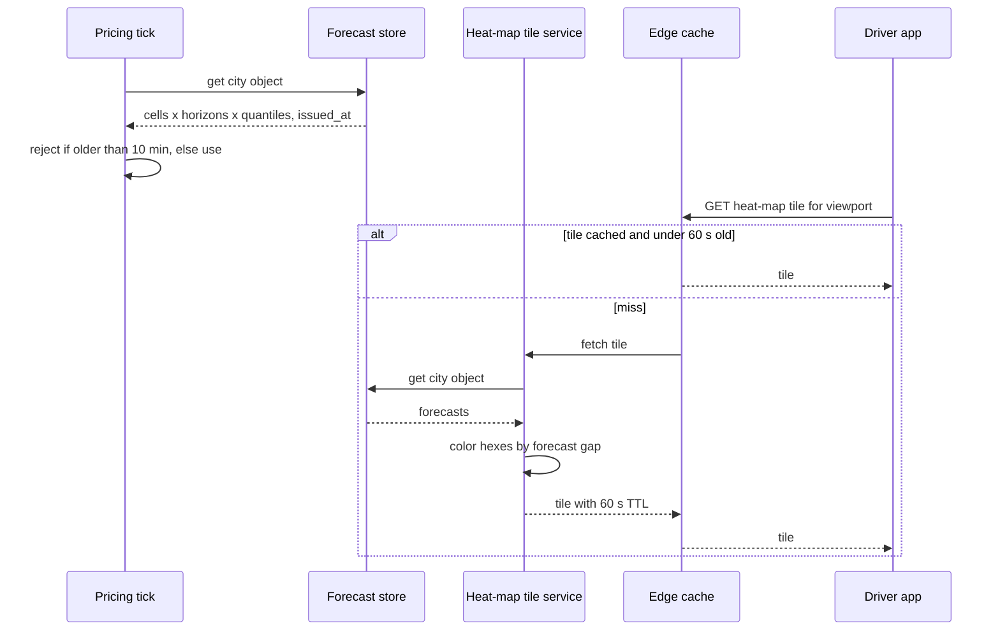

**Reading the diagram.** Both readers are synchronous. Pricing reads one object per city per minute and enforces its own staleness limit. Driver apps read heat-map tiles through an edge cache with a 60-second TTL, so the 33,333 reads per second at peak become a few hundred tile renders per second. The tile service colors hexagons by the gap between forecast demand and expected supply, not by raw demand, so drivers are not all sent to the busiest place. Failure points: a stale forecast object (pricing falls back to real-time counts only), and the tile service (the CDN keeps serving stale tiles). Scaling: tiles scale with the CDN; pricing reads are trivial.

### 83.4.10 Bottlenecks

1. **Input freshness, not compute.** The most predictive features are the last few buckets; any lag in the aggregator directly degrades the first horizons. Monitor event-time lag per city.
2. **Sparse series.** Fine hexagons are dominated by noise. Forecast at resolution 7, not 9, and push finer allocation to the consumer.
3. **Event knowledge.** No feature exists for an event nobody recorded. The operations annotation path and an anomaly detector on live app opens (a sudden surge of sessions near a venue) cover gaps.
4. **Backtest cost.** Fifty-two weekly origins × candidate models × cities is the largest compute bill in the system; sample cities and run full backtests only for promotion candidates.

### 83.4.11 Failure scenarios

**Table 83.6 — Demand forecasting failure scenarios.**

| What fails | Impact | Detection | Recovery | Prevention |
|---|---|---|---|---|
| Aggregator lag or outage | Lags stale; short-horizon forecasts drift toward seasonal pattern | Event-time lag; feature age at inference | Serve last forecast with stale flag; pricing uses real-time counts | Lag alert below freshness SLO; city-partitioned jobs |
| Censored labels (training on completed trips) | Under-forecast where supply was short; drivers sent away; loop reinforces | Forecast bias by supply-shortage slice | Retrain with suppressed-demand label | Label definition reviewed; price and supply as features |
| Label leakage via lags not available at issue time | Excellent backtest, poor live accuracy | Live versus backtest pinball gap | Rebuild features as of `issued_at` | Point-in-time joins (§62.8); live shadow scoring before promotion |
| Holiday or event not in features | Large under-forecast for hours | Residual spike in a cluster of hexagons | Operations annotation; widen intervals | Event feed, calendar coverage checks, anomaly detector on sessions |
| Concept drift (new product, competitor exit, pandemic) | Systematic bias across cities | Bias and coverage trend per city (§70.4) | Shorten training window; up-weight recent data | Weekly retrain; drift alerts |
| Weather feed outage | Missing feature, model sees zeros | Null-rate check on feature (§70.10) | Impute with climatology; flag | Treat missing as missing, not zero, in training |
| Hierarchy mapping error after map update | Incoherent or misplaced forecasts | Parent-minus-sum-of-children check | Roll back mapping | Version the hexagon-to-parent table |
| Feedback with pricing (§83.6) | Forecast learns price-suppressed demand | Forecast versus unconstrained-demand audits | As censored labels | Price as feature; occasional exploration |

### 83.4.12 Scaling strategy

**At 10× cities or hexagons** (1.5 million series), inference is still a few cores; the aggregator and online store scale by city partition. The backtest harness becomes the constraint: move to distributed training per region and sample backtest origins.

**At 10× temporal resolution** (5-minute buckets, horizons to 30 minutes), counts per bucket fall below one in most hexagons; forecast at 15 minutes and nowcast within the bucket from live sessions instead.

**At 100× scale or many verticals** (rides, food, freight sharing drivers), forecasts become a platform: one feature pipeline, per-vertical models and a joint hierarchy across verticals, with reconciliation across both geography and product.

### 83.4.13 Trade-offs

**Table 83.7 — Demand forecasting trade-offs.**

| Decision | Option chosen | Alternative | Why |
|---|---|---|---|
| Spatial unit | H3 resolution 7 | Resolution 8–9 or city zones | Enough counts per bucket to be learnable; hexagons smooth neatly |
| Model | Global GBM per quantile | Per-series statistical models | Shares strength across sparse series; one pipeline |
| Output | Quantiles | Point forecast | Decisions have asymmetric costs; uncertainty varies by hexagon |
| Coherence | Reconciliation (MinT) | Bottom-up sums | Uses accurate aggregate signal; bottom-up is noisy |
| Inference | 5-minute micro-batch | Online per request | Forecasts are shared by all consumers; cheaper and consistent |
| Label | Unconstrained demand estimate | Completed trips | Avoids learning the platform's own supply shortages |

### 83.4.14 Alternative designs

- **Deep global models** (DeepAR, temporal fusion transformers) for day-ahead forecasts with long histories; more accurate around complex seasonality, harder to debug than trees.
- **Classical per-series models** (exponential smoothing, ARIMA, Prophet [Taylor and Letham 2018]) per city: excellent at city level, unworkable for 150,000 sparse series.
- **Graph or convolutional spatiotemporal networks** that treat neighboring hexagons as a graph; useful when spillover between areas matters, at the cost of a GPU training pipeline.
- **Nowcasting only.** For pricing within 15 minutes, live counts plus momentum may be enough; forecasting earns its keep at horizons of 30 minutes and more.

### 83.4.15 Interview discussion

**Table 83.8 — 45-minute pacing plan for demand forecasting.**

| Minutes | Focus | What to produce |
|---|---|---|
| 0–5 | Decision and target | Who uses the forecast; unconstrained demand per hexagon and bucket; quantiles |
| 5–10 | Estimates | 150,000 series, 2.5 requests per bucket, 6 million values per refresh; compute is small |
| 10–20 | Architecture | Figure 83.2: streaming features, micro-batch inference, forecast store |
| 20–32 | Deep dive: model and evaluation | Global GBM, pinball loss, rolling-origin backtest, censored labels, reconciliation |
| 32–40 | Events and failures | Holidays, weather, annotations; Table 83.6 |
| 40–45 | Feedback with pricing, scaling | Price as feature, exploration, 10× plan |

**Likely follow-ups.**

- *"Why not forecast completed trips?"* They are capped by supply and suppressed by price; the model would learn the platform's shortages and repeat them.
- *"How do you know the model is calibrated?"* Coverage of the 80% interval per city and horizon in the backtest and live, plus pinball loss.
- *"How do you handle a concert?"* Event features from a feed, operations annotations, and a session-spike detector; widen intervals when an event is near.
- *"Can you add the hexagon quantiles to get the city's?"* No; reconcile means, variances or sample paths.

**What distinguishes senior and staff answers.** A senior answer chooses a sensible spatial unit, a global model with quantile loss and a time-based backtest. A staff answer names the censored-label feedback loop before being asked, ties the loss and quantiles to the decision each consumer makes, reconciles across the hierarchy, and treats input freshness and event knowledge as the operational core.

### 83.4.16 Production considerations

- **Monitoring** (Chapter 70). Live pinball loss and coverage per city and horizon once labels close (30 minutes after each bucket, so label delay is short, §63.4.2); feature age; bias by supply-shortage slice; seasonal reference windows for drift tests (§70.6.5).
- **Retraining.** Weekly scheduled retrain with promotion gates of Table 83.3; triggered retrain when city bias exceeds a threshold for two days (§70.14).
- **Responsible ML.** Forecasts steer drivers, and therefore service levels, between neighborhoods. Track rider wait times by area against demographic baselines (§71.5) so the system does not learn to under-serve areas with historically low supply.
- **Cost.** Streaming aggregation and backtests dominate; inference rounds to zero.
- **Operations.** City teams own event annotations; a runbook covers "forecast stale" and "known event missing".

## 83.5 ETA Prediction at Ride-Hailing Scale

### 83.5.1 Problem statement

Every screen and every decision on a ride-hailing platform contains an arrival time. The rider's product selector shows "3 min" to the nearest car; the upfront fare depends on predicted trip duration; dispatch ranks candidate drivers by their pickup ETA (§55.5.8); and during the trip the app updates the arrival time continuously. An ETA that is two minutes optimistic makes the rider wait on the curb and wrecks trust; one that is consistently pessimistic loses bookings and mis-prices fares.

QuickBite's delivery ETA (§60.15) is a different problem: its error is dominated by restaurant preparation time and courier hand-offs, at 40,000 predictions per second. Ride-hailing ETA is dominated by **driving time over a road network**, it is requested about six times as often, and it sits inside dispatch and pricing loops that run thousands of times per second. This case designs it at that scale.

**ML formulation.** For an origin, a destination and a departure time, predict the travel time of a leg (pickup leg: driver to rider; trip leg: pickup to drop-off). The routing engine of §55.6 already returns a physics-based estimate: the sum of live segment travel times along the best route. The model predicts the **residual**, the actual duration minus the routing estimate, conditioned on features the router cannot see: the route actually taken, intersections and turns, time of day, pickup friction at airports and stadiums, weather. The label is the observed leg duration from trip events, cleaned with map-matched GPS. The task is regression with an asymmetric loss and calibrated prediction intervals.

**Why ML is warranted.** The router is accurate in free-flowing traffic but systematically wrong where its assumptions fail: waiting to turn left, finding the rider at a busy terminal, drivers taking a different route than the optimal one. Those errors are learnable from billions of completed legs, and a residual model leaves the router responsible for what physics does well.

### 83.5.2 Functional requirements

1. **Point-to-point ETA.** Given origin, destination, departure time and product, return a predicted duration, the routing estimate and an 80% prediction interval.
2. **Batch ETA.** Given one destination (a rider) and up to 50 origins (candidate drivers), return all ETAs in one call for dispatch.
3. **Live trip ETA.** Re-estimate the remaining time of an active leg from the driver's current position every 20 s.
4. **Labels and traffic.** Map-match driver GPS traces to road segments to produce segment speeds for routing and leg labels for training.
5. **Explainability.** Return the routing estimate and the correction separately, for debugging and support.

Out of scope: the routing algorithm (§55.6.8), dispatch optimization (§55.5) and fare rules (§83.6).

### 83.5.3 Non-functional requirements

**Table 83.9 — ETA non-functional requirements.**

| Property | Target | Why |
|---|---|---|
| Latency (model only) | p99 ≤ 5 ms per batch of up to 50 | Dispatch and pricing call ETA inside their own 100–300 ms budgets |
| Latency (routing + model) | p99 ≤ 40 ms for a batch | Router many-to-one queries dominate |
| Availability | 99.99%; on model failure, serve routing ETA with a correction table | ETA is on the path of every quote and dispatch |
| Throughput | ~230,000 predictions/s at peak (§83.5.4) | Five consumers, see estimate |
| Accuracy | Trip-leg MAE ≤ 10% of duration; bias within ±2% per city and hour | Fares and promises depend on it |
| Calibration | 80% interval coverage 0.77–0.83 per city, hour band and leg type | Promises and pricing use the interval |
| Traffic freshness | Segment speeds ≤ 2 min old | Congestion changes within minutes |
| Model freshness | Retrained weekly; residual-correction table refreshed hourly | Road works and seasonal traffic |

### 83.5.4 Capacity estimation

::: example
**Worked example — Who asks for ETAs, and how often?** Assumptions from §55.4.4: 1,042 trip requests/s and 5,208 fare estimates/s at peak. Each fare estimate needs a trip ETA and a pickup ETA. Dispatch scores 20 candidates per request and, with batched matching (§55.5.8), evaluates each request in two batch windows on average. A pickup leg averages 5 min and a trip 20 min. Active legs refresh every 20 s. One million occupied resolution-9 hexagons with an open app at peak each get a nearest-car ETA every 10 s, cached per hexagon.

1. Fare estimates: $2 \times 5{,}208 = 10{,}417$/s.
2. Dispatch: $1{,}042 \times 20 \times 2 = 41{,}667$/s.
3. Active legs by Little's Law (§4.11): $1{,}042 \times (300 + 1{,}200) = 1.5625 \times 10^6$ concurrent; refreshes $1.5625 \times 10^6 / 20 = 78{,}125$/s.
4. App-open display: $10^6 / 10 = 100{,}000$/s.
5. Total at peak: $10{,}417 + 41{,}667 + 78{,}125 + 100{,}000 = 230{,}208$/s, about $5.8\times$ QuickBite's 40,000/s (§60.11). With a 3:1 peak-to-average ratio, the average is 76,736/s or $6.6 \times 10^9$ predictions/day.

**Interpretation.** The biggest consumers are not the requests riders make but the display and refresh loops that run continuously. **Engineering implication.** Cache app-open ETAs per hexagon and lower refresh rates for long legs before buying servers; every halving of the display refresh saves 50,000/s.
:::

::: example
**Worked example — Fleets, labels and training.** Apply the fleet formula of §60.11.1 with $c = 0.3$ ms of vCPU per prediction (a batched, small attention model in a load test), $u = 0.5$, $k = 16$ vCPU per node at \$0.77/h. Traffic splits 40/25/20/15% across four regions, each with one spare node.

1. Busy vCPU at peak: $230{,}208 \times 0.0003 = 69$; at $u = 0.5$, 138 vCPU, 9 nodes globally.
2. Per region: $\lceil 27.6/0.5/16 \rceil + 1 = 5$, then 4, 3 and 3: **15 model nodes**, \$11.55/h. At the 76,736/s average, $C_{1k} = 1{,}000 \times 11.55 / (3{,}600 \times 76{,}736) = \$0.000042$ per 1,000 predictions.
3. Routing: about 190,600 router queries/s (dispatch uses one many-to-one query per request per window); at 1 ms per point-to-point and 2 ms per many-to-one query, 193 busy cores, so $\lceil 193 \times 0.4 / 0.5 / 16 \rceil + 1 = 11$ nodes in the largest region and **30 routing nodes** in total, each holding its region's road graph in memory (§55.6.4).
4. Map matching: 500,000 GPS points/s (§55.4.4) at 50 µs per point = 25 busy cores, 50 at $u = 0.5$.
5. Labels: 30 million trips × 2 legs = $6 \times 10^7$ legs/day at 1 KB of features = 60 GB/day, 21.9 TB/year. Segment traversals: about 100 segments per trip × 30 million × 32 bytes = 96 GB/day.
6. Training on 90 days ($5.4 \times 10^9$ legs) at 200,000 examples/s per GPU: 7.5 GPU-hours per epoch; three epochs, 22.5 GPU-hours, under 3 hours on 8 GPUs.
7. Prediction log: dispatch, fare and refresh ETAs in full plus a 1% sample of display ETAs, 300 bytes each: about 1.1 TB/day.

**Interpretation.** The model fleet is small; the router is twice its size, and the prediction log is the largest data stream. **Engineering implication.** Optimize router queries (many-to-one, caching per hexagon pair) before the model, and sample logs by consumer.
:::

**Table 83.10 — ETA capacity summary.**

| Quantity | Value |
|---|---|
| Predictions at peak / average | 230,208/s / 76,736/s (6.6 billion/day) |
| Model fleet | 15 nodes of 16 vCPU across 4 regions |
| Routing fleet | ~30 nodes, road graph in memory per region |
| Map matching | 500,000 points/s, ~50 cores |
| Training labels | 60 million legs/day, ~22 TB/year |
| Training compute | ~22.5 GPU-hours per weekly retrain |
| Prediction log | ~1.1 TB/day |

### 83.5.5 API design

```protobuf
// Internal RPC (illustrative)
service Eta {
  rpc EstimateBatch(EtaBatchRequest) returns (EtaBatchResponse);
}
message EtaBatchRequest {
  repeated LatLng origins = 1;        // up to 50 (dispatch candidates) or 1
  LatLng destination = 2;
  int64 departure_unix_ms = 3;
  LegType leg_type = 4;               // PICKUP or TRIP
  string product = 5;                 // economy, premium, ...
  string caller = 6;                  // dispatch, pricing, display, trip_refresh
  uint32 deadline_ms = 7;
}
message EtaBatchResponse {
  repeated EtaResult results = 1;
  string model_version = 2;
  bool degraded = 3;                  // true when served by fallback
}
message EtaResult {
  int32 eta_s = 1;                    // point prediction
  int32 route_eta_s = 2;              // routing-engine estimate
  int32 p10_s = 3; int32 p90_s = 4;   // calibrated 80% interval
  string prediction_id = 5;           // joins the log to the eventual label
}
```

Feedback needs no new API: trip events (`driver_arrived`, `trip_started`, `trip_completed`) already flow on the trip-event topic (§55.4), and the GPS stream supplies the traces. The `prediction_id` lets the label pipeline join a logged prediction to its outcome, and `caller` lets monitoring compute accuracy per consumer, which matters because display ETAs are evaluated against legs that often never happen.

### 83.5.6 Data model and database schema

**Table 83.11 — ETA features, labels and stores.**

| Data | Key | Freshness | Store |
|---|---|---|---|
| Segment speeds (live) | segment_id, minute | ≤ 2 min | In-memory traffic store per region (§55.6.8) |
| Segment speed profiles (historical) | segment_id, day-of-week, 15-min slot | Weekly | Batch table, loaded into router |
| Route features: distance, routing ETA, turns, segment classes, tolls | computed per request | Request time | Not stored online; logged with prediction |
| Origin and destination cells, hashed at several H3 resolutions | h3_r7/r9/r11 | Static | Embedding tables inside the model |
| Context: hour, weekday, weather, event flag, product | city, time | Hourly | Online feature store |
| Pickup friction: median wait at pickup hexagon | h3_r10 | Daily | Online feature store |
| Label: observed leg duration | prediction_id / trip_id + leg | Minutes after leg ends | Lakehouse |
| Map-matched traversals | trip_id, seq | Minutes | Lakehouse (96 GB/day) |

```sql
CREATE TABLE eta_training_example (
  trip_id        BIGINT     NOT NULL,
  leg            CHAR(6)    NOT NULL,      -- PICKUP | TRIP
  requested_at   TIMESTAMP  NOT NULL,      -- prediction time; features as of this instant
  route_eta_s    INT        NOT NULL,
  features       BINARY     NOT NULL,
  actual_s       INT,                      -- cleaned duration
  label_quality  SMALLINT,                 -- 0 good, 1 corrected from GPS, 2 excluded
  route_overlap  REAL,                     -- share of the predicted route actually driven
  PRIMARY KEY (trip_id, leg)
) PARTITIONED BY (date(requested_at), region);
```

Two columns deserve comment. `label_quality` records whether the event timestamp was trusted, corrected from GPS or excluded (drivers sometimes tap "arrived" a block early). `route_overlap` records how much of the predicted route was driven; low overlap identifies legs where the residual came from a route change rather than traffic, which is exactly what a trip-level model must learn and a segment-level model cannot.

### 83.5.7 High-level architecture

**Figure 83.6 — ETA at ride-hailing scale: routing plus learned residual.**

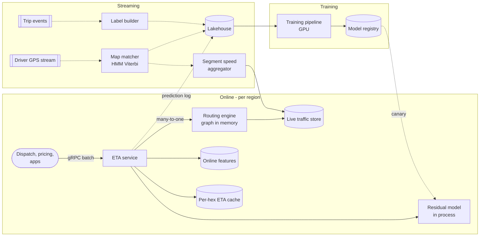

**Reading the diagram.** The online path is synchronous gRPC: callers send batches; the ETA service asks the routing engine for routes and segment-sum estimates (a many-to-one query for dispatch), reads context features in one multi-get, runs the residual model in process and returns corrected ETAs with intervals; display ETAs are served from a per-hexagon cache refreshed every 10 s. The streaming tier is asynchronous: the map matcher snaps GPS points to road segments, feeding both the segment-speed aggregator (live traffic for the router) and the lakehouse (traversals for labels); a label builder joins trip events with map-matched traces to produce cleaned leg durations. Training runs weekly on GPUs; models reach serving through a canary. Storage boundaries: traffic store, online features, cache, lakehouse, registry. Failure points: the router (no ETA at all), the traffic store (stale speeds), the model (fall back to routing ETA plus a correction table). Scaling: everything is partitioned by region; ETA and routing nodes are stateless apart from read-only graph and model copies.

### 83.5.8 Detailed component design

#### Map matching and label construction

Raw GPS is noisy: 5–20 m errors, worse in urban canyons, with points every 4 s. **Map matching** finds the most likely sequence of road segments for a trace. The standard formulation is a **hidden Markov model**: hidden states are candidate segments near each point; the emission probability falls with the distance from the point to the segment; the transition probability favors pairs whose road-network distance is close to the straight-line distance between consecutive points; the Viterbi algorithm finds the best path [Newson and Krumm 2009]. This is the same matcher that produces live traffic (§55.6.8); here its output also produces labels.

From matched traces, the label builder computes the leg duration and checks it: the "arrived" event is compared with the time the matched trace reached the pickup; when they differ by more than a threshold the GPS time wins and the row is marked corrected. Legs with GPS gaps, impossible speeds or cancellations are excluded. Labels are complete minutes after the leg ends, so label delay is short (§63.4.2), but cleaning rules are versioned, because a change to them is a change to the training target.

#### Model: routing engine plus residual, and the loss

The baseline is the routing estimate alone; the second baseline is the routing estimate multiplied by a correction factor per city, hour and road class, which is also the fallback. The production model predicts the residual from the routing estimate, route features, origin and destination embeddings and context.

::: industry
**Uber — DeepETA and DeeprETA.** Uber described ETA "post-processing": the routing engine produces an estimate and a machine-learned model predicts the residual between it and observed outcomes; Uber reported that this is its highest-QPS model and that it replaced gradient-boosted trees used for several years. The published model is a linear transformer (chosen because full self-attention was too slow), with categorical features embedded, continuous features bucketized before embedding, and geospatial features hashed at multiple grid resolutions; the paper reports lower mean and median absolute error than the routing estimate and competitive baselines [Hu et al. 2022a; Hu et al. 2022b].
*Evidence: Primary* — [Hu et al. 2022a; Hu et al. 2022b]
:::

**Segment-level or trip-level?** A segment-level model predicts the traversal time of each road segment and sums them; a trip-level model predicts the whole leg at once. Figure 83.7 contrasts them.

**Figure 83.7 — Segment-level, supersegment and trip-level ETA models.**

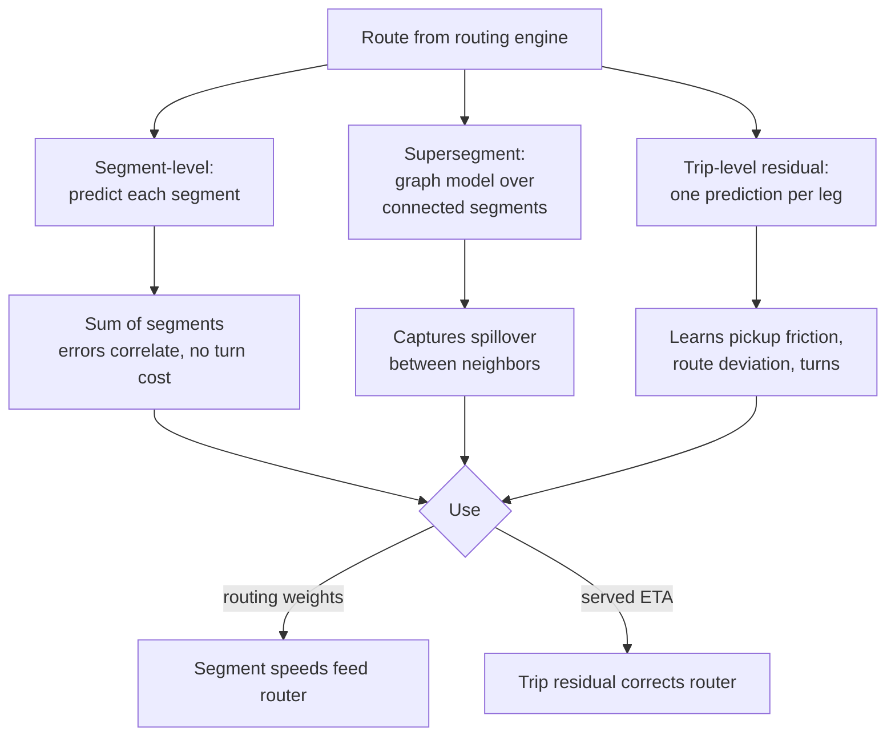

**Reading the diagram.** All three start from the same route. Segment-level predictions are reusable by the router for choosing routes, but summing them ignores turn and intersection delays and treats errors as independent when congestion makes them correlated. Graph models over **supersegments** (groups of connected segments) let congestion on one segment inform its neighbors; Google and DeepMind reported deploying such a graph neural network in Google Maps and reducing negative ETA outcomes substantially in several cities [Derrow-Pinion et al. 2021]. A trip-level residual model captures what no segment model can see: pickup friction, the driver not following the suggested route, and turn costs. The design uses both: segment speeds (from map-matched traffic) as router weights, and a trip-level residual for the served ETA. Failure point: if the router changes its route choice, the residual model sees a distribution shift and must be retrained together with it.

The loss must reflect that being late hurts more than being early (§59.4.2): a rider standing in the rain for two unpromised minutes is worse off than one whose car arrives a minute early. Squared error is also fragile against the heavy-tailed outliers that slip through label cleaning. An **asymmetric Huber loss** handles both; Uber's DeepETA write-up describes using an asymmetric Huber loss for these reasons [Hu et al. 2022b].

::: formula
**Asymmetric Huber loss**

$$h_\delta(e) = \begin{cases} \tfrac{1}{2} e^2 & |e| \le \delta \\ \delta\,(|e| - \tfrac{1}{2}\delta) & |e| > \delta \end{cases} \qquad L_{\delta,\omega}(e) = \begin{cases} \omega\, h_\delta(e) & e \ge 0 \ \text{(late)} \\ (1 - \omega)\, h_\delta(e) & e < 0 \ \text{(early)} \end{cases}$$

| Symbol | Meaning | Units |
|---|---|---|
| $e$ | Error: actual minus predicted duration | s |
| $\delta$ | Threshold where the loss turns from quadratic to linear | s |
| $\omega$ | Weight on late errors; 0.5 is symmetric | dimensionless |
| $h_\delta$, $L_{\delta,\omega}$ | Huber and asymmetric Huber loss | s² |
:::

::: example
**Worked example — Weighing late and early errors.** Take $\delta = 60$ s and $\omega = 0.7$.

1. 30 s late: $h = \tfrac{1}{2} \times 30^2 = 450$; $L = 0.7 \times 450 = 315$.
2. 30 s early: $L = 0.3 \times 450 = 135$.
3. 300 s late: $h = 60 \times (300 - 30) = 16{,}200$; $L = 0.7 \times 16{,}200 = 11{,}340$.
4. 300 s early: $L = 0.3 \times 16{,}200 = 4{,}860$.
5. With squared error, a 300 s error would cost $\tfrac{1}{2} \times 300^2 = 45{,}000$, 100 times a 30 s error rather than 36 times.

**Interpretation.** A late error costs $0.7/0.3 = 2.33$ times an early one of the same size, and large errors grow linearly, so a few bad labels cannot dominate training. **Engineering implication.** The model's predictions now sit slightly above the median. Choose $\omega$ from the business cost of lateness, and remember that pricing, which needs an unbiased duration for fares, may want the symmetric prediction: serve both from a multi-output head rather than one compromise.
:::

#### Serving at extreme request rates

Three choices keep the fleet at 15 nodes. **Batch at the caller**: dispatch sends 20–50 origins in one request, so the per-request overheads (deserialization, feature fetch, routing graph search from the shared destination) are paid once, and the model scores the batch as one matrix multiply (§66.6). **Model in process**: the network hop to a separate model server would cost more than the inference. **Cache what is shared**: display ETAs are per hexagon, not per rider. The fallback ladder (§60.12.2) runs from the full model, to the routing ETA times the hourly correction table, to the routing ETA alone, to a straight-line distance heuristic when the router is down.

#### Calibrating uncertainty

A point ETA is not enough when pricing uses duration risk and riders get promises. The model outputs an interval, calibrated with **split conformal prediction**: hold out a calibration set, compute the relative error of each example, and use its 80th percentile as the interval half-width [Angelopoulos and Bates 2021]. One global width fails because uncertainty differs by slice, so calibrate per slice (city, hour band, leg type), the conditional form of the method.

```python
import numpy as np
from sklearn.ensemble import HistGradientBoostingRegressor

rng = np.random.default_rng(83)
def trips(n):
    km = rng.gamma(2.0, 3.0, n)                     # trip length, km
    hour = rng.integers(0, 24, n)
    zone = rng.integers(0, 50, n)                   # coarse origin cell id
    rush = np.isin(hour, [7, 8, 17, 18]).astype(float)
    route_eta = 3600 * km / 30 * (1 + 0.3 * rush)     # routing engine: segment sum, seconds
    zone_bias = np.where(zone < 5, 120.0, 0.0)      # 5 downtown cells: slow pickups/drop-offs
    true = route_eta * (1 + 0.25 * rush) + zone_bias + 30
    actual = true * rng.lognormal(0, 0.10 + 0.10 * rush, n)   # noisier in rush hour
    X = np.column_stack([route_eta, km, hour, zone])
    return X, route_eta, actual, rush

X_tr, r_tr, y_tr, _ = trips(60_000)
X_cal, r_cal, y_cal, rush_cal = trips(20_000)
X_te, r_te, y_te, rush_te = trips(20_000)

# residual model: predict actual - routing ETA (absolute-error loss, robust to outliers)
m = HistGradientBoostingRegressor(loss="absolute_error", max_iter=200,
                                  categorical_features=[3], random_state=83)
m.fit(X_tr, y_tr - r_tr)
pred = lambda X, r: r + m.predict(X)
p_cal, p_te = pred(X_cal, r_cal), pred(X_te, r_te)
print(f"MAE routing engine only : {np.mean(np.abs(y_te - r_te)):6.1f} s")
print(f"MAE engine + residual ML: {np.mean(np.abs(y_te - p_te)):6.1f} s")

# split-conformal 80% interval on relative error |y - p| / p
s_cal = np.abs(y_cal - p_cal) / p_cal
def coverage(qhat_te):
    ok = np.abs(y_te - p_te) <= qhat_te * p_te
    return ok[rush_te == 0].mean(), ok[rush_te == 1].mean()
g = np.quantile(s_cal, 0.8)
print("global conformal   coverage off-peak %.3f, rush %.3f" % coverage(np.full_like(p_te, g)))
q_by = {k: np.quantile(s_cal[rush_cal == k], 0.8) for k in (0, 1)}
print("per-slice conformal coverage off-peak %.3f, rush %.3f" %
      coverage(np.where(rush_te == 1, q_by[1], q_by[0])))
print(f"half-width as % of ETA: global {100*g:.1f}; off-peak {100*q_by[0]:.1f}, rush {100*q_by[1]:.1f}")
```

Output (run with `OMP_NUM_THREADS=1`):

```text
MAE routing engine only :  118.2 s
MAE engine + residual ML:   84.3 s
global conformal   coverage off-peak 0.852, rush 0.525
per-slice conformal coverage off-peak 0.796, rush 0.800
half-width as % of ETA: global 14.6; off-peak 12.9, rush 26.4
```

What to notice:

- The residual model removes the router's systematic errors (rush-hour congestion, downtown pickup friction); what remains is irreducible noise.
- A single conformal width gives the advertised 80% overall but only 52.5% in rush hour, exactly when promises matter most. Per-slice calibration restores about 80% in both, at the price of intervals twice as wide in rush hour.

#### Evaluation and experiments

Offline: MAE and mean relative error, bias, and coverage by city, hour band, leg type and trip length, on a time-based holdout (§57.7.1), plus asymmetric-loss value. Online, ETA changes are not neutral: a new model changes dispatch decisions and fares, which change rider and driver behavior for everyone in the city. A rider-randomized test therefore shares supply between arms; changes that affect dispatch should be tested with switchback designs (§83.6.8). Display-only changes (the interval shown to riders) can be rider-randomized, measuring conversion and cancellations.

### 83.5.9 Data flow

**Figure 83.8 — Write path: GPS traces become traffic and labels.**

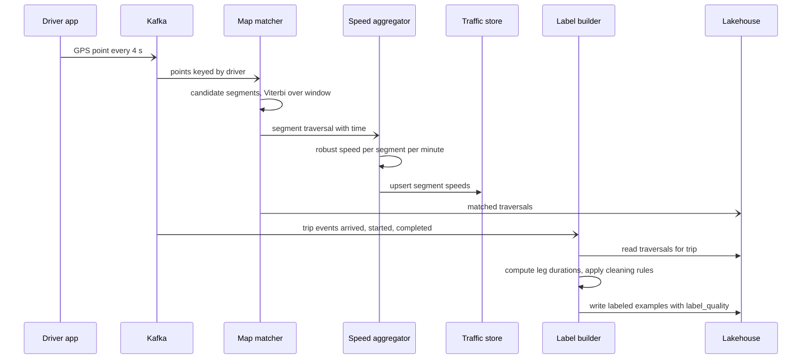

**Reading the diagram.** GPS points flow asynchronously into Kafka, keyed by driver so each matcher instance sees a whole trace in order. The matcher holds a short sliding window per driver and emits traversals once Viterbi decisions are stable (a few points of delay). Traversals feed two consumers: the speed aggregator (robust statistics per segment and minute, written to the in-memory traffic store the router reads) and the lake. The label builder waits for leg-ending trip events, then reads that trip's traversals and writes cleaned examples. Failure points: matcher lag (traffic stale, router estimates drift toward historical profiles), and event–trace mismatch (examples excluded, visible as a rising exclusion rate). Scaling: by driver partitions.

**Figure 83.9 — Read path: an upfront fare estimate asks for two ETAs.**

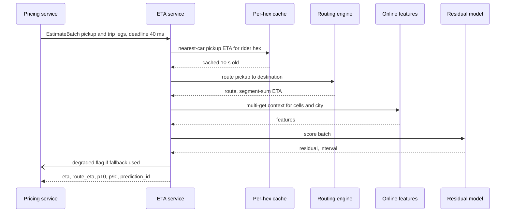

**Reading the diagram.** Calls are synchronous except the asynchronous degraded-flag signal. The pickup ETA comes from the per-hexagon cache because every rider in that hexagon shares it; the trip ETA needs a route, features and the model. The deadline propagates (§22.11): if the router has not answered within its share, the service returns the cached correction-table estimate and marks the response degraded. The `prediction_id` is logged with features for the training join. Failure points: router timeout (fallback), feature store miss (defaults for context features), model crash (correction table). Scaling: stateless ETA nodes behind a load balancer per region.

### 83.5.10 Bottlenecks

1. **Router queries.** Twice the model's compute; use many-to-one queries for dispatch and cache hexagon-to-hexagon ETAs for display.
2. **Feature fetch fan-out.** One multi-get per batch, never per origin; keep context features keyed by coarse cells.
3. **Map matching throughput** at 500,000 points/s; partition by driver and bound the Viterbi window.
4. **Prediction logging.** At 6.6 billion predictions per day, log by consumer with sampling.

### 83.5.11 Failure scenarios

**Table 83.12 — ETA failure scenarios.**

| What fails | Impact | Detection | Recovery | Prevention |
|---|---|---|---|---|
| Traffic store stale (matcher lag) | Router uses old speeds; residual compensates wrongly | Segment-speed age; bias by hour | Router falls back to historical profiles | Lag alerts; speed age as a model feature |
| Router route-choice change | Residual distribution shifts; bias | Bias jump at router release | Roll back router or retrain residual | Release router and model together; shadow scoring |
| Label cleaning bug | Model learns wrong target | Label-quality mix and mean duration shift | Re-run builder; retrain | Versioned cleaning rules; tests on known trips |
| Training–serving skew (route features computed differently) | Live MAE worse than offline | Log-and-compare skew check (§62.9.2) | Fix feature code | One feature library for both paths |
| Calibration drift (new road works, season) | Coverage falls in some slices | Coverage per slice (§70.9.1) | Recalibrate hourly from fresh labels | Conformal recalibration job |
| Feedback via dispatch | Model favors drivers it already over-predicts; data under-represents them | Accuracy by candidate rank | Log ETAs for non-chosen candidates and sample them | Exploration in dispatch; evaluate on all candidates |
| Driver gaming (marking arrival early) | Labels short; ETAs optimistic | Event-versus-GPS disagreement rate | GPS-corrected labels | Label from GPS, not taps |
| Model node failure in a region | Capacity loss | Health checks | N+1 spare; fallback ladder | Per-region redundancy |

### 83.5.12 Scaling strategy

**At 10×** (2.3 million predictions/s), the model fleet grows to about 150 nodes and the router to about 300; before that, cut demand: lower display refresh for idle app sessions, reuse pickup ETAs across batch windows, and cache hexagon-pair ETAs for short legs. Move the residual model to GPUs only if a larger model pays for itself in accuracy (§66.7).

**At 100×** (multiple verticals: rides, delivery, freight), make ETA a platform service with per-vertical heads on a shared encoder, as multi-task models share road and time representations; partition by region and vertical.

### 83.5.13 Trade-offs

**Table 83.13 — ETA design trade-offs.**

| Decision | Option chosen | Alternative | Why |
|---|---|---|---|
| Model target | Residual over routing ETA | End-to-end ML ETA | Router handles physics and long-tail routes; ML fixes systematic errors |
| Granularity | Trip-level residual plus segment speeds | Segment-only | Captures pickup friction, turns and route deviations |
| Loss | Asymmetric Huber, plus symmetric head for pricing | MSE | Lateness costs more; robust to outliers |
| Uncertainty | Per-slice conformal intervals | Model-native quantiles only | Distribution-free coverage guarantee per slice |
| Serving | In-process, CPU, caller-side batching | Separate GPU model server | Tiny model, extreme rate, tight latency |
| Labels | GPS-corrected durations | Driver taps | Taps are noisy and gameable |

### 83.5.14 Alternative designs

- **Pure segment model with GNN** (Google's supersegment approach) when the same model must also guide route choice.
- **Gradient-boosted trees** for the residual: cheaper and easier to debug, and what Uber reported using before DeepETA; a sound first version.
- **Pure ML ETA without a router**: fails on rare origin–destination pairs and on road closures the model has never seen.
- **Quantile regression heads** instead of conformal calibration: simpler serving, no coverage guarantee under drift; combine with conformalized quantile regression [Romano et al. 2019].

### 83.5.15 Interview discussion

**Table 83.14 — 45-minute pacing plan for ETA prediction.**

| Minutes | Focus | What to produce |
|---|---|---|
| 0–5 | Scope | Pickup and trip legs; consumers; how this differs from food-delivery ETA |
| 5–12 | Estimates | 230,000/s by consumer; Little's Law for refreshes; fleet sizes |
| 12–20 | Architecture | Figure 83.6: router + residual, traffic and label pipelines |
| 20–32 | Deep dive: model | Residual target, segment versus trip level, asymmetric loss, features |
| 32–40 | Deep dive: labels and calibration | Map matching, cleaning, per-slice conformal intervals |
| 40–45 | Failures and scaling | Router change, traffic lag, feedback via dispatch; 10× plan |

**Likely follow-ups.**

- *"Why not let the model predict the whole ETA?"* Rare routes and closures; the router generalizes by physics, the model by data.
- *"How do you get labels for display ETAs that never become trips?"* You do not; evaluate on legs that happened and watch selection bias.
- *"Why is dispatch a feedback loop?"* Dispatch picks the driver with the lowest predicted ETA, so labels exist mostly for under-predicted candidates; log and sample the others.

**What distinguishes senior and staff answers.** Senior answers combine router and model, size the fleet and pick a robust loss. Staff answers derive the request rate from consumers and attack it with caching, treat label construction as a first-class pipeline, calibrate per slice, and recognize that an ETA change is a marketplace change that needs a switchback test.

### 83.5.16 Production considerations

- **Monitoring.** MAE, bias and coverage per city, hour band, leg type and caller; fallback rate; segment-speed age; label exclusion rate; skew checks (Chapter 70).
- **Retraining.** Weekly retrain on 90 days; hourly recalibration of intervals and correction tables; retrain on every router release.
- **Responsible ML.** Systematically pessimistic ETAs in some neighborhoods mean higher fares and fewer dispatches there; audit bias by area (§71.5).
- **Privacy.** GPS traces are sensitive: keep raw traces short-lived, use matched traversals for training, and restrict access (§50.10).
- **Cost.** Router plus model about \$35/h at peak capacity, roughly \$0.00003 per trip; logging and map matching cost more than inference.

## 83.6 Dynamic (Surge) Pricing

### 83.6.1 Problem statement

On a rainy Friday at 23:00, 300 riders near a stadium want cars and 40 drivers are nearby. Without a price response, the platform dispatches drivers from ever farther away; each spends 15 minutes driving empty to a pickup, so fewer trips are completed per driver-hour exactly when they are scarcest, and riders wait, cancel and retry. Castillo, Knoepfle and Weyl call this the **wild goose chase** and show that raising prices when supply is short avoids it, by keeping enough idle drivers close to riders [Castillo et al. 2017]. **Dynamic pricing** (surge) sets a price multiplier per area and minute that balances requests with nearby supply: some riders wait or walk, some drivers come online or move in, and the riders who do request get a car quickly.

A good analogy is a thermostat with a very sensitive room: it measures the gap between demand and supply, adjusts the price and watches the response, but people react to the thermostat itself, and a jerky setting makes them oscillate.

**Formulation.** Surge is an optimization and control system that consumes ML models rather than a single model. Every 60 s, for each active H3 resolution-8 hexagon (0.737 km²), choose a multiplier $m \ge 1$ that keeps expected pickup ETA and the unfulfilled-request rate within targets, subject to caps, smoothness and regulatory limits. Its learned inputs are the demand forecast (§83.4), pickup ETAs (§83.5), a **conversion model** (probability that a rider requests given the quoted price and context, which encodes rider price elasticity) and a **supply response model** (how many drivers come online or move in as the multiplier rises). Labels for the conversion model come from the quote log: each quote either becomes a request within its validity window or not.

**Why ML is warranted.** The rule "multiplier = demand ÷ supply" is the right baseline, but how demand and supply respond to price varies by city, hour, weather and trip type, and must be estimated from data that the pricing system itself confounds.

### 83.6.2 Functional requirements

1. **Pricing tick.** Every 60 s, compute a multiplier for each active resolution-8 hexagon from current supply, demand, forecasts and models.
2. **Quotes.** Return a signed, expiring upfront quote (§55.4.8) that the request must reference; the rider never pays more than the quoted price for the quoted trip.
3. **Guardrails.** Enforce per-city caps, a maximum step per tick, emergency caps when a declared emergency applies, and operator overrides with audit.
4. **Driver signal.** Publish surge areas to driver apps.
5. **Experiments.** Assign cities and time blocks to pricing-policy variants (switchback) and log the assignment with every quote.
6. **Logging.** Log every multiplier decision with inputs, and every quote with its outcome.

Out of scope: base fare tables, driver pay design and payment (§55.9).

### 83.6.3 Non-functional requirements

**Table 83.15 — Surge pricing non-functional requirements.**

| Property | Target | Why |
|---|---|---|
| Tick period and input freshness | 60 s; supply and demand counts ≤ 60 s old | Imbalances form within minutes |
| Quote latency | p99 ≤ 10 ms for the multiplier lookup inside a 300 ms fare estimate | Fare estimate budget of §55.4.3 |
| Availability | 99.99% for quotes; if the tick fails, last-good multipliers for 5 min, then decay toward 1.0 | Never block quotes; never freeze a high price |
| Quote integrity | 100% of trips charged at or below the signed quote, except route changes the rider makes | Trust and consumer law |
| Stability | Step ≤ 0.3 per tick; neighbor difference ≤ 0.5 after smoothing | Prevents oscillation and driver chasing |
| Reliability outcome | Median pickup ETA ≤ 6 min and unfulfilled requests ≤ 5% in 95% of hexagon-hours | The purpose of surge |
| Model quality | Conversion model log loss and calibration per city; elasticity estimates with confidence intervals | Elasticity drives the price |
| Fairness and compliance | No protected attributes or proxies as inputs; caps per jurisdiction; quarterly disparity audit | Regulation and trust (§71.13) |

### 83.6.4 Capacity estimation

::: example
**Worked example — Ticks, quotes and logs.** Assumptions: 400,000 active resolution-8 hexagons at peak of 900,000 ever active; 32 bytes of multiplier state per hexagon; 30 million trips/day with 5 quotes each (§55.4.4); 500 bytes per quote record; 100 bytes per multiplier decision.

1. Hexagons priced per second: $400{,}000 / 60 = 6{,}667$/s, each a few microseconds of arithmetic plus model calls batched per city.
2. Multiplier table: $900{,}000 \times 32 = 28.8$ MB, small enough to replicate into every pricing node's memory.
3. Quote lookups: 5,208/s at peak (§55.4.4), served from that in-memory table.
4. Decision log: $400{,}000 \times 1{,}440 = 5.76 \times 10^8$ rows/day, 57.6 GB/day.
5. Quote log: $30 \times 10^6 \times 5 = 1.5 \times 10^8$ quotes/day, 75 GB/day, 27.4 TB/year: the training data for elasticity.
6. Inputs: the 500,000 location updates/s and the session and request streams of §83.4.4, aggregated per hexagon-minute by the stream job of §55.4.8.

**Interpretation.** Pricing is computationally tiny. **Engineering implication.** The design is about correctness, freshness, stability and experimentation, not throughput; replicate the table everywhere and spend effort on the loop.
:::

The core of the multiplier is a market-clearing calculation. Assume constant-elasticity responses over the next 15 minutes.

::: formula
**Market-clearing multiplier under constant elasticities**

$$D(m) = D_1\, m^{-\varepsilon}, \qquad S(m) = S_1\, m^{\eta}, \qquad m^\ast = \left(\frac{D_1}{S_1}\right)^{1/(\varepsilon + \eta)}, \qquad m = \min(m^\ast,\ m_{\text{cap}})$$

| Symbol | Meaning | Units |
|---|---|---|
| $D_1$ | Forecast requests at multiplier 1 in the next 15 min (§83.4, unconstrained) | requests |
| $S_1$ | Trips nearby supply can serve in 15 min at multiplier 1 | trips |
| $\varepsilon$ | Rider price elasticity (magnitude), from the conversion model | dimensionless |
| $\eta$ | Short-run supply elasticity | dimensionless |
| $m^\ast$, $m_{\text{cap}}$ | Clearing multiplier; regulatory or policy cap | dimensionless |
:::

::: example
**Worked example — A stadium hexagon.** $D_1 = 120$, $S_1 = 80$, $\varepsilon = 0.5$, $\eta = 0.3$.

1. $D_1/S_1 = 1.5$; exponent $1/(0.5 + 0.3) = 1.25$; $m^\ast = 1.5^{1.25} = 1.66$.
2. Check: demand $120 \times 1.66^{-0.5} = 93.1$; supply $80 \times 1.66^{0.3} = 93.1$. They match.
3. With a cap of 1.5: demand $120 \times 1.5^{-0.5} = 98.0$, supply $80 \times 1.5^{0.3} = 90.3$, so about 7.6 requests per 15 minutes go unserved or wait longer.

**Interpretation.** With inelastic riders ($\varepsilon < 1$), a 50% supply gap needs a 66% price rise, and a cap converts the remaining gap into waiting. **Engineering implication.** The elasticities are the most consequential numbers in the system, so they need the most careful estimation (§83.6.8), and caps must be chosen knowing they trade price protection for reliability.
:::

**Table 83.16 — Surge pricing capacity summary.**

| Quantity | Value |
|---|---|
| Hexagons priced | 400,000 per minute (6,667/s) |
| Multiplier table | 28.8 MB, replicated in memory |
| Quote lookups | ~5,200/s at peak |
| Decision log | 576 million rows/day, 57.6 GB/day |
| Quote log | 150 million quotes/day, 75 GB/day |

### 83.6.5 API design

```text
# Fare estimate (called by the rider app via the API gateway)
POST /v1/quotes
{ "pickup": {"lat": 37.78, "lng": -122.39}, "dropoff": {...}, "product": "economy" }
201 Created
{ "quote_id": "q_9b2...", "fare": {"amount": 2860, "currency": "USD"},
  "multiplier": 1.4, "eta_pickup_s": 240, "eta_trip_s": 1140,
  "expires_at": "2026-11-11T23:04:30Z", "signature": "ed25519:...",
  "policy": {"variant": "B", "block_id": "sfo-2026-11-11T23:00"} }

# Ride request must reference a valid quote
POST /v1/trips  { "quote_id": "q_9b2...", "signature": "ed25519:..." }

# Internal: multiplier lookup (in-process table, exposed for debugging)
GET /internal/surge/{h3_r8}       -> { "m": 1.4, "computed_at": "...", "inputs_ref": "..." }

# Operations: caps and overrides (audited, two-person approval for raises)
PUT /v1/surge/caps/{city}  { "max_multiplier": 2.0, "reason": "...", "until": "..." }
POST /v1/surge/emergency   { "region": "...", "mode": "cap_at_1.0", "declared_by": "..." }
```

The signature makes the quote tamper-evident, and `expires_at` (typically a few minutes) bounds how long a rider can hold a price while the market moves. The `policy` field records the experiment variant and switchback block for the analysis of §83.6.8. Emergency mode is a kill switch (§43.7.2) that operators can trigger without a deploy.

### 83.6.6 Data model and database schema

**Table 83.17 — Surge pricing data.**

| Data | Key | Freshness | Store |
|---|---|---|---|
| Hexagon state: idle drivers, open requests, sessions, pickup ETA | (h3_r8, minute) | ≤ 60 s | Stream job output in a key–value store |
| Forecast gap from §83.4 | (h3_r7, horizon) | 5 min | Forecast store |
| Multiplier decision with inputs and model versions | (h3_r8, minute) | Per tick | Replicated in-memory table; log to lake |
| Quote | quote_id | Per request | Key–value store with TTL; log to lake |
| Conversion examples: quote features, price, outcome | quote_id | Outcome known at expiry | Lakehouse |
| Caps, overrides, emergencies | city or region | On change | Strongly consistent config store, audited |

```sql
CREATE TABLE quote_log (
  quote_id        VARCHAR(32) PRIMARY KEY,
  created_at      TIMESTAMP   NOT NULL,
  rider_id_hash   BYTEA       NOT NULL,   -- pseudonymized
  h3_r8           CHAR(15)    NOT NULL,
  multiplier      NUMERIC(4,2) NOT NULL,
  multiplier_raw  NUMERIC(5,3) NOT NULL,  -- before rounding: enables discontinuity analysis
  fare_cents      INT         NOT NULL,
  eta_pickup_s    INT,
  policy_variant  VARCHAR(8),
  block_id        VARCHAR(48),            -- switchback block
  requested       BOOLEAN,                -- label, set at expiry
  trip_id         BIGINT
);
```

Keeping `multiplier_raw` alongside the rounded value is deliberate: it is what lets analysts estimate elasticity from rounding discontinuities, described next. Rider identity is pseudonymized and excluded from pricing inputs.

### 83.6.7 High-level architecture

**Figure 83.10 — Surge pricing as a control loop.**

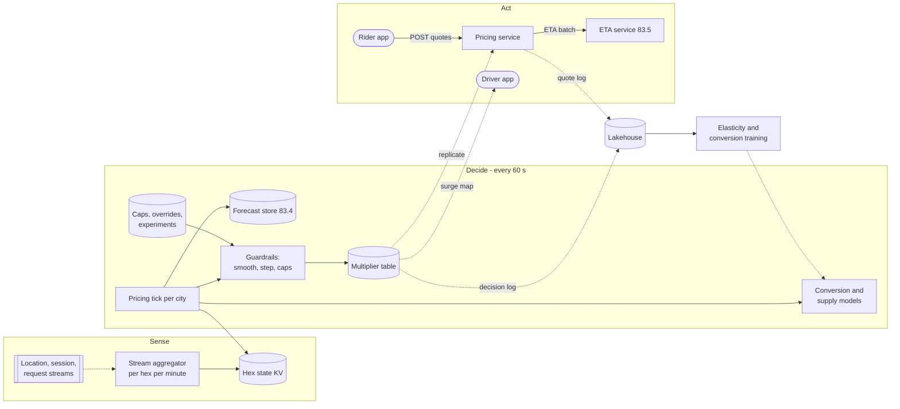

**Reading the diagram.** The loop has three stages. *Sense*: a stream aggregator counts idle drivers, sessions and requests per resolution-8 hexagon per minute (§55.4.8) and writes hexagon state. *Decide*: once a minute per city, the tick reads state and forecasts, calls the conversion and supply models in a batch, computes raw multipliers, then applies guardrails (spatial smoothing, maximum step, caps, overrides and experiment variants from a strongly consistent config store) and writes the multiplier table. *Act*: the table is replicated asynchronously to every pricing node, which answers quote requests synchronously, calling the ETA service for durations; driver apps receive the surge map. Logs of decisions and quotes flow to the lake, where elasticity and conversion models are retrained. Failure points: stale hexagon state (the loop acts on old data), a failed tick (last-good table, then decay), replication lag (different nodes quote different prices for a minute). Scaling: ticks partition by city; quote serving scales with stateless pricing nodes.

### 83.6.8 Detailed component design

#### The control loop: smoothing, stability and guardrails

Raw multipliers from the formula are noisy, because a resolution-8 hexagon sees only a handful of requests per minute. Three filters turn them into prices people can live with. **Spatial smoothing** averages the supply–demand gap over each hexagon's k-ring (7 cells for $k = 1$, §17.9.5), which also prevents a sharp price edge one street wide. **Temporal smoothing** blends the new value with the previous one and limits the step to 0.3 per tick, with hysteresis so that a multiplier does not flicker around a threshold. **Caps** bound the result per city and drop to 1.0 under emergency mode. Finally the multiplier is rounded to one decimal place, which matters for elasticity estimation below.

The loop has a delay: drivers need 5–15 minutes to respond, so a controller that reacts only to the current gap overshoots. Driver surge maps lure drivers into a hexagon; supply rises, the multiplier falls, drivers leave, and the cycle repeats. Using the **forecast** gap over the next 15–30 minutes rather than only the current gap, and showing drivers a smoothed, slower-moving surge map, damps that oscillation.

::: industry
**Uber — what happens when surge stops.** In a published case study, Hall, Kendrick and Nosko examined a sold-out concert in New York, where surge drew drivers to the venue and requests continued to be served, and a New Year's Eve outage of surge pricing in New York, during which completion rates fell sharply and pickup times rose as nearby drivers were exhausted [Hall et al. 2015]. Uber's SIGMOD paper names surge as a mission-critical consumer of its Kafka and Flink streaming stack [Fu and Soman 2021].
*Evidence: Primary* — [Hall et al. 2015; Fu and Soman 2021]
:::

#### Estimating price elasticity from confounded data

The conversion model predicts $P(\text{request} \mid \text{price}, \text{context})$. Fit naively on the quote log and price appears to *raise* conversion, because high multipliers occur exactly when riders are most determined (rain, late night, after a concert). Price is **confounded** with unobserved urgency. Four remedies, in order of preference:

1. **Natural experiments from rounding.** The raw multiplier is continuous but riders see it rounded. Quotes with raw values of 1.249 and 1.251 face nearly identical conditions but see 1.2 and 1.3, so the conversion difference across the rounding boundary is a clean, local causal estimate (a regression-discontinuity design). Cohen, Hahn, Hall, Levitt and Metcalfe used this structure in Uber data to estimate demand curves and found rider demand to be inelastic at surge prices [Cohen et al. 2016]. This is why `multiplier_raw` is logged.
2. **Small randomized perturbations** of the multiplier within a narrow band, applied at the hexagon-block level, give unconfounded variation; they must be approved as a policy, disclosed where required, and kept small enough to be fair.
3. **Rich controls**: features for weather, events, time and the forecast gap absorb much of the urgency signal, so the model compares like with like.
4. **Monotonicity constraints**: conversion must not increase with price; enforce it in the model so that residual confounding cannot produce an upward-sloping curve.

The resulting elasticities are reported with confidence intervals per city and hour band, and the pricing tick uses a shrunken estimate when the interval is wide.

#### Why naive A/B tests fail, and switchbacks

Suppose you test a 10% discount by randomizing riders 50/50, as §57.14 would suggest. Treated riders request more often, but both arms share the same drivers. When supply is short, every extra treated trip takes a driver away from a control rider, so treatment looks better and control looks worse than either would be on its own. The difference overstates the effect of rolling the discount out to everyone. This is **interference**: the stable unit treatment value assumption fails. Chamandy described this problem in ride-sharing experiments at Lyft and the alternative of randomizing over time [Chamandy 2016].

A **switchback experiment** randomizes the whole market (a city or region) between policies in time blocks, such as 60 minutes, so that within a block everyone shares the same policy. Carryover (drivers still busy with trips from the previous block) biases the boundary minutes, so analysts drop a burn-in period or model the carryover. Bojinov, Simchi-Levi and Zhao formalize switchback designs, derive optimal designs when carryover lasts a bounded number of periods, and give estimators and inference for them [Bojinov et al. 2023].

```python
import numpy as np

DAYS, D, DRIVERS = 14, 20, 600            # 14 days, 20-minute trips, 600 drivers on shift
T = DAYS * 1440
minute = np.arange(T) % 1440
openers = 20 + 50 * np.exp(-((minute - 1080) / 120.0) ** 2)   # app opens/min, evening peak
CONV = {0: 0.60, 1: 0.66}                  # request probability: control price, 10% discount

def simulate(seed, arm_of):
    """arm_of(t, n) -> array of 0/1 arms for the n openers in minute t."""
    rng = np.random.default_rng(seed)
    release = np.zeros(T + D, dtype=int)   # drivers freed at each minute
    idle = DRIVERS
    done = np.zeros((T, 2)); seen = np.zeros((T, 2))
    for t in range(T):
        idle += release[t]
        n = rng.poisson(openers[t])
        arms = arm_of(t, n)
        req = arms[rng.random(n) < np.where(arms == 1, CONV[1], CONV[0])]
        rng.shuffle(req)
        served = req[:idle]                # first-come, first-served while drivers last
        idle -= len(served); release[t + D] += len(served)
        np.add.at(done[t], served, 1); np.add.at(seen[t], arms, 1)
    return done, seen

per_day = lambda x: x / DAYS
res = {"true": [], "naive": [], "switch": [], "switch_burn": []}
base = []
for rep in range(10):
    s = 1000 + rep
    c, _ = simulate(s, lambda t, n: np.zeros(n, int))
    tr, _ = simulate(s, lambda t, n: np.ones(n, int))
    base.append(per_day(c.sum()))
    res["true"].append(per_day(tr.sum() - c.sum()))
    # naive A/B: randomize riders 50/50 inside the same market
    rng = np.random.default_rng(s + 7)
    d, v = simulate(s, lambda t, n: rng.integers(0, 2, n))
    rate = d.sum(0) / v.sum(0)             # completed trips per app open, by arm
    res["naive"].append(per_day((rate[1] - rate[0]) * v.sum()))
    # switchback: randomize 60-minute blocks of the whole city
    blocks = np.random.default_rng(s + 9).integers(0, 2, T // 60 + 1)
    d, _ = simulate(s, lambda t, n: np.full(n, blocks[t // 60]))
    arm_t = blocks[np.arange(T) // 60]
    for key, burn in (("switch", 0), ("switch_burn", 20)):
        keep = (np.arange(T) % 60) >= burn
        tot = d.sum(1)
        diff = sum(
            tot[keep & (arm_t == 1) & (minute // 60 == h)].mean()
            - tot[keep & (arm_t == 0) & (minute // 60 == h)].mean()
            for h in range(24))            # compare like hours, then add up the day
        res[key].append(diff * 60)
print(f"control trips/day: {np.mean(base):.0f}")
for k, v in res.items():
    print(f"{k:12s} extra trips/day: mean {np.mean(v):7.0f}   sd {np.std(v):5.0f}")
```

Output:

```text
control trips/day: 22330
true         extra trips/day: mean    1686   sd    50
naive        extra trips/day: mean    2199   sd    41
switch       extra trips/day: mean    1698   sd    58
switch_burn  extra trips/day: mean    1714   sd    82
```

What to notice:

- The true global effect of the discount is about +1,686 trips/day (+7.6%). The naive rider-randomized test reports +2,199, overstating it by 30%, with a *smaller* standard deviation: it is precisely wrong.
- The switchback estimate is close to the truth. Here 60-minute blocks are long relative to 20-minute trips, so carryover bias is small and the burn-in mainly adds variance; with longer trips or shorter blocks the burn-in earns its cost.

The price of a switchback is statistical power: the unit is a city-block, not a rider.

::: formula
**Switchback experiment size**

$$n = C \times \text{Days} \times \frac{1{,}440}{B}, \qquad \text{SE} \approx \frac{2\,\sigma_b}{\sqrt{n}}\sqrt{\frac{B}{B - b}}, \qquad \text{MDE} \approx 2.8 \times \text{SE}$$

| Symbol | Meaning | Units |
|---|---|---|
| $n$ | Number of randomized blocks, split half and half | blocks |
| $C$ | Cities (or independent regions) in the experiment | count |
| $B$, $b$ | Block length; burn-in dropped from each block | minutes |
| $\sigma_b$ | Standard deviation of the block-level metric after removing hour-of-week effects | metric units |
| SE, MDE | Standard error; minimum detectable effect at $\alpha = 0.05$, 80% power (§57.14.2) | metric units |
:::

::: example
**Worked example — Sizing a pricing switchback.** $C = 20$ cities, 14 days, $B = 60$ min, completion-rate metric with $\sigma_b = 0.12$.

1. $n = 20 \times 14 \times 24 = 6{,}720$ blocks.
2. Without burn-in: $\text{SE} = 2 \times 0.12 / \sqrt{6{,}720} = 0.00293$; $\text{MDE} = 2.8 \times 0.00293 = 0.0082$, or 0.82 percentage points.
3. With $b = 20$ min: inflation $\sqrt{60/40} = 1.22$; $\text{SE} = 0.00359$; $\text{MDE} = 1.00$ percentage point.

**Interpretation.** Twenty cities for two weeks detect about a 1-point change in completion rate, far coarser than a rider-level test with millions of riders. **Engineering implication.** Reduce $\sigma_b$ with hour-of-week and pre-period adjustments, pick block length from carryover (trip duration) rather than convenience, and reserve switchbacks for decisions that touch shared supply; display-only changes can still be rider-randomized.
:::

#### Fairness, regulation and transparency

Pricing by location and time is legal in most places, but surge decisions affect access to transport. Inputs exclude protected attributes and plausible proxies for individual willingness to pay (device type, battery level, rider history); the price is a property of the place and time, not the person, and is shown up front. Audits compare multipliers and wait times across neighborhoods with different demographics (§71.5) and check that caps hold. Some jurisdictions and agreements restrict surge during declared emergencies; emergency mode implements those rules, and city-level caps implement local regulation (§71.13).

**Figure 83.11 — Feedback loops between price, supply and the forecast.**

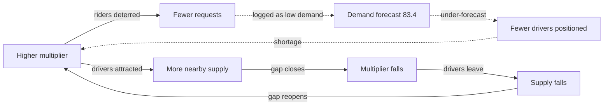

**Reading the diagram.** Solid arrows are the fast loop (minutes): price deters riders and attracts drivers, which closes the gap, lowers the price, and lets drivers drift away, an oscillation damped by smoothing and forecast-based pricing. Dotted arrows are the slow loop (days): price-suppressed requests enter the forecaster's training data as low demand, the forecaster under-predicts, positioning sends fewer drivers, and the shortage raises prices again. The slow loop is broken by forecasting unconstrained demand with price as a feature (§83.4.8). Failure points: removing smoothing, or training the forecaster on completed trips. Scaling: the loops are local to each city, which is also why city-level switchbacks are valid.

### 83.6.9 Data flow

**Figure 83.12 — Write path: one pricing tick.**

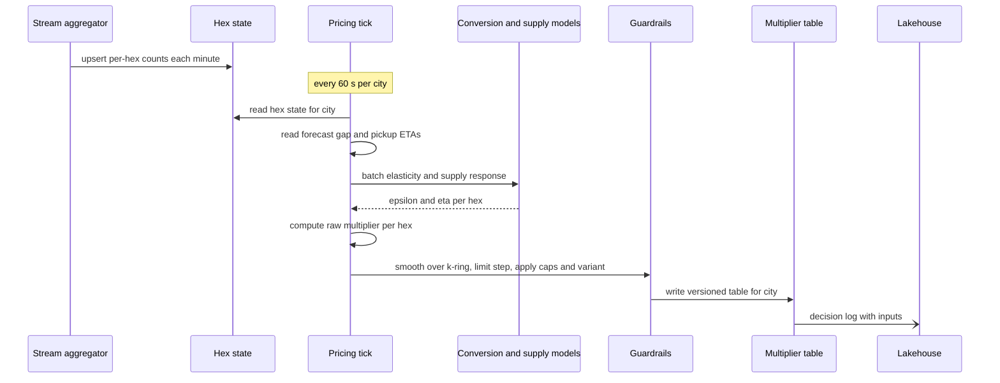

**Reading the diagram.** The aggregator writes hexagon state every minute; the tick reads one city's state, forecasts and ETAs, calls the models in one batch and computes raw multipliers, then guardrails apply smoothing, step limits, caps and the experiment variant for the current switchback block. The table is written as a new version for the whole city at once, so pricing nodes never mix two ticks. The decision log is asynchronous. Failure points: missing state (hexagon keeps its previous multiplier, decaying), model error (fall back to the ratio rule), config store unavailable (keep last caps; never raise caps on error). Scaling: one tick worker per group of cities.

**Figure 83.13 — Read path: a quote and the request that uses it.**

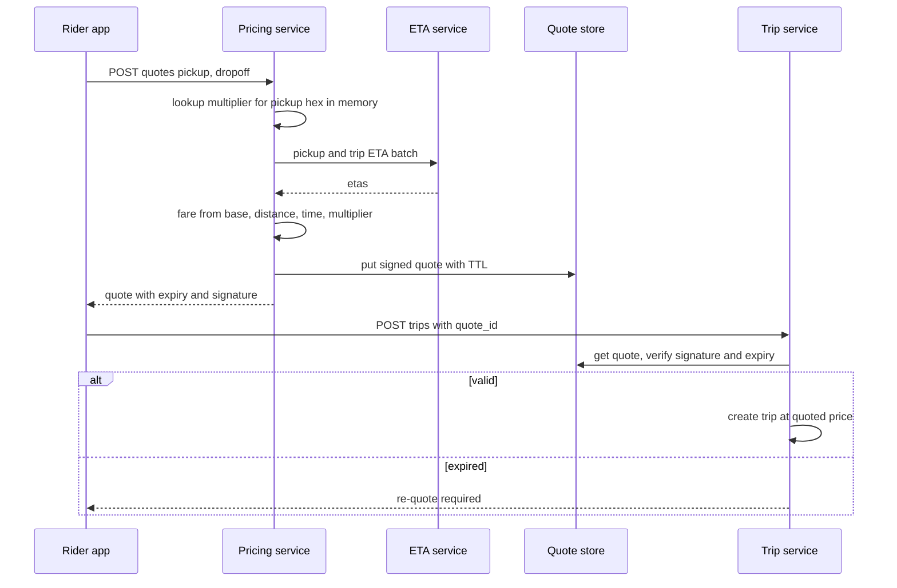

**Reading the diagram.** All calls are synchronous. The multiplier lookup is an in-memory read; the ETA batch is the main latency cost. The quote is stored with a TTL and signed, so the trip service can verify it without trusting the client. An expired quote forces a new quote at the current price, which is how the market's movement reaches riders without surprising them. Failure points: ETA timeout (fallback ETAs, degraded flag), quote store unavailable (signature alone verifies, with expiry checked from the signed payload). Scaling: stateless pricing nodes.

### 83.6.10 Bottlenecks

1. **Input freshness.** The loop is only as good as its one-minute counts; stream lag directly degrades prices.
2. **Elasticity uncertainty.** Wide intervals make prices either sluggish or jumpy; exploration budget is limited by fairness and policy.
3. **Experiment power.** Switchbacks need many city-blocks; experiments queue behind each other.
4. **Replication of the table** to thousands of pricing nodes each minute; use versioned snapshots and deltas.

### 83.6.11 Failure scenarios

**Table 83.18 — Surge pricing failure scenarios.**

| What fails | Impact | Detection | Recovery | Prevention |
|---|---|---|---|---|
| Stream aggregator stalls | Prices act on old gaps | Hex-state age per city | Last-good table for 5 min, then decay to 1.0 | Lag alerts; redundant aggregation |
| Runaway multiplier (bug or bad elasticity) | Extreme prices, public harm | Multiplier distribution and complaint spikes | Caps enforced in a separate guardrail stage; kill switch | Independent guardrails; canary per city |
| Oscillation | Drivers chase surge, riders see flicker | Autocorrelation of multiplier; driver movement | Increase smoothing, use forecast gap | Step limits; slower driver map |
| Confounded elasticity | Prices too high or too low | Discontinuity estimates disagree with model | Shrink to prior; use experimental estimates | Monotonic models; rounding analysis |
| Forecast feedback (§83.4) | Chronic under-supply in surge areas | Unconstrained-demand audits | Retrain forecaster with corrected labels | Price as forecast feature |
| Naive A/B launches a bad policy | Wrong decision at scale | Post-launch city metrics disagree with test | Roll back | Switchbacks for supply-affecting changes |
| Emergency declared | Legal and ethical exposure | External alert | Emergency mode caps | Pre-built, tested kill switch |
| Replication lag between nodes | Two riders in one hexagon see different prices for a minute | Version skew metric | Serve the older version consistently per hexagon | Versioned snapshots |
| Manipulation (drivers collectively going offline to trigger surge) | Inflated prices | Coordinated offline patterns | Exclude anomalous supply drops from gap | Supply anomaly detection |

### 83.6.12 Scaling strategy

**At 10×** (4 million hexagons, more cities), ticks remain cheap; the work is operational: per-city configuration, caps and experiments at scale. Move to finer hexagons (resolution 9) only in dense cores, with stronger spatial smoothing.

**At 100×** (multiple products sharing drivers), pricing becomes a joint optimization across products and time: one supply pool, several demand curves, possibly with optimization-based pricing that plans over the next hour rather than a per-hexagon formula, and experimentation moves to region-level switchbacks with carryover modeling.

### 83.6.13 Trade-offs

**Table 83.19 — Surge pricing trade-offs.**

| Decision | Option chosen | Alternative | Why |
|---|---|---|---|
| Granularity | Resolution 8, k-ring smoothing | Resolution 9 or city zones | Enough signal per hexagon; no sharp edges |
| Signal | Forecast gap plus current gap | Current gap only | Damps oscillation caused by response delay |
| Price guarantee | Signed, expiring upfront quote | Price at trip end | Riders pay what they saw; market movement via expiry |
| Elasticity | Discontinuities and small randomized bands | Observational regression | Confounding makes naive estimates wrong-signed |
| Experiments | Switchback by city and hour | Rider-level A/B | Interference biases rider-level tests |
| Safety | Separate guardrail stage, caps, kill switch | Caps inside the model | A model bug cannot bypass the guardrail |

### 83.6.14 Alternative designs

- **Fixed prices with queues** (airport-style waiting lists): simple and perceived as fair, but slow to attract supply.
- **Driver-side incentives only** (bonuses for driving in an area without raising rider prices): attracts supply, does not ration demand.
- **Optimization over a dispatch model**: solve for prices that maximize completed trips subject to wait-time constraints with a marketplace simulator; more principled, harder to explain.
- **Reinforcement learning** for pricing policies: attractive for delayed effects, but needs a trustworthy simulator and strict guardrails (§57.4.4).

### 83.6.15 Interview discussion

**Table 83.20 — 45-minute pacing plan for surge pricing.**

| Minutes | Focus | What to produce |
|---|---|---|
| 0–5 | Purpose | Reliability, wild goose chase; price per hexagon per minute |
| 5–10 | Estimates | 400,000 hexagons/min, 28.8 MB table, 5,200 quotes/s; compute is trivial |
| 10–20 | Architecture | Figure 83.10: sense, decide, act; signed quotes |
| 20–30 | Deep dive: the loop | Clearing formula, smoothing, step limits, caps, forecast gap |
| 30–40 | Deep dive: elasticity and experiments | Confounding, rounding discontinuity, interference, switchbacks and sizing |
| 40–45 | Guardrails and fairness | Emergency mode, no personal inputs, audits, feedback into forecasting |

**Likely follow-ups.**

- *"Why not A/B test the new pricing on half the riders?"* They share drivers; the estimate is biased. Use switchbacks.
- *"What if the pricing service is down?"* Quotes use the last-good table, decaying toward 1.0; never block quotes.
- *"How do you know riders' price sensitivity?"* Not from raw correlations; from discontinuities and randomized bands, with monotonic models.

**What distinguishes senior and staff answers.** Senior answers build the sense–decide–act loop with caps and quotes. Staff answers explain why surge exists (throughput, not revenue), quantify the cap trade-off, handle confounded elasticity, design and size a switchback, and close the loop with the demand forecaster.

### 83.6.16 Production considerations

- **Monitoring.** Multiplier distribution per city; hex-state age; pickup ETA and unfulfilled rate against targets; conversion-model calibration; oscillation metrics; complaint and refund rates (Chapter 70).
- **Retraining.** Conversion models weekly; elasticity estimates monthly with intervals; supply models after any driver-pay change.
- **Responsible ML and compliance.** No personal inputs; neighborhood disparity audits; documented caps and emergency rules per jurisdiction; reason codes for support ("high demand in this area").
- **Cost.** Negligible compute; the main costs are streaming aggregation and experimentation time.
- **Operations.** Two-person approval for raising caps; kill switch drills; per-city canary for any pricing-policy change.

## 83.7 Summary and revision notes

::: summary
- Marketplace models change the world they predict: forecasts move drivers, prices suppress demand, ETAs steer dispatch. Name the decision, the loss and the feedback loop before the architecture.
- **Demand forecasting** (§83.4): quantile forecasts per H3 resolution-7 hexagon and 15-minute bucket from a global model; the label is unconstrained demand, not completed trips; evaluate with pinball loss and coverage in rolling-origin backtests; reconcile across the hierarchy, remembering that quantiles do not add. Compute is tiny; input freshness and event knowledge are the hard parts.
- **ETA** (§83.5): routing engine plus a learned trip-level residual at about 230,000 predictions/s, driven mostly by display and refresh loops; labels from HMM map matching of GPS; asymmetric Huber loss for promises; per-slice conformal intervals, because one global width under-covers rush hour.
- **Surge pricing** (§83.6): a sense–decide–act loop every 60 s with smoothing, step limits, caps, signed quotes and a kill switch; elasticity is confounded by urgency, so estimate it from rounding discontinuities and small randomized bands; rider-randomized tests are biased by shared supply, so use switchbacks and size them by city-blocks.
- All three are coupled: pricing consumes forecasts and ETAs, and must not poison the forecaster's training labels.
:::

## 83.8 Knowledge checkpoint

1. Why is "completed trips" the wrong label for demand forecasting?
2. Why forecast at H3 resolution 7 rather than resolution 9?
3. What does rolling-origin backtesting add over a single time split?
4. Why can you not add hexagon 0.9 quantiles to get the city's 0.9 quantile?
5. In OLS reconciliation of a parent and two children, how is a disagreement of 9 distributed?
6. Which consumer generates the most ETA requests in §83.5.4, and what is the cheapest mitigation?
7. Why predict a residual over the routing estimate instead of the full ETA?
8. With $\delta = 60$ s and $\omega = 0.7$, what is the asymmetric Huber loss of a 120 s early error?
9. Why did one global conformal width fail in the ETA example?
10. Why does dispatch create a feedback loop for the ETA model?
11. Why does naive regression of conversion on price often show a positive slope?
12. Why does a rider-randomized pricing test overstate the effect of a discount?
13. What sets the block length and burn-in of a switchback?
14. What should pricing do when the pricing tick stops producing tables?

<details><summary>Answers</summary>

1. Completed trips are capped by supply and suppressed by price; a model trained on them learns past shortages and repeats them.
2. Resolution 9 hexagons see well under one request per bucket; resolution 7 aggregates enough counts to learn, and consumers can disaggregate.
3. Many origins across seasons and events, so the score reflects varied conditions and is not one lucky week.
4. Quantiles of sums are not sums of quantiles; adding upper quantiles produces intervals that are far too wide (100% coverage in the example).
5. Equally: each of the three nodes moves by 3, the parent up and the children down.
6. App-open display ETAs (100,000/s); cache per hexagon and lower refresh rates for idle sessions.
7. The router handles physics and rare routes; the model only needs to learn systematic errors such as turns, friction and route deviation.
8. $h = 60 \times (120 - 30) = 5{,}400$; $L = 0.3 \times 5{,}400 = 1{,}620$.
9. Rush-hour errors are larger, so the global width covered only 52.5% there; per-slice calibration fixes it.
10. Labels exist mainly for chosen drivers, who tend to be under-predicted; non-chosen candidates are never observed unless logged and sampled.
11. High prices coincide with urgent riders (rain, late nights), so price is confounded with willingness to ride.
12. Both arms share drivers; treated riders take supply from control riders, inflating the difference.
13. Carryover duration (trip and repositioning times) and the need for many blocks; burn-in drops minutes affected by the previous block.
14. Serve the last-good table for a few minutes, then decay toward 1.0; never block quotes or freeze a high price.
</details>

## 83.9 Interview questions

### Basic

**Q1.** What is pinball loss, and why is it used for demand forecasts? **Answer.** The quantile loss of §57.11.2: under-predictions cost $q$ per unit and over-predictions $1 - q$, so its minimizer is the $q$-quantile. Forecast consumers act on quantiles (position for the 0.75 quantile), and it handles zero counts where MAPE fails.

**Q2.** What is a switchback experiment? **Answer.** A design that randomizes the entire market between policies in time blocks, so that everyone in a block shares one policy; it avoids interference between arms at the cost of fewer, larger units.

### Intermediate

**Q3.** Your forecaster backtests well but performs poorly live. What do you check? **Answer.** Point-in-time correctness of lag features (leakage), differences between streaming and batch aggregations (late events), event and weather feature availability at issue time, and whether the live label definition matches the training label.

**Q4.** How would you serve 230,000 ETAs per second within 5 ms of model time? **Answer.** In-process CPU inference of a small model, caller-side batching of candidates, one feature multi-get per batch, per-hexagon caching of display ETAs, regional partitioning with N+1 nodes, and a fallback ladder to correction tables.

### Advanced

**Q5.** Design the measurement of rider price elasticity without harming riders. **Answer.** Log raw and rounded multipliers and use rounding discontinuities; add small, policy-approved randomized bands at block level; control for weather, events and forecast gap; enforce monotonicity; report estimates with intervals per city and shrink noisy ones; audit for disparate effects.

**Q6.** A new ETA model improves offline MAE by 8%. How do you launch it? **Answer.** Shadow-score to check skew and per-slice calibration; recalibrate intervals; because ETAs change dispatch and fares, run a city-level switchback measuring pickup time, completion and cancellations, with a canary per region and rollback to the previous model and router pairing.

## 83.10 Practical exercises

1. Extend the §83.4.8 code with a gradient-boosted quantile model using lag and calendar features, and compare its pinball loss and coverage with the negative-binomial baseline across the four origins.
2. Implement MinT reconciliation for one parent and 49 children using backtest residuals to estimate a diagonal $W$, and compare parent and child pinball losses with OLS.
3. Modify the ETA example to train with an asymmetric loss (for example, a quantile loss at 0.6) and measure the share of late arrivals before and after.
4. In the switchback simulation, shorten blocks to 20 minutes and lengthen trips to 40 minutes; measure the bias with and without burn-in.

## 83.11 Design challenges

1. **Scheduled rides.** Riders can book a trip for 06:00 tomorrow. Design how demand forecasting, ETA and pricing change when the price must be fixed hours ahead and supply is uncertain.
2. **Food delivery and rides sharing drivers.** Combine QuickBite's courier supply (§60.15) with ride-hailing drivers: design a joint forecast, a shared ETA platform and a pricing loop that does not starve either product.
3. **Regulated city.** A city caps multipliers at 1.5 and requires published pricing rules. Redesign surge to keep pickup times acceptable using driver incentives, forecasts and queues.

## 83.12 References

1. Angelopoulos, A. N., Bates, S. *A Gentle Introduction to Conformal Prediction and Distribution-Free Uncertainty Quantification*. arXiv:2107.07511, 2021.
2. Bell, F., Smyl, S. *Forecasting at Uber: An Introduction*. Uber Engineering Blog, 2018.
3. Bojinov, I., Simchi-Levi, D., Zhao, J. *Design and Analysis of Switchback Experiments*. Management Science 69(7):3759–3777, 2023.
4. Brodsky, I. *H3: Uber's Hexagonal Hierarchical Spatial Index*. Uber Engineering Blog, 2018.
5. Castillo, J. C., Knoepfle, D., Weyl, E. G. *Surge Pricing Solves the Wild Goose Chase*. Proceedings of the ACM Conference on Economics and Computation (EC), 2017.
6. Chamandy, N. *Experimentation in a Ridesharing Marketplace*. Lyft Engineering Blog, 2016.
7. Cohen, P., Hahn, R., Hall, J., Levitt, S., Metcalfe, R. *Using Big Data to Estimate Consumer Surplus: The Case of Uber*. NBER Working Paper 22627, 2016.
8. Derrow-Pinion, A., et al. *ETA Prediction with Graph Neural Networks in Google Maps*. Proceedings of CIKM, 2021.
9. Fu, Y., Soman, C. *Real-time Data Infrastructure at Uber*. Proceedings of ACM SIGMOD, 2021.
10. Gneiting, T., Raftery, A. E. *Strictly Proper Scoring Rules, Prediction, and Estimation*. Journal of the American Statistical Association 102(477), 2007.
11. Hall, J., Kendrick, C., Nosko, C. *The Effects of Uber's Surge Pricing: A Case Study*. Uber and University of Chicago, 2015.
12. Hu, X., Binaykiya, T., Frank, E., Cirit, O. *DeeprETA: An ETA Post-processing System at Scale*. arXiv:2206.02127, 2022. (Hu et al. 2022a)
13. Hu, X., Cirit, O., Binaykiya, T., Hora, R. *DeepETA: How Uber Predicts Arrival Times Using Deep Learning*. Uber Engineering Blog, 2022. (Hu et al. 2022b)
14. Hyndman, R. J., Athanasopoulos, G. *Forecasting: Principles and Practice*, 3rd ed. OTexts, 2021. https://otexts.com/fpp3/
15. Laptev, N., Yosinski, J., Li, L. E., Smyl, S. *Time-series Extreme Event Forecasting with Neural Networks at Uber*. ICML Time Series Workshop, 2017.
16. Newson, P., Krumm, J. *Hidden Markov Map Matching Through Noise and Sparseness*. Proceedings of ACM SIGSPATIAL GIS, 2009.
17. Romano, Y., Patterson, E., Candès, E. *Conformalized Quantile Regression*. NeurIPS, 2019.
18. Salinas, D., Flunkert, V., Gasthaus, J., Januschowski, T. *DeepAR: Probabilistic Forecasting with Autoregressive Recurrent Networks*. International Journal of Forecasting 36(3), 2020.
19. Taylor, S. J., Letham, B. *Forecasting at Scale*. The American Statistician 72(1), 2018.
20. Wickramasuriya, S. L., Athanasopoulos, G., Hyndman, R. J. *Optimal Forecast Reconciliation for Hierarchical and Grouped Time Series Through Trace Minimization*. Journal of the American Statistical Association 114(526), 2019.

## 83.13 Open verification items

- Hu et al. 2022b (DeepETA blog): confirm the author list and that it describes an asymmetric Huber loss; the arXiv paper's authors (Hu, Binaykiya, Frank, Cirit) were checked.
- Bell and Smyl 2018: confirm title, authors and year of Uber's forecasting introduction post.
- Hall, Kendrick and Nosko 2015: confirm the concert and New Year's Eve outage descriptions as summarized.
- Cohen et al. 2016: confirm the characterization of demand as inelastic at surge prices and the rounding-discontinuity design.
- Chamandy 2016: confirm the Lyft post's title and its discussion of time-based randomization.
- Emergency surge restrictions (§83.6.8): jurisdiction-specific rules and agreements were not cited; verify per jurisdiction before stating specifics.
