# Chapter 84 — Case Studies IX: Perception and Language

> **Level:** 3–5 · **Track:** B (ML/AI) · **Estimated reading time:** 4.5 h

The four systems in this chapter turn raw signals into meaning. A face recognizer turns pixels into an identity; an image classifier turns pixels into a label; a speech recognizer turns a waveform into words; a translator turns words in one language into words in another, sometimes while the speaker is still talking. All four run deep networks (Chapter 58) whose cost per request is far higher than the tree models of Chapters 82–83, so GPU serving, batching and model compression (Chapters 64, 66, 67) decide the bill. All four also process data that is personal in a way a click log is not: a face is a biometric identifier, a voice recording can reveal health and identity, and a translated conversation is, word for word, what someone said. The design is therefore judged on three axes at once: quality measured by a task-specific metric, latency or throughput at a cost, and how little raw signal the system collects and keeps.

Each case emphasizes a different hard problem, summarized in Table 84.1.

**Table 84.1 — The four cases and their distinctive hard problems.**

| Case | Distinctive hard problem |
|---|---|
| §84.4 Face recognition | Choosing a match threshold from FAR/FRR when 1:N search multiplies false matches by gallery size, with error rates that differ by demographic group, and with consent and biometric law as first-class requirements |
| §84.5 Image classification service | Throughput-oriented GPU serving for many tenants: dynamic batching, a preprocessing stage that can cost more than the model, thousands of customer models with strict versioning, and cost per 1,000 images |
| §84.6 Speech recognition | Streaming recognition with partial results and end-pointing inside a latency budget, the split between on-device and cloud, biasing toward a user's contacts, and evaluation by word error rate |
| §84.7 Real-time translation | Cascade versus end-to-end speech translation, the latency–quality trade-off of simultaneous translation, serving 200 languages with one model or many, and terminology control |

## 84.1 Learning objectives

After this chapter you should be able to:

- Design a consent-scoped face recognition service end to end (detection, alignment, embedding, 1:N matching), select a threshold from false match and false non-match rates, and show why the false positive identification rate grows with gallery size.
- Measure demographic differentials in a biometric system and turn biometric privacy law (BIPA, GDPR Article 9, the EU AI Act) into concrete requirements: opt-in, purpose limitation, retention and verifiable deletion.
- Design a multi-tenant image classification API, size its preprocessing (CPU and GPU) and model fleets, configure dynamic batching, and compute cost per 1,000 images.
- Version and roll out thousands of customer models with a shared backbone and per-tenant heads, and explain when that architecture stops fitting.
- Design a streaming speech recognizer with partial results, end-pointing and contextual biasing; decompose its latency; compute real-time factor and streams per GPU; and evaluate it with word error rate.
- Decide between on-device and cloud inference for perception and speech on latency, privacy, cost and quality.
- Design a translation service for text and speech, choose between a cascade and an end-to-end model, set a wait-k policy from an average-lagging budget, serve many languages, and evaluate with BLEU, COMET and human review.
- Run each design as a 45-minute interview, including the follow-ups that separate senior from staff answers.

## 84.2 Prerequisites

**Table 84.2 — Concept chapters each case applies.**

| Case | Concept chapters it leans on |
|---|---|
| All | Deep learning essentials, CNNs and embeddings — §58.6–§58.7; transformers — §58.9, Chapter 72; GPU architecture and precision — §64.3, §64.10; model serving and dynamic batching — §66.6–§66.10; quantization and distillation — §67.4–§67.8; monitoring — Chapter 70; responsible ML — Chapter 71 |
| §84.4 Face recognition | Embeddings and contrastive training — §74.3; exact and ANN search — §74.5–§74.9, capacity — §74.14; classification metrics and thresholds — §57.10; fairness slices — §71.4–§71.5; privacy and regulation — §71.9, §71.13; labeling and personal data — §63.14.2; object storage — Chapter 15 |
| §84.5 Image classification service | CPU versus GPU serving and cost per 1,000 predictions — §66.7; multi-model serving — §66.8; model versioning and safe rollout — §66.11–§66.12; TensorRT and ONNX Runtime — §67.10–§67.11; media pipelines — §54.4.8; object storage and presigned URLs — §15.8; multi-tenant ML serving platform — §85.6 |
| §84.6 Speech recognition | Recurrent networks and sequence models — §58.8; transformers and streaming inference — §72.10, §73.4; WebSockets and backpressure — §9.6; connection gateways — §9.9; on-device optimization — §67.3–§67.8; federated learning — §71.11; labeling — §63.5 |
| §84.7 Real-time translation | Tokenization — §72.4; prefill, decode and the KV cache — §72.10–§72.11; continuous batching — §73.6; BLEU and reference metrics — §78.6.2; human evaluation — §78.8; WebRTC — §9.7; caching — Chapter 20 |

## 84.3 How to use these case studies

Work through these cases with the method set out in §52.3: read the problem statement, close the book, produce your own requirements, estimates and architecture, then compare; treat every number as an assumption to challenge; follow the cross-references rather than expecting mechanisms to be re-taught; and rehearse each §84.x.15 pacing plan aloud against a clock. What is different for ML cases is that the problem statement must also fix the *ML formulation* (what is predicted, from what, with which label and which metric), that requirements include quality targets measured offline and guarded online, and that capacity is dominated by model compute rather than by storage or request fan-out. Add one habit specific to this chapter: for every design, draw a **signal trace** that follows one photo, utterance or sentence from the sensor to the decision, and mark at each hop where it is processed (device, edge or cloud), in what form (raw signal, embedding or text) and for how long it is retained. Most of the privacy and latency trade-offs in perception systems are visible on that trace.

## 84.4 Face Recognition

### 84.4.1 Problem statement

Design a face recognition service with two clients. The first is a photo-sharing platform's opt-in **People** feature: faces in a user's uploaded photos are grouped into people, the user may name a group, and new photos get suggestions such as "Is this Maya?". The second is an **access-control** product: an enterprise enrolls employees who consent, and a camera at a door identifies whoever stands in front of it and opens the door within half a second.

Both clients need the same pipeline. A **detector** finds faces in an image; an **aligner** warps each face to a canonical pose; an **embedding model** maps the aligned face to a vector such that two photos of the same person are close and photos of different people are far apart (§58.6, §74.3); a **matcher** compares that vector, the **probe**, with stored vectors of known people, the **gallery**. Comparing a probe with one claimed identity is **verification (1:1)**; searching a whole gallery for the best match is **identification (1:N)**.

The ML formulation is metric learning: a model trained on labeled identities so that cosine similarity separates **mated pairs** (same person) from **non-mated pairs**, followed by a threshold decision. ML is warranted (§59.4) because no hand-written rule recognizes a face across pose, age and lighting [Taigman et al. 2014; Schroff et al. 2015].

The distinctive hard problem is that the threshold is a policy decision with three entangled constraints: in 1:N search every gallery entry is a chance for a false match, so false positives grow with gallery size; error rates differ by demographic group [Grother et al. 2019]; and face templates are biometric data, regulated by GDPR and statutes such as Illinois' Biometric Information Privacy Act (BIPA), so consent and deletion shape the architecture as much as accuracy does.

::: definition
**Definition — FMR, FNMR, FPIR and FNIR.** For verification, the **false match rate (FMR)** is the fraction of non-mated comparisons whose score passes the threshold, and the **false non-match rate (FNMR)** is the fraction of mated comparisons that fail it. Older literature calls them the **false accept rate (FAR)** and **false reject rate (FRR)**; strictly, FAR and FRR are system-level rates that also include capture failures. For identification, the **false positive identification rate (FPIR)** is the fraction of searches by people *not* in the gallery that return any candidate above threshold, and the **false negative identification rate (FNIR)** is the fraction of searches by enrolled people that fail to return them.
:::

### 84.4.2 Functional requirements

1. **Consent.** A person (photo user, or employee) grants or withdraws consent for a stated purpose; no template is created or searched without a valid consent record for that purpose and jurisdiction.
2. **Photo processing.** For opted-in users, detect faces in every uploaded photo, embed them, and assign them to an existing person cluster or a new one.
3. **People management.** List a user's people, name, merge or split a person, and remove a face from a person.
4. **Tag suggestions.** Suggest names for faces in new photos, only from people the uploader has named and from friends who have opted in to being suggested.
5. **Enrollment and identification (access control).** A tenant enrolls an employee from one to five consented photos; a door camera submits a probe and receives *grant*, *deny* or *fallback to badge* within the latency budget.
6. **Deletion.** On withdrawal, account deletion or retention expiry, delete every template, cluster and derived index entry for that person, and produce a deletion receipt.
7. **Audit.** Every identification decision and every consent change is logged for the tenant and for regulators.

Out of scope: face recognition of strangers, searching one user's faces against another user's library, emotion or attribute inference (age, gender, ethnicity), and law-enforcement use.

### 84.4.3 Non-functional requirements

**Table 84.3 — Face recognition non-functional requirements.**

| Requirement | Target |
|---|---|
| Availability | Photo processing 99.9% (asynchronous, may lag); identification 99.95% per site, with badge fallback when unavailable |
| Latency | Photo faces processed within 5 min of upload at p99; identification p99 ≤ 300 ms server-side, 500 ms camera to door |
| Model quality | Verification FNMR ≤ 1% at FMR = $10^{-5}$ on the internal consented benchmark; access-control FPIR ≤ 0.1% at the deployed gallery size |
| Fairness | FMR and FNMR of every evaluated demographic slice within 2× of the best slice at the operating threshold, with confidence intervals (§71.5.1) |
| Privacy | Opt-in only; templates encrypted per owner; no raw face crops stored; deletion completes in ≤ 30 days (target 24 h) with receipt |
| Durability | Consent records and audit log 11 nines (object storage, §15.6); templates are re-derivable from photos for the photo client |
| Freshness | Model retrained at most quarterly; a new model requires re-embedding every template (§84.4.8) |

### 84.4.4 Capacity estimation

All figures use decimal units and illustrative assumptions for a teaching design. Throughputs per GPU are assumptions to be replaced by measurement on your hardware (§58.12.2).

::: example
**Worked example — Photo traffic and the backfill surprise.** Assumptions: 100 million users have opted in; they upload 250 million photos/day; 1.2 detected faces per photo on average; peak-to-average ratio 3; 500,000 new opt-ins per day, each with a library of 4,000 photos to process.

1. Live photos: $2.5 \times 10^8 / 86{,}400 = 2{,}894$ photos/s average, **8,681/s at peak**.
2. Live faces: $3 \times 10^8$ faces/day, 3,472/s average, **10,417/s at peak**.
3. Backfill: $5 \times 10^5 \times 4{,}000 = 2 \times 10^9$ photos/day $= 23{,}148$ photos/s and 27,778 faces/s, **8 times the live volume**.

**Interpretation.** The steady-state upload stream is not the largest workload; processing the libraries of new opt-ins is. **Engineering implication.** Run backfill as a separate, preemptible batch tier with its own quota (§66.13), and cap the opt-in backfill rate so a viral launch cannot starve live processing.
:::

::: example
**Worked example — GPU fleet.** Assumptions (measure them): one L4-class GPU detects faces in 600 photos/s on the 1,024-pixel thumbnails that the media pipeline already produces (§54.4.8), and embeds 2,500 aligned 112×112 faces/s with a ResNet-50-class network at FP16 with dynamic batching; live target utilization 0.6, backfill 0.8 (§66.9).

1. Live detection: $8{,}681 / 600 = 14.5$ GPUs; embedding: $10{,}417 / 2{,}500 = 4.2$ GPUs.
2. Live fleet at $u = 0.6$: $(14.5 + 4.2) / 0.6 = 31.1$, so **32 GPUs**.
3. Backfill: $23{,}148 / 600 + 27{,}778 / 2{,}500 = 38.6 + 11.1 = 49.7$ GPUs busy, or $49.7 / 0.8 = 62$ GPUs.
4. GPU-hours per day: live $\approx (2{,}894/600 + 3{,}472/2{,}500) \times 24 = 149$; backfill $\approx 1{,}193$.

**Interpretation.** Detection, not embedding, dominates, because every photo is scanned but only 1.2 faces per photo are embedded. **Engineering implication.** A cheaper detector on downscaled thumbnails saves more than optimizing the embedder; and the backfill tier, at eight times the GPU-hours, is where spot capacity and off-peak scheduling pay.
:::

::: example
**Worked example — Template storage and gallery size.** Assumptions: 512-dimension embeddings stored as FP16 (1,024 B) plus 100 B of metadata; an opted-in library averages $4{,}000 \times 1.2 = 4{,}800$ faces; each user has about 150 person clusters represented by up to 4 exemplar vectors.

1. All face templates: $10^8 \times 4{,}800 = 4.8 \times 10^{11}$ faces × 1,124 B = **540 TB**, growing by $3 \times 10^8 \times 365 \times 1{,}124 = 123$ TB/year.
2. Per-user gallery for matching: $150 \times 4 \times 1{,}024 = 614$ KB; across all users 61 TB.
3. Thumbnail reads for detection at peak: $8{,}681 \times 150$ KB × 8 = 10.4 Gbit/s from object storage.

**Interpretation.** Per-face templates are bulk data read only for re-clustering; the matcher needs only the small per-user gallery. **Engineering implication.** Keep templates in a wide-column store or object storage partitioned by owner, and load a user's 614 KB gallery into matcher memory once per upload session rather than once per photo.
:::

::: example
**Worked example — Access-control identification.** Assumptions: 2,000 tenant sites; 10 million door events/day; 30% of them in the morning peak hour; largest gallery 200,000 enrolled employees; brute-force dot products run at an effective 50 GFLOP/s per CPU core with SIMD.

1. Peak rate: $0.3 \times 10^7 / 3{,}600 = 833$ identifications/s (average 116/s).
2. Exact 1:N search over 200,000 × 512: $2 \times 2 \times 10^5 \times 512 = 2.05 \times 10^8$ FLOPs = **4.1 ms** on one core; the gallery occupies 205 MB.
3. Worst case, all peak queries against 200,000-person galleries at 50% utilization: $833 \times 0.0041 / 0.5 = 6.8$ cores.
4. A hypothetical 10-million-entry gallery: 205 ms per brute-force query and 10.2 GB of FP16 vectors; HNSW over int8 vectors would need $10^7 \times (512 + 260 + 8) = 7.8$ GB with sub-millisecond search (§74.14).

**Interpretation.** At enterprise gallery sizes exact search is cheap and exact (§74.5.2); ANN becomes necessary only above a few million entries. **Engineering implication.** The constraint on gallery size is not search cost but false matches, which the next section quantifies.
:::

### 84.4.5 API design

```text
POST /v1/consents
{ "subject_id": "u-123", "purpose": "photo_people" | "access_control",
  "tenant_id": null, "jurisdiction": "US-IL", "notice_version": "2026-03",
  "evidence": { "method": "in_app_toggle", "signed_release_id": "r-88" } }
-> 201 { "consent_id": "c-9", "status": "active" }

DELETE /v1/consents/{consent_id}            # withdrawal; starts deletion
-> 202 { "deletion_job": "d-41", "deadline": "2026-11-12T00:00:00Z" }
GET    /v1/deletions/{job}                  # receipt: stores purged, key destroyed, time

POST /v1/galleries/{gallery_id}/enrollments   # access control
{ "subject_id": "e-77", "consent_id": "c-12", "images": ["upload-token-1", "..."] }
-> 201 { "template_ids": ["t-1","t-2"], "quality": [0.91, 0.87] }

POST /v1/galleries/{gallery_id}:identify
{ "probe_image": "<bytes or token>", "camera_id": "door-3", "liveness": {...},
  "threshold_profile": "door-default", "top_k": 3 }
-> 200 { "decision": "grant" | "deny" | "fallback_badge",
         "candidates": [ { "subject_id": "e-77", "score": 0.71 } ],
         "model_version": "emb-2026q3", "request_id": "..." }

GET  /v1/users/{uid}/people?cursor=...      # photo client
POST /v1/people/{person_id}:name   { "display_name": "Maya" }
POST /v1/people:merge              { "ids": ["p-1","p-2"] }
POST /v1/faces/{face_id}:feedback  { "suggested_person": "p-1", "action": "confirm" | "reject" }
```

Photo processing is asynchronous: the upload service publishes `photo.uploaded`, and the face pipeline consumes it only if the owner has an active `photo_people` consent. Feedback (confirm, reject, merge, split) is the label stream (§84.4.8). The identify response never returns images or templates; the probe is processed in memory and discarded unless the tenant has enabled time-limited audit retention.

### 84.4.6 Data model and database schema

Consent and galleries are relational; templates are bulk, partitioned by owner, and encrypted with a per-owner key so that destroying the key makes every copy, including backups, unreadable (**crypto-shredding**).

```sql
CREATE TABLE consent (
  consent_id     UUID PRIMARY KEY,
  subject_id     TEXT NOT NULL,
  tenant_id      TEXT,                 -- NULL for the photo product
  purpose        TEXT NOT NULL CHECK (purpose IN ('photo_people','access_control')),
  jurisdiction   TEXT NOT NULL,
  notice_version TEXT NOT NULL,
  evidence       JSONB NOT NULL,       -- signed release, toggle event id
  granted_at     TIMESTAMPTZ NOT NULL,
  withdrawn_at   TIMESTAMPTZ,
  retention_until TIMESTAMPTZ NOT NULL -- e.g. end of employment + policy
);

CREATE TABLE gallery_member (
  gallery_id   TEXT NOT NULL,          -- 'user:u-123' or 'tenant:acme:hq'
  subject_id   TEXT NOT NULL,
  consent_id   UUID NOT NULL REFERENCES consent,
  person_id    TEXT NOT NULL,          -- cluster or employee id
  model_version TEXT NOT NULL,
  PRIMARY KEY (gallery_id, subject_id, person_id)
);

CREATE TABLE deletion_job (
  job_id UUID PRIMARY KEY, subject_id TEXT NOT NULL, reason TEXT NOT NULL,
  requested_at TIMESTAMPTZ NOT NULL, key_destroyed_at TIMESTAMPTZ,
  stores_purged JSONB, completed_at TIMESTAMPTZ
);
```

Templates live in a wide-column store keyed by `(owner_id, model_version, face_id)` with columns `{embedding: encrypted FP16[512], photo_id, bbox, landmarks, quality, person_id, created_at}`; a row group per owner keeps one user's faces contiguous for re-clustering. Gallery snapshots for access control are per-tenant blobs `(tenant_id, gallery_version)` in object storage, loaded into matcher memory. Labels are user feedback events `(face_id, person_id, action, ts)`; their delay is minutes to never, because most suggestions are simply ignored (§63.4.2). The training set is *not* built from user photos: it comes from a separately consented, documented dataset (§84.4.8).

### 84.4.7 High-level architecture

**Figure 84.1 — Consent-scoped face recognition service.**

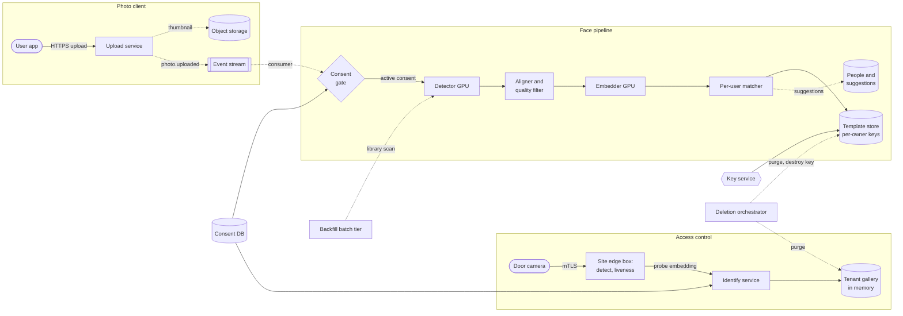

**Reading the diagram.** In the **photo client** the upload service writes a thumbnail to object storage and publishes an asynchronous `photo.uploaded` event (dotted arrows are asynchronous). The **face pipeline** consumes the event; the consent gate checks the consent database and drops events for users without an active `photo_people` consent, so non-consenting users' faces are never detected, let alone embedded. Detection and embedding run on batched GPU servers (§66.6); the aligner warps each face to 112×112 and drops faces that are too small, blurred or in profile; the per-user matcher loads the uploader's gallery, assigns the face to a person or creates a new cluster, writes the encrypted template, and asynchronously writes suggestions. In **access control** the site edge box detects the face and runs liveness checks locally, sending only an embedding over mutual TLS; the identify service searches the tenant's in-memory gallery synchronously. Storage boundaries: object storage (thumbnails), the template store (encrypted per owner with keys from the key service), the consent database and tenant galleries. Failure points: the consent gate (must fail closed), the GPU tiers (queue builds up, photos lag), and the identify service (doors fall back to badges). Scaling: GPU replicas for photo rate; the backfill tier separately; identify replicas per region with tenant galleries replicated in memory.

### 84.4.8 Detailed component design

#### Detection, alignment and embedding

Detection uses a single-stage detector that outputs boxes and five landmarks (eyes, nose, mouth corners), in the style of RetinaFace [Deng et al. 2020] or the earlier MTCNN [Zhang et al. 2016], run on the 1,024-pixel thumbnail rather than the 12-megapixel original. A **quality filter** rejects faces smaller than 40 pixels between the eyes, blurred, or turned more than about 45° from frontal, because their embeddings are unreliable and cause false merges.

**Alignment** computes the similarity transform that maps the five landmarks onto a fixed template and warps the crop to 112×112 pixels, so the embedder spends its capacity on identity rather than pose.

The **embedder** is a CNN (§58.7) producing a 512-dimension, L2-normalized vector, so cosine similarity is a dot product (§74.4). FaceNet trained it with a **triplet loss** that pulls an anchor toward a positive of the same identity and away from a negative by a margin [Schroff et al. 2015]; ArcFace trains a classifier over identities with an **additive angular margin** in the softmax, which converges more reliably at scale and became the common baseline [Deng et al. 2019]. Both generalize to people never seen in training, so galleries change without retraining.

#### Model choice, training data and the template-migration problem

**Baseline first:** a published open model evaluated on your own consented benchmark, after checking its license and training-data provenance (several web-scraped face datasets were withdrawn by their creators over consent concerns). **Production model:** an ArcFace-style ResNet-50-class network trained on a dataset whose subjects consented to training use, documented by demographic composition (§63.13), quantized to INT8 with a calibration set covering every slice (§67.4.3), and distilled to a MobileNet-class student for devices (§67.8).

The hardest operational fact is that **embeddings from two model versions are not comparable**: a template from version 1 cannot be matched against a probe from version 2. Every model upgrade therefore re-embeds every stored template, which for the photo client is $4.8 \times 10^{11}$ faces: $4.8 \times 10^{11} / 2{,}500 / 86{,}400 \approx 2{,}200$ GPU-days of embedding (100 GPUs for about three weeks), plus re-reading every source thumbnail. Storing each face's landmarks with its template avoids re-running detection, which would add another 7,700 GPU-days. The rollout is a **dual-write migration**: new photos are embedded by both versions; a batch job re-embeds the history per user; each user's gallery flips to version 2 atomically once complete; version-1 templates are deleted after the flip. Access-control tenants whose consent does not cover keeping enrollment photos must re-enroll employees, so upgrades are scheduled and announced.

#### Threshold selection and the 1:N multiplier

A threshold turns a score into a decision. On a verification benchmark you measure the two error rates as a function of the threshold and choose an operating point, usually stated as "FNMR at FMR = $10^{-k}$". Identification adds a multiplier.

::: formula
**False positive identification rate in a gallery of N**

$$\text{FPIR}(N, t) = 1 - \big(1 - \text{FMR}(t)\big)^{N} \approx N \cdot \text{FMR}(t) \quad (\text{when } N \cdot \text{FMR} \ll 1) \qquad n_{\text{impostor}} \ge \frac{3}{\text{FMR}}$$

| Symbol | Meaning | Units |
|---|---|---|
| $t$ | Similarity threshold | cosine, dimensionless |
| $\text{FMR}(t)$ | Fraction of non-mated comparisons scoring at or above $t$ | dimensionless |
| $N$ | Number of templates (people) in the gallery searched | count |
| $\text{FPIR}$ | Probability that a person not in the gallery returns at least one candidate above $t$ | dimensionless |
| $n_{\text{impostor}}$ | Non-mated comparisons needed to observe an FMR with useful confidence (rule of three: zero errors in $3/\text{FMR}$ trials bounds the rate at FMR with 95% confidence) | count |
:::

The approximation treats the $N$ comparisons as independent; real galleries contain look-alikes and relatives, so measured FPIR is usually somewhat higher.

::: example
**Worked example — How big can a door gallery be?** The requirement is FPIR ≤ 0.1% for visitors and contractors who are not enrolled.

1. Gallery of $N = 5{,}000$ at FMR = $10^{-6}$: FPIR $\approx 5{,}000 \times 10^{-6} = 0.5\%$ (exact: 0.499%). Fails.
2. Gallery of 5,000 at FMR = $10^{-7}$: 0.05%. Passes, if the model reaches $10^{-7}$ at an acceptable FNMR.
3. Gallery of 200,000 at FMR = $10^{-7}$: FPIR $\approx 2\%$ (exact 1.98%). Fails by 20×; it would need FMR = $5 \times 10^{-9}$.
4. Measuring FMR = $10^{-7}$ needs at least $3 \times 10^{7}$ non-mated comparisons, and more per demographic slice.

**Interpretation.** For a fixed model, the false-match budget per comparison shrinks in proportion to gallery size. **Engineering implication.** Large sites must not run open 1:N over all employees: partition the gallery by building or shift (smaller $N$), or turn identification into verification by combining face with a badge or PIN (1:1, $N = 1$). Privacy and accuracy point the same way: the smallest gallery that does the job is both the safest and the most accurate.
:::

The following program makes threshold selection concrete. It draws synthetic similarity scores (not from a real model) for mated pairs and for non-mated pairs from two demographic groups, picks the threshold that gives FMR = $10^{-5}$ on group A, and reports what the same threshold does to group B and to 1:N searches.

```python
import numpy as np
from statistics import NormalDist

rng = np.random.default_rng(84)
# Synthetic cosine similarities between face embeddings (illustrative, not a real model).
genuine = rng.normal(0.62, 0.11, 200_000)          # mated pairs: same person
imp_a = rng.normal(0.00, 0.075, 4_000_000)         # non-mated pairs, group A
imp_b = rng.normal(0.02, 0.085, 4_000_000)         # non-mated pairs, group B

def fmr(imp, t):  return np.mean(imp >= t)         # false match rate
def fnmr(gen, t): return np.mean(gen < t)          # false non-match rate

# 1. Pick the threshold that gives FMR = 1e-5 on group A (the tuning population).
t = np.quantile(imp_a, 1 - 1e-5)
print(f"threshold t = {t:.3f}")
print(f"group A: FMR = {fmr(imp_a, t):.1e}  FNMR = {fnmr(genuine, t):.4f}")
print(f"group B: FMR = {fmr(imp_b, t):.1e}  (same threshold)")

# 2. 1:N search: probability that at least one of N non-mated templates passes t.
for n in (100, 10_000, 1_000_000):
    fa, fb = fmr(imp_a, t), fmr(imp_b, t)
    print(f"N = {n:>9,}  FPIR A = {1 - (1 - fa) ** n:.4f}  FPIR B = {1 - (1 - fb) ** n:.4f}")

# 3. FPIR = 1% at N = 1e6 needs FMR = 1e-8: too rare to measure from 4M pairs,
#    so use the known (synthetic) distributions to see what it would cost.
t_big = NormalDist(0.00, 0.075).inv_cdf(1 - 1e-8)
print(f"t for FMR 1e-8 = {t_big:.3f}  FNMR = {NormalDist(0.62, 0.11).cdf(t_big):.4f}")
```

Output:

```text
threshold t = 0.326
group A: FMR = 1.0e-05  FNMR = 0.0035
group B: FMR = 1.5e-04  (same threshold)
N =       100  FPIR A = 0.0010  FPIR B = 0.0153
N =    10,000  FPIR A = 0.0952  FPIR B = 0.7851
N = 1,000,000  FPIR A = 1.0000  FPIR B = 1.0000
t for FMR 1e-8 = 0.421  FNMR = 0.0351
```

What to notice:

- A small shift in group B's non-mated distribution multiplies its false match rate by 15 at the same threshold: false matches live in the far tail, where small differences become large ratios.
- At $N = 10{,}000$ a threshold that looked strict for 1:1 returns a false candidate for 9.5% of group A's unenrolled visitors and 79% of group B's.
- Tightening to FMR = $10^{-8}$ raises FNMR tenfold (0.35% to 3.5%); only a better model or a smaller $N$ improves both. Step 3 uses the analytic distribution because 4 million samples cannot measure $10^{-8}$.

#### Demographic differentials and how to set the threshold

NIST's evaluation of 189 algorithms found false positive rates that varied across demographic groups, often by factors of 10 to 100 in one-to-one matching, with differentials depending strongly on the algorithm [Grother et al. 2019]. Gender Shades had shown error rates up to 34.7% for darker-skinned women against at most 0.8% for lighter-skinned men in commercial gender classifiers [Buolamwini & Gebru 2018]; it concerned attribute classification, not matching, but established the intersectional slice evaluation used here.

The design consequence: evaluate FMR and FNMR per slice with confidence intervals (§71.5), and **set one global threshold so that the worst slice meets the FMR target**. Per-group thresholds would require inferring each face's demographic group, itself biometric categorization that the EU AI Act prohibits for sensitive attributes; evaluation slices come from self-reported attributes in the consented benchmark (§71.5.2). More diverse training data and the model with the smallest measured differential are the real fixes.

#### Clustering a library

The matcher assigns each new face online to the nearest of the user's ~600 exemplars if it passes the **cluster threshold**, else starts a singleton. Nightly, changed libraries are re-clustered agglomeratively on a k-nearest-neighbor graph; for 200,000 faces all-pairs similarity is $2 \times 10^{10}$ pairs, so large libraries build the graph with a per-library HNSW index (§74.7). The **suggestion threshold** is stricter than the cluster threshold, because a wrong name is worse than a cluster the user can split. User merges and splits become **must-link** and **cannot-link** constraints that no re-cluster may undo.

#### Consent, biometric law and deletion as design inputs

This is an engineer's map as of 2026, not legal advice. **BIPA** (Illinois, 2008) requires informed written consent before collecting a biometric identifier and a public retention and destruction schedule, prohibits selling biometric data, and gives individuals a private right of action. **GDPR** Article 9 treats biometric data used to uniquely identify a person as a special category, generally requiring explicit consent; Articles 17 and 25 add erasure and data protection by design. The **EU AI Act** prohibits untargeted scraping of facial images and biometric categorization inferring sensitive attributes, and treats remote biometric identification as high-risk (§71.13.1).

Turned into requirements, these become mechanisms: a **consent gate** that fails closed before detection; **purpose binding**, so a `photo_people` consent never authorizes access-control matching and vice versa; **gallery scoping**, so no index spans users or tenants and no stranger search is technically possible; **per-owner encryption** with crypto-shredding for deletion, including backups; **retention schedules** enforced by a job that deletes templates at `retention_until`; and an **audit trail** of every identification. Figure 84.2 shows the consent lifecycle that drives them.

**Figure 84.2 — Biometric consent and template lifecycle.**

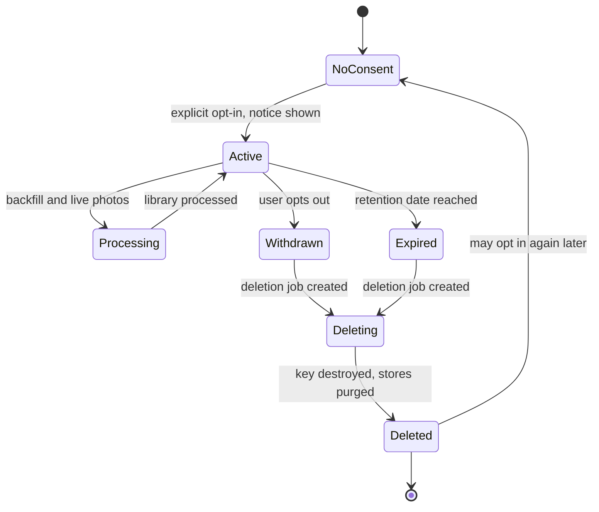

**Reading the diagram.** Each state is a value of the consent record for one subject and purpose. No templates exist in *NoConsent*. Opt-in requires an explicit action after a notice that states the purpose and retention period; the backfill batch then processes the library (*Processing*). Withdrawal and retention expiry both create a deletion job, whose completion requires two events: the per-owner key is destroyed (making every encrypted copy, including backups and replicas, unreadable) and each store confirms its purge (template store, galleries, suggestion cache, search indexes). Failure points: a deletion job that stalls (alert on age against the 30-day legal deadline) and a store missing from the purge list (enumerated in the receipt so an audit finds the gap). Scaling: deletion is a batch workflow, sized for mass withdrawals such as a feature shutdown.

#### Evaluation

Offline: FNMR at FMR = $10^{-5}$ and $10^{-6}$ for verification, FNIR at FPIR = 0.1% for identification at the deployed gallery sizes, all per demographic slice, on a consented benchmark with at least $3 \times 10^{7}$ non-mated pairs per slice for the strictest operating point. Participate in NIST's ongoing evaluations for an external check. Online, for the photo client: suggestion acceptance rate, rejection rate, and merges and splits per 1,000 faces (each is a model error a user fixed), compared in an A/B test with users as the unit (§57.14). For access control: badge-fallback rate (FNIR proxy) and confirmed false grants from security review (FPIR evidence), per site.

### 84.4.9 Data flow

**Figure 84.3 — Write path: an opted-in user uploads a photo.**

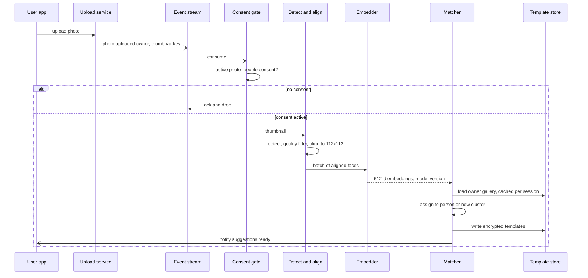

**Reading the diagram.** The upload itself completes synchronously and independently of face processing; the face pipeline is asynchronous and can lag minutes without users noticing. The consent check is the first step and fails closed: if the consent database is unreachable, events wait in the stream rather than being processed. Detection and alignment run on the thumbnail; aligned crops travel in memory to the embedder and are never stored. The matcher loads the owner's gallery once per upload session (a user uploading 50 photos pays one load), assigns faces and writes encrypted templates; suggestions are pushed asynchronously. Failure points: GPU queue growth (photos lag; scale the tier or shed backfill first), template store write failure (retry idempotently by `face_id`), and a model-version mismatch between gallery and probe (rejected by the matcher). Scaling: partition the stream by owner so one user's photos are processed by one matcher in order.

**Figure 84.4 — Read path: identification at a door.**

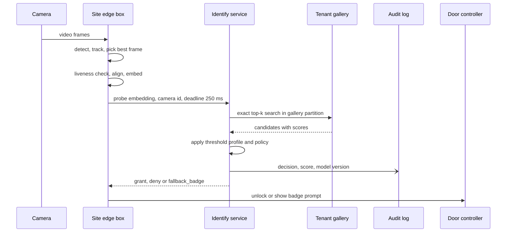

**Reading the diagram.** The edge box at the site runs detection, tracking (so a person walking up is processed once, from the best frame), **liveness detection** (rejecting photos, screens and masks, a presentation-attack defense) and embedding, so raw video never leaves the building. Only a 1 KB embedding crosses the network to the identify service, which searches the relevant gallery partition exactly, applies the tenant's threshold profile, writes the audit record asynchronously and returns a decision. Failure points: the network or identify service (the edge box falls back to badge after the deadline, never to an open door), a stale gallery (an employee who left must not be granted; galleries version on every change), and liveness failures. Scaling: identify replicas per region; very large tenants get dedicated replicas with their galleries pinned in memory.

### 84.4.10 Bottlenecks

1. **Detection GPU time** dominates photo processing; downscale before detection and skip near-duplicate burst photos by perceptual hash.
2. **Backfill surges** after a launch or a re-enabled region: eight times live load; meter by opt-in cohort.
3. **Model migration** re-embeds hundreds of billions of templates and re-reads their thumbnails; plan it like a data migration (§84.4.8).
4. **Re-clustering large libraries** is quadratic without ANN; use per-library HNSW and incremental updates.
5. **Measuring very low FMR** requires tens of millions of non-mated pairs per slice; the benchmark, not compute, limits how strict a threshold you can certify.

### 84.4.11 Failure scenarios

**Table 84.4 — Face recognition failure scenarios.**

| What fails | Impact | Detection | Recovery | Prevention |
|---|---|---|---|---|
| Consent gate bypassed by a code path (for example a reprocessing job) | Templates of non-consenting users: legal exposure | Daily reconciliation: every template owner has active consent | Delete orphan templates; disclose as required | Gate inside the pipeline library, not each caller; contract tests |
| Deletion incomplete in one store | Retained biometric data past the deadline | Deletion receipts missing a store; age of open jobs | Re-run purge; destroy key | Store registry; crypto-shredding covers unknown copies |
| Threshold drift after model or camera change | FPIR rises: false grants | Confirmed false grants; score distribution shift per camera (§70.7.4) | Roll back model or threshold profile | Re-certify threshold per model version and camera class |
| Demographic differential worse than benchmark in one site's population | Unequal false rejections or false grants | Per-site fallback rate; slice evaluation on consented samples | Raise threshold, add badge requirement | Worst-slice threshold; diverse calibration data |
| Presentation attack (printed photo, replay, mask) | Unauthorized entry | Liveness scores, tailgating sensors | Revoke, review footage under policy | Liveness model, depth or IR camera, face plus badge for sensitive doors |
| Training–serving skew: INT8 serving model differs from FP32 evaluated model | Higher FNMR in production than measured | Shadow-score sample at both precisions | Recalibrate quantization | Evaluate the exact deployed artifact (§67.16) |
| Mixed model versions in gallery and probe | Random matches or misses | Version check fails in matcher | Reject request; finish migration | Version stamped on every template and probe |
| Feedback loop: accepted wrong suggestions become cluster exemplars | Clusters drift and merge two people | Rising split rate | Rebuild cluster from confirmed faces | Exemplars only from high-quality, user-confirmed faces |
| GPU tier overload | Photo processing lags hours | Consumer lag, queue age | Pause backfill, autoscale | Separate quotas for live and backfill |

### 84.4.12 Scaling strategy

**At 10× users** (a billion opted-in users, 2.5 billion photos/day): live GPUs grow linearly to about 320, backfill to about 620 at the same opt-in ratio; template storage reaches 5.4 PB. Push detection toward the device, which already decodes the photo (§84.4.14), so the server embeds only faces the device found; move cold templates to an archive tier and keep only exemplars hot (§15.9).

**At 10× gallery size for access control** (2-million-person tenants such as a university system or stadium): search moves from exact to HNSW with exact re-ranking of the top 100, but the binding constraint is FPIR: at $N = 2 \times 10^6$ even FMR = $10^{-8}$ gives 2%. The design changes to verification (face plus credential) or partitioned galleries, not to a bigger index.

**At 100×**: per-tenant dedicated identify clusters and edge boxes that hold small site galleries locally for offline operation, with gallery sync by version; model upgrades become a quarterly fleet-wide program with migration budgets measured in GPU-months.

### 84.4.13 Trade-offs

**Table 84.5 — Face recognition design trade-offs.**

| Decision | Option chosen | Alternative | Why |
|---|---|---|---|
| Gallery scope | Per user or per tenant partition | One global index | Privacy (no stranger search possible) and FPIR both favor small galleries |
| Threshold | One global, set for the worst slice | Per-group thresholds | Avoids inferring sensitive attributes; slightly higher FNMR for some groups |
| Search | Exact below ~2M templates | ANN everywhere | Exact is cheap at these sizes and removes recall loss from the error budget |
| Detection input | Thumbnail | Original image | 10× cheaper; misses only tiny faces, which fail quality filters anyway |
| Probe processing | Edge embeds, sends vector | Stream video to cloud | Raw video stays on site; less bandwidth; door works with degraded network |
| Deletion | Crypto-shredding plus purge | Purge only | Covers backups and unknown copies |
| Upgrade | Dual-write migration | Re-enroll everyone | Users never see a gap; costs GPU-days |

### 84.4.14 Alternative designs

- **Fully on-device recognition.** The phone detects, embeds and clusters faces in the user's library; templates never leave the device, and synchronization across a user's devices can be end-to-end encrypted. Apple has described on-device face detection and people recognition in Photos along these lines [Apple 2017; Apple 2021]. This removes most server cost and much of the legal exposure but limits model size (§67.8), makes cross-device consistency harder, and makes friend suggestions impossible without sharing templates.
- **Verification-only access control.** Badge or phone credential plus a 1:1 face check; $N = 1$ eliminates the FPIR multiplier and the need for a gallery search at all.
- **No face recognition.** Grouping by event, location and user tags gives much of the photo product's value with no biometric processing at all.

::: industry
**Facebook face recognition and BIPA.** A class action alleged that Facebook's tag-suggestion feature collected face templates of Illinois users without the written consent BIPA requires; the case settled for USD 650 million in 2021. Later that year Meta announced it was shutting down the Face Recognition system on Facebook and deleting the individual templates of more than a billion people, citing societal concerns and regulatory uncertainty. The lesson for designers is that consent and retention are not policy documents beside the system: they are requirements that, if missing from the architecture, can force a feature to be removed entirely.
*Evidence: Primary* — [Meta 2021; In re Facebook Biometric Information Privacy Litigation 2021]
:::

### 84.4.15 Interview discussion

**Table 84.6 — 45-minute pacing plan for face recognition.**

| Minutes | Focus | What to produce |
|---|---|---|
| 0–5 | Scope and ethics | 1:1 vs 1:N; opt-in; purposes; what is out of scope (stranger search, attributes) |
| 5–10 | Estimates | Photos and faces per second; backfill 8× live; detection dominates; gallery sizes |
| 10–18 | Architecture | Figure 84.1; consent gate first; edge versus cloud for doors |
| 18–30 | Deep dive: matching | Embeddings, threshold from FMR/FNMR, FPIR ≈ N·FMR, worst-slice threshold |
| 30–38 | Deep dive: privacy and lifecycle | Consent states, crypto-shredding, model migration |
| 38–45 | Wrap-up | Failures (presentation attack, deletion gaps), scaling, alternatives |

**Likely follow-ups.**

- *"Why not one global index so you can tag anyone?"* That is stranger search: it needs consent from people who never used the product, it is prohibited or high-risk in several jurisdictions, and with $N$ in the billions FPIR approaches 1 at any usable threshold.
- *"How do you pick the threshold?"* From the cost of each error: for doors, false grants are worse, so fix FPIR at the deployed $N$ and accept the FNMR; for suggestions, a wrong name is worse than none. Certify per slice.
- *"What happens when you ship a better model?"* Templates are incompatible; dual-write and re-embed per user, flip galleries atomically, delete old templates.
- *"How do you prove deletion?"* Per-owner keys destroyed plus per-store purge receipts, audited.

**What distinguishes senior and staff answers.** A senior answer gets the pipeline, embeddings and an ANN or exact matcher right and mentions consent. A staff answer derives FPIR ≈ N·FMR and uses it to bound gallery size, observes that privacy and accuracy both favor small scoped galleries, treats the threshold as a per-slice, per-model certification, plans template migration on model upgrades, and builds deletion as a verifiable workflow rather than a promise.

### 84.4.16 Production considerations

- **Monitoring.** Per-slice and per-camera score distributions; suggestion acceptance and split rates; badge-fallback rate per site; consent-to-template reconciliation; deletion-job age (Chapter 70).
- **Retraining.** Quarterly at most, gated on per-slice FNMR at fixed FMR and on a funded migration plan.
- **Responsible ML.** A biometric impact assessment per jurisdiction before launch; model card with slice metrics (§59.10.3); no attribute inference; red-team presentation attacks.
- **Security.** Templates are secrets: per-owner encryption, no export API, access logged; model inversion can reconstruct recognizable faces from confidence scores [Fredrikson et al. 2015], so the identify API returns decisions and coarse scores only, rate-limited.
- **Cost.** About 1,350 GPU-hours/day (live plus backfill); at an illustrative USD 0.80 per GPU-hour, roughly USD 1,100/day, dominated by backfill. Storage for 540 TB of templates is the second line item.

## 84.5 Image Classification Service

### 84.5.1 Problem statement

Design a cloud image classification API for many business customers (**tenants**). A tenant sends an image, or a reference to one in object storage, and receives labels with confidences: either from a general model ("dog", "beach", "invoice") or from a **custom model** the tenant trained on its own labeled images ("defective weld", "our product, front view"). Requests arrive both one at a time from user-facing applications and as batch jobs of millions of images.

The ML formulation is supervised multi-class or multi-label classification (§57.10): input an image, output a probability per class; labels come from the tenant's uploaded, labeled examples (§63.5). ML is warranted because visual categories cannot be specified by rules, and transfer learning from a large pretrained backbone lets a tenant reach useful accuracy with a few hundred examples per class [He et al. 2016; Dosovitskiy et al. 2021].

The distinctive hard problem is **throughput economics at multi-tenant scale**. The model is cheap per image on a GPU only when images arrive in batches (§66.6); turning a compressed JPEG into a normalized tensor can cost more CPU than the model costs GPU; and thousands of customer models, each versioned and pinned by its owner, must share hardware without each paying for an idle replica. The answer is measured in **cost per 1,000 images** at a latency objective. The general multi-tenant serving platform is Chapter 85's subject (§85.6); this case focuses on what images add.

### 84.5.2 Functional requirements

1. **Classify (online).** `classify(image, model, version?)` returns top-k labels with calibrated confidences.
2. **Classify (batch).** Submit a manifest of object-storage keys; results are written to the tenant's bucket within a deadline.
3. **Custom models.** Upload labeled images, start training, read evaluation metrics (per-class precision and recall, confusion matrix), and deploy a version.
4. **Versioning.** Every model version is immutable; tenants address an explicit version or an alias (`prod`); the provider's own general model is versioned the same way and never changes silently under a pinned version.
5. **Feedback.** Tenants may post corrected labels for served predictions, which feed their next training run.
6. **Quotas and billing.** Per-tenant rate limits and metering per image.

### 84.5.3 Non-functional requirements

**Table 84.7 — Image classification non-functional requirements.**

| Requirement | Target |
|---|---|
| Availability | 99.9% monthly for online classify |
| Latency | Online p99 ≤ 300 ms server-side for images up to 4 MB (excluding URL fetch from the tenant's own servers); p50 ≤ 60 ms |
| Batch | 10 million images complete within 24 h; throughput, not latency, is the objective |
| Model quality | General model top-1 accuracy within 1 point of the offline benchmark on a monthly audit sample; custom models reported per class, never deployed below the tenant's chosen precision floor |
| Version stability | A pinned version returns identical labels (up to floating-point noise) for at least 12 months |
| Isolation | One tenant's burst cannot raise another tenant's p99 by more than 20% |
| Data | Request images not retained by default; training images kept until the tenant deletes them |
| Cost | Compute cost below USD 0.001 per 1,000 images at average load |

### 84.5.4 Capacity estimation

::: example
**Worked example — Request rate and bandwidth.** Assumptions: 800 million images/day across 25,000 tenants; peak-to-average 3; 70% online, 30% batch; average image 400 KB, about 2 megapixels.

1. Average: $8 \times 10^8 / 86{,}400 = 9{,}259$ images/s; **peak 27,778/s**, of which 19,444/s online.
2. Ingress at peak if bytes are uploaded: $27{,}778 \times 400{,}000 \times 8 = 88.9$ Gbit/s. Batch jobs therefore pass object-storage keys and the service reads in-region (§15.8.2), so batch bytes never cross the public edge.

**Interpretation.** At 89 Gbit/s, image transport is a design concern in its own right. **Engineering implication.** Prefer references to bytes for anything large or batch, and terminate uploads in the region that holds the GPUs.
:::

The pipeline has two compute stages, decode and model, priced on different hardware. §66.7 gives cost per 1,000 predictions for one device type; a pipeline sums it over stages.

::: formula
**Cost per 1,000 images across pipeline stages**

$$C_{1k} = \frac{1{,}000}{3{,}600} \sum_{i} \frac{p_i}{X_i \, u_i} \qquad N_i = \left\lceil \frac{\lambda_{\text{peak}}}{X_i \, u_i} \right\rceil$$

| Symbol | Meaning | Units |
|---|---|---|
| $i$ | Pipeline stage (decode and resize, model, postprocess) | — |
| $p_i$ | Price of one device of stage $i$ (one vCPU or one GPU) | USD/h |
| $X_i$ | Images per second one device of stage $i$ sustains | images/s |
| $u_i$ | Average utilization of that stage's fleet | dimensionless |
| $\lambda_{\text{peak}}$ | Peak image rate | images/s |
| $N_i$ | Devices needed in stage $i$ at peak | count |
| $C_{1k}$ | Compute cost per 1,000 images | USD |
:::

::: example
**Worked example — The decoder costs more than the model.** Assumptions (measure them): full libjpeg-turbo decode plus resize of a 2-megapixel JPEG takes 23 ms of one vCPU core ($X = 43.5$/s); decoding at 1/4 scale in the DCT domain, which JPEG supports natively, then resizing to 224×224, takes 5 ms ($X = 200$/s); a ResNet-50-class backbone at FP16 with TensorRT sustains $X = 2{,}500$ images/s per L4-class GPU at batch 32; prices USD 0.04 per vCPU-hour and USD 0.80 per GPU-hour (illustrative, as of 2026); $u = 0.6$.

1. Model GPUs: $27{,}778 / (2{,}500 \times 0.6) = 18.5$, so **19 GPUs**, USD 15.20/h.
2. Full decode: $27{,}778 \times 0.023 / 0.6 = 1{,}065$ cores, USD 42.59/h.
3. Scaled decode: $27{,}778 \times 0.005 / 0.6 = 231$ cores, USD 9.26/h.
4. Per 1,000 images: model $1{,}000 \times 0.80 / (3{,}600 \times 2{,}500 \times 0.6) = \$0.000148$; full decode \$0.000426 (**2.9 times the model**); scaled decode \$0.000093.
5. Pipeline total: \$0.000574 with full decode, **\$0.000241** with scaled decode.

**Interpretation.** A GPU fleet tuned to the last percent still loses to an unoptimized JPEG decoder. **Engineering implication.** Profile the whole pipeline before buying GPUs; decode at reduced scale, or move decode onto the GPU (§84.5.8), and size the CPU tier as carefully as the GPU tier.
:::

::: example
**Worked example — Peak sizing and idle cost.** The 19 GPUs and 231 decode cores are sized for peak. Kept on all day they cost $(19 \times 0.80 + 231 \times 0.04) \times 24 = \$587$ per day for 800 million images, or **\$0.00073 per 1,000**, three times the \$0.00024 computed at $u = 0.6$.

**Interpretation.** With a 3:1 peak-to-average ratio, a static fleet runs at one third of its target utilization on average. **Engineering implication.** Autoscale online capacity (§66.9) and schedule the 30% batch traffic into the troughs, so the same GPUs serve the online peak by day and batch jobs by night.
:::

::: example
**Worked example — Custom models in GPU memory.** Assumptions: every tenant model uses the shared backbone's 2,048-dimension pooled features plus its own linear **head** with on average 20 classes (FP32); 2,000 premium tenants instead have a fully fine-tuned ResNet-50 (25.6 million parameters, FP16).

1. One head: $2{,}048 \times 20 \times 4 = 164$ KB; all 25,000 heads: **4.1 GB**, which fits on every GPU next to the backbone.
2. One fine-tuned model: $25.6 \times 10^6 \times 2 = 51$ MB; 2,000 of them: 102 GB, so a GPU with 20 GB set aside holds about 390.
3. Loading a 51 MB model at 2 GB/s takes 26 ms plus engine initialization and warm-up (§66.10).

**Interpretation.** Head-only models make the "many models" problem disappear; full fine-tunes bring back multiplexing and cold starts. **Engineering implication.** Make shared-backbone heads the default product and price full fine-tuning as a premium tier served by model-aware routing (§66.8).
:::

Training is small by comparison: a head trains on cached backbone embeddings of the tenant's images (5,000 images embed in 2 GPU-seconds; the logistic regression trains on CPU in seconds), and a full fine-tune of 10 epochs over 10,000 images is about $10 \times 10{,}000 \times 3 / 2{,}500 = 120$ GPU-seconds. Training images average 5,000 per tenant: $25{,}000 \times 5{,}000 \times 400$ KB = 50 TB in object storage.

### 84.5.5 API design

```text
POST /v1/models/{model}/versions/{version|alias}:classify
Headers: Authorization: Bearer <tenant token>
{ "image": { "bytes": "<base64>" } | { "uri": "objstore://tenant-bucket/a.jpg" },
  "top_k": 5, "min_confidence": 0.2 }
-> 200 { "labels": [ { "name": "weld_defect", "confidence": 0.93 } ],
         "model": "acme-weld", "version": "7", "backbone": "bb-2025-11",
         "request_id": "..." }

POST /v1/batch-jobs
{ "model": "general", "version": "2025-11", "input_manifest": "objstore://.../in.jsonl",
  "output_prefix": "objstore://.../out/", "deadline_hours": 24 }
-> 202 { "job_id": "j-5", "state": "queued" }

POST /v1/datasets/{ds}/images        # labeled upload (presigned URL flow, §15.8.2)
POST /v1/models/{model}/versions     { "dataset": "ds-3", "type": "head" | "full" }
-> 202 { "version": "8", "state": "training" }
GET  /v1/models/{model}/versions/8/evaluation   # per-class precision, recall, confusion
PUT  /v1/models/{model}/aliases/prod  { "version": "8" }
POST /v1/predictions/{request_id}:feedback  { "correct_label": "no_defect" }
```

Responses always name the model version and backbone, so a tenant can reproduce any result. Changing the `prod` alias is a tenant action, not a provider action.

### 84.5.6 Data model and database schema

```sql
CREATE TABLE model_version (
  tenant_id   TEXT NOT NULL,
  model_id    TEXT NOT NULL,
  version     INT  NOT NULL,
  kind        TEXT NOT NULL CHECK (kind IN ('head','full','general')),
  backbone_id TEXT NOT NULL,          -- e.g. 'bb-2025-11'; heads depend on it
  artifact_uri TEXT NOT NULL,         -- immutable object key, content hash
  label_map   JSONB NOT NULL,         -- class index -> name
  dataset_snapshot TEXT NOT NULL,     -- for reproducibility
  metrics     JSONB NOT NULL,         -- per-class precision/recall on holdout
  state       TEXT NOT NULL,          -- training, ready, deprecated, retired
  created_at  TIMESTAMPTZ NOT NULL,
  retire_after TIMESTAMPTZ,           -- earliest retirement under the stability promise
  PRIMARY KEY (tenant_id, model_id, version)
);
CREATE TABLE model_alias (
  tenant_id TEXT, model_id TEXT, alias TEXT, version INT NOT NULL,
  updated_at TIMESTAMPTZ NOT NULL, PRIMARY KEY (tenant_id, model_id, alias)
);
```

Training examples are rows `(tenant_id, dataset_id, image_key, label(s), split, labeler, ts)`; split assignment is fixed at upload by hashing the image key so that re-training never leaks test images into training (§57.7). Backbone embeddings of training images are cached as `(backbone_id, image_hash) → float16[2048]` in object storage, so a head retrains without touching the GPU. Prediction logs keep `(request_id, tenant, model, version, top labels, latency, image_hash)`, never the image unless the tenant opts in. The feedback label delay is days or never; most tenants never send feedback, so quality monitoring cannot rely on it (§70.8).

### 84.5.7 High-level architecture

**Figure 84.5 — Multi-tenant image classification service.**

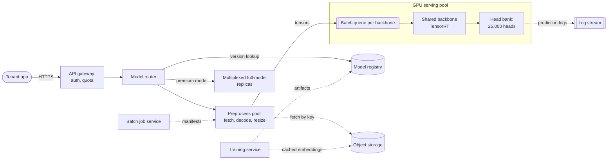

**Reading the diagram.** The gateway authenticates the tenant and applies its quota (§22.3) synchronously. The router resolves the alias to an immutable version in the model registry (cached), then sends the request to the preprocessing pool, which fetches bytes (from the request or, by key, from object storage), decodes, resizes and normalizes. Tensors enter a per-backbone batch queue; the backbone runs batched on the GPU, and the head bank applies each request's tenant head to its row of the backbone output. Requests for fully fine-tuned premium models go to multiplexed replicas instead. Batch jobs enter the same preprocessing pool asynchronously at lower priority. Training writes immutable artifacts to the registry and cached embeddings to object storage. Storage boundaries: registry, object storage, logs. Failure points: preprocessing saturation, a missing head on a replica, cold loads of premium models. Scaling: preprocessing and GPU pools scale independently.

### 84.5.8 Detailed component design

#### Preprocessing: where the CPU goes

A request's image must be fetched, decoded from JPEG, PNG or HEIC, rotated by its EXIF orientation, resized to 224×224 (or the backbone's input), converted to floating point and normalized. Decoding dominates, and its cost grows with the image's pixel count, not with the model's input size: a 12-megapixel phone photo costs about six times a 2-megapixel one before being thrown away down to 50,000 pixels. Four techniques, in the order to try them:

1. **Reduced-scale decode.** JPEG stores 8×8 DCT blocks, so a decoder can produce a 1/2, 1/4 or 1/8 scale image without computing full resolution, at a fraction of the cost. Pick the largest reduction that still leaves at least the model's input size.
2. **Cap input size at the edge.** Reject or downscale images above a pixel limit before they reach the decode pool, and bill them accordingly.
3. **GPU decode.** NVIDIA's nvJPEG library and the DALI data-loading library decode and resize on the GPU, so compressed bytes cross PCIe instead of 150 KB float tensors and the CPU pool shrinks [NVIDIA DALI Docs]. The cost is GPU time and memory taken from the model, and the GPU becomes a single pool for two stages, so measure both stages' throughput together.
4. **Isolate decoders.** Decoders parse untrusted input; run them in sandboxed processes with memory and time limits so a malformed image cannot crash the GPU server.

**Figure 84.6 — Two preprocessing placements.**

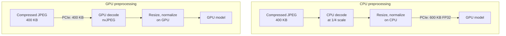

**Reading the diagram.** In the CPU placement, decode, resize and normalization run in the CPU pool and a 224×224×3 FP32 tensor (602 KB; 301 KB in FP16) crosses PCIe. In the GPU placement only the compressed bytes cross, and the GPU does the rest, sharing its compute with the model. All arrows are synchronous within a request. The failure point in both is a pathological input (huge or malformed image); the scaling choice is between adding CPU cores and adding GPU time. The CPU placement is easier to isolate and to scale independently; the GPU placement wins when CPU cost per image is high and GPU headroom exists.

#### Dynamic batching and the latency budget

The backbone runs one batched forward pass for requests from many tenants, because they share weights; heads are a cheap batched matrix multiply per tenant afterwards (a gather of each row's head). Apply the latency model of §66.6 with measured $T(B) = 1.6 + 0.35\,B$ ms:

::: example
**Worked example — Batching parameters.** $X(32) = 32 / 12.8 \text{ ms} = 2{,}500$ images/s; $X(1) = 513$/s; $X(8) = 1{,}818$/s. Choose $B_{\max} = 32$ and a maximum queue delay $D_{\max} = 8$ ms.

1. Worst case in the GPU server: $D_{\max} + 2\,T(B_{\max}) = 8 + 2 \times 12.8 = 33.6$ ms.
2. Each of 19 GPUs receives $27{,}778 / 19 = 1{,}462$ images/s at peak, below $X(32) = 2{,}500$, so the queue is stable (§66.6).
3. Online p99 budget of 300 ms: gateway and routing 10 ms, upload or fetch 150 ms (a 4 MB image over a slow client link dominates), preprocessing 20 ms, GPU 34 ms, response 5 ms, slack 81 ms.

**Interpretation.** Batching costs at most 34 ms and buys a fivefold throughput gain over batch size 1. **Engineering implication.** The GPU is not the latency problem; image transfer is. Keep $D_{\max}$ small for online traffic and run batch jobs at $B = 64$ on separate queues so they never sit in front of online requests.
:::

Batch-job traffic uses a lower-priority queue on the same GPUs; the scheduler always drains online first, giving batch the leftover capacity of Figure 84.5's troughs.

#### Many customer models: heads, versions and the backbone upgrade

The head-bank design keeps one backbone per GPU and all 25,000 heads resident, so any replica serves any tenant and nothing is ever cold. Premium full fine-tunes are routed by model ID to replicas that hold them (§66.8), with the least recently used model evicted; a tenant whose model is cold pays one load, and popular premium models are pinned on several replicas.

Versioning is a contract. A model version is the triple *(backbone, head weights, label map)*, stored immutably by content hash. The hard case is a **backbone upgrade**: a better backbone changes the embedding space, so every head trained on the old backbone is invalid. The upgrade is a migration:

1. Train the new backbone; validate the general model offline and by shadow traffic.
2. Recompute cached embeddings of every tenant's training images: $1.25 \times 10^8$ images at 2,500/s is 14 GPU-hours, cheap.
3. Retrain every head on the new embeddings and evaluate each against its own holdout; this produces a *new version* for each tenant, never an in-place change.
4. Tenants whose new version is at least as good on their holdout are notified and may move `prod`; the old version remains served until its `retire_after` date (12 months).
5. During the overlap, GPUs host **both** backbones, which halves the batch size each sees at a given traffic split, so plan capacity for the overlap.

The cost of version stability is therefore not storage but running two backbones for a year. Keep the number of live backbones to two by policy.

#### Training and evaluation

**Baseline:** the general model's backbone with a logistic-regression head, trained in seconds; it is the default and the yardstick. **Production custom model:** the same head with tuned regularization and class weighting, or a full fine-tune when the tenant's images look nothing like the backbone's training data (microscope slides, X-rays) and the head's holdout accuracy is poor. The tenant's data is split by hashed image key, with near-duplicate detection across splits by perceptual hash, because duplicates in train and test inflate accuracy. Evaluation reports per-class precision, recall and a confusion matrix; deployment is blocked if any class has fewer than 20 test examples. For the general model, a monthly audit sample of production images, labeled by annotators under the tenant-consent rules (§63.14.2), is the online quality check; prediction-confidence and embedding drift per tenant (§70.7.4) are the early warning, because tenant feedback is sparse. General-model changes are A/B tested on tenants who opted into the `latest` alias, with top-1 agreement and confidence calibration as guardrails.

### 84.5.9 Data flow

**Figure 84.7 — Write path: a tenant trains and deploys a custom head.**

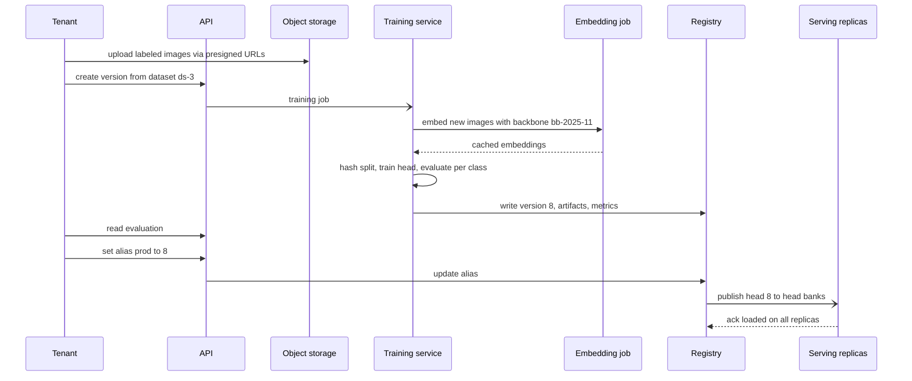

**Reading the diagram.** Images go straight to object storage through presigned URLs, bypassing the API servers. Training is asynchronous: only images without a cached embedding for this backbone are embedded on the GPU; training the head is a CPU job. The registry stores the immutable version with its metrics; the tenant, not the system, moves the `prod` alias. The new head is pushed asynchronously to every replica's head bank, and the alias flip becomes visible to the router only after all replicas acknowledge, so no request is routed to a replica that lacks the head. Failure points: a replica that fails to load (alias flip waits; the old version keeps serving) and a training job that crashes (idempotent restart from cached embeddings). Scaling: training jobs are queued and run on spare batch capacity.

**Figure 84.8 — Read path: an online classification.**

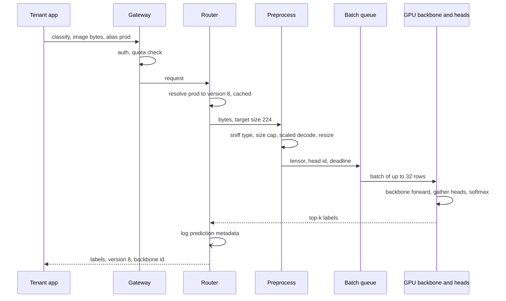

**Reading the diagram.** Every step is synchronous within the request except the asynchronous prediction log. The router's alias cache is invalidated by the registry's publish event. Preprocessing checks the content type from the bytes rather than the header, enforces the pixel cap and decodes at reduced scale. The queue releases a batch when it reaches 32 rows or the oldest row has waited 8 ms; rows from different tenants share the backbone pass and then use their own heads. Failure points: a full queue (shed with 429 and `Retry-After` rather than let latency grow, §66.14), a GPU fault (requests retried once on another replica), and a malformed image (rejected with 400 by the sandboxed decoder). Scaling: replicas behind the router; tenants with high volume can get a dedicated queue to limit noisy-neighbor effects.

### 84.5.10 Bottlenecks

1. **Decode CPU**, especially for very large images; mitigated by reduced-scale decode, size caps and GPU decode.
2. **Upload bandwidth** for online requests from slow clients; the GPU waits for no one, but the request's latency does.
3. **Batch formation at low traffic**: off-peak, batches are small and per-image GPU cost rises; consolidate replicas when traffic falls.
4. **Two backbones during an upgrade** split traffic and halve batch sizes.
5. **Premium cold loads** when many rarely used full models are requested in a burst.

### 84.5.11 Failure scenarios

**Table 84.8 — Image classification failure scenarios.**

| What fails | Impact | Detection | Recovery | Prevention |
|---|---|---|---|---|
| Preprocessing pool saturated | Latency rises, GPUs idle | Queue age before GPU; GPU utilization falls while p99 rises | Autoscale decoders; shed batch traffic | Size decode tier from measured cost per image |
| Decompression bomb or malformed file | Decoder crash or memory exhaustion | Sandbox kills, OOM counters | Reject request; block the file hash | Pixel limit before decode; sandboxed decoders |
| Training–serving skew: training resized with a different library than serving | Accuracy drops silently by several points | Golden-image test comparing training and serving tensors | Redeploy with shared preprocessing code | One preprocessing library and version for both paths (§59.8.2) |
| Silent change under a pinned version | Tenant's downstream logic breaks | Golden predictions per version replayed daily | Restore artifact by content hash | Immutable artifacts; no in-place updates |
| Label leakage via near-duplicates across splits | Inflated reported accuracy; poor production precision | Perceptual-hash duplicate audit | Re-split and retrain | Hash-based split with duplicate grouping |
| Drift in a tenant's images (new camera, new product line) | Accuracy decays; no labels to show it | Embedding and confidence drift per tenant | Notify tenant, request labeled samples | Drift monitors (§70.7.4); periodic labeled audits |
| Adversarial or abusive images (evasion, prohibited content) | Misclassification exploited; legal exposure | Abuse classifiers, report flows | Block tenant or content | Terms enforcement; content-safety pre-check |
| Noisy neighbor floods shared queue | Other tenants' p99 rises | Per-tenant queue share | Per-tenant rate limit, fair queuing | Weighted fair queue per tenant |
| GPU replica loses head bank update | Requests for new version fail on that replica | Load acknowledgments | Alias flip blocked; reload | Two-phase publish |

### 84.5.12 Scaling strategy

**At 10× traffic** (8 billion images/day, 278,000/s at peak): about 190 GPUs and, with scaled decode, 2,300 decode cores; move decode onto GPUs or onto dedicated decode accelerators to keep the CPU fleet from dominating; spread across regions with tenants homed to the region of their data. Compile the backbone with INT8 (§67.4) after per-tenant accuracy checks, which can roughly double throughput.

**At 10× tenants** (250,000 heads, 41 GB): the head bank no longer fits beside the backbone on every GPU; partition tenants across GPU groups by consistent hashing (§14.8) so each group holds a fraction of the heads, and route by tenant.

**At 100×**: multiple backbones specialized by domain (documents, products, medical) behind the same API, an automatic choice of backbone per tenant from validation accuracy, and a batch tier on cheaper or older GPUs, since batch work has no latency objective.

### 84.5.13 Trade-offs

**Table 84.9 — Image classification design trade-offs.**

| Decision | Option chosen | Alternative | Why |
|---|---|---|---|
| Custom model form | Shared backbone plus head | Full fine-tune per tenant | All tenants resident, no cold starts; full fine-tune only where accuracy demands |
| Preprocessing | Reduced-scale CPU decode, GPU decode at high scale | Full CPU decode | 4.6× cheaper decode per image |
| Batching | $B_{\max} = 32$, $D_{\max} = 8$ ms online; separate batch queue | One queue | Online latency protected; batch fills troughs |
| Versioning | Immutable versions; tenant moves alias | Provider auto-upgrades | Stability promise; costs two live backbones |
| Image retention | None by default | Keep for retraining | Privacy and storage; weaker quality monitoring |
| Precision | FP16, INT8 after validation | FP32 | 2× or more throughput; validated per tenant |

### 84.5.14 Alternative designs

- **CPU-only serving** with an optimized runtime (ONNX Runtime, OpenVINO-style) for small tenants or low volume; at this scale the GPU wins on cost per image once batches fill (§66.7).
- **Embedding API plus client-side heads.** Return the 2,048-dimension embedding and let tenants train their own classifiers; simplest to operate and version, but tenants bear the ML work and the embedding becomes a frozen contract.
- **Zero-shot classification with an image–text model** such as CLIP [Radford et al. 2021]: tenants supply class names instead of labeled examples; excellent for broad categories, weaker for fine-grained industrial classes, and its backbone is several times more expensive.
- **On-device classification** with a distilled MobileNet-class model (§67.8) for latency or privacy, synchronized from the same registry.

### 84.5.15 Interview discussion

**Table 84.10 — 45-minute pacing plan for the image classification service.**

| Minutes | Focus | What to produce |
|---|---|---|
| 0–5 | Scope | Online and batch; general and custom models; versioning promise |
| 5–12 | Estimates | 27,778 images/s; 89 Gbit/s; GPUs vs decode cores; cost per 1,000 |
| 12–20 | Architecture | Figure 84.5; preprocessing pool separate from GPU pool |
| 20–30 | Deep dive: throughput | Decode cost, dynamic batching numbers, batch vs online queues |
| 30–40 | Deep dive: many models | Head bank, multiplexed premium models, backbone upgrade migration |
| 40–45 | Wrap-up | Failures (skew, noisy neighbor), scaling, alternatives |

**Likely follow-ups.**

- *"Your GPUs are at 30% and latency is bad. Why?"* Most likely preprocessing or upload is the bottleneck; look at queue age before the GPU queue and decoder CPU, not at the model.
- *"How do you host 25,000 models?"* Make them heads on a shared backbone; full models only for tenants who need them, with model-aware routing and LRU loading.
- *"A tenant says their results changed overnight."* Responses carry version and backbone; replay golden images per version; artifacts are immutable, so either the tenant moved the alias or preprocessing changed, which golden-image tests catch.
- *"What is your cost per 1,000 images?"* Sum stages: about USD 0.00024 at 60% utilization, triple that with a static peak-sized fleet.

**What distinguishes senior and staff answers.** A senior answer sizes the GPU fleet with dynamic batching and separates online from batch. A staff answer finds that decode can cost more than the model and fixes the pipeline, turns the "many models" problem into a shared-backbone architecture, treats versioning as a contract with a migration plan and a budget for running two backbones, and explains cost per 1,000 images including idle capacity.

### 84.5.16 Production considerations

- **Monitoring.** Per-stage latency and utilization (decode, queue, GPU); batch-size histogram; per-tenant confidence and embedding drift; golden-image replay per live version (§70.7.4).
- **Retraining.** Tenant-driven for custom models; general model and backbone on a semiannual cadence with the migration of §84.5.8.
- **Responsible ML.** Terms prohibiting classifying people by sensitive attributes; refuse face-attribute classes; document general-model limits in a model card.
- **Security.** Sandboxed decoders, per-tenant encryption of training data, signed model artifacts, no cross-tenant access to heads or embeddings.
- **Cost.** About USD 0.00024 per 1,000 images in compute at target utilization; autoscaling and batch-trough filling decide whether the real figure is closer to that or to three times it.

## 84.6 Speech Recognition

### 84.6.1 Problem statement

Design the speech recognition behind a phone's voice assistant and dictation keyboard. The user speaks; words appear on screen while they talk (**partial results**); when they stop, the system decides that the utterance has ended (**end-pointing**), produces a **final** transcript and hands it to the assistant or the text field. "Call Maya Chen" must work even though "Chen" is rare in general speech, because Maya Chen is in this user's contacts.

The ML formulation is sequence transduction: map a sequence of acoustic frames (log-mel features every 10 ms) to a sequence of word pieces, trained on transcribed audio with a sequence loss. ML is warranted because speech varies with speaker, accent, noise and microphone, and end-to-end neural models replaced the separate acoustic, pronunciation and language models of earlier systems while improving accuracy [Graves 2012; He et al. 2019; Radford et al. 2023].

The distinctive hard problem is **streaming under a latency budget**: the system must emit words before the sentence is finished and decide when it is finished, both with incomplete information, on a phone or in the cloud. A second problem is **personalization without collecting personal data**: biasing toward the user's contacts and vocabulary while keeping audio and contact lists private.

### 84.6.2 Functional requirements

1. **Streaming recognition.** Accept audio as it is captured; return partial hypotheses every 100–200 ms and one final transcript per utterance.
2. **End-pointing.** Detect end of query for the assistant; for dictation, keep listening until the user stops the session.
3. **Contextual biasing.** Accept per-request bias phrases (contact names, app names, recently used words) and favor them in recognition.
4. **On-device and cloud modes.** Recognize on the device when a model for the language is installed and the device is capable; otherwise, or for long-form dictation if the user allows it, stream to the cloud.
5. **Formatting.** Convert spoken forms to written forms ("ten minutes" → "10 minutes" where appropriate), punctuation and capitalization.
6. **Improvement program.** Users may opt in to donate audio for human transcription; nobody else's audio is retained.

### 84.6.3 Non-functional requirements

**Table 84.11 — Speech recognition non-functional requirements.**

| Requirement | Target |
|---|---|
| Availability | Cloud recognition 99.95%; on-device works offline |
| Latency | First partial ≤ 300 ms after speech starts (p90); final transcript ≤ 500 ms after the user stops speaking (p90) |
| Compute | Real-time factor ≤ 0.5 on the oldest supported phone; cloud streams never fall behind real time |
| Model quality | WER on the voice-search test set ≤ 6%; contact-name recall ≥ 95% for names in the bias list; early-cutoff rate ≤ 1% of utterances |
| Fairness | WER for every accent and dialect slice within 1.5× of the overall WER, with confidence intervals |
| Privacy | Audio processed in memory; not stored unless the user opted in; bias lists not stored server-side |
| Freshness | On-device model updated monthly at most; cloud model weekly at most |

### 84.6.4 Capacity estimation

::: example
**Worked example — Streams, bandwidth and donated audio.** Assumptions: 50 million daily users; 10 utterances per user per day; 4 s of audio each; peak-to-average 3; 60% of audio recognized on device; Opus at 16 kbit/s for cloud streams; 2% of users opted in to donate.

1. Utterances: $5 \times 10^7 \times 10 = 5 \times 10^8$/day; audio $2 \times 10^9$ s/day.
2. Average concurrent streams: $2 \times 10^9 / 86{,}400 = 23{,}148$; **peak 69,444**, of which 40% in the cloud: **27,778 concurrent cloud streams**.
3. Ingress: $27{,}778 \times 16$ kbit/s $= 444$ Mbit/s, trivial.
4. Donated audio (opted-in share of cloud audio): $0.02 \times 0.4 \times 2 \times 10^9 = 1.6 \times 10^7$ s/day = 4,444 hours/day, 32 GB/day.

**Interpretation.** Speech is a concurrency problem, not a request-rate or bandwidth problem: what matters is how many streams are open at once. **Engineering implication.** Size gateways for 28,000 long-lived connections (§9.9.2) and GPUs for concurrent streams; donated audio far exceeds what can be transcribed, so sample it.
:::

::: formula
**Real-time factor and streaming latency**

$$\text{RTF} = \frac{T_{\text{step}}}{T_{\text{chunk}}} \qquad S_{\text{GPU}} = B \cdot \left\lfloor \frac{T_{\text{chunk}}}{T_{\text{step}}(B)} \right\rfloor$$

$$L_{\text{partial}} \le T_{\text{chunk}} + T_{\text{look}} + 2\,T_{\text{step}} + T_{\text{net}} \qquad L_{\text{final}} = T_{\text{ep}} + T_{\text{step}} + T_{\text{2nd}} + T_{\text{net}}$$

| Symbol | Meaning | Units |
|---|---|---|
| $T_{\text{chunk}}$ | Audio per encoder step (one chunk) | ms |
| $T_{\text{step}}(B)$ | GPU time to advance $B$ streams by one chunk | ms |
| RTF | Real-time factor: compute time per unit of audio; must stay below 1 | dimensionless |
| $B$ | Streams batched into one step | count |
| $S_{\text{GPU}}$ | Concurrent streams one GPU can keep real-time | streams |
| $T_{\text{look}}$ | Right-context (future audio) the encoder waits for | ms |
| $T_{\text{net}}$ | Network delay, one way (zero on device) | ms |
| $T_{\text{ep}}$ | Time from the last word to the end-point decision | ms |
| $T_{\text{2nd}}$ | Optional second-pass rescoring of the final hypothesis | ms |
| $L_{\text{partial}}$, $L_{\text{final}}$ | Worst-case delay of a partial word; delay of the final transcript after speech ends | ms |
:::

The $2\,T_{\text{step}}$ term covers a chunk that arrives just after a step started and waits for it.

::: example
**Worked example — Streams per GPU and the latency budget.** Assumptions (measure them): a 120-million-parameter streaming encoder–transducer; $T_{\text{chunk}} = 160$ ms; no extra lookahead beyond the chunk; one step for $B = 120$ streams takes $T_{\text{step}} = 32$ ms on an L4-class GPU; $T_{\text{net}} = 40$ ms; second pass 50 ms.

1. RTF $= 32/160 = 0.2$.
2. Steps per chunk period: $\lfloor 160/32 \rfloor = 5$, so $S_{\text{GPU}} = 120 \times 5 = 600$ streams.
3. Cloud GPUs at 70% utilization: $27{,}778 / (600 \times 0.7) = 66$; with no on-device recognition, $69{,}444 / 420 = 165$.
4. Sanity check: $2 \times 1.2 \times 10^8 \times 25$ frames/s $= 6$ GFLOP/s per stream, 3.6 TFLOP/s per GPU, a few percent of peak: streaming is bound by small batches, per-stream state and beam search, not by FLOPs.
5. Partial latency: $160 + 0 + 64 + 40 = 264$ ms worst case, within 300 ms.
6. Final latency with a 600 ms silence timeout: $600 + 32 + 50 + 40 = 722$ ms, which **fails** the 500 ms target; with a learned end-of-query detector deciding 300 ms after the last word: $300 + 32 + 50 + 40 = 422$ ms.

**Interpretation.** Chunk size sets partial latency and GPU efficiency together; end-pointing, not the model, dominates final latency. **Engineering implication.** Spend effort on the end-pointer; and moving 60% of recognition onto devices cuts the cloud fleet by 60% while also removing $T_{\text{net}}$.
:::

### 84.6.5 API design

Recognition is a bidirectional stream over gRPC or a WebSocket (§9.6): audio frames up, results down.

```text
stream Recognize(RecognizeRequest) returns (stream RecognizeResponse)

RecognizeRequest (first message):
  config { language: "en-US", mode: ASSISTANT | DICTATION,
           sample_rate: 16000, codec: OPUS, partials: true,
           bias: [ { phrase: "Maya Chen", boost: 2.0 }, ... ],   # not stored
           client: { device_model_version: "asr-dev-2026-10" } }
RecognizeRequest (subsequent): audio { bytes: <20 ms Opus frames> }
RecognizeRequest (optional):  control { end_of_stream: true }

RecognizeResponse:
  partial { text: "call maya", stable_prefix_len: 1, offset_ms: 640 }
  endpoint { reason: END_OF_QUERY | SILENCE | CLIENT, at_ms: 1720 }
  final   { text: "Call Maya Chen", words: [ {w, start_ms, end_ms, conf} ],
            alternatives: [...], model_version: "asr-cloud-2026-11-03" }

POST /v1/feedback  { utterance_id, action: "edited" | "retried", corrected_text? }   # opt-in only
```

`stable_prefix_len` tells the client how many words will not change, so the interface can render them solid and the rest greyed. The feedback endpoint accepts corrections only for users in the improvement program; for everyone else, the client keeps only aggregate counters (retry and edit rates) that contain no text.

### 84.6.6 Data model and database schema

Nothing user-specific is stored in the serving path; the data model belongs to the improvement and evaluation loop.

```sql
CREATE TABLE donated_utterance (
  utterance_id  UUID PRIMARY KEY,
  donor_pseudonym TEXT NOT NULL,       -- rotating pseudonym, not account id
  consent_id    UUID NOT NULL,
  language      TEXT NOT NULL,
  audio_uri     TEXT NOT NULL,         -- encrypted object; deleted after 90 days
  model_version TEXT NOT NULL,
  hypothesis    TEXT NOT NULL,
  sampled_for_transcription BOOLEAN NOT NULL,
  received_at   TIMESTAMPTZ NOT NULL
);
CREATE TABLE transcript (
  utterance_id UUID REFERENCES donated_utterance,
  transcriber  TEXT NOT NULL,
  text         TEXT NOT NULL,          -- verbatim, then normalized form
  normalized   TEXT NOT NULL,
  slice_tags   JSONB,                  -- self-reported accent/region, noise, device
  PRIMARY KEY (utterance_id, transcriber)
);
```

Labels are human transcripts with a delay of days to weeks and a cost of several hours of transcriber time per hour of audio, so only a sample (for example 200 of the 4,444 donated hours per day) is transcribed, stratified by language, slice and model confidence (active learning, §63.9). Training data is a mix of transcribed audio, a much larger pool of machine-labeled audio (teacher model output, filtered by confidence), and text-only data for the language model. Test sets are frozen per release and never used for training. Bias phrases live only on the device and in request memory.

### 84.6.7 High-level architecture

**Figure 84.9 — Hybrid on-device and cloud speech recognition.**

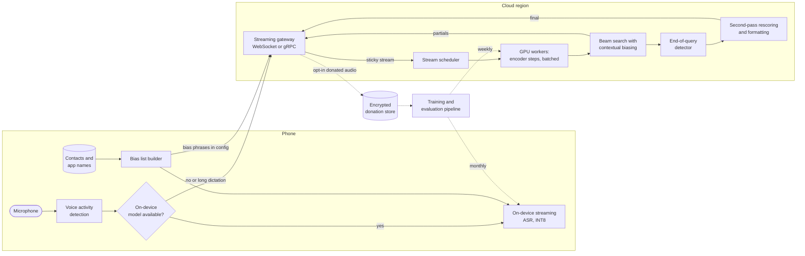

**Reading the diagram.** On the **phone**, voice activity detection gates the microphone so silence is not processed; if an on-device model is installed for the language, the whole recognition runs locally with an INT8 model, biased by a list built from contacts and app names that never leaves the device. Otherwise the client opens a **streaming connection** (solid arrows are the synchronous stream) to a gateway that pins the stream to one GPU worker, because the encoder and decoder keep per-stream state. The scheduler groups streams into batched encoder steps; beam search with contextual biasing produces partials; the end-of-query detector decides when to finalize; a second pass rescores and formats the final hypothesis. Only donated audio of opted-in users flows asynchronously (dotted) to the encrypted donation store and the training pipeline, which ships models to both tiers. Failure points: a GPU worker crash (stream state lost), gateway overload (reconnect storms, §9.9.6), and the model update channel to devices. Scaling: GPU workers by concurrent streams; gateways by connections.

### 84.6.8 Detailed component design

#### Model: why a transducer streams and an attention decoder does not

Three end-to-end families exist. **CTC** emits a label or blank per frame, assuming outputs independent given the audio [Graves et al. 2006]. **Attention encoder–decoder** models, such as Listen, Attend and Spell [Chan et al. 2016] and Whisper, attend over the *entire* encoded utterance before emitting each token; they are accurate but not naturally streaming. Whisper, trained on 680,000 hours of weakly supervised multilingual audio, processes 30-second windows and is robust across accents and noise, which makes it a strong offline and long-form model and a good teacher, but a poor fit for 300 ms partials without chunking tricks [Radford et al. 2023]. The **RNN Transducer (RNN-T)** combines an audio encoder, a **prediction network** that sees the tokens emitted so far, and a **joint network** that, at each frame, decides whether to emit a token or advance to the next frame [Graves 2012]. Because the encoder can be made causal (limited lookahead), the transducer emits words as audio arrives. Google described an all-neural streaming RNN-T that ran on Pixel phones, with quantization making it small and fast enough for on-device use [He et al. 2019].

**Figure 84.10 — Streaming transducer with contextual biasing and a second pass.**

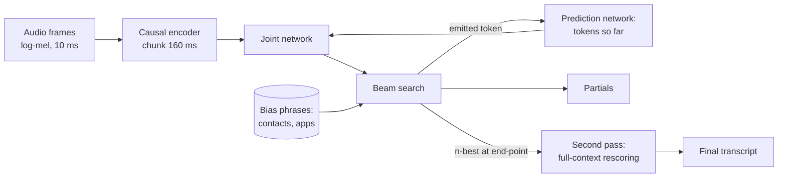

**Reading the diagram.** The causal encoder turns each 160 ms chunk of features into encoder frames without waiting for future chunks. For each frame, the joint network combines the encoder frame with the prediction network's summary of tokens emitted so far and outputs a distribution over word pieces plus *blank*. Beam search keeps the best few hypotheses, adds a bonus for prefixes of bias phrases, and feeds each emitted token back to the prediction network (the loop is what makes the model autoregressive in its outputs). Partials are the current best hypothesis. At the end-point, the n-best list is rescored by a second-pass model that sees the whole utterance, a design Google published as two-pass end-to-end recognition [Sainath et al. 2019]. The failure point is the loop: a biased token that is wrong is fed back and conditions everything after it, which is why boosts must be bounded.

**Baseline first:** a CTC model with an external n-gram language model, which is simple to bias and to evaluate. **Production model:** a Conformer-encoder transducer [Gulati et al. 2020] of about 120 million parameters in the cloud, distilled (§67.8) into a smaller INT8 model for devices, with Whisper-class large models used offline as teachers to label untranscribed audio.

#### Contextual biasing

A general model rarely outputs "Chen" after "Maya". Biasing raises the score of hypotheses that are prefixes of known phrases during beam search: a phrase list is compiled into a small prefix tree (or weighted finite-state transducer) over word pieces, and each hypothesis that advances along it gets a log-probability bonus, withdrawn if the hypothesis leaves the phrase. This **shallow fusion** is cheap and needs no retraining [Aleksic et al. 2015]; **neural biasing** such as CLAS feeds the phrases into the model as an attention context [Pundak et al. 2018]. Two guardrails matter. Boosts must be bounded and applied mainly in contexts where the phrase class is expected ("call …", "text …"), or biasing hallucinates contacts into unrelated speech; and evaluation needs two numbers: recall of bias phrases that were spoken, and the **false-trigger rate** on utterances with no bias phrase. Privacy comes from placement: on device, the contact list never leaves the phone; in the cloud it is sent per request inside the stream config and dropped when the stream ends.

#### End-pointing

A **silence timeout** declares the end after, say, 600 ms of non-speech: simple, but slow, and it cuts off users who pause mid-sentence ("call Maya … Chen"). An **end-of-query detector** is a small model that predicts from acoustic and decoder state whether the user has finished, so it can fire 200–300 ms after a complete query and wait longer after an incomplete one [Shannon et al. 2017]. Its two failure modes trade against each other: **early cutoff** (truncated queries, user must repeat) and **late end-point** (sluggish response). Tune it on a curve of early-cutoff rate against median end-point latency, choosing the knee; dictation mode disables it.

#### Evaluating with word error rate

::: formula
**Word error rate**

$$\text{WER} = \frac{S + D + I}{N} \qquad \text{WER}_{\text{corpus}} = \frac{\sum_u (S_u + D_u + I_u)}{\sum_u N_u}$$

| Symbol | Meaning | Units |
|---|---|---|
| $S$ | Substituted words in the minimum-edit alignment of hypothesis to reference | words |
| $D$ | Deleted words (in the reference, missing from the hypothesis) | words |
| $I$ | Inserted words (in the hypothesis, not in the reference) | words |
| $N$ | Words in the reference transcript | words |
| $u$ | Utterance index in the test set | — |
:::

WER can exceed 100% because insertions are unbounded. Corpus WER weights utterances by length, which is the convention; averaging per-utterance WER over-weights short commands. The following program computes the alignment counts with the Levenshtein recurrence over words.

```python
def align(ref, hyp):
    """Word-level Levenshtein alignment; returns (substitutions, deletions, insertions)."""
    r, h = ref.split(), hyp.split()
    # d[i][j] = (cost, S, D, I) for r[:i] versus h[:j]
    d = [[(j, 0, 0, j) for j in range(len(h) + 1)]]
    for i in range(1, len(r) + 1):
        row = [(i, 0, i, 0)]
        for j in range(1, len(h) + 1):
            c, s, dl, ins = d[i - 1][j - 1]
            same = r[i - 1] == h[j - 1]
            options = [
                (c + (0 if same else 1), s + (0 if same else 1), dl, ins),  # match/substitute
                (d[i - 1][j][0] + 1, d[i - 1][j][1], d[i - 1][j][2] + 1, d[i - 1][j][3]),  # delete
                (row[j - 1][0] + 1, row[j - 1][1], row[j - 1][2], row[j - 1][3] + 1),      # insert
            ]
            row.append(min(options))
        d.append(row)
    _, s, dl, ins = d[-1][-1]
    return s, dl, ins

pairs = [
    ("call maya chen on her mobile", "call maya chan on mobile please"),
    ("set a timer for ten minutes", "set a timer for ten minutes"),
    ("text dad i will be late", "text dad i'll be late"),
]
errors = words = 0
for ref, hyp in pairs:
    s, dl, ins = align(ref, hyp)
    n = len(ref.split())
    errors, words = errors + s + dl + ins, words + n
    print(f"S={s} D={dl} I={ins} N={n} WER={(s + dl + ins) / n:.3f}  | {hyp}")
print(f"corpus WER = {errors}/{words} = {errors / words:.3f}")
```

Output:

```text
S=1 D=1 I=1 N=6 WER=0.500  | call maya chan on mobile please
S=0 D=0 I=0 N=6 WER=0.000  | set a timer for ten minutes
S=1 D=1 I=0 N=6 WER=0.333  | text dad i'll be late
corpus WER = 5/18 = 0.278
```

What to notice:

- The first utterance has one error of each kind, but the one that matters is "chen" → "chan": the call goes to the wrong person. WER weights every word equally, so report **entity accuracy** (contact names, numbers) separately.
- The third utterance is correct to a human, yet scores 33% because "i'll" and "i will" differ as strings. Normalize both sides (contractions, numbers, casing, punctuation) with a fixed, versioned normalizer before scoring; Whisper's authors released one for this reason [Radford et al. 2023].
- Comparing two models requires the same test set and normalizer; a WER difference without both is meaningless.

Online, the experiment unit is the user (§57.14), with guardrails on **retry rate** (user repeats the query), **edit rate** in dictation, and end-point latency; these are label-free proxies available for every user. Offline WER is reported per slice: published studies found commercial recognizers' WER for Black speakers nearly twice that for white speakers [Koenecke et al. 2020], so slice evaluation by self-reported accent and dialect is a launch gate, not a report.

### 84.6.9 Data flow

**Figure 84.11 — Read path: one streamed cloud query.**

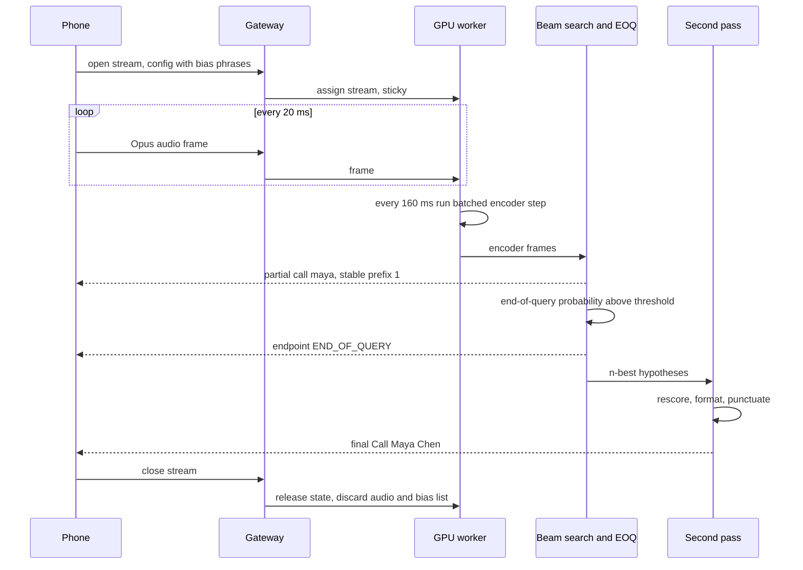

**Reading the diagram.** One stream stays on one worker because encoder caches and beam state live there. Audio frames arrive every 20 ms; the worker accumulates them and runs one batched encoder step per 160 ms chunk for all its streams. Partials flow back asynchronously as the beam changes; the end-point decision triggers the second pass and the final result. On close, state, audio and the bias list are discarded. Failure points: the worker dies mid-utterance (the gateway reassigns the stream, and the client replays its last two seconds of buffered audio, so the utterance survives with a short delay); the gateway drains for deployment (new streams go elsewhere, existing ones finish, §9.9.7); network stalls (the client falls back to on-device recognition if available). Scaling: stream slots per worker are the unit of capacity; the scheduler refuses new streams on a worker whose step time approaches the chunk period.

**Figure 84.12 — Write path: from donated audio to a new model on devices.**

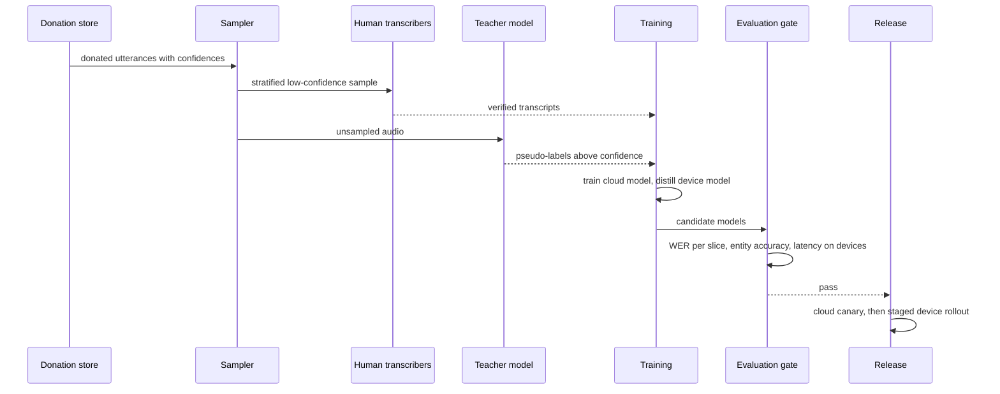

**Reading the diagram.** All steps are batch and asynchronous. The sampler sends a stratified sample, weighted toward low-confidence and under-represented slices, to human transcribers; a large teacher model pseudo-labels the rest, kept only above a confidence threshold. Training produces a cloud model and a distilled, quantized device model. The evaluation gate checks frozen test sets per slice, entity accuracy, and measured latency and memory on the oldest supported devices. Release canaries the cloud model on a fraction of streams and rolls the device model out in stages with a kill switch. Failure points: pseudo-label errors reinforcing themselves (feedback loop), test-set contamination, and a device model that exceeds memory on old phones. Audio is deleted from the donation store after 90 days, transcripts after their consent period.

### 84.6.10 Bottlenecks

1. **End-point latency** dominates the user-perceived delay; the end-of-query detector is the highest-leverage component.
2. **Per-stream state and stickiness**: streams cannot be load-balanced per request; a hot worker cannot shed load without migrating state.
3. **Small batches** at low traffic make each GPU step less efficient; consolidate streams onto fewer workers off-peak.
4. **Transcription labor** limits labeled data and slice coverage, not compute.
5. **Device diversity**: the oldest supported phone sets the device model size.

### 84.6.11 Failure scenarios

**Table 84.12 — Speech recognition failure scenarios.**

| What fails | Impact | Detection | Recovery | Prevention |
|---|---|---|---|---|
| GPU worker crash | In-flight utterances lost | Stream error rate per worker | Reassign; client replays buffered audio | Client-side 2 s audio buffer; health-based placement |
| Step time exceeds chunk period (RTF > 1) | Partials fall behind, latency grows | Per-worker RTF and lag | Stop admitting streams; shed to device | Admission control by step-time headroom |
| Reconnect storm after a gateway failure | Gateway overload | Connection rate spike | Jittered backoff (§9.9.6) | Capacity for reconnect surge |
| Over-biasing | Contact names inserted into unrelated speech | False-trigger rate on no-bias test set | Lower boosts; restrict to contexts | Bounded boosts; class contexts |
| Early cutoff after end-pointer update | Truncated queries, retries | Retry rate, early-cutoff metric | Roll back end-pointer | Gate on cutoff–latency curve |
| Training–serving skew: device front end computes features differently | Device WER worse than cloud | Same-audio comparison of device and cloud | Fix feature code | Shared feature library and golden audio tests |
| Pseudo-label feedback loop | Systematic errors become training targets | WER on human-verified slices stalls or rises | Remove pseudo-labeled batches | Confidence thresholds; human-verified anchor data |
| Drift (new slang, product names, a new accent population) | WER rises on new terms | Retry and edit rates by locale; OOV rate | Add text data, bias lists | Monthly refresh; slice monitoring |
| Privacy failure: audio of non-donors logged by debug path | Legal and trust breach | Data inventory scans | Purge; disclose | No audio in logs by construction; lint rules |

### 84.6.12 Scaling strategy

**At 10× users**: cloud GPUs grow toward 660 at the same on-device share; the cheaper lever is raising the on-device share by supporting more languages and older phones with smaller distilled models, each percentage point of traffic moved to devices removing 2.5% of peak cloud streams. Gateways scale horizontally with stream-aware draining.

**At 10× languages** (from 20 to 200): per-language models become a long tail with little traffic each; move to a multilingual model with a language-identification front end, keep dedicated models for the largest languages, and accept higher WER in the tail initially, measured per language.

**At 100×**: region-local serving everywhere (latency and data residency), continuous pseudo-labeling with periodic human audits, and federated learning (§71.11) for personalization that never centralizes user audio.

### 84.6.13 Trade-offs

**Table 84.13 — Speech recognition design trade-offs.**

| Decision | Option chosen | Alternative | Why |
|---|---|---|---|
| Model family | Streaming transducer plus second pass | Attention model on full utterance | Partials in 300 ms; second pass recovers accuracy |
| Chunk size | 160 ms | 40 ms or 640 ms | Smaller is lower latency but less efficient and less accurate |
| End-pointing | Learned end-of-query | Silence timeout | 300 ms faster finals; fewer cutoffs on pauses |
| Placement | On device when possible | Cloud only | Privacy, offline, no network delay, 60% less cloud cost; smaller model |
| Biasing | Shallow fusion with bounded boosts | Neural biasing only | Cheap, no retraining; neural biasing as quality upgrade |
| Data | Opt-in donations plus pseudo-labels | Retain all audio | Privacy; less data, more reliance on teachers |

### 84.6.14 Alternative designs

- **Batch transcription** (voicemail, meetings, video captions): non-streaming attention models such as Whisper over 30-second windows give better accuracy per FLOP and need no end-pointer; sized by audio hours per day, not concurrent streams.
- **Cloud-only**: simplest operations and one model, at the cost of network latency, offline failure and every utterance leaving the device.
- **Cascaded hybrid ASR** (acoustic model, lexicon, n-gram LM in a decoding graph): still strong where custom vocabularies change daily, since the LM can be rebuilt without retraining.

### 84.6.15 Interview discussion

**Table 84.14 — 45-minute pacing plan for speech recognition.**

| Minutes | Focus | What to produce |
|---|---|---|
| 0–5 | Scope | Streaming, partials, end-pointing, on-device vs cloud, biasing |
| 5–10 | Estimates | Concurrent streams, not RPS; 27,778 cloud streams; 66 GPUs |
| 10–18 | Architecture | Figure 84.9; sticky streams; device path |
| 18–30 | Deep dive: streaming | Transducer vs attention, chunking, RTF, latency decomposition, end-pointing |
| 30–38 | Deep dive: quality | WER with normalization, entity accuracy, biasing, slices |
| 38–45 | Wrap-up | Failures, privacy, scaling to more languages |

**Likely follow-ups.**

- *"Why not run Whisper for the assistant?"* It encodes 30-second windows and is expensive per stream; it fits batch transcription and teacher labeling, while the assistant needs a streaming transducer.
- *"Users say it cuts them off."* Plot early-cutoff rate against end-point latency, adjust the end-of-query threshold by context, and check slices: slower speakers are cut off more.
- *"How do you recognize a contact name the model never saw?"* Contextual biasing from the device's contact list, compiled into a prefix tree; evaluate recall and false triggers.
- *"How do you improve without keeping audio?"* Opt-in donations, pseudo-labels from teachers, federated learning, and label-free online proxies.

**What distinguishes senior and staff answers.** A senior answer chooses a streaming model, sizes by concurrent streams and evaluates by WER. A staff answer decomposes final latency and shows that end-pointing dominates it, normalizes text before WER and adds entity metrics, treats on-device recognition as both a privacy and a cost lever, and designs the improvement loop around consent.

### 84.6.16 Production considerations

- **Monitoring.** Per-worker RTF and stream lag; first-partial and final latency; early-cutoff, retry and edit rates by locale and device class; language-ID confusion; bias false-trigger rate.
- **Retraining.** Cloud weekly at most, device monthly, each behind slice gates and staged rollout.
- **Responsible ML.** Slice WER by accent and dialect as a launch gate; transcriber guidelines and well-being for sensitive audio (§63.14.3).
- **Security and privacy.** Encrypted streams; audio and bias lists in memory only; donation store encrypted with retention limits and access logging.
- **Cost.** 66 cloud GPUs at peak, autoscaled with traffic; the device fleet is free compute but costs engineering for each device class.
