# Chapter 85 — Case Studies X: ML Platforms

> **Level:** 4–5 · **Track:** B (ML/AI) · **Estimated reading time:** 4 h

The cases in Chapters 81–84 each designed one ML product: a recommender, a fraud model, an ETA predictor. This chapter designs the **platforms** underneath them. A platform has a different customer: not an end user who wants a prediction, but hundreds of ML engineers in dozens of teams who want to ship models without rebuilding the same pipelines, schedulers and servers each time. The design is judged by what those teams can do with it (how fast a feature reaches production, how long a training job waits, what a rarely used model costs) and by how well it keeps one team's mistake or burst from hurting the others.

Each case emphasizes a different hard problem, summarized in Table 85.1.

**Table 85.1 — The four cases and their distinctive hard problems.**

| Case | Distinctive hard problem |
|---|---|
| §85.4 Feature store | Point-in-time-correct training sets over years of history, online reads that fan out to hundreds of keys at more than 100,000 requests/s, and streaming aggregates that count each event once |
| §85.5 Distributed training platform | Sharing a few thousand GPUs among 80 teams: quotas, fair share, gang scheduling, preemption with checkpoints, and honest utilization and cost accounting |
| §85.6 Multi-tenant serving platform | Serving 5,000 models of wildly different popularity: packing, loading and evicting models, scaling to zero, isolating tenants and pricing each model |
| §85.7 Real-time inference platform | Meeting a p99 budget for high-stakes decisions: budget decomposition, hedging and deadlines, CPU versus GPU economics, safe rollout, online/offline consistency and multi-region placement |

## 85.1 Learning objectives

After this chapter you should be able to:

- Design a company-wide feature store: declarative definitions, batch and streaming materialization, backfills, point-in-time training-set generation at the scale of billions of rows, and an online read path whose fan-out you can quantify.
- Design a self-service training platform: job API, quota and fair-share policy for GPUs, gang admission, preemption with checkpoint-on-signal, experiment tracking, and chargeback; estimate checkpoint bandwidth and the GPU-hours lost to preemption.
- Design a multi-tenant serving platform that packs thousands of models onto a shared fleet, routes by model affinity, loads and evicts models, scales idle models to zero, enforces per-tenant quotas and computes the cost of each model.
- Design a real-time inference platform for fraud-, ads- and ETA-style decisions: decompose a p99 budget, size hedging and timeouts, choose CPU or GPU by cost per prediction, roll models out through shadow and canary stages, verify online/offline consistency and place the system in several regions.
- Explain which concept chapter owns each mechanism these platforms use and apply its formulas rather than re-deriving them.
- Run each design as a 45-minute interview and recognize the follow-ups that separate senior from staff answers.

## 85.2 Prerequisites

**Table 85.2 — Concept chapters each case applies.**

| Case | Concept chapters it leans on |
|---|---|
| All | ML system architecture and latency budgets — §60.10–§60.11; MLOps, registry and CI/CD — Chapter 69; ML monitoring — Chapter 70; multi-tenancy — Chapter 47; cost — Chapter 51 |
| §85.4 Feature store | Feature stores (the owner) — Chapter 62, especially §62.7–§62.11 and §62.15; data engineering for ML — Chapter 61; stream processing and exactly-once — §29.8–§29.9, §31.11; fan-out and hedging — §23.6–§23.7 |
| §85.5 Training platform | Distributed training, checkpointing and fault tolerance — §65.15–§65.18; cluster scheduling, fairness and gang scheduling — §46.8–§46.12; GPU utilization — §64.11, §64.15; large clusters — Chapter 80 |
| §85.6 Serving platform | Model serving, multi-model serving, autoscaling and cold start — §66.8–§66.10; fair queuing and isolation — §47.7–§47.9; LLM-specific gateways and token quotas — Chapter 79 |
| §85.7 Real-time inference | Latency budgets — §60.10; dynamic batching and CPU versus GPU — §66.6–§66.7; safe deployment and reliability — §66.12, §66.14; model optimization — Chapter 67; training–serving skew — §62.9; multi-region systems — Chapter 44 |

## 85.3 How to use these case studies

Work through each case with the method of §52.3: read the problem statement, close the book, produce your own requirements, estimates and architecture, and only then compare; treat every number as an assumption to challenge; and follow the cross-references wherever a mechanism is summarized in a sentence. Platform cases differ from the product cases of Chapters 81–84 in three ways. The "ML formulation" in each N.x.1 is a set of representative workloads the platform must serve, not one prediction target, so state them explicitly. Model-quality targets become platform guarantees: no label leakage, bounded skew, identical scores online and offline. And every requirement has a tenant dimension: for each resource, ask who gets it when two teams want it at once, and who pays for it.

## 85.4 Feature Store (company-wide, for hundreds of models)

### 85.4.1 Problem statement

A consumer marketplace with 100 million active user profiles, 40 million listed items and 2 million merchants runs about 400 production models built by 90 teams; 150 of them serve online. Each team has built its own feature pipelines. The result is the list of §62.6: the same "orders in the last 7 days" computed five different ways, training sets built with naive joins that leak future values, online values that disagree with the offline values the model was trained on, and no record of who reads what. Design a company-wide **feature platform** that lets a team define a feature once, use it for training and serving, and discover and reuse other teams' features.

The ML formulation is a set of representative consumers with very different access patterns:

- **Fraud and risk scoring**: a few entity keys per request (user, card, device, merchant), streaming velocity counters that must be seconds fresh.
- **Ranking**: one user plus 150 candidate items per request, so one request reads hundreds of keys.
- **Forecasting and lifetime-value models**: batch only, but training sets with hundreds of millions of rows and years of history.

Why a platform rather than per-team code: features are shared across models, skew and leakage are platform-wide failure modes that one team cannot fix alone, and the online store is expensive infrastructure that is cheaper to run once. The concepts (as-of joins, online store layout, freshness budgets, governance) are owned by Chapter 62; this case applies them at a scale where the hard problems become **point-in-time correctness at billions of rows**, **online fan-out** and **streaming correctness**.

### 85.4.2 Functional requirements

1. **Define.** Engineers declare entities, sources, feature views (batch, streaming or on-demand) and feature services in code reviewed in Git; the registry stores every version.
2. **Materialize.** The platform schedules batch jobs and runs streaming jobs that write both the offline history and the online store from the same definition.
3. **Backfill.** A new or changed definition can be computed over up to two years of history, and the online store bootstrapped, without a hand-written second pipeline.
4. **Generate training sets.** Given a spine (entity keys, label timestamps, labels) and a feature service, return a point-in-time-correct table (§62.8).
5. **Serve online.** Return feature vectors for a batch of entity keys within milliseconds, with value ages and defaults for missing values.
6. **Log and compare.** Record served feature values for sampled requests and compare them with offline recomputation (§62.9.2).
7. **Discover and govern.** Search features by name, entity, owner and usage; show lineage, freshness and quality; enforce access control and personal-data tags (§62.15).

### 85.4.3 Non-functional requirements

**Table 85.3 — Feature store non-functional requirements.**

| Requirement | Target |
|---|---|
| Online read latency (serving API, one call) | p99 ≤ 10 ms, p99.9 ≤ 25 ms, measured at the client |
| Online availability | 99.99% of read calls return values or declared defaults |
| Streaming freshness | p99 feature age ≤ 60 s for streaming views; batch views published by 04:00 local |
| Point-in-time correctness | Zero use of values unavailable at label time; ≥ 99.5% of logged served values reproduced exactly by the training-set builder |
| Streaming aggregate accuracy | Within 0.1% of a batch recompute over the same events ("exactly-once-ish") |
| Training-set generation | 500 million rows × 400 features in under 2 hours |
| Backfill | One year of a new streaming view in under 6 hours |
| Durability | Offline history on object storage with eleven-nines durability (§15.6) |
| Scale | 30,000 features, 2,000 views, 40 entity types, 90 teams |

### 85.4.4 Capacity estimation

Decimal units throughout; all numbers are illustrative assumptions for a teaching design.

::: example
**Worked example — Online read load and fan-out.** Assumptions: 120,000 serving-API requests/s at peak. 100,000/s are "small" (fraud, pricing, ETA-type): 4 keys in 3 view groups. 20,000/s are ranking requests: 1 user key and 150 item keys in 2 view groups. Apply the read-load formula of §62.11.1.

1. Keys: $100{,}000 \times 4 + 20{,}000 \times 151 = 400{,}000 + 3{,}020{,}000 = 3.42$ million keys/s. Ranking is 17% of requests and 88% of keys.
2. Batched calls (one multi-get per view group): $100{,}000 \times 3 + 20{,}000 \times 2 = 340{,}000$ calls/s.
3. But a multi-get is split by partition. With the item view hash-partitioned over $S = 48$ partitions, 150 random keys touch on average $S\,(1 - (1 - 1/S)^{150}) = 48 \times (1 - 0.0425) = 45.96$ partitions.
4. Ranking alone therefore issues $20{,}000 \times 45.96 = 919{,}190$ sub-requests/s, and one ranking read waits for 46 of them. If each sub-request meets its deadline with probability 0.999, the whole read does so with probability $0.999^{46} = 0.955$, against $0.999^{3} = 0.997$ for a small request.

**Interpretation.** Batching by view group (§62.11) is not enough when one request's keys are spread over the whole cluster: the partition count, not the key count, becomes the fan-out. **Engineering implication.** Store the item view differently from the user view: replicate it in full on a small set of item-serving nodes so a ranking read is one call to one node (§85.4.8).
:::

::: example
**Worked example — Online store memory.** Apply the memory formula of §62.11.1 with 80 bytes of per-key overhead, replication $r = 3$ and memory utilization $u = 0.6$.

1. User view group: $10^8 \times (1{,}200 + 80) = 128$ GB.
2. Item view group: $4 \times 10^7 \times (400 + 80) = 19.2$ GB.
3. Merchant: $2 \times 10^6 \times (1{,}000 + 80) = 2.16$ GB.
4. User × category affinity: $5 \times 10^8 \times (64 + 80) = 72$ GB.
5. One copy: 221.4 GB; provisioned $221.4 \times 3 / 0.6 = 1{,}107$ GB, about 18 nodes with 64 GB usable each.

**Interpretation.** The whole online store fits in about a terabyte of memory, and the item view is small enough (19.2 GB) to hold complete copies. The affinity table is a third of the bytes and is read by few models. **Engineering implication.** Tier the store as in §62.11: in-memory partitioned storage for user and merchant views, full replicas for items, and a disk-backed key-value store for the large, cold affinity view.
:::

::: example
**Worked example — Streaming and offline volume.** Assumptions: events average 700,000/s (1.5 million/s at peak), 300 bytes each; streaming jobs update 5 million entity-window keys per minute; batch views write 3 billion changed rows per day at 150 bytes compressed; logged streaming values take 60 bytes each.

1. Events: $700{,}000 \times 86{,}400 = 60.5$ billion/day, 18.1 TB/day raw.
2. Online writes from streaming: $5 \times 10^6 / 60 = 83{,}333$/s, which is 7.2 billion values/day.
3. Offline growth: $3 \times 10^9 \times 150 + 7.2 \times 10^9 \times 60 = 450 + 432 = 882$ GB/day; two years of history is 644 TB.

**Interpretation.** Writes to the online store are 2.4% of key reads, and the offline history grows by under a terabyte a day, small next to the raw event lake. **Engineering implication.** The online store is read-optimized; the offline store is cheap object storage, and the expensive operation is not storing history but joining it.
:::

The expensive operation is the training-set build. A typical request is a spine of 500 million labeled rows asking for 400 features from 25 views over 180 days. The spine is $5 \times 10^8 \times 40$ B = 20 GB, the output $5 \times 10^8 \times 400 \times 4$ B = 800 GB, but if each view holds 2 GB of history per day, the join reads $25 \times 180 \times 2$ GB = 9 TB. Sixty such builds a day would scan 0.54 PB. Windowed aggregates add a second cost: computing "events in the last 30 days" at each label time from raw events reads every event in the window, once per spine row. **Tiling** (§62.3.5) stores partial aggregates per hour and per day so a window is assembled from a few tiles plus raw events at its two ragged edges.

::: formula
**Reads per spine row for a windowed aggregate, raw versus two-level tiles**

$$R_{\text{raw}} = \rho\,W \qquad R_{\text{tiled}} \approx \left(\frac{W}{\Delta_2} - 1\right) + \left(\frac{\Delta_2}{\Delta_1} - 1\right) + \rho\,\Delta_1$$

| Symbol | Meaning | Units |
|---|---|---|
| $\rho$ | Event rate of one entity | events/h |
| $W$ | Window length | h |
| $\Delta_1$, $\Delta_2$ | Fine and coarse tile sizes (for example 1 h and 24 h) | h |
| $R_{\text{raw}}$ | Raw events read to compute the window for one spine row | reads |
| $R_{\text{tiled}}$ | Expected coarse tiles, fine tiles and edge events read | reads |
:::

The three terms of $R_{\text{tiled}}$ are the full coarse tiles inside the window, the fine tiles in the two partial coarse periods (on average half a coarse period at each edge), and the raw events in the two partial fine periods (on average half a fine period at each edge).

::: example
**Worked example — A 30-day count for typical and heavy users.** $W = 720$ h, $\Delta_1 = 1$ h, $\Delta_2 = 24$ h. A typical user produces 200 events in 30 days ($\rho = 0.278$/h); a heavy user (a reseller, a bot under investigation) 50,000 ($\rho = 69.4$/h).

1. Typical user: $R_{\text{raw}} = 200$; $R_{\text{tiled}} = 29 + 23 + 0.28 = 52.3$. A 3.8× saving.
2. Heavy user: $R_{\text{raw}} = 50{,}000$; $R_{\text{tiled}} = 29 + 23 + 69.4 = 121$. A 412× saving.
3. A 500-million-row spine at the typical rate: $10^{11}$ raw reads versus $2.6 \times 10^{10}$ tile reads.

**Interpretation.** Tiles help most exactly where raw scans hurt most: the heavy-tailed entities that also cause skew in a distributed join. **Engineering implication.** Materialize hourly and daily tiles for every windowed aggregate as part of the view's definition; the training-set builder and the backfill both read tiles, and the tile size bounds how precisely a window edge can be placed unless edge events are also read.
:::

### 85.4.5 API design

Definitions live in Git and are compiled into the registry by CI; the runtime APIs are gRPC for online serving and a job API for offline work.

```python
# illustrative feature definition (Feast-like Python DSL)
user = Entity(name="user", join_keys=["user_id"])

user_orders_7d = StreamFeatureView(
    name="user_orders_7d", version=3, entities=[user],
    source=KafkaSource(topic="orders", timestamp_field="event_ts"),
    aggregations=[Aggregation(column="order_id", function="count", window="7d"),
                  Aggregation(column="amount", function="sum", window="7d")],
    tiles=["1h", "1d"], ttl="2d", default=0,
    owner="risk-features", pii="none", freshness_budget_s=60)

fraud_v12 = FeatureService(name="fraud_v12",
    features=[user_orders_7d, card_velocity_10m, device_profile, merchant_risk])
```

```protobuf
service FeatureServing {
  rpc GetOnlineFeatures(GetOnlineFeaturesRequest) returns (GetOnlineFeaturesResponse);
  rpc PushFeatures(PushRequest) returns (PushResponse);          // request-time sources
}
message GetOnlineFeaturesRequest {
  string feature_service = 1;              // "fraud_v12", resolved to a pinned version
  map<string, KeyList> entity_keys = 2;    // "user" -> [u1], "item" -> [i1..i150]
  int64 deadline_ms = 3;                   // remaining budget from the caller
  bool log_served_values = 4;              // sampled by the caller
}
message GetOnlineFeaturesResponse {
  repeated FeatureVector vectors = 1;      // values, event_ts and age per view
  repeated string defaulted = 2;           // features that fell back to defaults
  string registry_version = 3;
}
```

Offline APIs are asynchronous jobs: `POST /v1/training-sets` with a spine table, a feature service and an output location returns a job ID; `POST /v1/backfills` with a view version and a time range; `GET /v1/catalog/search?q=` for discovery. Every response carries the registry version used, so a training set can be traced to exact definitions.

### 85.4.6 Data model and database schema

The registry is a small relational database (Chapter 11), the single source of truth for definitions, ownership and consumption.

```sql
CREATE TABLE feature_view (
  view_id         BIGINT PRIMARY KEY,
  name            TEXT NOT NULL,
  version         INT  NOT NULL,
  entity          TEXT NOT NULL,               -- user, item, merchant, ...
  kind            TEXT NOT NULL,               -- batch | stream | on_demand
  definition_sha  TEXT NOT NULL,               -- Git commit of the definition
  ttl_s           INT  NOT NULL,
  freshness_budget_s INT NOT NULL,
  owner_team      TEXT NOT NULL,
  pii_class       TEXT NOT NULL,
  state           TEXT NOT NULL,               -- draft | active | deprecated | retired
  UNIQUE (name, version)
);
CREATE TABLE feature_service_member (
  service_name TEXT, service_version INT, view_id BIGINT REFERENCES feature_view,
  PRIMARY KEY (service_name, service_version, view_id)
);
CREATE TABLE consumption (                      -- written by the serving API and job API
  view_id BIGINT, consumer TEXT, model_name TEXT, last_read DATE,
  PRIMARY KEY (view_id, consumer, model_name)
);
```

**Offline store.** One Iceberg- or Delta-style table per view version (§61.8), partitioned by event date and bucketed into 1,024 buckets by hash of the entity key, sorted by `(entity_key, event_ts)` within each file. Columns: `entity_key`, `event_ts`, `created_ts` (availability time, §62.8.1), feature columns. Tile tables have the same layout with `tile_start` and `tile_size`. Bucketing every view by the same hash of the same entity key is what lets the builder join without a full shuffle (§85.4.8).

**Online store.** Keys follow `{view_group}:{version}:{entity_key}`; values are a packed float array with one event timestamp per member view (§62.11.1). User and merchant groups are hash-partitioned in an in-memory store; the item group is fully replicated; the affinity view lives on a disk-backed key-value store.

**Labels** never enter the feature store; they arrive with the spine and their own timestamps and delays (§63.4).

### 85.4.7 High-level architecture

**Figure 85.1 — Company-wide feature platform.**

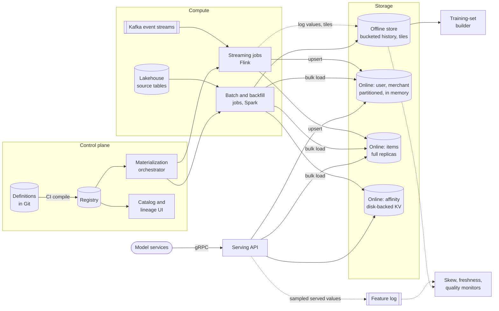

**Reading the diagram.** The **control plane** compiles reviewed definitions from Git into the registry, which drives the orchestrator and the catalog; nothing on the request path reads the registry directly (the serving API caches it). **Compute** has two engines fed by one definition: streaming jobs consume Kafka and upsert the online store synchronously while logging values and tiles to the offline store asynchronously (dotted); batch and backfill jobs read lakehouse tables, write the offline history and bulk-load the online store. **Storage** is split by access pattern: the offline store is bucketed, append-only history on object storage; the online store has three tiers chosen in §85.4.4. The **training-set builder** reads only the offline store. **Model services** call the stateless serving API over gRPC; it logs sampled served values to Kafka for the skew monitor, which compares them with offline recomputation. Failure points: a streaming job stalls (ages grow, caught at read time), an online partition is slow (hedge or default), a definition change breaks consumers (caught by the registry's consumption records). Scaling: online by partitions and replicas, streaming by Kafka partitions and job parallelism, offline by buckets and cluster size.

### 85.4.8 Detailed component design

#### Point-in-time training sets at billions of rows

The as-of join and the availability timestamp are defined in §62.8; here the problem is running it on 500 million spine rows against 9 TB of history in under two hours.

1. **Prune.** From the feature service, list the views and their TTLs. For each view, read only partitions from `min(label_ts) − TTL` to `max(label_ts)`; that is why the TTL is part of every definition.
2. **Bucket the spine.** Hash the spine's entity keys into the same 1,024 buckets as the offline tables. Only the spine moves over the network (20 GB), never the history.
3. **Merge per bucket.** For each bucket, a task streams the spine rows and the view's history, both sorted by `(entity_key, ts)`, and emits for each spine row the last history row with `created_ts ≤ label_ts` and age within TTL. This is a single linear merge, the same idea as the sort-merge join of §29.4.4, with no shuffle of history.
4. **Windowed aggregates** are assembled from tiles per the formula above, inside the same merge.
5. **Skew.** Heavy entities (the reseller with 50,000 events) make some buckets slow. Split hot keys' spine rows by time range across several tasks; each needs only its own slice of history (§29.6.3).
6. **Reuse.** Cache the joined result per (view version, spine partition); a retrain that adds one feature joins only that view and reuses the rest (§69.9.3).

The illustrative program below checks the key property of step 4 on toy data: assembling a 7-day window from daily tiles, hourly tiles and raw edge events gives exactly the raw-scan answer while reading far less.

```python
import numpy as np

rng = np.random.default_rng(7)
H, D = 3600, 86_400
DAYS, USERS, N_EVENTS, N_SPINE = 30, 50, 600_000, 2_000
WINDOW = 7 * D                                   # feature: events in [t - 7 days, t)

ev_user = rng.integers(0, USERS, N_EVENTS)
ev_ts = rng.integers(0, DAYS * D, N_EVENTS)
sp_user = rng.integers(0, USERS, N_SPINE)        # training spine: (entity, label time)
sp_ts = rng.integers(WINDOW, DAYS * D, N_SPINE)

events = {u: np.sort(ev_ts[ev_user == u]) for u in range(USERS)}
hourly = np.zeros((USERS, DAYS * 24), dtype=np.int64)
np.add.at(hourly, (ev_user, ev_ts // H), 1)      # partial aggregates per hour
daily = hourly.reshape(USERS, DAYS, 24).sum(axis=2)  # and per day

def raw(u, a, b):                                # count raw events in [a, b)
    e = events[u]
    n = int(np.searchsorted(e, b) - np.searchsorted(e, a))
    return n, n

def tiled(u, a, b):
    """Raw events for partial hours, hourly tiles for partial days, daily tiles."""
    h0, h1 = -(-a // H), b // H                  # full hours inside [a, b)
    d0, d1 = -(-h0 // 24), h1 // 24              # full days inside them
    n_e, r_e = raw(u, a, h0 * H)
    n_t, r_t = raw(u, h1 * H, b)
    if d0 < d1:
        val = hourly[u, h0:d0 * 24].sum() + daily[u, d0:d1].sum() + hourly[u, d1 * 24:h1].sum()
        reads = (d0 * 24 - h0) + (d1 - d0) + (h1 - d1 * 24)
    else:
        val, reads = hourly[u, h0:h1].sum(), h1 - h0
    return n_e + val + n_t, r_e + r_t + reads

stats = np.zeros(3)
for u, t in zip(sp_user, sp_ts):
    v1, r1 = raw(u, t - WINDOW, t)
    v2, r2 = tiled(u, t - WINDOW, t)
    stats += (v1 != v2, r1, r2)
print(f"spine rows {N_SPINE}, mismatches {int(stats[0])}")
print(f"reads per row: raw events {stats[1] / N_SPINE:,.0f}, "
      f"tiled {stats[2] / N_SPINE:,.1f} (ratio {stats[1] / stats[2]:.0f}x)")
```

Output:

```text
spine rows 2000, mismatches 0
reads per row: raw events 2,797, tiled 45.6 (ratio 61x)
```

What to notice:

- The window is half-open, `[t − 7 days, t)`, so an event at exactly the label time is excluded; the same convention must hold online, or the first skew check will fail.
- The measured 45.6 reads matches the formula: $(7 - 1) + (24 - 1) + \rho \times 1 = 6 + 23 + 16.7 = 45.7$ with $\rho = 600{,}000 / (50 \times 720) = 16.7$ events/h.
- Zero mismatches is the property to test in CI for every aggregate function: tiles must be **mergeable** (count, sum, min, max, and sketches such as HyperLogLog); a mean is stored as a sum and a count.

#### The online read path: layout against fan-out

The serving API resolves the feature service from its cached registry and issues one call per view group in parallel, as in Figure 62.6. Three design decisions follow from the fan-out arithmetic of §85.4.4.

- **Partitioned groups for large, few-key entities.** The user group (128 GB) is hash-partitioned; a request reads one user key, so it touches one partition.
- **Full replicas for small, many-key entities.** The item group (19.2 GB) is replicated in full on 10 item-serving nodes with 32 GB of memory each. A ranking request sends its 150 keys to one node, chosen by least outstanding requests: one sub-request instead of 46. At 3.02 million item keys/s, each node serves about 302,000 keys/s at peak; with an assumed capacity of 500,000 batched in-memory key reads/s per node (illustrative; benchmark yours), losing two nodes leaves 377,000 keys/s per node, still within capacity. Streaming updates are broadcast to all replicas through a Kafka topic with one consumer group per replica.
- **Hedged reads with deadlines.** The API hedges a partition read after its p95 (§23.7) and stops waiting at the caller's `deadline_ms` minus a reserve, returning declared defaults flagged in `defaulted`. Defaults must equal those used in training (§62.11.2).

Hot keys (a viral item, a merchant on the home page) are absorbed by the item replicas and by a per-process cache whose TTL counts against the view's freshness budget (§62.10).

#### Streaming features with exactly-once-ish semantics

A velocity feature such as "card transactions in the last 10 minutes" must count each event once even though Kafka delivers at least once and jobs restart. End-to-end exactly-once is not available across Kafka, Flink and an external key-value store, so the platform composes three weaker guarantees (§29.8.4, §31.11.3, §61.4.5):

1. **Deduplicate at the source.** Producers attach an event ID; the job keeps a keyed set of recent IDs (24 hours) in Flink state and drops repeats.
2. **Exactly-once state.** Window state lives in Flink and is restored from checkpoints (asynchronous barrier snapshots, §29.9.2), so a restart replays from the checkpointed Kafka offsets and recomputes the same aggregates.
3. **Idempotent sink.** Each online write is an upsert of the full window value, tagged `(entity, view_version, window_end)`, and the store keeps the value with the larger `window_end`. Replaying a write after a restart rewrites the same value instead of adding to it. Writes of increments ("+1") are forbidden for this reason.

Late events beyond the watermark's allowed lateness (§29.8.3) are not reflected online but are in the offline log; the nightly batch recompute of the same definition is the yardstick for the 0.1% accuracy target, and a drift between the two is an alert, not a silent correction.

#### Backfill and bootstrap

A new streaming view has no history. The orchestrator compiles the same definition into a Spark job that reads the raw events from the lakehouse, builds hourly and daily tiles for the requested range, and writes them to the offline store with `created_ts` set to when the streaming job *would* have published each value (event time plus the view's measured publication delay), so training sets built from backfilled history behave like served values. Then it bootstraps the online store from the latest tiles and starts the streaming job from the Kafka offset that corresponds to the backfill's end, overlapping by one window so no events are missed and idempotent upserts absorb the overlap. One year of a view fed by 5 billion events/day is $1.8 \times 10^{12}$ events; at an assumed 20,000 events/s per vCPU that is 25,347 vCPU-hours, about \$1,270 at \$0.05 per vCPU-hour, run on 4,500 vCPUs to meet the 6-hour target.

#### Governance, discovery and evaluation of the platform

The catalog indexes every view with owner, entity, freshness, null rate, lineage to source tables and the list of consuming models from the `consumption` table, so engineers can find "orders in the last 7 days" before writing an eighth version; a nightly job flags near-duplicates by correlation of values on a sample. Lifecycle, access control and personal-data handling follow §62.15. The platform is evaluated like a product: share of online models served from it, median time from definition to first training set, number of skew incidents per quarter, and the served-versus-recomputed match rate in Table 85.3.

::: industry
**Published feature platforms.** Uber's 2017 Michelangelo post describes a shared feature store with batch features loaded to Cassandra and near-real-time features computed from Kafka streams, logged back to HDFS for training; Airbnb's Zipline talks describe declarative aggregations that produce both point-in-time backfills and online values, using partial-aggregate tiles, a design continued in the open-source Chronon (2024). Feast's documentation separates `get_historical_features` (point-in-time joins over an offline store) from `materialize` and `get_online_features`. Section 62.13 compares these systems in detail; this case's design is a composite for teaching.
*Evidence: Primary* — [Hermann and Del Balso 2017; Feast Docs]; *Secondary* for Zipline — [Zanoyan and Shapiro 2019]
:::

### 85.4.9 Data flow

**Figure 85.2 — Write path: one order event becomes a streaming feature.**

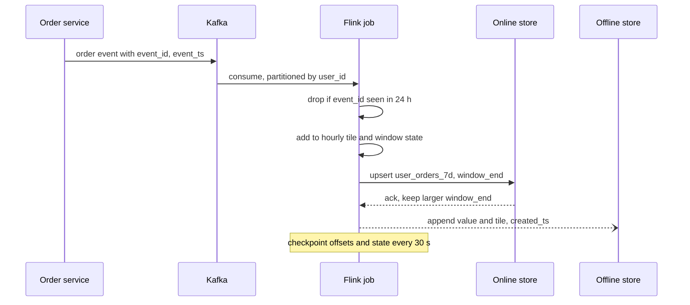

**Reading the diagram.** The producer writes the event to Kafka with an event ID and event time. The streaming job consumes it from a partition keyed by user, discards duplicates using keyed state, updates the tile and window state, and upserts the full window value to the online store, which keeps whichever value has the later `window_end`; that makes a replay after a crash harmless. The append to the offline store is asynchronous and records `created_ts`, the availability time that point-in-time joins need. Checkpoints bind Kafka offsets and state together. Failure points: consumer lag (freshness), a crash between upsert and checkpoint (replayed, absorbed by idempotence), the offline append falling behind (training sees gaps; alert on it). Scaling: more Kafka partitions and job parallelism.

**Figure 85.3 — Read path: a ranking request reads one user and 150 items.**

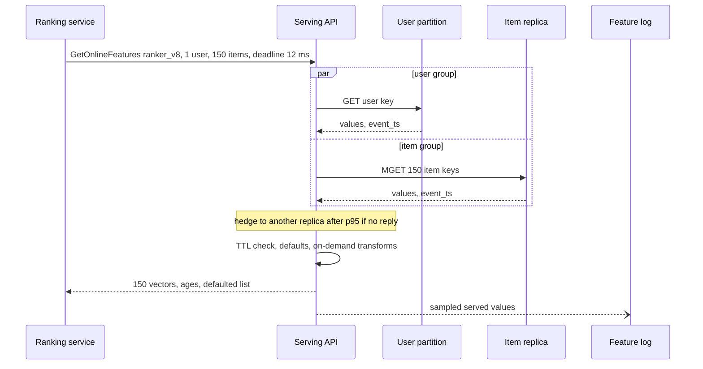

**Reading the diagram.** One synchronous call becomes two parallel reads: one key to the user's partition and one batched read to a single full item replica, instead of 46 partition sub-requests. If either read has not answered by its p95, the API hedges to another replica; at the deadline it substitutes declared defaults and lists them. The feature log write is asynchronous and sampled. Storage boundaries: user partitions and item replicas. Failure points: a slow partition (hedged), an item replica that lags the update stream (bounded by the freshness alert), a stale registry cache (version returned in the response). Scaling: replicas for read throughput, partitions for user memory.

**Figure 85.4 — Training-set generation as a bucketed merge.**

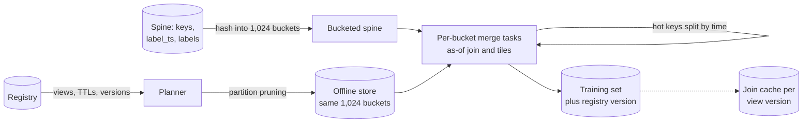

**Reading the diagram.** The planner reads view versions and TTLs from the registry and prunes offline partitions to the label-time range plus TTL. The spine is the only data that is shuffled, into the buckets the offline tables already use; each merge task then joins one bucket of spine with the same bucket of every view in a single sorted pass, assembling windows from tiles. Tasks for heavy keys are split by time range. The output records the registry version; per-view results are cached for reuse. All steps are batch and asynchronous with respect to serving. Failure points: a view not bucketed the standard way (falls back to a shuffle, slow), a missing `created_ts` (cannot join on availability), stragglers on hot buckets. Scaling: more tasks per bucket, more buckets as history grows.

### 85.4.10 Bottlenecks

1. **Item fan-out on the read path.** Solved by full replicas; if the item catalog grows past one node's memory, split items into a few large range groups so a request touches at most a few nodes.
2. **Training-set scans.** 9 TB per build; pruning, bucketing, tiles and the join cache are the levers, plus a queue with per-team quotas so one team's nightly sweep of 50 builds does not starve others.
3. **Streaming hot keys.** One merchant with 5% of all orders overloads one Flink subtask; pre-aggregate per (key, salt) and combine (§29.6.3).
4. **Backfills competing with production jobs.** Run them in a separate low-priority queue with a vCPU cap.
5. **Registry as a write bottleneck** is not one: it changes a few hundred times a day; only its availability for CI and job planning matters.

### 85.4.11 Failure scenarios

**Table 85.4 — Feature store failure scenarios.**

| What fails | Impact | Detection | Recovery | Prevention |
|---|---|---|---|---|
| Label leakage: view joined on event time though published hours later | Offline metrics inflated; online accuracy drops at launch | Served-versus-recomputed match rate below 99.5% for that view | Rebuild training set joining on `created_ts`; retrain | Require `created_ts`; builder refuses event-time joins for batch views |
| Streaming job stalled | Values age; fraud model sees old velocities | Read-side age histogram over budget (§62.10) | Restart from checkpoint; TTL turns stale values into defaults | Age alerts per view; TTL in every definition |
| Duplicate events after replay | Inflated counters, false fraud flags | Streaming versus nightly batch differ by more than 0.1% | Recompute window from the offline log; republish | Event-ID dedupe; idempotent upserts |
| Online partition slow or down | p99.9 breach for requests touching it | Per-partition latency; defaulted-feature rate | Hedge to replicas; fail over primary | Replicas across zones; capacity headroom |
| Training–serving skew from a transform mismatch | Silent accuracy loss | Skew monitor on logged values (§62.9.2) | Roll back feature version or model | One definition compiled to both paths; parity tests in CI |
| Breaking change to a shared view | Other teams' models degrade | Consumers listed in `consumption`; canary of new version | Pin consumers to old version | Immutable versions; deprecation workflow (§62.15) |
| Feedback loop through features | A model's own outputs (for example, items it promoted) inflate popularity features | Feature distribution drift correlated with model launches | Exclude model-driven exposure or add exposure as a feature | Document feature provenance; drift monitors (Chapter 70) |
| Backfill overwrote good history | Training sets change silently | Row-count and checksum diff per partition | Time-travel restore of the table (§61.8) | Backfills write new table versions; promote after validation |

### 85.4.12 Scaling strategy

**At 10×** (1.2 million requests/s, 4,000 models): the user group grows to 1.3 TB, so 60 or more partitions; item replicas grow in count, not size, until the catalog outgrows one node; the serving API becomes a sidecar library to save a hop. Training-set builds become the cost center: make the join cache shared across teams and materialize popular feature services as daily "training tables" that many models read.

**At 100×**, regional online stores fed by per-region streaming jobs, with batch views replicated from one offline store; definitions stay global. Offline, history beyond a year moves to cheaper storage tiers (§15.9) and tiles replace raw events for old periods.

### 85.4.13 Trade-offs

**Table 85.5 — Feature store design trade-offs.**

| Decision | Choice | Alternative | Why |
|---|---|---|---|
| Item view layout | Full replicas | Hash partitions | One sub-request per ranking read instead of 46; costs 10 copies of 19 GB |
| Streaming semantics | Dedupe + checkpointed state + idempotent upsert | Transactional exactly-once end to end | The online store cannot join a Kafka transaction; idempotence is enough |
| Windowed aggregates | Hourly and daily tiles | Raw-event scans | 4–400× fewer reads; mergeable functions only |
| Join | Bucketed sort-merge on availability time | Warehouse SQL as-of join | No history shuffle; needs a standard table layout |
| Serving API | Separate service | In-process library | Central upgrades and caching; one extra hop of about 1 ms |
| Definition style | Declarative aggregations | Arbitrary user code | Platform can tile, backfill and verify parity; less flexible |

### 85.4.14 Alternative designs

- **Feast on existing infrastructure.** Definitions in Python, offline store in the warehouse, online store in Redis or DynamoDB, pipelines owned by teams. Cheapest start; the platform does not own streaming correctness or tiling, so §85.4.8's guarantees become each team's job.
- **Managed platforms** (as of 2026) such as Databricks feature engineering, SageMaker Feature Store or Tecton (§62.13) trade control for lower operational load; check whether their point-in-time join semantics use availability time.
- **Log-and-wait.** Instead of point-in-time joins, log the exact feature vectors served and train only on logged data. It eliminates skew by construction but every new feature needs weeks of logging before it can be trained on; most platforms combine both.

### 85.4.15 Interview discussion

**Table 85.6 — 45-minute pacing plan for the feature store.**

| Minutes | Focus | What to produce |
|---|---|---|
| 0–5 | Scope | Consumers (fraud, ranking, batch), batch and streaming views, discovery |
| 5–12 | Estimates | 3.42 M keys/s; 46-partition fan-out; 1.1 TB online; 9 TB per training build |
| 12–20 | Architecture | Figure 85.1; one definition, two engines, tiered online store |
| 20–32 | Deep dive: offline | Availability-time as-of join, bucketing, tiles, skewed keys |
| 32–40 | Deep dive: online and streaming | Item replicas, hedging, defaults; dedupe and idempotent upserts |
| 40–45 | Wrap-up | Failures (leakage, stalled job), governance, 10× |

**Likely follow-ups.**

- *"Why not just use the warehouse's as-of join?"* It works at small scale; at 500 million rows it shuffles 9 TB of history, and most warehouses join on event time, not availability time.
- *"How do you know the online value equals the offline value?"* Log sampled served values and recompute them with the builder; the match rate is an SLO.
- *"Exactly once?"* No: at-least-once delivery, deduplicated, with idempotent writes; measured against a batch recompute.
- *"How do you stop teams creating duplicates?"* Catalog search with usage and quality, near-duplicate detection, and review before activation.

**What distinguishes senior and staff answers.** A senior answer gets the offline/online split, the as-of join and batching right. A staff answer quantifies partition fan-out and changes the layout per entity, joins on availability time and explains why, makes streaming correctness measurable against batch, treats backfill as part of the definition, and runs the platform with adoption and skew metrics.

### 85.4.16 Production considerations

- **Observability.** Per view: age at read, materialization lag, null and default rates, drift (Chapter 70); per serving call: latency by view group, hedge rate, defaulted count; per build: bytes scanned and duration.
- **Security and privacy.** Per-view access control in both stores; personal-data tags drive retention and deletion in offline history and online keys (§62.15, §71.9).
- **Cost.** Training-set scans and always-on streaming jobs dominate; report cost per view and per consuming team (§47.11.2).
- **Operations.** Definitions change through review and CI with parity tests; online-store rollouts are per zone; on-call is split between the platform (stores, API, jobs) and view owners (correctness of their features).

## 85.5 Distributed Model Training Platform (self-service for many teams)

### 85.5.1 Problem statement

A company owns 4,096 GPUs: 384 nodes of 8 H100-class GPUs (3,072) and 128 nodes of 8 A100-class GPUs (1,024). Eighty teams share them. Today each team owns a fixed slice: some slices sit idle at night while other teams queue for days, every team writes its own launch scripts, failed jobs are restarted by hand, and nobody can say what a model cost to train. Design a self-service **training platform**: engineers submit jobs through one API; the platform admits, places, runs, restarts, tracks and bills them, and keeps the fleet busy without letting one team monopolize it.

The representative workloads span three orders of magnitude:

- **Small** (1–8 GPUs): notebooks, debugging runs, hyperparameter-search trials and fine-tunes. 80% of jobs.
- **Medium** (16–128 GPUs): recommendation and vision models, larger fine-tunes. 18% of jobs.
- **Large** (256–1,024 GPUs): foundation-model pre-training. 0.1% of jobs, but the largest share of GPU-hours.

Published traces show why this is hard. Microsoft's analysis of its Philly cluster found that although most GPUs were allocated, the hardware utilization of GPUs in use averaged only about 52%; that about 30% of jobs were killed or ended unsuccessfully; and that gang scheduling with locality constraints caused queueing, so the authors advised trading some queueing delay for locality [Jeon et al. 2019]. Alibaba's study of a two-month trace from its PAI MLaaS cluster of over 6,000 GPUs reported low GPU utilization, long queueing delays, tasks needing high-end GPUs that were hard to schedule, load imbalance across heterogeneous machines and CPU bottlenecks [Weng et al. 2022]. The distinctive hard problem is therefore **sharing**: quotas and fair share for gangs, preemption that does not waste work, failures handled automatically, and utilization and cost measured honestly. Gang scheduling, fairness and preemption mechanisms are owned by Chapter 46; checkpointing and fault tolerance by §65.15–§65.16.

### 85.5.2 Functional requirements

1. **Submit** batch jobs and interactive sessions with an image, command, GPU type and count, gang minimum and maximum (for elastic jobs), priority class and queue.
2. **Sweep.** Submit hyperparameter searches as one object that expands into many trials.
3. **Quota and fair share.** Each team has a guaranteed GPU quota per GPU type; idle capacity is lent to teams with demand and reclaimed when the owner needs it.
4. **Gang admission and topology-aware placement** for multi-node jobs (§46.10–§46.11).
5. **Preemption with notice**: a preempted job receives a signal and a grace period to checkpoint.
6. **Automatic recovery**: restart failed or preempted jobs from their latest complete checkpoint, excluding bad nodes.
7. **Experiment tracking**: parameters, metrics, artifacts, code and data versions per run, with comparison views (§69.7).
8. **Cost and utilization reports** per job, team and project; promotion of artifacts to the model registry (§69.8).

### 85.5.3 Non-functional requirements

**Table 85.7 — Training platform non-functional requirements.**

| Requirement | Target |
|---|---|
| Queue wait, jobs ≤ 8 GPUs | Median ≤ 10 min, p90 ≤ 1 h |
| Guaranteed quota | A team below its quota gets it back within 15 min (by reclaiming borrowed capacity) |
| Large jobs | Start within 4 h of submission through reservations |
| Allocation | ≥ 85% of GPU-hours allocated over a week |
| Goodput | ≥ 95% for jobs of 256 GPUs or more (§65.16) |
| Checkpoint stall | ≤ 1 s per checkpoint with asynchronous writes |
| Control-plane availability | 99.9%; running jobs continue if the control plane is down |
| Durability | Checkpoints and tracked artifacts on replicated object storage |
| Experiment tracking | 5,000 metric points/s ingest; query a run's metrics in ≤ 2 s |
| Model-quality guardrails | Not owned by the platform; it records data and code versions so results can be reproduced (§69.10) |

### 85.5.4 Capacity estimation

::: example
**Worked example — GPU-hours by job class.** Assumptions: 25,000 jobs/week. Small: 20,000 jobs × 3 GPUs × 2 h. Medium: 4,500 jobs × 32 GPUs × 1.5 h. Large: 25 jobs × 512 GPUs × 20 h.

1. Capacity: $4{,}096 \times 168 = 688{,}128$ GPU-hours/week.
2. Demand: $120{,}000 + 216{,}000 + 256{,}000 = 592{,}000$ GPU-hours, an allocation of $592{,}000 / 688{,}128 = 86.0\%$.
3. Shares of GPU-hours: small 20.3%, medium 36.5%, large 43.2%; shares of jobs: 80%, 18% and 0.1%.
4. Average concurrent GPUs: small 714, medium 1,286 (about 40 jobs of 32), large 1,524 (about three 512-GPU jobs).
5. Submission rate: $25{,}000 / 604{,}800 = 0.041$ jobs/s, 0.12/s in busy hours, plus bursts of hundreds when a sweep is submitted.

**Interpretation.** One job in a thousand uses 43% of the GPU-hours, while four in five jobs are small and latency-sensitive (an engineer waiting). **Engineering implication.** Run two policies on one fleet: fast backfilling for small jobs and reservations for large gangs (§46.12.2), and size the scheduler for bursts of submissions, not for the trivial average rate.
:::

::: example
**Worked example — Checkpoint bandwidth and storage.** Assumptions: large jobs train 30-billion-parameter models and save 14 bytes per parameter (§65.15); medium jobs save 14 GB; both checkpoint every 30 minutes asynchronously; each large job may take 30 s to drain a checkpoint.

1. Large checkpoint: $14 \times 30 \times 10^9 = 420$ GB. Burst: $420 / 30 = 14$ GB/s per job, 42 GB/s if three coincide.
2. Average: $3 \times 420 \text{ GB} / 1{,}800 \text{ s} = 0.7$ GB/s for large jobs and $40 \times 14 \text{ GB} / 1{,}800 = 0.31$ GB/s for medium jobs.
3. Rolling checkpoints (three per running job): $9 \times 420 \text{ GB} + 40 \times 3 \times 14 \text{ GB} = 5.5$ TB.
4. Retained: two milestones per large job for 13 weeks, $25 \times 2 \times 420 \text{ GB} \times 13 = 273$ TB; the final checkpoint of every medium job for 30 days, $4{,}500 \times 14 \text{ GB} \times 30 / 7 = 270$ TB.

**Interpretation.** The burst is 40 times the average; retention, not the rolling set, sizes storage, and medium jobs' forgotten final checkpoints cost as much as the large jobs' milestones. **Engineering implication.** Size the checkpoint tier for bursts (§80.6.2), stagger large jobs' checkpoint times, and apply lifecycle rules: keep only registered or tagged checkpoints beyond 30 days (§15.9).
:::

Preemption is how the platform reclaims lent capacity, and every preemption throws away work.

::: formula
**GPU-hours lost to one preemption**

$$L_{\text{pre}} = G \times \left( t_{\text{lost}} + R \right) \qquad t_{\text{lost}} = \begin{cases} \tau / 2 & \text{no checkpoint on signal} \\ t_{\text{save}} & \text{checkpoint within the grace period} \end{cases}$$

| Symbol | Meaning | Units |
|---|---|---|
| $G$ | GPUs held by the preempted job | GPUs |
| $\tau$ | Interval between periodic checkpoints | h |
| $t_{\text{save}}$ | Time to write a checkpoint after the preemption signal | h |
| $R$ | Restart time: requeue, reschedule, reload, warm up | h |
| $L_{\text{pre}}$ | GPU-hours of work lost | GPU-h |
:::

::: example
**Worked example — Reclaiming borrowed GPUs 200 times a week.** A typical borrowed job holds $G = 32$ GPUs, checkpoints every $\tau = 30$ min, restarts in $R = 5$ min, and can save in $t_{\text{save}} = 1$ min when signaled.

1. Without checkpoint-on-signal: $32 \times (15 + 5) / 60 = 10.7$ GPU-h per preemption; 200 per week is 2,133 GPU-h, 0.31% of capacity.
2. With checkpoint-on-signal: $32 \times (1 + 5) / 60 = 3.2$ GPU-h; 640 GPU-h per week, 0.09%.
3. A 512-GPU job preempted without notice would lose $512 \times 20 / 60 = 171$ GPU-h each time.

**Interpretation.** Preemption is cheap when jobs checkpoint on signal and small when only small jobs borrow. **Engineering implication.** Make checkpoint-on-SIGTERM part of the platform's training library, give a grace period longer than $t_{\text{save}}$, and never lend capacity to large gangs that cannot be preempted cheaply.
:::

::: example
**Worked example — What a utilization point is worth.** Internal prices: \$2.50 per H100-hour and \$1.40 per A100-hour.

1. Weekly fleet cost: $3{,}072 \times 168 \times 2.50 + 1{,}024 \times 168 \times 1.40 = 1{,}290{,}240 + 240{,}845 = \$1.53$ million.
2. One percentage point of allocation is \$15,300 a week, about \$0.8 million a year.
3. Effective utilization multiplies allocation, goodput and the useful fraction of each allocated GPU's compute: with 86%, 95% and an MFU of 45% (§64.11), $0.86 \times 0.95 \times 0.45 = 0.37$.

**Interpretation.** Allocation is the easiest number to report and the least informative; the Philly finding of about 52% hardware utilization of allocated GPUs is the same warning. **Engineering implication.** Report all three factors per team; most of the money is recovered by raising the third (input pipelines, communication overlap, right-sizing) rather than squeezing allocation from 86% to 90%.
:::

Other loads are modest: 1,000 concurrent runs logging 50 metrics every 10 s is 5,000 points/s (13 GB/day at 30 bytes each); reading training data at 0.1 GB/s per GPU is 410 GB/s across the fleet, which the storage tier must serve (§80.6.1).

### 85.5.5 API design

```yaml
# POST /v1/jobs  (illustrative job spec)
name: ranker-dlrm-v14
team: ads-ranking
queue: ads-ranking/default          # resolves to the team's quota
priority_class: standard            # interactive | standard | preemptible
image: registry.internal/ads/trainer@sha256:...
command: ["torchrun", "train.py", "--config", "configs/v14.yaml"]
resources: {gpu_type: h100, gpus_per_node: 8, nodes: {min: 2, max: 4}}  # elastic
gang: true
checkpoint: {dir: "s3://ckpt/ads-ranking/ranker-dlrm-v14", interval_min: 30,
             on_preempt: true, grace_s: 120}
retries: {max: 5, exclude_failed_nodes: true}
tracking: {experiment: "dlrm-v14", log_code_version: true, data_version: "clicks@2026-11-01"}
```

Other endpoints: `POST /v1/sweeps` (search space, trial template, parallelism); `GET /v1/jobs/{id}` (state, attempts, nodes, queue position); `POST /v1/jobs/{id}:cancel`; `POST /v1/sessions` (interactive, priority `interactive`, idle timeout); `POST /v1/runs/{id}/metrics` (batched points); `GET /v1/usage?team=&from=&to=` (GPU-hours by type and tier, cost). All are authenticated per user and authorized per team queue.

### 85.5.6 Data model and database schema

```sql
CREATE TABLE queue (                       -- one per team and GPU type
  queue_id TEXT PRIMARY KEY, team TEXT NOT NULL, gpu_type TEXT NOT NULL,
  nominal_gpus INT NOT NULL,               -- guaranteed quota
  borrow_limit INT NOT NULL,               -- max GPUs it may borrow
  weight REAL NOT NULL                     -- share of idle capacity
);
CREATE TABLE job (
  job_id UUID PRIMARY KEY, queue_id TEXT REFERENCES queue, owner TEXT,
  spec JSONB NOT NULL, priority_class TEXT, state TEXT,   -- pending|admitted|running|...
  submitted_at TIMESTAMPTZ, admitted_at TIMESTAMPTZ, finished_at TIMESTAMPTZ
);
CREATE TABLE attempt (                     -- one per (re)start
  job_id UUID, attempt INT, nodes TEXT[], gpus INT, borrowed BOOLEAN,
  started_at TIMESTAMPTZ, ended_at TIMESTAMPTZ, end_reason TEXT,  -- done|failed|preempted
  resumed_from_step BIGINT, PRIMARY KEY (job_id, attempt)
);
CREATE TABLE usage_ledger (                -- append-only, per minute per attempt
  job_id UUID, attempt INT, minute TIMESTAMPTZ, gpu_type TEXT, gpus INT,
  tier TEXT, sm_active_avg REAL, PRIMARY KEY (job_id, attempt, minute)
);
CREATE TABLE checkpoint_manifest (
  job_id UUID, step BIGINT, uri TEXT, bytes BIGINT, complete BOOLEAN,
  created_at TIMESTAMPTZ, retain_until DATE, PRIMARY KEY (job_id, step)
);
```

Job and queue state lives in the orchestrator (Kubernetes objects managed by Kueue in this design, §46.10.2) and is mirrored into this relational store for history and billing. Experiment metrics go to a tracking store (MLflow-style, §69.7.2): run metadata in a relational database, metric points in a time-series table, artifacts and checkpoints in object storage. The usage ledger is the source of truth for cost.

### 85.5.7 High-level architecture

**Figure 85.5 — Self-service training platform.**

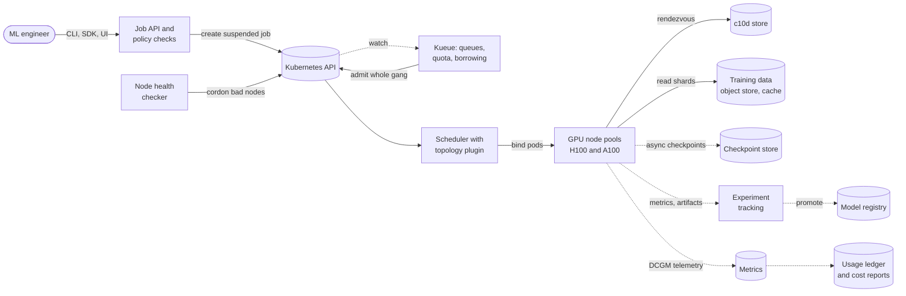

**Reading the diagram.** Engineers submit through a job API that validates the spec against team policy (allowed GPU types, maximum size, image provenance) and creates a **suspended** job, so no GPU is held while it waits. **Kueue** watches jobs asynchronously, checks the team's quota and borrowing limits, and admits a whole gang at once; the scheduler then places the pods with topology awareness (§46.11.2). Running pods meet at a rendezvous store, stream data from object storage through a cache, and write checkpoints, metrics and telemetry asynchronously (dotted). A health checker cordons failing nodes, which sends affected jobs back through admission to restart from their last checkpoint. Telemetry feeds the usage ledger and cost reports; tracked artifacts can be promoted to the model registry. Storage boundaries: Kubernetes state, rendezvous, data, checkpoints, tracking, ledger. Failure points: the control plane (running jobs continue), the checkpoint store under burst, a bad node hanging a collective. Scaling: node pools by GPU type; admission is per job, so thousands of pods do not overload the scheduler.

### 85.5.8 Detailed component design

#### Quotas, fair share and borrowing

Each team's queue has a **nominal quota** per GPU type, sized by budget, and the sum of quotas equals the fleet. Admission has two phases and a reclaim rule, which map onto Kueue's ClusterQueues and cohorts (§46.10.2):

1. **Guaranteed.** A team's jobs are admitted, whole gangs only, while the team stays within its quota.
2. **Borrowing.** Idle GPUs are lent to teams with pending jobs, choosing the team with the lowest ratio of allocation to quota whose next gang fits (weighted max-min fairness, §46.9.1). Borrowed jobs are marked preemptible.
3. **Reclaim.** When a team below its quota submits work, the platform preempts borrowed gangs, newest first, until the owner's job fits. Gangs are preempted whole: preempting one worker stalls the rest at the next collective (§46.10).

The program below models the policy on a 512-GPU pool with four teams.

```python
CLUSTER = 512                                       # GPUs
QUOTA = {"search": 192, "ads": 128, "vision": 128, "speech": 64}  # nominal = weight

def admit(queues, quota, capacity):
    """Phase 1: whole gangs within nominal quota. Phase 2: lend idle GPUs,
    always to the team with the lowest allocation/quota whose next gang fits."""
    alloc = {t: 0 for t in quota}
    running = []                                    # (team, gpus, borrowed?)
    pending = {t: list(q) for t, q in queues.items()}
    for t in quota:                                 # phase 1: guaranteed share
        while pending[t] and alloc[t] + pending[t][0] <= quota[t]:
            g = pending[t].pop(0); alloc[t] += g; running.append((t, g, False))
    free = capacity - sum(alloc.values())
    while True:                                     # phase 2: weighted borrowing
        cands = [t for t in quota if pending[t] and pending[t][0] <= free]
        if not cands:
            break
        t = min(cands, key=lambda x: alloc[x] / quota[x])
        g = pending[t].pop(0); alloc[t] += g; free -= g; running.append((t, g, True))
    return alloc, running, free

def show(title, alloc, running, free):
    print(title)
    for t in QUOTA:
        b = sum(g for tt, g, br in running if tt == t and br)
        print(f"  {t:<7} quota {QUOTA[t]:>3}  allocated {alloc[t]:>3}  borrowed {b:>3}")
    print(f"  idle GPUs: {free}")

# Speech is quiet; the other teams queue gangs (GPUs per job, FIFO order).
queues = {"search": [64, 64, 64, 32, 32], "ads": [32] * 6, "vision": [8] * 20, "speech": []}
before = admit(queues, QUOTA, CLUSTER)
show("Before speech submits:", *before)

# Speech submits a 64-GPU gang. Recompute: borrowed gangs that no longer fit are preempted.
queues["speech"] = [64]
after = admit(queues, QUOTA, CLUSTER)
show("After reclaiming for speech:", *after)
lost = [r for r in before[1] if r[2] and r not in after[1]]
print("  preempted (borrowed) gangs:", [(t, g) for t, g, _ in lost])
```

Output:

```text
Before speech submits:
  search  quota 192  allocated 224  borrowed  32
  ads     quota 128  allocated 160  borrowed  32
  vision  quota 128  allocated 128  borrowed   0
  speech  quota  64  allocated   0  borrowed   0
  idle GPUs: 0
After reclaiming for speech:
  search  quota 192  allocated 192  borrowed   0
  ads     quota 128  allocated 128  borrowed   0
  vision  quota 128  allocated 128  borrowed   0
  speech  quota  64  allocated  64  borrowed   0
  idle GPUs: 0
  preempted (borrowed) gangs: [('search', 32), ('ads', 32)]
```

What to notice:

- With speech idle, its 64 GPUs are not wasted: search and ads borrow 32 each, and allocation stays at 100%.
- Vision's 8-GPU jobs lost the borrowing tie-break even though they would also have fitted; a real policy adds queue age or DRF across GPUs, CPU and memory (§46.9.3) so a team with small jobs is not always last.
- Reclaim preempts exactly the borrowed gangs, never a team's guaranteed work. The model recomputes from scratch for brevity; a real scheduler preempts only what is needed and keeps running jobs in place.

#### Gang admission, placement and preemption

Jobs are admitted whole and placed inside one network domain where possible, following the Philly lesson that waiting a little for locality beats running spread out [Jeon et al. 2019]. Large jobs get **reservations**: the scheduler drains a rack-aligned block for a 512-GPU job over at most a few hours while backfilling it with small jobs whose declared run time ends before the reservation starts (§46.12.2). Preemption uses priority classes: `interactive` above `standard` above `preemptible`; within a class, only borrowed work can be preempted. The platform sends SIGTERM, waits the grace period (120 s) while the training library saves a checkpoint, then kills the pods and requeues the job with `resume: latest`.

#### Elastic, fault-tolerant training and checkpoint storage

The platform's training library wraps `torchrun` (§65.16.2): data-parallel jobs declare `nodes: {min, max}` and continue on fewer nodes after a failure or partial preemption; tensor- and pipeline-parallel jobs restart on hot spares with the same layout. Checkpoints are sharded and asynchronous, committed with a manifest (§65.15.1); the interval follows Young/Daly from the job's size and the fleet's measured failure rate (§65.15.2), recomputed by the platform rather than guessed by each team. A node health pipeline (DCGM diagnostics, NCCL tests, error counters) cordons suspect nodes and feeds the scheduler's exclusion list (§80.11.2). The checkpoint tier is a parallel file system or object store sized for 42 GB/s bursts, with lifecycle rules from §85.5.4.

#### Experiment tracking, utilization and cost attribution

Each attempt's pods report metrics and artifacts to the tracking service, keyed by run ID, with code commit, image digest and data version recorded automatically (§69.7). The **usage ledger** records per minute: GPUs held, GPU type, tier (guaranteed, borrowed, interactive) and average SM activity from DCGM. Chargeback (§47.11.2, §51.5.2) bills a team for GPU-hours it held, at full price for guaranteed and interactive use and at a discount (for example 60%) for borrowed, preemptible use, which encourages teams to soak up idle capacity. Idle time inside an allocation is billed to the job, so an interactive session left open overnight shows up on its owner's bill; unallocated capacity is platform overhead. Ledger reports show allocation, goodput (from attempt records) and SM activity side by side.

The platform's own "model" choices are libraries, not models: a supported image per framework version, the training wrapper above, and templates for DDP, FSDP and 3D parallelism (§65.13). Its evaluation is operational: queue-wait percentiles by job class, allocation, goodput, effective utilization, and the share of jobs that ran without manual intervention.

::: industry
**Published cluster schedulers for deep learning.** Research systems built on traces like Philly's explored the policy space this design simplifies: Gandiva time-slices and migrates jobs using the iterative nature of training [Xiao et al. 2018]; Tiresias schedules without knowing job durations, using attained service [Gu et al. 2019]; Themis targets finish-time fairness [Mahajan et al. 2020]; Gavel makes policies heterogeneity-aware across GPU types [Narayanan et al. 2020]; Pollux adapts each job's resources and batch size to maximize goodput [Qiao et al. 2021]. Alibaba's PAI study motivated GPU sharing and a reserving-and-packing policy that separates large-GPU tasks from small ones [Weng et al. 2022].
*Evidence: Primary* — the cited papers
:::

### 85.5.9 Data flow

**Figure 85.6 — Write path: submitting and starting a multi-node job.**

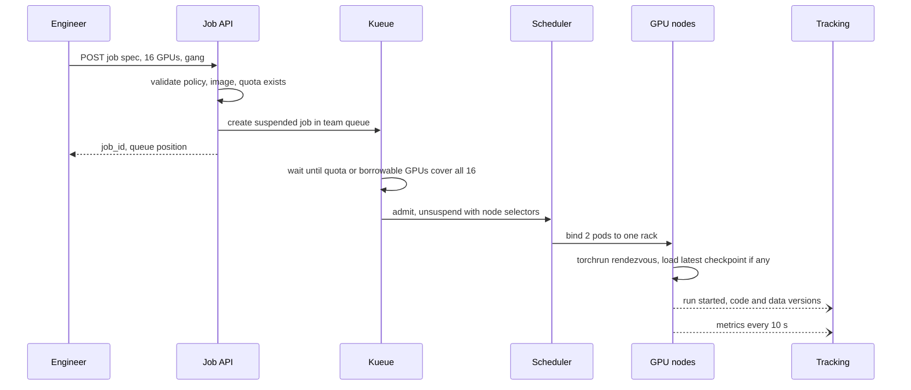

**Reading the diagram.** The API answers immediately with a job ID; everything after that is asynchronous from the engineer's point of view. Kueue holds the job suspended until the whole gang is covered by quota or borrowable capacity, then admits it; the scheduler binds both pods within one rack. Workers rendezvous and resume from a checkpoint if this is a restart. Tracking writes are asynchronous and never block a training step. Failure points: admission waiting forever on fragmentation (requeue timeout), a pod failing to start (gang released), tracking unavailable (metrics buffered locally). Scaling: admission is per job; the API is stateless.

**Figure 85.7 — Reclaiming borrowed GPUs with checkpoint-on-signal.**

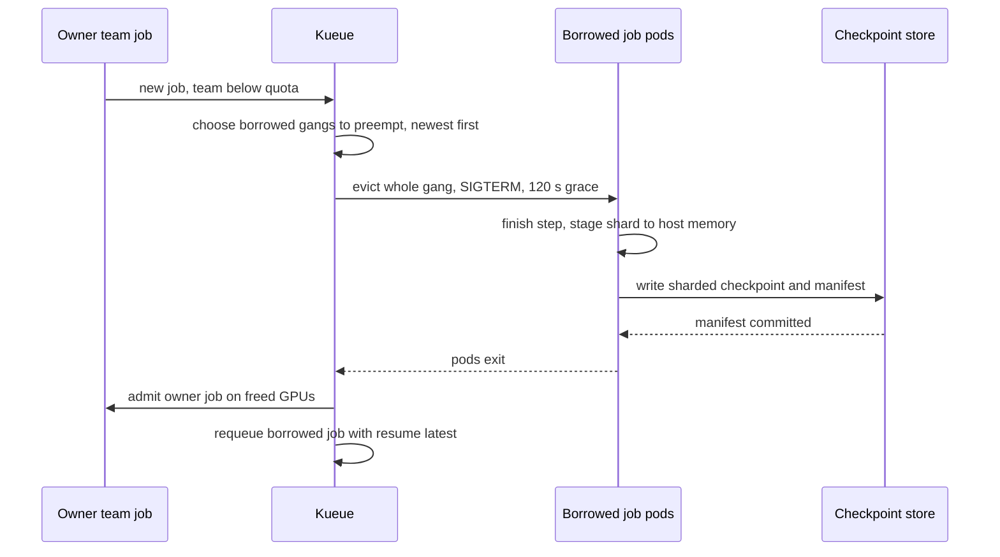

**Reading the diagram.** A team below its quota submits work; Kueue selects borrowed gangs to preempt and evicts each whole gang with a grace period. The training library finishes the current step, stages its shard and commits a checkpoint manifest before exiting, so the work lost is about one minute instead of half a checkpoint interval. The owner's job is admitted on the freed GPUs and the preempted job is requeued to resume later. Failure points: a checkpoint that does not finish within the grace period (the previous periodic checkpoint is used), a job that ignores SIGTERM (killed, loses up to $\tau/2$). Scaling: reclaim is incremental; only as many gangs as needed are preempted.

### 85.5.10 Bottlenecks

1. **Fragmentation.** Free GPUs scattered over many nodes cannot host a gang; pack small jobs onto partially used nodes (bin-packing, §46.7) and defragment with reservations.
2. **Checkpoint bursts.** Three large jobs checkpointing together need 42 GB/s; stagger them and keep staging in host memory.
3. **Input pipelines.** GPUs starved by data loading or CPU preprocessing, a bottleneck the Alibaba study also reports [Weng et al. 2022]; provision CPUs per GPU and cache hot datasets near the nodes.
4. **Scheduler throughput during sweeps.** Hundreds of trial submissions per minute; admit sweeps as one object with bounded parallelism.
5. **Heterogeneity.** Jobs that insist on H100s queue while A100s idle; use flavor fallback lists and price A100s lower.

### 85.5.11 Failure scenarios

**Table 85.8 — Training platform failure scenarios.**

| What fails | Impact | Detection | Recovery | Prevention |
|---|---|---|---|---|
| Partial gang placed | GPUs held idle, possible deadlock | Admitted-but-not-running time | Requeue after timeout | Gang admission, `waitForPodsReady` (§46.10) |
| Hang in a collective | Job stops progressing, GPUs burn | No step progress; NCCL watchdog | Kill, cordon node, restart from checkpoint | Collective timeouts; health checks |
| Silent data corruption | Loss spike or NaN, wrong model | Loss and gradient-norm monitors | Roll back to earlier checkpoint, exclude node | Burn-in tests; cross-replica checks (§80.8.3) |
| Corrupt latest checkpoint | Resume fails | Missing manifest | Use previous complete checkpoint | Manifest commit; keep three |
| Quota hoarding | Interactive sessions idle on GPUs | Low SM activity on held GPUs | Idle timeout, reclaim | Bill idle time; session limits |
| Starvation of large jobs | Pre-training waits days | Head-of-queue age | Reservation | Backfill with declared run times |
| Control plane down | No new admissions | API health | Fail over; running jobs unaffected | Replicated etcd; jobs do not depend on API at run time |
| Data or label leakage in a team's pipeline | Model looks good offline, fails online | Not visible to the platform | Owner's evaluation | Record data versions; offer validated dataset templates (§69.4) |

### 85.5.12 Scaling strategy

**At 10×** (40,000 GPUs) the largest jobs exceed one network domain and failures arrive hourly; Chapter 80's techniques take over: rail-optimized fabrics, hot spares, in-memory checkpoints and goodput budgets (§80.9). The control plane splits into several clusters (cells) behind one job API, each with its own Kueue, and teams' quotas span cells. **At 100×**, pre-training gets dedicated clusters and the shared platform serves the long tail of medium jobs; capacity planning becomes power- and facility-limited (§80.7).

### 85.5.13 Trade-offs

**Table 85.9 — Training platform design trade-offs.**

| Decision | Choice | Alternative | Why |
|---|---|---|---|
| Orchestrator | Kubernetes + Kueue | Slurm | Shares fleet and tooling with serving and pipelines; Slurm is simpler for a pre-training-only cluster (§65.18) |
| Sharing | Quotas with borrowing and reclaim | Static team slices | Idle slices lent out; owner guarantees kept |
| Preemption unit | Whole gang | Single pod | One missing worker stalls the rest |
| Lost work | Checkpoint on signal | Periodic only | 3.2 instead of 10.7 GPU-h per reclaim |
| Large jobs | Reservations + backfill | Strict FIFO | Large jobs start in hours; small ones fill holes |
| Billing | Held GPU-hours, discounted when borrowed | Bill used compute only | Simple, rewards releasing GPUs, prices idle sessions |

### 85.5.14 Alternative designs

- **Slurm with fair-share and preemption** (§46.12) for research-heavy organizations; simpler for large MPI-style jobs, weaker for mixed workloads.
- **Ray-based platform** (§65.18) when data loading, tuning and training are one Python program.
- **Managed cloud training** (SageMaker, Vertex AI) for bursty demand; pay per use, less control over topology.
- **Adaptive schedulers** such as Pollux that change job sizes automatically; higher utilization in research results, but jobs must tolerate resizing [Qiao et al. 2021].

### 85.5.15 Interview discussion

**Table 85.10 — 45-minute pacing plan for the training platform.**

| Minutes | Focus | What to produce |
|---|---|---|
| 0–5 | Scope | Job classes, teams, GPU types; self-service and billing |
| 5–12 | Estimates | 688k GPU-h/week; 0.1% of jobs use 43%; checkpoint bursts; cost of a point |
| 12–20 | Architecture | Figure 85.5; suspended jobs, admission, placement |
| 20–32 | Deep dive: sharing | Quotas, borrowing, reclaim, gang preemption, reservations |
| 32–40 | Deep dive: reliability | Checkpoint-on-signal, elastic restart, health pipeline |
| 40–45 | Wrap-up | Utilization honesty, chargeback, 10× |

**Likely follow-ups.**

- *"How do you keep GPUs busy without starving owners?"* Lend idle quota as preemptible capacity and reclaim it with checkpoint-on-signal.
- *"Why is 90% allocation not 90% utilization?"* Allocation ignores idle sessions, input stalls and low MFU; Philly measured about 52% hardware utilization of GPUs in use [Jeon et al. 2019].
- *"How do large jobs ever start?"* Reservations on a rack-aligned block, backfilled with jobs that finish in time.
- *"What happens when a node fails mid-run?"* Health check cordons it; the job restarts from the last manifest on a spare or fewer nodes.

**What distinguishes senior and staff answers.** A senior answer explains gang scheduling, quotas and checkpointing. A staff answer quantifies the cost of preemption and of a utilization point, separates allocation from effective utilization, designs incentives through billing, and explains how the policy differs for 8-GPU and 512-GPU jobs.

### 85.5.16 Production considerations

- **Observability.** Queue-wait percentiles by class and team; allocation, goodput and SM activity per team (§64.11); preemptions and restarts per job; checkpoint duration; node health events.
- **Security.** Signed images, per-team namespaces and storage credentials, no shared writable volumes across teams; training data access audited (§50.8).
- **Cost.** Ledger-based chargeback; reserved capacity for the base load and spot or on-demand for bursts of preemptible work (§51.6).
- **Operations.** Scheduler-policy changes are tested by replaying recorded job traces in a simulator before rollout; GPU node burn-in before joining the pool; quarterly quota reviews against usage.

## 85.6 Multi-tenant ML Serving Platform

### 85.6.1 Problem statement

A company's 300 teams have 5,000 models deployed for online inference: gradient-boosted trees, linear models, scikit-learn pipelines, small PyTorch and ONNX networks, and 200 vision and language models that need GPUs. Many are per-market or per-customer variants (a churn model per enterprise customer, a demand model per city), so the catalog grows faster than traffic. Each model today runs as its own deployment with two replicas for availability. Design a **multi-tenant serving platform** that serves all of them from a shared fleet at a fraction of the cost, while each team keeps its own latency objective, quota and bill.

The ML formulation is a popularity distribution, not a prediction target. Peak traffic is 300,000 predictions/s, and it is extremely skewed:

- **Hot**: 50 models carry 85% of traffic, about 5,100 predictions/s each.
- **Warm**: 950 models carry 14.9%, about 47/s each.
- **Cold**: 4,000 models share 0.1%, an average of 0.075/s each; half of them see fewer than one request every ten minutes.

The distinctive hard problem is **density with isolation**: pack thousands of models onto shared servers, load and evict them by demand, scale idle models to zero, and still keep one tenant's burst, slow model or bad artifact from hurting the others, while charging each model its share. Single-model serving mechanics (dynamic batching, autoscaling signals, cold-start anatomy) are owned by §66.6–§66.10; LLM-specific gateways, token quotas and multi-LoRA serving by Chapter 79.

### 85.6.2 Functional requirements

1. **Deploy** a registered model version (§69.8) with a runtime (XGBoost, scikit-learn, ONNX Runtime, Triton, custom container), resource hints and an SLO class.
2. **Predict** over REST and gRPC by model name and alias; batch requests of many rows.
3. **Route** to a server holding the model; load it on demand if none does.
4. **Scale** each model with its traffic, including to zero resident copies.
5. **Roll out** new versions by alias change with shadow and canary support (§66.12).
6. **Quota** per tenant: deployed models, resident memory, request rate, concurrency.
7. **Log** predictions (sampled) for monitoring and training (§60.6.2).
8. **Report** latency, errors and cost per model and tenant.

### 85.6.3 Non-functional requirements

**Table 85.11 — Multi-tenant serving non-functional requirements.**

| Requirement | Target |
|---|---|
| Latency, warm or hot model (platform overhead, excluding model compute) | p99 ≤ 5 ms added by router and server |
| Latency, cold model (first request) | p99 ≤ 2 s for models under 500 MB on CPU; ≤ 15 s for GPU models |
| Availability | 99.95% per hot or warm model; cold models 99.9% |
| Isolation | One tenant at 10× its quota raises others' p99 by ≤ 10% |
| Density | Platform cost ≤ 25% of one-deployment-per-model |
| Rollout | Alias change effective within 60 s; instant rollback |
| Correctness | Served model version recorded on every logged prediction; artifacts verified by digest |
| Model-quality hooks | Prediction and feature logs feed drift monitoring (Chapter 70) per model |

### 85.6.4 Capacity estimation

::: example
**Worked example — One deployment per model versus a shared fleet.** Assumptions: model files have a median of 150 MB and a mean of 246 MB; a model needs about 1.5× its file size in memory once deserialized; 2 ms of CPU per prediction on average; prices \$0.04 per vCPU-hour and \$0.005 per GB-hour.

1. **Dedicated baseline:** 2 pods per model, each 1 vCPU and $0.5 + 2 \times$ size GB: 10,000 pods, 10,000 vCPU and $2 \times 5{,}000 \times (0.5 + 2 \times 0.246) = 9{,}920$ GB. Cost: $10{,}000 \times 0.04 + 9{,}920 \times 0.005 = \$449.6$/h, \$3.94 million a year.
2. **Busy CPU at peak:** $300{,}000 \times 0.002 = 600$ vCPU. The baseline reserves 17 times that.
3. **Hot tier, dedicated and autoscaled:** $255{,}000 \times 0.002 / 0.5 = 1{,}020$ vCPU, 255 pods of 4 vCPU and 8 GB: $1{,}020 \times 0.04 + 2{,}040 \times 0.005 = \$51.0$/h.
4. **Multi-model fleet for warm and cold:** warm models resident in two copies, $950 \times 0.246 \times 1.5 \times 2 = 701$ GB; about 800 cold models resident at a time, $800 \times 0.246 \times 1.5 = 295$ GB; total 996 GB, or 1,423 GB at 70% memory utilization. Warm CPU: $44{,}700 \times 0.002 / 0.5 = 179$ vCPU. Sixteen servers of 16 vCPU and 128 GB cover both with zone spread: $16 \times (16 \times 0.04 + 128 \times 0.005) = \$20.5$/h.
5. **Shared total:** $51.0 + 20.5 = \$71.5$/h, \$0.63 million a year: 6.3 times cheaper, 16% of the baseline.

**Interpretation.** In the baseline the cost is redundancy floors for models nobody calls; in the shared design it is CPU for the hot models, and the long tail costs only memory. **Engineering implication.** Give hot models dedicated, autoscaled deployments, put everything else on multi-model servers sized by memory, and treat "resident copies" as the unit that scales.
:::

::: example
**Worked example — Cold-start time for an unloaded model.** Apply the cold-start formula of §66.10 to a warm server (no node provisioning, no image pull). CPU model of 300 MB: object store at 0.4 GB/s, deserialization at 1 GB/s, initialization 0.2 s, warm-up 0.3 s.

1. From the object store: $0.3/0.4 + 0.3/1 + 0.2 + 0.3 = 0.75 + 0.3 + 0.2 + 0.3 = 1.55$ s.
2. From a node-local NVMe cache at 2 GB/s: $0.15 + 0.3 + 0.2 + 0.3 = 0.95$ s.
3. A 2 GB GPU model from the object store, host-to-device at 4 GB/s, 2 s initialization and 3 s warm-up: $5 + 0.5 + 2 + 3 = 10.5$ s.
4. If no server has free memory and a new pod must start on a new node, add the minutes of node provisioning from §66.10.

**Interpretation.** Scaling a model to zero *resident copies* on a running fleet costs about a second; scaling the *fleet* to zero costs minutes. **Engineering implication.** Scale models to zero, not servers: keep the multi-model fleet warm with memory headroom, cache popular artifacts on local disks, and meet the 2 s cold target only for models below a size limit.
:::

For **GPU models**, 200 models with two dedicated GPUs each would need 400 GPUs (\$800/h at \$2.00 per GPU-hour). Their summed busy time is about 18 GPUs at peak; packing them on multi-model GPU servers, about 46 models of 1.5 GB per 80 GB GPU by memory (§66.8), with MIG slices for the few with strict latency objectives, needs about 40 GPUs (\$80/h).

### 85.6.5 API design

```yaml
# PUT /v1/tenants/{tenant}/deployments/{name}   (illustrative)
model: registry://payments/merchant-churn@7     # registry version, verified by digest
runtime: xgboost-cpu                           # or sklearn, onnx-cpu, triton-gpu, custom
slo_class: standard                            # critical | standard | best_effort
scaling: {min_copies: 0, max_copies: 8, target_inflight_per_copy: 4}
aliases: {prod: 7, canary: {version: 8, weight: 0.05}}
logging: {sample_rate: 0.02, log_features: true}
```

```text
POST /v2/models/{tenant}.{name}[:{alias}]/infer       # KServe v2 inference protocol shape
  {"inputs": [{"name": "features", "shape": [20, 64], "datatype": "FP32", "data": [...]}]}
  -> {"model_version": "7", "outputs": [...], "served_by": "mm-server-12", "cold": false}
GET  /v1/tenants/{tenant}/usage?from=&to=             # copies, GB-hours, vCPU-hours, cost
PUT  /v1/tenants/{tenant}/quota                      # admins only
```

Every response names the version served and whether it was a cold load, so clients and the prediction log can explain a slow request.

### 85.6.6 Data model and database schema

```sql
CREATE TABLE deployment (
  tenant TEXT, name TEXT, model_uri TEXT, digest TEXT, runtime TEXT,
  slo_class TEXT, tier TEXT,                 -- hot | warm | cold, set by the controller
  min_copies INT, max_copies INT, mem_bytes BIGINT,   -- measured at validation
  PRIMARY KEY (tenant, name)
);
CREATE TABLE placement (                     -- desired and actual copies
  tenant TEXT, name TEXT, version INT, server_id TEXT,
  state TEXT,                                -- loading | warming | serving | draining
  loaded_at TIMESTAMPTZ, last_request TIMESTAMPTZ,
  PRIMARY KEY (tenant, name, version, server_id)
);
CREATE TABLE tenant_quota (
  tenant TEXT PRIMARY KEY, max_models INT, max_resident_gb REAL,
  max_rps INT, max_concurrency INT, weight REAL
);
```

Placement is high-churn, small state kept in a replicated key-value store with watches (etcd-class, §26.9) so routers learn of new copies within a second; deployments and quotas are low-churn configuration; artifacts live in object storage addressed by digest; per-minute usage records feed the cost ledger.

### 85.6.7 High-level architecture

**Figure 85.8 — Multi-tenant serving platform.**

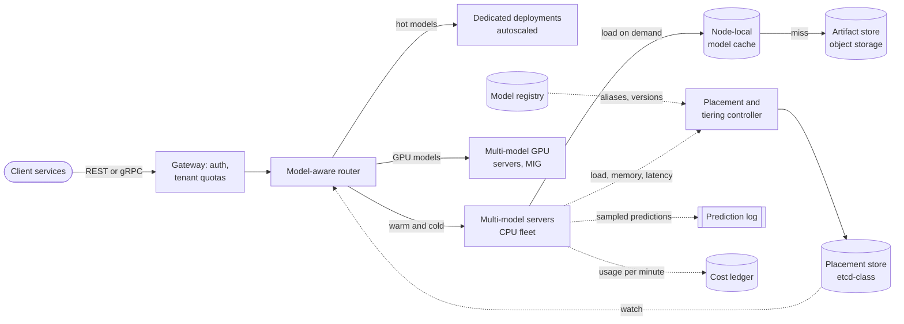

**Reading the diagram.** Clients call a gateway that authenticates the tenant and enforces its rate and concurrency quotas (§22.3), then a **model-aware router** that knows, from a watched placement store, which servers hold which models. Hot models go to their own autoscaled deployments; warm and cold models to **multi-model servers**, each holding dozens to hundreds of models in memory; GPU models to multi-model GPU servers, some partitioned with MIG. The **placement controller** decides copies per model from load and memory reports and writes desired placement; servers load artifacts from a node-local cache backed by object storage. Prediction logs and per-minute usage leave asynchronously (dotted). Storage boundaries: placement store, artifact store and node caches, registry, ledger. Failure points: the router's placement view going stale (requests sent to a server that just evicted the model, which reloads or redirects), load storms on the artifact store, a model that exhausts a server's memory. Scaling: routers are stateless; multi-model servers scale by memory.

### 85.6.8 Detailed component design

#### Placement, tiering and model-affinity routing

The controller recomputes each model's desired copies every 30 seconds:

1. **Tier.** A model is hot if its sustained rate needs more than a few full servers; it graduates to a dedicated deployment with its own autoscaler (§66.9). Otherwise it lives on the multi-model fleet.
2. **Copies.** For multi-model residents, copies $= \lceil \text{rate} \times c / (k_{\text{copy}} \, u) \rceil$, at least 2 for `critical` and `standard` warm models (zone spread), and 0 for idle models after a TTL of 15 minutes without requests.
3. **Where.** Candidate servers are ranked by rendezvous hashing of the model ID (§14.8.6), so a model returns to the same servers and finds its artifact in their local cache; among the top candidates, the controller picks those with free memory and low load, a bounded-load rule that keeps a few heavy models from piling onto one server.
4. **Route.** For each request, the router picks the holder with the fewest in-flight requests; if there is none, it sends the request to the top rendezvous candidate, which loads the model while the request waits up to its deadline. Duplicate loads of one model on one server are coalesced (single flight, §20.11.1).

This is the design KServe's ModelMesh documents: serving pods managed as a distributed LRU cache of models, copies loaded and unloaded by recency and request volume, and placement balanced by cache age and load [KServe ModelMesh Docs].

#### Loading and eviction

Each multi-model server keeps a memory budget for models and evicts when a load needs room. Which models to evict decides how many requests pay a cold start. The simulation below replays a 300,000-request trace over 2,000 models with Zipf popularity and log-normal sizes against one server's 48 GB budget.

```python
from collections import OrderedDict
import heapq
import numpy as np

rng = np.random.default_rng(42)
M, N_REQ, CAP = 2_000, 300_000, 48e9                 # models, requests, bytes of RAM
size = np.clip(rng.lognormal(np.log(150e6), 1.0, M), 5e6, 4e9)   # model sizes, bytes
pop = 1.0 / np.arange(1, M + 1) ** 1.05              # Zipf popularity by rank
pop /= pop.sum()
trace = rng.choice(M, N_REQ, p=pop)

def lru(trace):
    cache, used, misses, loaded = OrderedDict(), 0.0, 0, 0.0
    for m in trace:
        if m in cache:
            cache.move_to_end(m); continue
        misses += 1; loaded += size[m]
        while used + size[m] > CAP:
            _, s = cache.popitem(last=False); used -= s
        cache[m] = size[m]; used += size[m]
    return misses, loaded

def gdsf(trace, cost):
    """GreedyDual-Size-Frequency: evict the lowest L + freq * cost / size."""
    prio, freq, heap = {}, {}, []
    used, L, misses, loaded = 0.0, 0.0, 0, 0.0
    for m in trace:
        freq[m] = freq.get(m, 0) + 1
        if m not in prio:
            misses += 1; loaded += size[m]
            while used + size[m] > CAP:
                p, v = heapq.heappop(heap)
                if prio.get(v) == p:                 # skip stale heap entries
                    L = p; used -= size[v]; del prio[v]
            used += size[m]
        prio[m] = L + freq[m] * cost(m) / size[m]
        heapq.heappush(heap, (prio[m], m))
    return misses, loaded

print(f"catalog {size.sum() / 1e9:.0f} GB, cache {CAP / 1e9:.0f} GB")
policies = [("LRU", lru),
            ("GDSF, cost = 1 (hits)", lambda t: gdsf(t, lambda m: 1.0)),
            ("GDSF, cost = size (bytes)", lambda t: gdsf(t, lambda m: size[m]))]
for name, fn in policies:
    miss, loaded = fn(trace)
    print(f"{name:<26} hit ratio {1 - miss / N_REQ:.3f}  "
          f"loads {miss:>6,}  GB loaded {loaded / 1e9:>6,.0f}")
```

Output:

```text
catalog 465 GB, cache 48 GB
LRU                        hit ratio 0.671  loads 98,737  GB loaded 23,000
GDSF, cost = 1 (hits)      hit ratio 0.780  loads 66,067  GB loaded 19,230
GDSF, cost = size (bytes)  hit ratio 0.738  loads 78,590  GB loaded 18,861
```

What to notice:

- Size-aware eviction beats LRU: weighting frequency by $1/\text{size}$, the GreedyDual-Size family of web-cache policies [Cao and Irani 1997] extended with frequency, keeps many small popular models instead of a few large ones, raising the hit ratio from 0.67 to 0.78 (§20.9 compares general cache policies).
- The cost term chooses the objective: cost $= 1$ maximizes hits (fewest slow requests); cost $=$ size minimizes bytes loaded (least load on the artifact store). Platforms usually optimize hits within a cap on load bandwidth.
- Even the best policy misses 22% of requests when one server tries to cache a 465 GB catalog in 48 GB. The fix is not a better policy but **affinity routing**: with rendezvous placement, each of 20 servers caches only its own share of models, the fleet's 960 GB holds the whole catalog, and misses fall to genuinely cold models.

Two further rules prevent thrashing. A model must stay resident for a minimum time (60 s) before it can be evicted, and a server limits concurrent loads (for example 4) and the artifact store limits loads per tenant, so a deploy of 500 per-customer models does not saturate the store.

#### Scaling to zero and the cold request

A model with no requests for its TTL drops to zero resident copies but stays deployed: its placement entry, artifact and rendezvous candidates remain. The first request then costs the 1–1.6 s of §85.6.4. Tenants choose per deployment between `min_copies: 0` (cheapest; first request slow), `min_copies: 1` (one copy always resident) and `critical` (two copies in two zones). The router can also answer a cold request with a declared fallback, such as a tenant-level default model or a cached prediction, when the caller's deadline is shorter than the load time.

#### Tenant isolation and quotas

Isolation is layered, following §47.7–§47.9:

- **Admission.** Token-bucket rate limits and concurrency limits per tenant at the gateway (§22.4), with `429` and `Retry-After` beyond quota; resident-memory quota enforced by the controller (a tenant over its GB quota has its own least valuable models evicted first).
- **Fair queuing on each server.** Requests queue per tenant, served by weighted fair queuing (§47.8.2), so a tenant sending 10× its share waits in its own queue.
- **Per-model limits.** Maximum concurrency and timeout per model; a model whose p99 exceeds its class limit is moved to a quarantine server rather than slowing its neighbors.
- **Process and sandbox boundaries.** Standard runtimes load only formats that do not execute code on load (ONNX, XGBoost JSON, TorchScript); pickled scikit-learn models and custom pre-processing run in per-tenant containers under a sandboxing runtime such as gVisor (§47.9.2), because a pickle is a program. `critical` tenants can request dedicated servers or MIG slices.

#### Cost per model

::: formula
**Cost of one model on a shared fleet**

$$C_m = p_{\text{mem}} \sum_{i} M_{m} \, T_{m,i} + \frac{p_{\text{cpu}}}{u} \cdot \frac{N_m \, c_m}{3{,}600}$$

| Symbol | Meaning | Units |
|---|---|---|
| $M_m$ | Resident memory of one copy of model $m$ | GB |
| $T_{m,i}$ | Hours copy $i$ was resident in the period | h |
| $p_{\text{mem}}$, $p_{\text{cpu}}$ | Price per GB-hour and per vCPU-hour | \$/GB-h, \$/vCPU-h |
| $N_m$, $c_m$ | Predictions served and CPU-seconds per prediction | count, s |
| $u$ | Fleet CPU utilization target, spreading idle capacity over users | dimensionless |
| $C_m$ | Cost charged to the model for the period | \$ |
:::

::: example
**Worked example — A cold per-customer model and a warm model.** Prices as in §85.6.4; $u = 0.5$.

1. **Cold model**, 300 MB file (0.45 GB resident), resident 3 h/day, 500 predictions/day at 5 ms: memory $0.45 \times 3 \times 0.005 = \$0.0068$; CPU $(0.04/0.5) \times 500 \times 0.005 / 3{,}600 = \$0.00006$; total \$0.0068/day, \$2.48 a year.
2. Its dedicated baseline: $2 \times 24 \times (0.04 + 1.1 \times 0.005) = \$2.18$/day, \$797 a year, 321 times more.
3. **Warm model**, 0.45 GB, two copies all day, 47 predictions/s at 2 ms: memory $2 \times 0.45 \times 24 \times 0.005 = \$0.108$; CPU $(0.04/0.5) \times 47 \times 86{,}400 \times 0.002 / 3{,}600 = \$0.180$; total \$0.288/day, \$0.071 per million predictions.

**Interpretation.** On a shared fleet, idle models cost memory-hours and busy models cost CPU; both are small compared with dedicated redundancy floors. **Engineering implication.** Bill tenants by this formula through the ledger (§47.11.2) so a team with 2,000 rarely used models sees what they cost, and let them choose `min_copies` knowing the price of a warm first request.
:::

The platform is evaluated on density (cost against the dedicated baseline), cold-request rate and latency per tier, isolation incidents, and the share of models deployed self-service. Model-quality evaluation stays with each team, fed by the platform's prediction logs and shadow/canary routing (§66.12).

::: industry
**Published multi-model serving systems.** Clipper placed a model abstraction layer, with one container per model framework, under a selection layer that could combine or choose among models, and introduced adaptive batching and prediction caching for online serving [Crankshaw et al. 2017]. INFaaS made serving "model-less": clients state latency and accuracy requirements, and the system chooses among model variants (hardware, batch size, precision), shares hardware among models and scales variants automatically [Romero et al. 2021]. KServe's ModelMesh treats a pool of serving pods as a distributed LRU cache of models, loading and unloading copies by recency and request volume [KServe ModelMesh Docs].
*Evidence: Primary* — the cited papers and documentation
:::

### 85.6.9 Data flow

**Figure 85.9 — Write path: deploying a new model version.**

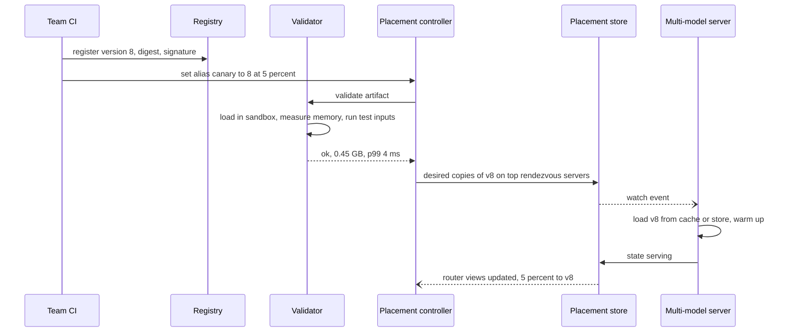

**Reading the diagram.** CI registers a version with its digest; changing an alias is the deployment. The controller has the artifact validated in a sandbox, which measures resident memory and latency on test inputs (the numbers placement needs) and rejects artifacts that fail to load or produce wrong outputs. It then writes desired placement; servers learn of it through an asynchronous watch, load and warm the model, and report `serving`, after which routers send the canary share to the new version. Failure points: an artifact that passes validation but leaks memory (server memory alarms, quarantine), a stuck watch (controller reconciles every 30 s). Rollback is an alias change; the old version is still resident.

**Figure 85.10 — Read path: a request for a model with no resident copy.**

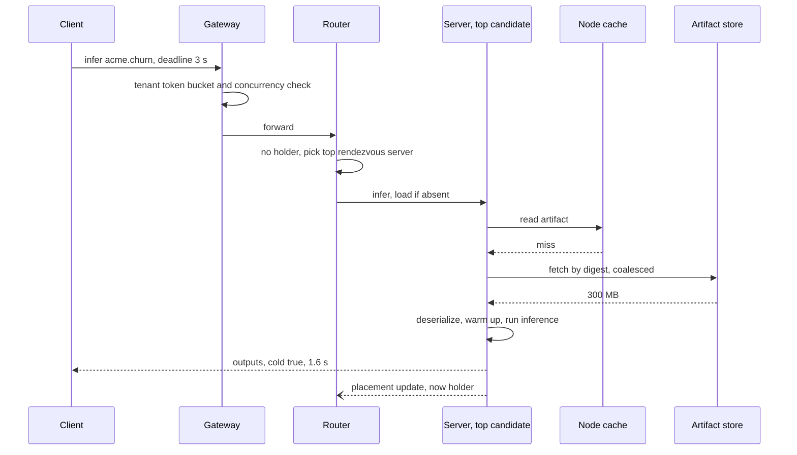

**Reading the diagram.** The gateway applies the tenant's quotas synchronously. The router finds no holder and picks the model's top rendezvous server, which coalesces concurrent loads of the same model, reads the node cache and, on a miss, the artifact store by digest, loads and warms the model, and answers with a `cold` flag. The placement update is asynchronous; later requests go to the new holder. Storage boundaries: node cache, artifact store, placement store. Failure points: a load longer than the deadline (fallback or error), the artifact store throttled during a load storm, the chosen server out of memory (evicts by policy). Scaling: rendezvous candidates spread models across the fleet; the cache absorbs repeated loads.

### 85.6.10 Bottlenecks

1. **Memory, not CPU,** sizes the multi-model fleet; resident-memory estimates must come from measurement, not file size.
2. **Artifact-store bandwidth** during mass deploys or after a fleet restart; limit concurrent loads and pre-warm node caches.
3. **Router placement freshness**; watches plus retry on `model not here` responses.
4. **Hot models on shared servers** before graduation; graduate on a sustained rate, not a spike.
5. **Per-request overhead** for tiny models: serialization and routing can exceed inference time; batch rows per request and keep connections pooled.

### 85.6.11 Failure scenarios

**Table 85.12 — Multi-tenant serving failure scenarios.**

| What fails | Impact | Detection | Recovery | Prevention |
|---|---|---|---|---|
| Eviction thrash | Many cold requests, store overloaded | Load rate per server, cold-request ratio | Add memory, raise minimum residency | Size-aware eviction; affinity routing; capacity alerts |
| Load storm after restart | Every model cold at once | Artifact-store throughput, queue of loads | Throttle loads, prioritize hot and warm models | Persistent node caches; staged restarts |
| Noisy tenant | Other tenants' p99 rises | Per-tenant queue delay; fair-share deviation | Throttle at gateway | Token buckets, fair queuing, per-model concurrency |
| Malicious or unsafe artifact | Code execution in shared server | Sandbox violations; artifact scanning | Kill container, revoke version | Safe formats; sandboxed custom runtimes; signed artifacts |
| Wrong memory estimate | Out-of-memory kills co-resident models | OOM events per server | Restart, reload others, quarantine model | Measured memory at validation; memory limits per runtime process |
| Stale model served after rollback | Bad predictions continue | Version on logged predictions | Force alias, evict version | Version in every response; reconcile loop |
| Training–serving skew in a tenant's pre-processing | Silent quality loss for that model | Drift and skew monitors on logs (Chapter 70) | Tenant rolls back | Transforms packaged with the model (§69.6.1) |
| Region or zone loss | Copies on lost servers vanish | Health checks | Reload on survivors; cold spike | Two-zone copies for `critical` and warm models |

### 85.6.12 Scaling strategy

**At 10×** (50,000 models, 3 million predictions/s): placement churn grows; shard the controller by tenant ranges and partition the fleet into cells of a few hundred servers, each with its own placement store, routing tenants to cells (§47.4.3). **At 100×**, per-customer models become a data problem: consider one model with a customer embedding or multi-task head instead of thousands of separate models, or adapter-style variants over shared weights, as Chapter 79 does for LLMs with multi-LoRA serving (§79.7).

### 85.6.13 Trade-offs

**Table 85.13 — Multi-tenant serving design trade-offs.**

| Decision | Choice | Alternative | Why |
|---|---|---|---|
| Unit of scaling | Resident copies on a warm fleet | Pods per model | Seconds instead of minutes to scale from zero; far fewer floors |
| Routing | Rendezvous candidates + least in-flight | Random or round robin | Cache affinity; whole catalog fits in fleet memory |
| Eviction | Size-aware frequency (GDSF-like) | LRU | Higher hit ratio for the same memory |
| Hot models | Dedicated deployments | Same multi-model servers | Independent autoscaling and isolation for 85% of traffic |
| Custom code | Sandboxed containers | Shared process | Isolation at a few ms and some memory cost |
| Billing | Memory-hours + CPU | Per request | Reflects what idle and busy models actually consume |

### 85.6.14 Alternative designs

- **Serverless per model** (Knative-style scale to zero of pods, Chapter 48): simple and isolated, but cold starts of tens of seconds and per-pod overhead.
- **Batch-scored predictions** for models whose inputs are known in advance (§60.8): many cold per-customer models need no online serving at all.
- **One generalized model** in place of thousands of variants: fewer artifacts, shared capacity, but per-customer behavior must be learned from features.
- **Managed multi-model endpoints** in cloud ML services (as of 2026) offer similar load-on-demand behavior with less control over routing and isolation.

### 85.6.15 Interview discussion

**Table 85.14 — 45-minute pacing plan for the multi-tenant serving platform.**

| Minutes | Focus | What to produce |
|---|---|---|
| 0–5 | Scope | Model count, popularity skew, runtimes, SLO classes |
| 5–12 | Estimates | Dedicated \$450/h versus shared \$72/h; cold start about 1.5 s |
| 12–20 | Architecture | Figure 85.8; tiers, router, controller |
| 20–32 | Deep dive: density | Affinity routing, eviction policy, scale to zero |
| 32–40 | Deep dive: isolation | Quotas, fair queuing, sandboxes, cost per model |
| 40–45 | Wrap-up | Failures (thrash, load storms), 10× with cells |

**Likely follow-ups.**

- *"Why not one Kubernetes deployment per model?"* Redundancy floors for 5,000 models cost \$3.9 million a year for 600 vCPU of real work.
- *"How do you avoid every server caching every model?"* Rendezvous placement gives each model a few home servers.
- *"How does a slow model not hurt others?"* Per-model concurrency limits, timeouts and quarantine; per-tenant fair queuing.
- *"How is this different from an LLM gateway?"* LLMs add token-based quotas, KV-cache-aware routing and adapters (Chapter 79); the density and isolation principles are the same.

**What distinguishes senior and staff answers.** A senior answer proposes multi-model servers and LRU. A staff answer quantifies the popularity tiers, separates scaling models from scaling servers, shows that affinity routing matters more than the eviction policy, treats artifacts as untrusted code, and gives tenants a price for each choice.

### 85.6.16 Production considerations

- **Observability.** Per model and tenant: RED metrics, cold-request rate and latency, resident copies, evictions; per server: memory, load queue, fair-share deviation (§40.5); version on every logged prediction.
- **Security.** Signed artifacts, digest checks, safe formats, sandboxes, per-tenant credentials for feature and data access (§47.12).
- **Cost.** Ledger with memory-hours and CPU per model; show teams their cold models' cost and the price of `min_copies`.
- **Operations.** Staged fleet restarts with cache preservation; quotas reviewed against usage; monitoring and retraining remain the tenant's responsibility, with platform-provided drift dashboards (Chapter 70).

## 85.7 Real-time ML Inference Platform (low-latency decisioning)

### 85.7.1 Problem statement

A payments-and-marketplace company makes three kinds of decision in the request path, each with a model at its core:

- **Payment risk** at authorization: approve, decline or step up (ask for extra authentication). Binary classification; the label is a chargeback or confirmed fraud, arriving 30–90 days later (§63.4). 8,000 decisions/s at peak; the decision must return within 60 ms at p99 inside a 300 ms authorization.
- **Promotion and ad ranking**: score 300 candidates per request for click and conversion probability; labels arrive within minutes. 25,000 requests/s, 7.5 million predictions/s at peak; the model stage gets 25 ms at p99.
- **ETA-style regression**: 40,000 predictions/s from small tree models, as in §66.16.

Each team built its own service. They disagree on how to fetch features, time out, fall back, log and roll out, and two incidents last year came from models that scored differently online than in the notebook that approved them. Design a shared **real-time inference platform** that gives these decisions a common, fast and safe path. Unlike §85.6, there are few models but each is critical: the distinctive hard problem is **the tail**: decomposing a p99 budget and defending it with hedging, deadlines and fallbacks, choosing CPU or GPU per workload by cost, rolling out models without risking money, proving that online scores equal offline scores, and running in three regions.

### 85.7.2 Functional requirements

1. **Decide/score API** per use case, taking request context and entity keys and returning scores, a decision and reason codes.
2. **Feature assembly** from the online feature store (§85.4), streaming counters and request-time features, with defaults on timeout.
3. **Model execution** in-process on CPU or on GPU model servers with dynamic batching.
4. **Post-processing**: calibration, policy thresholds per segment, rules, reason codes (§71.8).
5. **Fallback ladder**: full model, model without slow features, simpler model, rules only.
6. **Rollout**: shadow, canary and A/B by stable hash, automatic rollback (§66.12).
7. **Logging** of decisions with feature vectors, model version and fallback level, for training, monitoring and consistency checks.
8. **Multi-region** active–active serving with regional failover.

### 85.7.3 Non-functional requirements

**Table 85.15 — Real-time inference non-functional requirements.**

| Requirement | Payment risk | Ranking | ETA |
|---|---|---|---|
| Latency objective | 60 ms p99 end to end in the service | 25 ms p99 model stage; 80 ms p99 service | 100 ms p99 for 20 rows (§60.10) |
| Availability | 99.99% decisions (any fallback level counts) | 99.95% | 99.95% |
| Fallback rate | ≤ 0.5% below full model | ≤ 1% | ≤ 1% |
| Online/offline score parity | Trees bit-identical; ≤ 0.1% of samples beyond $10^{-5}$ | ≤ 0.1% beyond $10^{-4}$ | Bit-identical |
| Model-quality guardrail | Decline rate and step-up rate within ±10% of control during canary | CTR within ±2% | MAE within 3% |
| Freshness | Velocity counters ≤ 5 s old at p99 | Model retrained daily | Streaming features ≤ 60 s |
| Regions | Three, each able to carry half of global peak | Same | Same |

### 85.7.4 Capacity estimation

**Figure 85.11 — Payment-risk p99 budget of 60 ms.**

```mermaid
gantt
  title Payment risk decision budget, p99 in ms
  dateFormat x
  axisFormat %L
  section Network
  Ingress, auth, decode        :n1, 0, 3
  section Features
  Five parallel feature calls  :f1, 3, 23
  section Model
  Transforms, trees, small DNN :m1, 23, 33
  section Post
  Calibrate, policy, reasons   :p1, 33, 38
  section Return
  Encode and respond           :n2, 38, 40
  section Slack
  Queueing, GC, one hedge      :s1, 40, 60
```

**Reading the diagram.** Time runs left to right in milliseconds from arrival. Stages are sequential and synchronous; the feature bar hides five parallel calls (three feature-store view groups, the velocity-counter store and a device-reputation service), and the slowest sets its length. Logging is asynchronous and not drawn. One third of the budget is slack, reserved for variance rather than for a bigger model, following §60.10. Failure point: the feature stage, which crosses the network to stateful stores; the model stage runs in-process with no network hop.

::: example
**Worked example — Does the 20 ms feature stage hold, with and without hedging?** Apply the fan-out rule of §60.10. Assumed per-call latency: p95 = 6 ms; 1.5% of calls exceed 20 ms and 2.5% exceed 14 ms (a tail from compactions and garbage collection).

1. Required per-call probability for the stage to meet 20 ms at p99 with five calls: $0.99^{1/5} = 0.998$.
2. Without hedging: $P(\text{stage} \le 20) = 0.985^5 = 0.927$; the stage misses its budget on 7.3% of requests.
3. Hedge each call after 6 ms to another replica (§23.7). A call is late only if the original exceeds 20 ms *and* the hedge, sent at 6 ms, takes more than 14 ms: $0.015 \times 0.025 = 0.000375$, so $p = 0.999625$ per call and $0.999625^5 = 0.998$ per stage.
4. Cost: hedges fire on at most 5% of calls: $8{,}000 \times 5 \times 0.05 = 2{,}000$ extra calls/s on top of 40,000.

**Interpretation.** The tail of five independent calls, not their median, decides the budget; hedging at the p95 buys a 39-fold reduction in late stages for 5% more load, assuming the slow events on two replicas are independent. **Engineering implication.** Hedge feature reads by default, cap hedges per client at a few percent of traffic (so an overloaded store is not doubled), and give every call a deadline after which the platform uses declared defaults.
:::

::: example
**Worked example — CPU or GPU for each workload?** Apply the cost-per-prediction comparison of §66.7. Prices: \$0.04 per vCPU-hour, \$1.00 per inference-GPU-hour including its host share; planned utilization 0.5 for both. Ranking DNN: one vCPU scores 2,000 candidates/s; one GPU 250,000/s at the batch size the 25 ms budget allows (10 ms batching window). Regions are each sized for half of global peak at $u = 0.6$.

1. Break-even speedup: $S^{*} = (1.00/0.04) \times (0.5/0.5) = 25$; the GPU's speedup is $250{,}000/2{,}000 = 125$.
2. Cost per 1,000 predictions: CPU $1{,}000 \times 0.04 / (3{,}600 \times 2{,}000 \times 0.5) = \$0.0000111$; GPU $1{,}000 \times 1.00 / (3{,}600 \times 250{,}000 \times 0.5) = \$0.00000222$, five times cheaper.
3. Ranking fleet: per region $3.75 \times 10^6 / (250{,}000 \times 0.6) = 25$ GPUs, 75 in total, \$75/h; on CPU, $3.75 \times 10^6 / (2{,}000 \times 0.6) = 3{,}125$ vCPU per region, \$375/h in total. In normal operation each region runs at $2.5 \times 10^6 / (25 \times 250{,}000) = 0.4$.
4. Payment risk: 5 ms of CPU per decision. Per region $4{,}000 \times 0.005 / 0.5 = 40$ vCPU, 120 in total, \$4.80/h, about \$0.42 per million decisions at an average of 40% of peak. A GPU path would need at least two GPUs per region (\$6/h) for a model that runs in 3 ms on CPU and would add a network hop.

**Interpretation.** Heavy arithmetic at high volume (ranking) belongs on GPUs; small models at modest volume (risk, ETA) belong in-process on CPUs, where the cost is trivial and the hop is avoided. **Engineering implication.** The platform offers both paths behind one API and chooses per model from measured throughput at the budget's batch size, re-evaluated as traffic changes.
:::

**Logging volume.** Payment risk logs every decision with 400 features at 4 bytes: $8{,}000 \times 1{,}600$ B = 12.8 MB/s at peak, 0.44 TB/day at an average of 40% of peak. Logging every ranking prediction with 200 features would be 6 GB/s; a 1% sample of requests with all candidates is 60 MB/s at peak, 2.1 TB/day, enough for consistency checks and training-data augmentation.

### 85.7.5 API design

```protobuf
service Decisioning {
  rpc Decide(DecideRequest) returns (DecideResponse);
}
message DecideRequest {
  string use_case = 1;                    // "payment_risk", "promo_rank", "eta"
  string request_id = 2;                  // idempotency and log join key
  int64 deadline_unix_ms = 3;             // absolute; propagated to every call
  map<string, string> entity_keys = 4;    // card, user, device, merchant
  repeated Candidate candidates = 5;      // ranking only
  bytes request_features = 6;             // amount, currency, channel, ...
}
message DecideResponse {
  repeated float scores = 1;
  string decision = 2;                    // approve | decline | step_up (risk)
  repeated string reason_codes = 3;
  string model_version = 4;
  int32 fallback_level = 5;               // 0 = full model ... 3 = rules only
  repeated string defaulted_features = 6;
}
```

Labels and outcomes come back through `POST /v1/outcomes` (chargebacks, clicks, delivery times) keyed by `request_id`; the platform joins them with decision logs for training and monitoring.

### 85.7.6 Data model and database schema

```sql
-- Decision log (lakehouse table, partitioned by date and use_case)
CREATE TABLE decision_log (
  request_id TEXT, use_case TEXT, region TEXT, decided_at TIMESTAMP,
  model_version TEXT, shadow_versions TEXT[], fallback_level INT,
  features BINARY,               -- serialized vector exactly as scored
  feature_ages_ms INT[],         -- per view group
  scores FLOAT[], shadow_scores FLOAT[], decision TEXT, latency_ms REAL
);
-- Outcomes arrive late and are joined by request_id
CREATE TABLE outcome (
  request_id TEXT, use_case TEXT, label TEXT, label_value REAL, observed_at TIMESTAMP
);
```

Model deployments are registry entries with aliases per region (`payment_risk.prod.us`, `.canary.eu`) (§69.8). Velocity counters live in a regional in-memory store keyed `{counter}:{entity}:{window_end}` with a TTL equal to the window; features otherwise come from the feature store's layout (§85.4.6).

### 85.7.7 High-level architecture

**Figure 85.12 — Real-time inference platform in one region.**

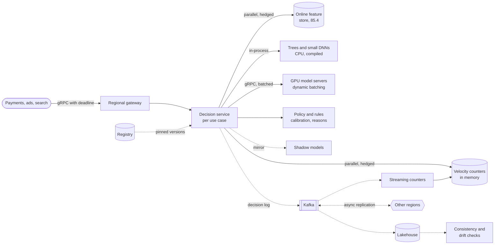

**Reading the diagram.** Clients call a regional gateway with an absolute deadline; a **decision service** per use case (a deployment of shared platform code plus the use case's configuration) fans out in parallel to the feature store and the velocity-counter store, hedging slow calls. It runs small models in-process on CPU and sends heavy ranking models to **GPU servers** that batch across requests, then applies policy and returns. Asynchronously (dotted) it mirrors requests to shadow models and logs decisions to Kafka, which feeds the lakehouse, the streaming counter jobs and other regions. Consistency and drift checks run over the logs; the registry supplies pinned model versions. Storage boundaries: feature store, counter store, Kafka, lakehouse. Failure points: feature stores (hedge, defaults), the GPU pool (fallback to a CPU model), a bad model version (rollback), cross-region replication lag (counter undercount). Scaling: decision services by RPS, GPU servers by in-flight requests (§66.9), stores by partitions.

### 85.7.8 Detailed component design

#### Deadlines, hedging and the fallback ladder

Every request carries an absolute deadline. The decision service computes each stage's timeout as the smaller of its budget and the remaining time minus a reserve for post-processing and response (5 ms here), so a slow feature stage cannot push the model stage past the end (§22.11). Feature calls are hedged after their p95, with a token budget limiting hedges to 5% of calls per client. When a deadline expires, the stage degrades instead of failing:

1. **Level 0**: full model with all features.
2. **Level 1**: missing features replaced by training-time defaults; the model was trained with the same defaults and a missingness indicator.
3. **Level 2**: a fallback model trained without the slowest feature groups (for risk, without the device-reputation service).
4. **Level 3**: rules only. For payment risk this is a deliberate policy: below a configured amount the payment is approved (fail open), above it the customer is stepped up (fail safe), because declining every payment during an outage costs more than the fraud it would stop.

The fallback level is logged and has its own SLO (Table 85.15); a rising level-1 rate is usually the first sign of a degrading store.

#### Model execution: CPU in-process and GPU with batching

Tree ensembles and small networks are compiled (Treelite-style tree compilation, ONNX Runtime, §67.10) and run inside the decision service: 1,000 trees over 400 features take about 1–2 ms, with no hop and no batching delay. The ranking DNN runs on GPU model servers with dynamic batching (§66.6): the decision service sends one request of 300 candidates; the server combines requests up to a 2,048-row batch or a 10 ms window. Models are optimized before deployment (FP16 or INT8 where accuracy holds, §67.5), and the optimization step is part of the CI gate so the served artifact is the one evaluated.

#### Rollout: shadow, canary and delayed labels

A new risk model cannot be judged by its true metric during a canary, because chargebacks arrive weeks later (§70.8). Rollout therefore runs in stages with proxy guardrails:

1. **Offline gate**: AUC and recall at the operating point on a recent, point-in-time-correct holdout, sliced by segment (§71.5); score parity of the packaged artifact.
2. **Shadow, 100% of traffic, 7 days**: the candidate scores every request; nothing it says is used. Compare score distributions (PSI, §70.5.1), decision rates at the proposed threshold, and agreement with the incumbent per segment; manual review of the largest disagreements.
3. **Canary by stable hash of the card**, 1% → 5% → 25%: guardrails on decline rate, step-up rate, manual-review queue and payment conversion, with automatic rollback on breach (§66.12, §43.6.4).
4. **A/B at 50%** for ranking models, judged on clicks and conversions within days (§57.14); risk models instead keep a small long-running holdout to measure fraud loss when labels mature.

#### Online/offline consistency checks

Two continuous checks catch the incident class that motivated the platform:

- **Score parity.** A job replays a sample of logged feature vectors through the exact registered artifact offline and compares scores with the logged ones. Trees must match bit for bit; networks within a tolerance set by numerical precision. A failure means the served artifact, runtime or pre-processing differs from what was evaluated.
- **Feature parity.** For a sample of decisions, the feature store's training-set builder recomputes features as of the decision time (on availability time, §62.8) and compares them with the logged vector; mismatch rates per feature are tracked against the 99.5% match target of §85.4.3. A failure means training data will not look like serving data: skew (§62.9).

Both also run in CI on a frozen set of recorded requests before any model or feature change ships.

#### Regional deployment and global counters

The platform is active–active in three regions, each sized for half of global peak so that two regions carry everything if one fails (§44.6.2). Models and batch features are replicated everywhere; the hard part is **streaming counters**. A card used in two regions within a minute must be counted once globally. Routing each card's updates to a home region would add a cross-region round trip of tens of milliseconds to a 60 ms budget (§44.4). Instead each region counts locally and replicates its per-window increments asynchronously; the served value is the local count plus the latest remote counts, a grow-only counter per region (§27.14.3). The undercount is bounded by the replication lag, about one second; a rule flags transactions when a card's regions differ within that window. Data-residency rules can pin some use cases' features and logs to one region (§44.9).

The platform's own evaluation is operational: per use case, p99 against budget, fallback rate by level, parity pass rates, rollback count and time to roll back, and cost per million decisions.

::: industry
**Published prediction services.** DoorDash described Sibyl, a prediction service built to handle its real-time predictions: it loads models from a model store, fetches features from a low-latency feature store, supports shadowing and A/B tests, and writes prediction logs; a later post describes logging every prediction with its feature values and model identifiers for monitoring [DoorDash 2020; DoorDash 2021]. Facebook's ad click-prediction paper combined boosted decision trees with a linear model and reported that prediction accuracy depends strongly on data freshness, which motivated online training of the linear layer [He et al. 2014]. Hedged requests to tame fan-out tails were described by Dean and Barroso [Dean and Barroso 2013].
*Evidence: Primary* — the cited posts and papers
:::

### 85.7.9 Data flow

**Figure 85.13 — Read path: one payment-risk decision.**

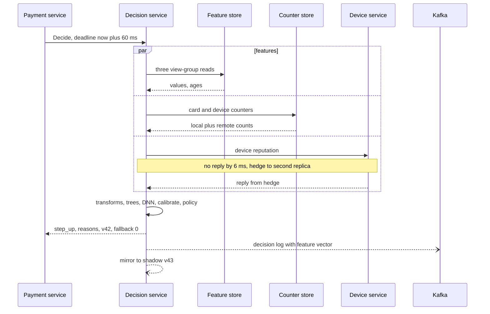

**Reading the diagram.** The payment service sets an absolute deadline. The decision service issues five feature calls in parallel; the device service is slow, so a hedge goes to a second replica, which answers first. The model and policy run in-process, the decision returns with its model version and fallback level, and then, asynchronously, the decision log goes to Kafka and the request is mirrored to the shadow model. Failure points: any feature source (hedge, then defaults), the device service down (fallback level 2), Kafka unavailable (local buffer; decisions never wait for logging). Scaling: stateless decision services behind the gateway.

**Figure 85.14 — Write path: from outcome to retrained, rolled-out model.**

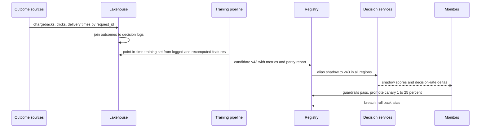

**Reading the diagram.** Outcomes arrive late and are joined to decision logs by request ID; training uses logged feature vectors where available and point-in-time recomputation for new features. A candidate is registered with offline metrics and a parity report, then moved by alias through shadow and canary stages; monitors compare decision rates and score distributions and either promote or roll back. Every step is asynchronous relative to serving; the alias change is the only control signal decision services receive. Failure points: label delay (proxies used), a feedback loop (declined payments never get fraud labels, so a small random holdout of approvals under a limit keeps training data unbiased, §68.12), a rollback that does not roll back features (§69.13.2).

### 85.7.10 Bottlenecks

1. **Feature-stage tail**: five network calls; hedging, co-location in one zone and fewer view groups.
2. **GPU batching window versus budget**: a larger window raises throughput but eats the 25 ms; tune per model (§66.6).
3. **Garbage collection and CPU throttling** in decision services spoil p99 (§23.6.3); set CPU requests equal to limits, keep allocations low on the hot path.
4. **Counter store hot keys** during card-testing attacks; pre-aggregate and rate-limit per key.
5. **Logging bandwidth** for ranking; sample requests, not candidates, to keep lists intact.

### 85.7.11 Failure scenarios

**Table 85.16 — Real-time inference failure scenarios.**

| What fails | Impact | Detection | Recovery | Prevention |
|---|---|---|---|---|
| Feature store slow | p99 breach; defaults rise | Stage latency, level-1 rate | Hedging, defaults, fallback model | Store SLO at p99.8; capacity headroom |
| Score mismatch online versus offline | Model behaves unlike its evaluation | Score-parity job | Roll back artifact or runtime | Parity gate in CI; artifact digests |
| Feature skew after a pipeline change | Silent loss of fraud recall | Feature-parity mismatch rate | Revert feature version; retrain | One definition for both paths (§85.4) |
| Fraudsters adapt to the model | Fraud rate rises in a segment | Manual-review findings, rising chargebacks by segment | Retrain on new patterns; temporary rules | Frequent retraining; adversarial features; monitoring slices (§70.9.2) |
| Feedback loop from declines | Model never sees outcomes of declined payments | Shrinking label coverage | Exploration holdout | Small randomized approval holdout |
| Stale model | Accuracy decays | Model age; performance on matured labels | Retrain and promote | Scheduled plus triggered retraining (§70.14) |
| GPU pool lost | Ranking cannot run the DNN | Health checks, error rate | Fall back to CPU tree ranker | CPU fallback model kept warm |
| Region lost | One third of capacity gone | Global load balancer | Shift traffic; counters lose remote updates briefly | Each region sized for half of peak |
| Bad canary | Decline rate jumps for 5% of users | Guardrail breach | Automatic alias rollback | Staged canary, small first step |

### 85.7.12 Scaling strategy

**At 10×** (80,000 risk decisions/s, 75 million ranking predictions/s): ranking GPUs grow to about 750; cost pressure moves to model optimization (distillation, INT8, §67.5–§67.8) and cascades that score 300 candidates with a cheap model and only the top 50 with the DNN (§60.13.2). Risk services stay on CPU; the counter store needs more partitions and per-key pre-aggregation. **At 100×**, regional cells with their own stores and GPU pools, and models compiled per hardware generation; the consistency checks become sampled per cell.

### 85.7.13 Trade-offs

**Table 85.17 — Real-time inference design trade-offs.**

| Decision | Choice | Alternative | Why |
|---|---|---|---|
| Small models | In-process on CPU | Remote model server | No hop; trivial cost at this volume |
| Ranking DNN | GPU with dynamic batching | CPU fleet | Five times cheaper per prediction at this volume |
| Tail control | Hedging at p95 + deadlines | Larger timeouts | 39× fewer late stages for 5% more calls |
| Outage policy (risk) | Fail open below an amount, step up above | Fail closed | Lost sales exceed the fraud stopped |
| Global counters | Local counts + async replicated increments | Home-region routing | Keeps cross-region round trips out of the budget; bounded undercount |
| Rollout of risk models | Long shadow + guardrailed canary | Short A/B on true labels | Labels take weeks |

### 85.7.14 Alternative designs

- **Embed everything in each product service**, as before the platform: lowest latency, but every team re-solves deadlines, logging, parity and rollout.
- **A single general model server** (Triton or KServe) for all models: uniform operations, but a network hop for models that take 2 ms in-process.
- **Precompute decisions** where inputs are known in advance (ETA ranges per zone, user-level risk tiers), leaving only a cheap online adjustment (§60.8).
- **Rules-first engines** with ML scores as one input: the right shape when policy changes daily and must be auditable; the platform's policy stage is a small version of this.

### 85.7.15 Interview discussion

**Table 85.18 — 45-minute pacing plan for the real-time inference platform.**

| Minutes | Focus | What to produce |
|---|---|---|
| 0–5 | Scope | Use cases, budgets, label delays, regions |
| 5–12 | Estimates | Budget decomposition; hedging arithmetic; CPU versus GPU cost |
| 12–20 | Architecture | Figure 85.12; decision service, stores, model paths |
| 20–30 | Deep dive: tail | Deadlines, hedges, fallback ladder, fail-open policy |
| 30–40 | Deep dive: safety | Shadow, canary with proxies, score and feature parity |
| 40–45 | Wrap-up | Regions and counters, failures, 10× |

**Likely follow-ups.**

- *"Where do the 60 ms go?"* Figure 85.11; the feature stage is the variance, the slack is protected.
- *"Why not put the fraud model on GPU?"* 3–5 ms on CPU, no batching to fill, and a floor of GPUs per region; CPU is cheaper and faster here.
- *"How do you canary a model whose labels take 60 days?"* Shadow and proxies (decision rates, score distribution, review queue), plus a long-running holdout.
- *"How do you know online equals offline?"* Score parity and feature parity jobs on logged samples, and the same checks in CI.

**What distinguishes senior and staff answers.** A senior answer budgets latency and proposes canaries. A staff answer computes the stage's tail probability and the value of hedging, chooses hardware by cost per prediction per workload, designs an explicit outage policy with the business, handles delayed labels and feedback loops in rollout, and solves cross-region counters without spending the budget on round trips.

### 85.7.16 Production considerations

- **Observability.** Per use case and region: stage latencies, hedge and fallback rates, score distributions, decision rates by segment, parity pass rates, model version mix; traces sampled with tail sampling for slow requests (§40.6.3).
- **Responsible ML.** Reason codes for declines and step-ups; fairness slices on decline rates (§71.5); audit trail of model and policy versions per decision for disputes and regulators (§69.11).
- **Retraining.** Ranking daily; risk weekly on matured labels plus triggered retraining on drift (§70.14).
- **Cost.** GPUs for ranking dominate; report cost per million decisions per use case; optimization and cascades are the levers.
- **Security.** Feature and decision logs contain payment data: tokenized identifiers, encryption, access restricted by use case, retention limits (§50.8).

## 85.8 Summary and revision notes

::: summary
- **Platforms serve engineers, not end users.** Their requirements have a tenant dimension: for every resource, decide who gets it under contention and who pays for it.
- **Feature store (§85.4).** Join on availability time with bucketed sort-merge so history is never shuffled; assemble windows from mergeable hourly and daily tiles ($R_{\text{tiled}} \ll \rho W$ for heavy entities); lay out the online store per entity: partition few-key entities, fully replicate small many-key ones to avoid partition fan-out; get exactly-once-ish streaming from deduplication, checkpointed state and idempotent upserts, measured against batch.
- **Training platform (§85.5).** Quotas with borrowing and whole-gang reclaim keep GPUs busy without breaking guarantees; checkpoint-on-signal cuts preemption loss from $G(\tau/2 + R)$ to $G(t_{\text{save}} + R)$; reservations plus backfill start large jobs; report allocation, goodput and MFU separately, because published traces show allocation overstates useful work.
- **Multi-tenant serving (§85.6).** Popularity is extremely skewed: dedicate deployments to hot models, put the long tail on multi-model servers sized by memory, scale copies (not servers) to zero, route by rendezvous affinity so the fleet's memory holds the catalog, treat artifacts as untrusted code, and bill memory-hours plus CPU.
- **Real-time inference (§85.7).** Decompose the p99 budget and protect slack; the probability that a stage of $N$ parallel calls is late is what matters, and hedging at the p95 shrinks it dramatically; choose CPU or GPU per workload by cost per prediction; roll out high-stakes models with shadow and proxy-guarded canaries; verify score and feature parity continuously; replicate counters across regions asynchronously rather than spending the budget on round trips.
:::

## 85.9 Knowledge checkpoint

1. Why must a point-in-time join use the availability timestamp rather than the event timestamp for a nightly batch view?
2. A ranking request reads 150 item keys from a store with 48 hash partitions. How many partitions does it touch on average, and why does that matter?
3. Write the two-level tiling estimate of reads per spine row and evaluate it for a 7-day window at 10 events/h.
4. Name the three mechanisms that give a streaming feature "exactly-once-ish" behavior.
5. In the training platform, why are borrowed jobs preempted as whole gangs?
6. A 64-GPU borrowed job checkpoints every 60 minutes and restarts in 10 minutes. How many GPU-hours does a preemption lose with and without a 2-minute checkpoint-on-signal?
7. Why is 86% allocation not 86% utilization? Give the three factors.
8. In §85.6, why does affinity routing matter more than the eviction policy?
9. What is the difference between scaling a model to zero and scaling a fleet to zero, in cold-start time?
10. Why do pickled models need a sandbox on a shared server?
11. Five parallel calls each exceed 20 ms with probability 1.5%. What fraction of stages miss 20 ms, and what does hedging after the p95 change?
12. Why is the payment-risk model served on CPU while the ranking DNN is served on GPU?
13. How can you canary a risk model whose labels arrive after 60 days?
14. What do the score-parity and feature-parity checks each detect?

<details><summary>Answers</summary>

1. The value stamped midnight was not readable until the job published it hours later; joining on event time gives examples in that window a value serving could not have seen, which is label leakage (§62.8).
2. $48\,(1 - (47/48)^{150}) \approx 46$ partitions. The read waits for the slowest of 46 sub-requests, so its tail is far worse than a three-call read; full replicas of the item view make it one call.
3. $R_{\text{tiled}} \approx (W/\Delta_2 - 1) + (\Delta_2/\Delta_1 - 1) + \rho\Delta_1 = 6 + 23 + 10 = 39$ reads, versus $\rho W = 1{,}680$ raw events.
4. Event-ID deduplication in keyed state, checkpointed window state with replay from checkpointed offsets, and idempotent full-value upserts ordered by window end.
5. Collective operations need every worker; preempting one pod stalls all the others while still holding their GPUs.
6. Without: $64 \times (30 + 10)/60 = 42.7$ GPU-h. With: $64 \times (2 + 10)/60 = 12.8$ GPU-h.
7. Allocation counts GPUs held; goodput removes lost and restart time; MFU (or hardware utilization) removes the idle fraction of each held GPU. Effective utilization is their product.
8. Without affinity, every server sees the whole catalog and even the best policy misses often; with rendezvous placement each server caches only its share, so the fleet's total memory holds the catalog.
9. Reloading a model on a warm server takes about a second; starting servers on new nodes takes minutes (§66.10).
10. Unpickling executes code chosen by the artifact's author; on a shared server that code could read other tenants' data or crash their models.
11. $1 - 0.985^5 = 7.3\%$. With hedging, a call is late only if both attempts are slow: $0.015 \times 0.025$, so about 0.2% of stages miss.
12. The risk model takes a few milliseconds of CPU at 8,000 decisions/s, so CPUs cost a few dollars an hour with no hop; the ranking DNN needs 7.5 million predictions/s, where a GPU's 125× throughput beats the 25× break-even.
13. Long shadow on all traffic, then a staged canary guarded by proxies (decline and step-up rates, score distribution, review queue, conversion), plus a long-running holdout evaluated when labels mature.
14. Score parity detects differences between the served and evaluated artifact or runtime; feature parity detects training–serving skew in features.
</details>

## 85.10 Interview questions

### Basic

**Q1.** What problems does a company-wide feature store solve that per-team pipelines do not? **Answer.** One definition for training and serving (no skew), point-in-time-correct training sets (no leakage), reuse and discovery of features, a shared low-latency online store, and governance: owners, versions, consumers and access control (§62.6).

**Q2.** Why do training jobs need gang scheduling? **Answer.** Synchronous training needs all workers at every step; placing some workers holds GPUs idle and can deadlock two jobs that each hold part of the cluster (§46.10).

### Intermediate

**Q3.** Design the eviction and routing policy for 5,000 models on 20 multi-model servers. **Answer.** Assign each model a few home servers by rendezvous hashing so caches specialize; within a server, evict by size-aware frequency with a minimum residency time; keep two copies of warm models in different zones; limit concurrent loads; let hot models graduate to dedicated deployments.

**Q4.** How would you allocate a 100 ms p99 budget for a fraud decision? **Answer.** Allocate stages (network, parallel feature fetch, model, policy, response) and keep about a third as slack; compute the probability the parallel stage is late from per-call tails; hedge at the p95 and propagate deadlines; define fallback levels and an explicit outage policy.

### Advanced

**Q5.** A team reports that its model's offline AUC is 0.92 but online performance matches a 0.85 model. How do you investigate on this platform? **Answer.** Check score parity (artifact or runtime differences), then feature parity per feature (skew), then whether the training set joined on event time (leakage for batch views), then defaults and fallback rates online, then population differences between the offline holdout and live traffic (drift, feedback loops).

**Q6.** The GPU fleet is 86% allocated, yet teams complain about waits and finance about cost. What do you change? **Answer.** Measure goodput and SM activity per team; bill idle allocated time; enforce session idle timeouts; lend idle quota as preemptible capacity with checkpoint-on-signal; add reservations for large jobs and backfill; fix input pipelines and communication overlap to raise MFU; price older GPU types lower to shift demand.

## 85.11 Practical exercises

1. Extend the tiling program of §85.4.8 to a 30-day sum and a distinct count (use a set per tile as a stand-in for HyperLogLog), and verify zero mismatches. Which aggregate functions are not mergeable?
2. Modify the fair-share program of §85.5.8 to break ties by queue age and to cap any team's borrowing at 50% of its quota. Rerun the scenario.
3. Add a minimum-residency rule (no eviction within 1,000 requests of a load) and a per-server affinity filter (each server sees one twentieth of models) to the cache simulation of §85.6.8. Report the hit ratio.
4. Simulate the five-call feature stage of §85.7.4 with log-normal latencies and measure p99 with and without hedging at the p95, including the extra calls.

## 85.12 Design challenges

1. **Feature store for 50 regions under data-residency law.** User features may not leave their region; models are global. Design materialization, training-set generation and serving.
2. **Training platform with 30% spot capacity.** Spot GPUs can vanish with two minutes' notice. Decide which jobs may run on them, how checkpoints and pricing change, and what goodput you can promise.
3. **Serving 100,000 per-customer models.** Compare multi-model serving with replacing them by one model with customer embeddings or adapters, in cost, quality risk and operations.

## 85.13 References

1. Cao, P., Irani, S. *Cost-Aware WWW Proxy Caching Algorithms*. USENIX Symposium on Internet Technologies and Systems (USITS), 1997.
2. Crankshaw, D., Wang, X., Zhou, G., Franklin, M. J., Gonzalez, J. E., Stoica, I. *Clipper: A Low-Latency Online Prediction Serving System*. USENIX NSDI, 2017.
3. Dean, J., Barroso, L. A. *The Tail at Scale*. Communications of the ACM 56(2), 2013.
4. DoorDash Engineering. *Meet Sibyl, DoorDash's New Prediction Service* (and the companion post on its ideation and requirements). DoorDash Engineering Blog, 2020.
5. DoorDash Engineering. Post on monitoring ML models with prediction logs. DoorDash Engineering Blog, 2021.
6. Feast Authors. *Feast documentation*. n.d. https://docs.feast.dev
7. Gu, J., Chowdhury, M., Shin, K. G., Zhu, Y., Jeon, M., Qian, J., Liu, H., Guo, C. *Tiresias: A GPU Cluster Manager for Distributed Deep Learning*. USENIX NSDI, 2019.
8. He, X., Pan, J., Jin, O., Xu, T., Liu, B., Xu, T., Shi, Y., Atallah, A., Herbrich, R., Bowers, S., Quiñonero Candela, J. *Practical Lessons from Predicting Clicks on Ads at Facebook*. ADKDD Workshop, 2014.
9. Hermann, J., Del Balso, M. *Meet Michelangelo: Uber's Machine Learning Platform*. Uber Engineering Blog, 2017.
10. Jeon, M., Venkataraman, S., Phanishayee, A., Qian, J., Xiao, W., Yang, F. *Analysis of Large-Scale Multi-Tenant GPU Clusters for DNN Training Workloads*. USENIX ATC, 2019.
11. KServe Authors. *ModelMesh* (repository and documentation). n.d. https://github.com/kserve/modelmesh
12. Mahajan, K., Balasubramanian, A., Singhvi, A., Venkataraman, S., Akella, A., Phanishayee, A., Chawla, S. *Themis: Fair and Efficient GPU Cluster Scheduling*. USENIX NSDI, 2020.
13. Narayanan, D., Santhanam, K., Kazhamiaka, F., Phanishayee, A., Zaharia, M. *Heterogeneity-Aware Cluster Scheduling Policies for Deep Learning Workloads*. USENIX OSDI, 2020.
14. Qiao, A., Choe, S. K., Subramanya, S. J., Neiswanger, W., Ho, Q., Zhang, H., Ganger, G. R., Xing, E. P. *Pollux: Co-adaptive Cluster Scheduling for Goodput-Optimized Deep Learning*. USENIX OSDI, 2021.
15. Romero, F., Li, Q., Yadwadkar, N. J., Kozyrakis, C. *INFaaS: Automated Model-less Inference Serving*. USENIX ATC, 2021.
16. Weng, Q., Xiao, W., Yu, Y., Wang, W., Wang, C., He, J., Li, Y., Zhang, L., Lin, W., Ding, Y. *MLaaS in the Wild: Workload Analysis and Scheduling in Large-Scale Heterogeneous GPU Clusters*. USENIX NSDI, 2022.
17. Xiao, W., Bhardwaj, R., Ramjee, R., Sivathanu, M., Kwatra, N., Han, Z., Patel, P., Peng, X., Zhao, H., Zhang, Q., Yang, F., Zhou, L. *Gandiva: Introspective Cluster Scheduling for Deep Learning*. USENIX OSDI, 2018.
18. Zanoyan, V., Shapiro, E. *Zipline: A Declarative Feature Engineering Framework*. Strange Loop, 2019.

## 85.14 Open verification items

- Jeon et al. 2019: the "about 52%" hardware utilization and "about 30%" unsuccessful-job figures were checked against the abstract only; trace period (75 days, October–December 2017) is from the authors' slides.
- Weng et al. 2022: "over 6,000 GPUs" from the abstract; the paper body reportedly gives 6,742.
- KServe ModelMesh: cache and placement behavior from the repository and an IBM Developer tutorial; confirm against current KServe documentation.
- DoorDash posts (2020, 2021): confirm exact titles and authors; Sibyl details (feature store, shadowing, prediction logs) were taken from search summaries.
- Author lists for Gandiva, Tiresias, Themis, Gavel and Pollux; GDSF attribution (Cherkasova 1998) beyond Cao and Irani 1997.
- All throughput, price and latency figures in the capacity estimates are illustrative assumptions.
