# Chapter 87 — Interview Fundamentals

> **Level:** 2 · **Track:** Shared · **Estimated reading time:** 2.5 h

Books I and II taught you how to design systems. This chapter teaches you how to *show* that you can, in 45 or 60 minutes, out loud, to a stranger who is taking notes. That is a different skill. Strong engineers fail system-design interviews because they design silently, spend twenty minutes on requirements, or answer a question nobody asked. Weaker engineers sometimes pass because they steer the conversation well. Your goal is to remove that gap so that the interview measures what you actually know.

Chapter 1 (§1.11) gave the format in one page, Chapter 2 gave the thinking tools (requirements, assumptions, trade-offs, estimation), and Chapter 3 gave the learning method. This chapter does not repeat them. It turns each one into an interview technique: what to say, when, how long to spend, and what to write on the board. Chapter 88 then gives the fourteen-step readiness framework and the rubrics by level, and Chapter 89 the estimation handbook.

## 87.1 Learning objectives

After this chapter you should be able to:

- **Name** the five signal areas a system-design interviewer records and point to the evidence you produce for each.
- **Pace** a 45- or 60-minute interview with a written time budget, and recover when one phase overruns.
- **Run** the first five minutes: restate the problem, ask targeted clarifying questions, and write functional and non-functional requirements and non-goals on the board.
- **Estimate** at interview speed with stated assumptions and rounding conventions, and stop when the numbers have made their decision.
- **Sketch** an API and a data model from access patterns, and justify SQL versus NoSQL in two sentences.
- **Draw** a high-level design with consistent conventions and evolve it in stages without starting over.
- **Select** deep-dive topics by risk, and spot single points of failure, hot keys and fan-out.
- **State** trade-offs in the "option A versus B, because constraint C" form.
- **Handle** hints, pushback, mistakes and gaps in your knowledge without losing the thread.
- **Diagnose** the common failure patterns in your own mock interviews and build a practice plan with a peer rubric.

## 87.2 Prerequisites

- **Interview format and signals** — §1.11. This chapter expands Table 1.18 into techniques.
- **Requirements, assumptions and trade-offs** — §2.5, §2.7, §2.8. You must already be able to turn adjectives into numbers.
- **Back-of-the-envelope estimation** — §2.11. Section 87.6 covers only interview use; the full method is in Ch 89.
- **Learning method** — §3.4 (retrieval and deliberate practice) and §3.6 (drawing from memory). Section 87.15 builds the practice plan on them.
- **At least two case studies read with the §52.3 method** — for example the URL shortener (§52.4) and the chat application (§53.4). You will use them as practice material.

## 87.3 What a system-design interview is and what it measures

### 87.3.1 The interview as an evidence-gathering exercise

::: definition
**Definition — Interview signal.** An observable behavior that an interviewer can write down as evidence for or against a hiring criterion, for example "asked for read/write ratio before choosing a store" or "could not explain why a queue was added". A **signal area** is a group of related signals that the interviewer's feedback form asks about.
:::

#### First-principles explanation

Imagine you are a building inspector with forty-five minutes and a clipboard. You cannot watch the builder construct a whole house. You can only ask questions, watch them sketch, and note what they do. Everything you cannot observe, you cannot credit. The interviewer is in the same position. Whatever you think but do not say or draw does not exist for them. That is the most important fact about the format, and most of this chapter follows from it.

#### Why does this exist?

A system-design interview tries to predict how you will behave in a real design review (§1.10): with incomplete requirements, competing goals and a colleague who asks "why?". Coding interviews measure whether you can produce a correct, efficient program for a well-defined problem. They say little about whether you can scope an ambiguous problem, size it, choose between several workable architectures and explain the choice. Employers who hire for senior and infrastructure roles therefore add a design round. Ch 90 lists what individual companies have published about their own rounds. This chapter gives general advice only.

#### How it works internally: the five signal areas

Interview guides and published rubrics group the evidence in slightly different ways, but most map onto five areas (Table 87.1). The names here are this book's. Ch 88 gives level-by-level rubrics built on them.

**Table 87.1 — The five signal areas and the evidence for each.**

| Signal area | Question the interviewer is answering | Strong evidence | Weak evidence |
|---|---|---|---|
| Problem navigation | Can they turn ambiguity into a scoped problem and drive it? | Targeted questions; written FRs, numeric NFRs and non-goals; agenda stated | Starts drawing at minute 1; waits to be led |
| Solution design | Does the design meet the requirements end to end? | Every FR traced through the diagram; read and write paths distinct | Boxes with no data flow; FRs left unhandled |
| Technical depth | Do they understand how the parts actually work? | Explains partitioning, replication, cache behavior with numbers | Names products ("use Kafka") without mechanism |
| Trade-off reasoning | Do they choose deliberately? | Names what each option costs; ties choice to a stated NFR | "X is best"; one option only |
| Communication | Could I work with this person in a design review? | Thinks aloud, checks in, adapts to hints, summarizes | Long silences; monologue; argues with hints |

**Figure 87.1 — Where each signal area is earned during the interview.**

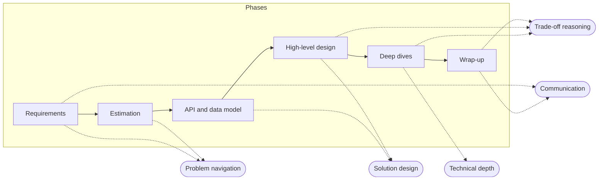

**Reading the diagram.** The rectangles inside the *Phases* boundary are the six phases of the interview, run left to right with solid arrows because each one feeds the next. The stadium shapes on the right are the five signal areas. Each dotted arrow means "this phase is the main opportunity to produce evidence for that area"; it is dotted because the evidence is recorded by the interviewer after the fact, not exchanged during the phase. Problem navigation is earned early, in requirements and estimation. Solution design is earned in the API, data model and diagram. Technical depth comes almost entirely from deep dives, which is why §87.4 protects their time. Trade-off reasoning appears in three phases, and communication spans the whole interview (only two of its edges are drawn to keep the figure readable). The failure point the figure exposes: a candidate who spends thirty minutes on the high-level design leaves no time to earn depth or trade-off signals, however good the diagram is. No phase scales to compensate for a missing one.

### 87.3.2 How it differs from a coding interview

**Table 87.2 — Coding interview versus system-design interview.**

| Aspect | Coding interview | System-design interview |
|---|---|---|
| Problem definition | Precise; inputs and outputs given | Deliberately vague; you define scope |
| Correct answer | Usually one optimal complexity class | Many acceptable designs; judged by fit to requirements |
| Who drives | Interviewer sets the pace | Candidate is expected to drive, more so at senior levels |
| Artifact | Working code | Requirements list, numbers, API, schema, diagram |
| Depth | One algorithm, fully | Many components shallowly, one or two deeply |
| What sinks you | Bugs, wrong complexity | Unscoped problem, unjustified choices, silence |
| Preparation | Pattern drills | Building blocks (Books I–II) plus case studies plus spoken practice |

The row that surprises most candidates is *who drives*. In a coding interview, waiting for the interviewer's next prompt is normal. In a design interview, especially at senior levels, the interviewer is watching whether you set the agenda ("I'll do requirements, a quick estimate, the API, then a diagram, then go deep on code generation — sound good?") and keep to it.

### 87.3.3 Virtual versus on-site whiteboarding

Design interviews happen at a physical whiteboard or, increasingly, in a shared online drawing tool or document. The skills are the same; the mechanics are not.

**Table 87.3 — Whiteboard versus virtual drawing tool.**

| Concern | Physical whiteboard | Virtual tool (shared canvas or document) |
|---|---|---|
| Drawing speed | Fast freehand; erasing is easy | Slower; practice the tool's shapes and connectors beforehand |
| Space | Fixed; plan zones (requirements left, diagram center, numbers right) | Unlimited; risk of scrolling away from what the interviewer sees |
| Eye contact | Your back is turned while drawing; narrate | Face on camera; the interviewer may watch the canvas, not you |
| Text | Handwriting legibility matters | Typed requirements are faster and clearer |
| Pointing | Point at the box you mean | Say the box's name ("the redirect service") or use the cursor |
| Pauses | A silent minute feels long | A silent minute feels longer; narrate every action |
| Failure mode | Running out of space and redrawing | Audio lag, tool fumbling, losing the shared view |

Whatever the medium, divide the canvas into the same zones every time: requirements and non-goals in the top-left, key numbers in the top-right, API and schema bottom-left, the diagram in the center. Interviewers glance back at the requirements while you design; keep them visible.

::: industry
**Research on observed problem-solving.** In a randomized controlled trial with 48 computer-science students, Behroozi and colleagues compared a traditional whiteboard interview, in which the candidate solved a problem while an interviewer watched, with a private session in which candidates worked alone and then explained their solution. Performance was markedly lower, and measured stress and cognitive load higher, in the observed condition. The task was a coding problem, not a design problem, and the sample was small, but the mechanism generalizes: being watched consumes working memory. The practical lesson for candidates is to rehearse *under observation* (§87.15), so that the observed condition is familiar.
*Evidence: Primary* — [Behroozi et al. 2020]
:::

#### Common misconceptions

::: mistake
**"There is a right answer, and the interviewer is waiting for me to find it."** Most prompts have several good designs. The interviewer is scoring *how* you reach yours: whether it follows from stated requirements, and whether you can say what it costs. A different design from the one the interviewer had in mind, well justified, scores well. A "correct" design recited without reasons scores poorly.
:::

## 87.4 The interview timeline

### 87.4.1 Pacing plans for 45 and 60 minutes

::: definition
**Definition — Time budget.** A planned allocation of interview minutes to phases, decided before the interview and checked against a clock during it. The **deep-dive reserve** is the time left for deep dives after every other phase has taken its share.
:::

#### First-principles explanation

A pilot plans fuel before take-off: so much to climb, so much to cruise, a reserve for the landing. If headwinds use extra fuel during the climb, the pilot does not discover the shortfall at the runway; the plan shows it early. A time budget does the same for an interview. Deep dives are the landing: they come last and are where depth is earned, so any overrun earlier eats them first.

#### How it works internally

Table 87.4 gives a default plan for each length. It matches the shape of Figure 1.9 and the 45-minute plans in every case study (N.x.15). Treat the minutes as targets, not rules: if the interviewer wants to linger somewhere, follow them.

**Table 87.4 — Default pacing plans.**

| Phase | 45-minute slot | 60-minute slot | Produce on the board |
|---|---|---|---|
| Introductions | 0–2 | 0–3 | Nothing; listen for hints about focus |
| Requirements | 2–8 | 3–10 | FRs, numeric NFRs, non-goals |
| Estimation | 8–11 | 10–14 | Three to five numbers that decide something |
| API and data model | 11–17 | 14–21 | Core endpoints; main entities and keys |
| High-level design | 17–27 | 21–33 | One diagram covering every FR |
| Deep dives | 27–39 | 33–51 | One or two components in depth |
| Wrap-up | 39–42 | 51–55 | Bottlenecks, failures, what you would do next |
| Your questions | 42–45 | 55–60 | Nothing; ask about the team or the problem |

**Figure 87.2 — The two pacing plans on a shared time axis (minutes).**

```mermaid
gantt
  title Pacing plans in minutes
  dateFormat x
  axisFormat %M
  section 45 min
  Intro              :a1, 0, 120000
  Requirements       :a2, 120000, 480000
  Estimation         :a3, 480000, 660000
  API and data       :a4, 660000, 1020000
  High-level design  :a5, 1020000, 1620000
  Deep dives         :crit, a6, 1620000, 2340000
  Wrap-up            :a7, 2340000, 2520000
  Your questions     :a8, 2520000, 2700000
  section 60 min
  Intro              :b1, 0, 180000
  Requirements       :b2, 180000, 600000
  Estimation         :b3, 600000, 840000
  API and data       :b4, 840000, 1260000
  High-level design  :b5, 1260000, 1980000
  Deep dives         :crit, b6, 1980000, 3060000
  Wrap-up            :b7, 3060000, 3300000
  Your questions     :b8, 3300000, 3600000
```

**Reading the diagram.** Each bar is one phase; the horizontal axis is elapsed minutes. The upper section is the 45-minute plan and the lower one the 60-minute plan, aligned at minute zero so you can compare them. Deep dives are highlighted as critical because they are the phase that absorbs every overrun. Phases are strictly sequential here, but in a real interview the boundaries blur: you will return to the diagram during deep dives and revise a requirement when a number surprises you. The scaling lesson is visible: the 60-minute slot adds 15 minutes, and 6 of them go to deep dives. The failure point is the left half of each bar chart: an extra five minutes on requirements shifts every later bar right and shortens the red bar.

#### Mathematical foundations

::: formula
**Deep-dive reserve**

$$T_{deep} = T_{total} - T_{over} - \sum_{p \in P} T_p$$

| Symbol | Meaning | Units |
|---|---|---|
| $T_{deep}$ | Minutes left for deep dives | minutes |
| $T_{total}$ | Scheduled interview length | minutes |
| $T_{over}$ | Overhead: introductions plus your questions at the end | minutes |
| $P$ | The fixed phases: requirements, estimation, API and data, high-level design, wrap-up | — |
| $T_p$ | Minutes actually spent in phase $p$ | minutes |
:::

::: example
**Worked example — What a requirements overrun costs.**

1. Planned 45-minute slot: $T_{over} = 2 + 3 = 5$; fixed phases $6 + 3 + 6 + 10 + 3 = 28$. $T_{deep} = 45 - 5 - 28 = 12$ minutes.
2. Requirements actually take 12 minutes instead of 6: fixed phases now total $28 + 6 = 34$. $T_{deep} = 45 - 5 - 34 = 6$ minutes.
3. Planned 60-minute slot: $T_{over} = 3 + 5 = 8$; fixed phases $7 + 4 + 7 + 12 + 4 = 34$. $T_{deep} = 60 - 8 - 34 = 18$ minutes.

**Interpretation.** A six-minute overrun in one early phase halves the 45-minute deep-dive reserve, from 12 to 6 minutes. **Engineering implication:** write the minute marks for "start diagram" (17 or 21) and "start deep dive" (27 or 33) at the top of your scratch area. If you reach the first mark early, bank the time; if late, cut estimation to one number and the API to two endpoints, never the deep dive.
:::

### 87.4.2 The flow of an interview and the first five minutes

**Figure 87.3 — The flow of an interview, with checkpoints and loops.**

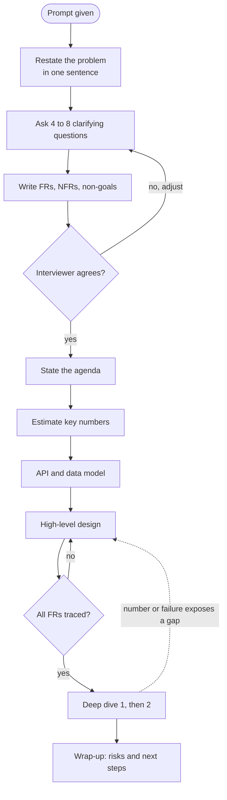

**Reading the diagram.** The stadium is the moment the prompt is spoken; rectangles are your actions; diamonds are checkpoints where you explicitly ask or check something. The top five nodes are the first five minutes. Restating the problem ("so we're building a public service that turns long URLs into short ones and redirects") catches misunderstandings at the cheapest moment. The first checkpoint is a spoken one: you read your requirements back and ask whether they match the interviewer's intent; a "no" loops back to questions, not forward to design. Stating the agenda tells the interviewer you have a plan and invites them to redirect. The second checkpoint is silent: before leaving the high-level design, trace each functional requirement through the diagram. The dotted edge is the normal, expected revision loop: a deep dive often reveals that the diagram needs a cache, a queue or a different store, and you go back and change it. The failure points are skipping the first checkpoint (designing the wrong system) and treating the dotted loop as an embarrassment rather than as evidence of judgment.

::: tip
**Interview tip — the first five minutes, word for word.** (1) *Restate*: one sentence. (2) *Ask*: users and top journeys, scale, the hardest quality target, one scope question. (3) *Write*: FRs as bullets, NFRs as numbers, non-goals. (4) *Confirm*: "Does this match what you had in mind?" (5) *Agenda*: "Next I'll estimate, then API and data, then a diagram, then go deep on X." This takes four to six minutes and earns most of the problem-navigation signal before you have drawn a single box.
:::

## 87.5 Requirements gathering

### 87.5.1 The clarifying-question catalogue

::: definition
**Definition — Clarifying question.** A question asked before designing whose answer would change the design. A question whose answer would not change anything ("what language is the backend in?") is not clarifying; it only consumes time.
:::

#### First-principles explanation

Section 2.5 used the tailor who asks about occasion, climate and budget before cutting. In an interview the tailor has six minutes, so the questions must be the ones that change the cut. The test for every question is: *if the answer were the opposite, would I draw a different diagram?* "Is it read-heavy?" passes; "Should links be case-sensitive?" usually does not.

#### How it works internally

Ask in four groups, roughly in this order. You will rarely need more than two questions from each group. When the interviewer answers "you decide", that is an invitation to state an assumption (§2.7), not a refusal.

**Table 87.5 — Clarifying questions that change designs.**

| Group | Question | What the answer changes |
|---|---|---|
| Users and journeys | Who are the users, and what are the top two or three things they do? | The FR list and which paths are critical |
| | Is this consumer-facing, internal, or an API for developers? | Auth model, rate limits, latency targets |
| Scale | How many daily active users, or requests per day? | Single node versus partitioned; caching need |
| | What is the read-to-write ratio? | Cache-first versus write-optimized design |
| | How much data per item, and for how long? | Store choice; hot and cold tiers |
| | Is traffic spiky (events, launches) or smooth? | Peak factor; queueing; autoscaling |
| Quality | Which operation must never fail or be lost? | Durability and replication on that path |
| | What latency does the user notice on the critical path? | Caching, precomputation, region placement |
| | Can users see slightly stale data? For how long? | Strong versus eventual consistency (§25.7) |
| | Global or one region? Any data-residency rules? | Multi-region design (Ch 44) |
| Scope | Which features are out of scope for today? | What you will *not* draw |
| | Is there an existing system or must this be greenfield? | Migration and compatibility concerns |

Functional requirements describe behavior a user can observe; non-functional requirements describe how well the system behaves (§1.6–§1.7). In an interview, keep FRs to three to five bullets and make every NFR a number with a unit. **Scoping out** is as valuable as scoping in: each non-goal you name ("no user accounts beyond an API key"; "no editing of links") is a branch you no longer have to defend.

**Figure 87.4 — Requirement tree for "design a URL shortener".**

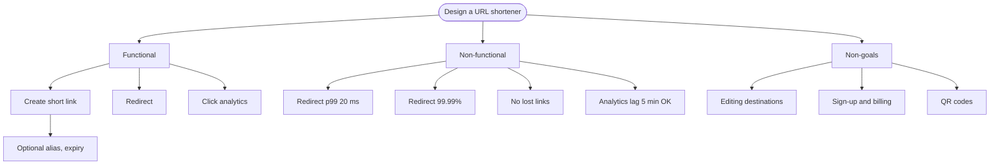

**Reading the diagram.** The root is the prompt. Its three children are the three columns you write on the board. Under *Functional*, each leaf is a user-visible behavior; the optional alias and expiry hang under creation because they modify it rather than standing alone. Under *Non-functional*, each leaf carries a number; the redirect path gets the strictest targets because it sits in front of somebody else's page load, while analytics is allowed to lag, which licenses an asynchronous pipeline later. Under *Non-goals*, each leaf removes a branch of the design: immutable links make caching trivial; no billing removes a payment subsystem. There is no data flow or failure point in a requirement tree, but it predicts the architecture: two very different NFR profiles (redirect versus analytics) are the first sign that the design will split into a synchronous read path and an asynchronous event path, as in Figure 52.1.

### 87.5.2 A worked dialogue

The following transcript shows the first six minutes for the prompt whose full design is §52.4. The numbers match that case study so you can continue the exercise there.

::: example
**Mini-transcript — Requirements for a URL shortener (Illustrative).** *Evidence: Illustrative* — a constructed dialogue for teaching, not a record of any company's interview.

> **Interviewer:** Design a URL shortener.
>
> **Candidate:** So: a public service that turns a long URL into a short code and redirects anyone who opens the code to the original. Before I design, a few questions. Who creates links — anonymous users, logged-in users, or other services through an API?
>
> **Interviewer:** Logged-in users and API clients.
>
> **Candidate:** Then I'll treat identity as an existing service. Beyond create and redirect, do owners need click statistics?
>
> **Interviewer:** Yes, basic analytics.
>
> **Candidate:** Custom aliases and expiry?
>
> **Interviewer:** Nice to have.
>
> **Candidate:** I'll include them as optional. Can owners change where a link points?
>
> **Interviewer:** What do you think?
>
> **Candidate:** I'd make links immutable. Editing a destination invalidates caches everywhere and lets someone swap a safe page for a phishing page after the link has spread. I'll list editing as a non-goal unless you want it. On scale: I'll assume 50 million new links a day and about 100 redirects per link, so roughly 100 reads per write. Is that the right order of magnitude?
>
> **Interviewer:** That's fine.
>
> **Candidate:** For quality: a broken redirect breaks every page that embeds the link, so I'd target 99.99% availability and around 20 ms server-side p99 for redirects. Creation can be 99.9% because clients retry. A created link must never be lost. Analytics can lag a few minutes. And codes shouldn't be guessable, so nobody can enumerate private links. Out of scope: sign-up, billing, QR codes. Does that match what you had in mind?
>
> **Interviewer:** Yes. Maybe skip abuse handling for now.
>
> **Candidate:** Noted as a non-goal; I'll mention where it would plug in at the end. Next I'll do a quick estimate, then the API and data model, then a diagram, and I'd like to go deep on code generation and the redirect cache.

**What to notice.** Every question changed something: who creates links (auth), analytics (an event pipeline), editing (caching and abuse), scale (cache-first redirect path). When the interviewer turned a question back ("What do you think?"), the candidate decided and gave a reason. The candidate *proposed* numbers instead of asking open-ended "how many users?" questions, which is faster and shows judgment. The last line is the agenda, and it already names the deep dives.
:::

### 87.5.3 Writing requirements on the board

Write them in the shape you will refer back to. A compact form that fits in the top-left zone:

```text
FR   1 create(long_url, [alias], [expiry]) -> code
     2 GET /code -> redirect
     3 owner sees clicks/day, referrers, countries
NFR  redirect p99 <= 20 ms, 99.99% | create 99.9%
     no lost links | analytics lag <= 5 min | codes not guessable
     50M creates/day, 100:1 read:write
OUT  edit destination, sign-up, billing, QR, abuse (later)
```

::: mistake
**"The more questions I ask, the more thorough I look."** Ten minutes of questions reads as an inability to make decisions. Ask the questions whose answers change the design, propose defaults for the rest, and move on. You can return to a requirement when a later number makes it matter.
:::

## 87.6 Estimation in the interview

### 87.6.1 When and how much

Estimate only what will drive a decision: is one database enough, does the working set fit in memory, does the egress need a CDN? Three to five numbers in three or four minutes is typical. Some interviewers skip estimation entirely or ask you to do it later; follow their lead, and estimate at the moment a decision needs a number. Ch 89 gives the full formulas, reference capacities and dozens of practice problems; this section covers only the in-interview conventions.

**Table 87.6 — Interview rounding conventions.**

| Quantity | Convention | Error introduced |
|---|---|---|
| Seconds per day | $86{,}400 \approx 10^5$ | About −14% on rates (you under-estimate slightly) |
| Peak factor | Peak ≈ 2–3 × average unless told otherwise | State it; Ch 89 refines it |
| Sizes | Round to 1, 2 or 5 × a power of ten | Within a factor of 2 |
| Days per year | ≈ 400 for storage growth | +10%, a safety margin |
| Units | KB, MB, GB, TB = $10^3$ … $10^{12}$ bytes | Say "decimal units" once |

State each assumption aloud *before* using it ("I'll assume 2 MB per photo, including resized copies"), write the result with its unit, and say what it decides.

The rest of this chapter uses a second prompt, **PhotoShare** (introduced in the §1.11 tip): users upload photos, follow other users and scroll a chronological home feed. It is close to the Instagram case (§53.6), so you can compare your interview-sized answer with the full one.

::: example
**Worked example — PhotoShare in four numbers.** *Assumptions (stated aloud):* 10 million DAU; 2 million uploads a day (one in five users uploads); 10 feed loads per DAU per day; peak = 3 × average; 2 MB stored per photo including resized versions; 1 KB of metadata per photo; a feed page shows 10 thumbnails of 50 KB.

1. **Upload rate.** $2 \times 10^6 / 10^5 = 20$ uploads/s average; peak $20 \times 3 = 60$/s. (Exact: $2 \times 10^6 / 86{,}400 = 23$/s.)
2. **Feed read rate.** $10^7 \times 10 = 10^8$ loads/day; $10^8 / 10^5 = 1{,}000$ RPS average; peak $3{,}000$ RPS. Read:write ≈ 50:1.
3. **Storage.** Photos: $2 \times 10^6 \times 2\ \text{MB} = 4\ \text{TB/day}$; × 365 ≈ 1.5 PB/year before replication. Metadata: $2 \times 10^6 \times 1\ \text{KB} = 2\ \text{GB/day}$, about 0.7 TB/year.
4. **Peak egress.** $3{,}000 \times 10 \times 50\ \text{KB} = 1.5\ \text{GB/s} = 12\ \text{Gbps}$.

**Interpretation.** Photo bytes and metadata differ by a factor of about 2,000, so they belong in different stores. **Engineering implication:** put photos in an object store behind a CDN (12 Gbps is a CDN's job, not your servers'); metadata fits comfortably in a relational database for years; the 50:1 read ratio justifies a feed cache. Four numbers, three decisions, under four minutes. Stop there.
:::

## 87.7 API design in the interview

An interview API is a contract sketch, not a specification. Write the three to six calls that carry the functional requirements, with their inputs, outputs and the one or two properties that matter: idempotency, pagination, authentication. Section 8.6 covers REST design in full, §8.8 gRPC and §22.15 idempotency keys.

**Table 87.7 — Choosing the interface style in one sentence.**

| Situation | Choose | Sentence to say |
|---|---|---|
| Public or mobile clients, resource-shaped data | REST over HTTPS | "Public clients and caches understand HTTP; resources map to nouns." |
| Internal service-to-service calls, high rate | gRPC | "Typed contracts and binary encoding; we control both ends." |
| Server pushes updates to clients | WebSocket or server-sent events (§9.6) | "The client must hear about changes without polling." |
| Clients need flexible field selection | GraphQL (§8.7) | "Many screens, each needing a different slice of the same graph." |

Name resources as plural nouns (`/photos`, `/users/{id}/feed`), use cursor pagination for anything that grows without bound (§8.6.5), and put an **idempotency key** on every non-idempotent create that a client might retry, especially anything that charges money or creates a public object.

::: example
**Worked example — PhotoShare API.**

```text
POST /v1/photos/upload-url        -> { upload_url, photo_id }   (presigned object-store URL, §15.8.2)
POST /v1/photos                   Idempotency-Key: <uuid>
     { photo_id, caption }        -> 201 { photo_id, created_at }
POST /v1/users/{id}/follow        -> 204                          (idempotent by nature)
GET  /v1/feed?cursor=<opaque>&limit=20
     -> 200 { items: [ { photo_id, author_id, thumb_url, caption, created_at } ],
              next_cursor }
```

**What to notice.** The photo bytes never pass through your API servers: the client uploads straight to the object store with a presigned URL, then registers the photo. The register call carries an idempotency key because a mobile client on a flaky network will retry it, and a duplicate would put the same photo in followers' feeds twice. Follow is idempotent by nature (following twice is a no-op), so it needs no key. The feed uses an opaque cursor encoding `(created_at, photo_id)`, so new uploads do not shift pages the way offsets would. Saying these four sentences earns more credit than writing twenty endpoints.
:::

## 87.8 Data modeling in the interview

Start from **access patterns**, not entities. List the queries the API needs, with their rate, then choose keys and stores that make the frequent queries cheap. This is the same reasoning as §11.17 and §12.12, compressed to five minutes.

**Table 87.8 — PhotoShare access patterns.**

| Query | Peak rate | Shape | Implication |
|---|---|---|---|
| Get one user's feed page | 3,000/s | Recent photos of followed users | Precompute or cache; never a live join at this rate |
| Register a photo | 60/s | Single-row insert | Any database handles it |
| List a user's own photos | Low hundreds/s (assumed) | Range scan by author, newest first | Index on `(author_id, created_at)` |
| Who follows user X? | 60/s (on each upload) | Range scan by followee | Index on `(followee_id)` for fan-out |
| Photo bytes | 30,000 thumbnails/s | Blob by key | Object store and CDN, not a database |

**Figure 87.5 — PhotoShare core entities.**

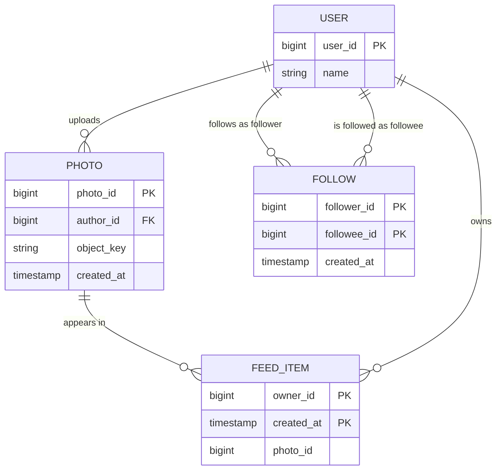

**Reading the diagram.** Four entities, each a box with its key attributes. A user uploads many photos; the follow relationship is a separate table with a composite key `(follower_id, followee_id)`, which makes "follow twice" a no-op and supports both directions with one extra index. `FEED_ITEM` is not a fact about the world but a **derived** table: a precomputed copy of "photos my followees posted", keyed by owner and time so that the 3,000-per-second feed query is one range read. The photo row stores only `object_key`; the bytes live in an object store outside this model, which is the main storage boundary. The failure point is the derived table: if fan-out lags, feeds are stale but nothing is lost, because `PHOTO` remains the source of truth. Scaling: `FEED_ITEM` partitions by `owner_id`; `PHOTO` and `FOLLOW` fit one relational primary for years at the §87.6 numbers.

**SQL or NoSQL, in two sentences.** "Users, photos and follows are small, relational and need uniqueness constraints, so I'll start them in a relational database (§11). The feed table is a high-rate, key-plus-range read that I may partition by owner, so a wide-column or key-value store (§12.6, §12.4) or a cache is a good fit there." Name the access pattern that drives each choice; do not argue SQL versus NoSQL in the abstract.

## 87.9 Drawing the high-level design

### 87.9.1 Conventions

A diagram in an interview is read in real time by someone who did not draw it. Use the same conventions every time, so the interviewer learns your notation once. This book's conventions (style guide §6) work well on a whiteboard too.

**Table 87.9 — Diagram conventions for interviews.**

| Element | Draw as | Say |
|---|---|---|
| Client | Rounded box at the far left | "Mobile app" or "browser" |
| Service | Rectangle with a verb-like name | One sentence of responsibility (§2.3) |
| Data store | Cylinder, labeled with *what* it stores | "Photo metadata, relational" |
| Queue or log | Box with double sides | What flows through it |
| Synchronous call | Solid arrow, labeled with protocol | "The caller waits" |
| Asynchronous flow | Dashed arrow | "Fire and forget; eventual" |
| External system | Hexagon or labeled cloud | Its SLA if it matters |

Draw arrows in the direction of the request, number the steps of the main read and write paths (1, 2, 3 …) if the diagram gets busy, and trace one request aloud each time you finish a path.

### 87.9.2 Evolving the diagram in stages

Do not draw the final architecture first. Draw the simplest design that meets every FR, then let the numbers from §87.6 force each addition. Each addition then arrives with its reason, which is exactly the trade-off signal the interviewer wants. Figures 87.6 to 87.8 show three stages for PhotoShare.

**Figure 87.6 — Stage 1: the simplest design that meets every FR.**

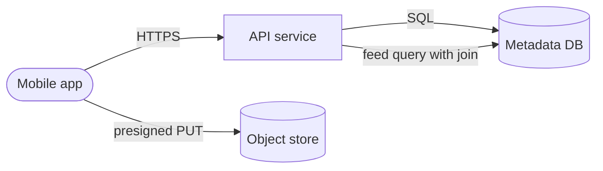

**Reading the diagram.** One stateless API service, one relational database for users, photos and follows, and an object store for photo bytes, which the client writes directly using a presigned URL. All arrows are synchronous. The feed is computed on every request by joining follows with photos. This design handles all three FRs and is correct; say so. Its failure points are obvious and you should name them: the API and database are single instances, and the feed join runs 3,000 times per second at peak. Scaling options at this stage are none; that is what stage 2 is for.

**Figure 87.7 — Stage 2: scale the read path.**

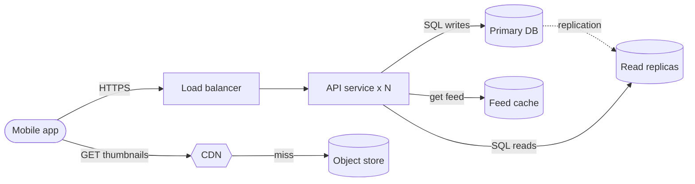

**Reading the diagram.** The 12 Gbps egress number moved image traffic to a CDN, which fetches from the object store only on a miss. The 50:1 read ratio added read replicas, fed asynchronously from the primary (dotted), and a feed cache in front of them. The API is now several stateless instances behind a load balancer, so losing one is harmless. New failure points: replicas lag the primary, so a user may not see their own new photo for a moment (read-your-writes, §25.6, can route that user's reads to the primary briefly); a cold feed cache sends the full read rate to the replicas. The feed is still built by a join on a cache miss.

**Figure 87.8 — Stage 3: precompute feeds asynchronously.**

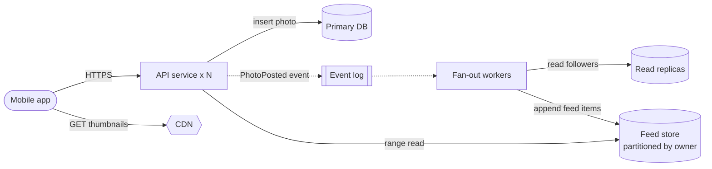

**Reading the diagram.** Uploads now write the photo row synchronously and publish an event asynchronously (dotted) to a durable log. Fan-out workers consume it, read the uploader's followers from a replica and append one feed item per follower to a feed store partitioned by owner (Figure 87.5's `FEED_ITEM`). A feed request becomes a single-partition range read, which scales with partitions. The storage boundary is clear: the primary is the source of truth; the feed store is derived and rebuildable. Failure points: if workers lag, feeds are late but nothing is lost because the log retains events; a user with millions of followers turns one upload into millions of writes. That last point is the natural first deep dive, which is where §87.10 begins.

::: tip
**Interview tip — "Here is where I'd stop for v1."** After stage 2, say which stage you would actually launch with and what would trigger stage 3 ("when cache misses push replica CPU past about 60%"). Naming the trigger shows you understand that every addition costs operations, and it avoids the over-engineering pattern in §87.13.
:::

## 87.10 Deep dives and bottlenecks

The deep dive is where technical depth is earned (Figure 87.1). Sometimes the interviewer picks the topic. More often, especially at senior levels, they wait to see whether *you* find the hardest part of the problem. Pick by risk: the component where the requirements, the numbers and the failure modes put the most pressure.

**Figure 87.9 — Choosing what to deep-dive.**

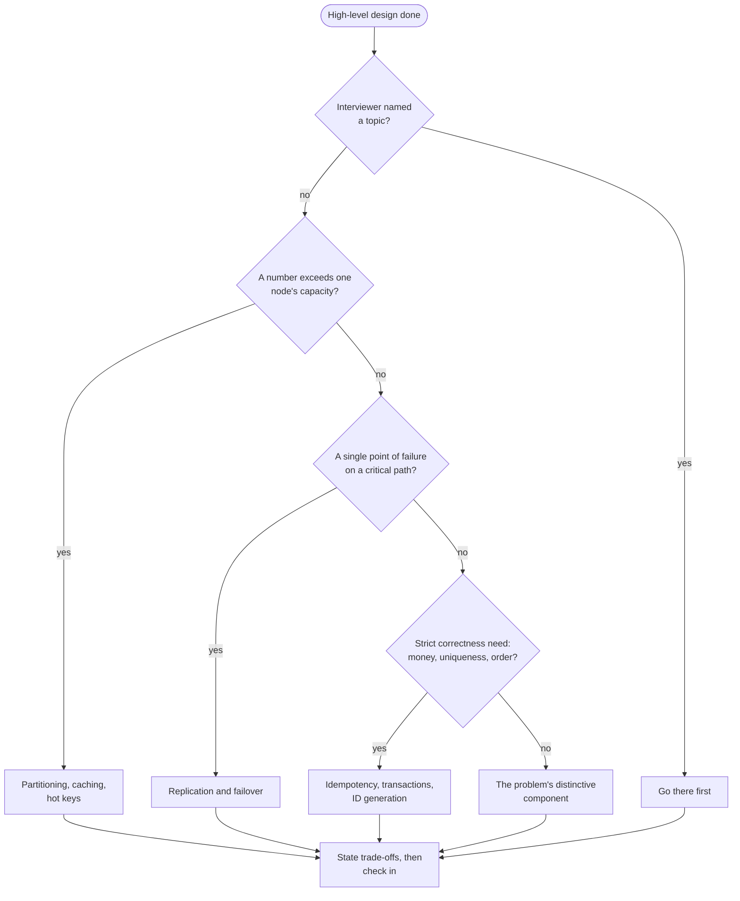

**Reading the diagram.** The stadium is the moment the high-level design covers every FR. The first diamond defers to the interviewer: if they name a topic, it outranks your plan. Otherwise three questions, in order, find the riskiest component. A number from §87.6 that exceeds one node's capacity points to partitioning, caching or hot keys. A single point of failure on a path with a strict availability target points to replication and failover. A strict correctness requirement points to idempotency, transactions or unique-ID generation. If none applies, go to whatever makes this prompt distinctive (code generation for a URL shortener, fan-out for a feed). Every branch ends in the same action: state the options and their costs, then ask whether to continue or switch. This is a decision procedure, not a system, so there is no data flow; its failure mode is choosing a comfortable topic instead of a risky one.

Three bottlenecks recur across almost every prompt; learn to spot them on your own diagram:

- **Single points of failure.** Point at every box and ask "what happens when this dies?" A single primary database, a single sequencer or a single coordinator needs a replica and a failover story (§39.4).
- **Hot keys.** One celebrity, one viral link or one flash-sale item can concentrate load on a single partition or cache node, whatever the average says. Mitigate with replication of hot items, key splitting or local caches (§14.10, §20.15).
- **Fan-out.** One action that becomes N writes or N reads, with N unbounded: feed delivery, notifications, group messages. Compute the worst case, not the average. For PhotoShare, a user with 10 million followers turns one upload into 10 million feed writes; the standard answer is a hybrid that skips fan-out-on-write for such accounts and merges their posts at read time (§53.7.8).

## 87.11 Trade-off communication

Every design choice gives something up. The interview skill is to say what, briefly, and to tie the choice to a requirement already on the board. One sentence pattern does most of the work:

::: concept
**Key insight — The A-versus-B-because-C pattern.** "I'll use **A** rather than **B**, because **constraint C** matters more here; the cost is **D**, which is acceptable because **E**." Example: "I'll fan out on write rather than on read, because feed reads outnumber uploads 50 to 1 and the p99 target is on reads; the cost is write amplification for popular users, which I'll handle with a hybrid."
:::

Most trade-offs in interviews lie on three axes: **consistency** (how stale may data be?), **latency** (how fast must the critical path be?) and **cost** (money, operational effort, team time). Naming the axis helps the interviewer follow. Chapter 2 (§2.8) gives the heavier tools, weighted matrices and reversibility, which you can mention for one-way-door decisions such as the ID format.

**Table 87.10 — Phrases that signal judgment, and phrases that undercut it.**

| Signals judgment | Undercuts it |
|---|---|
| "Given the 99.99% target on redirects, I'd …" | "Best practice is …" |
| "This is a two-way door, so I'll pick the simpler option and measure." | "We should definitely use Kafka." |
| "If the read ratio were 2:1 instead of 100:1, I'd drop the cache." | "This scales infinitely." |
| "The cost of this is …; I think that's acceptable because …" | "There's no downside." |
| "Two options; let me compare them on latency and cost." | Listing five technologies without a choice |

## 87.12 Communication and collaboration

**Think aloud.** Narrate decisions, not keystrokes: "I'm putting the cache in front of the replicas because a miss storm would otherwise hit the database" is evidence; "now I'm drawing a box" is not. If you need thirty seconds to think, say so and then think silently; announced silence is fine, unexplained silence is not.

**Check in at phase boundaries.** "That's the high-level design. I'd like to go deep on fan-out next. Or is there something you'd rather see?" One question every five to ten minutes is enough.

**Treat hints as data.** An interviewer's question ("what happens if this user has 10 million followers?") is almost always a hint that something important is missing. Answer it directly, revise the design, and thank them. Arguing with a hint wastes time and reads as poor collaboration.

**Handle pushback by separating facts from preferences.** If the interviewer challenges a choice, restate the constraint you used. If they supply a new fact, change the design; if they test whether you will defend a sound choice, defend it once with the reason, and offer the alternative's cost.

**Figure 87.10 — Responding to a hint during the design.**

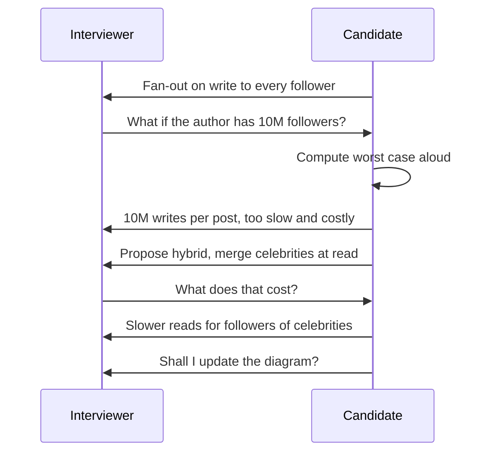

**Reading the diagram.** Two participants exchange turns top to bottom; solid arrows are spoken turns, and the self-arrow is the candidate computing aloud. The interviewer's question is a hint, not an attack. The strong response has four beats: quantify the problem (10 million writes per post), acknowledge the flaw plainly, propose a fix with its cost, and offer to update the diagram. The failure point is the second turn: candidates who defend the original design ("it's async, so it's fine") lose both the technical and the communication signal.

**Recover from mistakes in the open.** "I said the feed store is partitioned by photo; that's wrong for this query, it should be by owner. Let me fix it." Catching your own error is a positive signal.

**When you don't know something**, say what you do know and reason from first principles: "I haven't operated Cassandra, but for this access pattern I need a partitioned store with range scans within a partition; any wide-column store would do, and I'd verify its compaction behavior under our write rate." Never bluff product details; interviewers probe exactly where bluffing begins.

## 87.13 Common failure patterns

Most failed design interviews fail in one of six recognizable ways. Each has a cheap prevention you can practice.

**Table 87.11 — Failure patterns, their symptoms and their fixes.**

| Pattern | What the interviewer sees | Why it happens | Prevention |
|---|---|---|---|
| Jumping to the solution | Diagram at minute 1; wrong problem solved | Anxiety; a memorized answer | Restate, ask, write requirements first (§87.5) |
| Over-engineering | Multi-region, Kafka, microservices for 1,000 users | Pattern-matching to famous systems | Let numbers force each addition (§87.9.2) |
| Buzzword listing | "Kafka, Redis, Cassandra, Kubernetes" without roles | Breadth without mechanism | One sentence of responsibility per box |
| Silent drawing | Minutes of silence; interviewer cannot credit thinking | Concentration habit from coding | Narrate decisions; announce pauses (§87.12) |
| Ignoring NFRs | Design that meets FRs but no latency, availability or consistency story | NFRs never written as numbers | Numeric NFRs on the board; refer back to them |
| Wrong level of detail | Ten minutes on a schema column, or only boxes and no depth | No time budget | Minute marks (§87.4); deep-dive selection (§87.10) |

::: mistake
**"I failed because I didn't know technology X."** Post-interview self-diagnosis usually blames missing knowledge. Recordings of mock interviews more often show a process failure from Table 87.11, such as twelve minutes of requirements or no deep dive at all. Score your recordings against the table before concluding that you need to read more.
:::

## 87.14 How ML system-design interviews differ

ML system-design rounds use the same timeline and signal areas, but replace part of the middle with modeling decisions. Chapter 88 gives the ML extension of the readiness framework (problem formulation through retraining), and Chapter 92 gives practice questions with rubrics. In brief:

**Table 87.12 — Traditional versus ML system-design interviews.**

| Phase | Traditional emphasis | ML emphasis |
|---|---|---|
| Requirements | FRs, NFRs, scale | Business goal translated into an ML objective and metric (§57.10–§57.13) |
| Data | Entities and access patterns | Data sources, labels, label delay, leakage (§57.6, Ch 61, Ch 63) |
| Core design | Services and stores | Features, model choice, training pipeline, serving path (Ch 60, Ch 66) |
| Deep dives | Partitioning, consistency, fan-out | Training–serving skew, latency budget, cold start, evaluation |
| Wrap-up | Failures and scaling | Monitoring, drift and retraining (Ch 70), online experiments (§57.14) |

The most common ML-specific failure is spending the whole slot on the model and never drawing the serving path, or the reverse. Using QuickBite's ETA prediction (Ch 60) as a practice prompt, the serving path must answer about 40,000 predictions per second at peak, which is a systems constraint that shapes the model choice.

## 87.15 Preparing: a practice plan

Chapter 3 established that retrieval practice, spacing and deliberate practice with feedback beat rereading (§3.4). For interviews, the feedback must come from performing *under observation and out loud*, because that is the condition the interview tests (§87.3.3).

**Figure 87.11 — The weekly practice loop.**

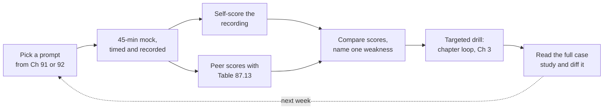

**Reading the diagram.** Each rectangle is a practice activity; solid arrows are the order within one week, and the dotted edge starts the next week's cycle. A mock interview, timed against Table 87.4 and recorded, produces two independent scores: yours from the recording and a peer's from the rubric. The gap between them is itself information (§3.10.1). The comparison yields exactly one weakness to fix, which drives a targeted drill using the concept-mastery loop from Chapter 3, followed by a comparison with the corresponding full case study (Ch 52–56, 81–86). The failure mode of this loop is skipping the drill and doing mock after mock: repetition without targeted feedback is not deliberate practice. To scale, rotate partners so that you are scored by several people and also practice being the interviewer, which teaches you what is visible from the other side of the table.

**Table 87.13 — Peer-review rubric for a mock interview (0–2 points each, 14 maximum).**

| Criterion | 0 | 1 | 2 |
|---|---|---|---|
| Requirements | Started drawing at once | Some questions; FRs only | FRs, numeric NFRs, non-goals, confirmed |
| Pacing | No deep dive | Deep dive under 8 minutes | Deep dive at or after plan, 10+ minutes |
| Estimation | None or unused | Numbers computed | Numbers drove a stated decision |
| Design | FRs not covered | Covers FRs | Read and write paths distinct; evolved in stages |
| Depth | Names only | One mechanism explained | Mechanism with numbers and failure modes |
| Trade-offs | None stated | Options listed | A-versus-B-because-C with costs |
| Communication | Silence or monologue | Some narration | Narrated, checked in, used hints well |

For prompts beyond this book, widely used preparation guides include [Xu 2020] and [Xu and Lam 2022] for traditional systems, [Aminian and Xu 2023] for ML, and the community-maintained [Martin, System Design Primer]; for depth behind the boxes, [Kleppmann 2017] and [Huyen 2022] remain the standard references. Use them as prompts and comparisons, not as scripts to memorize.

A practical schedule for someone with six to eight weeks: two mocks per week (one as candidate, one as interviewer), one targeted drill per week, and one case study read with the §52.3 method on each remaining day. Keep a log of rubric scores; the three lowest rows across the last four mocks are your study plan.

## 87.16 Summary and revision notes

::: summary
- **Unspoken reasoning earns no credit.** The interviewer records evidence in five signal areas: problem navigation, solution design, technical depth, trade-off reasoning and communication (Table 87.1).
- **The candidate drives.** Unlike coding rounds, the design round is vague by intent and rewards you for setting and keeping an agenda.
- **Budget time and protect the deep dive.** $T_{deep} = T_{total} - T_{over} - \sum T_p$; a six-minute overrun on requirements halves a 45-minute slot's 12-minute reserve.
- **First five minutes:** restate, ask the questions that change the design, write FRs, numeric NFRs and non-goals, confirm, state the agenda.
- **Estimate only to decide.** Three to five numbers, rounded ($86{,}400 \approx 10^5$), assumptions spoken first, each followed by the decision it drives.
- **API and data from access patterns.** A few calls with idempotency and cursor pagination; keys and stores chosen for the frequent queries.
- **Draw in stages.** Simplest design that meets every FR first; let numbers force each addition and name the trigger for the next stage.
- **Deep-dive by risk:** capacity overflow, single points of failure, strict correctness, then the problem's distinctive component; always check for hot keys and unbounded fan-out.
- **Say trade-offs as "A versus B, because C; the cost is D".**
- **Treat hints as data**, recover from mistakes openly, and reason from first principles when you do not know a product.
- **Practice under observation**, scored with a rubric, with one targeted drill per weakness.
:::

## 87.17 Knowledge checkpoint

1. Name the five signal areas and the interview phase where each is mainly earned.
2. Give two differences between a coding interview and a system-design interview.
3. What is the test for whether a question is a clarifying question?
4. In a 45-minute slot with 5 minutes of overhead and fixed phases totaling 30 minutes, how long is the deep-dive reserve?
5. Why should the candidate propose numbers rather than ask "how many users?"
6. What error does rounding 86,400 to 10⁵ introduce, and in which direction?
7. When does a create endpoint need an idempotency key? Give an example from PhotoShare.
8. Why is `FEED_ITEM` in Figure 87.5 called a derived table, and why does that matter for failures?
9. What forced the CDN into PhotoShare's stage-2 design?
10. List the order of questions in Figure 87.9.
11. Rewrite "Cassandra is best for this" in the A-versus-B-because-C form.
12. An interviewer asks, "What if this key gets 100× the average traffic?" What is the strong response?
13. Name three of the six failure patterns in Table 87.11 and one prevention for each.
14. What does an ML design round add to the requirements phase?

<details><summary>Answers</summary>

1. Problem navigation (requirements, estimation); solution design (API, data model, high-level design); technical depth (deep dives); trade-off reasoning (high-level design, deep dives, wrap-up); communication (throughout).
2. Any two: the problem is deliberately vague; there are many acceptable answers; the candidate drives; the artifact is a design, not code; the most common failure is an unscoped problem, not a bug.
3. Whether the answer would change the design. If the opposite answer would not change the diagram, skip it.
4. $45 - 5 - 30 = 10$ minutes.
5. It is faster, it shows judgment about plausible scale, and the interviewer can correct a stated number in one word.
6. About −14% on rates (dividing by 100,000 instead of 86,400), so rates are slightly underestimated.
7. When the operation is not naturally idempotent and a client may retry it. Registering a photo: a retry without a key would create a duplicate photo in followers' feeds.
8. It is computed from `PHOTO` and `FOLLOW`, so it can be rebuilt. If fan-out lags or the feed store fails, feeds are stale or slow, but no source data is lost.
9. Peak thumbnail egress of about 12 Gbps (3,000 feed loads/s × 10 × 50 KB), which belongs on a CDN, not on application servers.
10. Has the interviewer named a topic? Does a number exceed one node's capacity? Is there a single point of failure on a critical path? Is there a strict correctness need? Otherwise, the problem's distinctive component.
11. For example: "I'll use a wide-column store rather than a relational one for the feed table, because the dominant query is a 3,000/s single-key range read; the cost is weaker ad hoc querying, which this table does not need."
12. Quantify it, acknowledge the hot-key risk, propose a mitigation (replicate the hot key, split it, cache it locally) with its cost, and update the diagram.
13. Any three, for example: jumping to the solution (write requirements first); over-engineering (let numbers force additions); silent drawing (narrate decisions); ignoring NFRs (numeric NFRs on the board); buzzword listing (one sentence of responsibility per box); wrong level of detail (minute marks).
14. Translating the business goal into an ML objective and a measurable metric, and identifying labels and data sources.
</details>

## 87.18 Interview questions

### Basic

**Q1. "What do you think I'm looking for in this interview?"** (a meta-question some interviewers ask at the start or end)

**Answer.** Evidence that I can take an ambiguous problem, scope it with you, design something that meets its requirements, go deep where the risk is, and explain what each choice costs, while being someone you would want in a design review. I'd add that there is no single expected answer; a well-justified design that differs from yours should score as well as the one you had in mind.

**Q2. "You've never used the database you just proposed. How would you find out whether it fits?"**

**Answer.** Say so, then reason from requirements: name the access pattern (single-key range reads at 3,000/s), the properties needed (partitioning, range scans within a partition, tunable consistency) and how I would verify them: the documentation's consistency model, a load test at 2× peak, and its behavior during node loss. Then offer an alternative I know well that meets the same pattern.

### Intermediate

**Q3. Design a distributed rate limiter. What do you do in the first five minutes?** (full case: §52.6)

**Answer.** Restate: a service that decides allow or deny for API requests against configurable rules. Ask: what keys (API key, user, IP)? which algorithms or semantics (bursts allowed?)? global or per-region limits? scale (decisions per second)? what happens when the limiter fails? Write FRs (rules, decision API, 429 with retry-after, dynamic configuration), NFRs (added latency well under a few milliseconds at p99, very high availability, bounded overshoot) and the key principle as a non-functional requirement: *a limiter outage must degrade enforcement, never the API* (fail open for most rules). Non-goals: billing, abuse detection. Agenda: estimate decisions per second, then algorithm choice (token bucket versus sliding window, §22.4, §22.7), then local versus central counting as the deep dive.

**Q4. Design a notification system. Which component would you deep-dive, and why?** (full case: §52.7)

**Answer.** Using Figure 87.9: the numbers (campaigns of tens of millions of recipients) exceed one node, and correctness matters (no duplicate one-time passwords, opt-outs honored). The distinctive risk is that bulk campaigns must not delay critical messages. I would deep-dive the delivery pipeline: separate queues per priority class so marketing cannot starve transactional sends (bulkheads, §22.14); at-least-once delivery with deduplication keys before the provider call; preference checks as late as possible so recent opt-outs apply; and provider failover with circuit breakers. Trade-off: per-priority queues cost more infrastructure but are the only way to guarantee the critical-path latency target.

### Advanced

**Q5. Design a news feed. The interviewer says, "Your fan-out-on-write design won't work." How do you respond?**

**Answer.** Ask, or infer, which constraint breaks it, then quantify: an author with 10 million followers creates 10 million writes per post; at a few thousand writes per second per partition that is minutes of lag and a large write bill. Acknowledge it and propose the hybrid: fan out on write for ordinary authors, skip fan-out for authors above a follower threshold, and merge their recent posts at read time (§53.7.8). State the cost: slower, more complex reads for users who follow celebrities, plus a threshold to tune. Offer to update the diagram and name the metric that sets the threshold (fan-out lag versus feed-read p99).

**Q6. Design delivery-time (ETA) prediction for a food-delivery app. Outline your 45 minutes.** (ML prompt; see Ch 60 and Ch 92)

**Answer.** Requirements (6 min): business goal (accurate promised times, fewer late orders) translated into an ML target (minutes from order to delivery) and metrics (mean absolute error, share of orders late beyond the promise); scale around 40,000 predictions/s at peak (QuickBite, Ch 60). Data (5 min): order history, restaurant prep times, courier locations; labels arrive at delivery. Design (12 min): offline training pipeline, feature store with real-time features (current kitchen load, traffic), low-latency serving path with a strict latency budget. Deep dive (12 min): training–serving skew in real-time features, and fallbacks when features are missing. Wrap-up: drift monitoring (Ch 70), retraining cadence, online A/B testing of the promise (§57.14).

## 87.19 Practical exercises

1. **Time yourself.** Run the URL shortener (§52.4) as a 45-minute solo mock against a timer. Record the minute at which each phase began and compute your actual $T_{deep}$.
2. **Question pruning.** Write fifteen clarifying questions for "design a ride-hailing app". Strike every one whose opposite answer would not change the diagram. How many remain?
3. **Staged diagram.** Draw three stages for a pastebin (§52.5), naming the number that forces each addition.
4. **Trade-off sentences.** Write five A-versus-B-because-C sentences for decisions in the chat case study (§53.4).
5. **Peer rubric.** Score a recorded mock with Table 87.13, have a peer score it independently, and explain every row where the scores differ by 2.

## 87.20 Design challenges

1. **Compressed slot.** You have 30 minutes, not 45, for "design a ticket booking system" (§55.8). Write a time budget with the deep-dive reserve formula and decide which phases to shrink and which deep dive to keep.
2. **Interviewer as product manager.** Pair with a partner who keeps changing requirements mid-interview (adding real-time features, then global scale). Practice revising the board and stating the cost of each change without restarting the design.

## 87.21 References

1. Aminian, A., Xu, A. *Machine Learning System Design Interview*. Byte Code LLC, 2023.
2. Behroozi, M., Shirolkar, S., Barik, T., Parnin, C. *Does Stress Impact Technical Interview Performance?* Proceedings of the 28th ACM Joint European Software Engineering Conference and Symposium on the Foundations of Software Engineering (ESEC/FSE), 2020.
3. Huyen, C. *Designing Machine Learning Systems*. O'Reilly, 2022.
4. Kleppmann, M. *Designing Data-Intensive Applications*. O'Reilly, 2017.
5. Martin, D. *The System Design Primer* (GitHub repository), accessed 2026. https://github.com/donnemartin/system-design-primer
6. Xu, A. *System Design Interview – An Insider's Guide*. Independently published, 2020.
7. Xu, A., Lam, S. *System Design Interview – An Insider's Guide: Volume 2*. Byte Code LLC, 2022.

## 87.22 Open verification items

- **[Behroozi et al. 2020]** Confirm the exact proceedings title and page numbers, and the precise effect size ("performance reduced by more than half" in secondary reports); the chapter states only "markedly lower".
- **[Aminian and Xu 2023]** Confirm the publication year (2023 assumed; ISBN 9781736049129).
- **[Xu 2020]** Publisher listed as "Independently published" to match Ch 1; later printings are credited to Byte Code LLC. Harmonize across the bibliography.
- The five signal-area names (Table 87.1) are this book's synthesis of public preparation guides, not a quotation of any company's rubric; Ch 90 should cite company-published pages where they exist.
- Company interview-preparation pages (e.g., Google and Amazon careers sites) could not be fetched from the authoring session; none are cited here.
