# Chapter 88 — The Interview Readiness Framework

> **Level:** 2–5 · **Track:** Shared · **Estimated reading time:** 3 h

Chapter 87 covers interview *technique*: what interviewers look for, how to gather requirements in conversation, how to communicate and how to run the clock. This chapter supplies the *content checklist* that technique operates on. It gives you a fourteen-step sequence for any traditional design prompt, an extension for machine-learning (ML) prompts, a short set of additions for large-language-model (LLM) and agent prompts, and a rubric that shows how the same steps are performed at five career levels. The case studies in Chapters 52–56 and 81–86 follow a sixteen-section written template (§52.3). The fourteen steps here are the interview-time version of that template: the same order of removing uncertainty, compressed to fit in 45 or 60 minutes and spoken rather than written.

The chapter works through two new designs end to end. **PriceWatch** is a price-drop alert service for a large online marketplace (traditional track). Its sibling **Deal Nudge** decides which unrequested deal notifications that marketplace should send (ML track). Both are hypothetical teaching designs; every number attached to them is a stated assumption, not a measurement of any company.

## 88.1 Learning objectives

After this chapter you should be able to:

- **Explain** why a fixed design framework improves repeatability and coverage, and why it must be used as a checklist rather than recited as a script.
- **Execute** the fourteen traditional steps, producing the right artifact at each step and stopping when its "done when" criterion is met.
- **Budget** 45 or 60 minutes across the steps and **adapt** the budget to product-style and infrastructure-style prompts.
- **Extend** the sequence for ML prompts: formulate the problem, define labels, guard against leakage, choose a baseline, plan evaluation, serving, experimentation, monitoring and retraining.
- **Add** the LLM- and agent-specific concerns: evaluation-first design, cost per request, guardrails, and the RAG-versus-fine-tuning decision.
- **Assess** a design answer against a level rubric (junior to principal) on six dimensions, and **turn** the scores into a practice plan.

## 88.2 Prerequisites

- Interview format and the weak-versus-strong signal table — §1.11. This chapter turns those signals into steps and rubrics.
- Requirements, assumptions, trade-offs and back-of-the-envelope estimation — §2.5, §2.7, §2.8 and §2.11. Each is one step of the framework.
- The case-study method — §52.3. The worked designs below follow its conventions (decimal units, $h = 0.10$, $b = 2$ unless stated).
- The ML lifecycle and ML system architecture — Chapters 59 and 60. The ML extension in §88.6 is the lifecycle compressed into interview steps.
- Interview technique and pacing — Chapter 87 (read alongside); capacity formulas — Chapter 89 and §2.11.

A note on two different "level" scales. This book labels its *reading* levels L1–L5 (front matter). The rubric in §88.9 uses the career-ladder labels **L3–L7** that are common across the industry (junior, mid, senior, staff, principal). The two scales are unrelated; where this chapter says "L5" in a rubric it means a senior engineer, not the book's principal reading level.

## 88.3 Why a framework

### 88.3.1 Frameworks as checklists, not scripts

::: definition
**Definition — Design framework.** An ordered list of questions a designer answers for any system, each with an expected artifact (a list, a number, a diagram, a decision) and a completion criterion. Used as a **checklist**, it guarantees coverage while letting the designer vary depth and order. Used as a **script**, it is recited step by step regardless of the problem, which is a failure mode.
:::

#### First-principles explanation

A pilot with ten thousand hours still runs a pre-flight checklist. The checklist does not teach flying; it catches the one item a skilled person forgets when tired, rushed or distracted. A system design interview creates exactly those conditions: an unfamiliar prompt, a stranger watching and a clock. Under that pressure, capable engineers skip whole categories (no data model, no failure story, no numbers) not because they do not know them but because nothing prompted them. A framework is the prompt.

#### Why does this exist?

Three problems motivate it.

1. **Repeatability.** Without a framework, the quality of your answer depends on whether the prompt happens to match your experience. With one, a prompt you have never seen still gets requirements, numbers, an API, a data model, an architecture, depth and failure analysis.
2. **Coverage.** Interviewers assess several dimensions (§88.9). A brilliant deep dive with no capacity estimate leaves the "quantitative reasoning" dimension unscored. Interviewers cannot give credit for evidence you never produced.
3. **Blind spots.** Everyone has home ground. Backend engineers skip estimation; ML engineers skip APIs and data models; infrastructure engineers skip product requirements. A checklist makes your personal blind spots visible, because the same steps go missing in every practice session.

#### How it works internally

1. **Learn the steps until they are automatic**, so they cost no working memory during the interview.
2. **Plan depth at the start.** After clarifying the problem, name the hard part and decide which steps deserve most of the time (§52.3's tip: name the hard problem early).
3. **Run each step to its "done when" criterion**, not to exhaustion. A step is a gate, not a chapter.
4. **Check coverage at transitions.** Glance at the checklist when you move from one phase to the next.
5. **Loop back** when a later step invalidates an earlier one: a capacity number that changes the data store, or a failure analysis that changes the architecture.
6. **Yield to the interviewer.** If they redirect, follow them; the checklist tells you what to mention briefly later, not what to defend now.

**Figure 88.1 — Using the framework as a checklist loop.**

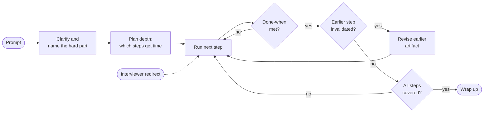

**Reading the diagram.** *Components:* the prompt and the interviewer (stadiums) are external inputs; the rectangles are your actions; the diamonds are checks you make silently. *Direction:* left to right, with two inner loops: one keeps working a step until its done-when criterion holds, the other revises an earlier artifact when new information contradicts it. *Synchronous versus asynchronous:* solid arrows are your own sequence; the dotted arrow is an interviewer redirect, which can arrive at any time and re-enters the loop at whatever step they named. *Failure points:* skipping the planning box (time runs out before the hard part) and never taking the "yes" branch of the invalidation check (defending a design your own numbers contradict). *Scaling:* the same loop works for a 30-minute screen or a 60-minute onsite; only the depth per step changes.

#### Real-world industry applications

::: industry
**Surgical safety checklists.** A study across eight hospitals in eight countries introduced a 19-item surgical safety checklist. The death rate fell from 1.5% to 0.8% and inpatient complications from 11.0% to 7.0% of patients [Haynes et al. 2009]. The checklist did not teach surgery; it ensured that experts under time pressure did not skip steps they already knew, such as confirming the patient's identity and the planned procedure. Gawande draws the same lesson across aviation, construction and medicine: good checklists are short, cover the steps experts most often skip, and leave judgment to the expert [Gawande 2009].
*Evidence: Primary* — [Haynes et al. 2009; Gawande 2009]
:::

#### Alternatives and trade-offs

**Table 88.1 — Three ways to approach a design prompt.**

| Row | Free-form | Rigid script | Checklist framework |
|---|---|---|---|
| What it is | Follow your instincts | Recite fixed steps in fixed order | Fixed questions, flexible depth and order |
| Advantages | Natural, fast on familiar prompts | Never forgets a step | Coverage plus adaptability |
| Disadvantages | Blind spots repeat every time | Ignores the prompt's hard part; sounds rehearsed | Needs practice to feel natural |
| Choose when | Never in a high-stakes interview | Only while first learning the steps | Always, after learning |

#### Failure scenarios

**Table 88.2 — How framework use goes wrong.**

| What goes wrong | Why | Detection | Recovery | Prevention |
|---|---|---|---|---|
| Recited framework | Steps run in full regardless of the prompt | Interviewer looks at the clock; "let's move on" | Jump to the hard part; summarize skipped steps in one line | Plan depth after step 1 |
| Never reach depth | Even time on all fourteen steps | 25 minutes gone, no deep dive started | Collapse steps 9–14 into the deep dive | Use the time budget in Table 88.4 |
| Ignoring a redirect | Loyalty to the checklist | Interviewer repeats the question | Answer the redirect fully, then resume | Treat redirects as signals of what is scored |
| Stale artifacts | Numbers or model never revisited | Estimate contradicts the chosen store | Say so and revise aloud | Loop-back check at each transition |

#### Common misconceptions

::: mistake
**"The interviewer checks whether I did all fourteen steps."** Interviewers score the *quality of your decisions*, not the presence of headings. A candidate who spends one sentence on the API ("a REST endpoint to create a watch and one to list them; nothing unusual") and ten minutes on the hard part outscores one who gives each step equal, shallow attention. The checklist guarantees that every step gets *at least* one sentence; your judgment decides which get ten minutes.
:::

## 88.4 The fourteen-step traditional sequence

### 88.4.1 Overview

::: definition
**Definition — The fourteen-step sequence.** An ordered checklist for a traditional (non-ML) system design interview: (1) clarify the problem, (2) functional requirements, (3) non-functional requirements, (4) capacity estimation, (5) API design, (6) data model, (7) high-level architecture, (8) component deep dives, (9) data flow, (10) scaling strategy, (11) bottlenecks and hot spots, (12) failure handling and reliability, (13) trade-offs and alternatives, (14) operations. The steps group into the seven phases of §52.3: scope, size, contract, shape, depth, stress and judgment.
:::

The order is the order in which uncertainty disappears. You cannot pick a store before you know the access pattern (step 6 needs step 5), you cannot know the access pattern before the requirements (steps 2–3), and you cannot judge whether a store is big enough before the numbers (step 4). Later steps can and should send you back to earlier ones. Popular preparation guides use a shorter sequence of the same shape [Xu 2020]; the extra steps here make data flow, hot spots, failures and operations explicit, because that is where answers most often go thin.

**Figure 88.2 — The fourteen steps in seven phases.**

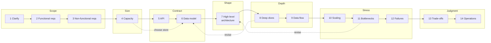

**Reading the diagram.** *Components:* each rectangle is one step; each subgraph is one phase from §52.3, so you can map the steps onto the written case-study template. *Direction:* left to right is the default order. *Solid versus dotted:* solid arrows are the forward sequence; dotted arrows are the three most common loop-backs: a capacity number that decides the store (4 to 6), a deep dive that changes the schema (8 to 6), and a hot spot that changes the architecture (11 to 7). *Failure points:* the phase boundaries are where candidates lose time; the transition from Shape to Depth is where most never arrive. *Scaling the framework:* for a short screen, collapse Stress and Judgment into two minutes of spoken bullets; for a long onsite, expand Depth.

**Table 88.3 — The fourteen steps at a glance.**

| Step | Question it answers | Artifact on the whiteboard | Book I owner |
|---|---|---|---|
| 1 Clarify | What, for whom, what is hard? | One-sentence restatement, hard part named | §1.3, §2.4 |
| 2 Functional reqs | What must it do? | 3–5 prioritized FRs, 2–3 non-goals | §1.6, §2.5 |
| 3 Non-functional reqs | How well, in numbers? | Scale, latency, availability, consistency, durability targets | §1.7, §39.6 |
| 4 Capacity | How big? | Peak RPS, storage, bandwidth, memory, node counts | §2.11, Ch 89 |
| 5 API | What do clients call? | 3–6 calls with idempotency and pagination | Ch 8, §22.15 |
| 6 Data model | What is stored under which key? | Entities, keys, access patterns, stores | Ch 11–12, §14.7 |
| 7 Architecture | Which components, which flows? | Box-and-arrow diagram, sync versus async | §2.3, Ch 33 |
| 8 Deep dives | How does the hard part work? | Algorithm, structure, numbers, rejected alternative | Topic owners |
| 9 Data flow | What happens, in order? | Read and write paths with durability points | Ch 30, Ch 32 |
| 10 Scaling | What changes at 10× and 100×? | First component to break, the change | §2.10, Ch 18 |
| 11 Bottlenecks | Where is load concentrated? | Hot key or partition, mitigation | §14.10, §20.15 |
| 12 Failures | What breaks, and then what? | Failure table, degradation, recovery | §2.9, Ch 39 |
| 13 Trade-offs | What did we give up? | Decision, cost, reversal condition | §2.8 |
| 14 Operations | How is it run and evolved? | SLIs, security risk, cost driver, next step | Ch 40, 50, 51 |

**Table 88.4 — Time budget per step, in minutes of design time.**

| Step | 45-minute slot | 60-minute slot | Can merge with |
|---|---|---|---|
| 1 Clarify | 2 | 3 | 2 |
| 2 Functional reqs | 2 | 3 | 1 |
| 3 Non-functional reqs | 2 | 3 | 4 |
| 4 Capacity | 4 | 5 | 3 |
| 5 API | 3 | 4 | 6 |
| 6 Data model | 3 | 4 | 5 |
| 7 Architecture | 6 | 7 | 9 |
| 8 Deep dives | 11 | 15 | 9, 11 |
| 9 Data flow | 3 | 4 | 7, 8 |
| 10 Scaling | 3 | 4 | 11 |
| 11 Bottlenecks | 2 | 2 | 8, 10 |
| 12 Failures | 2 | 3 | 8 |
| 13 Trade-offs | 1 | 2 | every step |
| 14 Operations | 1 | 1 | 12 |
| **Total** | **45** | **60** | |

These are minutes of *design* time. Introductions and your own questions come out of the slot; Chapter 87 covers the whole timeline. If a 45-minute slot leaves you 38 design minutes, scale every row by about 0.85 and protect the deep dive. The extra quarter-hour of a 60-minute slot goes mostly to step 8, which is where senior signals are earned.

**Figure 88.3 — The 45-minute budget as a timeline.**

```mermaid
gantt
  title Design minutes in a 45-minute slot
  dateFormat x
  axisFormat %M
  section Scope
  Clarify, FRs, NFRs        :p1, 0, 360000
  section Size
  Capacity                  :p2, 360000, 600000
  section Contract
  API and data model        :p3, 600000, 960000
  section Shape
  Architecture              :p4, 960000, 1320000
  section Depth
  Deep dives and data flow  :p5, 1320000, 2160000
  section Stress
  Scale, hot spots, failure :p6, 2160000, 2580000
  section Judgment
  Trade-offs and operations :p7, 2580000, 2700000
```

**Reading the diagram.** *Components:* one bar per phase, labeled with the steps it contains; the axis shows elapsed minutes. *Direction:* time runs left to right; each bar starts where the previous one ends. *Key reading:* Depth is the longest bar (14 minutes, about 31% of the slot) and starts at minute 22; if you are still drawing the architecture at minute 25, you are behind. *Failure points:* Scope stretching past minute 8 and Contract past minute 18 are the two common overruns. *Scaling:* the 60-minute plan has the same shape with Depth growing to 19 minutes.

### 88.4.2 Step 1 — Clarify the problem

- **Purpose.** Agree on what is being built, for whom, and what makes it hard.
- **Produce.** A one-sentence restatement, the actors (users, operators, other systems), the core use case and the **hard part** named aloud.
- **Time.** 2 minutes (3 in a 60-minute slot).
- **Common mistakes.** Asking twenty open questions instead of proposing answers ("Shall I assume…?"); asking nothing and starting to draw; missing the actor who generates most of the load (couriers' GPS in QuickBite, §2.11).
- **Done when** you can say in one sentence what the system does, for whom and what is hard, and the interviewer has agreed or corrected you.

### 88.4.3 Step 2 — Functional requirements

- **Purpose.** Fix the behavior the design must support.
- **Produce.** Three to five prioritized functional requirements (FRs) and two or three explicit **non-goals**.
- **Time.** 2 minutes.
- **Common mistakes.** Listing a dozen features; forgetting the write path that creates the data the read path shows; leaving non-goals unsaid, so the interviewer assumes you forgot them.
- **Done when** every component you will later draw can be traced to an FR, and the non-goals have been said aloud (§1.6, §2.5).

### 88.4.4 Step 3 — Non-functional requirements

- **Purpose.** Turn "fast, scalable, reliable" into numbers that will choose the architecture.
- **Produce.** Scale (users, objects), latency targets with a percentile, availability, consistency *per operation*, durability, freshness, and constraints such as cost or regulation.
- **Time.** 2 minutes.
- **Common mistakes.** Adjectives instead of numbers; one consistency level for every operation; forgetting durability for data that cannot be recreated.
- **Done when** each NFR has a number, a percentile or a window, and at least one pair is in tension so a trade-off will be needed later (§1.7, §39.6).

### 88.4.5 Step 4 — Capacity estimation

- **Purpose.** Learn which regime the system is in before choosing components.
- **Produce.** Peak read and write rates, storage over the retention period, bandwidth, hot-set memory and rough node counts, using the formulas of §2.11 (full handbook in Chapter 89).
- **Time.** 4 minutes.
- **Common mistakes.** Six significant figures; computing numbers and never using them; average instead of peak; forgetting replication copies.
- **Done when** every number is attached to a decision ("20 GB of watches fits in memory, so no partitioning for size") and the dominant load (often not the obvious one) is named.

### 88.4.6 Step 5 — API design

- **Purpose.** Fix the contract between clients and the system.
- **Produce.** Three to six calls with method, key parameters, response, pagination, and an idempotency key on retried writes; say which calls are synchronous and which return 202 Accepted.
- **Time.** 3 minutes.
- **Common mistakes.** CRUD on every table; no idempotency on payments or sends; unbounded list endpoints.
- **Done when** each FR maps to at least one call and every write states what happens if the client retries it (§22.15).

### 88.4.7 Step 6 — Data model

- **Purpose.** Decide what is stored, under which key, in which store.
- **Produce.** Entities with primary keys, the access patterns each must serve, the store per entity and the partition key for anything large.
- **Time.** 3 minutes.
- **Common mistakes.** Choosing "SQL or NoSQL" before listing access patterns; a partition key that concentrates load (§14.7); ignoring retention and deletion.
- **Done when** each access pattern is served by a key or index, and each store choice is justified by an access pattern plus an NFR.

### 88.4.8 Step 7 — High-level architecture

- **Purpose.** Show the components and how requests flow between them.
- **Produce.** A diagram with clients, edge, services, stores and queues; synchronous and asynchronous edges distinguished; one request walked through out loud.
- **Time.** 6 minutes.
- **Common mistakes.** Boxes named after products with no stated purpose; fifteen microservices for a three-FR problem; no asynchronous path where the NFRs allow one.
- **Done when** every FR has a path through the diagram and every box is justified by an FR or NFR.

### 88.4.9 Step 8 — Component deep dives

- **Purpose.** Prove you can make the hard part work, which is where most of the signal is.
- **Produce.** For one to three components: the algorithm or data structure, the consistency and concurrency story, the numbers, and at least one alternative rejected for a stated reason.
- **Time.** 11 minutes (15 in a 60-minute slot).
- **Common mistakes.** Diving into the easy part (the load balancer); going wide instead of deep; waiting for the interviewer to choose.
- **Done when** you have explained how the hard part works at the level of keys, structures and failure behavior, with numbers.

### 88.4.10 Step 9 — Data flow: read and write paths

- **Purpose.** Make ordering, durability and visibility explicit.
- **Produce.** Step-by-step write path and read path (a sequence diagram if time allows), marking where a write becomes durable, where it becomes visible and where the client is acknowledged.
- **Time.** 3 minutes, usually merged into steps 7 and 8.
- **Common mistakes.** Only the happy read path; acknowledging before the write is durable without saying so; not stating what a retry does halfway through.
- **Done when** for the main write you can name the durability point, the visibility delay and the retry behavior.

### 88.4.11 Step 10 — Scaling strategy

- **Purpose.** Show the design survives growth without a rewrite.
- **Produce.** The first component to break at 10× and at 100×, and the change for each: partitioning, replication, caching, asynchronous processing or a new tier.
- **Time.** 3 minutes.
- **Common mistakes.** Scaling everything up front; "add more servers" without saying which state moves; ignoring the cost of the change.
- **Done when** the first breaking point is named with a number and a specific remedy (§2.10, Ch 18).

### 88.4.12 Step 11 — Bottlenecks and hot spots

- **Purpose.** Find where load is concentrated, because averages hide it.
- **Produce.** The worst key, partition or time window (a celebrity, a flash sale, a top-of-the-hour job), its load in numbers and a mitigation.
- **Time.** 2 minutes, often inside the deep dive.
- **Common mistakes.** Assuming uniform load; caching a hot key without handling stampedes (§20.11).
- **Done when** the worst-case hot spot is quantified and mitigated (§14.10, §20.15).

### 88.4.13 Step 12 — Failure handling and reliability

- **Purpose.** Show what happens when each part fails, and what the user sees.
- **Produce.** For each stateful component: failure mode, blast radius, detection, degraded behavior and recovery (with RPO and RTO where data is at stake); retries paired with idempotency; timeouts.
- **Time.** 2 minutes.
- **Common mistakes.** "It's replicated" as the only answer; retries without idempotency; forgetting the message broker and the cache as failure points.
- **Done when** every stateful component has a failure row and the user-visible behavior is stated (§2.9, Ch 39).

### 88.4.14 Step 13 — Trade-offs and alternatives

- **Purpose.** Show judgment: every choice cost something.
- **Produce.** Two or three key decisions, each with the alternative, why it lost and the condition that would reverse the decision.
- **Time.** 1 minute as a summary, because trade-offs should already have been stated at every step.
- **Common mistakes.** "X is the best"; trade-offs only when asked; no reversal condition.
- **Done when** each major decision has a named cost and a "we would switch if…" condition (§2.8).

### 88.4.15 Step 14 — Operations: observability, security, cost, evolution

- **Purpose.** Show you have run systems, not just drawn them.
- **Produce.** Two or three service-level indicators (SLIs) you would alert on, the main security or abuse risk, the dominant cost driver, and the deployment and evolution path.
- **Time.** 1 minute.
- **Common mistakes.** Omitting it; "we'd add monitoring" with no metric; forgetting personal data and deletion.
- **Done when** each of the four (observability, security, cost, evolution) has one concrete sentence (Ch 40, Ch 50, Ch 51).

## 88.5 Applying the fourteen steps end to end: PriceWatch

The prompt: *"Design a price-drop alert feature for a large online marketplace."* What follows is what a strong 45-minute answer puts on the whiteboard at each step, in compressed form. Each artifact is short on purpose: this is the density an interview allows. For the deep treatment of each technique, follow the cross-references to Book I; the delivery side (push, email, preferences, provider failover) is the notification platform of §52.7, which PriceWatch calls rather than rebuilds.

*Evidence: Illustrative* — PriceWatch is a teaching design, not any marketplace's system.

### 88.5.1 Scope and size (steps 1–4)

**Step 1 — Clarify.** "Shoppers *watch* a product and set a target price; when the price falls to or below the target, we notify them. The marketplace's catalog owns prices; we consume its price changes. The hard part is matching each price change against its watchers cheaply, and surviving the burst when a product with millions of watchers drops in price."

**Step 2 — Functional requirements.** (P0) create and delete a watch with a target price, or "any drop"; (P0) list my watches with current prices; (P0) alert when the price reaches the target; (P1) do not re-alert on small price oscillations; (P2) a 90-day price history chart. *Non-goals:* price prediction, tracking other websites, seller-facing tools, building our own delivery channels.

**Step 3 — Non-functional requirements.** 50 million daily active users on the marketplace; 200 million watches. Alert latency: p99 ≤ 2 minutes from the price change committing to the hand-off to the notification platform, relaxed to 10 minutes for products with very large audiences. Watch API p99 ≤ 200 ms and 99.9% availability per month. No price change may be lost (at-least-once processing); duplicate alerts for the same watch and drop fewer than 1 in 10⁴; and the price must still be at or below the target when the alert is sent.

**Step 4 — Capacity.** The question is how many alerts a price change produces, which is a fan-out product.

::: formula
**Alert rate from price changes**

$$R_{alert} = R_{change} \times f_w \times \bar{w} \times p$$

| Symbol | Meaning | Units |
|---|---|---|
| $R_{alert}$ | Alerts handed to the notification platform | alerts/s |
| $R_{change}$ | Price-change events from the catalog | events/s |
| $f_w$ | Fraction of price changes on products with at least one watch | dimensionless |
| $\bar{w}$ | Mean watches per watched product | watches/product |
| $p$ | Probability that one change crosses one watch's target | dimensionless |
:::

::: example
**Worked example — PriceWatch capacity.** Peak formula from §2.11 with $h = 0.10$, $b = 2$ (§52.3 conventions); decimal units. Assumptions: 20 million users have watches, 10 each (200 million watches) on 30 million distinct products; 100 million price changes a day (sellers' automated repricing dominates); $f_w = 0.4$; $p = 0.02$; a watch row is 100 bytes, a user-index row 40 bytes; 40 million watch-list views and 5 million new watches a day.

1. Price changes at peak: $10^8 \times 0.10 / 3{,}600 \times 2 = 5{,}556$ events/s (average 1,157/s).
2. Mean watchers: $\bar{w} = 2 \times 10^8 / 3 \times 10^7 \approx 6.7$.
3. Watch evaluations at peak: $5{,}556 \times 0.4 \times 6.7 \approx 14{,}900$/s, if every watcher of a changed product were examined.
4. Alerts at peak: $14{,}900 \times 0.02 \approx 300$/s; per day: $10^8 \times 0.4 \times 6.7 \times 0.02 \approx 5.4$ million.
5. Watch store: $2 \times 10^8 \times 100$ B = 20 GB; user index $2 \times 10^8 \times 40$ B = 8 GB; with three replicas, about **84 GB** in total.
6. Watch API: list views $4 \times 10^7 \times 0.10 / 3{,}600 \times 2 \approx 2{,}200$ RPS; creates $5 \times 10^6 \times 0.10 / 3{,}600 \times 2 \approx 280$/s.
7. Event stream: $5{,}556 \times 200$ B ≈ 1.1 MB/s.

**Interpretation.** Steady-state load is small: 300 alerts/s, 2,200 read RPS and under 100 GB of state that fits in memory on a few nodes. **Engineering implication.** Nothing here forces partitioning for size. The design is shaped instead by *skew*: the mean of 6.7 watchers hides products with millions, which step 11 quantifies. Saying this out loud is the senior signal at step 4.
:::

### 88.5.2 Contract and shape (steps 5–7)

**Step 5 — API.**

```text
POST   /v1/watches            Idempotency-Key: <uuid>
       { "product_id": "p_981", "target_price": 449.00, "currency": "USD" }
       201 { "watch_id": "w_77", "current_price": 499.00 }
GET    /v1/watches?cursor=... 200 { "items": [...], "next_cursor": "..." }
DELETE /v1/watches/{watch_id} 204
(consumed, not exposed)  PriceChanged { product_id, old_price, new_price, version, ts }
```

**Step 6 — Data model.** The matcher's access pattern is "watches on product *P* with target in a price range", so the main table is partitioned by `product_id` and clustered by `target_price`. The API's pattern is "my watches", served by a second table keyed by `user_id`, maintained from the main table's change stream (§32.6). Each watch row also carries `last_alerted_price` and `last_alerted_version`, used for deduplication and debouncing. A wide-column store fits (§12.6); a partitioned relational database also works at 84 GB.

**Step 7 — High-level architecture.**

**Figure 88.4 — PriceWatch high-level architecture.**

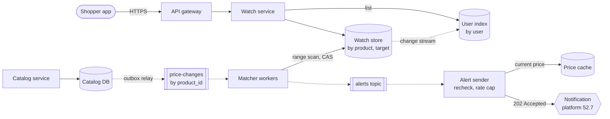

**Reading the diagram.** *Components:* the watch service (stateless) serves the API; the watch store and user index are the two storage boundaries for watches; the catalog and its database belong to another team; matcher workers and the alert sender form the event-driven pipeline; the notification platform is external to PriceWatch. *Protocols and direction:* shoppers call over HTTPS through the gateway; the catalog publishes price changes through a transactional outbox (§32.5) into a topic partitioned by `product_id`, so changes to one product arrive in order. *Synchronous versus asynchronous:* solid arrows are request/response; dotted arrows are asynchronous streams, so a slow matcher delays alerts but never blocks a seller's price update. *Failure points:* the matcher (replays from its committed offset), the watch store partition for a hot product, and the notification platform (alerts accumulate in the alerts topic). *Scaling:* matchers scale with topic partitions; the watch service scales horizontally; the alert sender's rate cap protects the notification platform's quota.

### 88.5.3 Depth (steps 8–9)

**Step 8 — Deep dive: matching and debouncing.**

1. **Range matching.** A drop from $p_{old}$ to $p_{new}$ triggers exactly the watches with $p_{new} \le target < p_{old}$. Because rows are clustered by target price, the matcher reads only those rows, not every watcher of the product. For a typical product this is a handful of rows; for a hot product it is the triggered slice, not all of its watchers.
2. **Deduplication.** For each matched watch, the matcher performs a compare-and-set: set `last_alerted_version = v` only if it is lower than `v`. Only the winner enqueues the alert, with idempotency key `watch_id:v` (§22.15). A replayed event loses the compare-and-set and sends nothing.
3. **Debouncing.** Automated repricers oscillate (499 → 449 → 499 → 449). The rule "alert at most once per watch per 24 hours unless the new price is at least 5% below `last_alerted_price`" stops repeat alerts and is checked in the same compare-and-set.
4. **Re-check at send time.** The alert sender reads the current price from a cache fed by the same stream and drops alerts whose price has already recovered above the target.

*Rejected alternative:* a periodic batch join of all 200 million watches against current prices. It is simple and cheap, but its latency is the batch interval (an hour or more), which fails the 2-minute NFR. It would win if the product accepted a daily digest instead of real-time alerts.

**Step 9 — Write path.**

**Figure 88.5 — PriceWatch write path for one price drop.**

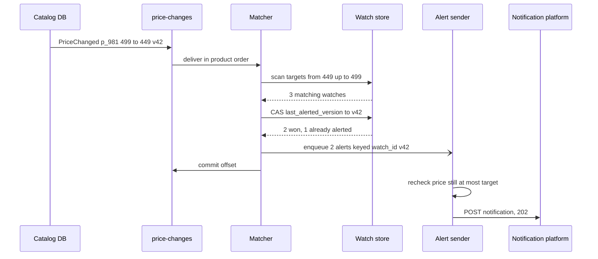

**Reading the diagram.** *Components:* six participants from Figure 88.4. *Order and durability:* the price change is durable in the catalog database before it reaches the topic (outbox); the compare-and-set is the deduplication point; alerts are durable in the alerts topic before the matcher commits its offset, so a crash between the two causes a replay that the compare-and-set absorbs. *Synchronous versus asynchronous:* the half-arrow (`-)`) marks the asynchronous enqueue; the rest are request/response calls. *Failure points:* a crash before the offset commit (safe replay), and the notification platform rejecting a request (the sender retries with the same idempotency key). *Scaling:* each matcher owns a set of product partitions, so ordering per product holds while throughput grows with partitions. The read path is simpler: `GET /v1/watches` reads the user index, then the price cache, with p99 well inside 200 ms.

### 88.5.4 Stress and judgment (steps 10–14)

**Step 10 — Scaling.** At 10× (2 billion watches, 55,000 price changes/s at peak) the state is 840 GB with replicas: partition the watch store by `product_id` with consistent hashing (§14.8) and add topic partitions; every tier is already stateless or partitioned. At 100×, the first thing to break is not storage but the notification quota and the hot-product fan-out.

**Step 11 — Hot spots.** A games console with 2 million watchers drops in price and crosses half of the targets: 1 million alerts at once. With PriceWatch's notification quota $C = 5{,}000$/s and normal traffic $\lambda_{hi} \approx 300$/s, the drain time from §52.7 is $T = 10^6 / (5{,}000 - 300) \approx 213$ s, about 3.5 minutes, inside the 10-minute large-audience NFR. Mitigations: products above 100,000 watches get their watch partition split into sub-partitions by hash of `watch_id`, scanned by parallel matcher tasks (§14.10); their alerts go to the platform at marketing priority with a rate cap so one-time passwords never queue behind them.

**Step 12 — Failures.**

**Table 88.5 — PriceWatch failure handling (compressed).**

| Component fails | User-visible effect | Detection | Recovery |
|---|---|---|---|
| Matcher worker | Alerts delayed seconds | Consumer lag | Rebalance; replay from offset; compare-and-set dedupes |
| Watch store partition | Alerts for those products delayed | Error rate, lag | Replica promotion; replay (7-day topic retention) |
| Catalog outbox relay | No alerts at all | Price-change rate drops to zero | Relay restart; outbox rows wait in the catalog DB |
| Notification platform | Alerts queued | Sender 5xx, alerts-topic depth | Retry with backoff and the same key (§22.12) |
| Price cache stale | Possible stale alert | Cache age metric | Fall back to catalog read for the recheck |

**Step 13 — Trade-offs.** (1) Event-driven matching over a batch join: real-time alerts at the cost of a streaming pipeline; switch if a daily digest is acceptable. (2) Partition by product, with a user index maintained asynchronously: fast matching at the cost of a list view that can lag a new watch by a second; switch to a synchronous dual write if users complain. (3) At-least-once delivery with deduplication rather than end-to-end exactly-once (§32.9): simpler, with a measured duplicate rate.

**Step 14 — Operations.** *Observability:* SLIs are price-change-to-hand-off lag (p99), matcher consumer lag, duplicate-alert rate and stale-alert rate. *Security and abuse:* authenticated watch API; a cap of 500 watches per user and rate limits (§22.3) stop scrapers using watches as a free price feed. *Cost:* dominated by notifications sent, which is why debouncing matters. *Evolution:* the price history chart (P2), then ranking which deals to push proactively, which is an ML problem and the subject of §88.7.

## 88.6 The ML extension

### 88.6.1 Eleven ML steps

::: definition
**Definition — ML extension.** Eleven steps added to, or substituted into, the traditional sequence when the prompt's core is a learned model: (M1) problem formulation, (M2) data and labels, (M3) features and feature store, (M4) model choice, baseline first, (M5) training pipeline, (M6) offline evaluation, (M7) serving and latency budget, (M8) online experimentation, (M9) monitoring and drift, (M10) retraining and feedback loops, (M11) responsible ML. They are the lifecycle of Chapter 59 compressed into interview steps.
:::

#### First-principles explanation

A traditional system is specified by code: if the code is right and the servers are up, the output is right. An ML system is specified by data, so it can be healthy and wrong at the same time (§60.3.2). The extra steps all answer one question the traditional sequence never asks: *how do we know the model's outputs are good, and how do we keep them good as the world changes?*

#### How it works internally

**Table 88.6 — The ML steps: what to produce and when each is done.**

| Step | Produce | Done when | Owner |
|---|---|---|---|
| M1 Formulation | Business goal → ML task → metric; why ML at all | Business metric, ML metric and their link are stated | §59.4 |
| M2 Data and labels | Sources, label definition and delay, labeling plan, leakage risks | Label is defined precisely, with its delay and bias | §59.5, Ch 63 |
| M3 Features | 3–4 feature groups, freshness, store, point-in-time joins | Each group has a source and a freshness; skew addressed | Ch 62 |
| M4 Model | Heuristic baseline, then a simple model, then justified complexity | Baseline named and beaten for a stated reason | §59.9.1 |
| M5 Training | Pipeline, cadence, data volume, compute | Reproducible pipeline with validation gates | §60.5, Ch 69 |
| M6 Offline evaluation | Metrics, slices, calibration, acceptance gate | Gate defined, including slices that must not regress | §59.10 |
| M7 Serving | Batch or online, latency budget, fleet size, fallback | Budget split and fallback ladder stated | §60.8–60.12, Ch 66 |
| M8 Experimentation | A/B design, unit, guardrail metrics, duration | Launch decision rule written before the test | §57.14 |
| M9 Monitoring | Data, prediction and outcome monitors, label delay | Silent-failure modes each have a detector | Ch 70 |
| M10 Retraining | Cadence or trigger; feedback-loop mitigation | Loop named and broken (exploration, holdout) | §59.13, §68.12 |
| M11 Responsible ML | Fairness slices, harms, privacy, human override | Top harm named with a control | Ch 71 |

A useful 45-minute budget for an ML prompt: formulation and metrics 7 minutes, data, labels and features 8, model 5, training and offline evaluation 6, serving 8, experimentation, monitoring and retraining 8, responsible ML 3. Data and serving receive the most time because that is where ML systems fail in production [Sculley et al. 2015; Paleyes et al. 2022].

**Figure 88.6 — The ML extension as a loop.**

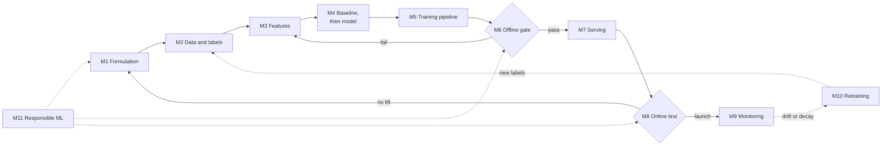

**Reading the diagram.** *Components:* each node is one ML step; the two diamonds are the decision gates (offline acceptance and online launch). *Direction:* left to right for the first launch, then around the loop. *Solid versus dotted:* solid arrows are the build sequence; dotted arrows are continuing, asynchronous processes after launch: monitoring triggers retraining, and the deployed model's outcomes become new labels. Responsible ML is not a final step; it constrains formulation, the offline gate and the launch decision. *Failure points:* a failed offline gate usually sends you back to features, not to a bigger model; a failed online test sends you back to formulation, because the offline metric did not track the business goal. *Scaling:* the loop is the same for a single model or a platform; what scales is automation of the gates (Ch 69).

### 88.6.2 Mapping onto the fourteen traditional steps

The ML steps do not replace the traditional ones. An ML system still has an API, a data model, capacity numbers and failure modes; most candidates who fail ML design interviews fail on these system steps, not on model choice.

**Table 88.7 — Mapping the traditional steps to the ML extension.**

| Traditional step | What changes for ML | ML step |
|---|---|---|
| 1–3 Clarify and requirements | Add the business metric, the ML task and a quality NFR | M1 |
| 4 Capacity | Add predictions/s, training data volume, compute per prediction | M5, M7 |
| 5 API | Prediction call plus feedback-logging call | M7, M2 |
| 6 Data model | Prediction log, labels, feature tables with timestamps | M2, M3 |
| 7 Architecture | Offline, nearline and online tiers (§60.7) | M3, M5, M7 |
| 8 Deep dives | Label design, features, model and evaluation | M2–M6 |
| 9 Data flow | Training path and inference path, joined by the log | M3, M5, M7 |
| 10–11 Scaling, hot spots | Fleet sizing, batching, cascades | M7 |
| 12 Failures | Silent failures, fallbacks, drift | M7, M9 |
| 13 Trade-offs | Accuracy versus latency and cost; batch versus online | M4, M7 |
| 14 Operations | Experiments, monitoring, retraining, responsible ML | M8–M11 |

**Figure 88.7 — Where the ML steps attach to the traditional sequence.**

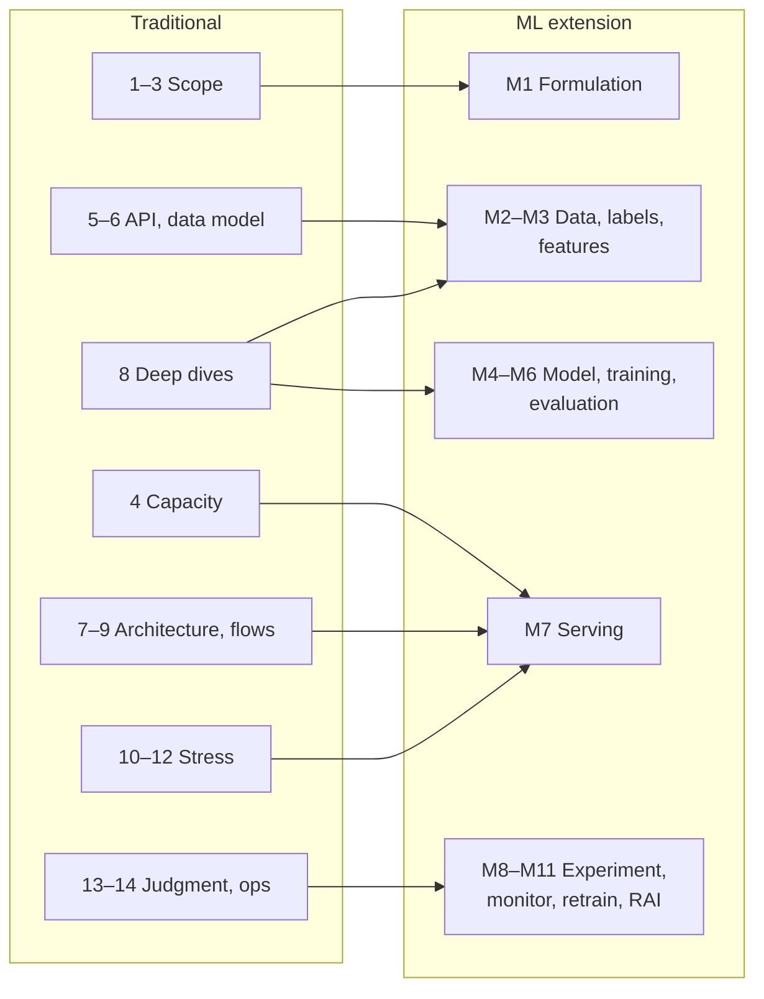

**Reading the diagram.** *Components:* the left subgraph is the traditional sequence grouped by phase; the right subgraph is the ML extension grouped into five blocks. *Direction:* each arrow means "this traditional step is where you perform these ML steps"; for example, the deep dive (step 8) is where label design, model choice and evaluation are discussed. *Key reading:* serving (M7) attaches to four traditional steps (capacity, architecture, scaling and failures), which is why it is the systems-heavy core of an ML interview. *Failure points:* candidates who attach everything to step 8 spend 30 minutes on models and never size the fleet or name a fallback. *Scaling:* for an LLM prompt, the additions of §88.8 attach to the same places.

::: mistake
**"An ML design interview is a modeling interview."** Starting with "I'd use a transformer" before defining the label is the most common failure. The interviewer cannot evaluate a model choice until they know what it predicts, from which data, against which baseline, under which latency budget. Model choice is one of eleven steps and rarely deserves more than five minutes.
:::

## 88.7 Applying the ML extension end to end: Deal Nudge

The prompt: *"Our marketplace sends deal notifications. Users complain about spam, and many disable notifications. Design an ML system that decides which deal notification, if any, each user should receive."* This continues PriceWatch's marketplace: PriceWatch handles alerts users *asked for*; Deal Nudge handles notifications they did not ask for, where the cost of a bad send is a lost channel.

*Evidence: Illustrative* — a teaching design with assumed numbers.

### 88.7.1 Formulation, data and features (M1–M3)

**M1 — Formulation.** Business goal: increase purchases driven by notifications without eroding the notification channel. ML task: for each eligible user each day, score up to five candidate deals with two models: $\hat{p}_{open}$, the probability that the user opens the notification within 24 hours, and $\hat{p}_{off}$, the probability that they disable notifications within 48 hours. Send the best candidate if $V \cdot \hat{p}_{open} - K \cdot \hat{p}_{off} > \theta$, where $V$ and $K$ are the estimated value of an open and the cost of a lost user channel. Why ML: engagement depends on many interacting signals that rules cannot capture, and a heuristic already exists to beat.

**M2 — Data and labels.** Sources: the notification log (sent, delivered, opened), app sessions, purchases, opt-out events, deal catalog. Labels: `open_24h` and `optout_48h`, both delayed (24 and 48 hours, §59.12.2). Two hazards dominate. *Leakage:* a feature such as "sessions today" computed at training time includes the session the notification itself caused; every feature must be read as of send time with point-in-time joins (§62.8) [Kaufman et al. 2011]. *Selection bias:* labels exist only for notifications that were sent, and the old heuristic sent mostly to already-engaged users. The fix is an exploration slice: 1% of eligible users receive a uniformly random candidate (or none), logged with its propensity (§68.11).

**M3 — Features.** User (days since last app open, 30-day notification open rate, purchase frequency, category affinities), fatigue (notifications received in the last 24 hours and 7 days), deal (discount, price, category popularity, stock), context (local hour, weekday). User aggregates are computed daily in batch; the fatigue counters are streamed, because they change during the day. Both are served from a feature store with one definition for training and serving (§62.9).

### 88.7.2 Model, training and evaluation (M4–M6)

**M4 — Model.** Baseline 0: today's rule ("send the deepest discount in the user's top category to anyone who opened a notification in 30 days"). Baseline 1: logistic regression on the features above. Candidate: gradient-boosted trees, chosen because the features are tabular and heterogeneous; a deep model is not justified until trees plateau [Huyen 2022].

**M5 — Training.** Daily retraining on a rolling 28 days of sends whose labels have matured, about 12 million sends a day or 336 million rows; tree training on that volume takes tens of minutes on a few CPU nodes, so compute is not the constraint. Validation gates check schema, label rates and feature distributions before training (§59.7).

**M6 — Offline evaluation.** Ranking metrics alone are wrong here, because the decision is send or not. Report PR-AUC and calibration for both models, then estimate the *policy's* value on the exploration slice with inverse-propensity weighting. The gate: policy value at least as good as the production model, calibration error under a set bound, and no regression on slices (new users, each country, low-activity users).

::: example
**Worked example — Deal Nudge volumes and the case for the harm model.** Assumptions: 80 million users eligible per day; 5 candidates each; tree inference costs 20 µs of one vCPU per score. The heuristic sends to 30% of eligible users with a 4% open rate and 0.05% opt-out per send. The model policy, estimated offline on the exploration slice, sends to 15% with a 7.5% open rate and 0.03% opt-out per send.

1. Scores per day: $8 \times 10^7 \times 5 = 4 \times 10^8$. Compute: $4 \times 10^8 \times 20\ \mu s = 8{,}000$ vCPU-seconds ≈ **2.2 vCPU-hours a day**.
2. Heuristic: sends $8 \times 10^7 \times 0.30 = 2.4 \times 10^7$; opens $2.4 \times 10^7 \times 0.04 = 960{,}000$; opt-outs $2.4 \times 10^7 \times 0.0005 = 12{,}000$ a day.
3. Model: sends $1.2 \times 10^7$; opens $1.2 \times 10^7 \times 0.075 = 900{,}000$; opt-outs $1.2 \times 10^7 \times 0.0003 = 3{,}600$ a day.
4. Change: sends −50%, opens −6.25%, opt-outs −70%.

**Interpretation.** Inference is almost free, so serving cost does not drive this design; send volume and channel loss do. The model gives up 6% of opens to keep 8,400 more users a day reachable. **Engineering implication.** Whether that trade is right depends on long-term purchases, which only an online experiment with a holdout can measure (M8). Capacity formulas for inference fleets are in §60.11 and Chapter 89.
:::

### 88.7.3 Serving, experimentation and operation (M7–M11)

**M7 — Serving.** Batch scoring once a day per time zone, before the local evening send window, writes `(user, deal, score)` to a send queue. At send time a lightweight check re-reads the fatigue counters and the deal's current price and stock, and skips stale sends. Latency is not critical (minutes), but freshness of fatigue counters is. Fallback: if scoring fails, send nothing that day rather than reverting to the spammy heuristic; a missed day of nudges is cheap.

**Figure 88.8 — Deal Nudge architecture.**

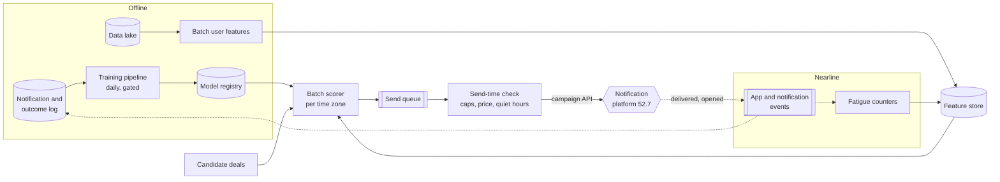

**Reading the diagram.** *Components:* offline training and batch features; nearline fatigue counters; the batch scorer; the send-time check; the notification platform (external). *Storage boundaries:* the outcome log, data lake, feature store and model registry. *Synchronous versus asynchronous:* the scorer-to-queue-to-check path is a scheduled batch; dotted arrows are event streams that carry outcomes back into the log, closing the feedback loop. *Failure points:* the send-time check is the safety net when features are stale or the model misbehaves, because its caps and quiet hours are deterministic rules outside the model; a scoring failure produces no sends rather than bad sends. *Scaling:* scoring is embarrassingly parallel by user; send volume is governed by the notification platform's campaign rate caps.

**M8 — Online experimentation.** Randomize by user: heuristic versus model, plus a 2% long-term holdout that receives no nudges, so incremental purchases are measured against doing nothing [Kohavi et al. 2020]. Primary metric: purchases per user over 28 days. Guardrails: opt-out rate, uninstall rate, unsubscribe complaints. Run at least two weeks, because novelty inflates early open rates. Write the launch rule before starting.

**M9 — Monitoring.** Daily send volume (a model or feature bug shows first as a volume jump), predicted versus realized open rate per slice (calibration), feature freshness and drift (§70.5), opt-out rate. Labels arrive after 24–48 hours, so volume and calibration monitors are the early warnings (§70.8).

**M10 — Retraining and feedback.** Daily retraining, promoted through a 5% canary for one day. The model trains on outcomes of its own sends, a feedback loop that narrows whom it ever learns about; the 1% exploration slice and the 2% holdout keep unbiased data flowing (§59.13.2).

**Figure 88.9 — The selection-bias loop and how exploration breaks it.**

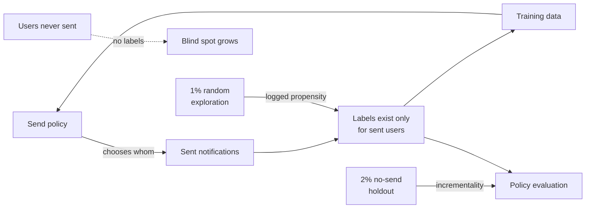

**Reading the diagram.** *Components:* the policy, its sends, the labels they generate and the training data form a closed loop (solid). *The hazard (dotted):* users the policy never chooses generate no labels, so the model never learns that some of them would have responded; the blind spot grows with each retrain. *The fix:* the exploration slice adds labeled sends chosen at random with a known propensity, enabling unbiased offline policy evaluation; the holdout measures what the notifications add over sending nothing. *Failure points:* dropping exploration to "save" sends, or computing metrics without propensity weights. *Scaling:* the exploration fraction can shrink as traffic grows, because the absolute number of random sends still suffices for estimates.

**M11 — Responsible ML.** Hard caps outside the model (at most one nudge a day, quiet hours, global opt-out honored within a minute); no targeting on sensitive inferred attributes such as health-related purchases; slice gates so new and low-activity users are not systematically excluded from good deals; and a model card recording intended use and known gaps (Ch 71) [Mitchell et al. 2019].

## 88.8 LLM and agent-system additions

### 88.8.1 What changes when the model is an LLM

LLM and agent prompts ("design a support assistant", "design a coding agent") still run the traditional steps and most of the ML extension. Five concerns become first-class, because the output is open-ended text or actions rather than a number.

**Table 88.8 — LLM and agent additions and where they attach.**

| Addition | Question it answers | Attaches to | Owner |
|---|---|---|---|
| Evaluation first | How will we know an answer is good, before building? | Step 3, M1, M6 | §78.4, §78.7 |
| Cost per request | Tokens in and out × price; does the unit economics work? | Step 4 | §77.17, §79.15 |
| Latency in tokens | TTFT and TPOT budgets; streaming | Step 3, M7 | §73.4 |
| Guardrails and injection | What may enter, what may the model do, what may leave? | Steps 8, 12 | §77.11, §78.13 |
| Knowledge versus behavior | RAG, fine-tuning or both? | Step 8, M4 | §76.14 |
| Agent safety | Tool permissions, sandboxing, human approval, budgets | Steps 12, 14 | §77.12, §77.13 |
| Routing and fallback | Which model per request; what if the provider fails? | Steps 10, 12 | §78.14, §78.15 |

**Evaluation first.** Before any architecture, define a task-specific evaluation set (real queries with reference answers or rubrics), the metrics (task success, groundedness, safety violations) and how they are scored (programmatic checks, LLM-as-a-judge calibrated against humans). Every later choice (model, retrieval depth, prompt) is then an experiment against that set. Candidates who start with "I'd use RAG with a vector database" and never say how quality is measured show the LLM equivalent of starting with the model.

**Knowledge versus behavior.** Classify each requirement: facts that change or must be cited belong in retrieval; stable behavior (format, tone, escalation rules) belongs in fine-tuning or structured output (§76.14). **Agent safety.** Give each tool the least privilege, require human approval for irreversible actions, cap steps and spend per task, and treat retrieved or tool-returned text as untrusted data (§77.13).

::: formula
**Cost per LLM request**

$$C_{req} = \frac{n_{in} \cdot P_{in} + n_{cached} \cdot P_{cached} + n_{out} \cdot P_{out}}{10^6}$$

| Symbol | Meaning | Units |
|---|---|---|
| $C_{req}$ | Model cost of one request | dollars |
| $n_{in}$ | Uncached input tokens | tokens |
| $n_{cached}$ | Input tokens served from a prompt cache | tokens |
| $n_{out}$ | Output tokens | tokens |
| $P_{in}, P_{cached}, P_{out}$ | Prices per million tokens | dollars per $10^6$ tokens |
:::

::: example
**Worked example — Is prompt caching worth mentioning?** Assumptions: the hosted large-model prices used in Book II (as of 2026, §77.17): $P_{in} = \$2.50$, $P_{cached} = \$0.25$, $P_{out} = \$10$ per million tokens; 3,000 input tokens (2,000 of them a fixed system prompt and tool definitions) and 400 output tokens; 1 million requests a day.

1. Without caching: $(3{,}000 \times 2.50 + 400 \times 10)/10^6 = (7{,}500 + 4{,}000)/10^6 = \$0.0115$ per request, **\$11,500 a day**.
2. With the fixed 2,000 tokens cached: $(1{,}000 \times 2.50 + 2{,}000 \times 0.25 + 400 \times 10)/10^6 = (2{,}500 + 500 + 4{,}000)/10^6 = \$0.0070$, **\$7,000 a day**.
3. Saving: $1 - 7{,}000/11{,}500 \approx 39\%$.

**Interpretation.** Output tokens are now 57% of the cost, so the next lever is shorter answers or a smaller model for easy requests (routing). **Engineering implication.** In an interview, one line of this arithmetic at step 4 shows you treat cost as a requirement, which is a staff-level signal for LLM systems.
:::

**Figure 88.10 — Evaluation-first design loop for an LLM feature.**

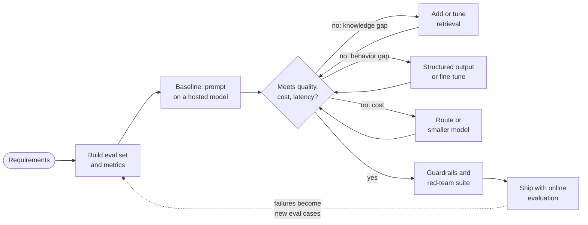

**Reading the diagram.** *Components:* the evaluation set is built before anything else; a simple prompted baseline comes next; the diamond is the decision against quality, cost and latency targets. *Direction and loops:* each failure type has its own remedy (retrieval for knowledge gaps, structured output or fine-tuning for behavior gaps, routing for cost), and every remedy returns to the same evaluation. *Asynchronous path:* after launch, production failures flow back (dotted) into the evaluation set, so it grows with real traffic. *Failure points:* skipping the evaluation set makes every later decision unmeasurable; skipping the red-team suite ships injection and safety failures. *Scaling:* the same loop runs per feature on a shared platform (Ch 79).

## 88.9 Rubrics by level

### 88.9.1 How to read the rubric

::: warning
**This is a general, industry-informed rubric, not any company's rubric.** *Evidence: Illustrative.* Companies publish little about how they score design interviews, and their internal ladders differ in names, number of levels and expectations. The levels below (L3 junior, L4 mid, L5 senior, L6 staff, L7 principal) are common shorthand, not a mapping of any company's titles. Chapter 90 covers what individual companies have published. Use the rubric to find your gaps, not to predict an outcome.
:::

The rubric has six dimensions. Each table gives the behavior an interviewer could observe at each level and an example signal (something you might actually say). Two patterns run through all six. First, **scope grows**: from a component, to a system, to a system plus its neighbors and evolution, to an organization's portfolio. Second, **prompting decreases**: a junior candidate reaches good answers with hints; a senior candidate raises the issues unprompted; a staff candidate raises issues the interviewer had not planned to ask about. Higher levels include all lower-level behaviors.

**Table 88.9 — Dimension 1: scoping and requirements.**

| Level | Observable behavior | Example signal |
|---|---|---|
| L3 | Asks basic questions when prompted; lists FRs | "Should users be able to delete a watch?" |
| L4 | States FRs and some numeric NFRs unprompted | "Alert within a couple of minutes, 99.9% for the API" |
| L5 | Prioritizes, sets non-goals, names the hard part | "The hard part is fan-out on hot products; history is P2" |
| L6 | Questions the problem itself; ties NFRs to business cost | "Do users want real-time alerts or would a digest convert better?" |
| L7 | Frames it within the product and platform strategy | "This and deal nudges should share one fatigue budget per user" |

**Table 88.10 — Dimension 2: design breadth.**

| Level | Observable behavior | Example signal |
|---|---|---|
| L3 | A working single-path design with guidance | Client, service, database |
| L4 | Complete end-to-end design with caches and queues where needed | Async pipeline from catalog to notifications |
| L5 | Covers all fourteen steps; justifies every box | "The user index exists only for the list API" |
| L6 | Covers neighboring systems, migration and multi-team contracts | "The catalog's outbox is a contract we need versioned" |
| L7 | Designs for reuse across products and years | "Make watch-and-alert a platform primitive for stock and price" |

**Table 88.11 — Dimension 3: technical depth.**

| Level | Observable behavior | Example signal |
|---|---|---|
| L3 | Correct use of standard components | "Index on user_id" |
| L4 | Explains how one component works internally | Partition key and range scan explained |
| L5 | Deep on the hard part with numbers and edge cases | CAS deduplication, debouncing, replay safety |
| L6 | Depth across two areas; spots subtle failure interactions | "Replay plus debounce can suppress a legitimate second drop" |
| L7 | Knows where the field's state of the art and limits are | Cites when exactly-once actually holds and when it cannot |

**Table 88.12 — Dimension 4: trade-offs.**

| Level | Observable behavior | Example signal |
|---|---|---|
| L3 | Names one option, sometimes "the best" | "Use Kafka" |
| L4 | Compares two options when asked | "Batch is simpler; streaming is faster" |
| L5 | States costs unprompted, tied to NFRs | "Streaming costs a pipeline; the 2-minute NFR requires it" |
| L6 | Gives reversal conditions; weighs one-way versus two-way doors | "If a digest is acceptable, the batch join wins; the schema is the one-way door" |
| L7 | Trades engineering cost against business and organizational cost | "One team can run this; a second pipeline doubles on-call" |

**Table 88.13 — Dimension 5: reliability and operations.**

| Level | Observable behavior | Example signal |
|---|---|---|
| L3 | Mentions replication or backups when asked | "Add a replica" |
| L4 | Handles retries, timeouts and a failure or two | "Retry with backoff" |
| L5 | Failure table per stateful component; idempotency; SLIs | Lag SLI, duplicate rate, replay plan |
| L6 | Degradation strategy, blast radius, cost and security | "Cap watches per user; scrapers are the abuse case" |
| L7 | Operational model across teams: SLOs, incident and launch process | "Error budget shared with the catalog team's outbox" |

**Table 88.14 — Dimension 6: communication and leadership.**

| Level | Observable behavior | Example signal |
|---|---|---|
| L3 | Explains own work clearly when asked | Answers questions accurately |
| L4 | Thinks aloud; checks in at transitions | "Shall I go deeper here or move on?" |
| L5 | Drives the session; manages time; summarizes | "I'll spend ten minutes on matching, then failures" |
| L6 | Adapts to the interviewer; makes the discussion a design review | Turns a challenge into a shared exploration |
| L7 | Teaches and aligns; frames decisions for stakeholders | "Here's how I'd present this choice to the product lead" |

**Figure 88.11 — Rubric progression: scope widens as prompting drops.**

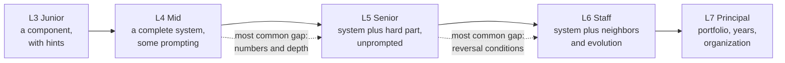

**Reading the diagram.** *Components:* five levels, each labeled with its scope and how much prompting it needs. *Direction:* left to right is progression; each level includes the behaviors of the levels before it. *Dotted arrows:* the two transitions where candidates most often stall, in our general experience rather than from published data: from mid to senior, the gap is quantitative depth on the hard part; from senior to staff, it is judgment about reversibility, neighbors and evolution. *Failure points:* "level-hopping" by adding staff-sounding vocabulary (platforms, organizations) without the senior foundation; interviewers notice missing depth quickly. *Scaling:* the same progression applies to ML and LLM prompts, with ML-specific depth (labels, leakage, experimentation) in dimension 3.

## 88.10 Self-assessment and gap analysis

### 88.10.1 Scoring mock interviews

Run each mock with a partner who scores you on the six dimensions of §88.9, writing down the *evidence* (what you said or drew) next to each score, not just a number. Score each dimension by the level whose behavior you showed, from 3 to 7. Record the session; listening back reveals silences and unstated trade-offs that neither of you noticed live. Practice deliberately: one weak dimension per week, with feedback after every attempt, rather than repeating full mocks on comfortable prompts [Ericsson et al. 1993] (§3.4). For staff and principal behaviors, which are hard to observe in a mock, Larson and Reilly describe what the role looks like in practice [Larson 2021; Reilly 2022].

::: formula
**Gap priority per dimension**

$$G_d = w_d \times \max(0,\ t - \bar{s}_d)$$

| Symbol | Meaning | Units |
|---|---|---|
| $G_d$ | Priority of practicing dimension $d$ | level-points (weighted) |
| $w_d$ | Weight of dimension $d$ for your target role | dimensionless |
| $t$ | Target level | level (3–7) |
| $\bar{s}_d$ | Mean level shown on $d$ across recent mocks | level (3–7) |
:::

::: example
**Worked example — Ranking gaps after three mocks.** Target $t = 5$ (senior). Depth and trade-offs weigh 1.5, the others 1.0. Mean scores: scoping 5.33, breadth 4.67, depth 4.33, trade-offs 4.00, reliability 3.33, communication 5.00.

1. Reliability: $1.0 \times (5 - 3.33) = 1.67$.
2. Trade-offs: $1.5 \times (5 - 4.00) = 1.50$.
3. Depth: $1.5 \times (5 - 4.33) = 1.00$.
4. Breadth: $1.0 \times (5 - 4.67) = 0.33$; scoping and communication: 0.

**Interpretation.** The largest gap is reliability, even though depth "feels" weakest to many candidates. **Engineering implication.** Next week, end every practice design with steps 12–14 done properly (failure table, SLIs, cost) before anything else; re-score after three more mocks.
:::

```python
# Mock-interview gap analysis: average three sessions, rank gaps by weight.
TARGET = 5  # target level (senior)
WEIGHTS = {"scoping": 1.0, "breadth": 1.0, "depth": 1.5,
           "trade-offs": 1.5, "reliability": 1.0, "communication": 1.0}
SESSIONS = [  # level shown per dimension in each mock (3..7)
    {"scoping": 5, "breadth": 5, "depth": 4, "trade-offs": 4, "reliability": 3, "communication": 5},
    {"scoping": 5, "breadth": 4, "depth": 4, "trade-offs": 4, "reliability": 4, "communication": 5},
    {"scoping": 6, "breadth": 5, "depth": 5, "trade-offs": 4, "reliability": 3, "communication": 5},
]

def gaps(sessions, weights, target):
    rows = []
    for d, w in weights.items():
        mean = sum(s[d] for s in sessions) / len(sessions)
        rows.append((w * max(0.0, target - mean), d, mean))
    return sorted(rows, reverse=True)

for g, d, mean in gaps(SESSIONS, WEIGHTS, TARGET):
    print(f"{d:<14} mean={mean:.2f} priority={g:.2f}")
# reliability    mean=3.33 priority=1.67
# trade-offs     mean=4.00 priority=1.50
# depth          mean=4.33 priority=1.00  (then breadth 0.33, scoping 0, communication 0)
```

What to notice: scores above target contribute zero (`max(0, ...)`), so strengths do not mask weaknesses; weights encode the role (raise reliability's weight for infrastructure roles); and the output is a ranked practice list, not a pass/fail verdict.

**Figure 88.12 — The gap-analysis practice loop.**

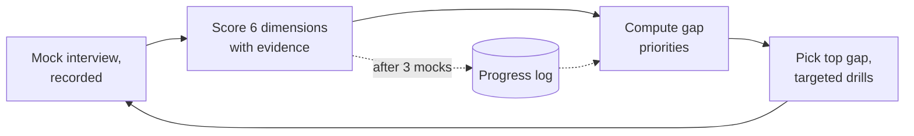

**Reading the diagram.** *Components:* the recorded mock, scoring with evidence, the gap computation, targeted drills and a progress log (the only storage). *Direction:* a weekly loop; the dotted arrows are the slower path in which scores accumulate and gaps are recomputed every three mocks rather than after one noisy session. *Failure points:* scoring without evidence (scores drift upward), and drilling strengths because they feel good. *Scaling:* the same loop works alone (score your recordings against the tables) or in a study group that rotates interviewer and candidate roles.

### 88.10.2 Adapting the framework

**Table 88.15 — Adapting the framework to the format.**

| Format | What changes | Keep no matter what |
|---|---|---|
| 45 minutes | Steps 9, 11, 13 merge into the deep dive; step 14 is one sentence | Numbers at step 4; one real deep dive |
| 60 minutes | Two deep dives; full failure table; a sequence diagram | Time check at minute 30 |
| Product-style prompt | More time on steps 1–3, 5 and user-visible behavior | A capacity estimate |
| Infrastructure-style prompt | Less on FRs; more on steps 6, 8, 10–12 (consistency, partitioning, failure) | Stated non-goals |
| ML prompt | Replace half of steps 5–9 with M1–M7 (Table 88.7) | API, fleet size, fallback |
| LLM or agent prompt | Add evaluation first, cost per request, guardrails (§88.8) | Failure handling for tools |

A product-style prompt ("design a shopping list app") rewards careful requirements and API shape; an infrastructure-style prompt ("design a distributed rate limiter") assumes the requirements are short and spends the time on correctness under concurrency and failure. Ask which emphasis the interviewer wants if the prompt is ambiguous; Chapter 87 covers how.

## 88.11 Summary and revision notes

::: summary
- A framework is a **checklist, not a script**: it guarantees every step gets at least a sentence, while judgment decides which steps get ten minutes.
- The **fourteen steps** follow the order in which uncertainty disappears: scope (1–3), size (4), contract (5–6), shape (7), depth (8–9), stress (10–12), judgment (13–14). Each has an artifact and a "done when" criterion.
- In 45 minutes, protect about 14 minutes of depth starting near minute 22; in 60 minutes the extra time goes to deep dives.
- Every number from step 4 must drive a decision; PriceWatch's 84 GB showed that **skew**, not size, shaped the design.
- The **ML extension** adds formulation, labels and leakage, features, baseline-first modeling, offline gates, serving, experimentation, monitoring, retraining and responsible ML; it attaches to the traditional steps rather than replacing them.
- Deal Nudge showed **selection bias** from logging only sent notifications, broken by an exploration slice and a no-send holdout.
- LLM prompts add **evaluation first**, cost per request, guardrails, the knowledge-versus-behavior split and agent safety.
- The **rubric** has six dimensions; scope widens and prompting drops from L3 to L7. It is illustrative, not any company's rubric.
- Score mocks with evidence, compute weighted gaps, and drill the top gap.
:::

## 88.12 Knowledge checkpoint

1. Name the seven phases and the steps in each.
2. Why is the framework a checklist and not a script?
3. What is the "done when" criterion for step 4?
4. How many design minutes go to deep dives in a 45-minute and a 60-minute slot?
5. In PriceWatch, why is the watch table clustered by target price?
6. How does PriceWatch avoid duplicate alerts on event replay?
7. Compute PriceWatch's peak alert rate from its assumptions.
8. What two hazards dominate Deal Nudge's labels?
9. Why does Deal Nudge send nothing if scoring fails?
10. Name four LLM-specific additions to the framework.
11. Compute the cost per request for 3,000 input and 400 output tokens at \$2.50 and \$10 per million.
12. What two patterns run through all six rubric dimensions?

<details><summary>Answers</summary>

1. Scope (1–3), size (4), contract (5–6), shape (7), depth (8–9), stress (10–12), judgment (13–14).
2. A script ignores the prompt's hard part and wastes time; a checklist guarantees coverage while letting depth and order vary.
3. Every number is attached to a decision, and the dominant load is named.
4. About 14 minutes (steps 8–9) in 45; about 19 in 60.
5. A price drop triggers exactly the watches with target between the new and old price, so a range scan reads only those rows.
6. A compare-and-set on `last_alerted_version`; only the winner enqueues, with idempotency key `watch_id:version`.
7. $5{,}556 \times 0.4 \times 6.7 \times 0.02 \approx 300$ alerts/s.
8. Leakage from features computed after the send, and selection bias from labels existing only for sent notifications.
9. A missed day of nudges is cheap; falling back to the spammy heuristic would cause the opt-outs the system exists to prevent.
10. Evaluation first, cost per request, guardrails and injection defense, RAG versus fine-tuning, agent safety, routing and fallback (any four).
11. $(3{,}000 \times 2.50 + 400 \times 10)/10^6 = \$0.0115$.
12. Scope widens (component to portfolio) and the need for prompting drops.
</details>

## 88.13 Interview questions

### Basic

**Q1. How do you approach a design question you have never seen?**
**Answer.** *L3–L4:* "I clarify requirements, estimate, draw an architecture and then go deeper." *L5 and above:* the same steps, plus planning: "I'll confirm scope and numbers in about eight minutes, name the hard part, and spend most of the time there; I'll cover failures and operations at the end and loop back if a number changes a decision."

**Q2. Why estimate capacity at all?**
**Answer.** *L4:* to size servers and storage. *L5–L6:* to find which regime you are in and what dominates; often the result is that size is small and skew or one unexpected write path (GPS updates, click streams) shapes the design, and that is worth saying explicitly.

### Intermediate

**Q3. Your estimate gives 84 GB of state and 300 writes/s. The interviewer asks whether you need sharding. Answer.**
**Answer.** *L4:* "No, it fits on one node with replicas." *L5:* "Not for size or throughput; but the hottest product has 2 million watchers, so I'd sub-partition hot products for parallel fan-out." *L6:* adds that partitioning by `product_id` is the one-way door worth getting right now, while node count is a two-way door to revisit at 10×.

**Q4. Design an ML system that decides which notifications to send. Where do you start?**
**Answer.** *L4:* features and a classifier predicting opens. *L5:* the business goal and two labels (engagement and opt-out), leakage, a heuristic baseline and an A/B test. *L6:* also the selection-bias loop, an exploration slice with logged propensities, a long-term holdout for incrementality, and hard caps outside the model.

### Advanced

**Q5. Mid-interview: "Assume the notification platform accepts only 1,000 messages/s from you." What changes?**
**Answer.** *L5:* the drain time for a million-alert hot drop becomes $10^6/(1{,}000 - 300) \approx 1{,}430$ s, about 24 minutes, which breaks the 10-minute NFR; prioritize by watch age or target closeness and renegotiate the NFR for large audiences. *L6–L7:* also question the product: send in-app inbox entries immediately and push only to the most engaged watchers, and propose a shared per-user notification budget across PriceWatch and Deal Nudge.

**Q6. How would you decide an LLM support assistant is ready to launch?**
**Answer.** *L4:* manual testing on sample questions. *L5:* a task-specific evaluation set with success, groundedness and safety metrics, a gate, and a canary. *L6:* plus judge calibration against human labels, red-team and injection suites, cost and latency gates, an online metric (resolution without escalation) with guardrails, and a path for production failures to become evaluation cases.

## 88.14 Practical exercises

1. Run the fourteen steps on "design a ticket booking system" with a 45-minute timer, then compare with §55.8 and list missed steps.
2. Recompute PriceWatch's capacity with $p = 0.05$ and 1 billion watches; which conclusions change?
3. Modify the gap-analysis program to weight reliability 2.0 for an infrastructure role and report the new ranking.
4. Score a recording of yourself against Tables 88.9–88.14, writing one piece of evidence per score.

## 88.15 Design challenges

1. **Back-in-stock alerts** for the same marketplace: reuse PriceWatch's steps and identify which artifacts change.
2. **Deal Nudge for email** instead of push: redo M1, M2 and M8 when opens are measured unreliably.
3. **A coding agent that opens pull requests:** apply §88.8 and write the evaluation-first plan and the tool-permission table.

## 88.16 References

1. Gawande, A. *The Checklist Manifesto: How to Get Things Right*. Metropolitan Books, 2009.
2. Haynes, A. B., et al. *A Surgical Safety Checklist to Reduce Morbidity and Mortality in a Global Population*. New England Journal of Medicine 360(5), 2009.
3. Sculley, D., et al. *Hidden Technical Debt in Machine Learning Systems*. NeurIPS, 2015.
4. Paleyes, A., Urma, R.-G., Lawrence, N. D. *Challenges in Deploying Machine Learning: A Survey of Case Studies*. ACM Computing Surveys 55(6), 2022.
5. Kaufman, S., Rosset, S., Perlich, C. *Leakage in Data Mining: Formulation, Detection, and Avoidance*. KDD, 2011.
6. Huyen, C. *Designing Machine Learning Systems*. O'Reilly, 2022.
7. Kohavi, R., Tang, D., Xu, Y. *Trustworthy Online Controlled Experiments: A Practical Guide to A/B Testing*. Cambridge University Press, 2020.
8. Mitchell, M., et al. *Model Cards for Model Reporting*. FAT*, 2019.
9. Ericsson, K. A., Krampe, R. T., Tesch-Römer, C. *The Role of Deliberate Practice in the Acquisition of Expert Performance*. Psychological Review 100(3), 1993.
10. Larson, W. *Staff Engineer: Leadership Beyond the Management Track*. Self-published, 2021.
11. Reilly, T. *The Staff Engineer's Path*. O'Reilly, 2022.
12. Xu, A. *System Design Interview – An Insider's Guide*. Independently published, 2020.

## 88.17 Open verification items

- Haynes et al. 2009: confirm the 1.5% → 0.8% death rate and 11.0% → 7.0% complication figures and the eight-hospital setting against the paper.
- Kaufman et al.: confirm the KDD 2011 author list (the later TKDD version adds an author).
- Price figures (\$2.50, \$0.25, \$10 per million tokens) are Book II assumptions (§77.17), not current list prices.
- The L3–L7 rubric and "most common gap" claims are illustrative general guidance, not measured data.
