# Chapter 89 — Capacity Estimation Handbook

> **Level:** 2–4 · **Track:** Shared · **Estimated reading time:** 4 h

Every design in this book starts with numbers: requests per second at peak, bytes per year, gigabytes of GPU memory, dollars per million tokens. Chapter 2 introduced the method (§2.11), Chapter 4 supplied the mathematics, and each case study applied it to one system. This chapter gathers all of it into one reference. Each estimation family gets a formula in handbook form, a worked example with every step shown, and the mistakes that most often break it. The chapter ends with twelve end-to-end drills, from a URL shortener to a large-language-model (LLM) pre-training run, and a runnable calculator that reproduces the key results.

Where a formula is derived elsewhere, this chapter cites the owning section and gives only the form you need at the whiteboard. Where a case study already estimated a system, the drill reuses its numbers and cites it, so that the book tells one consistent story.

::: note
**Conventions used throughout this chapter.** Decimal units for estimation: 1 KB = 10³ bytes, 1 GB = 10⁹ bytes, 1 TB = 10¹² bytes; network rates in bits per second, 1 Gb/s = 125 MB/s (§4.5). The reference GPU is the H100 SXM: 80 GB of HBM3, 3.35 TB/s, 989 TFLOP/s dense BF16 (Table 64.4); Chapters 65 and 80 round this to 10¹⁵ FLOP/s, and the 1% difference is below estimation precision. Illustrative prices, as of 2026: \$2.50 per GPU-hour and \$0.77 per hour for a 16-vCPU node (\$0.048 per vCPU-hour) (§60.11); object storage \$0.023 per GB-month (Table 15.4); internet egress \$0.05 per GB and negotiated CDN delivery \$0.01 per GB (§21.5.4). Unless a case says otherwise, the busiest hour carries $h = 0.10$ of daily traffic and the burst factor is $b = 2$ (§52.3), and target utilization is $u = 0.6$.
:::

## 89.1 Learning objectives

After this chapter you should be able to:

- Turn a vague prompt ("design a chat app for 100 million users") into a written list of assumptions and an estimation tree in under five minutes.
- Convert daily volumes into average and peak rates, and choose a defensible peak-to-average ratio.
- Estimate storage with retention, indexes, compression, replication and erasure coding, and bandwidth with CDN offload and media bitrates.
- Size caches, databases, application fleets, message-broker partitions and consumer groups, including headroom and N+1/N+2 or zone-level redundancy.
- Translate availability and durability targets into downtime and loss budgets, and compose them across dependencies.
- Estimate ML workloads: training-data volume, feature-store reads, embedding-table memory and CPU or GPU inference fleets.
- Estimate GPU memory for training and serving, training compute and time with $6ND$, and LLM serving throughput from the memory-bandwidth limit of decode.
- Compute cost per request, per user and per million tokens, and say which resource dominates it.
- Run any of twelve standard drills aloud in an interview, and sanity-check your own answers.

## 89.2 Prerequisites

- Back-of-the-envelope method and peak formula — §2.11 (this chapter is its deep treatment).
- Units, prefixes and time conversions — §4.5; percentiles and fan-out — §4.8; queueing and utilization — §4.10; Little's Law — §4.11.
- Availability, durability and latency numbers — §4.14, §4.16, §4.17.
- Capacity planning, headroom and redundancy — §18.11.
- Inference fleet sizing — §60.11; GPU hardware and the roofline — Chapter 64; training memory and $6ND$ — §65.3–§65.4.
- KV cache and LLM serving capacity — §72.11, §73.5, §73.15; cost and unit economics — Chapter 51.

## 89.3 The estimation mindset

### 89.3.1 What estimation is for

::: definition
**Definition — Capacity estimation.** The practice of deriving, from stated assumptions and a few reference numbers, the order of magnitude of a system's load (requests, bytes, tokens per second) and the resources it needs (nodes, memory, disks, GPUs, network, money). An estimate is judged by whether it reaches the right power of ten and the right *design decision*, not by its third significant digit.
:::

#### First-principles explanation

Before driving across a country you estimate the trip: about 4,000 km at about 100 km/h is about 40 hours of driving, so plan for five days, not one and not twenty. You do not know the exact distance or speed, yet the estimate decides the plan: book hotels, share the driving, or fly instead. Capacity estimation does the same for software. Twenty requests per second fits on one server; twenty thousand needs a fleet and a cache; twenty million needs partitioning and many regions. The estimate tells you which of these worlds you are in.

#### Why does this exist?

Architecture changes in steps of about ten (§2.10). A design that is right for 1,000 RPS is usually wrong for 100,000 RPS, and the mistake is expensive to discover after launch. Estimation exposes the binding constraint early, before money or code is committed. It also exposes surprises: in QuickBite, courier GPS writes outnumber orders 83 to 1 (§2.11), and in an LLM chatbot the KV cache, not the weights, fills the GPU (§72.11).

#### How it works internally

1. **Clarify the scope**: which features, which users, which time horizon.
2. **Write assumptions down** with units, labeled as assumptions (§2.7).
3. **Build an estimation tree**: the quantity you want at the root, multiplied factors as children, and assumptions as leaves (Figure 89.1).
4. **Compute rates, then sizes, then resources**: average to peak rate, rate times size, size times retention and copies, load divided by per-node capacity at a target utilization.
5. **Sanity-check** by a second route and against reference numbers (§89.4).
6. **State the implication**: which component is the bottleneck, what you will design around, and which assumption would change the answer.

### 89.3.2 Orders of magnitude, rounding and error

Rounding is not sloppiness; it is how you keep arithmetic fast enough to do aloud. Use one or two significant figures, keep powers of ten explicit, and round *consistently*: round up anything you will provision (nodes, disks), and never round the same quantity both ways in one calculation.

::: formula
**Bounding an unknown and combining uncertain factors**

$$\hat{x} = \sqrt{x_{\text{lo}}\, x_{\text{hi}}} \qquad F_{\text{prod}} \approx \exp\sqrt{\sum_{i=1}^{n} (\ln F_i)^2} \qquad F_{\text{worst}} = \prod_{i=1}^{n} F_i$$

| Symbol | Meaning | Units |
|---|---|---|
| $x_{\text{lo}}$, $x_{\text{hi}}$ | Lower and upper bounds you are confident in | units of $x$ |
| $\hat{x}$ | Point estimate: the geometric mean of the bounds | units of $x$ |
| $F_i$ | Uncertainty factor of factor $i$: the true value lies within $\times F_i$ or $\div F_i$ | dimensionless |
| $n$ | Number of multiplied factors in the estimate | count |
| $F_{\text{prod}}$ | Typical uncertainty factor of the product, assuming independent errors | dimensionless |
| $F_{\text{worst}}$ | Worst-case factor, if every error points the same way | dimensionless |
:::

The geometric mean is the right midpoint on a log scale: halfway between 10 and 1,000 is 100, not 505. Independent errors partly cancel, which is why Fermi estimates land closer than their individual guesses suggest [Weinstein and Adam 2008].

::: example
**Worked example — Yearly photo storage for an app whose user count you do not know.** You believe daily active users (DAU) lie between 5 million and 50 million. Assume 0.5 uploads per DAU per day at 2 MB each, kept for a year.

1. Point estimate of DAU: $\sqrt{5 \times 10^6 \times 5 \times 10^7} = 1.58 \times 10^7$, round to **16 million**.
2. Uploads per day: $16 \times 10^6 \times 0.5 = 8 \times 10^6$. Bytes per day: $8 \times 10^6 \times 2 \times 10^6 = 1.6 \times 10^{13}$ B $= 16$ TB.
3. Per year: $16 \times 365 = 5{,}840$ TB $= 5.84$ PB, before replication.
4. Uncertainty: four factors (DAU, uploads, size, retention), each trusted within 2×: $F_{\text{prod}} = \exp\sqrt{4 \times (\ln 2)^2} = \exp(1.386) = 4.0$, against a worst case of $2^4 = 16$.
5. Range: $5.84 / 4 = 1.46$ PB to $5.84 \times 4 = 23.4$ PB.
6. Per-user check: $5.84 \times 10^{15} / 16 \times 10^6 = 365$ MB per DAU per year, 1 MB a day: one photo every two days. Plausible.

**Interpretation.** The answer is "a few petabytes a year", uncertain by about 4× either way. **Engineering implication.** Every value in that range calls for the same design: object storage with erasure coding (§15.6) and a CDN, never a database. When the decision is the same across the range, stop estimating. When it flips inside the range, narrow the one assumption that dominates the uncertainty, here DAU.
:::

### 89.3.3 Units: decimal versus binary

Estimation uses decimal units; memory pages, allocators and some operating-system tools use binary units (KiB, MiB, GiB = 2¹⁰, 2²⁰, 2³⁰ bytes). The gap is 7.4% at giga and 12.6% at peta (Table 4.2). Network links are always decimal and always in **bits**. State the convention once, at the top of your estimate.

::: mistake
**Mixing bits and bytes, or GB and GiB.** "1 Gb/s link, 1 GB/s of traffic, fits" is wrong by 8×. "80 GB GPU" from a datasheet is decimal, while `nvidia-smi` reports MiB; 80 GB is 74.5 GiB. Write units on every line of the calculation and carry them through, as in a physics problem.
:::

### 89.3.4 Estimation trees and sanity checks

**Figure 89.1 — An estimation tree for yearly photo storage.**

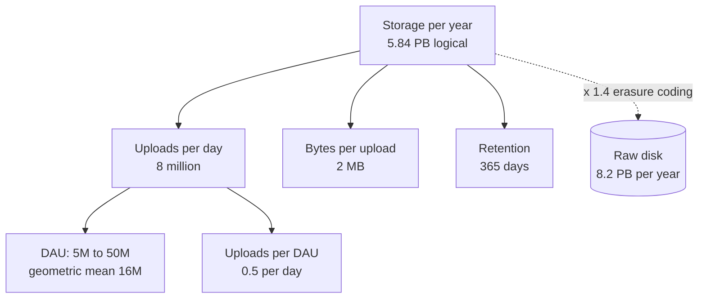

**Reading the diagram.** The root is the quantity you want; each child is a factor that multiplies into it, and the leaves are assumptions you state aloud. Arrows point from a result to what it is computed from, so you can read the tree top-down as an explanation or bottom-up as arithmetic. The dotted edge is a later adjustment: redundancy turns logical bytes into raw disk at the storage boundary (cylinder). The failure point of a tree is a leaf nobody questioned; the interviewer's follow-up usually targets the most uncertain leaf, here DAU. A tree scales to any estimate: replace "bytes per upload" with "tokens per call" and it sizes an LLM fleet.

**Figure 89.2 — The estimation loop.**

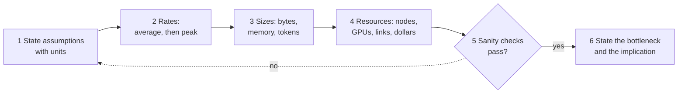

**Reading the diagram.** The loop runs left to right in a few minutes. Rates come before sizes because bandwidth and per-node load depend on peak rate, and resources come last because they divide load by capacity. The decision diamond is where an estimate earns trust: if a sanity check fails, return to the assumptions (dotted edge) rather than patching a number. The output is not a table of numbers but a sentence: what saturates first and what the design must do about it.

**Table 89.1 — Five sanity checks.**

| Check | Question | Example |
|---|---|---|
| Units | Do the units cancel to what you want? | requests/day ÷ s/day = requests/s |
| Per-user | Is the per-user figure believable? | 365 MB per DAU per year for a photo app |
| Second route | Does another decomposition agree within ~3×? | Storage from uploads, and from bandwidth × time |
| Reference | Is it near a known system or limit? | 280,000 RPS ≫ one database node (~10⁴) |
| Extremes | Does it behave sensibly at 0 and at 10×? | Doubling DAU should double storage, not square it |

::: mistake
**Computing the average and calling it capacity.** Servers fail at peak, not on average. Every rate in a capacity estimate must be converted to a design peak (§89.5) before it is divided by per-node capacity.
:::

::: mistake
**Precision theater.** "We need 47.3 servers" signals that you computed without thinking. Say "about 50, so two racks' worth or one autoscaling group", and spend the saved minute on the bottleneck.
:::

## 89.4 Reference numbers cheat sheet

The tables below collect the constants used in this book's estimates. They are order-of-magnitude anchors, dated **as of 2026**, with the owning section as source. Ratios between rows change far more slowly than the absolute values; measure your own hardware before committing money (§4.17).

**Table 89.2 — Time and rate conversions.**

| Conversion | Exact | Handy form |
|---|---|---|
| Seconds per day | 86,400 | ≈ 10⁵ (16% high) |
| Seconds per 30-day month / 365-day year | 2,592,000 / 31,536,000 | ≈ 2.6 × 10⁶ / ≈ π × 10⁷ |
| 1 million per day | 11.6 per second | ≈ 12/s |
| 1 billion per day | 11,574 per second | ≈ 12,000/s |
| 1 per second sustained | 86,400/day; 31.5 million/year | ≈ 10⁵/day |
| 1 MB/s sustained | 86.4 GB/day; 2.6 TB/month; 31.5 TB/year | ≈ 30 TB/year |
| 1 TB/day | 11.6 MB/s = 92.6 Mb/s | ≈ 0.1 Gb/s |
| 1 Gb/s | 125 MB/s = 10.8 TB/day | ≈ 10 TB/day |
| Peak-to-average ratio for busiest-hour share $h$, burst $b$ | $24\,h\,b$ | $h = 0.10, b = 2$: 4.8; $h = 0.20, b = 2$: 9.6 |

**Table 89.3 — Latency anchors (order of magnitude, as of 2025–2026; from Table 4.9).**

| Operation | Approximate value |
|---|---|
| Main-memory reference | ~100 ns |
| Read 4 KB randomly from NVMe SSD | ~50–100 µs |
| Round trip within one datacenter | ~50–500 µs |
| Read 1 MB sequentially from memory / NVMe / HDD | ~0.1 ms / ~0.2 ms / ~5 ms |
| HDD seek | ~4–10 ms |
| Round trip across a continent / California–Netherlands | ~50–100 ms / ~150 ms |
| LLM decode step, 8B model on one H100 | ~8 ms at batch 1; ~26 ms at batch 172 (§89.16) |

**Table 89.4 — Throughput and per-node capacity anchors (as of 2026).**

| Resource | Rough capacity | Source |
|---|---|---|
| Server DRAM bandwidth, one socket | ~0.3–0.6 TB/s | Table 64.1 |
| NVMe SSD sequential read | ~3–7 GB/s per drive | Table 4.9 (1 MB in 0.15–0.3 ms) |
| HDD sequential; random | ~200 MB/s; ~100–250 IOPS | Table 4.9 |
| NIC 10 / 25 / 100 Gb/s | 1.25 / 3.1 / 12.5 GB/s | §4.5 |
| GPU NIC, 400 Gb/s | 50 GB/s line rate | Table 64.8 |
| PCIe Gen5 x16 / NVLink 4 | ~64 / 450 GB/s per direction | Table 64.8 |
| H100 HBM3 | 3.35 TB/s, 80 GB | Table 64.2 |
| Stateless API node, simple JSON | ~10³ RPS | Table 2.17 |
| Relational primary, indexed writes | ~10³–10⁴ writes/s | Table 2.17, §14.7.4 |
| In-memory key-value node | ~10⁵ ops/s | Table 2.17 |
| Wide-column node, sustained writes | ~2.5 × 10⁴ writes/s (assumed) | §53.4.4 |
| Kafka partition, append | tens of MB/s | §31.5.2 |
| WebSocket gateway node | 2–5 × 10⁵ connections (design ceiling) | §9.9.2, §53.4.4 |

**Table 89.5 — Typical object sizes used in this book.**

| Object | Size | Source |
|---|---|---|
| Integer ID / UUID / timestamp | 8 B / 16 B / 8 B | — |
| Short-link record with indexes | 500 B | §52.4.4 |
| Chat message stored, with metadata | 300 B | §53.4.4 |
| Order record | 2 KB | §2.11 |
| Log line | 400 B | §56.6.4 |
| Metric sample, Gorilla-compressed | 1.37 B | §56.6.4 |
| GPS location update on the wire / stored | 200 B / 100 B | §55.4.4 |
| API JSON response (no images) | 1–20 KB | §2.11 |
| Photo original / four renditions / delivered | 3 MB / 390 KB / 150 KB | §53.6.4 |
| Video delivered (average) / H.264 ladder | 2.5 Mb/s / 0.4–6 Mb/s | §54.4.4, §21.8.2 |
| 768-dimension FP32 embedding / with ANN graph and metadata | 3,072 B / 3,400 B | §75.6.3 |
| English text per LLM token | ~4 characters, ~0.75 words (1.3 tokens per word) | §72.4.5 |
| KV cache per token: 7B MHA / 8B GQA / 70B GQA, FP16 | 524 / 131 / 328 KB | Table 73.3 |

**Table 89.6 — Accelerator constants (dense 16-bit, vendor datasheets, as of 2026; from Tables 64.3–64.4).**

| GPU | Dense BF16 | HBM bandwidth | HBM | Ridge point |
|---|---|---|---|---|
| A100 SXM 80 GB | 312 TFLOP/s | 2.0 TB/s | 80 GB | ~153 FLOPs/byte |
| H100 SXM | 989 TFLOP/s (FP8 1,979) | 3.35 TB/s | 80 GB | ~295 |
| H200 SXM | 989 TFLOP/s | 4.8 TB/s | 141 GB | ~206 |
| B200 | ~2,250 TFLOP/s | ~8 TB/s | ~180–192 GB | ~280 |

Datasheets headline tensor-core rates "with sparsity"; halve them for ordinary dense work (§64.8). Use dense figures and a measured utilization (MFU, §64.11) in every estimate.

::: warning
**Reference numbers are anchors, not facts.** Per-node capacities vary by 10× with language, payload and work per request, and prices change every year and differ by region and contract. In an interview, say "assume about 10³ RPS per node; I would load-test that"; in a design document, replace each anchor with a measurement and keep the date.
:::

## 89.5 Users and traffic

::: definition
**Definition — DAU, MAU and stickiness.** **Monthly active users (MAU)** and **daily active users (DAU)** count distinct users active in a month and in a day. Their ratio, DAU/MAU, is the **stickiness**: about 0.1–0.2 for an occasionally used app and above 0.5 for a messaging app used every day. The **peak-to-average ratio (PAR)** is the design peak rate divided by the daily average rate.
:::

Traffic estimation is a funnel: users become sessions, sessions become requests, requests become a daily volume, the daily volume becomes an average rate, and the average becomes a design peak. Each API request then fans out into several internal calls.

**Figure 89.3 — The traffic funnel, from users to per-service peak load.**


**Reading the diagram.** Each arrow multiplies or divides by one stated assumption, so a reviewer can challenge any edge in isolation. Users (stadiums) are people, the rectangles are request rates. The PAR edge is where most estimates go wrong: it carries the shape of the day (busiest-hour share) and the bursts above it. The last edge is fan-out: a single API request may call profile, catalog and ranking services, so internal load is a multiple of external load and must be sized separately. The flow is a planning model, synchronous throughout, with no storage boundary.

::: formula
**Users to design-peak traffic (handbook form of §2.11 and §4.5.3)**

$$U_{\text{DAU}} = \sigma\, U_{\text{MAU}} \qquad V = U_{\text{DAU}}\, a \qquad \bar{R} = \frac{V}{86{,}400} \qquad R_{\text{peak}} = \frac{V\, h}{3{,}600}\, b = \bar{R} \times 24\, h\, b \qquad \rho_{rw} = \frac{V_{\text{read}}}{V_{\text{write}}}$$

| Symbol | Meaning | Units |
|---|---|---|
| $U_{\text{MAU}}$, $U_{\text{DAU}}$ | Monthly and daily active users | users |
| $\sigma$ | Stickiness, DAU/MAU | dimensionless |
| $a$ | Requests of one type per DAU per day | requests/user/day |
| $V$ | Daily volume of that request type | requests/day |
| $\bar{R}$ | Average rate | requests/s |
| $h$ | Share of daily volume in the busiest hour (1/24 for flat traffic) | fraction |
| $b$ | Burst factor above the busiest-hour average | dimensionless |
| $R_{\text{peak}}$ | Design peak rate | requests/s |
| $\rho_{rw}$ | Read-to-write ratio | dimensionless |
:::

::: example
**Worked example — A recipe-sharing app with 30 million MAU.** Assumptions: stickiness 0.4; each DAU opens the app 3 times a day and each session makes 8 API reads (24 reads); 0.6 writes per DAU per day (saves, ratings, comments); $h = 0.10$, $b = 2$; each API request makes 3 internal calls.

1. DAU: $0.4 \times 30 \times 10^6 = 12 \times 10^6$.
2. Reads: $12 \times 10^6 \times 24 = 2.88 \times 10^8$/day; average $2.88 \times 10^8 / 86{,}400 = 3{,}333$ RPS.
3. Read peak: $2.88 \times 10^8 \times 0.10 / 3{,}600 \times 2 = 16{,}000$ RPS. PAR $= 24 \times 0.10 \times 2 = 4.8$.
4. Writes: $12 \times 10^6 \times 0.6 = 7.2 \times 10^6$/day; average 83/s; peak $83.3 \times 4.8 = 400$/s.
5. Read-to-write ratio: $2.88 \times 10^8 / 7.2 \times 10^6 = 40$.
6. Internal calls at peak: $16{,}000 \times 3 = 48{,}000$ RPS.

**Interpretation.** A 30-million-user product is about 16,000 RPS of reads and 400 writes per second at peak: a read-heavy system where one relational primary absorbs every write. **Engineering implication.** Spend the design on caching and read scaling (§89.8), size internal services for 48,000 RPS rather than 16,000, and do not partition the write path yet.
:::

**Table 89.7 — Peak-to-average ratios used in this book (assumptions, not measurements).**

| Workload | PAR | Why | Source |
|---|---|---|---|
| Global consumer feed or search | 2 | Time zones flatten the day | §53.7.4, §56.4.4 |
| Regional chat, ride-hailing | 3 | Evening peak in one or a few time zones | §53.4.4, §55.4.4 |
| Default case-study rule ($h = 0.10$, $b = 2$) | 4.8 | Busy hour plus bursts | §52.3 |
| Payments in a holiday sale | 5 | Seasonal spike | §82.4.4 |
| Food delivery dinner rush ($h = 0.20$, $b = 2$) | 9.6 | Two meal peaks dominate | §2.11, §18.11.3 |
| Ticket on-sale, flash sale | 100s to 1,000s | Demand concentrated on one item in minutes | §55.8.4 |

::: mistake
**Applying one PAR to everything.** Writes, reads, batch jobs and notification campaigns peak at different times and by different factors; a campaign that pushes 10 million notifications at 18:00 creates its own peak (§52.7). Estimate a peak per traffic class, and remember that a global service's peak is set by its largest region's evening, not the global average.
:::

::: mistake
**Counting registered users as active.** Ten million registered customers may be four million weekly and two million daily actives (QuickBite, §57). Size online paths from DAU and concurrent users; size storage from everyone whose data you keep.
:::

## 89.6 Storage

Storage estimates multiply a daily growth by retention, then adjust for what the bytes become on disk: indexes add, compression subtracts, and redundancy multiplies.

**Figure 89.4 — From one record to raw disk.**

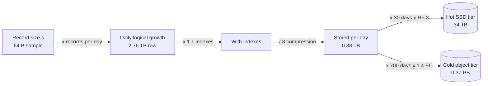

**Reading the diagram.** A record becomes daily growth, gains index overhead, shrinks by compression, and then splits by age into tiers (cylinders are storage boundaries). Each tier has its own retention and its own redundancy scheme: three-way replication on the hot tier for fast reads and simple repair, erasure coding on the cold tier for cost. Failure point: forgetting a multiplier, usually replication or indexes. Scaling: storage grows linearly forever unless retention, downsampling or tiering bend the curve.

::: formula
**Stored bytes with indexes, compression and redundancy**

$$S = n_{\text{day}}\; s\; \frac{1 + x}{c}\; T\; k \qquad k_{\text{rep}} = r \qquad k_{\text{EC}} = \frac{d + m}{d}$$

| Symbol | Meaning | Units |
|---|---|---|
| $S$ | Raw bytes on disk for one tier | bytes |
| $n_{\text{day}}$ | Records written per day | records/day |
| $s$ | Logical size per record | bytes |
| $x$ | Index and storage-engine overhead | fraction |
| $c$ | Compression ratio (1 = none) | dimensionless |
| $T$ | Days the tier keeps data | days |
| $k$ | Redundancy multiplier | dimensionless |
| $r$ | Replication factor | copies |
| $d$, $m$ | Data and parity fragments of an erasure code RS($d$, $m$) (§15.6) | count |
:::

::: example
**Worked example — Telemetry from 5 million devices.** Each device sends a 64-byte sample every 10 s. Indexes add 10%; columnar time-series compression is 8:1. Hot tier: 30 days on SSD with replication factor 3. Cold tier: the next 700 days (two years in total) in object storage with RS(10,4), $k = 1.4$.

1. Samples per day: $5 \times 10^6 \times 86{,}400 / 10 = 4.32 \times 10^{10}$. Raw bytes: $4.32 \times 10^{10} \times 64 = 2.76$ TB/day.
2. Stored per day: $2.76 \times 1.1 / 8 = 0.380$ TB.
3. Hot tier: $0.380 \times 30 \times 3 = 34.2$ TB of SSD.
4. Cold tier: $0.380 \times 700 \times 1.4 = 372$ TB; with three replicas instead it would be 798 TB, so erasure coding saves 426 TB.
5. Total: about 0.41 PB. Without compression or tiering, two years at RF 3: $2.76 \times 1.1 \times 730 \times 3 = 6.66$ PB, 16 times more.

**Interpretation.** Compression and redundancy choice matter more than raw volume: the same data costs 0.41 PB or 6.7 PB. **Engineering implication.** State compression, retention and redundancy per tier explicitly; downsampling old data (keeping 5-minute averages, §56.6.4) would shrink the cold tier by another order of magnitude.
:::

**Table 89.8 — Replication versus erasure coding (§15.6).**

| Scheme | Overhead $k$ | Losses tolerated | Fragments read to repair one | Choose when |
|---|---|---|---|---|
| 3 replicas | 3.0× | 2 | 1 | Hot, small, latency-sensitive data; databases |
| RS(6,3) | 1.5× | 3 | 6 | Warm data, fewer failure domains |
| RS(10,4) | 1.4× | 4 | 10 | Large cold objects, 14 or more failure domains |

::: industry
**Facebook f4 warm-blob storage.** Muralidhar et al. report moving warm photos from Haystack, with an effective replication factor of 3.6, to f4, with an effective factor of 2.1, by combining RS(10,4) within a datacenter with XOR coding across datacenters. At exabyte scale that difference is the main storage cost lever.
*Evidence: Primary* — [Muralidhar et al. 2014]
:::

::: mistake
**Storing per recipient instead of per object.** A group message stored once per member multiplies storage by group size (6.4× in §53.4.4); a feed stored per follower multiplies by audience. Decide whether a fan-out writes *pointers* or *copies* before multiplying.
:::

## 89.7 Bandwidth

::: formula
**Bandwidth, origin load and streaming concurrency**

$$B = R\, s \times 8 \qquad B_{\text{origin}} = B_{\text{users}}\,(1 - O_B) \qquad V_{\text{conc}} = \lambda_{\text{start}}\, W \qquad B_{\text{video}} = V_{\text{conc}}\; r_{\text{bit}}$$

| Symbol | Meaning | Units |
|---|---|---|
| $B$ | Bandwidth | bits/s |
| $R$, $s$ | Transfer rate and bytes per transfer | transfers/s, bytes |
| $O_B$ | CDN byte offload: share of user bytes served from cache (§21.5.1) | fraction |
| $B_{\text{users}}$, $B_{\text{origin}}$ | Bandwidth delivered to users; bandwidth the origin must serve | bits/s |
| $\lambda_{\text{start}}$ | Rate at which viewing sessions start | sessions/s |
| $W$ | Average session (view) duration | s |
| $V_{\text{conc}}$ | Concurrent viewers, by Little's Law (§4.11) | viewers |
| $r_{\text{bit}}$ | Average delivered bitrate | bits/s |
:::

::: example
**Worked example — A video-learning platform.** Assumptions: 20 million views per day of 12 minutes on average; delivered bitrate 3 Mb/s; PAR 3; CDN byte offload 95%; prices from the chapter note.

1. View starts: average $20 \times 10^6 / 86{,}400 = 231$/s; peak $694$/s.
2. Concurrent viewers at peak: $694 \times 720 = 500{,}000$ (average 167,000).
3. Peak egress to users: $500{,}000 \times 3 \times 10^6 = 1.5$ Tb/s.
4. Origin at 95% offload: $1.5 \times 0.05 = 75$ Gb/s at peak.
5. Bytes per day: $20 \times 10^6 \times 720 \times 3 \times 10^6 / 8 = 5.4$ PB; origin share $270$ TB.
6. Cost per day: CDN $5.4 \times 10^6$ GB × \$0.01 = \$54,000; origin $270{,}000$ GB × \$0.05 = \$13,500. Serving everything from cloud egress would cost $5.4 \times 10^6 \times 0.05 = \$270{,}000$ a day.

**Interpretation.** Requests are few (under 700 starts per second) but bytes are enormous, and delivery cost dwarfs compute. **Engineering implication.** Video bytes belong to the CDN; the origin is sized for cache misses and shielded (§21.5); each point of offload is worth 15 Gb/s of origin capacity here, and lowering the average bitrate by better encoding (§54.4) cuts the largest bill linearly.
:::

**Figure 89.5 — Where bandwidth is counted.**


**Reading the diagram.** Viewer traffic is synchronous HTTPS between users and CDN edges; only misses travel inward, collapsed further by an origin shield, to object storage (cylinder, storage boundary). Uploads arrive on a separate, much smaller ingress path. Failure points: a cold or purged CDN multiplies origin load by up to 20× at 95% offload, and egress is billed at every arrow that leaves the provider. Scaling: more edges and a higher offload for egress, a larger shield for origin.

::: mistake
**Sizing a link at its line rate.** A 10 Gb/s NIC delivers less after TCP, TLS and framing overhead and should run below about 70% to absorb bursts. Divide by a target utilization exactly as for CPUs, and remember that egress and ingress are separate budgets.
:::

## 89.8 Caching

A cache estimate answers three questions: how much memory holds the hot data (the **working set**), what hit ratio that memory buys, and what load the misses leave for the backend. The mechanics, eviction policies and failure modes are Chapter 20's; this section gives the arithmetic.

::: formula
**Working set, hit ratio and backend load (§20.3.2–§20.3.3)**

$$M = K\, s\, o \qquad h_{\text{Zipf}}(K) \approx \frac{\ln K + \gamma}{\ln N + \gamma} \qquad R_{\text{db}} = (1 - h)\, R_{\text{read}} + R_{\text{write}}$$

| Symbol | Meaning | Units |
|---|---|---|
| $M$ | Cache memory needed, one copy | bytes |
| $K$ | Keys held (the hottest $K$) | keys |
| $s$ | Value size | bytes |
| $o$ | Overhead factor for keys, pointers and allocator slack (1.5–2) | dimensionless |
| $N$ | Distinct keys requested | keys |
| $\gamma$ | Euler–Mascheroni constant, 0.577 | dimensionless |
| $h$ | Hit ratio (Zipf popularity with exponent 1, ideal policy) | fraction |
| $R_{\text{read}}$, $R_{\text{write}}$ | Reads reaching the cache; writes, which reach the database regardless | requests/s |
| $R_{\text{db}}$ | Load reaching the database | requests/s |
:::

::: example
**Worked example — A product catalog with 100 million items.** Peak 200,000 reads/s and 2,000 writes/s; 2 KB per item; overhead 1.5; popularity roughly Zipf with exponent 1.

1. Cache the top 1 million: $M = 10^6 \times 2{,}000 \times 1.5 = 3$ GB; $h \approx (13.82 + 0.58)/(18.42 + 0.58) = 0.758$; $R_{\text{db}} = 0.242 \times 200{,}000 + 2{,}000 = 50{,}500$/s.
2. Top 10 million: 30 GB; $h \approx 0.879$; $R_{\text{db}} = 26{,}200$/s.
3. Top 30 million: 90 GB; $h \approx 0.937$; $R_{\text{db}} = 14{,}700$/s.
4. Cold cache after a restart: $R_{\text{db}} = 202{,}000$/s, 7.7 times the 10-million-key steady state.

**Interpretation.** Each 10× of cache memory adds about 12 points of hit ratio, but because the backend sees *misses*, going from 87.9% to 93.7% halves database load. **Engineering implication.** Size the cache from the backend's capacity: choose $h$ so that $R_{\text{db}}$ fits the database at its target utilization, then buy the memory that delivers it, replicated across zones. Plan warm-up or request coalescing for the cold-cache case (§20.11, §20.13), because the database cannot absorb 7.7×.
:::

**Figure 89.6 — How hit ratio sets backend load.**

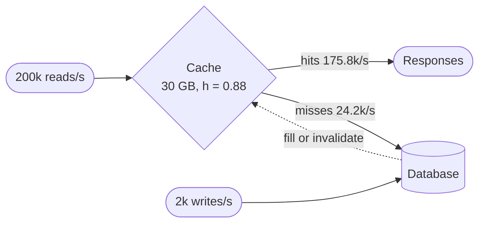

**Reading the diagram.** Reads hit the cache first (synchronous); only misses, plus every write, reach the database (cylinder, storage boundary). Fills and invalidations flow back asynchronously (dotted). The failure point is the miss edge: it grows by a factor of $1/(1-h)$ when the cache empties. Scaling the cache raises $h$ with diminishing returns; scaling the database is needed only if even the realistic miss rate exceeds it.

::: mistake
**Estimating hit ratio from the share of keys cached.** Caching 10% of keys gives far more than 10% of hits under skew (88% above), and caching 100% of keys does not give 100% when TTLs, invalidations and new keys cause misses. When the whole dataset fits (2 million recipes × 4 KB × 1.5 = 12 GB for §89.5's app), cache all of it and estimate misses from writes and TTL instead.
:::

## 89.9 Database sizing

A database is sized by the largest of three demands, storage, writes and reads after caching, each divided by what one node delivers at a safe fill or utilization (§14.7.4). Connection counts form a fourth, often forgotten, limit.

::: formula
**Shards and connections (handbook form of §14.7.4 and §4.11)**

$$S = \left\lceil \max\left(\frac{D}{C_{\text{disk}}\, f},\; \frac{W}{w_{\text{node}}\, u},\; \frac{R_{\text{db}}}{n_{\text{read}}\, r_{\text{node}}\, u}\right)\right\rceil \qquad L_{\text{conn}} = R_q\, t_{\text{hold}} \qquad C_{\text{open}} = P\, S\, p$$

| Symbol | Meaning | Units |
|---|---|---|
| $S$ | Shards (each a replicated group) | shards |
| $D$ | Data at the planning horizon, one copy, with indexes | TB |
| $C_{\text{disk}}$, $f$ | Usable disk per node; target fill fraction | TB; fraction |
| $W$, $w_{\text{node}}$ | Peak writes; writes one primary sustains | writes/s |
| $R_{\text{db}}$, $r_{\text{node}}$ | Peak reads after caches; reads one node sustains | reads/s |
| $n_{\text{read}}$ | Nodes per shard serving reads | nodes |
| $u$ | Target utilization | fraction |
| $L_{\text{conn}}$ | Connections busy on average | connections |
| $R_q$, $t_{\text{hold}}$ | Query rate; time each query holds a connection | queries/s; s |
| $C_{\text{open}}$ | Connections opened by $P$ application instances with pool size $p$ per shard | connections |
:::

::: example
**Worked example — An order-history store.** Horizon data $D = 40$ TB with indexes; 8 TB usable per node at $f = 0.6$; peak writes 30,000/s at $w_{\text{node}} = 10{,}000$; reads after cache 60,000/s served by 2 replicas per shard at 20,000 each; $u = 0.6$; queries hold a connection for 2 ms; 120 application pods.

1. Storage term: $40 / (8 \times 0.6) = 8.33$. Write term: $30{,}000 / 6{,}000 = 5$. Read term: $60{,}000 / (2 \times 20{,}000 \times 0.6) = 2.5$.
2. $S = \lceil 8.33 \rceil = 9$ shards, storage-bound; 27 nodes with a primary and two replicas each, three shards' primaries per zone.
3. Busy connections: $(30{,}000 + 60{,}000) \times 0.002 = 180$ fleet-wide, 20 per shard.
4. Opened connections with a pool of 5 per shard per pod: $120 \times 9 \times 5 = 5{,}400$, 600 per shard, 30 times the 20 in use.

**Interpretation.** The store is storage-bound, so the write path has 40% spare capacity at the horizon; but naive pooling opens 30 times more connections than the work needs, enough to exhaust a PostgreSQL server's process limit. **Engineering implication.** Compute all three shard terms and benchmark the binding one; put a transaction-mode pooler between pods and primaries (§14.13, §18.8.5); create many logical shards (for example 720) so physical shards can be added in small steps (§14.7.4).
:::

**Figure 89.7 — Three demands, one shard count.**

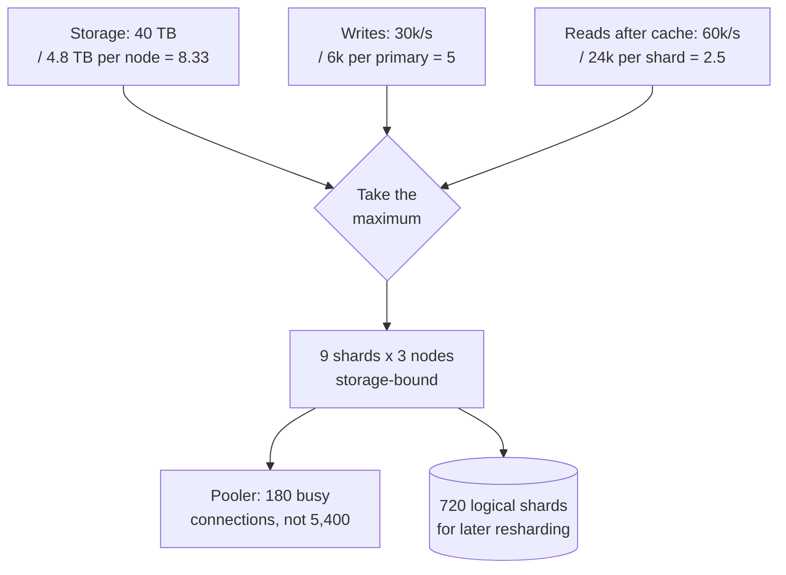

**Reading the diagram.** The three inputs are independent capacity demands; the diamond picks the binding one. Below it, two operational consequences: the connection budget, which a pooler enforces, and the logical-shard map, the storage boundary that makes later growth a data move rather than a re-keying. Failure points: a wrong per-node benchmark in the binding term, and a hot shard that a uniform estimate hides (§14.8). Scaling: add physical shards by moving logical ones.

::: mistake
**Sizing a database from today's data.** Size for the horizon (often 18–24 months) plus the fill fraction; a node at 90% disk cannot compact, back up or rebalance. Growth also changes which term binds: a write-bound store usually becomes storage-bound as history accumulates (§53.4.4).
:::

## 89.10 Servers and memory

Application fleets are sized by whichever runs out first: CPU, concurrency (threads, connections, sockets) or memory. Then failure headroom is added on top of queueing headroom (§18.11.2).

::: formula
**CPU-bound, concurrency-bound and redundant fleet size**

$$N_{\text{cpu}} = \left\lceil \frac{R\, c_{\text{cpu}}}{k\, u} \right\rceil \qquad N_{\text{conc}} = \left\lceil \frac{R\, W}{T_{\text{node}}\, u} \right\rceil \qquad N_{\text{total}} = N + n_{\text{spare}} \;\;\text{or}\;\; \left\lceil N\, \frac{Z}{Z - f} \right\rceil$$

| Symbol | Meaning | Units |
|---|---|---|
| $R$ | Peak requests | requests/s |
| $c_{\text{cpu}}$ | CPU time per request, from a profile or load test | vCPU-s |
| $k$ | vCPUs per node | vCPU |
| $u$ | Target utilization | fraction |
| $W$ | Time a request occupies a thread or slot (Little's Law, §4.11) | s |
| $T_{\text{node}}$ | Concurrent slots per node (threads, connections) | slots |
| $N$ | Larger of $N_{\text{cpu}}$, $N_{\text{conc}}$ and a memory term | nodes |
| $n_{\text{spare}}$ | Spares: 1 for N+1, 2 for N+2 | nodes |
| $Z$, $f$ | Zones used; zones that may fail without overload | count |
:::

::: example
**Worked example — The recipe app's API tier.** From §89.5: 16,000 RPS at peak. Profile: 4 ms of CPU per request; each request waits 120 ms on downstream calls, so it occupies a worker for 124 ms. Nodes have 16 vCPU and, with a thread-per-request server, 200 worker threads; $u = 0.6$; three zones.

1. CPU: $16{,}000 \times 0.004 = 64$ busy vCPU; $N_{\text{cpu}} = \lceil 64 / 9.6 \rceil = 7$.
2. Concurrency: $L = 16{,}000 \times 0.124 = 1{,}984$ requests in flight; $N_{\text{conc}} = \lceil 1{,}984 / 120 \rceil = 17$.
3. Memory: at 1 MB per in-flight request, 2 GB across the fleet: not binding.
4. Thread-per-request: $N = 17$; zone-safe $\lceil 17 \times 3/2 \rceil = 26$. An asynchronous server removes the thread limit: $N = 7$, zone-safe $\lceil 10.5 \rceil = 11$, rounded to 12 for four per zone. Losing a zone leaves 8 nodes at $64 / 128 = 50\%$ CPU.

**Interpretation.** The same traffic needs 26 or 12 nodes depending on whether waiting holds a thread. **Engineering implication.** Compute concurrency with Little's Law for every I/O-heavy service; if a downstream slows from 120 ms to 1 s, $L$ rises to 16,000 and a thread-bound fleet collapses, which is why timeouts and bulkheads are capacity mechanisms (§22.11).
:::

**Figure 89.8 — Fleet sizing flow.**

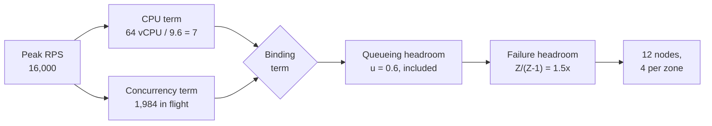

**Reading the diagram.** Peak load feeds two independent terms (a memory term would be a third); the diamond selects the larger. Queueing headroom is already inside each term through $u$; failure headroom is applied once, afterward, either as spares or as zone-level static stability (§18.11.2). Failure points: measuring per-node capacity at saturation rather than at the latency objective, and applying headroom twice. Scaling: autoscaling moves the fleet between a zone-safe floor and the peak size.

::: mistake
**Stacking headroom factors.** Dividing by $u = 0.6$, then adding 50% "for safety", then doubling for zones turns 7 nodes into 35. Name each headroom once: queueing ($u$), failure ($Z/(Z-f)$ or spares) and growth (lead time, §18.11.4).
:::

## 89.11 Queues and streams

A log-based broker such as Kafka is sized in partitions (parallelism), consumers (processing capacity), disk (retention) and lag (how far consumers trail producers). Partitioning mechanics are in §31.5.

::: formula
**Partitions, consumers, broker disk and lag (§31.5.2, §56.6.4, §4.11)**

$$P = \left\lceil h_{\text{room}} \max\left(\frac{T}{t_p}, \frac{T}{t_c}\right) \right\rceil \qquad n_c = \left\lceil \frac{T}{c_i\, u} \right\rceil \le P \qquad B = \frac{\bar{r}}{\rho}\, T_{\text{ret}}\, r \qquad W_{\text{lag}} = \frac{Q}{\lambda} \qquad T_{\text{catch}} = \frac{Q}{C - \bar{r}}$$

| Symbol | Meaning | Units |
|---|---|---|
| $T$ | Peak topic throughput | MB/s |
| $t_p$, $t_c$ | Measured produce and consume throughput of one partition | MB/s |
| $h_{\text{room}}$ | Headroom for growth and key skew | dimensionless |
| $c_i$ | Throughput of one consumer instance, including its processing | MB/s |
| $n_c$ | Consumer instances (no more than partitions) | instances |
| $\bar{r}$, $\rho$, $r$ | Average ingest; compression ratio; replication factor | MB/s; —; copies |
| $T_{\text{ret}}$, $B$ | Retention; broker disk | s; bytes |
| $Q$, $\lambda$ | Backlog; consumption rate | bytes or messages; per s |
| $W_{\text{lag}}$ | Lag expressed in time | s |
| $C$, $T_{\text{catch}}$ | Total consumer capacity; time to drain a backlog while new data arrives | MB/s; s |
:::

::: example
**Worked example — A clickstream topic.** 500,000 events/s at peak and 200,000/s on average, 500 bytes each; a partition takes 50 MB/s of produce but its consumer, which writes to a database, manages 5 MB/s per partition; headroom 1.5; one consumer instance processes 10 MB/s; compression 4:1; retention 3 days; RF 3.

1. Peak throughput: $500{,}000 \times 500 = 250$ MB/s (average 100 MB/s).
2. Partitions: $\lceil 1.5 \times \max(5, 50) \rceil = 75$; choose 96, which divides evenly among 24, 32 or 48 consumers.
3. Consumers: $\lceil 250 / (10 \times 0.6) \rceil = 42$; deploy 48, two partitions each, total capacity 480 MB/s.
4. Broker disk: $100 / 4 \times 259{,}200 \times 3 = 19.4$ TB.
5. A 10-minute consumer outage at average load leaves $Q = 60$ GB (120 million events); catch-up: $60{,}000 / (480 - 100) = 158$ s.
6. Lag in time: a steady backlog of 2 million events consumed at 200,000/s is $W_{\text{lag}} = 10$ s behind.

**Interpretation.** The consumer, not the broker, sets the partition count, and consumer headroom sets recovery time. **Engineering implication.** Over-partition modestly at creation (re-partitioning moves keys, §31.5.3), alert on lag in seconds rather than messages, and provision consumers at about 2× average so a backlog drains in minutes.
:::

**Figure 89.9 — Sizing a topic and its consumer group.**


**Reading the diagram.** Producers append synchronously to partitions chosen by key; consumers pull asynchronously (dotted), each owning whole partitions, so partitions cap consumer parallelism. Broker disk (a storage boundary) holds the retention window that lets consumers fall behind without loss. Failure points: a slow sink makes lag grow; a hot key overloads one partition however many exist. Scaling: add consumers up to the partition count, then add partitions with care.

::: mistake
**Sizing partitions from producer throughput only.** Brokers append at tens of MB/s per partition, but a consumer that calls a database per event may process a tenth of that. Measure the consume path first.
:::

## 89.12 Availability and durability budgets

Nines translate into time, failed requests or lost objects. The derivations are in §4.14 and §4.16; the handbook needs the conversions and the composition rules.

**Table 89.9 — Nines and their budgets (365-day year, 30-day month; from Table 4.7).**

| Availability | Downtime per year | Per month | Failed requests per billion |
|---|---|---|---|
| 99% | 3.65 days | 7.2 h | 10,000,000 |
| 99.9% | 8.76 h | 43.2 min | 1,000,000 |
| 99.95% | 4.38 h | 21.6 min | 500,000 |
| 99.99% | 52.6 min | 4.32 min | 100,000 |
| 99.999% | 5.26 min | 25.9 s | 10,000 |

::: formula
**Budgets and composition (§4.14, §4.16)**

$$D = (1 - A)\, T \qquad A_{\text{series}} = \prod_i A_i \qquad A_{\text{parallel}} = 1 - \prod_i (1 - A_i) \qquad E[\text{lost}] = N_{\text{obj}}\, P_{\text{loss/yr}}$$

| Symbol | Meaning | Units |
|---|---|---|
| $A$, $A_i$ | Availability of the system or of component $i$ | fraction |
| $T$, $D$ | Period; allowed downtime (error budget in time) | min or h |
| $N_{\text{obj}}$ | Objects stored | objects |
| $P_{\text{loss/yr}}$ | Annual loss probability per object ($10^{-11}$ for eleven nines) | probability |
| $E[\text{lost}]$ | Expected objects lost per year | objects |
:::

::: example
**Worked example — A checkout path.** In series: CDN 99.99%, API tier 99.95%, database 99.95%, external payment provider 99.9%. Target: 99.95%.

1. Series: $0.9999 \times 0.9995 \times 0.9995 \times 0.999 = 0.99790$: 18.4 hours of downtime a year, worse than any single component.
2. Database pair with fast failover, treated as parallel: $1 - 0.0005^2 = 0.99999975$; path $= 0.99840$, 14.0 h/year. Still short.
3. Take the payment call off the synchronous path (authorize asynchronously, retry, confirm by notification): $0.9999 \times 0.9995 \times 0.99999975 = 0.99940$, 5.3 h/year. Closer; the API tier is now the limit.
4. Request budget: at 1 billion checkout requests a month and 99.9%, 1 million may fail.
5. Durability: 10¹⁰ objects at eleven nines lose $10^{10} \times 10^{-11} = 0.1$ objects a year in expectation; at nine nines, 10.

**Interpretation.** A chain is weaker than its weakest link, and an external dependency often caps the whole path. **Engineering implication.** Draw the synchronous path, multiply, and remove or parallelize the components that dominate; never promise more nines than your least available synchronous dependency. Durability nines mean "few objects per year at your scale", not "never", and they ignore correlated failures and bugs (§4.16), so backups outside the replication system remain necessary.
:::

::: mistake
**Adding nines by adding replicas without independence.** Two nodes behind the same bad deploy, power feed or configuration fail together; the parallel formula assumes independence and gives an upper bound. Spread replicas over failure domains and budget failover time explicitly.
:::

## 89.13 ML estimation

An ML system adds four estimates to the usual ones: how much training data accumulates, how many feature lookups serving issues, how much memory embedding tables take, and how many CPUs or GPUs inference needs. Each has an owning section; the handbook forms are below.

::: formula
**Training rows, feature reads, embedding memory and inference fleet**

$$n_{\text{train}} = n_{\text{ev}}\,(\pi + \beta(1 - \pi)) \qquad K_{\text{feat}} = R\,(e + m) \qquad M_{\text{emb}} = \sum_t V_t\, d_t\, s\,(1 + k_{\text{opt}}) \qquad N_{\text{inf}} = \left\lceil \frac{R\, m\, c}{k\, u} \right\rceil + N_{\text{red}}$$

| Symbol | Meaning | Units |
|---|---|---|
| $n_{\text{ev}}$ | Logged examples (impressions, transactions) per day | examples/day |
| $\pi$, $\beta$ | Positive rate; fraction of negatives kept by downsampling (§63.11) | fraction |
| $n_{\text{train}}$ | Training rows kept per day | rows/day |
| $R$ | Peak inference requests | requests/s |
| $e$, $m$ | Entity keys per request (user, context); items scored per request | keys; items |
| $K_{\text{feat}}$ | Feature-store key reads (§62.11.1) | keys/s |
| $V_t$, $d_t$, $s$ | Rows, dimension and bytes per value of embedding table $t$ (§68.8) | rows; values; bytes |
| $k_{\text{opt}}$ | Optimizer copies per value: Adam 2, SGD 0, row-wise Adagrad ≈ 0 | copies |
| $c$ | CPU time per scored item | vCPU-s |
| $k$, $u$, $N_{\text{red}}$ | vCPUs per node; target utilization; redundancy (§60.11.1) | vCPU; fraction; nodes |
:::

::: example
**Worked example — Ranking for a marketplace with 50 million users and 10 million listings.** Assumptions: 128-dimension FP32 embeddings for users and listings; peak 5,000 ranking requests/s with PAR 3; 200 listings scored per request at 50 µs of CPU each; 20 listings shown per request; click rate 2%; keep all clicks and 5% of non-clicks; 500 bytes per logged example; 16-vCPU nodes at $u = 0.5$.

1. Embeddings: users $5 \times 10^7 \times 128 \times 4 = 25.6$ GB; listings 5.12 GB; total 30.7 GB. Training with dense Adam: $\times 3 = 92.2$ GB, more than one 80 GB GPU; with row-wise Adagrad, about 31.0 GB, which fits. FP16 serving copy: 15.4 GB.
2. Feature reads at peak: $5{,}000 \times (1 + 200) = 1.005$ million keys/s, 99.5% of them item keys.
3. Logged impressions: average $5{,}000 / 3 = 1{,}667$ requests/s, $1.44 \times 10^8$ requests/day, $\times 20 = 2.88 \times 10^9$ impressions/day, 1.44 TB/day.
4. Training rows: $2.88 \times 10^9 \times (0.02 + 0.05 \times 0.98) = 1.99 \times 10^8$/day, 99.4 GB/day; a 30-day window is 3.0 TB.
5. Inference: $5{,}000 \times 200 \times 50\ \mu\text{s} = 50$ busy cores; at $u = 0.5$, 100 vCPU, 7 nodes, plus redundancy.

**Interpretation.** The model is small to serve (50 cores) and its tables fit one GPU if the optimizer is chosen well; the large quantities are the 1 million feature reads per second and the 1.4 TB/day of logs. **Engineering implication.** Replicate the item feature view next to the rankers instead of reading 200 keys across a partitioned store (§85.4.4), downsample negatives at logging time, and choose the optimizer with the memory estimate in hand.
:::

**Figure 89.10 — The ML estimation tree.**

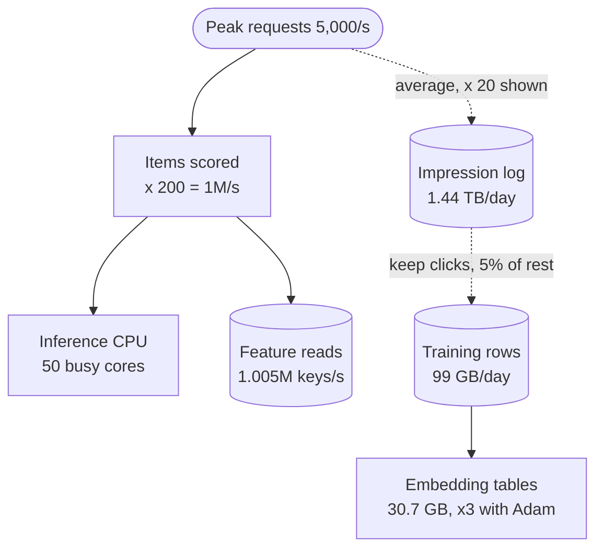

**Reading the diagram.** The solid path is synchronous serving: requests multiply into scored items, which drive both CPU and feature-store reads (cylinder). The dotted path is asynchronous: impressions are logged, downsampled and turned into training data, which trains embedding tables whose size depends on the optimizer. Failure points: the per-request item count, which multiplies three resources at once, and an unbounded impression log. Scaling: cut items per request with a cheaper first stage (§68.4), and downsample before storing.

::: mistake
**Sizing ML serving by requests instead of predictions.** One recommendation or ETA request scores tens to hundreds of items (20 restaurants per QuickBite search, §60.11); fleets, feature reads and logs scale with predictions per second.
:::

## 89.14 GPU memory

GPU memory is the first wall an ML estimate hits. Four consumers compete for it: weights, optimizer state and gradients (training only), activations, and the KV cache (LLM serving only).

**Table 89.10 — Weight memory by precision (decimal GB).**

| Parameters | FP32 (4 B) | BF16/FP16 (2 B) | FP8/INT8 (1 B) | INT4 (0.5 B) | Training state, 16 B per parameter |
|---|---|---|---|---|---|
| 7B | 28 | 14 | 7 | 3.5 | 112 |
| 8B | 32 | 16 | 8 | 4 | 128 |
| 70B | 280 | 140 | 70 | 35 | 1,120 |
| 405B | 1,620 | 810 | 405 | 203 | 6,480 |

::: formula
**Training and serving memory (§65.3, §65.9, §72.11, §73.5)**

$$M_{\text{train}} = \frac{16\,N}{p} + M_{\text{act}} \qquad k_{\text{tok}} = 2\, L\, n_{\text{kv}}\, d_h\, b_{\text{kv}} \qquad M_{\text{KV}} = u\, M_{\text{GPU}} - \frac{N b_w}{t} - M_{\text{act}} - M_{\text{fw}} \qquad S_{\max} = \left\lfloor \frac{t\, M_{\text{KV}}}{k_{\text{tok}}\, n_{\text{ctx}}} \right\rfloor$$

| Symbol | Meaning | Units |
|---|---|---|
| $N$ | Parameters | parameters |
| 16 | BF16 weights and gradients (2 + 2) plus FP32 master weights and two Adam moments (4 + 4 + 4) | bytes/parameter |
| $p$ | Sharding degree with ZeRO-3/FSDP (1 for plain data parallelism) | GPUs |
| $M_{\text{act}}$ | Activation memory per GPU (training) or activation reserve (serving) | bytes |
| $k_{\text{tok}}$ | KV-cache bytes per token for the whole model | bytes/token |
| $L$, $n_{\text{kv}}$, $d_h$, $b_{\text{kv}}$ | Layers; KV heads; head dimension; bytes per KV value | —; —; —; bytes |
| $u$, $M_{\text{GPU}}$ | Fraction of memory the engine manages (0.9); GPU memory | —; bytes |
| $b_w$, $t$ | Bytes per weight; tensor-parallel degree | bytes; GPUs |
| $M_{\text{fw}}$ | Framework overhead | bytes |
| $S_{\max}$, $n_{\text{ctx}}$ | Concurrent sequences that fit; tokens per sequence | sequences; tokens |
:::

::: example
**Worked example — A 70B model (80 layers, 8 KV heads of 128 dimensions) on 80 GB GPUs.**

1. Weights: 140 GB in BF16, at least two GPUs; 70 GB in FP8 fits one GPU but leaves only about 2 GB of its 72 GB managed budget for everything else; INT4, 35 GB.
2. Training: $16 \times 70 \times 10^9 = 1.12$ TB of model state; ZeRO-3 over 64 GPUs, 17.5 GB each, plus activations: 521 GB per 4,096-token sequence without recomputation (§65.3), so recomputation and tensor or pipeline parallelism are needed.
3. KV cache per token: $2 \times 80 \times 8 \times 128 \times 2 = 327{,}680$ B; one 4,096-token sequence 1.34 GB; 100 such sequences 134 GB.
4. Serving on four GPUs ($t = 4$): $M_{\text{KV}} = 0.9 \times 80 - 140/4 - 2 - 2 = 33$ GB per GPU; tokens $= 33 \times 10^9 / 81{,}920 = 402{,}832$ per replica; $S_{\max} = 98$ sequences of 4,096 tokens (§73.5).

**Interpretation.** For training, optimizer state dominates (8× the BF16 weights); for serving, the KV cache does (100 long sequences need more memory than the weights). **Engineering implication.** Choose the parallel layout from the training-state estimate, and the serving tensor-parallel degree and KV precision from the concurrency you need, not from whether the weights fit.
:::

**Figure 89.11 — Where 80 GB goes in training and in serving.**

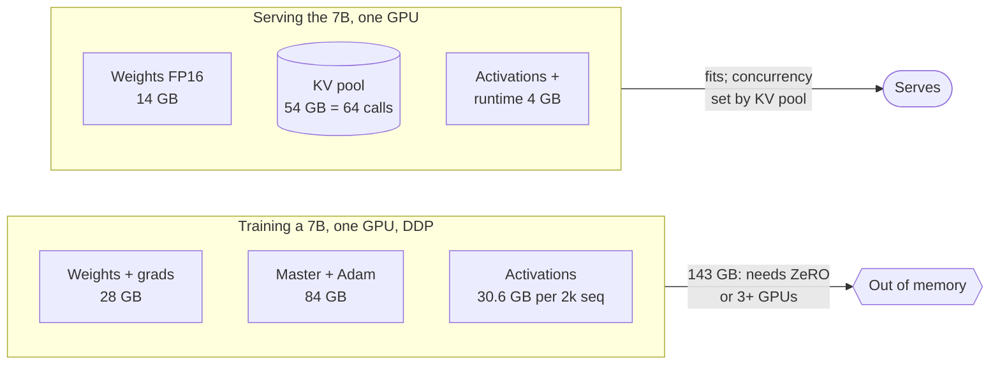

**Reading the diagram.** The same 7B model needs 143 GB to train with plain data parallelism (§65.3), so it fails on one 80 GB GPU, while serving it uses 14 GB of weights and gives the rest to the KV pool (cylinder: per-sequence state), whose size sets concurrency (§73.5). Failure points: optimizer state in training, long contexts in serving. Scaling: shard training state across GPUs (ZeRO/FSDP), and shrink serving bytes with FP8 KV or grouped-query attention.

::: mistake
**"The model is 7B, so it needs 7 GB."** That holds only for 8-bit weights at inference with no KV cache. Training needs about 16 bytes per parameter plus activations, and serving at useful concurrency needs weights plus tens of gigabytes of KV cache.
:::

## 89.15 Training FLOPs and time

::: formula
**Compute, time, GPU-hours and cost (§65.4, §72.15, §80.14)**

$$C \approx 6\, N\, D \qquad T_{\text{wall}} = \frac{C}{G\, R\, \text{MFU}\; \Gamma} \qquad H_{\text{GPU}} = \frac{C}{R\, \text{MFU}\; \Gamma \times 3{,}600} \qquad \$ = H_{\text{GPU}}\, p \qquad N_{\text{opt}} \approx \sqrt{C / 120}$$

| Symbol | Meaning | Units |
|---|---|---|
| $C$ | Training compute | FLOPs |
| $N$, $D$ | Non-embedding parameters; training tokens | parameters; tokens |
| $G$, $R$ | GPUs; peak dense 16-bit rate per GPU | GPUs; FLOP/s |
| MFU | Model FLOPs utilization, typically 0.35–0.45 for large dense runs | fraction |
| $\Gamma$ | Goodput: share of time producing kept progress (§80.9) | fraction |
| $T_{\text{wall}}$, $H_{\text{GPU}}$ | Wall-clock time; GPU-hours | s; GPU-h |
| $p$ | Price per GPU-hour | \$/GPU-h |
| $N_{\text{opt}}$ | Compute-optimal parameters, about 20 tokens per parameter [Hoffmann et al. 2022] | parameters |
:::

::: example
**Worked example — A 13B model on 2 trillion tokens.** H100 at 989 TFLOP/s, MFU 0.40, goodput 0.9, \$2.50 per GPU-hour, 1,024 GPUs.

1. $C = 6 \times 1.3 \times 10^{10} \times 2 \times 10^{12} = 1.56 \times 10^{23}$ FLOPs.
2. Achieved rate per GPU: $989 \times 10^{12} \times 0.40 = 3.96 \times 10^{14}$ FLOP/s. Ideal GPU-hours: $1.56 \times 10^{23} / (3.96 \times 10^{14} \times 3{,}600) = 109{,}500$.
3. With goodput 0.9: 121,700 GPU-hours; on 1,024 GPUs, 119 hours, 4.95 days.
4. Cost: $121{,}700 \times 2.50 = \$304{,}000$. At MFU 0.30 it would be \$406,000.
5. Memory: $16 \times 13 \times 10^9 = 208$ GB of training state, so the run must shard it (ZeRO/FSDP).
6. Compute-optimal split of this budget: $N_{\text{opt}} = \sqrt{1.56 \times 10^{23}/120} = 3.6 \times 10^{10}$ parameters on 721 billion tokens. The plan trains a 13B model on 154 tokens per parameter instead.

**Interpretation.** Five days and about \$300,000; each 10 points of MFU are worth about \$100,000 on this run. **Engineering implication.** Over-training a smaller model costs more training compute for its quality than the Chinchilla-optimal size but makes every served token cheaper ($2N$ FLOPs per token); decide with lifetime serving volume in view (§65.4), and put a measured MFU and goodput in the plan.
:::

::: industry
**Llama 3 405B — checking $6ND$ against a published run.** Meta reports about $3.8 \times 10^{25}$ FLOPs for its 405B model trained on about 15.6 trillion tokens on up to 16,384 H100 GPUs, with BF16 MFU of 38–43%. $6 \times 4.05 \times 10^{11} \times 1.56 \times 10^{13} = 3.79 \times 10^{25}$ matches, and the model card reports 30.84 million GPU-hours for Llama 3.1 405B.
*Evidence: Primary* — [Dubey et al. 2024; Meta 2024]
:::

::: mistake
**Forgetting goodput and evaluation.** $6ND$ over peak FLOP/s gives the *ideal* run. Real runs lose 5–15% to checkpoints, failures and restarts at scale (§80.9), and add ablations, evaluation and failed starts; budget the run, not the formula.
:::

## 89.16 LLM inference throughput

An LLM request has two phases with opposite bottlenecks (§72.10). **Prefill** processes all input tokens in parallel and is compute-bound. **Decode** produces one token per step for every sequence in the batch, and each step must read all the weights and the batch's KV cache from HBM, so it is memory-bandwidth-bound: at batch 1 an H100 can decode a 7B model no faster than 14 GB / 3.35 TB/s = 4.2 ms per token (§64.9.2). Batching shares each weight read across many sequences, and the KV-cache memory of §89.14 caps the batch.

::: formula
**Prefill time, decode step, throughput and GPU-seconds per request (after §73.15)**

$$T_{\text{pre}} = \frac{2\,N\,n_{\text{in}}}{t\,R\,\text{MFU}} \qquad t_{\text{step}}(B) = t_0 + \frac{N b_w / t + B\,\bar{n}\,k_{\text{tok}}/t}{\eta\, BW} \qquad X = \frac{B}{t_{\text{step}}(B)\; t} \qquad g = t\left(T_{\text{pre}} + \frac{n_{\text{out}}\, t_{\text{step}}(B)}{B}\right)$$

| Symbol | Meaning | Units |
|---|---|---|
| $n_{\text{in}}$, $n_{\text{out}}$ | Uncached input tokens; output tokens per request | tokens |
| $t$ | Tensor-parallel degree (GPUs per replica) | GPUs |
| $R$, MFU | Peak dense FLOP/s per GPU; prefill utilization (about 0.5) | FLOP/s; fraction |
| $t_0$ | Fixed per-step overhead (about 2 ms) | s |
| $B$ | Sequences decoded together, at most $S_{\max}$ of §89.14 | sequences |
| $\bar{n}$ | Mean context while decoding, $n_{\text{in}} + n_{\text{out}}/2$ | tokens |
| $\eta$, $BW$ | Achieved fraction of HBM bandwidth (about 0.8); HBM bandwidth | fraction; bytes/s |
| $t_{\text{step}}$ | Time per output token (TPOT) for every sequence in the batch | s |
| $X$ | Output tokens per second per GPU | tokens/s |
| $g$ | GPU-seconds per request; fleet busy GPUs $= \lambda_{\text{peak}}\, g$ | GPU-s |
:::

::: example
**Worked example — An 8B GQA model on one H100.** Llama-3-8B shape: $N = 8.03 \times 10^9$, 32 layers, 8 KV heads of 128 dimensions, FP16 weights and KV. Requests: 2,000 input and 300 output tokens; 100 requests/s at peak; $\rho = 0.6$, N+1.

1. Weights 16.1 GB; KV pool $0.9 \times 80 - 16.1 - 4 = 51.9$ GB; $k_{\text{tok}} = 131{,}072$ B; 396,000 tokens; $B = \lfloor 396{,}270 / 2{,}300 \rfloor = 172$.
2. Decode step at $B = 172$: $0.002 + (16.06 \times 10^9 + 172 \times 2{,}150 \times 131{,}072)/(0.8 \times 3.35 \times 10^{12}) = 0.002 + 0.0241 = 26.1$ ms, inside a 50 ms TPOT target. Throughput $172 / 0.0261 = 6{,}595$ output tokens/s.
3. At batch 1 the step is 8.1 ms, 123 tokens/s: batching buys 53× the throughput for 3.2× the per-token latency.
4. Prefill: $2 \times 8.03 \times 10^9 \times 2{,}000 / (989 \times 10^{12} \times 0.5) = 65$ ms.
5. $g = 0.065 + 300 \times 0.0261/172 = 0.110$ GPU-s. Busy GPUs at peak: $100 \times 0.110 = 11.0$; fleet $\lceil 11.0/0.6 \rceil + 1 = 20$ GPUs.
6. Sensitivity: a 6,000-token RAG prompt cuts the batch to 62 and raises $g$ to 0.324 GPU-s, 2.9× more GPUs; an FP8 KV cache doubles the batch to 344 and lowers $g$ to 0.088.

**Interpretation.** Decode throughput is set by bytes per step, and the batch by KV memory; prefill is a large share of GPU time once prompts reach thousands of tokens. **Engineering implication.** Size from per-class token histograms, never from one average call: §86.5 shows QuickBite's chatbot fleet growing from 2 to 7 GPUs once retrieval lengthened its prompts. Record KV precision and the TPOT objective in the plan, because both change the batch.
:::

**Figure 89.12 — From tokens to an LLM fleet.**

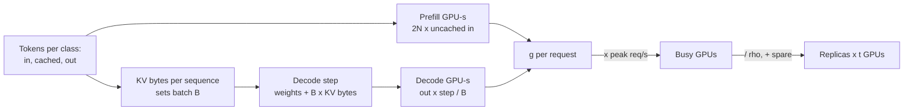

**Reading the diagram.** Token counts per workload class drive two independent costs: prefill compute and decode bandwidth, the latter through the batch that the KV cache allows. Their sum, $g$, multiplied by peak arrivals, gives busy GPUs; utilization headroom and redundancy give the fleet. Failure points: a longer prompt shrinks the batch and raises prefill at once; scaling on GPU utilization misleads because a GPU looks busy whenever anything runs (§73.15). Scaling: prefix caching cuts prefill, FP8 KV and GQA raise the batch, disaggregation lets each phase run at its own utilization (§86.5).

::: mistake
**Computing tokens per second from FLOPs.** $2N$ FLOPs per token at 989 TFLOP/s suggests 60,000 tokens/s for an 8B model; batch-1 decode delivers about 120, because it is limited by reading 16 GB per step. Use bandwidth for decode and FLOPs for prefill.
:::

## 89.17 Cost estimation

::: formula
**Monthly cost and unit cost (Chapter 51, §73.15)**

$$C_{\text{month}} = \sum_j n_j\, p_j\, 730 + S\, p_{\text{GB-mo}} + V_{\text{egress}}\, p_{\text{GB}} \qquad c_{\text{unit}} = \frac{C_{\text{month}}}{U_{\text{month}}} \qquad C_{1\text{M}} = \frac{p_{\text{GPU}}\, H_{\text{GPU}}}{T_{\text{tok}}/10^6}$$

| Symbol | Meaning | Units |
|---|---|---|
| $n_j$, $p_j$ | Nodes of type $j$; price per node-hour | nodes; \$/h |
| 730 | Hours per month | h |
| $S$, $p_{\text{GB-mo}}$ | Stored bytes; storage price | GB; \$/GB-month |
| $V_{\text{egress}}$, $p_{\text{GB}}$ | Bytes leaving the provider; price per GB | GB; \$/GB |
| $U_{\text{month}}$ | Units of value per month (requests, users, orders) | units |
| $H_{\text{GPU}}$, $T_{\text{tok}}$ | GPU-hours provisioned and tokens served per day | GPU-h; tokens |
| $C_{1\text{M}}$ | Blended cost per million tokens | \$ |
:::

::: example
**Worked example — The recipe app's bill, and an LLM feature for it.** Compute: 12 API, 3 database and 2 cache nodes at \$0.77/h. Storage: 50 TB of photos. Egress: 288 million API reads a day at 20 KB. LLM feature: §89.16's 8B service at an average of $100/4.8 = 20.8$ requests/s, scheduled at 20 GPUs for 6 peak hours and 6 GPUs for the other 18.

1. Compute: $17 \times 0.77 \times 730 = \$9{,}556$. Storage: $50{,}000 \times 0.023 = \$1{,}150$. Egress: $2.88 \times 10^8 \times 20 \times 10^3 \times 30 = 172.8$ TB; $\times \$0.05/\text{GB} = \$8{,}640$.
2. Total \$19,346 a month for $2.952 \times 10^8 \times 30 = 8.86 \times 10^9$ requests: \$0.0022 per 1,000 requests, \$0.00064 per MAU.
3. LLM: $20 \times 6 + 6 \times 18 = 228$ GPU-hours a day, \$570. Requests: $20.8 \times 86{,}400 = 1.8$ million a day, $1.8 \times 10^6 \times 2{,}300 = 4.14 \times 10^9$ tokens: \$0.138 per million tokens, \$0.00032 per request.
4. Utilization: busy GPU-hours $1.8 \times 10^6 \times 0.110 / 3{,}600 = 55.2$, 24% of 228. At 100% the floor is \$0.033 per million tokens.
5. Hosted small-model API at \$0.15/M input and \$0.60/M output (Chapter 79): $1.8 \times 10^6 \times (2{,}000 \times 0.15 + 300 \times 0.60)/10^6 = \$864$ a day.

**Interpretation.** Egress costs almost as much as all the servers, and one LLM feature (\$17,100 a month) costs about as much as the rest of the product. Self-hosting beats the hosted API here (\$570 against \$864 a day) only because volume keeps a 20-GPU peak fleet 24% busy. **Engineering implication.** Report cost per unit of value, split fixed from variable (§51.4), and name the dominant line, because that is where design effort pays: compression and caching for egress, prompt length and utilization for the LLM.
:::

::: mistake
**Pricing GPUs at 100% utilization.** Dividing a GPU-hour price by peak throughput gives the floor (\$0.033 per million tokens above), not the cost. Redundancy, diurnal troughs and headroom typically make the blended cost 3–40× the floor (§73.15).
:::

## 89.18 Twelve end-to-end estimation drills

Each drill is a five-minute interview estimate. Where a case study already sized the system, the drill reuses its assumptions and cites it, so you can go there for the full design. Say the assumptions first, compute out loud, and end on the sentence in the last row of each table. Practice them with a timer, then change one assumption and redo the arithmetic.

### 89.18.1 URL shortener

::: example
**Drill 1.** Assumptions (§52.4.4): 50 million new links a day; 100 redirects per link; $h = 0.10$, $b = 2$; 500 B per stored link and per redirect response; 10-year retention, 3 replicas; 10,000 RPS per redirect node; 95% cache hit ratio.

1. Creates: peak $50 \times 10^6 \times 0.10/3{,}600 \times 2 = 2{,}778$/s. Redirects: $5 \times 10^9$/day, 57,870 average, **277,778/s peak**.
2. Storage: $50 \times 10^6 \times 3{,}650 \times 500 \times 3 = 274$ TB; keyspace $62^7 = 3.5 \times 10^{12}$, 5.2% used after 10 years.
3. Egress: $277{,}778 \times 500 \times 8 = 1.11$ Gb/s. Cache misses: 13,889/s. Nodes: $\lceil 277{,}778/6{,}000 \rceil + 3 = 50$.
:::

**Table 89.11 — Drill 1 summary.**

| Quantity | Value | Consequence |
|---|---|---|
| Peak redirects / creates | 278,000 / 2,800 per s | Cache-first read path; writes need no global lock |
| Storage, 10 years, RF 3 | 274 TB | Partitioned key-value store |
| Fleet and cache | 50 nodes; ~200 GB working set | Hit ratio is the most important number |

### 89.18.2 Chat application

::: example
**Drill 2.** Assumptions (§53.4.4): 100 million DAU × 40 messages; PAR 3; 6.4 recipients per message on average; 300 B stored per message, RF 3; 5% carry a 500 KB attachment; 25% of DAU connected at peak, 500,000 connections per gateway design ceiling.

1. Sends: $4 \times 10^9$/day; peak $46{,}300 \times 3 = 138{,}900$/s. Deliveries: $\times 6.4$, 888,900/s at peak.
2. Text: $4 \times 10^9 \times 300 = 1.2$ TB/day; $\times 365 \times 3 = 1.31$ PB/year. Attachments: 100 TB/day.
3. Connections: 25 million; 81 gateways across three zones (§53.4.4).
:::

**Table 89.12 — Drill 2 summary.**

| Quantity | Value | Consequence |
|---|---|---|
| Messages / deliveries at peak | 138,900 / 888,900 per s | Store once per conversation; fan out pointers |
| Text / media storage | 1.31 PB/year / 36.5 PB/year logical | Database is storage-bound after year one |
| Concurrent connections | 25 million; 81 gateways | Connection tier sized for zone loss |

### 89.18.3 News feed

::: example
**Drill 3.** Assumptions (§53.7.4): 2 billion DAU × 15 feed loads; PAR 2; 10⁹ posts/day reaching 400 people; 100,000 large accounts averaging 5 million followers posting 4 times a day.

1. Feed loads: $3 \times 10^{10}$/day, 347,000 average, **694,000/s peak**.
2. Push fan-out: ordinary authors $4 \times 10^{11}$/day = 4.63 M/s; large accounts $2 \times 10^{12}$/day = 23.1 M/s.
3. Pull instead: recent-activity index ≈ 1 TB per replica; ranking 694 million candidate scorings/s before pruning.
:::

**Table 89.13 — Drill 3 summary.**

| Quantity | Value | Consequence |
|---|---|---|
| Feed loads at peak | 694,000/s | Precompute and cache the first page |
| Push inserts | 4.6 M/s ordinary, 23.1 M/s celebrities | Hybrid: push for most, pull for the tail |
| Ranking | ~694 M scorings/s | Staged ranking funnel (§53.7.8) |

### 89.18.4 Video upload and delivery

::: example
**Drill 4.** Assumptions (§54.4.4): 500 hours uploaded per minute at 10 Mb/s source; average video 6 min; 4 core-seconds per video-second for the H.264 ladder; 1 billion watch-hours a day at 2.5 Mb/s.

1. Ingest: $500 \times 60 = 30{,}000$ video-seconds per second; $\times 10$ Mb/s = 300 Gb/s; uploads $7.2$ million/day, 83/s.
2. Originals: 3.24 PB/day; about 1.8 EB/year raw with 1.5× erasure coding.
3. Transcoding: $30{,}000 \times 4 = 120{,}000$ busy cores. Egress: $10^9 \times 3{,}600 \times 2.5 \times 10^6 / 86{,}400 = 104$ Tb/s average.
:::

**Table 89.14 — Drill 4 summary.**

| Quantity | Value | Consequence |
|---|---|---|
| Uploads | 83 requests/s, 300 Gb/s | Bytes bypass app servers |
| Storage and compute | 3.24 PB/day originals; 120,000 cores | Lazy encoding of expensive codecs |
| Egress | 104 Tb/s average | Entirely a CDN problem |

### 89.18.5 Ride matching

::: example
**Drill 5.** Assumptions (§55.4.4, §55.5.4): 30 million trips/day with PAR 3; 2 million drivers online at peak updating every 4 s at 200 B; 20 candidates scored by ETA per request; 200 B of index state per driver.

1. Trips: $347 \times 3 = 1{,}042$ requests/s. Location updates: $2 \times 10^6 / 4 = 500{,}000$/s, 0.8 Gb/s.
2. ETA computations: $1{,}042 \times 20 = 20{,}840$/s. Supply index: $2 \times 10^6 \times 200 = 400$ MB.
3. History: 2.16 TB/day at 100 B per point (average 1 million drivers).
:::

**Table 89.15 — Drill 5 summary.**

| Quantity | Value | Consequence |
|---|---|---|
| Location writes | 500,000/s | In-memory geo index plus a log, never the trip DB |
| Trip requests | ~1,000/s | Ordinary transactional store |
| Index memory | 400 MB | Partition by city for isolation, not capacity |

### 89.18.6 Search index

::: example
**Drill 6.** Assumptions (§56.4.4): 5 billion queries/day, PAR 2, 30% result-cache hits; $3 \times 10^{10}$ documents × 400 terms × 3 B per posting; 300 shards; 4 ms CPU per shard per query; $u = 0.5$; 64-core leaves.

1. Peak: 115,741 queries/s; after cache 81,019/s.
2. Inverted index: 36 TB; 120 GB per shard.
3. Cores: $81{,}019 \times 300 \times 0.004 / 0.5 = 194{,}000$; 3,038 leaves, 11 replicas; 18 replicas across three regions, 5,400 leaves.
:::

**Table 89.16 — Drill 6 summary.**

| Quantity | Value | Consequence |
|---|---|---|
| Queries at the index | 81,000/s | Cache and early termination cut cost |
| Inverted index | 36 TB | Fits in leaf RAM when sharded 300 ways |
| Leaf fleet | ~5,400 servers | Cost ∝ query rate × corpus size |

### 89.18.7 Metrics and logging pipeline

::: example
**Drill 7.** Assumptions (§56.6.4): 50 million active series scraped every 15 s at 1.37 B per sample; 4 KB of ingester memory per series, RF 3; logs from 100,000 containers at 20 lines/s of 400 B.

1. Samples: $5 \times 10^7 / 15 = 3.33$ million/s; storage $3.33 \times 10^6 \times 86{,}400 \times 1.37 = 395$ GB/day.
2. Ingester memory: $5 \times 10^7 \times 4{,}000 \times 3 = 600$ GB.
3. Logs: $2 \times 10^6$ lines/s, 800 MB/s, 69 TB/day raw (6.9 TB at 10:1 compression).
:::

**Table 89.17 — Drill 7 summary.**

| Quantity | Value | Consequence |
|---|---|---|
| Metric samples | 3.33 M/s, 395 GB/day | Cardinality, not samples, is the limit |
| Ingester memory | 600 GB | Enforce per-tenant series quotas |
| Logs | 69 TB/day raw | Index few fields; tier to object storage |

### 89.18.8 Recommendation serving

::: example
**Drill 8.** Assumptions (QuickBite, §68.4): 2,500 requests/s at peak; funnel of 1,000 candidates, 900 light-ranked at 5 µs, 300 heavy-ranked at 100 µs, plus 6 ms of fixed work; $\rho = 0.5$; 10 million customers and 5 million dishes at $d = 64$, FP32.

1. CPU per request: $4.5 + 1 + 4.5 + 30 + 0.5 = 40.5$ ms; fleet $2{,}500 \times 0.0405 / 0.5 = 203$ cores.
2. Without the funnel: 12 s per request, 60,000 cores.
3. Embeddings: $10^7 \times 64 \times 4 = 2.56$ GB plus 1.28 GB; feature keys $2{,}500 \times 301 = 752{,}500$/s.
:::

**Table 89.18 — Drill 8 summary.**

| Quantity | Value | Consequence |
|---|---|---|
| Serving CPU | ~203 cores (7 servers) | Heavy ranker is 74% of CPU |
| Embedding tables | 3.84 GB | One GPU; plain data parallelism |
| Feature reads | ~750,000 keys/s | Batch per view group; replicate item view |

### 89.18.9 Fraud scoring

::: example
**Drill 9.** Assumptions (§82.4.4): 100 million authorizations/day, PAR 5; 5 entities × 6 windows of counters per authorization; 1.21 billion entities at 500 B; 6 ms vCPU per decision; 16-vCPU nodes at $u = 0.4$; three regions, each able to carry half the peak; 2 KB logged per decision for 548 days.

1. Peak: 5,787/s, design 6,000/s. Counter updates: $5{,}787 \times 30 = 173{,}600$/s.
2. Feature state: 605 GB, 1.8 TB with three replicas.
3. Fleet: $3{,}000 \times 0.006 / 6.4 = 2.8$, 3 nodes per region, 9 in total. Decision log: 200 GB/day, 110 TB.
:::

**Table 89.19 — Drill 9 summary.**

| Quantity | Value | Consequence |
|---|---|---|
| Scoring rate | 6,000/s | Small fleet; redundancy sets its size |
| Counter updates | 174,000/s | The real load: size the stream processor for it |
| State and log | 1.8 TB in memory; 110 TB log | Spend on freshness and the decision log |

### 89.18.10 ETA predictions

::: example
**Drill 10.** Assumptions (QuickBite, §2.4, §60.11): 2,000 search requests/s at peak × 20 restaurants; 360 million predictions/day; gradient-boosted trees at 0.1 ms vCPU; 16-vCPU nodes at \$0.77/h, $u = 0.5$, one node per zone in three zones.

1. Peak: 40,000 predictions/s; average $3.6 \times 10^8/86{,}400 = 4{,}167$/s (PAR 9.6).
2. Busy vCPU: $40{,}000 \times 0.0001 = 4$; 8 at $u = 0.5$, one node; zone floor three nodes, \$2.31/h.
3. Cost: $1{,}000 \times 2.31/(3{,}600 \times 4{,}167) = \$0.000154$ per 1,000; at 720 ETAs per order, \$0.00011 per order. A 2 ms deep model needs 11 CPU nodes.
:::

**Table 89.20 — Drill 10 summary.**

| Quantity | Value | Consequence |
|---|---|---|
| Predictions | 40,000/s peak; 360 M/day | Size from predictions, not searches |
| Fleet | 3 nodes (trees) or 11 (deep, CPU) | Redundancy floor dominates for trees |
| Cost | \$0.00015 per 1,000 | Well under \$0.001 per order |

### 89.18.11 RAG support chatbot

::: example
**Drill 11.** Assumptions (QuickBite, §75.15, §86.5): 75,000 queries/day, average 0.87/s, peak 8/s; a 4,050-token generation call (700 cacheable) with 200 output tokens plus a 450-token condensation call; 25,800 chunks of 3,400 B; internal prices \$0.20/M input, \$0.60/M output; fixed search cluster \$1,686/month.

1. Index: $25{,}800 \times 3{,}400 = 87.7$ MB: one node's memory.
2. Per query: generation \$0.000930, condensation \$0.000108, reranking \$0.000094, fixed \$0.000749: **\$0.00188**; \$141 a day.
3. GPUs: a RAG call takes 0.317 GPU-s with FP16 KV (batch 24) or 0.206 with FP8 (batch 48); with QuickBite's other 7B traffic the pool is 7 or 5 GPUs (§86.5).
:::

**Figure 89.13 — Estimation tree for the RAG chatbot.**

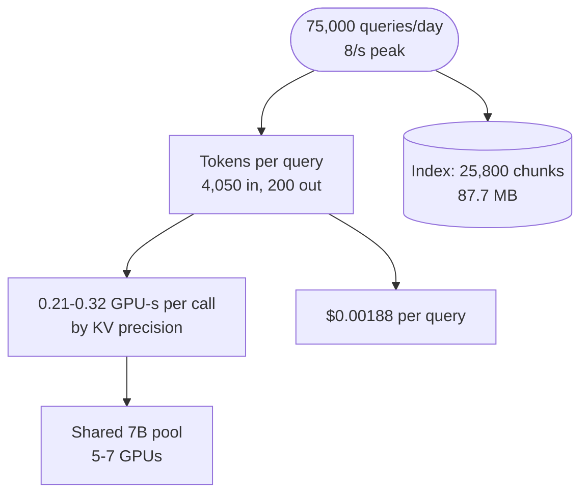

**Reading the diagram.** Query volume drives tokens, which drive both GPU time and token cost; the index (cylinder) is a fixed, tiny storage boundary. The prompt length sets the KV batch and therefore the GPU count, which is the failure point §86.5 found. Scaling at this volume is about consolidation and utilization, not capacity.

**Table 89.21 — Drill 11 summary.**

| Quantity | Value | Consequence |
|---|---|---|
| Peak queries | 8/s | Tiny rate; long prompts dominate |
| Index | 88 MB | No vector database cluster needed |
| Cost per query / GPU pool | \$0.0019 / 5–7 GPUs | Utilization ~9%: share a platform |

### 89.18.12 LLM pre-training run

::: example
**Drill 12.** Assumptions (§65.3): a 70B dense model on 1.4 trillion tokens within 30 days; H100 at 989 TFLOP/s, MFU 0.40, goodput 0.9; \$2.50 per GPU-hour.

1. $C = 6 \times 7 \times 10^{10} \times 1.4 \times 10^{12} = 5.88 \times 10^{23}$ FLOPs; compute-optimal, since $\sqrt{C/120} = 7 \times 10^{10}$.
2. GPU-hours: $5.88 \times 10^{23}/(3.96 \times 10^{14} \times 3{,}600)/0.9 = 458{,}750$; on 640 GPUs (80 servers), 29.9 days; \$1.15 million. (§65.3 gets 568 GPUs with 10¹⁵ FLOP/s and no goodput loss.)
3. Memory: 1.12 TB of state plus 521 GB of activations per sequence: at least 25 GPUs just to fit, so time, not memory, sets the cluster.
4. Checkpoint: $14 N = 980$ GB; sharded over 640 ranks at 100 GB/s aggregate, 9.8 s (§65.15).
:::

**Figure 89.14 — Estimation tree for a pre-training run.**

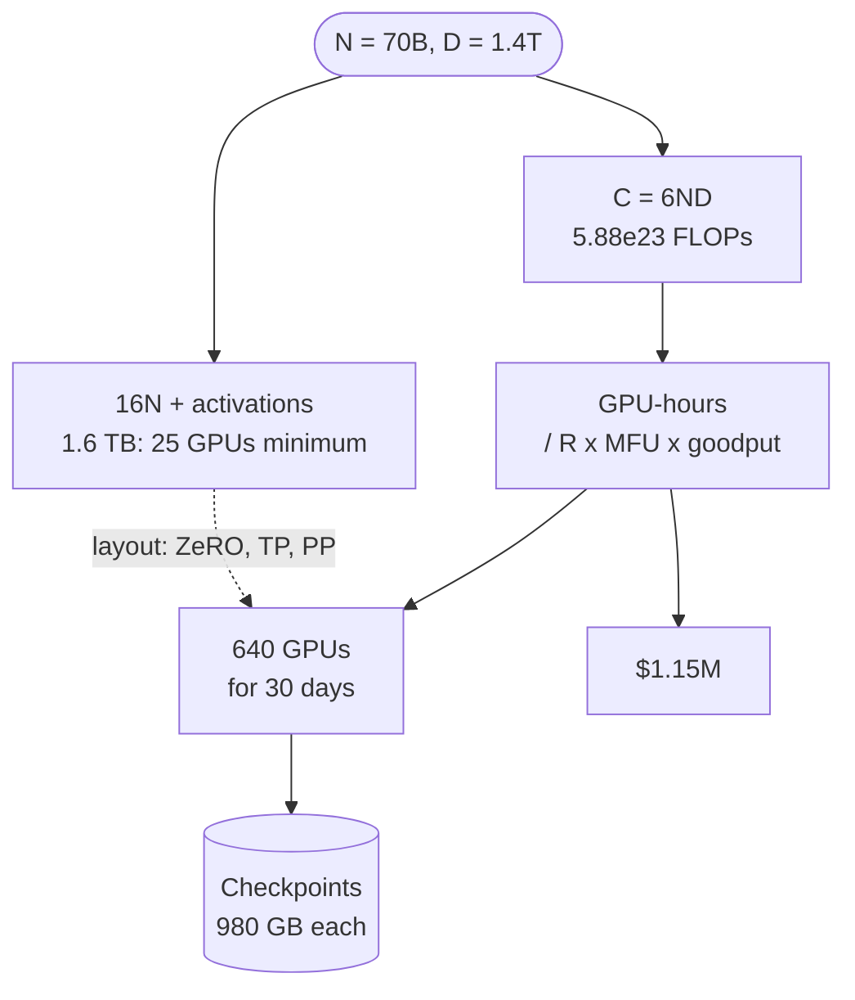

**Reading the diagram.** Parameters and tokens feed two independent tests: compute (left), which sets GPU count and cost, and memory (right), which sets the parallel layout but not the count (dotted influence). Checkpoints are the storage boundary whose write speed affects goodput. Failure points: an optimistic MFU and ignoring goodput, each of which stretches the schedule. Scaling: GPUs scale time down linearly until communication and failures erode MFU and goodput (§80.9).

**Table 89.22 — Drill 12 summary.**

| Quantity | Value | Consequence |
|---|---|---|
| Compute | 5.88 × 10²³ FLOPs | Compute-optimal at 20 tokens per parameter |
| Cluster and time | 640 H100s, ~30 days | Time, not memory, sets size |
| Cost | ~\$1.15 million, 458,750 GPU-h | Each MFU point is worth ~\$28,000 |

## 89.19 A runnable estimation calculator

The program below implements the handbook formulas for traffic, storage, bandwidth, fleet size, KV cache, LLM serving and training, with fixed inputs, and reruns four drills. It uses only the Python standard library; change an input and rerun to see which conclusions move.

```python
"""Capacity estimation calculator (Chapter 89). SI units: 1 GB = 1e9 bytes."""
import math

DAY, HOUR = 86_400, 3_600

def traffic(daily, busy_hour_share=0.10, burst=2.0):
    """Average and design-peak rate from a daily volume (Sec. 89.5)."""
    avg = daily / DAY
    peak = daily * busy_hour_share / HOUR * burst
    return avg, peak

def storage(per_day, record_bytes, days, copies=3.0, index=0.0, compression=1.0):
    """Bytes stored after retention, indexes, compression and redundancy (Sec. 89.6)."""
    return per_day * record_bytes * (1 + index) / compression * days * copies

def bandwidth_gbps(rate, bytes_each):
    """Bits per second, in Gb/s, for `rate` transfers/s of `bytes_each` (Sec. 89.7)."""
    return rate * bytes_each * 8 / 1e9

def nodes(peak, per_node, util=0.6, spare=0):
    """Fleet size at a target utilization plus spares (Sec. 89.10)."""
    return math.ceil(peak / (per_node * util)) + spare

def kv_bytes_per_token(layers, kv_heads, head_dim, bytes_per_value=2):
    """2 (K and V) x layers x KV heads x head dimension x bytes (Sec. 89.14)."""
    return 2 * layers * kv_heads * head_dim * bytes_per_value

def llm_serving(params, layers, kv_heads, head_dim, n_in, n_out, hbm=80e9,
                peak_flops=989e12, hbm_bw=3.35e12, bw_eff=0.8, mfu=0.5,
                step_overhead=0.002, util=0.9, reserve=4e9, w_bytes=2, kv_b=2):
    """One-GPU replica at its memory-limited batch (Sec. 89.16, after Sec. 73.15)."""
    w = params * w_bytes
    k = kv_bytes_per_token(layers, kv_heads, head_dim, kv_b)
    kv_pool = util * hbm - w - reserve
    batch = int(kv_pool / k // (n_in + n_out))
    ctx = n_in + n_out / 2                              # mean context while decoding
    step = step_overhead + (w + batch * ctx * k) / (bw_eff * hbm_bw)
    prefill = 2 * params * n_in / (mfu * peak_flops)
    gpu_s = prefill + n_out * step / batch               # GPU-seconds per request
    return dict(weights_gb=w / 1e9, kv_pool_gb=kv_pool / 1e9, kv_kb=k / 1e3,
                batch=batch, tpot_ms=step * 1e3, prefill_ms=prefill * 1e3,
                out_tok_s=batch / step, gpu_s=gpu_s)

def training(params, tokens, gpus, peak_flops=989e12, mfu=0.4, goodput=0.9,
             price=2.50):
    """6ND compute, wall-clock days and cost (Sec. 89.15)."""
    flops = 6 * params * tokens
    gpu_hours = flops / (peak_flops * mfu * HOUR) / goodput
    return flops, gpu_hours / gpus / 24, gpu_hours, gpu_hours * price

# Drill 1: URL shortener (Sec. 52.4): 50M creates/day, 100 reads per create
c_avg, c_peak = traffic(50e6)
r_avg, r_peak = traffic(50e6 * 100)
print(f"URL  creates {c_peak:,.0f}/s peak | redirects {r_avg:,.0f}/s avg, {r_peak:,.0f}/s peak")
print(f"URL  storage 10 y x3: {storage(50e6, 500, 3650) / 1e12:,.0f} TB | "
      f"egress {bandwidth_gbps(r_peak, 500):.2f} Gb/s | "
      f"nodes {nodes(r_peak, 10_000, spare=3)}")

# Drill 2: chat text store (Sec. 53.4): 4e9 messages/day, 300 B, RF 3, 1 year
print(f"Chat text store, 1 year RF 3: {storage(4e9, 300, 365) / 1e15:.2f} PB")

# Sec. 89.16: 8B GQA model, 2,000 input + 300 output tokens, one H100
s = llm_serving(8.03e9, 32, 8, 128, 2_000, 300)
gpus = math.ceil(100 * s["gpu_s"] / 0.6) + 1                # 100 req/s, rho 0.6, N+1
print(f"8B   weights {s['weights_gb']:.1f} GB, KV {s['kv_kb']:.0f} kB/token, "
      f"pool {s['kv_pool_gb']:.1f} GB, batch {s['batch']}")
print(f"8B   TPOT {s['tpot_ms']:.1f} ms, prefill {s['prefill_ms']:.0f} ms, "
      f"{s['out_tok_s']:,.0f} output tok/s, {s['gpu_s']:.3f} GPU-s/request, "
      f"{gpus} GPUs for 100 req/s")

# Drill 12: 70B dense model on 1.4T tokens, 640 GPUs
flops, days, gpu_h, cost = training(70e9, 1.4e12, 640)
print(f"70B  {flops:.2e} FLOPs, {days:.1f} days on 640 GPUs, "
      f"{gpu_h:,.0f} GPU-h, ${cost:,.0f}")
```

Output:

```text
URL  creates 2,778/s peak | redirects 57,870/s avg, 277,778/s peak
URL  storage 10 y x3: 274 TB | egress 1.11 Gb/s | nodes 50
Chat text store, 1 year RF 3: 1.31 PB
8B   weights 16.1 GB, KV 131 kB/token, pool 51.9 GB, batch 172
8B   TPOT 26.1 ms, prefill 65 ms, 6,595 output tok/s, 0.110 GPU-s/request, 20 GPUs for 100 req/s
70B  5.88e+23 FLOPs, 29.9 days on 640 GPUs, 458,750 GPU-h, $1,146,875
```

What to notice:

- `traffic` is §89.5's formula: with the defaults $h = 0.10$ and $b = 2$, peak is 4.8 times average, and the URL-shortener numbers match §52.4.4 exactly.
- `storage` multiplies in the order of Figure 89.4: indexes, compression, retention, then copies; pass `copies=1.4` for RS(10,4).
- `llm_serving` reproduces §89.16 (batch 172, 26.1 ms, 0.110 GPU-s) and, with the 7B shape and 1,510/78 tokens, §73.15's batch of 64 and 0.075 GPU-s, so the step-time model is the same one used across Book II.
- `training` divides by goodput, which is why 640 GPUs, not 574, finish the 70B run in 30 days.

## 89.20 Summary and revision notes

::: summary
- Estimation exists to find the order of magnitude and the binding constraint. Write assumptions with units, build a tree, compute rates, then sizes, then resources, and sanity-check by a second route (§89.3).
- Bound unknowns with the geometric mean; independent errors in $n$ factors of 2× combine to about $2^{\sqrt{n}}$, not $2^n$.
- Peak = average × $24hb$; the defaults $h = 0.10$, $b = 2$ give 4.8, a dinner-rush service 9.6, a global feed 2. Estimate a peak per traffic class and include internal fan-out (§89.5).
- Storage = records × size × (1 + index) / compression × retention × redundancy; erasure coding at 1.4× instead of 3 replicas and compression often change the answer by 10× or more (§89.6).
- Bandwidth = rate × bytes × 8; the origin sees only $(1 - O_B)$; streaming concurrency comes from Little's Law (§89.7).
- Backend load is $(1 - h)R_{\text{read}} + R_{\text{write}}$; under Zipf skew each 10× of cache adds roughly a constant number of hit-ratio points, and a cold cache multiplies backend load by $1/(1-h)$ (§89.8).
- Databases need the maximum of storage, write and read terms; connection pools need Little's Law and usually a pooler (§89.9). Fleets need the maximum of CPU, concurrency and memory terms, then one explicit failure headroom (§89.10).
- Topics are sized by the consume path; lag in seconds is backlog divided by throughput; catch-up time is backlog divided by spare consumer capacity (§89.11).
- Series availability multiplies; one external dependency often caps the path; durability nines become expected objects lost at your scale (§89.12).
- ML fleets scale with predictions, not requests; embedding memory depends on the optimizer; logs and feature reads are often the large numbers (§89.13).
- GPU memory: 16 bytes per parameter to train, $N b_w$ plus KV cache to serve; the KV cache, $2 L n_{kv} d_h b$ per token, sets concurrency (§89.14).
- Training compute is $6ND$; time and cost divide by peak FLOP/s, MFU and goodput (§89.15).
- Prefill is compute-bound, decode is bandwidth-bound; batch is capped by KV memory; size LLM fleets in GPU-seconds per request by token class (§89.16).
- Report cost per unit of value and name the dominant line; utilization, not price, usually sets LLM cost (§89.17).
:::

## 89.21 Knowledge checkpoint

1. Your DAU estimate lies between 2 million and 200 million. What single number should you use, and why?
2. Convert 3 billion events a day into an average and a design peak rate with $h = 0.10$ and $b = 2$.
3. Why is the peak-to-average ratio of a single-country food-delivery app higher than that of a global search engine?
4. A table stores 1 TB/day of records, indexes add 30%, compression is 4:1, retention is one year and the store keeps three replicas. How much raw disk is needed?
5. What does RS(10,4) cost in storage overhead, how many losses does it tolerate, and what does repairing one fragment read?
6. A CDN serves 800 Gb/s to users with 97% byte offload. How much bandwidth must the origin serve?
7. A cache at 90% hit ratio fronts 100,000 reads/s and 1,000 writes/s. What reaches the database, and what reaches it if the cache restarts empty?
8. Requests take 5 ms of CPU and wait 200 ms on I/O. At 10,000 RPS, how many vCPUs and how many concurrent requests must the fleet hold?
9. A consumer group is 20 minutes behind on a topic receiving 50 MB/s, and it can consume 150 MB/s. How long until it catches up?
10. Four services in series each have 99.95% availability. What is the path's availability and yearly downtime?
11. How much memory does it take to train a 13B model with Adam in mixed precision, before activations? To serve it in FP8?
12. KV-cache bytes per token for 40 layers, 8 KV heads, head dimension 128, FP16?
13. Why does decode at batch 1 reach only a tiny fraction of a GPU's FLOP/s?
14. Training compute for a 3B model on 600 billion tokens, and GPU-hours at 989 TFLOP/s and 40% MFU?
15. Why does the blended cost per million tokens of a small self-hosted fleet exceed its 100%-utilization floor by a large factor?

<details><summary>Answers</summary>

1. The geometric mean, $\sqrt{2 \times 10^6 \times 2 \times 10^8} = 2 \times 10^7$: it is the midpoint on a log scale, so it is at most 10× wrong either way, while the arithmetic mean (101 million) can be 50× wrong at the low end.
2. Average $3 \times 10^9 / 86{,}400 = 34{,}722$/s; peak $\times 4.8 = 166{,}667$/s.
3. Its traffic is concentrated in two meal peaks within one time zone ($h \approx 0.2$), while a global service's regions peak at different hours, flattening the day.
4. $1 \times 1.3 / 4 \times 365 \times 3 = 356$ TB.
5. 1.4× overhead; any 4 of 14 fragments may be lost; repair reads 10 fragments (§15.6).
6. $800 \times 0.03 = 24$ Gb/s.
7. $0.1 \times 100{,}000 + 1{,}000 = 11{,}000$/s normally; $101{,}000$/s with an empty cache, 9.2× more.
8. CPU: $10{,}000 \times 0.005 = 50$ busy vCPUs (83 at $u = 0.6$); concurrency $10{,}000 \times 0.205 = 2{,}050$ in flight (Little's Law).
9. Backlog $50 \times 1{,}200 = 60$ GB; $60{,}000 / (150 - 50) = 600$ s, 10 minutes.
10. $0.9995^4 = 0.9980$; about 17.5 hours a year.
11. $16 \times 13 \times 10^9 = 208$ GB; FP8 weights 13 GB plus KV cache and overhead.
12. $2 \times 40 \times 8 \times 128 \times 2 = 163{,}840$ bytes.
13. Each step reads every weight once to produce one token per sequence: arithmetic intensity is about 1 FLOP per byte, far below the ~295 ridge point, so bandwidth limits it (§64.9).
14. $6 \times 3 \times 10^9 \times 6 \times 10^{11} = 1.08 \times 10^{22}$ FLOPs; $1.08 \times 10^{22} / (3.96 \times 10^{14} \times 3{,}600) = 7{,}580$ GPU-hours before goodput.
15. Redundant replicas, diurnal troughs and utilization headroom are paid for whether or not tokens flow; at low volume the always-on floor dominates (§73.15, §89.17).
</details>

## 89.22 Interview questions

### Basic

**Q1.** "Estimate the QPS and storage for a photo-sharing service with 50 million DAU." **Answer.** State assumptions: 2 uploads per DAU per week (about 0.3/day), 2 MB original plus 400 KB renditions, 30 feed reads per DAU per day, PAR 4.8. Uploads: $50 \times 10^6 \times 0.3 = 15$ million/day, 174/s average, about 830/s peak. Reads: $1.5 \times 10^9$/day, 17,400/s average, about 83,000/s peak, mostly cache and CDN. Storage: $15 \times 10^6 \times 2.4$ MB = 36 TB/day, 13 PB/year logical, about 18 PB raw with 1.4× erasure coding. Conclusion: reads are a caching and CDN problem; storage is an object-store problem; nothing here needs a sharded database for photos, only for metadata.

**Q2.** "How many servers do we need for 50,000 RPS?" **Answer.** It depends on work per request, so ask or assume: at 2 ms of CPU, 100 busy vCPUs; at $u = 0.6$ on 16-vCPU nodes, $\lceil 100/9.6 \rceil = 11$; zone-safe over three zones, $\lceil 16.5 \rceil = 17$, rounded to 18. Then check concurrency: if requests wait 100 ms on I/O, 5,000 are in flight, which an async server handles but a 200-thread server would need 42 nodes for. Name the measurement you would make: per-node RPS at the latency objective.

**Q3.** "Convert 99.99% availability into something a team can act on." **Answer.** 4.32 minutes per 30-day month, or 100,000 failed requests per billion. That rules out human-paced recovery: detection and failover must be automatic, and every synchronous dependency must itself exceed 99.99% or be removed from the path.

### Intermediate

**Q4.** "Size the cache for a service with 100 million keys and 300,000 reads/s whose database can take 30,000 reads/s." **Answer.** Writes aside, the database tolerates a miss ratio of 10%, so $h \ge 0.90$, and with headroom aim for 0.93–0.95. Under Zipf ($s \approx 1$), caching about 30 million keys gives roughly 0.94 (§89.8); at 2 KB and 1.5× overhead, 90 GB, replicated across zones. Then address the cold-start case: an empty cache sends 300,000 reads/s, ten times capacity, so add request coalescing, warm-up from a snapshot and load shedding.

**Q5.** "Estimate the Kafka cluster for 1 GB/s of peak log ingest with 3 days of retention." **Answer.** Assume average 400 MB/s, compression 4:1, RF 3: disk $= 100$ MB/s × 259,200 s × 3 = 78 TB, plus 30% free space, about 100 TB. Partitions from the consume path: if a consumer partition sustains 10 MB/s, $1{,}000/10 \times 1.5 = 150$ partitions. Network: 1 GB/s produced plus 2 GB/s of replication arrive, and 2 GB/s of replication plus, say, two consumer groups' 2 GB/s leave; a 25 Gb/s NIC at 60% carries about 1.9 GB/s each way, so 3 brokers suffice for network, while 100 TB at about 12 TB per broker needs 9: disk binds. Finish with lag alerting in seconds.

**Q6.** "Can one H100 serve a 70B model?" **Answer.** BF16 weights are 140 GB, so no. FP8 weights (70 GB) fit in 80 GB but leave about 2 GB of the managed budget, enough KV for perhaps one or two short conversations at 328 KB per token. INT4 (35 GB) leaves about 33 GB, about 100,000 tokens. Practical answer: TP=4 at BF16 (98 concurrent 4K sequences, §73.5), TP=2 at FP8, or an H200/B200 with more HBM, after checking quality parity of the quantized model.

### Advanced

**Q7.** "Estimate GPUs for an assistant with 10 million DAU, 5 conversations each, 4 turns per conversation, 3,000 input tokens per turn (half cached) and 250 output tokens, on an 8B model." **Answer.** Turns: $2 \times 10^8$/day, 2,315/s average, about 11,000/s peak at PAR 4.8. Per turn on an H100 (§89.16 model): prefill of 1,500 uncached tokens ≈ 49 ms; KV per sequence $3{,}250 \times 131$ KB = 0.43 GB, batch 121; decode step $0.002 + (16.1 + 121 \times 3{,}125 \times 131{,}072 \times 10^{-9})/2{,}680 = 26.5$ ms; decode $250 \times 0.0265/121 = 0.055$ GPU-s; $g \approx 0.103$ GPU-s. Busy GPUs ≈ 1,150 at peak; at $\rho = 0.6$ about 1,900 GPUs, about \$115,000 a day at \$2.50 if held all day, much less with diurnal scaling. Levers: more prefix caching, FP8 KV (doubles the batch), shorter prompts, a smaller model for simple turns.

**Q8.** "Plan a 30B-parameter model trained on 3 trillion tokens in under 6 weeks." **Answer.** $C = 6 \times 3 \times 10^{10} \times 3 \times 10^{12} = 5.4 \times 10^{23}$. At 989 TFLOP/s, MFU 0.40, goodput 0.9: $5.4 \times 10^{23} / (3.56 \times 10^{14} \times 3{,}600) = 421{,}000$ GPU-hours; 42 days is 1,008 hours, so about 420 GPUs; plan 512 for margin and evaluation, about \$1.05 million. Memory: 480 GB of state, so FSDP over at least 8–16 GPUs per replica plus activation recomputation. Checkpoints: $14N = 420$ GB, asynchronous and sharded. Ask what lifetime serving volume justifies 100 tokens per parameter rather than a larger model.

**Q9.** "Our estimate says 7,000 RPS but production peaked at 21,000. What went wrong, and how would you estimate differently?" **Answer.** Likely causes: a PAR from averages rather than per-minute data, missed synchronized events (a push notification or a scheduled job), retries amplifying load during slowness, or internal fan-out counted once. Fix: estimate per traffic class, model campaigns and retries explicitly (retry amplification multiplies load by up to the attempt count), measure the peak minute rather than the peak hour, and add tripwires that compare forecast to actual (§18.11).

## 89.23 Practical exercises

1. Rebuild Figure 89.1 for a short-video app: estimate uploads, storage per year and delivery egress, then identify the most uncertain leaf and compute the range with $F_{\text{prod}}$.
2. Extend the calculator with a `cache` function implementing §89.8 and a `shards` function implementing §89.9, and reproduce the catalog and order-history examples.
3. Pick any case study in Chapters 52–56, change its PAR from 4.8 to 9.6, and list which conclusions in its capacity summary change.
4. Using `llm_serving`, plot output tokens per second per GPU against input length from 500 to 16,000 tokens for the 8B model, with FP16 and FP8 KV caches.
5. Estimate the monthly cost of the telemetry store of §89.6 with Table 15.4's storage classes, moving data older than 90 days to an archive class.

## 89.24 Design challenges

1. **A global live-streaming launch.** Ten million concurrent viewers for a two-hour event at 4 Mb/s, plus chat at 1% of viewers sending a message a minute. Estimate egress, origin load at 98% offload, chat fan-out, and the cost of the night. Decide what to pre-provision and what to shed.
2. **Self-host or buy.** A company serves 2 billion LLM tokens a day (80% input, 30% of it cacheable) on an 8B-class model. Estimate the self-hosted fleet and cost per million tokens across a diurnal cycle, compare with hosted API prices, and find the daily volume at which the decision flips.
3. **Ten-year archive.** A regulator requires keeping 5 PB/year of documents for ten years with eleven nines of durability. Compare three replicas, RS(10,4) and a cold archive class on cost and repair traffic, and state the expected number of objects lost per year at your object count.

## 89.25 References

1. Barroso, L. A., Hölzle, U. *The Case for Energy-Proportional Computing*. IEEE Computer 40(12), 2007.
2. Beyer, B., Jones, C., Petoff, J., Murphy, N. R. (eds.). *Site Reliability Engineering: How Google Runs Production Systems*. O'Reilly, 2016. https://sre.google/sre-book/table-of-contents/
3. Chowdhery, A., et al. *PaLM: Scaling Language Modeling with Pathways*. arXiv:2204.02311, 2022.
4. Dean, J. *Designs, Lessons and Advice from Building Large Distributed Systems*. Keynote, LADIS, 2009.
5. Dean, J., Barroso, L. A. *The Tail at Scale*. Communications of the ACM 56(2), 2013.
6. Dubey, A., et al. *The Llama 3 Herd of Models*. arXiv:2407.21783, 2024.
7. Hoffmann, J., et al. *Training Compute-Optimal Large Language Models*. arXiv:2203.15556, 2022.
8. IEC. *IEC 80000-13: Quantities and Units — Part 13: Information Science and Technology*. International Electrotechnical Commission, 2008.
9. Kaplan, J., et al. *Scaling Laws for Neural Language Models*. arXiv:2001.08361, 2020.
10. Kwon, W., et al. *Efficient Memory Management for Large Language Model Serving with PagedAttention*. SOSP, 2023.
11. Little, J. D. C. *A Proof for the Queuing Formula: L = λW*. Operations Research 9(3), 1961.
12. Meta. *Llama 3.1 Model Card*. Meta, 2024. https://github.com/meta-llama/llama-models
13. Muralidhar, S., et al. *f4: Facebook's Warm BLOB Storage System*. OSDI, 2014.
14. NVIDIA. *NVIDIA H100 Tensor Core GPU Datasheet*. NVIDIA, 2022.
15. Pelkonen, T., et al. *Gorilla: A Fast, Scalable, In-Memory Time Series Database*. PVLDB 8(12), 2015.
16. Pope, R., et al. *Efficiently Scaling Transformer Inference*. MLSys, 2023.
17. Rajbhandari, S., Rasley, J., Ruwase, O., He, Y. *ZeRO: Memory Optimizations Toward Training Trillion Parameter Models*. SC, 2020.
18. Weinstein, L., Adam, J. A. *Guesstimation: Solving the World's Problems on the Back of a Cocktail Napkin*. Princeton University Press, 2008.
19. Williams, S., Waterman, A., Patterson, D. *Roofline: An Insightful Visual Performance Model for Multicore Architectures*. Communications of the ACM 52(4), 2009.
20. Xu, A. *System Design Interview — An Insider's Guide*. Independently published, 2020.

## 89.26 Open verification items

- All prices (\$2.50 per GPU-hour, \$0.77 per 16-vCPU node-hour, \$0.023 per GB-month, \$0.05 and \$0.01 per GB of egress, token prices) are illustrative 2026 figures inherited from Chapters 15, 21, 60, 75 and 79; re-check against current list prices before publication.
- Hardware anchors in Tables 89.3, 89.4 and 89.6 (NVMe throughput, HDD IOPS, B200 bandwidth and capacity) are order-of-magnitude values; B200 figures vary by SKU (see Chapter 64's open items).
- Per-node service capacities (API node, wide-column node, gateway connection ceilings) are teaching assumptions, not benchmarks.
- The Zipf hit-ratio approximation assumes exponent 1 and an ideal policy; real policies and skews differ (§20.9.5).
