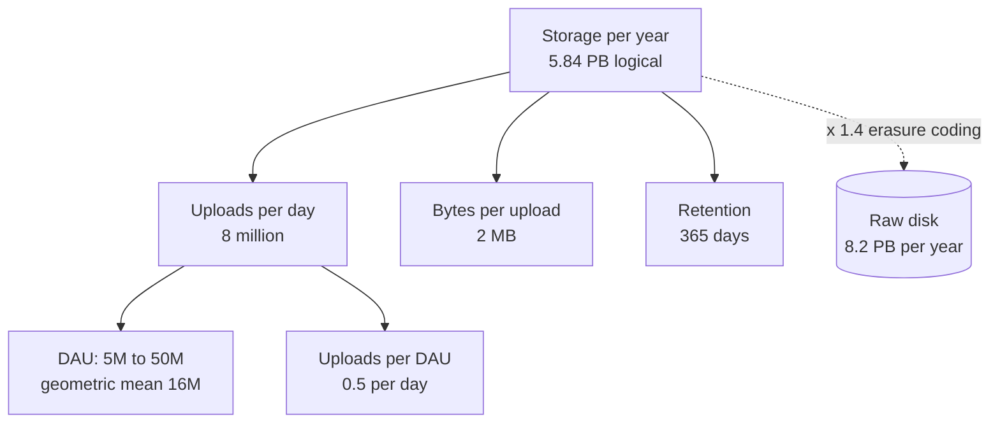
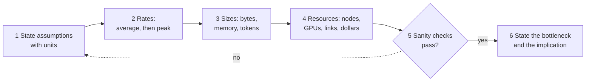
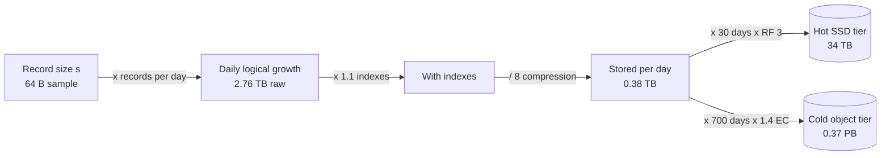
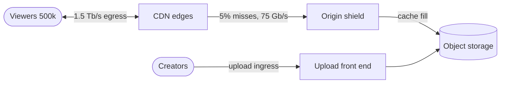
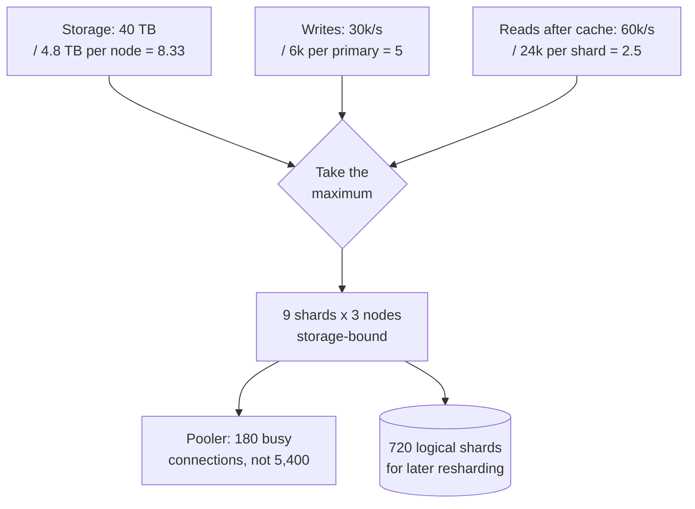
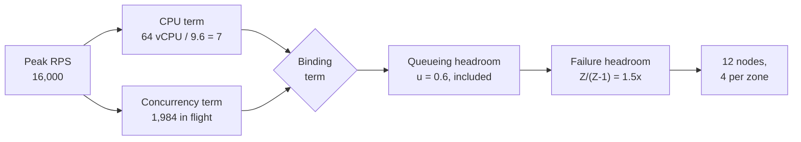
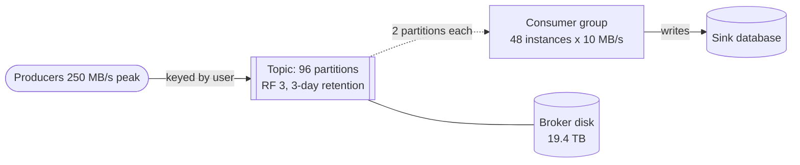

# Chapter 89 — Capacity Estimation Handbook

> **Level:** 2–4 · **Track:** Shared · **Estimated reading time:** 4 h

Every design in this book starts with numbers: requests per second at peak, bytes per year, gigabytes of GPU memory, dollars per million tokens. Chapter 2 introduced the method (§2.11), Chapter 4 supplied the mathematics, and each case study applied it to one system. This chapter gathers all of it into one reference. Each estimation family gets a formula in handbook form, a worked example with every step shown, and the mistakes that most often break it. The chapter ends with twelve end-to-end drills, from a URL shortener to a large-language-model (LLM) pre-training run, and a runnable calculator that reproduces the key results.

Where a formula is derived elsewhere, this chapter cites the owning section and gives only the form you need at the whiteboard. Where a case study already estimated a system, the drill reuses its numbers and cites it, so that the book tells one consistent story.

::: note
**Conventions used throughout this chapter.** Decimal units for estimation: 1 KB = 10³ bytes, 1 GB = 10⁹ bytes, 1 TB = 10¹² bytes; network rates in bits per second, 1 Gb/s = 125 MB/s (§4.5). The reference GPU is the H100 SXM: 80 GB of HBM3, 3.35 TB/s, 989 TFLOP/s dense BF16 (Table 64.4); Chapters 65 and 80 round this to 10¹⁵ FLOP/s, and the 1% difference is below estimation precision. Illustrative prices, as of 2026: \$2.50 per GPU-hour and \$0.77 per hour for a 16-vCPU node (\$0.048 per vCPU-hour) (§60.11); object storage \$0.023 per GB-month (Table 15.4); internet egress \$0.05 per GB and negotiated CDN delivery \$0.01 per GB (§21.5.4). Unless a case says otherwise, the busiest hour carries $h = 0.10$ of daily traffic and the burst factor is $b = 2$ (§52.3), and target utilization is $u = 0.6$.
:::

## 89.1 Learning objectives

After this chapter you should be able to:

- Turn a vague prompt ("design a chat app for 100 million users") into a written list of assumptions and an estimation tree in under five minutes.
- Convert daily volumes into average and peak rates, and choose a defensible peak-to-average ratio.
- Estimate storage with retention, indexes, compression, replication and erasure coding, and bandwidth with CDN offload and media bitrates.
- Size caches, databases, application fleets, message-broker partitions and consumer groups, including headroom and N+1/N+2 or zone-level redundancy.
- Translate availability and durability targets into downtime and loss budgets, and compose them across dependencies.
- Estimate ML workloads: training-data volume, feature-store reads, embedding-table memory and CPU or GPU inference fleets.
- Estimate GPU memory for training and serving, training compute and time with $6ND$, and LLM serving throughput from the memory-bandwidth limit of decode.
- Compute cost per request, per user and per million tokens, and say which resource dominates it.
- Run any of twelve standard drills aloud in an interview, and sanity-check your own answers.

## 89.2 Prerequisites

- Back-of-the-envelope method and peak formula — §2.11 (this chapter is its deep treatment).
- Units, prefixes and time conversions — §4.5; percentiles and fan-out — §4.8; queueing and utilization — §4.10; Little's Law — §4.11.
- Availability, durability and latency numbers — §4.14, §4.16, §4.17.
- Capacity planning, headroom and redundancy — §18.11.
- Inference fleet sizing — §60.11; GPU hardware and the roofline — Chapter 64; training memory and $6ND$ — §65.3–§65.4.
- KV cache and LLM serving capacity — §72.11, §73.5, §73.15; cost and unit economics — Chapter 51.

## 89.3 The estimation mindset

### 89.3.1 What estimation is for

::: definition
**Definition — Capacity estimation.** The practice of deriving, from stated assumptions and a few reference numbers, the order of magnitude of a system's load (requests, bytes, tokens per second) and the resources it needs (nodes, memory, disks, GPUs, network, money). An estimate is judged by whether it reaches the right power of ten and the right *design decision*, not by its third significant digit.
:::

#### First-principles explanation

Before driving across a country you estimate the trip: about 4,000 km at about 100 km/h is about 40 hours of driving, so plan for five days, not one and not twenty. You do not know the exact distance or speed, yet the estimate decides the plan: book hotels, share the driving, or fly instead. Capacity estimation does the same for software. Twenty requests per second fits on one server; twenty thousand needs a fleet and a cache; twenty million needs partitioning and many regions. The estimate tells you which of these worlds you are in.

#### Why does this exist?

Architecture changes in steps of about ten (§2.10). A design that is right for 1,000 RPS is usually wrong for 100,000 RPS, and the mistake is expensive to discover after launch. Estimation exposes the binding constraint early, before money or code is committed. It also exposes surprises: in QuickBite, courier GPS writes outnumber orders 83 to 1 (§2.11), and in an LLM chatbot the KV cache, not the weights, fills the GPU (§72.11).

#### How it works internally

1. **Clarify the scope**: which features, which users, which time horizon.
2. **Write assumptions down** with units, labeled as assumptions (§2.7).
3. **Build an estimation tree**: the quantity you want at the root, multiplied factors as children, and assumptions as leaves (Figure 89.1).
4. **Compute rates, then sizes, then resources**: average to peak rate, rate times size, size times retention and copies, load divided by per-node capacity at a target utilization.
5. **Sanity-check** by a second route and against reference numbers (§89.4).
6. **State the implication**: which component is the bottleneck, what you will design around, and which assumption would change the answer.

### 89.3.2 Orders of magnitude, rounding and error

Rounding is not sloppiness; it is how you keep arithmetic fast enough to do aloud. Use one or two significant figures, keep powers of ten explicit, and round *consistently*: round up anything you will provision (nodes, disks), and never round the same quantity both ways in one calculation.

::: formula
**Bounding an unknown and combining uncertain factors**

$$\hat{x} = \sqrt{x_{\text{lo}}\, x_{\text{hi}}} \qquad F_{\text{prod}} \approx \exp\sqrt{\sum_{i=1}^{n} (\ln F_i)^2} \qquad F_{\text{worst}} = \prod_{i=1}^{n} F_i$$

| Symbol | Meaning | Units |
|---|---|---|
| $x_{\text{lo}}$, $x_{\text{hi}}$ | Lower and upper bounds you are confident in | units of $x$ |
| $\hat{x}$ | Point estimate: the geometric mean of the bounds | units of $x$ |
| $F_i$ | Uncertainty factor of factor $i$: the true value lies within $\times F_i$ or $\div F_i$ | dimensionless |
| $n$ | Number of multiplied factors in the estimate | count |
| $F_{\text{prod}}$ | Typical uncertainty factor of the product, assuming independent errors | dimensionless |
| $F_{\text{worst}}$ | Worst-case factor, if every error points the same way | dimensionless |
:::

The geometric mean is the right midpoint on a log scale: halfway between 10 and 1,000 is 100, not 505. Independent errors partly cancel, which is why Fermi estimates land closer than their individual guesses suggest [Weinstein and Adam 2008].

::: example
**Worked example — Yearly photo storage for an app whose user count you do not know.** You believe daily active users (DAU) lie between 5 million and 50 million. Assume 0.5 uploads per DAU per day at 2 MB each, kept for a year.

1. Point estimate of DAU: $\sqrt{5 \times 10^6 \times 5 \times 10^7} = 1.58 \times 10^7$, round to **16 million**.
2. Uploads per day: $16 \times 10^6 \times 0.5 = 8 \times 10^6$. Bytes per day: $8 \times 10^6 \times 2 \times 10^6 = 1.6 \times 10^{13}$ B $= 16$ TB.
3. Per year: $16 \times 365 = 5{,}840$ TB $= 5.84$ PB, before replication.
4. Uncertainty: four factors (DAU, uploads, size, retention), each trusted within 2×: $F_{\text{prod}} = \exp\sqrt{4 \times (\ln 2)^2} = \exp(1.386) = 4.0$, against a worst case of $2^4 = 16$.
5. Range: $5.84 / 4 = 1.46$ PB to $5.84 \times 4 = 23.4$ PB.
6. Per-user check: $5.84 \times 10^{15} / 16 \times 10^6 = 365$ MB per DAU per year, 1 MB a day: one photo every two days. Plausible.

**Interpretation.** The answer is "a few petabytes a year", uncertain by about 4× either way. **Engineering implication.** Every value in that range calls for the same design: object storage with erasure coding (§15.6) and a CDN, never a database. When the decision is the same across the range, stop estimating. When it flips inside the range, narrow the one assumption that dominates the uncertainty, here DAU.
:::

### 89.3.3 Units: decimal versus binary

Estimation uses decimal units; memory pages, allocators and some operating-system tools use binary units (KiB, MiB, GiB = 2¹⁰, 2²⁰, 2³⁰ bytes). The gap is 7.4% at giga and 12.6% at peta (Table 4.2). Network links are always decimal and always in **bits**. State the convention once, at the top of your estimate.

::: mistake
**Mixing bits and bytes, or GB and GiB.** "1 Gb/s link, 1 GB/s of traffic, fits" is wrong by 8×. "80 GB GPU" from a datasheet is decimal, while `nvidia-smi` reports MiB; 80 GB is 74.5 GiB. Write units on every line of the calculation and carry them through, as in a physics problem.
:::

### 89.3.4 Estimation trees and sanity checks

**Figure 89.1 — An estimation tree for yearly photo storage.**

**Reading the diagram.** The root is the quantity you want; each child is a factor that multiplies into it, and the leaves are assumptions you state aloud. Arrows point from a result to what it is computed from, so you can read the tree top-down as an explanation or bottom-up as arithmetic. The dotted edge is a later adjustment: redundancy turns logical bytes into raw disk at the storage boundary (cylinder). The failure point of a tree is a leaf nobody questioned; the interviewer's follow-up usually targets the most uncertain leaf, here DAU. A tree scales to any estimate: replace "bytes per upload" with "tokens per call" and it sizes an LLM fleet.

**Figure 89.2 — The estimation loop.**

**Reading the diagram.** The loop runs left to right in a few minutes. Rates come before sizes because bandwidth and per-node load depend on peak rate, and resources come last because they divide load by capacity. The decision diamond is where an estimate earns trust: if a sanity check fails, return to the assumptions (dotted edge) rather than patching a number. The output is not a table of numbers but a sentence: what saturates first and what the design must do about it.

**Table 89.1 — Five sanity checks.**

| Check | Question | Example |
|---|---|---|
| Units | Do the units cancel to what you want? | requests/day ÷ s/day = requests/s |
| Per-user | Is the per-user figure believable? | 365 MB per DAU per year for a photo app |
| Second route | Does another decomposition agree within ~3×? | Storage from uploads, and from bandwidth × time |
| Reference | Is it near a known system or limit? | 280,000 RPS ≫ one database node (~10⁴) |
| Extremes | Does it behave sensibly at 0 and at 10×? | Doubling DAU should double storage, not square it |

::: mistake
**Computing the average and calling it capacity.** Servers fail at peak, not on average. Every rate in a capacity estimate must be converted to a design peak (§89.5) before it is divided by per-node capacity.
:::

::: mistake
**Precision theater.** "We need 47.3 servers" signals that you computed without thinking. Say "about 50, so two racks' worth or one autoscaling group", and spend the saved minute on the bottleneck.
:::

## 89.4 Reference numbers cheat sheet

The tables below collect the constants used in this book's estimates. They are order-of-magnitude anchors, dated **as of 2026**, with the owning section as source. Ratios between rows change far more slowly than the absolute values; measure your own hardware before committing money (§4.17).

**Table 89.2 — Time and rate conversions.**

| Conversion | Exact | Handy form |
|---|---|---|
| Seconds per day | 86,400 | ≈ 10⁵ (16% high) |
| Seconds per 30-day month / 365-day year | 2,592,000 / 31,536,000 | ≈ 2.6 × 10⁶ / ≈ π × 10⁷ |
| 1 million per day | 11.6 per second | ≈ 12/s |
| 1 billion per day | 11,574 per second | ≈ 12,000/s |
| 1 per second sustained | 86,400/day; 31.5 million/year | ≈ 10⁵/day |
| 1 MB/s sustained | 86.4 GB/day; 2.6 TB/month; 31.5 TB/year | ≈ 30 TB/year |
| 1 TB/day | 11.6 MB/s = 92.6 Mb/s | ≈ 0.1 Gb/s |
| 1 Gb/s | 125 MB/s = 10.8 TB/day | ≈ 10 TB/day |
| Peak-to-average ratio for busiest-hour share $h$, burst $b$ | $24\,h\,b$ | $h = 0.10, b = 2$: 4.8; $h = 0.20, b = 2$: 9.6 |

**Table 89.3 — Latency anchors (order of magnitude, as of 2025–2026; from Table 4.9).**

| Operation | Approximate value |
|---|---|
| Main-memory reference | ~100 ns |
| Read 4 KB randomly from NVMe SSD | ~50–100 µs |
| Round trip within one datacenter | ~50–500 µs |
| Read 1 MB sequentially from memory / NVMe / HDD | ~0.1 ms / ~0.2 ms / ~5 ms |
| HDD seek | ~4–10 ms |
| Round trip across a continent / California–Netherlands | ~50–100 ms / ~150 ms |
| LLM decode step, 8B model on one H100 | ~8 ms at batch 1; ~26 ms at batch 172 (§89.16) |

**Table 89.4 — Throughput and per-node capacity anchors (as of 2026).**

| Resource | Rough capacity | Source |
|---|---|---|
| Server DRAM bandwidth, one socket | ~0.3–0.6 TB/s | Table 64.1 |
| NVMe SSD sequential read | ~3–7 GB/s per drive | Table 4.9 (1 MB in 0.15–0.3 ms) |
| HDD sequential; random | ~200 MB/s; ~100–250 IOPS | Table 4.9 |
| NIC 10 / 25 / 100 Gb/s | 1.25 / 3.1 / 12.5 GB/s | §4.5 |
| GPU NIC, 400 Gb/s | 50 GB/s line rate | Table 64.8 |
| PCIe Gen5 x16 / NVLink 4 | ~64 / 450 GB/s per direction | Table 64.8 |
| H100 HBM3 | 3.35 TB/s, 80 GB | Table 64.2 |
| Stateless API node, simple JSON | ~10³ RPS | Table 2.17 |
| Relational primary, indexed writes | ~10³–10⁴ writes/s | Table 2.17, §14.7.4 |
| In-memory key-value node | ~10⁵ ops/s | Table 2.17 |
| Wide-column node, sustained writes | ~2.5 × 10⁴ writes/s (assumed) | §53.4.4 |
| Kafka partition, append | tens of MB/s | §31.5.2 |
| WebSocket gateway node | 2–5 × 10⁵ connections (design ceiling) | §9.9.2, §53.4.4 |

**Table 89.5 — Typical object sizes used in this book.**

| Object | Size | Source |
|---|---|---|
| Integer ID / UUID / timestamp | 8 B / 16 B / 8 B | — |
| Short-link record with indexes | 500 B | §52.4.4 |
| Chat message stored, with metadata | 300 B | §53.4.4 |
| Order record | 2 KB | §2.11 |
| Log line | 400 B | §56.6.4 |
| Metric sample, Gorilla-compressed | 1.37 B | §56.6.4 |
| GPS location update on the wire / stored | 200 B / 100 B | §55.4.4 |
| API JSON response (no images) | 1–20 KB | §2.11 |
| Photo original / four renditions / delivered | 3 MB / 390 KB / 150 KB | §53.6.4 |
| Video delivered (average) / H.264 ladder | 2.5 Mb/s / 0.4–6 Mb/s | §54.4.4, §21.8.2 |
| 768-dimension FP32 embedding / with ANN graph and metadata | 3,072 B / 3,400 B | §75.6.3 |
| English text per LLM token | ~4 characters, ~0.75 words (1.3 tokens per word) | §72.4.5 |
| KV cache per token: 7B MHA / 8B GQA / 70B GQA, FP16 | 524 / 131 / 328 KB | Table 73.3 |

**Table 89.6 — Accelerator constants (dense 16-bit, vendor datasheets, as of 2026; from Tables 64.3–64.4).**

| GPU | Dense BF16 | HBM bandwidth | HBM | Ridge point |
|---|---|---|---|---|
| A100 SXM 80 GB | 312 TFLOP/s | 2.0 TB/s | 80 GB | ~153 FLOPs/byte |
| H100 SXM | 989 TFLOP/s (FP8 1,979) | 3.35 TB/s | 80 GB | ~295 |
| H200 SXM | 989 TFLOP/s | 4.8 TB/s | 141 GB | ~206 |
| B200 | ~2,250 TFLOP/s | ~8 TB/s | ~180–192 GB | ~280 |

Datasheets headline tensor-core rates "with sparsity"; halve them for ordinary dense work (§64.8). Use dense figures and a measured utilization (MFU, §64.11) in every estimate.

::: warning
**Reference numbers are anchors, not facts.** Per-node capacities vary by 10× with language, payload and work per request, and prices change every year and differ by region and contract. In an interview, say "assume about 10³ RPS per node; I would load-test that"; in a design document, replace each anchor with a measurement and keep the date.
:::

## 89.5 Users and traffic

::: definition
**Definition — DAU, MAU and stickiness.** **Monthly active users (MAU)** and **daily active users (DAU)** count distinct users active in a month and in a day. Their ratio, DAU/MAU, is the **stickiness**: about 0.1–0.2 for an occasionally used app and above 0.5 for a messaging app used every day. The **peak-to-average ratio (PAR)** is the design peak rate divided by the daily average rate.
:::

Traffic estimation is a funnel: users become sessions, sessions become requests, requests become a daily volume, the daily volume becomes an average rate, and the average becomes a design peak. Each API request then fans out into several internal calls.

**Figure 89.3 — The traffic funnel, from users to per-service peak load.**

**Reading the diagram.** Each arrow multiplies or divides by one stated assumption, so a reviewer can challenge any edge in isolation. Users (stadiums) are people, the rectangles are request rates. The PAR edge is where most estimates go wrong: it carries the shape of the day (busiest-hour share) and the bursts above it. The last edge is fan-out: a single API request may call profile, catalog and ranking services, so internal load is a multiple of external load and must be sized separately. The flow is a planning model, synchronous throughout, with no storage boundary.

::: formula
**Users to design-peak traffic (handbook form of §2.11 and §4.5.3)**

$$U_{\text{DAU}} = \sigma\, U_{\text{MAU}} \qquad V = U_{\text{DAU}}\, a \qquad \bar{R} = \frac{V}{86{,}400} \qquad R_{\text{peak}} = \frac{V\, h}{3{,}600}\, b = \bar{R} \times 24\, h\, b \qquad \rho_{rw} = \frac{V_{\text{read}}}{V_{\text{write}}}$$

| Symbol | Meaning | Units |
|---|---|---|
| $U_{\text{MAU}}$, $U_{\text{DAU}}$ | Monthly and daily active users | users |
| $\sigma$ | Stickiness, DAU/MAU | dimensionless |
| $a$ | Requests of one type per DAU per day | requests/user/day |
| $V$ | Daily volume of that request type | requests/day |
| $\bar{R}$ | Average rate | requests/s |
| $h$ | Share of daily volume in the busiest hour (1/24 for flat traffic) | fraction |
| $b$ | Burst factor above the busiest-hour average | dimensionless |
| $R_{\text{peak}}$ | Design peak rate | requests/s |
| $\rho_{rw}$ | Read-to-write ratio | dimensionless |
:::

::: example
**Worked example — A recipe-sharing app with 30 million MAU.** Assumptions: stickiness 0.4; each DAU opens the app 3 times a day and each session makes 8 API reads (24 reads); 0.6 writes per DAU per day (saves, ratings, comments); $h = 0.10$, $b = 2$; each API request makes 3 internal calls.

1. DAU: $0.4 \times 30 \times 10^6 = 12 \times 10^6$.
2. Reads: $12 \times 10^6 \times 24 = 2.88 \times 10^8$/day; average $2.88 \times 10^8 / 86{,}400 = 3{,}333$ RPS.
3. Read peak: $2.88 \times 10^8 \times 0.10 / 3{,}600 \times 2 = 16{,}000$ RPS. PAR $= 24 \times 0.10 \times 2 = 4.8$.
4. Writes: $12 \times 10^6 \times 0.6 = 7.2 \times 10^6$/day; average 83/s; peak $83.3 \times 4.8 = 400$/s.
5. Read-to-write ratio: $2.88 \times 10^8 / 7.2 \times 10^6 = 40$.
6. Internal calls at peak: $16{,}000 \times 3 = 48{,}000$ RPS.

**Interpretation.** A 30-million-user product is about 16,000 RPS of reads and 400 writes per second at peak: a read-heavy system where one relational primary absorbs every write. **Engineering implication.** Spend the design on caching and read scaling (§89.8), size internal services for 48,000 RPS rather than 16,000, and do not partition the write path yet.
:::

**Table 89.7 — Peak-to-average ratios used in this book (assumptions, not measurements).**

| Workload | PAR | Why | Source |
|---|---|---|---|
| Global consumer feed or search | 2 | Time zones flatten the day | §53.7.4, §56.4.4 |
| Regional chat, ride-hailing | 3 | Evening peak in one or a few time zones | §53.4.4, §55.4.4 |
| Default case-study rule ($h = 0.10$, $b = 2$) | 4.8 | Busy hour plus bursts | §52.3 |
| Payments in a holiday sale | 5 | Seasonal spike | §82.4.4 |
| Food delivery dinner rush ($h = 0.20$, $b = 2$) | 9.6 | Two meal peaks dominate | §2.11, §18.11.3 |
| Ticket on-sale, flash sale | 100s to 1,000s | Demand concentrated on one item in minutes | §55.8.4 |

::: mistake
**Applying one PAR to everything.** Writes, reads, batch jobs and notification campaigns peak at different times and by different factors; a campaign that pushes 10 million notifications at 18:00 creates its own peak (§52.7). Estimate a peak per traffic class, and remember that a global service's peak is set by its largest region's evening, not the global average.
:::

::: mistake
**Counting registered users as active.** Ten million registered customers may be four million weekly and two million daily actives (QuickBite, §57). Size online paths from DAU and concurrent users; size storage from everyone whose data you keep.
:::

## 89.6 Storage

Storage estimates multiply a daily growth by retention, then adjust for what the bytes become on disk: indexes add, compression subtracts, and redundancy multiplies.

**Figure 89.4 — From one record to raw disk.**

**Reading the diagram.** A record becomes daily growth, gains index overhead, shrinks by compression, and then splits by age into tiers (cylinders are storage boundaries). Each tier has its own retention and its own redundancy scheme: three-way replication on the hot tier for fast reads and simple repair, erasure coding on the cold tier for cost. Failure point: forgetting a multiplier, usually replication or indexes. Scaling: storage grows linearly forever unless retention, downsampling or tiering bend the curve.

::: formula
**Stored bytes with indexes, compression and redundancy**

$$S = n_{\text{day}}\; s\; \frac{1 + x}{c}\; T\; k \qquad k_{\text{rep}} = r \qquad k_{\text{EC}} = \frac{d + m}{d}$$

| Symbol | Meaning | Units |
|---|---|---|
| $S$ | Raw bytes on disk for one tier | bytes |
| $n_{\text{day}}$ | Records written per day | records/day |
| $s$ | Logical size per record | bytes |
| $x$ | Index and storage-engine overhead | fraction |
| $c$ | Compression ratio (1 = none) | dimensionless |
| $T$ | Days the tier keeps data | days |
| $k$ | Redundancy multiplier | dimensionless |
| $r$ | Replication factor | copies |
| $d$, $m$ | Data and parity fragments of an erasure code RS($d$, $m$) (§15.6) | count |
:::

::: example
**Worked example — Telemetry from 5 million devices.** Each device sends a 64-byte sample every 10 s. Indexes add 10%; columnar time-series compression is 8:1. Hot tier: 30 days on SSD with replication factor 3. Cold tier: the next 700 days (two years in total) in object storage with RS(10,4), $k = 1.4$.

1. Samples per day: $5 \times 10^6 \times 86{,}400 / 10 = 4.32 \times 10^{10}$. Raw bytes: $4.32 \times 10^{10} \times 64 = 2.76$ TB/day.
2. Stored per day: $2.76 \times 1.1 / 8 = 0.380$ TB.
3. Hot tier: $0.380 \times 30 \times 3 = 34.2$ TB of SSD.
4. Cold tier: $0.380 \times 700 \times 1.4 = 372$ TB; with three replicas instead it would be 798 TB, so erasure coding saves 426 TB.
5. Total: about 0.41 PB. Without compression or tiering, two years at RF 3: $2.76 \times 1.1 \times 730 \times 3 = 6.66$ PB, 16 times more.

**Interpretation.** Compression and redundancy choice matter more than raw volume: the same data costs 0.41 PB or 6.7 PB. **Engineering implication.** State compression, retention and redundancy per tier explicitly; downsampling old data (keeping 5-minute averages, §56.6.4) would shrink the cold tier by another order of magnitude.
:::

**Table 89.8 — Replication versus erasure coding (§15.6).**

| Scheme | Overhead $k$ | Losses tolerated | Fragments read to repair one | Choose when |
|---|---|---|---|---|
| 3 replicas | 3.0× | 2 | 1 | Hot, small, latency-sensitive data; databases |
| RS(6,3) | 1.5× | 3 | 6 | Warm data, fewer failure domains |
| RS(10,4) | 1.4× | 4 | 10 | Large cold objects, 14 or more failure domains |

::: industry
**Facebook f4 warm-blob storage.** Muralidhar et al. report moving warm photos from Haystack, with an effective replication factor of 3.6, to f4, with an effective factor of 2.1, by combining RS(10,4) within a datacenter with XOR coding across datacenters. At exabyte scale that difference is the main storage cost lever.
*Evidence: Primary* — [Muralidhar et al. 2014]
:::

::: mistake
**Storing per recipient instead of per object.** A group message stored once per member multiplies storage by group size (6.4× in §53.4.4); a feed stored per follower multiplies by audience. Decide whether a fan-out writes *pointers* or *copies* before multiplying.
:::

## 89.7 Bandwidth

::: formula
**Bandwidth, origin load and streaming concurrency**

$$B = R\, s \times 8 \qquad B_{\text{origin}} = B_{\text{users}}\,(1 - O_B) \qquad V_{\text{conc}} = \lambda_{\text{start}}\, W \qquad B_{\text{video}} = V_{\text{conc}}\; r_{\text{bit}}$$

| Symbol | Meaning | Units |
|---|---|---|
| $B$ | Bandwidth | bits/s |
| $R$, $s$ | Transfer rate and bytes per transfer | transfers/s, bytes |
| $O_B$ | CDN byte offload: share of user bytes served from cache (§21.5.1) | fraction |
| $B_{\text{users}}$, $B_{\text{origin}}$ | Bandwidth delivered to users; bandwidth the origin must serve | bits/s |
| $\lambda_{\text{start}}$ | Rate at which viewing sessions start | sessions/s |
| $W$ | Average session (view) duration | s |
| $V_{\text{conc}}$ | Concurrent viewers, by Little's Law (§4.11) | viewers |
| $r_{\text{bit}}$ | Average delivered bitrate | bits/s |
:::

::: example
**Worked example — A video-learning platform.** Assumptions: 20 million views per day of 12 minutes on average; delivered bitrate 3 Mb/s; PAR 3; CDN byte offload 95%; prices from the chapter note.

1. View starts: average $20 \times 10^6 / 86{,}400 = 231$/s; peak $694$/s.
2. Concurrent viewers at peak: $694 \times 720 = 500{,}000$ (average 167,000).
3. Peak egress to users: $500{,}000 \times 3 \times 10^6 = 1.5$ Tb/s.
4. Origin at 95% offload: $1.5 \times 0.05 = 75$ Gb/s at peak.
5. Bytes per day: $20 \times 10^6 \times 720 \times 3 \times 10^6 / 8 = 5.4$ PB; origin share $270$ TB.
6. Cost per day: CDN $5.4 \times 10^6$ GB × \$0.01 = \$54,000; origin $270{,}000$ GB × \$0.05 = \$13,500. Serving everything from cloud egress would cost $5.4 \times 10^6 \times 0.05 = \$270{,}000$ a day.

**Interpretation.** Requests are few (under 700 starts per second) but bytes are enormous, and delivery cost dwarfs compute. **Engineering implication.** Video bytes belong to the CDN; the origin is sized for cache misses and shielded (§21.5); each point of offload is worth 15 Gb/s of origin capacity here, and lowering the average bitrate by better encoding (§54.4) cuts the largest bill linearly.
:::

**Figure 89.5 — Where bandwidth is counted.**

**Reading the diagram.** Viewer traffic is synchronous HTTPS between users and CDN edges; only misses travel inward, collapsed further by an origin shield, to object storage (cylinder, storage boundary). Uploads arrive on a separate, much smaller ingress path. Failure points: a cold or purged CDN multiplies origin load by up to 20× at 95% offload, and egress is billed at every arrow that leaves the provider. Scaling: more edges and a higher offload for egress, a larger shield for origin.

::: mistake
**Sizing a link at its line rate.** A 10 Gb/s NIC delivers less after TCP, TLS and framing overhead and should run below about 70% to absorb bursts. Divide by a target utilization exactly as for CPUs, and remember that egress and ingress are separate budgets.
:::

## 89.8 Caching

A cache estimate answers three questions: how much memory holds the hot data (the **working set**), what hit ratio that memory buys, and what load the misses leave for the backend. The mechanics, eviction policies and failure modes are Chapter 20's; this section gives the arithmetic.

::: formula
**Working set, hit ratio and backend load (§20.3.2–§20.3.3)**

$$M = K\, s\, o \qquad h_{\text{Zipf}}(K) \approx \frac{\ln K + \gamma}{\ln N + \gamma} \qquad R_{\text{db}} = (1 - h)\, R_{\text{read}} + R_{\text{write}}$$

| Symbol | Meaning | Units |
|---|---|---|
| $M$ | Cache memory needed, one copy | bytes |
| $K$ | Keys held (the hottest $K$) | keys |
| $s$ | Value size | bytes |
| $o$ | Overhead factor for keys, pointers and allocator slack (1.5–2) | dimensionless |
| $N$ | Distinct keys requested | keys |
| $\gamma$ | Euler–Mascheroni constant, 0.577 | dimensionless |
| $h$ | Hit ratio (Zipf popularity with exponent 1, ideal policy) | fraction |
| $R_{\text{read}}$, $R_{\text{write}}$ | Reads reaching the cache; writes, which reach the database regardless | requests/s |
| $R_{\text{db}}$ | Load reaching the database | requests/s |
:::

::: example
**Worked example — A product catalog with 100 million items.** Peak 200,000 reads/s and 2,000 writes/s; 2 KB per item; overhead 1.5; popularity roughly Zipf with exponent 1.

1. Cache the top 1 million: $M = 10^6 \times 2{,}000 \times 1.5 = 3$ GB; $h \approx (13.82 + 0.58)/(18.42 + 0.58) = 0.758$; $R_{\text{db}} = 0.242 \times 200{,}000 + 2{,}000 = 50{,}500$/s.
2. Top 10 million: 30 GB; $h \approx 0.879$; $R_{\text{db}} = 26{,}200$/s.
3. Top 30 million: 90 GB; $h \approx 0.937$; $R_{\text{db}} = 14{,}700$/s.
4. Cold cache after a restart: $R_{\text{db}} = 202{,}000$/s, 7.7 times the 10-million-key steady state.

**Interpretation.** Each 10× of cache memory adds about 12 points of hit ratio, but because the backend sees *misses*, going from 87.9% to 93.7% halves database load. **Engineering implication.** Size the cache from the backend's capacity: choose $h$ so that $R_{\text{db}}$ fits the database at its target utilization, then buy the memory that delivers it, replicated across zones. Plan warm-up or request coalescing for the cold-cache case (§20.11, §20.13), because the database cannot absorb 7.7×.
:::

**Figure 89.6 — How hit ratio sets backend load.**

**Reading the diagram.** Reads hit the cache first (synchronous); only misses, plus every write, reach the database (cylinder, storage boundary). Fills and invalidations flow back asynchronously (dotted). The failure point is the miss edge: it grows by a factor of $1/(1-h)$ when the cache empties. Scaling the cache raises $h$ with diminishing returns; scaling the database is needed only if even the realistic miss rate exceeds it.

::: mistake
**Estimating hit ratio from the share of keys cached.** Caching 10% of keys gives far more than 10% of hits under skew (88% above), and caching 100% of keys does not give 100% when TTLs, invalidations and new keys cause misses. When the whole dataset fits (2 million recipes × 4 KB × 1.5 = 12 GB for §89.5's app), cache all of it and estimate misses from writes and TTL instead.
:::

## 89.9 Database sizing

A database is sized by the largest of three demands, storage, writes and reads after caching, each divided by what one node delivers at a safe fill or utilization (§14.7.4). Connection counts form a fourth, often forgotten, limit.

::: formula
**Shards and connections (handbook form of §14.7.4 and §4.11)**

$$S = \left\lceil \max\left(\frac{D}{C_{\text{disk}}\, f},\; \frac{W}{w_{\text{node}}\, u},\; \frac{R_{\text{db}}}{n_{\text{read}}\, r_{\text{node}}\, u}\right)\right\rceil \qquad L_{\text{conn}} = R_q\, t_{\text{hold}} \qquad C_{\text{open}} = P\, S\, p$$

| Symbol | Meaning | Units |
|---|---|---|
| $S$ | Shards (each a replicated group) | shards |
| $D$ | Data at the planning horizon, one copy, with indexes | TB |
| $C_{\text{disk}}$, $f$ | Usable disk per node; target fill fraction | TB; fraction |
| $W$, $w_{\text{node}}$ | Peak writes; writes one primary sustains | writes/s |
| $R_{\text{db}}$, $r_{\text{node}}$ | Peak reads after caches; reads one node sustains | reads/s |
| $n_{\text{read}}$ | Nodes per shard serving reads | nodes |
| $u$ | Target utilization | fraction |
| $L_{\text{conn}}$ | Connections busy on average | connections |
| $R_q$, $t_{\text{hold}}$ | Query rate; time each query holds a connection | queries/s; s |
| $C_{\text{open}}$ | Connections opened by $P$ application instances with pool size $p$ per shard | connections |
:::

::: example
**Worked example — An order-history store.** Horizon data $D = 40$ TB with indexes; 8 TB usable per node at $f = 0.6$; peak writes 30,000/s at $w_{\text{node}} = 10{,}000$; reads after cache 60,000/s served by 2 replicas per shard at 20,000 each; $u = 0.6$; queries hold a connection for 2 ms; 120 application pods.

1. Storage term: $40 / (8 \times 0.6) = 8.33$. Write term: $30{,}000 / 6{,}000 = 5$. Read term: $60{,}000 / (2 \times 20{,}000 \times 0.6) = 2.5$.
2. $S = \lceil 8.33 \rceil = 9$ shards, storage-bound; 27 nodes with a primary and two replicas each, three shards' primaries per zone.
3. Busy connections: $(30{,}000 + 60{,}000) \times 0.002 = 180$ fleet-wide, 20 per shard.
4. Opened connections with a pool of 5 per shard per pod: $120 \times 9 \times 5 = 5{,}400$, 600 per shard, 30 times the 20 in use.

**Interpretation.** The store is storage-bound, so the write path has 40% spare capacity at the horizon; but naive pooling opens 30 times more connections than the work needs, enough to exhaust a PostgreSQL server's process limit. **Engineering implication.** Compute all three shard terms and benchmark the binding one; put a transaction-mode pooler between pods and primaries (§14.13, §18.8.5); create many logical shards (for example 720) so physical shards can be added in small steps (§14.7.4).
:::

**Figure 89.7 — Three demands, one shard count.**

**Reading the diagram.** The three inputs are independent capacity demands; the diamond picks the binding one. Below it, two operational consequences: the connection budget, which a pooler enforces, and the logical-shard map, the storage boundary that makes later growth a data move rather than a re-keying. Failure points: a wrong per-node benchmark in the binding term, and a hot shard that a uniform estimate hides (§14.8). Scaling: add physical shards by moving logical ones.

::: mistake
**Sizing a database from today's data.** Size for the horizon (often 18–24 months) plus the fill fraction; a node at 90% disk cannot compact, back up or rebalance. Growth also changes which term binds: a write-bound store usually becomes storage-bound as history accumulates (§53.4.4).
:::

## 89.10 Servers and memory

Application fleets are sized by whichever runs out first: CPU, concurrency (threads, connections, sockets) or memory. Then failure headroom is added on top of queueing headroom (§18.11.2).

::: formula
**CPU-bound, concurrency-bound and redundant fleet size**

$$N_{\text{cpu}} = \left\lceil \frac{R\, c_{\text{cpu}}}{k\, u} \right\rceil \qquad N_{\text{conc}} = \left\lceil \frac{R\, W}{T_{\text{node}}\, u} \right\rceil \qquad N_{\text{total}} = N + n_{\text{spare}} \;\;\text{or}\;\; \left\lceil N\, \frac{Z}{Z - f} \right\rceil$$

| Symbol | Meaning | Units |
|---|---|---|
| $R$ | Peak requests | requests/s |
| $c_{\text{cpu}}$ | CPU time per request, from a profile or load test | vCPU-s |
| $k$ | vCPUs per node | vCPU |
| $u$ | Target utilization | fraction |
| $W$ | Time a request occupies a thread or slot (Little's Law, §4.11) | s |
| $T_{\text{node}}$ | Concurrent slots per node (threads, connections) | slots |
| $N$ | Larger of $N_{\text{cpu}}$, $N_{\text{conc}}$ and a memory term | nodes |
| $n_{\text{spare}}$ | Spares: 1 for N+1, 2 for N+2 | nodes |
| $Z$, $f$ | Zones used; zones that may fail without overload | count |
:::

::: example
**Worked example — The recipe app's API tier.** From §89.5: 16,000 RPS at peak. Profile: 4 ms of CPU per request; each request waits 120 ms on downstream calls, so it occupies a worker for 124 ms. Nodes have 16 vCPU and, with a thread-per-request server, 200 worker threads; $u = 0.6$; three zones.

1. CPU: $16{,}000 \times 0.004 = 64$ busy vCPU; $N_{\text{cpu}} = \lceil 64 / 9.6 \rceil = 7$.
2. Concurrency: $L = 16{,}000 \times 0.124 = 1{,}984$ requests in flight; $N_{\text{conc}} = \lceil 1{,}984 / 120 \rceil = 17$.
3. Memory: at 1 MB per in-flight request, 2 GB across the fleet: not binding.
4. Thread-per-request: $N = 17$; zone-safe $\lceil 17 \times 3/2 \rceil = 26$. An asynchronous server removes the thread limit: $N = 7$, zone-safe $\lceil 10.5 \rceil = 11$, rounded to 12 for four per zone. Losing a zone leaves 8 nodes at $64 / 128 = 50\%$ CPU.

**Interpretation.** The same traffic needs 26 or 12 nodes depending on whether waiting holds a thread. **Engineering implication.** Compute concurrency with Little's Law for every I/O-heavy service; if a downstream slows from 120 ms to 1 s, $L$ rises to 16,000 and a thread-bound fleet collapses, which is why timeouts and bulkheads are capacity mechanisms (§22.11).
:::

**Figure 89.8 — Fleet sizing flow.**

**Reading the diagram.** Peak load feeds two independent terms (a memory term would be a third); the diamond selects the larger. Queueing headroom is already inside each term through $u$; failure headroom is applied once, afterward, either as spares or as zone-level static stability (§18.11.2). Failure points: measuring per-node capacity at saturation rather than at the latency objective, and applying headroom twice. Scaling: autoscaling moves the fleet between a zone-safe floor and the peak size.

::: mistake
**Stacking headroom factors.** Dividing by $u = 0.6$, then adding 50% "for safety", then doubling for zones turns 7 nodes into 35. Name each headroom once: queueing ($u$), failure ($Z/(Z-f)$ or spares) and growth (lead time, §18.11.4).
:::

## 89.11 Queues and streams

A log-based broker such as Kafka is sized in partitions (parallelism), consumers (processing capacity), disk (retention) and lag (how far consumers trail producers). Partitioning mechanics are in §31.5.

::: formula
**Partitions, consumers, broker disk and lag (§31.5.2, §56.6.4, §4.11)**

$$P = \left\lceil h_{\text{room}} \max\left(\frac{T}{t_p}, \frac{T}{t_c}\right) \right\rceil \qquad n_c = \left\lceil \frac{T}{c_i\, u} \right\rceil \le P \qquad B = \frac{\bar{r}}{\rho}\, T_{\text{ret}}\, r \qquad W_{\text{lag}} = \frac{Q}{\lambda} \qquad T_{\text{catch}} = \frac{Q}{C - \bar{r}}$$

| Symbol | Meaning | Units |
|---|---|---|
| $T$ | Peak topic throughput | MB/s |
| $t_p$, $t_c$ | Measured produce and consume throughput of one partition | MB/s |
| $h_{\text{room}}$ | Headroom for growth and key skew | dimensionless |
| $c_i$ | Throughput of one consumer instance, including its processing | MB/s |
| $n_c$ | Consumer instances (no more than partitions) | instances |
| $\bar{r}$, $\rho$, $r$ | Average ingest; compression ratio; replication factor | MB/s; —; copies |
| $T_{\text{ret}}$, $B$ | Retention; broker disk | s; bytes |
| $Q$, $\lambda$ | Backlog; consumption rate | bytes or messages; per s |
| $W_{\text{lag}}$ | Lag expressed in time | s |
| $C$, $T_{\text{catch}}$ | Total consumer capacity; time to drain a backlog while new data arrives | MB/s; s |
:::

::: example
**Worked example — A clickstream topic.** 500,000 events/s at peak and 200,000/s on average, 500 bytes each; a partition takes 50 MB/s of produce but its consumer, which writes to a database, manages 5 MB/s per partition; headroom 1.5; one consumer instance processes 10 MB/s; compression 4:1; retention 3 days; RF 3.

1. Peak throughput: $500{,}000 \times 500 = 250$ MB/s (average 100 MB/s).
2. Partitions: $\lceil 1.5 \times \max(5, 50) \rceil = 75$; choose 96, which divides evenly among 24, 32 or 48 consumers.
3. Consumers: $\lceil 250 / (10 \times 0.6) \rceil = 42$; deploy 48, two partitions each, total capacity 480 MB/s.
4. Broker disk: $100 / 4 \times 259{,}200 \times 3 = 19.4$ TB.
5. A 10-minute consumer outage at average load leaves $Q = 60$ GB (120 million events); catch-up: $60{,}000 / (480 - 100) = 158$ s.
6. Lag in time: a steady backlog of 2 million events consumed at 200,000/s is $W_{\text{lag}} = 10$ s behind.

**Interpretation.** The consumer, not the broker, sets the partition count, and consumer headroom sets recovery time. **Engineering implication.** Over-partition modestly at creation (re-partitioning moves keys, §31.5.3), alert on lag in seconds rather than messages, and provision consumers at about 2× average so a backlog drains in minutes.
:::

**Figure 89.9 — Sizing a topic and its consumer group.**

**Reading the diagram.** Producers append synchronously to partitions chosen by key; consumers pull asynchronously (dotted), each owning whole partitions, so partitions cap consumer parallelism. Broker disk (a storage boundary) holds the retention window that lets consumers fall behind without loss. Failure points: a slow sink makes lag grow; a hot key overloads one partition however many exist. Scaling: add consumers up to the partition count, then add partitions with care.

::: mistake
**Sizing partitions from producer throughput only.** Brokers append at tens of MB/s per partition, but a consumer that calls a database per event may process a tenth of that. Measure the consume path first.
:::

## 89.12 Availability and durability budgets

Nines translate into time, failed requests or lost objects. The derivations are in §4.14 and §4.16; the handbook needs the conversions and the composition rules.

**Table 89.9 — Nines and their budgets (365-day year, 30-day month; from Table 4.7).**

| Availability | Downtime per year | Per month | Failed requests per billion |
|---|---|---|---|
| 99% | 3.65 days | 7.2 h | 10,000,000 |
| 99.9% | 8.76 h | 43.2 min | 1,000,000 |
| 99.95% | 4.38 h | 21.6 min | 500,000 |
| 99.99% | 52.6 min | 4.32 min | 100,000 |
| 99.999% | 5.26 min | 25.9 s | 10,000 |

::: formula
**Budgets and composition (§4.14, §4.16)**

$$D = (1 - A)\, T \qquad A_{\text{series}} = \prod_i A_i \qquad A_{\text{parallel}} = 1 - \prod_i (1 - A_i) \qquad E[\text{lost}] = N_{\text{obj}}\, P_{\text{loss/yr}}$$

| Symbol | Meaning | Units |
|---|---|---|
| $A$, $A_i$ | Availability of the system or of component $i$ | fraction |
| $T$, $D$ | Period; allowed downtime (error budget in time) | min or h |
| $N_{\text{obj}}$ | Objects stored | objects |
| $P_{\text{loss/yr}}$ | Annual loss probability per object ($10^{-11}$ for eleven nines) | probability |
| $E[\text{lost}]$ | Expected objects lost per year | objects |
:::

::: example
**Worked example — A checkout path.** In series: CDN 99.99%, API tier 99.95%, database 99.95%, external payment provider 99.9%. Target: 99.95%.

1. Series: $0.9999 \times 0.9995 \times 0.9995 \times 0.999 = 0.99790$: 18.4 hours of downtime a year, worse than any single component.
2. Database pair with fast failover, treated as parallel: $1 - 0.0005^2 = 0.99999975$; path $= 0.99840$, 14.0 h/year. Still short.
3. Take the payment call off the synchronous path (authorize asynchronously, retry, confirm by notification): $0.9999 \times 0.9995 \times 0.99999975 = 0.99940$, 5.3 h/year. Closer; the API tier is now the limit.
4. Request budget: at 1 billion checkout requests a month and 99.9%, 1 million may fail.
5. Durability: 10¹⁰ objects at eleven nines lose $10^{10} \times 10^{-11} = 0.1$ objects a year in expectation; at nine nines, 10.

**Interpretation.** A chain is weaker than its weakest link, and an external dependency often caps the whole path. **Engineering implication.** Draw the synchronous path, multiply, and remove or parallelize the components that dominate; never promise more nines than your least available synchronous dependency. Durability nines mean "few objects per year at your scale", not "never", and they ignore correlated failures and bugs (§4.16), so backups outside the replication system remain necessary.
:::

::: mistake
**Adding nines by adding replicas without independence.** Two nodes behind the same bad deploy, power feed or configuration fail together; the parallel formula assumes independence and gives an upper bound. Spread replicas over failure domains and budget failover time explicitly.
:::

