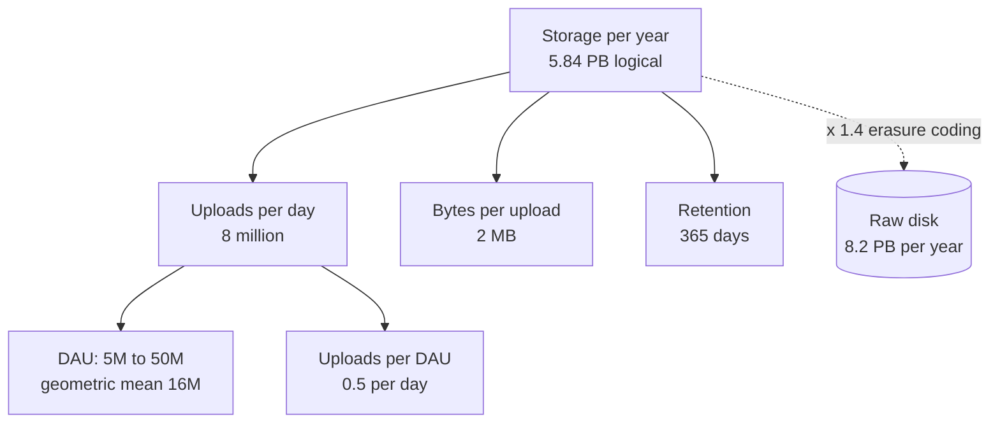
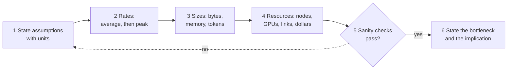

# Chapter 89 — Capacity Estimation Handbook

> **Level:** 2–4 · **Track:** Shared · **Estimated reading time:** 4 h

Every design in this book starts with numbers: requests per second at peak, bytes per year, gigabytes of GPU memory, dollars per million tokens. Chapter 2 introduced the method (§2.11), Chapter 4 supplied the mathematics, and each case study applied it to one system. This chapter gathers all of it into one reference. Each estimation family gets a formula in handbook form, a worked example with every step shown, and the mistakes that most often break it. The chapter ends with twelve end-to-end drills, from a URL shortener to a large-language-model (LLM) pre-training run, and a runnable calculator that reproduces the key results.

Where a formula is derived elsewhere, this chapter cites the owning section and gives only the form you need at the whiteboard. Where a case study already estimated a system, the drill reuses its numbers and cites it, so that the book tells one consistent story.

::: note
**Conventions used throughout this chapter.** Decimal units for estimation: 1 KB = 10³ bytes, 1 GB = 10⁹ bytes, 1 TB = 10¹² bytes; network rates in bits per second, 1 Gb/s = 125 MB/s (§4.5). The reference GPU is the H100 SXM: 80 GB of HBM3, 3.35 TB/s, 989 TFLOP/s dense BF16 (Table 64.4); Chapters 65 and 80 round this to 10¹⁵ FLOP/s, and the 1% difference is below estimation precision. Illustrative prices, as of 2026: \$2.50 per GPU-hour and \$0.77 per hour for a 16-vCPU node (\$0.048 per vCPU-hour) (§60.11); object storage \$0.023 per GB-month (Table 15.4); internet egress \$0.05 per GB and negotiated CDN delivery \$0.01 per GB (§21.5.4). Unless a case says otherwise, the busiest hour carries $h = 0.10$ of daily traffic and the burst factor is $b = 2$ (§52.3), and target utilization is $u = 0.6$.
:::

## 89.1 Learning objectives

After this chapter you should be able to:

- Turn a vague prompt ("design a chat app for 100 million users") into a written list of assumptions and an estimation tree in under five minutes.
- Convert daily volumes into average and peak rates, and choose a defensible peak-to-average ratio.
- Estimate storage with retention, indexes, compression, replication and erasure coding, and bandwidth with CDN offload and media bitrates.
- Size caches, databases, application fleets, message-broker partitions and consumer groups, including headroom and N+1/N+2 or zone-level redundancy.
- Translate availability and durability targets into downtime and loss budgets, and compose them across dependencies.
- Estimate ML workloads: training-data volume, feature-store reads, embedding-table memory and CPU or GPU inference fleets.
- Estimate GPU memory for training and serving, training compute and time with $6ND$, and LLM serving throughput from the memory-bandwidth limit of decode.
- Compute cost per request, per user and per million tokens, and say which resource dominates it.
- Run any of twelve standard drills aloud in an interview, and sanity-check your own answers.

## 89.2 Prerequisites

- Back-of-the-envelope method and peak formula — §2.11 (this chapter is its deep treatment).
- Units, prefixes and time conversions — §4.5; percentiles and fan-out — §4.8; queueing and utilization — §4.10; Little's Law — §4.11.
- Availability, durability and latency numbers — §4.14, §4.16, §4.17.
- Capacity planning, headroom and redundancy — §18.11.
- Inference fleet sizing — §60.11; GPU hardware and the roofline — Chapter 64; training memory and $6ND$ — §65.3–§65.4.
- KV cache and LLM serving capacity — §72.11, §73.5, §73.15; cost and unit economics — Chapter 51.

## 89.3 The estimation mindset

### 89.3.1 What estimation is for

::: definition
**Definition — Capacity estimation.** The practice of deriving, from stated assumptions and a few reference numbers, the order of magnitude of a system's load (requests, bytes, tokens per second) and the resources it needs (nodes, memory, disks, GPUs, network, money). An estimate is judged by whether it reaches the right power of ten and the right *design decision*, not by its third significant digit.
:::

#### First-principles explanation

Before driving across a country you estimate the trip: about 4,000 km at about 100 km/h is about 40 hours of driving, so plan for five days, not one and not twenty. You do not know the exact distance or speed, yet the estimate decides the plan: book hotels, share the driving, or fly instead. Capacity estimation does the same for software. Twenty requests per second fits on one server; twenty thousand needs a fleet and a cache; twenty million needs partitioning and many regions. The estimate tells you which of these worlds you are in.

#### Why does this exist?

Architecture changes in steps of about ten (§2.10). A design that is right for 1,000 RPS is usually wrong for 100,000 RPS, and the mistake is expensive to discover after launch. Estimation exposes the binding constraint early, before money or code is committed. It also exposes surprises: in QuickBite, courier GPS writes outnumber orders 83 to 1 (§2.11), and in an LLM chatbot the KV cache, not the weights, fills the GPU (§72.11).

#### How it works internally

1. **Clarify the scope**: which features, which users, which time horizon.
2. **Write assumptions down** with units, labeled as assumptions (§2.7).
3. **Build an estimation tree**: the quantity you want at the root, multiplied factors as children, and assumptions as leaves (Figure 89.1).
4. **Compute rates, then sizes, then resources**: average to peak rate, rate times size, size times retention and copies, load divided by per-node capacity at a target utilization.
5. **Sanity-check** by a second route and against reference numbers (§89.4).
6. **State the implication**: which component is the bottleneck, what you will design around, and which assumption would change the answer.

### 89.3.2 Orders of magnitude, rounding and error

Rounding is not sloppiness; it is how you keep arithmetic fast enough to do aloud. Use one or two significant figures, keep powers of ten explicit, and round *consistently*: round up anything you will provision (nodes, disks), and never round the same quantity both ways in one calculation.

::: formula
**Bounding an unknown and combining uncertain factors**

$$\hat{x} = \sqrt{x_{\text{lo}}\, x_{\text{hi}}} \qquad F_{\text{prod}} \approx \exp\sqrt{\sum_{i=1}^{n} (\ln F_i)^2} \qquad F_{\text{worst}} = \prod_{i=1}^{n} F_i$$

| Symbol | Meaning | Units |
|---|---|---|
| $x_{\text{lo}}$, $x_{\text{hi}}$ | Lower and upper bounds you are confident in | units of $x$ |
| $\hat{x}$ | Point estimate: the geometric mean of the bounds | units of $x$ |
| $F_i$ | Uncertainty factor of factor $i$: the true value lies within $\times F_i$ or $\div F_i$ | dimensionless |
| $n$ | Number of multiplied factors in the estimate | count |
| $F_{\text{prod}}$ | Typical uncertainty factor of the product, assuming independent errors | dimensionless |
| $F_{\text{worst}}$ | Worst-case factor, if every error points the same way | dimensionless |
:::

The geometric mean is the right midpoint on a log scale: halfway between 10 and 1,000 is 100, not 505. Independent errors partly cancel, which is why Fermi estimates land closer than their individual guesses suggest [Weinstein and Adam 2008].

::: example
**Worked example — Yearly photo storage for an app whose user count you do not know.** You believe daily active users (DAU) lie between 5 million and 50 million. Assume 0.5 uploads per DAU per day at 2 MB each, kept for a year.

1. Point estimate of DAU: $\sqrt{5 \times 10^6 \times 5 \times 10^7} = 1.58 \times 10^7$, round to **16 million**.
2. Uploads per day: $16 \times 10^6 \times 0.5 = 8 \times 10^6$. Bytes per day: $8 \times 10^6 \times 2 \times 10^6 = 1.6 \times 10^{13}$ B $= 16$ TB.
3. Per year: $16 \times 365 = 5{,}840$ TB $= 5.84$ PB, before replication.
4. Uncertainty: four factors (DAU, uploads, size, retention), each trusted within 2×: $F_{\text{prod}} = \exp\sqrt{4 \times (\ln 2)^2} = \exp(1.386) = 4.0$, against a worst case of $2^4 = 16$.
5. Range: $5.84 / 4 = 1.46$ PB to $5.84 \times 4 = 23.4$ PB.
6. Per-user check: $5.84 \times 10^{15} / 16 \times 10^6 = 365$ MB per DAU per year, 1 MB a day: one photo every two days. Plausible.

**Interpretation.** The answer is "a few petabytes a year", uncertain by about 4× either way. **Engineering implication.** Every value in that range calls for the same design: object storage with erasure coding (§15.6) and a CDN, never a database. When the decision is the same across the range, stop estimating. When it flips inside the range, narrow the one assumption that dominates the uncertainty, here DAU.
:::

### 89.3.3 Units: decimal versus binary

Estimation uses decimal units; memory pages, allocators and some operating-system tools use binary units (KiB, MiB, GiB = 2¹⁰, 2²⁰, 2³⁰ bytes). The gap is 7.4% at giga and 12.6% at peta (Table 4.2). Network links are always decimal and always in **bits**. State the convention once, at the top of your estimate.

::: mistake
**Mixing bits and bytes, or GB and GiB.** "1 Gb/s link, 1 GB/s of traffic, fits" is wrong by 8×. "80 GB GPU" from a datasheet is decimal, while `nvidia-smi` reports MiB; 80 GB is 74.5 GiB. Write units on every line of the calculation and carry them through, as in a physics problem.
:::

### 89.3.4 Estimation trees and sanity checks

**Figure 89.1 — An estimation tree for yearly photo storage.**

**Reading the diagram.** The root is the quantity you want; each child is a factor that multiplies into it, and the leaves are assumptions you state aloud. Arrows point from a result to what it is computed from, so you can read the tree top-down as an explanation or bottom-up as arithmetic. The dotted edge is a later adjustment: redundancy turns logical bytes into raw disk at the storage boundary (cylinder). The failure point of a tree is a leaf nobody questioned; the interviewer's follow-up usually targets the most uncertain leaf, here DAU. A tree scales to any estimate: replace "bytes per upload" with "tokens per call" and it sizes an LLM fleet.

**Figure 89.2 — The estimation loop.**

**Reading the diagram.** The loop runs left to right in a few minutes. Rates come before sizes because bandwidth and per-node load depend on peak rate, and resources come last because they divide load by capacity. The decision diamond is where an estimate earns trust: if a sanity check fails, return to the assumptions (dotted edge) rather than patching a number. The output is not a table of numbers but a sentence: what saturates first and what the design must do about it.

**Table 89.1 — Five sanity checks.**

| Check | Question | Example |
|---|---|---|
| Units | Do the units cancel to what you want? | requests/day ÷ s/day = requests/s |
| Per-user | Is the per-user figure believable? | 365 MB per DAU per year for a photo app |
| Second route | Does another decomposition agree within ~3×? | Storage from uploads, and from bandwidth × time |
| Reference | Is it near a known system or limit? | 280,000 RPS ≫ one database node (~10⁴) |
| Extremes | Does it behave sensibly at 0 and at 10×? | Doubling DAU should double storage, not square it |

::: mistake
**Computing the average and calling it capacity.** Servers fail at peak, not on average. Every rate in a capacity estimate must be converted to a design peak (§89.5) before it is divided by per-node capacity.
:::

::: mistake
**Precision theater.** "We need 47.3 servers" signals that you computed without thinking. Say "about 50, so two racks' worth or one autoscaling group", and spend the saved minute on the bottleneck.
:::

