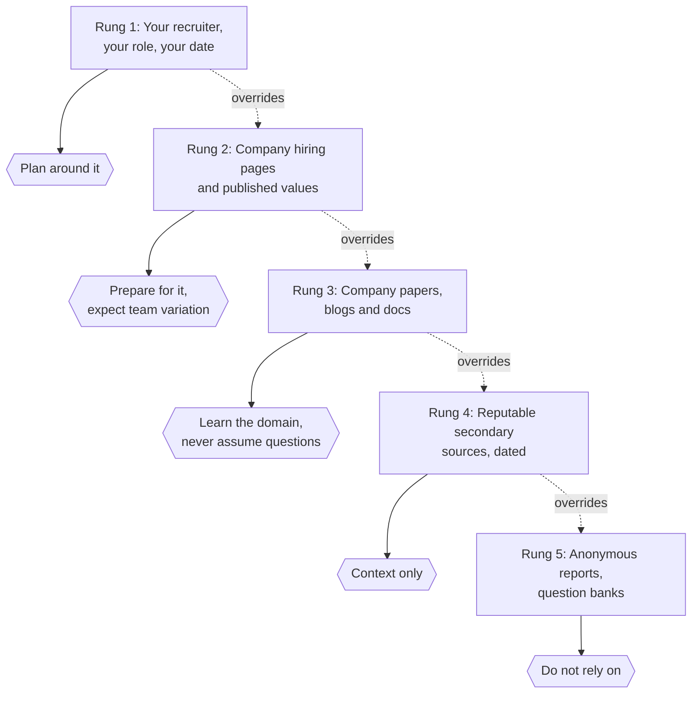
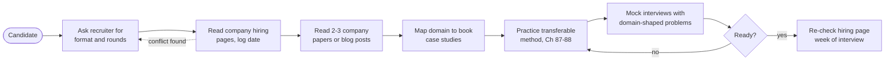
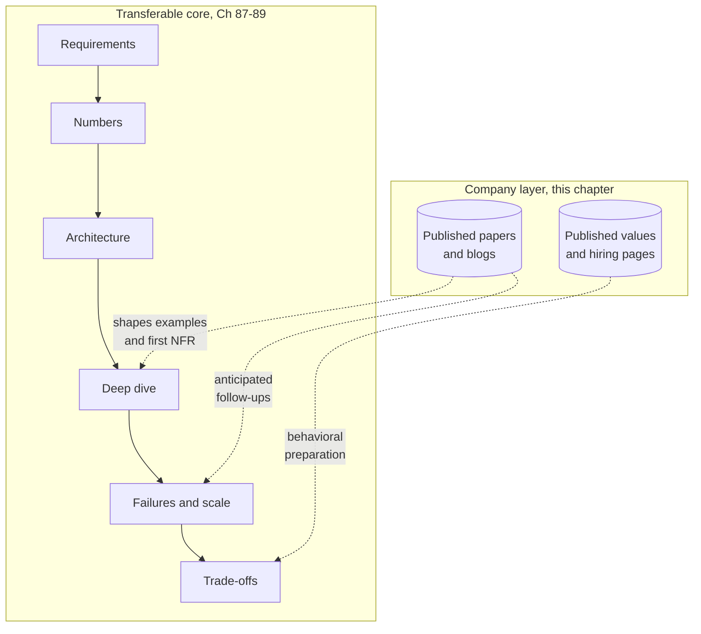
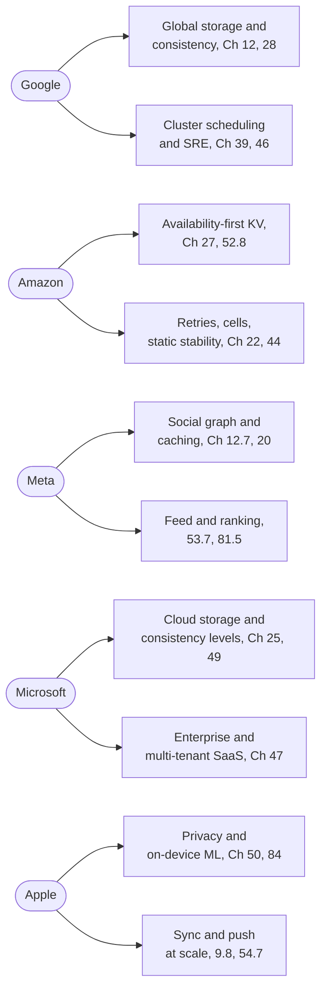
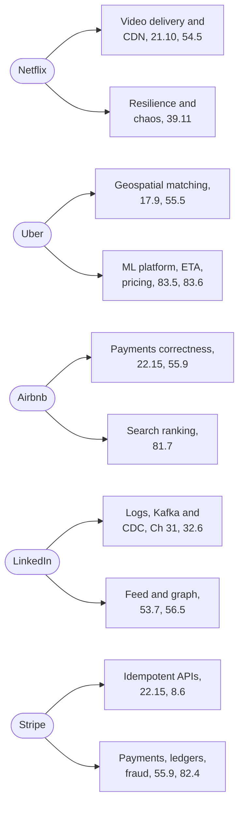
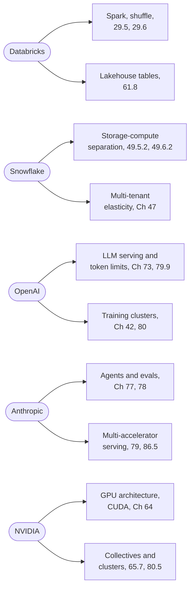

# Chapter 90 — Company-Level Interview Preparation

> **Level:** 3–5 · **Track:** Shared · **Estimated reading time:** 4 h

Candidates often prepare for a named company by collecting rumors: "they always ask a feed design", "the bar is higher for senior roles", "they want you to mention a specific database". Most of that is unverifiable, much of it is out of date, and some of it is false. This chapter takes the opposite approach. For each of fifteen companies it separates three kinds of information and labels each one: what the company itself has published about how it hires (*Evidence: Primary*, with a citation and "as of 2026"); what the company has published about its own systems, which tells you what kinds of problems its engineers think about; and general preparation advice that we infer from that public engineering focus (*Evidence: Illustrative*), which is our suggestion and never a claim about how the company interviews.

The companies are Google, Amazon, Meta, Microsoft, Apple, Netflix, Uber, Airbnb, LinkedIn, Stripe, Databricks, Snowflake, OpenAI, Anthropic and NVIDIA. They vary a great deal in how much they publish about hiring. Some publish detailed preparation pages; some publish almost nothing. Where a company publishes little, this chapter says so plainly rather than filling the gap.

::: warning
**Read this first — what this chapter does not contain.** It contains no interview-loop structures, leveling guides, hiring bars, rubrics or "questions they ask" unless the company has published them itself. It contains no content from review sites, anonymous forums or candidate reports. Hiring processes change often and vary by team, role, level and country; your recruiter's description of *your* process always overrides anything here, including the verified items.
:::

## 90.1 Learning objectives

After this chapter you should be able to:

- Classify any piece of company interview information on a five-rung reliability ladder and decide how much preparation time it deserves.
- Explain why candidate reports and forum posts are unreliable evidence about a company's interview, using sampling bias, survivorship, time decay and team variance.
- List the evaluation dimensions that generalize across companies and map each to the method in Chapters 87–88.
- For each of the fifteen companies, state what the company has published about its hiring (with citation), name two or three of its published systems or papers, and connect them to the case studies in this book.
- Derive company-targeted practice priorities from a company's public engineering focus while labeling them as your own inference.
- Build and execute a four-week preparation plan that spends most of its time on transferable skills and a bounded share on company context.
- Reason aloud, in an interview, about constraints that a company's domain makes important (for example idempotent payments, accelerator-aware serving or global consistency) without claiming knowledge of its internal systems.

## 90.2 Prerequisites

- The interview format overview — §1.11 (what a design interview is and how it is paced).
- Requirements, assumptions and trade-offs — §2.5, §2.7, §2.8 (the core skills every company evaluates).
- Back-of-the-envelope estimation — §2.11 and Chapter 89 (numbers you will need in every company's design round).
- Reading papers and engineering blogs — §3.5 (how to extract a design from a paper in an hour).
- Interview fundamentals and the readiness framework — Chapters 87 and 88 (the evaluation dimensions and the 14-step sequence this chapter assumes).
- The case studies — Chapters 52–56 and 81–86 (the practice material this chapter maps companies onto).

## 90.3 How to use company information responsibly

### 90.3.1 What is knowable

::: definition
**Definition — Verified public information.** A statement about a company's hiring or engineering that the company itself has published in a form you can cite: a careers or interview-preparation page, an official engineering blog post, a published set of leadership principles or values, official product documentation, or a paper its engineers authored. It is verified only for the date you read it.
:::

#### First-principles explanation

Think of preparing for a company as preparing to visit a city you have never seen. The city's official transit map is reliable but incomplete. A friend's account of a trip five years ago is vivid but may describe a bus line that no longer runs. An anonymous review that says "the trains are always late" tells you about one traveler's bad day. A sensible traveler uses the official map for facts, the friend for color, and ignores the anonymous review. Interview preparation works the same way: the company's own words are the map, and everything else is weaker evidence.

#### Why does this exist?

Interview preparation has become an industry, and much of what circulates about specific companies is presented with more confidence than its sources justify. Two failures follow. First, candidates over-fit: they memorize a "known" question list and then cannot adapt when the interviewer changes one requirement. Second, candidates under-prepare on transferable skills because they believe a company-specific trick will carry them. Both failures are avoidable if you know what can actually be known.

#### How it works internally: the reliability ladder

Rank every piece of information you find on five rungs, from most to least reliable:

1. **Your recruiter's description of your process.** Specific to your role, level, team and date. Ask for it in writing.
2. **The company's own hiring pages** — careers sites, interview-preparation pages, published values. Authoritative but general; they describe the typical process, and many say teams vary.
3. **The company's engineering publications** — papers, engineering blogs, documentation. Reliable about *systems*, silent about *interviews*. They tell you what problems the company's engineers care about, not what you will be asked.
4. **Reputable secondary sources** — books, conference talks by employees, journalism that cites the company. Useful for context; check dates.
5. **Anonymous or candidate-reported content** — forums, review sites, "my interview experience" posts, paid question banks. Unverifiable, unrepresentative and often stale. This chapter does not use it.

**Figure 90.1 — The information-reliability ladder.**

**Reading the diagram.** The five rectangles are information sources ordered from most reliable (top) to least reliable (bottom); the hexagons on the right are the action each source justifies. Solid arrows connect a source to its use. Dotted arrows show precedence: when two sources disagree, the higher rung wins, and that override is applied whenever you discover a conflict rather than once. There is no storage boundary in this diagram; the "storage" is your own notes, which should record each item's rung and the date you read it. The failure point is mixing rungs without labels, which turns a forum rumor into an apparent fact. The ladder scales to any company: the number of rungs stays fixed while the amount of content on each varies, and for some companies rung 2 is almost empty.

### 90.3.2 Why hearsay is unreliable

Candidate reports feel like data because there are many of them. They are not a sample of anything well defined.

1. **Selection bias.** People who post are not typical candidates. Very good and very bad experiences are over-represented, and the incentive to post differs between those who received offers and those who did not.
2. **Survivorship.** "I was asked X and passed" does not mean X decided the outcome; the same candidate might have passed with any question.
3. **Team and role variance.** Large companies run many hiring pipelines. A report from one organization tells you little about another. Several companies' own pages say exactly this (for example NVIDIA and Microsoft, §90.19 and §90.8).
4. **Time decay.** Processes change: new rounds are added, formats move online or back to onsite, AI-tool policies are introduced. A two-year-old report may describe a process that no longer exists.
5. **Memory and paraphrase.** A question recalled hours later is a reconstruction. Requirements that the interviewer stated are often forgotten, so the posted "question" is a different problem.
6. **Confidentiality.** Many candidates agree not to share interview content. Content that circulates anyway is ethically compromised, and preparing from it can expose you to disqualification.

::: mistake
**Misconception — "If enough people report the same question, it must be true."** Repetition across forums often means copying, not independent observation. One post is quoted in a guide, the guide is quoted in a video, and the "consensus" has a single origin. Even if a question is genuinely common, memorizing an answer is the wrong preparation: interviewers change requirements precisely to see whether you can reason rather than recall.
:::

### 90.3.3 Time-sensitivity

Every verified item in this chapter is marked "as of 2026". Treat that as a date stamp, not a guarantee. Before an interview, re-read the company's current hiring page and compare it with your notes. Three categories change most often:

- **Format** — remote versus onsite, number of rounds, live-coding tools.
- **Policy** — rules on AI assistance during take-homes and live interviews, which several companies began publishing in 2025 (see §90.18 for one published example).
- **Values and principles** — companies revise them; Amazon added two Leadership Principles in 2021 and Netflix rewrote its culture memo in 2024 (§90.6, §90.10).

::: recommendation
**Recommendation — Keep a dated source log.** For each target company, keep a short table: item, source URL, rung on the ladder, date read. When you prepare, sort by rung and spend time roughly in proportion to reliability and relevance. Delete anything you cannot source. Ten minutes of logging prevents hours of preparing for a process that does not exist.
:::

### 90.3.4 The responsible preparation workflow

**Figure 90.2 — A responsible company-preparation workflow.**

**Reading the diagram.** The flow runs left to right from the candidate. Every step is something you do synchronously, in order; the single dotted arrow is the asynchronous correction path: if the public page contradicts what your recruiter said, you go back and ask, and the recruiter's answer wins (rung 1 over rung 2). The decision node loops practice and mock interviews until you are ready, which is where most of the time goes. The "storage" across steps is your dated source log from §90.3.3. Failure points: skipping step B (preparing for the wrong format), skipping step D (having no domain vocabulary), or skipping step I (missing a late policy change). The workflow scales to several companies at once because steps E–G are shared; only steps B–D and I are per company.

### 90.3.5 Ethics and policies on AI assistance

Some companies now publish explicit rules on whether you may use AI tools during applications, take-home exercises and live interviews. Where a company publishes such rules, follow them exactly; where it does not, ask your recruiter and assume no assistance during live interviews unless told otherwise. Do not seek or use leaked interview content. Apart from the ethical problem, interviewers who recognize a memorized answer typically probe until the memorized part runs out.

#### Failure scenarios

**Table 90.1 — Failure scenarios in company-targeted preparation.**

| What goes wrong | Why | Detection | Recovery | Prevention |
|---|---|---|---|---|
| Prepared for a round that does not exist | Relied on an old report | Recruiter's schedule differs | Re-plan the last week around actual rounds | Ask the recruiter first (rung 1) |
| Memorized design collapses under a changed requirement | Over-fitted to a "known question" | Cannot justify a component when asked "why" | Restart from requirements aloud | Practice method, not answers (Ch 87–88) |
| Claimed knowledge of internal systems | Confused a published paper with today's production | Interviewer asks a follow-up you cannot answer | Say what was published and when, then reason generically | Phrase as "the published design was…" |
| Ignored a published AI-use policy | Did not read the company's page | Policy reminder from interviewer | Stop, comply, explain | Read policy pages the week before |
| Spent most prep time on company trivia | Mistook context for skill | Weak mock scores on fundamentals | Rebalance toward transferable practice | Cap company-specific time (§90.21) |

## 90.4 What generalizes across companies

### 90.4.1 Common evaluation dimensions

Every company's design interview is, at its core, the same exercise: given an ambiguous problem, can you turn it into a precise one, propose a design that meets it, quantify that design, find where it breaks and explain what you traded away. Chapter 87 develops these skills and Chapter 88 turns them into a 14-step sequence with level-by-level expectations. The dimensions below appear, in some wording, in the hiring materials of many of the companies in this chapter, and they are the substance behind any company-specific vocabulary.

**Table 90.2 — Evaluation dimensions that generalize (general advice; see Chapters 87–88).**

| Dimension | What a strong answer shows | Where this book teaches it |
|---|---|---|
| Problem framing | Clarifying questions; explicit functional and non-functional requirements | §2.5, §1.6–§1.7, Ch 87 |
| Quantitative reasoning | Peak RPS, storage, bandwidth, memory, GPU memory, cost with stated assumptions | §2.11, Ch 89 |
| Architecture | Components with clear responsibilities and data flow | §2.3, case studies Ch 52–56 |
| Data modeling | Access patterns before schema; partition keys justified | Ch 11–12, §14.7 |
| Depth on the hard part | Naming the one difficult component and designing it properly | §52.3 tip, Ch 88 |
| Failure and scale | Failure modes, bottlenecks, what changes at 10× and 100× | §2.6, §2.9, Ch 39 |
| Trade-offs | Alternatives considered and why rejected | §2.8, Ch 87 |
| Communication | Structured narration, diagrams, time management | §1.11, Ch 87 |
| Ownership and judgment | Operability, cost, security, product sense | Ch 40, Ch 50, Ch 51 |

::: concept
**Key insight — Company preparation is a thin layer on a thick core.** The transferable core (Table 90.2) is what interviews measure. Company context changes which examples come to mind first, which constraints you raise without being prompted, and which vocabulary you can use credibly. It is worth perhaps a quarter of your preparation time, not most of it (§90.21).
:::

### 90.4.2 How company context changes an answer

Company context legitimately changes three things in an interview answer:

1. **Which non-functional requirement you raise first.** For a payments company, correctness under retries comes before latency; for a streaming company, delivery cost per gigabyte and startup time come early; for an AI lab, accelerator memory and cost per token come early.
2. **Which examples you can cite.** If a company has published a design (Dynamo, TAO, Spanner, Kafka, H3), you may refer to it as published work, with its date, as long as you do not claim it describes today's production system.
3. **Which follow-up questions you anticipate.** Domain constraints suggest follow-ups: multi-region consistency, abuse, privacy, hardware failure.

It does not change the method. A candidate who skips requirements because "this company cares about scale" has misread the situation everywhere.

**Figure 90.3 — The transferable core and the company layer.**

**Reading the diagram.** The upper subgraph is the method you apply in every interview, executed synchronously from requirements to trade-offs; each solid arrow is the next step of the sequence in Chapter 88. The lower subgraph holds two stores of company knowledge, drawn as cylinders because they are reference material you consult, not steps you perform. Dotted arrows are influences rather than steps: published engineering work shapes which examples you cite in the deep dive and which failures you anticipate, and published values inform how you discuss trade-offs and past work. The storage boundary is between the two subgraphs: nothing in the company layer replaces a step of the core. The failure point is drawing a solid arrow from the layer into the core, that is, skipping a core step because of a company belief. This structure scales to any number of companies because the core is shared and only the lower subgraph is swapped.

### 90.4.3 How the company sections are organized

Each of §90.5–§90.19 has the same four parts:

1. **Verified public information** — what the company itself has published about hiring, in `industry` callouts labeled *Evidence: Primary* and dated "as of 2026". Where a page could only be confirmed through search-engine excerpts because the site could not be fetched directly, the item is still cited, and the limitation is logged in §90.28.
2. **Engineering context worth knowing** — the company's published systems and papers that relate to design interviews, with cross-references to the chapter that teaches each idea.
3. **Preparation focus areas** — general advice we infer from the company's public engineering focus, labeled *Evidence: Illustrative*. These are suggestions for what to practice, not statements about what the company asks.
4. **Practice mapping** — which problem families in Chapters 91–92 and which case studies in this book give the most relevant practice.

### 90.4.4 Company focus maps at a glance

The three maps below summarize §90.5–§90.19. They connect each company to the engineering themes visible in its own publications and to the chapters that teach those themes. They are general advice derived from public engineering work, not descriptions of interview content.

**Figure 90.4 — Focus map: Google, Amazon, Meta, Microsoft, Apple (general advice).**

**Reading the diagram.** Each stadium node is a company; each rectangle is an engineering theme visible in that company's own publications, with the book chapters that teach it. Arrows mean "public work suggests practicing", not "the interview contains". All edges are drawn solid because this is a static reference map with no runtime flow; there are no storage boundaries or failure points in the systems sense. The practical failure point is reading the map as a question list. To scale your use of it, pick one theme per company for a deep dive and treat the rest as vocabulary.

**Figure 90.5 — Focus map: Netflix, Uber, Airbnb, LinkedIn, Stripe (general advice).**

**Reading the diagram.** The layout matches Figure 90.4: companies on the left, published engineering themes on the right, labeled with the sections that teach them. All arrows are solid and static. The map shows two recurring clusters across these five companies: correctness of money movement (Airbnb, Stripe) and event streams feeding many consumers (LinkedIn, and the real-time marketplace at Uber). The failure point is again misreading it as a statement about interviews; it summarizes published engineering focus only.

**Figure 90.6 — Focus map: Databricks, Snowflake, OpenAI, Anthropic, NVIDIA (general advice).**

**Reading the diagram.** Same conventions as the previous two maps. The five data and AI companies split into two groups: data-platform companies (Databricks, Snowflake), whose publications concern query engines, table formats and the separation of storage from compute; and AI companies (OpenAI, Anthropic, NVIDIA), whose publications concern accelerators, large-scale training and serving, and agent systems. Expect the second group's themes to change fastest; re-check publications within weeks of an interview.

## 90.5 Google

### 90.5.1 Verified public information

::: industry
**Google — hiring pages (as of 2026).** Google publishes a "How we hire" page on its careers site describing its application and interview process, with interview tips for candidates [Google How We Hire]. Separately, Google's re:Work site publishes general guidance for organizations on structured interviewing and interviewer training, such as the guide "Train your interviewers" [Google re:Work]; that is advice to other employers, not a description of any specific Google loop.
*Evidence: Primary* — [Google How We Hire; Google re:Work]. The careers page could not be fetched directly during research; its current wording, including any list of assessed attributes, is an open verification item (§90.28).
:::

Many secondary sources describe a set of attributes that Google is said to assess. We have not been able to confirm the current wording on Google's own page, so this chapter does not repeat it. Read the page itself.

### 90.5.2 Engineering context worth knowing

Google has published more foundational distributed-systems papers than almost any other company, and several of them define vocabulary used in every design interview:

- **GFS** (2003) and **MapReduce** (2004) — a single-master distributed file system with large chunks and a batch programming model that moves computation to data [Ghemawat et al. 2003; Dean and Ghemawat 2004]. See §15.5 and §29.4.
- **Bigtable** (2006) — a sparse, sorted, multi-dimensional map partitioned into tablets over GFS; the origin of the wide-column model [Chang et al. 2006]. See §12.6.1.
- **Spanner** (2012) — a globally distributed database with externally consistent transactions using TrueTime and commit wait [Corbett et al. 2012]. See §28.8.
- **Borg** (2015) — cluster management for a large fleet, the ancestor of Kubernetes [Verma et al. 2015]. See §46.5.
- **Site Reliability Engineering** — Google's freely available SRE books define SLOs, error budgets and postmortem culture [Beyer et al. 2016]. See §39.6–§39.7 and §39.12.

::: industry
**Google's published papers as design vocabulary.** The papers above are Google's own descriptions of systems at the time of publication. They are useful because they show the reasoning behind a design: Bigtable's choice of a sorted key space enables range scans and creates hot-spot risk; Spanner's commit wait trades a few milliseconds of latency for external consistency. In an interview, cite them as published designs with their dates, not as descriptions of current production.
*Evidence: Primary* — [Ghemawat et al. 2003; Dean and Ghemawat 2004; Chang et al. 2006; Corbett et al. 2012; Verma et al. 2015; Beyer et al. 2016]
:::

### 90.5.3 Preparation focus areas

::: recommendation
**General advice — inferred from Google's published engineering focus.** Google's public work concentrates on planet-scale storage, global consistency, cluster scheduling and reliability engineering. Practice: (1) choosing between strong and eventual consistency and quantifying the latency cost of a global commit (§28.8, §44.12); (2) partitioning a sorted key space and handling hot ranges (§14.6, §14.10); (3) SLO-driven design, where you state an availability target, compute the error budget and design to it (§39.6–§39.7); (4) estimating at very large scale, where you should say which resource saturates first (Ch 89). This is our inference from published papers, not a statement about Google's interviews.
*Evidence: Illustrative*
:::

### 90.5.4 Practice mapping

- **Case studies:** YouTube (§54.4), Google Drive (§54.7), Google Maps tiles and routing (§55.6), web-scale search engine (§56.4), web crawler (§52.10), YouTube-style recommendations (§81.4), search ranking (§81.7).
- **Chapter 91 families:** storage and indexing systems, globally replicated data, schedulers and batch pipelines.
- **Chapter 92 families:** large-scale recommendation and search ranking; training-infrastructure problems that touch accelerators (Google's published TPU work is summarized in §80.12).

## 90.6 Amazon

### 90.6.1 Verified public information

::: industry
**Amazon — Leadership Principles and interview preparation (as of 2026).** Amazon publishes sixteen Leadership Principles on its jobs site: Customer Obsession; Ownership; Invent and Simplify; Are Right, A Lot; Learn and Be Curious; Hire and Develop the Best; Insist on the Highest Standards; Think Big; Bias for Action; Frugality; Earn Trust; Dive Deep; Have Backbone, Disagree and Commit; Deliver Results; Strive to be Earth's Best Employer; and Success and Scale Bring Broad Responsibility [Amazon LP]. The last two were added in 2021 [Amazon 2021]. Amazon also publishes role-specific interview-preparation pages. Its system design preparation page for SDE III candidates states that half of the interview time is spent on questions about the Leadership Principles and half on coding problems and system design, and that the interviewer will ask questions about your design while you should ask questions to complete and validate it [Amazon SDE III Prep]. A separate SDE II preparation page exists [Amazon SDE II Prep].
*Evidence: Primary* — [Amazon LP; Amazon 2021; Amazon SDE III Prep; Amazon SDE II Prep]. Confirmed through search-engine excerpts of the pages; direct fetch was blocked (§90.28).
:::

The published statement that the candidate "should ask questions to complete and validate" the design is worth noting because it is the same behavior Chapter 87 recommends everywhere: requirements are negotiated, not given.

### 90.6.2 Engineering context worth knowing

- **Dynamo** (2007) — a leaderless, always-writable key-value store using consistent hashing, sloppy quorums, hinted handoff, vector clocks and Merkle-tree anti-entropy [DeCandia et al. 2007]. See §27.7–§27.9 and the full design in §52.8.
- **DynamoDB** (2022 paper) — a managed service that differs from the 2007 Dynamo design, with Multi-Paxos-replicated partitions and an emphasis on predictable performance [Elhemali et al. 2022]. See §12.4.3.
- **Amazon Builders' Library** — articles by Amazon engineers on timeouts, retries with jitter, idempotent APIs, shuffle sharding, static stability and load shedding [Amazon Builders' Library]. See §22.11–§22.15 and §44.10.

::: industry
**Dynamo versus DynamoDB.** A common interview error is to describe DynamoDB as the 2007 Dynamo design. The 2022 paper describes a different architecture: each partition is replicated with Multi-Paxos and has a leader, and much of the paper concerns admission control and predictable latency for a multi-tenant service. Citing the two correctly, with dates, signals that you read primary sources.
*Evidence: Primary* — [DeCandia et al. 2007; Elhemali et al. 2022]
:::

### 90.6.3 Preparation focus areas

::: recommendation
**General advice — inferred from Amazon's published engineering focus and principles.** Amazon's publications emphasize availability under failure, safe retries and blast-radius reduction. Practice: (1) designing for partial failure with timeouts, retries, backoff, jitter and idempotency keys (§22.11–§22.15); (2) cell-based architecture and static stability across availability zones (§44.10); (3) leaderless versus leader-based replication and when each fits (§27.4, §27.7); (4) an e-commerce checkout path that stays correct when inventory, payment and order services fail independently (§55.7, §32.7). Because Amazon publishes that its design interviews sit alongside Leadership Principles questions, prepare specific, honest stories about past technical decisions, framed so a listener can see your own actions and their results. This is our inference, not a statement about how answers are scored.
*Evidence: Illustrative*
:::

### 90.6.4 Practice mapping

- **Case studies:** distributed key-value store (§52.8), rate limiter (§52.6), notification system (§52.7), Amazon-style e-commerce platform (§55.7), payment system (§55.9), product recommendation (§81.8).
- **Chapter 91 families:** key-value and storage services, rate limiting and traffic management, order and inventory workflows.
- **Chapter 92 families:** product recommendations and personalized ranking; fraud and abuse detection.

## 90.7 Meta

### 90.7.1 Verified public information

::: industry
**Meta — interview preparation pages (as of 2026).** Meta's careers site hosts a page titled "Preparing for Your Full Loop Interview at Meta" for software engineering candidates [Meta Full Loop Prep]. A Meta careers blog post dated 6 October 2022, "Preparing for your software engineering interview at Meta", describes the full onsite interview as consisting of three parts and states that the design interview is 45 minutes long and almost never involves coding [Meta 2022].
*Evidence: Primary* — [Meta Full Loop Prep; Meta 2022]. The 2022 post is several years old and may not describe the current loop; the content of the full-loop page could not be confirmed directly (§90.28).
:::

### 90.7.2 Engineering context worth knowing

- **TAO** (2013) — a geographically distributed, read-optimized graph store of objects and typed associations, implemented as a two-tier cache (followers and leaders) over sharded MySQL [Bronson et al. 2013]. See §12.7.3 and the feed case in §53.7.
- **Scaling Memcache at Facebook** (2013) — look-aside caching at very large scale, leases to prevent thundering herds and stale sets, and cross-region invalidation [Nishtala et al. 2013]. See §20.10–§20.11.
- **Tectonic** (2021) — an exabyte-scale distributed file system consolidating several storage systems into one multitenant service [Pan et al. 2021]. See §49.4.2.
- **Llama 3** (2024) — the model report includes training-infrastructure detail: up to 16,384 H100 GPUs, the network topology and interruption statistics [Dubey et al. 2024]. See §80.5.2 and §80.12.

::: industry
**Graph-shaped API, relational storage.** TAO's published design is a useful interview pattern: the data model is a graph, but the storage is sharded MySQL, because most queries are one hop and the read-to-write ratio is very high. A caching tier shaped like the API absorbs reads, and writes go through to the database. The lesson generalizes to any read-heavy social product.
*Evidence: Primary* — [Bronson et al. 2013]
:::

### 90.7.3 Preparation focus areas

::: recommendation
**General advice — inferred from Meta's published engineering focus.** Meta's public engineering work concentrates on read-heavy social systems, caching at extreme scale, messaging and large-scale ML infrastructure. Practice: (1) feed generation with an explicit fan-out-on-write versus fan-out-on-read decision and its capacity arithmetic (§53.7); (2) cache consistency, leases and invalidation across regions (§20.10–§20.11); (3) real-time messaging with delivery guarantees and ordering (§53.4–§53.5); (4) ranking systems with candidate generation and multi-stage scoring (§81.5, §81.9). Because Meta's own 2022 post separates design from coding, practice design answers that contain no code and stay at the level of components, data and trade-offs. This is our inference.
*Evidence: Illustrative*
:::

### 90.7.4 Practice mapping

- **Case studies:** chat application (§53.4), WhatsApp (§53.5), Instagram (§53.6), Facebook News Feed (§53.7), Instagram-style feed and Explore recommendations (§81.5), personalized advertising (§81.9), content moderation (§82.7).
- **Chapter 91 families:** feeds and timelines, messaging and presence, distributed caches.
- **Chapter 92 families:** feed ranking, ads ranking, integrity and moderation pipelines.

## 90.8 Microsoft

### 90.8.1 Verified public information

::: industry
**Microsoft — hiring tips and culture pages (as of 2026).** Microsoft's careers site publishes interview tips covering preparation and what to expect during and after interviews, framing the interview as a two-way conversation and saying that your recruiter will explain the format and timeline [Microsoft Interview Tips]. It also publishes a page on technical interviewing [Microsoft Technical Interviewing] and a culture page naming growth mindset, being customer obsessed, being diverse and inclusive, and One Microsoft [Microsoft Culture].
*Evidence: Primary* — [Microsoft Interview Tips; Microsoft Technical Interviewing; Microsoft Culture]. Confirmed through search-engine excerpts; the technical-interviewing page's detailed content could not be read directly (§90.28).
:::

### 90.8.2 Engineering context worth knowing

- **Windows Azure Storage** (2011) — a stream layer, partition layer and front ends providing strong consistency within a storage stamp, with asynchronous geo-replication between stamps [Calder et al. 2011]. See §49.4.4.
- **Azure Cosmos DB consistency levels** — official documentation of five consistency levels between strong and eventual, a widely cited illustration of the consistency spectrum [Microsoft Learn: Cosmos DB]. See §25.10 and §44.12.
- **Azure Well-Architected Framework** — Microsoft's published guidance on reliability, security, cost, operations and performance [Azure Well-Architected]. See Ch 39 and Ch 51.

### 90.8.3 Preparation focus areas

::: recommendation
**General advice — inferred from Microsoft's published engineering focus.** Microsoft's public engineering material spans cloud infrastructure, enterprise SaaS and developer tools. Practice: (1) explaining a consistency spectrum and choosing a level per use case (§25.3–§25.7); (2) multi-tenant SaaS with tenant isolation, quotas and per-tenant cost (Ch 47); (3) real-time collaboration and chat for enterprises, including presence and message ordering (§53.4); (4) file sync and sharing (§54.7–§54.8); (5) enterprise AI assistants with permission-aware retrieval (§86.4). Because Microsoft's tips say the recruiter explains the format, ask early whether your loop includes a design round and at what depth. This is our inference.
*Evidence: Illustrative*
:::

### 90.8.4 Practice mapping

- **Case studies:** chat application (§53.4), Google Drive and Dropbox as file-sync references (§54.7–§54.8), enterprise RAG assistant (§86.4), AI coding assistant (§86.6), LLM inference platform (§86.5).
- **Chapter 91 families:** collaboration and messaging, file storage and sync, multi-tenant platforms.
- **Chapter 92 families:** enterprise retrieval and assistants, model-serving platforms.

## 90.9 Apple

### 90.9.1 Verified public information

::: industry
**Apple — interview tips (as of 2026).** Apple's careers site publishes an interview-tips page. It says candidates should expect open-ended questions about how they have performed in past roles and should contact their recruiter with questions about the process [Apple Interview Tips]. We found no Apple-published description of engineering or system design interviews.
*Evidence: Primary* — [Apple Interview Tips]. Confirmed through a search-engine excerpt only (§90.28).
:::

Apple publishes little about its engineering interviews. Treat any detailed claim about an "Apple loop" as unverified.

### 90.9.2 Engineering context worth knowing

- **Private Cloud Compute** (2024) — Apple's security blog describes a cloud system for AI requests built on Apple silicon and a hardened operating system, with design requirements that include no privileged runtime access for staff and verifiability of software images by independent researchers [Apple PCC]. See §50.8 and §50.12.
- **FoundationDB** (2021 paper) — an open-source, strictly serializable transactional key-value store with an unbundled architecture and deterministic simulation testing [Zhou et al. 2021]. See §12.11, and compare the distributed SQL systems in §28.10.
- **Apple Push Notification service** — official developer documentation for sending notification requests [Apple APNs]. See §9.8 and §52.7.
- **Apple Machine Learning Research** publishes on on-device ML, including face detection and people recognition in Photos (cited in Ch 84).

### 90.9.3 Preparation focus areas

::: recommendation
**General advice — inferred from Apple's published engineering focus.** Apple's public material emphasizes privacy, on-device computation and services that serve very large device populations. Practice: (1) privacy-by-design trade-offs, such as data minimization, on-device versus server processing, and end-to-end encryption effects on features (§50.8–§50.10); (2) push notification and device-sync systems at large scale (§9.8, §52.7, §54.7); (3) on-device ML serving constraints such as model size, battery and offline operation (Ch 67, §84.4–§84.6); (4) strong transactional storage for metadata (§28.10). Because Apple publishes little about interviews, rely on your recruiter for format. This is our inference.
*Evidence: Illustrative*
:::

### 90.9.4 Practice mapping

- **Case studies:** notification system (§52.7), Google Drive and Dropbox as sync references (§54.7–§54.8), face recognition (§84.4), image classification (§84.5), speech recognition (§84.6).
- **Chapter 91 families:** push and notification systems, sync and storage, metadata services.
- **Chapter 92 families:** on-device and privacy-preserving ML, perception models.

## 90.10 Netflix

### 90.10.1 Verified public information

::: industry
**Netflix — culture memo (as of 2026).** Netflix publishes its culture memo on its jobs site [Netflix Culture]. Netflix announced a revised version in 2024 [Netflix 2024]. We found no Netflix-published description of its engineering interview process.
*Evidence: Primary* — [Netflix Culture; Netflix 2024]. Read the memo itself; this chapter does not summarize its principles because the current wording could not be read directly (§90.28).
:::

### 90.10.2 Engineering context worth knowing

- **Open Connect** — Netflix's own content delivery network, with appliances placed inside or near internet service providers and filled with content ahead of demand [Netflix Open Connect]. See §21.10 and §54.5.
- **Chaos engineering** — the Simian Army post (2011) introduced Chaos Monkey and related failure-injection tools [Izrailevsky and Tseitlin 2011]; Netflix engineers later formalized the discipline [Basiri et al. 2016]. See §39.11.
- **Recommendations** — a published overview of the Netflix recommender system and its business value [Gomez-Uribe and Hunt 2015]. See §81.6.

### 90.10.3 Preparation focus areas

::: recommendation
**General advice — inferred from Netflix's published engineering focus.** Netflix's public work centers on video delivery, resilience in the cloud, experimentation and personalization. Practice: (1) video delivery with a CDN hierarchy, pre-positioning and bitrate ladders, with bandwidth arithmetic (§21.8, §54.5); (2) resilience patterns such as timeouts, circuit breakers, bulkheads and fallbacks, and how to verify them by fault injection (§22.13–§22.14, §39.11); (3) homepage personalization and its online experimentation (§81.6); (4) estimating peak egress for a global streaming service (Ch 89). Since the culture memo is the main published hiring document, read it and be ready to discuss how you work, honestly. This is our inference.
*Evidence: Illustrative*
:::

### 90.10.4 Practice mapping

- **Case studies:** YouTube (§54.4), Netflix (§54.5), Spotify (§54.6), Netflix-style homepage recommendations (§81.6).
- **Chapter 91 families:** video and media delivery, CDNs, resilience under dependency failure.
- **Chapter 92 families:** personalization, ranking with experimentation.

## 90.11 Uber

### 90.11.1 Verified public information

::: industry
**Uber — interview guides (as of 2026).** Uber's jobs site publishes an Uber Interview Guide with role-specific guides, including an engineering guide [Uber Engineering Guide] and an engineering manager guide; the latter states that Uber's values guide how people behave and decide, and that hiring teams assess every candidate with those values in mind [Uber EM Guide].
*Evidence: Primary* — [Uber Engineering Guide; Uber EM Guide]. Confirmed through search-engine excerpts; the engineering guide's detailed content could not be read directly (§90.28).
:::

### 90.11.2 Engineering context worth knowing

- **H3** (2018) — a hexagonal hierarchical spatial index, open-sourced by Uber, used for bucketing locations [Brodsky 2018]. See §17.9 and §55.5.
- **Michelangelo** (2017) — Uber's published ML platform covering data management, training, evaluation, deployment and prediction [Hermann and Del Balso 2017]. See §62.13 and §85.4.
- **DeepETA** (2022) — a deep-learning model for arrival-time prediction layered on a routing engine's estimate [Hu et al. 2022]. See §83.5.

### 90.11.3 Preparation focus areas

::: recommendation
**General advice — inferred from Uber's published engineering focus.** Uber's public work centers on real-time, location-based marketplaces and ML at platform scale. Practice: (1) location ingestion and nearest-driver search with a geospatial index, including update-rate arithmetic (§17.9, §55.4–§55.5); (2) dispatch and matching under consistency constraints, so that one driver never receives two trips (§55.5); (3) ETA prediction, demand forecasting and dynamic pricing as ML systems (§83.4–§83.6); (4) payments and fraud in a two-sided market (§55.9, §82.4). This is our inference.
*Evidence: Illustrative*
:::

### 90.11.4 Practice mapping

- **Case studies:** Uber ride-hailing platform (§55.4), ride matching (§55.5), payment system (§55.9), demand forecasting (§83.4), ETA prediction (§83.5), surge pricing (§83.6), real-time payment fraud (§82.4), feature store (§85.4).
- **Chapter 91 families:** geospatial and proximity services, real-time dispatch, payments.
- **Chapter 92 families:** marketplace ML, forecasting, ETA, fraud.

## 90.12 Airbnb

### 90.12.1 Verified public information

::: industry
**Airbnb — core values (as of 2026).** Airbnb's careers site lists four core values: Champion the Mission, Be a Host, Embrace the Adventure, and Be a Cereal Entrepreneur [Airbnb Life]. We found no Airbnb-published description of its engineering interview process.
*Evidence: Primary* — [Airbnb Life]. Confirmed through a search-engine excerpt (§90.28).
:::

### 90.12.2 Engineering context worth knowing

- **Avoiding double payments** (2019) — Airbnb's engineering blog describes an idempotency framework for its payments services that splits each request into pre-RPC, RPC and post-RPC phases so that retries are safe [Chew 2019]. See §22.15 and §55.9.
- **Search ranking with deep learning** (2019) — a KDD paper on applying neural networks to Airbnb search ranking [Haldar et al. 2019]. See §81.7.
- **Chronon** (2024) — Airbnb's ML feature platform, open-sourced in 2024 [Airbnb 2024]. See §62.13 and §85.4.

::: industry
**Idempotency as a payments primitive.** The Airbnb post is a good primary source to cite when a design involves retries of money movement: each payment request carries an idempotency key, local database work and the remote call are separated into phases, and a retry either replays a recorded result or resumes safely.
*Evidence: Primary* — [Chew 2019]
:::

### 90.12.3 Preparation focus areas

::: recommendation
**General advice — inferred from Airbnb's published engineering focus.** Practice: (1) a booking and reservation system that prevents double-booking under concurrency (§55.8; isolation levels and locking, §11.13 and §11.15); (2) payments with idempotency keys and reconciliation (§22.15, §55.9); (3) search and ranking for a two-sided marketplace with availability and price filters (§81.7); (4) feature pipelines that keep training and serving consistent (§62.8–§62.9). Prepare to discuss how your past work reflected the published values, honestly and specifically. This is our inference.
*Evidence: Illustrative*
:::

### 90.12.4 Practice mapping

- **Case studies:** ticket booking (§55.8, as a reservation-consistency analog), payment system (§55.9), search ranking (§81.7), feature store (§85.4), real-time payment fraud (§82.4).
- **Chapter 91 families:** reservations and inventory, payments, search.
- **Chapter 92 families:** marketplace ranking, feature platforms.

## 90.13 LinkedIn

### 90.13.1 Verified public information

::: industry
**LinkedIn — how we hire (as of 2026).** LinkedIn's careers site publishes a "How We Hire" page describing four stages: application, conversation, interview and decision [LinkedIn How We Hire]. A 2021 LinkedIn Engineering blog post states that the engineering interview process typically includes an introductory conversation with an engineering recruiter and a technical interview, followed by interviews with several LinkedIn engineers and leaders [LinkedIn 2021].
*Evidence: Primary* — [LinkedIn How We Hire; LinkedIn 2021]. The 2021 post may be out of date; both were confirmed through search-engine excerpts (§90.28).
:::

### 90.13.2 Engineering context worth knowing

- **Kafka** (2011) — LinkedIn engineers described Kafka as a distributed messaging system for log processing [Kreps et al. 2011]. See Chapter 31.
- **"The Log"** (2013) — Jay Kreps's essay on the log as the unifying abstraction for data integration, replication and stream processing [Kreps 2013]. See §31.3 and §32.3.
- **Databus** (2012) — LinkedIn's change-data-capture platform [Das et al. 2012]. See §32.6.

### 90.13.3 Preparation focus areas

::: recommendation
**General advice — inferred from LinkedIn's published engineering focus.** Practice: (1) event streaming with partitions, consumer groups, ordering and retention, with throughput arithmetic (Ch 31); (2) change data capture feeding search indexes, caches and analytics from one source of truth (§32.5–§32.6); (3) a professional feed and notifications (§53.7, §52.7); (4) graph-based recommendations such as connection suggestions, and typeahead search over people (§56.5, §16.9). This is our inference.
*Evidence: Illustrative*
:::

### 90.13.4 Practice mapping

- **Case studies:** notification system (§52.7), Facebook News Feed as a feed reference (§53.7), recommendation system (§56.5), logging and monitoring platform (§56.6), real-time analytics (§56.7).
- **Chapter 91 families:** event streaming and pipelines, feeds, search and typeahead.
- **Chapter 92 families:** people and job recommendations, feed ranking.

## 90.14 Stripe

### 90.14.1 Verified public information

::: industry
**Stripe — operating principles (as of 2026).** Stripe's jobs site publishes "How Stripe works", a set of operating principles that includes "Users first" and "Move with urgency and focus" [Stripe Culture]. We found no Stripe-published description of its engineering interview process.
*Evidence: Primary* — [Stripe Culture]. Confirmed through search-engine excerpts; the full list of principles could not be read directly (§90.28).
:::

### 90.14.2 Engineering context worth knowing

Stripe's public documentation and engineering blog are unusually relevant to API design interviews:

- **Idempotent requests** — Stripe's API reference documents idempotency keys on requests [Stripe Docs: Idempotency], and a 2017 blog post explains the design [Leach 2017]. See §22.15.
- **Rate limiters** — a 2017 post describes the rate limiters and load shedders Stripe runs in production [Stripe 2017]. See §22.3–§22.9 and §52.6.
- **Webhooks** — official documentation of event delivery to merchants, including signature verification [Stripe Docs: Webhooks]. See §55.9.

::: industry
**API design as a published product.** Stripe's documentation is a public example of decisions interviewers often probe in API design: how a client retries safely, how errors are classified, how rate limits are signaled and how asynchronous events are delivered and verified. Reading it is a fast way to learn the vocabulary of production APIs.
*Evidence: Primary* — [Stripe Docs: Idempotency; Leach 2017; Stripe 2017; Stripe Docs: Webhooks]
:::

### 90.14.3 Preparation focus areas

::: recommendation
**General advice — inferred from Stripe's published engineering focus.** Practice: (1) a payments API end to end: resources, idempotency keys, pagination, versioning and webhooks (§8.6, §8.15, §22.15); (2) exactly-once effects in an at-least-once world, using idempotent consumers and transactional outboxes (§32.5, §32.9–§32.10); (3) a double-entry ledger with reconciliation (§55.9); (4) per-merchant rate limiting and load shedding (§52.6); (5) real-time fraud scoring with a strict latency budget (§82.4). This is our inference.
*Evidence: Illustrative*
:::

### 90.14.4 Practice mapping

- **Case studies:** rate limiter (§52.6), notification system for webhook-style delivery (§52.7), payment system (§55.9), real-time payment fraud detection (§82.4).
- **Chapter 91 families:** API design, payments and ledgers, rate limiting.
- **Chapter 92 families:** fraud and risk scoring.

## 90.15 Databricks

### 90.15.1 Verified public information

::: industry
**Databricks — interview preparation (as of 2026).** Databricks publishes an interview-preparation page on its careers site that links to role-specific guides, including one for engineering [Databricks Interview Prep]. The engineering guide is a PDF dated April 2025 [Databricks Engineering Prep 2025]; its text, as excerpted by a search engine, describes an open-ended design interview for engineering roles on the storage-layer team with deliberately broad requirements. Databricks also published a 2020 engineering blog post on engineering interviews written from a hiring manager's perspective [Databricks 2020].
*Evidence: Primary* — [Databricks Interview Prep; Databricks Engineering Prep 2025; Databricks 2020]. The PDF and blog post could not be read in full (§90.28).
:::

### 90.15.2 Engineering context worth knowing

- **Spark and RDDs** (2012) — resilient distributed datasets: immutable, partitioned collections recovered by recomputing lineage [Zaharia et al. 2012]. See §29.5–§29.6.
- **Delta Lake** (2020) — ACID tables over cloud object stores using a transaction log with optimistic concurrency, compacted into Parquet checkpoints [Armbrust et al. 2020]. See §61.8.
- **Lakehouse** (2021) — the argument for warehouse features on open data formats in object storage [Armbrust et al. 2021]. See §49.5 and §61.8.

### 90.15.3 Preparation focus areas

::: recommendation
**General advice — inferred from Databricks' published engineering focus.** Practice: (1) distributed query execution: partitioning, shuffle, skew and spill, with data-volume arithmetic (§29.6, §14.10); (2) transactional table formats on object storage: commit protocols, conflicts, compaction and time travel (§61.8, §13.13); (3) batch and streaming pipelines sharing one storage layer (§29.10, §56.7); (4) multi-tenant compute clusters and autoscaling (Ch 46–47); (5) ML platforms built on a data platform (§85.4–§85.5). Because the published engineering guide mentions an open-ended design interview for storage-layer roles, be comfortable designing storage systems from first principles. This is our inference.
*Evidence: Illustrative*
:::

### 90.15.4 Practice mapping

- **Case studies:** real-time analytics platform (§56.7), logging and monitoring platform (§56.6), distributed job scheduler (§52.9), feature store (§85.4), distributed training platform (§85.5).
- **Chapter 91 families:** data pipelines, analytics engines, storage engines.
- **Chapter 92 families:** ML platforms, feature and training infrastructure.

## 90.16 Snowflake

### 90.16.1 Verified public information

::: industry
**Snowflake — what is published about hiring (as of 2026).** We did not find a Snowflake-published description of its engineering interview process or a values list that we could confirm from Snowflake's own pages. Snowflake does host a resource page for its SIGMOD 2016 paper [Snowflake SIGMOD resource].
*Evidence: Primary* — [Snowflake SIGMOD resource]. Snowflake publishes little about engineering interviews; rely on your recruiter (§90.28).
:::

### 90.16.2 Engineering context worth knowing

- **The Snowflake Elastic Data Warehouse** (SIGMOD 2016) — a multi-cluster, shared-data architecture that separates storage (in cloud object storage) from compute (elastic virtual warehouses) and from a cloud-services layer that manages metadata, transactions and optimization [Dageville et al. 2016]. See §49.5.2 and §49.6.2.
- **Building an Elastic Query Engine on Disaggregated Storage** (NSDI 2020) — a study by Cornell and Snowflake authors of about 70 million queries over 14 days, focusing on the ephemeral storage system used for intermediate data and on elasticity [Vuppalapati et al. 2020]. See §49.5.2.

::: industry
**Disaggregation as the central decision.** Both papers present the separation of storage and compute as the decision from which elasticity, isolation between workloads and per-second scaling follow, and they discuss its costs: remote-storage latency, caching on local SSDs and the need for a separate store for intermediate data.
*Evidence: Primary* — [Dageville et al. 2016; Vuppalapati et al. 2020]
:::

### 90.16.3 Preparation focus areas

::: recommendation
**General advice — inferred from Snowflake's published engineering focus.** Practice: (1) the storage–compute separation trade-off with numbers: scan bandwidth from object storage versus local cache hit ratio (§49.5.2, §20.3); (2) columnar storage, pruning with min/max metadata and compression (§13.13); (3) multi-tenant query services with workload isolation, quotas and cost attribution (Ch 47); (4) metadata services that must be strongly consistent while data is immutable (§15.7). This is our inference.
*Evidence: Illustrative*
:::

### 90.16.4 Practice mapping

- **Case studies:** real-time analytics platform (§56.7), logging and monitoring platform (§56.6), web-scale search engine for index-serving contrast (§56.4).
- **Chapter 91 families:** analytics and warehouse design, metadata services, multi-tenant platforms.
- **Chapter 92 families:** data platforms for ML, feature computation.

## 90.17 OpenAI

### 90.17.1 Verified public information

::: industry
**OpenAI — interview guide (as of 2026).** OpenAI publishes an interview guide on its website. It states that OpenAI wants all candidates to go through a consistent interview process, that it is not credential-driven, and that for engineering interviews it generally looks for well-designed solutions to the challenge, high-quality code, optimal performance and good test coverage [OpenAI Interview Guide].
*Evidence: Primary* — [OpenAI Interview Guide]. Confirmed through search-engine excerpts; other sections of the guide could not be read directly (§90.28).
:::

### 90.17.2 Engineering context worth knowing

- **Scaling Kubernetes to 7,500 nodes** (2021) — OpenAI's account of running very large Kubernetes clusters for research workloads, including networking, API-server and scheduling issues [OpenAI 2021]. See Chapter 42 and §46.6.
- **Scaling laws** (2020) and **GPT-3** (2020) — papers by OpenAI researchers on how loss scales with compute, data and parameters, and on few-shot learning in large language models [Kaplan et al. 2020; Brown et al. 2020]. See Chapter 72 and §65.4.
- **API documentation** — official documentation of platform features that shape serving design, such as prompt caching [OpenAI Docs: Prompt Caching]. See §73.8 and §79.12.

### 90.17.3 Preparation focus areas

::: recommendation
**General advice — inferred from OpenAI's published engineering focus.** Practice: (1) LLM serving: GPU memory budgets, KV-cache sizing, continuous batching, and the TTFT/TPOT trade-off (§73.4–§73.7); (2) token-based rate limits, quotas and admission control for a multi-tenant API (§79.9, §73.14); (3) streaming responses to clients and handling disconnects (§9.5–§9.6); (4) large-cluster training reliability and goodput (§80.8–§80.9); (5) retrieval and agent systems built on model APIs (Ch 75, Ch 77). Because OpenAI's guide names code quality, performance and test coverage for engineering interviews, keep coding practice in your plan alongside design. This is our inference.
*Evidence: Illustrative*
:::

### 90.17.4 Practice mapping

- **Case studies:** LLM inference platform (§86.5), AI coding assistant (§86.6), AI-powered search (§86.8), enterprise RAG assistant (§86.4), rate limiter (§52.6).
- **Chapter 91 families:** API platforms, rate limiting, streaming delivery.
- **Chapter 92 families:** LLM serving, RAG, agents, training infrastructure.

## 90.18 Anthropic

### 90.18.1 Verified public information

Anthropic's hiring pages could be read directly during research, so this section can be more specific than most.

::: industry
**Anthropic — how we hire (as of 2026).** Anthropic's careers page says it cares about what candidates can do rather than where they learned it, and notes that engineers do research and researchers do engineering. It states that interviews are conducted over Google Meet; that technical roles use live coding tools such as Colab and CodeSignal; that candidates can look things up but should be comfortable with basic syntax and standard libraries; and that interviewers ask about experience and motivation and leave time for the candidate's questions [Anthropic Careers]. The same page lists principles under which employees work: act for the global good; hold light and shade; be good to our users; ignite a race to the top on safety; do the simple thing that works; be helpful, honest, and harmless; and put the mission first.
*Evidence: Primary* — [Anthropic Careers]
:::

::: industry
**Anthropic — published AI-use guidance for candidates (last updated 10 July 2025; read 2026).** Anthropic publishes guidance on using AI during its hiring process. It encourages candidates to use Claude to refine application materials they drafted themselves and to prepare for interviews; it asks candidates to complete take-home assessments without Claude unless told otherwise; and it states that live interviews are without AI assistance unless the interviewer indicates otherwise. The page also states that Anthropic does not let Claude make hiring decisions [Anthropic AI Guidance].
*Evidence: Primary* — [Anthropic AI Guidance]
:::

::: industry
**Anthropic — a published account of a take-home (January 2026).** An Anthropic engineering post describes a performance-engineering take-home, in use since early 2024, in which candidates optimize code for a simulated accelerator; it reports that over 1,000 candidates had completed it and describes redesigning it as successive Claude models solved earlier versions within the time limit [Anthropic 2026a]. This describes one team's assessment at one time; it is not a description of other roles' interviews.
*Evidence: Primary* — [Anthropic 2026a]
:::

### 90.18.2 Engineering context worth knowing

- **Serving across hardware platforms** — a September 2025 postmortem states that Anthropic serves Claude through its first-party API, Amazon Bedrock and Google Cloud Vertex AI, on AWS Trainium, NVIDIA GPUs and Google TPUs, and analyzes three infrastructure bugs that degraded output quality, including why they were hard to detect [Anthropic 2025a]. See §79.8 and §78.15.
- **Agent systems** — engineering posts on building effective agents (December 2024) and on a multi-agent research system with an orchestrator and parallel subagents (June 2025) [Anthropic 2024; Anthropic 2025b]. See §77.6 and §77.9.
- **Constitutional AI** (2022) — training a harmless assistant from AI feedback guided by a list of principles [Bai et al. 2022]. See §76.10 (preference alignment) and Chapter 71.
- **API documentation** — for example prompt caching [Anthropic Docs: Prompt Caching]. See §73.8.

### 90.18.3 Preparation focus areas

::: recommendation
**General advice — inferred from Anthropic's published engineering focus.** Practice: (1) LLM serving where correctness of outputs must be monitored, not only latency and errors, since the 2025 postmortem shows quality regressions that ordinary health checks missed (§78.11, §79.13); (2) the same model served on several accelerator types and clouds: capacity planning, routing and consistency of results (§79.6, §79.8); (3) agent orchestration with tool calls, retries, state and evaluation (§77.8–§77.10, §77.14); (4) evaluation pipelines and safety testing (§78.4, §78.12); (5) since the careers page names live coding in Colab or CodeSignal, keep practical coding fluency in your plan. Follow the published AI-use rules exactly. This is our inference.
*Evidence: Illustrative*
:::

### 90.18.4 Practice mapping

- **Case studies:** LLM inference platform (§86.5), customer-support agent (§86.7), AI coding assistant (§86.6), enterprise RAG assistant (§86.4).
- **Chapter 91 families:** API platforms, multi-tenant rate limiting, observability.
- **Chapter 92 families:** LLM serving, agents, evaluation, safety systems.

## 90.19 NVIDIA

### 90.19.1 Verified public information

::: industry
**NVIDIA — how we hire (as of 2026).** NVIDIA's careers site ("Want to Be an NVIDIAN?") states that for full-time roles candidates are typically asked to take part in phone interviews followed by virtual or in-person interviews, that some teams use a slightly different process, that candidates complete an onsite, in-person interview at an NVIDIA office before they can be considered for an offer, and that most candidates have a decision within weeks of their first interview [NVIDIA How We Hire].
*Evidence: Primary* — [NVIDIA How We Hire]. Confirmed through search-engine excerpts of the page (§90.28).
:::

### 90.19.2 Engineering context worth knowing

- **CUDA** — the CUDA C++ Programming Guide defines the thread, block and grid model and the memory hierarchy [NVIDIA CUDA Guide]. See §64.4–§64.6.
- **NCCL** — the NVIDIA Collective Communication Library implements all-reduce, all-gather and related collectives across GPUs and nodes [NVIDIA NCCL Guide]. See §65.7 and §80.5.3.
- **DGX SuperPOD reference architecture** — NVIDIA's published design for clusters built from scalable units with a rail-optimized InfiniBand compute fabric [NVIDIA DGX SuperPOD RA]. See §80.12.
- **Inference software** — Triton Inference Server documentation, including dynamic batching [NVIDIA Triton Docs]. See §66.5–§66.6.

### 90.19.3 Preparation focus areas

::: recommendation
**General advice — inferred from NVIDIA's published engineering focus.** Practice: (1) roofline reasoning: is a kernel or a model layer compute-bound or memory-bound, with FLOPs and bytes computed (§64.9, §64.12); (2) collective communication cost for data, tensor and pipeline parallelism (§49.9.2, §65.6–§65.11); (3) cluster networking and failure handling for large training jobs (§80.5, §80.8); (4) inference serving with batching and GPU sharing (§66.6, §64.15, Ch 73). NVIDIA states that teams' processes vary, so ask which skills your team assesses. This is our inference.
*Evidence: Illustrative*
:::

### 90.19.4 Practice mapping

- **Case studies:** distributed model training platform (§85.5), multi-tenant ML serving platform (§85.6), LLM inference platform (§86.5).
- **Chapter 91 families:** high-performance and HPC-style systems, schedulers.
- **Chapter 92 families:** training infrastructure, GPU serving, inference optimization.
