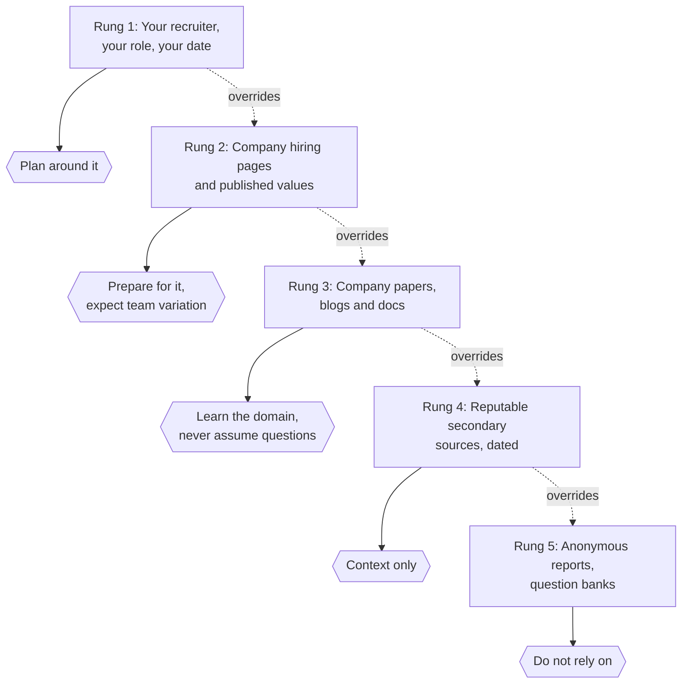
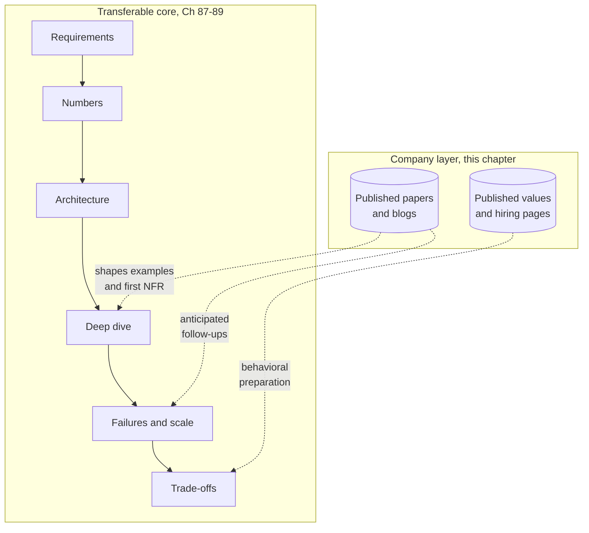

# Chapter 90 — Company-Level Interview Preparation

> **Level:** 3–5 · **Track:** Shared · **Estimated reading time:** 4 h

Candidates often prepare for a named company by collecting rumors: "they always ask a feed design", "the bar is higher for senior roles", "they want you to mention a specific database". Most of that is unverifiable, much of it is out of date, and some of it is false. This chapter takes the opposite approach. For each of fifteen companies it separates three kinds of information and labels each one: what the company itself has published about how it hires (*Evidence: Primary*, with a citation and "as of 2026"); what the company has published about its own systems, which tells you what kinds of problems its engineers think about; and general preparation advice that we infer from that public engineering focus (*Evidence: Illustrative*), which is our suggestion and never a claim about how the company interviews.

The companies are Google, Amazon, Meta, Microsoft, Apple, Netflix, Uber, Airbnb, LinkedIn, Stripe, Databricks, Snowflake, OpenAI, Anthropic and NVIDIA. They vary a great deal in how much they publish about hiring. Some publish detailed preparation pages; some publish almost nothing. Where a company publishes little, this chapter says so plainly rather than filling the gap.

::: warning
**Read this first — what this chapter does not contain.** It contains no interview-loop structures, leveling guides, hiring bars, rubrics or "questions they ask" unless the company has published them itself. It contains no content from review sites, anonymous forums or candidate reports. Hiring processes change often and vary by team, role, level and country; your recruiter's description of *your* process always overrides anything here, including the verified items.
:::

## 90.1 Learning objectives

After this chapter you should be able to:

- Classify any piece of company interview information on a five-rung reliability ladder and decide how much preparation time it deserves.
- Explain why candidate reports and forum posts are unreliable evidence about a company's interview, using sampling bias, survivorship, time decay and team variance.
- List the evaluation dimensions that generalize across companies and map each to the method in Chapters 87–88.
- For each of the fifteen companies, state what the company has published about its hiring (with citation), name two or three of its published systems or papers, and connect them to the case studies in this book.
- Derive company-targeted practice priorities from a company's public engineering focus while labeling them as your own inference.
- Build and execute a four-week preparation plan that spends most of its time on transferable skills and a bounded share on company context.
- Reason aloud, in an interview, about constraints that a company's domain makes important (for example idempotent payments, accelerator-aware serving or global consistency) without claiming knowledge of its internal systems.

## 90.2 Prerequisites

- The interview format overview — §1.11 (what a design interview is and how it is paced).
- Requirements, assumptions and trade-offs — §2.5, §2.7, §2.8 (the core skills every company evaluates).
- Back-of-the-envelope estimation — §2.11 and Chapter 89 (numbers you will need in every company's design round).
- Reading papers and engineering blogs — §3.5 (how to extract a design from a paper in an hour).
- Interview fundamentals and the readiness framework — Chapters 87 and 88 (the evaluation dimensions and the 14-step sequence this chapter assumes).
- The case studies — Chapters 52–56 and 81–86 (the practice material this chapter maps companies onto).

## 90.3 How to use company information responsibly

### 90.3.1 What is knowable

::: definition
**Definition — Verified public information.** A statement about a company's hiring or engineering that the company itself has published in a form you can cite: a careers or interview-preparation page, an official engineering blog post, a published set of leadership principles or values, official product documentation, or a paper its engineers authored. It is verified only for the date you read it.
:::

#### First-principles explanation

Think of preparing for a company as preparing to visit a city you have never seen. The city's official transit map is reliable but incomplete. A friend's account of a trip five years ago is vivid but may describe a bus line that no longer runs. An anonymous review that says "the trains are always late" tells you about one traveler's bad day. A sensible traveler uses the official map for facts, the friend for color, and ignores the anonymous review. Interview preparation works the same way: the company's own words are the map, and everything else is weaker evidence.

#### Why does this exist?

Interview preparation has become an industry, and much of what circulates about specific companies is presented with more confidence than its sources justify. Two failures follow. First, candidates over-fit: they memorize a "known" question list and then cannot adapt when the interviewer changes one requirement. Second, candidates under-prepare on transferable skills because they believe a company-specific trick will carry them. Both failures are avoidable if you know what can actually be known.

#### How it works internally: the reliability ladder

Rank every piece of information you find on five rungs, from most to least reliable:

1. **Your recruiter's description of your process.** Specific to your role, level, team and date. Ask for it in writing.
2. **The company's own hiring pages** — careers sites, interview-preparation pages, published values. Authoritative but general; they describe the typical process, and many say teams vary.
3. **The company's engineering publications** — papers, engineering blogs, documentation. Reliable about *systems*, silent about *interviews*. They tell you what problems the company's engineers care about, not what you will be asked.
4. **Reputable secondary sources** — books, conference talks by employees, journalism that cites the company. Useful for context; check dates.
5. **Anonymous or candidate-reported content** — forums, review sites, "my interview experience" posts, paid question banks. Unverifiable, unrepresentative and often stale. This chapter does not use it.

**Figure 90.1 — The information-reliability ladder.**

**Reading the diagram.** The five rectangles are information sources ordered from most reliable (top) to least reliable (bottom); the hexagons on the right are the action each source justifies. Solid arrows connect a source to its use. Dotted arrows show precedence: when two sources disagree, the higher rung wins, and that override is applied whenever you discover a conflict rather than once. There is no storage boundary in this diagram; the "storage" is your own notes, which should record each item's rung and the date you read it. The failure point is mixing rungs without labels, which turns a forum rumor into an apparent fact. The ladder scales to any company: the number of rungs stays fixed while the amount of content on each varies, and for some companies rung 2 is almost empty.

### 90.3.2 Why hearsay is unreliable

Candidate reports feel like data because there are many of them. They are not a sample of anything well defined.

1. **Selection bias.** People who post are not typical candidates. Very good and very bad experiences are over-represented, and the incentive to post differs between those who received offers and those who did not.
2. **Survivorship.** "I was asked X and passed" does not mean X decided the outcome; the same candidate might have passed with any question.
3. **Team and role variance.** Large companies run many hiring pipelines. A report from one organization tells you little about another. Several companies' own pages say exactly this (for example NVIDIA and Microsoft, §90.19 and §90.8).
4. **Time decay.** Processes change: new rounds are added, formats move online or back to onsite, AI-tool policies are introduced. A two-year-old report may describe a process that no longer exists.
5. **Memory and paraphrase.** A question recalled hours later is a reconstruction. Requirements that the interviewer stated are often forgotten, so the posted "question" is a different problem.
6. **Confidentiality.** Many candidates agree not to share interview content. Content that circulates anyway is ethically compromised, and preparing from it can expose you to disqualification.

::: mistake
**Misconception — "If enough people report the same question, it must be true."** Repetition across forums often means copying, not independent observation. One post is quoted in a guide, the guide is quoted in a video, and the "consensus" has a single origin. Even if a question is genuinely common, memorizing an answer is the wrong preparation: interviewers change requirements precisely to see whether you can reason rather than recall.
:::

### 90.3.3 Time-sensitivity

Every verified item in this chapter is marked "as of 2026". Treat that as a date stamp, not a guarantee. Before an interview, re-read the company's current hiring page and compare it with your notes. Three categories change most often:

- **Format** — remote versus onsite, number of rounds, live-coding tools.
- **Policy** — rules on AI assistance during take-homes and live interviews, which several companies began publishing in 2025 (see §90.18 for one published example).
- **Values and principles** — companies revise them; Amazon added two Leadership Principles in 2021 and Netflix rewrote its culture memo in 2024 (§90.6, §90.10).

::: recommendation
**Recommendation — Keep a dated source log.** For each target company, keep a short table: item, source URL, rung on the ladder, date read. When you prepare, sort by rung and spend time roughly in proportion to reliability and relevance. Delete anything you cannot source. Ten minutes of logging prevents hours of preparing for a process that does not exist.
:::

### 90.3.4 The responsible preparation workflow

**Figure 90.2 — A responsible company-preparation workflow.**

**Reading the diagram.** The flow runs left to right from the candidate. Every step is something you do synchronously, in order; the single dotted arrow is the asynchronous correction path: if the public page contradicts what your recruiter said, you go back and ask, and the recruiter's answer wins (rung 1 over rung 2). The decision node loops practice and mock interviews until you are ready, which is where most of the time goes. The "storage" across steps is your dated source log from §90.3.3. Failure points: skipping step B (preparing for the wrong format), skipping step D (having no domain vocabulary), or skipping step I (missing a late policy change). The workflow scales to several companies at once because steps E–G are shared; only steps B–D and I are per company.

### 90.3.5 Ethics and policies on AI assistance

Some companies now publish explicit rules on whether you may use AI tools during applications, take-home exercises and live interviews. Where a company publishes such rules, follow them exactly; where it does not, ask your recruiter and assume no assistance during live interviews unless told otherwise. Do not seek or use leaked interview content. Apart from the ethical problem, interviewers who recognize a memorized answer typically probe until the memorized part runs out.

#### Failure scenarios

**Table 90.1 — Failure scenarios in company-targeted preparation.**

| What goes wrong | Why | Detection | Recovery | Prevention |
|---|---|---|---|---|
| Prepared for a round that does not exist | Relied on an old report | Recruiter's schedule differs | Re-plan the last week around actual rounds | Ask the recruiter first (rung 1) |
| Memorized design collapses under a changed requirement | Over-fitted to a "known question" | Cannot justify a component when asked "why" | Restart from requirements aloud | Practice method, not answers (Ch 87–88) |
| Claimed knowledge of internal systems | Confused a published paper with today's production | Interviewer asks a follow-up you cannot answer | Say what was published and when, then reason generically | Phrase as "the published design was…" |
| Ignored a published AI-use policy | Did not read the company's page | Policy reminder from interviewer | Stop, comply, explain | Read policy pages the week before |
| Spent most prep time on company trivia | Mistook context for skill | Weak mock scores on fundamentals | Rebalance toward transferable practice | Cap company-specific time (§90.21) |

## 90.4 What generalizes across companies

### 90.4.1 Common evaluation dimensions

Every company's design interview is, at its core, the same exercise: given an ambiguous problem, can you turn it into a precise one, propose a design that meets it, quantify that design, find where it breaks and explain what you traded away. Chapter 87 develops these skills and Chapter 88 turns them into a 14-step sequence with level-by-level expectations. The dimensions below appear, in some wording, in the hiring materials of many of the companies in this chapter, and they are the substance behind any company-specific vocabulary.

**Table 90.2 — Evaluation dimensions that generalize (general advice; see Chapters 87–88).**

| Dimension | What a strong answer shows | Where this book teaches it |
|---|---|---|
| Problem framing | Clarifying questions; explicit functional and non-functional requirements | §2.5, §1.6–§1.7, Ch 87 |
| Quantitative reasoning | Peak RPS, storage, bandwidth, memory, GPU memory, cost with stated assumptions | §2.11, Ch 89 |
| Architecture | Components with clear responsibilities and data flow | §2.3, case studies Ch 52–56 |
| Data modeling | Access patterns before schema; partition keys justified | Ch 11–12, §14.7 |
| Depth on the hard part | Naming the one difficult component and designing it properly | §52.3 tip, Ch 88 |
| Failure and scale | Failure modes, bottlenecks, what changes at 10× and 100× | §2.6, §2.9, Ch 39 |
| Trade-offs | Alternatives considered and why rejected | §2.8, Ch 87 |
| Communication | Structured narration, diagrams, time management | §1.11, Ch 87 |
| Ownership and judgment | Operability, cost, security, product sense | Ch 40, Ch 50, Ch 51 |

::: concept
**Key insight — Company preparation is a thin layer on a thick core.** The transferable core (Table 90.2) is what interviews measure. Company context changes which examples come to mind first, which constraints you raise without being prompted, and which vocabulary you can use credibly. It is worth perhaps a quarter of your preparation time, not most of it (§90.21).
:::

### 90.4.2 How company context changes an answer

Company context legitimately changes three things in an interview answer:

1. **Which non-functional requirement you raise first.** For a payments company, correctness under retries comes before latency; for a streaming company, delivery cost per gigabyte and startup time come early; for an AI lab, accelerator memory and cost per token come early.
2. **Which examples you can cite.** If a company has published a design (Dynamo, TAO, Spanner, Kafka, H3), you may refer to it as published work, with its date, as long as you do not claim it describes today's production system.
3. **Which follow-up questions you anticipate.** Domain constraints suggest follow-ups: multi-region consistency, abuse, privacy, hardware failure.

It does not change the method. A candidate who skips requirements because "this company cares about scale" has misread the situation everywhere.

**Figure 90.3 — The transferable core and the company layer.**

**Reading the diagram.** The upper subgraph is the method you apply in every interview, executed synchronously from requirements to trade-offs; each solid arrow is the next step of the sequence in Chapter 88. The lower subgraph holds two stores of company knowledge, drawn as cylinders because they are reference material you consult, not steps you perform. Dotted arrows are influences rather than steps: published engineering work shapes which examples you cite in the deep dive and which failures you anticipate, and published values inform how you discuss trade-offs and past work. The storage boundary is between the two subgraphs: nothing in the company layer replaces a step of the core. The failure point is drawing a solid arrow from the layer into the core, that is, skipping a core step because of a company belief. This structure scales to any number of companies because the core is shared and only the lower subgraph is swapped.

### 90.4.3 How the company sections are organized

Each of §90.5–§90.19 has the same four parts:

1. **Verified public information** — what the company itself has published about hiring, in `industry` callouts labeled *Evidence: Primary* and dated "as of 2026". Where a page could only be confirmed through search-engine excerpts because the site could not be fetched directly, the item is still cited, and the limitation is logged in §90.28.
2. **Engineering context worth knowing** — the company's published systems and papers that relate to design interviews, with cross-references to the chapter that teaches each idea.
3. **Preparation focus areas** — general advice we infer from the company's public engineering focus, labeled *Evidence: Illustrative*. These are suggestions for what to practice, not statements about what the company asks.
4. **Practice mapping** — which problem families in Chapters 91–92 and which case studies in this book give the most relevant practice.

### 90.4.4 Company focus maps at a glance

The three maps below summarize §90.5–§90.19. They connect each company to the engineering themes visible in its own publications and to the chapters that teach those themes. They are general advice derived from public engineering work, not descriptions of interview content.

**Figure 90.4 — Focus map: Google, Amazon, Meta, Microsoft, Apple (general advice).**

**Reading the diagram.** Each stadium node is a company; each rectangle is an engineering theme visible in that company's own publications, with the book chapters that teach it. Arrows mean "public work suggests practicing", not "the interview contains". All edges are drawn solid because this is a static reference map with no runtime flow; there are no storage boundaries or failure points in the systems sense. The practical failure point is reading the map as a question list. To scale your use of it, pick one theme per company for a deep dive and treat the rest as vocabulary.

**Figure 90.5 — Focus map: Netflix, Uber, Airbnb, LinkedIn, Stripe (general advice).**

**Reading the diagram.** The layout matches Figure 90.4: companies on the left, published engineering themes on the right, labeled with the sections that teach them. All arrows are solid and static. The map shows two recurring clusters across these five companies: correctness of money movement (Airbnb, Stripe) and event streams feeding many consumers (LinkedIn, and the real-time marketplace at Uber). The failure point is again misreading it as a statement about interviews; it summarizes published engineering focus only.

**Figure 90.6 — Focus map: Databricks, Snowflake, OpenAI, Anthropic, NVIDIA (general advice).**

**Reading the diagram.** Same conventions as the previous two maps. The five data and AI companies split into two groups: data-platform companies (Databricks, Snowflake), whose publications concern query engines, table formats and the separation of storage from compute; and AI companies (OpenAI, Anthropic, NVIDIA), whose publications concern accelerators, large-scale training and serving, and agent systems. Expect the second group's themes to change fastest; re-check publications within weeks of an interview.
