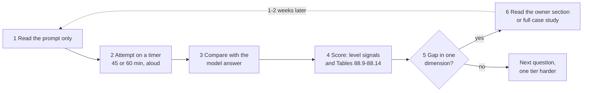
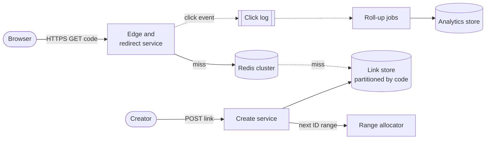
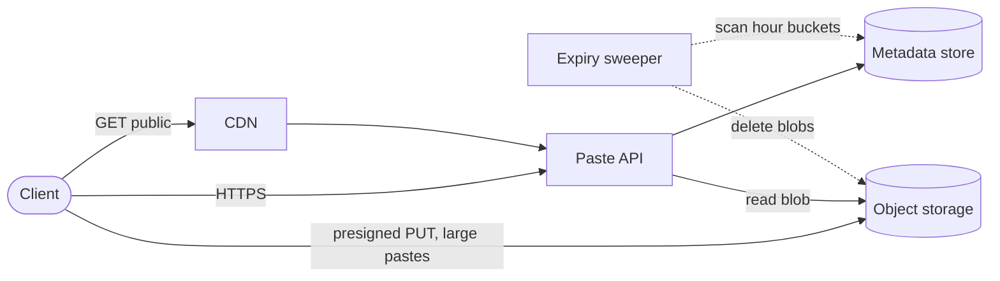
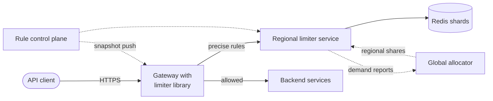

# Chapter 91 — Interview Practice Library I: Traditional System Design

> **Level:** 2–5 · **Track:** A (Traditional) · **Estimated reading time:** 12 h (a reference library; work through it one question at a time)

Chapters 87 to 89 taught the method: how to run the interview (Ch 87), what to cover and how each level is judged (Ch 88), and how to estimate (Ch 89). This chapter is where you practice it. It holds 56 traditional system-design prompts, graded from easy to expert, each with a model answer written the way a strong candidate would deliver it in 45 or 60 minutes: the clarifying questions, the numbers that decide the design, one diagram, the two or three deep dives that decide the interview, the trade-offs, the follow-ups an interviewer is likely to ask, and what separates a mid-level answer from a senior or staff one.

The library does not replace the case studies. Where Book I already has a full sixteen-section case study (Chapters 52–56) or a worked design elsewhere, the model answer here is deliberately compact: it shows what fits in the interview and points to the case study for the full treatment. Where no case study exists, the answer is complete enough to stand alone. Every design in this chapter is a teaching design: *Evidence: Illustrative*. Numbers are stated assumptions, not measurements of any company.

## 91.1 Learning objectives

After working through this chapter you should be able to:

- **Attempt** any of 56 traditional prompts under a 45- or 60-minute clock, producing requirements, an estimate, an API, a data model and a diagram before the deep-dive mark.
- **Identify**, within the first ten minutes, the two or three decisions that dominate a given prompt (the "hard part") and spend most of your deep-dive time on them.
- **Reuse** the estimation formulas of Chapter 89 (§89.5–§89.12) on unfamiliar prompts and state the design consequence of each number.
- **Map** a new prompt onto a known pattern (lookup service, fan-out, stream aggregation, inventory with holds, real-time connection fleet, blob pipeline) and adapt the pattern rather than start from a blank board.
- **Answer** the standard follow-up questions for each prompt in two or three sentences, with a number or a reversal condition where one exists.
- **Score** your own attempt against the level signals of each question and the rubric of §88.9, and choose the next question that targets your weakest dimension.

## 91.2 Prerequisites

- **Interview technique and pacing** — Chapter 87, especially Table 87.4 (pacing plans) and §87.10 (choosing deep dives). The model answers assume you already run the clock.
- **The fourteen-step sequence and the level rubric** — §88.4 and §88.9. Each question's "What distinguishes levels" section is a compressed form of Tables 88.9–88.14.
- **Estimation formulas** — §89.5 (traffic), §89.6 (storage), §89.7 (bandwidth), §89.8 (caching), §89.9 (database sizing), §89.10 (fleets), §89.11 (queues) and §89.12 (availability). The estimates here cite these sections rather than re-derive them.
- **The case-study method** — §52.3. Read at least two case studies end to end before using the compact answers, which assume you can open the full case for depth.
- **Core building blocks** — caching (Ch 20), partitioning and consistent hashing (§14.6–§14.8), queues and logs (Ch 30–31), idempotency (§22.15), object storage (Ch 15) and real-time connections (Ch 9). The model answers name these and cross-reference them; they do not re-teach them.

## 91.3 How to use this library

### 91.3.1 The practice loop

The library is built for **retrieval practice** (§3.4): you attempt a design from memory, under time pressure, and only then compare with a model answer. Reading the answers first feels productive and teaches little. Figure 91.1 shows the loop.

**Figure 91.1 — The practice loop for one question.**

**Reading the diagram.** The loop has six steps, run left to right. You read only the prompt (step 1) and attempt the design aloud on a timer, ideally to a peer acting as interviewer (step 2), with the pacing of Table 87.4. Only then do you open the model answer (step 3) and score your attempt (step 4) against the question's level signals and the six rubric dimensions of §88.9. The decision diamond (step 5) routes you: a gap in one dimension, for example estimation or failure handling, sends you to the owning section or the full case study (step 6), and the dotted edge is the delayed re-attempt, one or two weeks later, that turns reading into recall. No gap sends you to a harder question. The failure point of the loop is step 3 done first; the scaling lesson is spacing: three attempts of one question spread over a month teach more than three questions in an evening.

### 91.3.2 Difficulty tiers

Difficulty describes how much of the design is non-standard, not how large the system is. A URL shortener at 280,000 RPS is still *Easy* because every component is a standard part; a calendar with a few thousand writes per second is *Medium* because recurrence and time zones need original thought.

**Table 91.1 — Difficulty tiers in this library.**

| Tier | Questions | What the prompt demands | Typical slot | Level it best discriminates |
|---|---|---|---|---|
| Easy | Q1–Q12 | One core component or pattern; a correct standard design plus one deep dive | 45 min | Junior to mid (L3–L4); a senior warm-up |
| Medium | Q13–Q28 | A complete product with two or three interacting subsystems and a clear hard part | 45–60 min | Mid to senior (L4–L5) |
| Hard | Q29–Q44 | Strong correctness or scale constraints (money, ordering, global state) where the obvious design fails | 60 min | Senior to staff (L5–L6) |
| Expert | Q45–Q56 | Infrastructure that other systems are built on; consensus, durability or migration under live load | 60 min, often a design review | Staff to principal (L6–L7) |

A senior candidate should be able to finish any Easy question in 30 minutes with time left for extensions. Interviewers often use an Easy prompt for a senior loop and then push it to Hard with follow-ups ("now make it multi-region", "now guarantee no double charge"); the follow-up questions in each answer show where that push usually goes.

### 91.3.3 The per-question format

Every question uses the same headings, in the order you would cover them in the room:

- **Prompt** — what the interviewer says, in one to three sentences. Read only this before attempting.
- **Clarifying questions and assumptions** — the questions worth asking, and the answers the model solution assumes. Your interviewer may answer differently; follow their answers, not these.
- **Requirements** — functional requirements (FRs) and non-functional requirements (NFRs) with numbers.
- **Estimation** — an `example` callout with the few numbers that decide something. Formulas are those of Chapter 89 and are cited, not re-derived. Unless stated otherwise the defaults of the §89 conventions note apply: busiest-hour share $h = 0.10$ and burst factor $b = 2$ (peak-to-average ratio 4.8), target utilization $u = 0.6$, decimal units (1 KB = 10³ bytes).
- **API and data model** — the core calls and the main entities with their keys.
- **High-level design** — one diagram with a "Reading the diagram" paragraph.
- **Deep dives** — the two or three topics that decide the interview, with the reasoning a strong answer gives.
- **Trade-offs and alternatives** — the main choices, each with the condition that would reverse it.
- **Follow-up questions** — four to six likely follow-ups, each with a short model answer.
- **What distinguishes levels** — observable mid-level, senior and staff signals for this prompt.

Questions with a full case study elsewhere in the book have **compact answers** (about 500–700 words): the interview-length answer plus the cross-reference. Questions without one have **full answers** (about 1,000–1,200 words). In both cases the model answer is *one* good answer. Interviewers reward a different design that is justified with numbers and trade-offs just as much.

::: tip
**How to read a model answer after your attempt.** Do not check whether your boxes match. Check four things: did you find the same hard part; did your numbers reach the same order of magnitude; did your deep dive contain a mechanism (not just a component name); and could you answer at least four of the follow-ups. Those four checks map onto the rubric dimensions that most often separate levels (§88.9).
:::

::: mistake
**Memorizing model answers.** Interviewers change one constraint ("links never expire", "payments must be exactly once", "the users are in one city") precisely to see whether you reason or recite. Practice the reasoning: for each question, write down which assumption, if changed, would change the design most. That sentence is worth more than the diagram.
:::

### 91.3.4 Index of all 56 questions

Table 91.2 lists every question in both parts of the library. "Related" names the full case study where one exists (the compact answers point there) and otherwise the sections that own the key techniques.

**Table 91.2 — Index of the traditional practice library.**

| Q | Title | Difficulty | Related sections |
|---|---|---|---|
| 1 | URL shortener | Easy | §52.4 (full case); §17.10, §20.15 |
| 2 | Pastebin | Easy | §52.5 (full case); §15.8.2, §15.9 |
| 3 | Rate limiter | Easy | §52.6 (full case); §22.4–§22.8 |
| 4 | Distributed LRU cache | Easy | §20.9, §20.14, §20.15, §38.10.3, §52.8 |
| 5 | Unique ID generator | Easy | §17.10, §26.11, §53.6.8 |
| 6 | Like/view counter | Easy | §53.6.8, §17.5, §56.7 |
| 7 | Parking-lot reservation system | Easy | §38.10.1, §55.8, §22.15 |
| 8 | Real-time leaderboard | Easy | §12.4.2, §17.7, §20.6 |
| 9 | Notification service | Easy | §52.7 (full case); §22.15, §30.10 |
| 10 | File upload service (presigned URLs) | Easy | §15.8, §52.5, §21.3 |
| 11 | Feature-flag service | Easy | §43.7, §9.4, §57.14 |
| 12 | API gateway | Easy | §34.6, Ch 22, §52.6 |
| 13 | News feed | Medium | §53.7, §53.8 (full cases); §23.6.1 |
| 14 | Chat/messaging app | Medium | §53.4, §53.5 (full cases); §9.9 |
| 15 | Photo-sharing app | Medium | §53.6 (full case); §15.8, Ch 21 |
| 16 | Typeahead/autocomplete | Medium | §16.9 (worked design), §56.4; §17.11 |
| 17 | Web crawler | Medium | §52.10 (full case); §17.4 |
| 18 | E-commerce catalog search | Medium | Ch 16, §55.7, §81.7 |
| 19 | Ticket booking (seat reservation) | Medium | §55.8 (full case); §26.11 |
| 20 | Ride-hailing dispatch | Medium | §55.4, §55.5 (full cases); §17.9 |
| 21 | Food delivery | Medium | §2.11, §18.11.5 (QuickBite); §55.5, §32.7.2 |
| 22 | File sync (Dropbox-like) | Medium | §54.8 (full case); §54.7, §15.8.3 |
| 23 | Video upload and streaming | Medium | §54.4 (full case); §21.8 |
| 24 | Metrics monitoring system | Medium | §56.6 (full case); §12.8, §40.5 |
| 25 | Distributed logging pipeline | Medium | §56.6 (full case); Ch 31 |
| 26 | Email service | Medium | §52.7, Ch 15, Ch 16 |
| 27 | Calendar and scheduling | Medium | §52.9, §52.7, §55.8 |
| 28 | Collaborative document editing | Medium | §54.7 (full case); §27.14, §45.6 |
| 29 | Payment system | Hard | §55.9 (full case); §22.15, §32.5 |
| 30 | Stock-exchange matching engine | Hard | §27.4, Ch 31, §4.11 |
| 31 | Distributed key-value store | Hard | §52.8 (full case); §14.8 |
| 32 | Distributed message queue | Hard | §30.4, Ch 31 |
| 33 | Resharding a live SQL database | Hard | §14.7, §14.9, §43.13 |
| 34 | Global CDN | Hard | Ch 21, §19.9 |
| 35 | Distributed cache at very large scale | Hard | §20.14, §20.15, §44.7 |
| 36 | Real-time search over posts | Hard | §16.10, §53.8 |
| 37 | Ad-click aggregation | Hard | §56.7 (full case); §29.8 |
| 38 | Top-K heavy hitters | Hard | §17.6, §53.8 |
| 39 | Multi-region active-active social app | Hard | Ch 44, §27.14 |
| 40 | Distributed cron/job scheduler | Hard | §52.9 (full case); §26.13 |
| 41 | Live streaming platform | Hard | §21.8, §54.4 |
| 42 | Proximity service | Hard | §17.9, §55.4 |
| 43 | Maps and routing | Hard | §55.6 (full case) |
| 44 | Multiplayer game backend | Hard | §9.6, §9.9, §44.4 |
| 45 | Globally consistent database | Expert | §28.8, §44.12 |
| 46 | Distributed file system | Expert | §15.5 |
| 47 | Object storage service | Expert | §15.4, §15.6 |
| 48 | Durable workflow engine | Expert | §32.7, §32.11 |
| 49 | Multi-tenant SaaS platform with tenant isolation | Expert | Ch 47 |
| 50 | Tracing/observability platform at exabyte scale | Expert | §40.6, §56.6 |
| 51 | Zero-downtime monolith-to-microservices migration | Expert | §34.13, §43.13 |
| 52 | Coordination/configuration service (consensus) | Expert | §26.7–§26.9 |
| 53 | Digital wallet with double-entry ledger and reconciliation | Expert | §55.9, §32.5 |
| 54 | Global edge rate limiting and DDoS protection | Expert | §52.6, §10.11, §21.11 |
| 55 | Lakehouse/data warehouse | Expert | §49.6, §61.8 |
| 56 | Bank-grade disaster recovery (RPO 0 across regions) | Expert | §39.8, §44.11 |

### 91.3.5 Choosing what to practice

If your interview is weeks away, work through one tier at a time and finish each tier with two questions you have not seen, attempted cold. If it is days away, pick by pattern rather than by number: most prompts are variations on six recurring shapes, and one question per shape covers more ground than ten questions of the same shape.

**Table 91.3 — Six recurring shapes and the questions that train them.**

| Shape | The hard part it trains | Questions |
|---|---|---|
| Read-heavy lookup | Cache hierarchy, hot keys, key generation | Q1, Q2, Q4, Q5, Q16 |
| Counting and aggregation | Hot counters, windows, approximation | Q3, Q6, Q8, Q24, Q37, Q38 |
| Fan-out | Push versus pull, celebrity accounts, delivery guarantees | Q9, Q13, Q14, Q15, Q26 |
| Inventory with holds | No double booking, contention, timeouts | Q7, Q19, Q21, Q27, Q29 |
| Real-time connections and location | Connection fleets, geospatial indexes, presence | Q14, Q20, Q21, Q28, Q42, Q44 |
| Blob and media pipelines | Direct-to-storage upload, processing state machines, CDN | Q10, Q15, Q22, Q23, Q41, Q47 |

::: recommendation
**A four-week plan for a senior loop.** Week 1: Q1, Q3, Q6, Q9 (Easy, one per shape) plus Ch 89 drills. Week 2: Q13, Q14, Q19, Q21 (Medium, the four most common prompts). Week 3: Q16, Q22, Q26, Q28, re-attempting any week-1 question you scored below senior. Week 4: two Hard questions from part B and two cold Medium questions, then rest. This is general advice, not a published recommendation of any company.
:::

## 91.4 Easy questions (Q1–Q12)

The Easy tier trains standard components done well. Each answer is short on architecture and long on the one mechanism that a mid-level candidate usually leaves vague: code generation, expiry, counting, eviction, ID layout, hot counters, holds, ranking, priorities, upload state, flag propagation and gateway policy.

### 91.4.1 Q1. URL shortener

**Difficulty:** Easy · **Time:** 45 min · **Related:** §52.4 (full case study); §17.10 (IDs), §20.15 (hot keys)

#### Prompt

"Design a service like bit.ly: users submit a long URL and get a short link; anyone who opens the short link is redirected. Assume large public scale."

#### Clarifying questions and assumptions

- Custom aliases and expiry? Yes to both, optional per link. Analytics? Click counts per link, minutes of delay acceptable.
- Scale? Assume 50 million new links per day and 100 redirects per link (§52.4.4). Links kept 10 years.
- Can short codes be guessable? No: sequential codes would let anyone enumerate private links.

#### Requirements

- **FR:** create a short link (optionally custom alias, expiry); redirect; per-link click statistics; delete or disable a link (abuse takedown).
- **NFR:** redirect p99 < 50 ms at the edge region; redirect availability 99.99%; create 99.9%; no two long URLs ever share a code by accident; codes 7 characters.

#### Estimation

::: example
**Worked example — The numbers that shape the shortener (§52.4.4, formulas of §89.5 and §89.6).**

1. Creates: $50 \times 10^6 \times 0.10 / 3{,}600 \times 2 = 2{,}778$/s at peak. Redirects: $5 \times 10^9$/day, peak $277{,}778$ RPS.
2. Ten years of links: $50 \times 10^6 \times 3{,}650 = 1.825 \times 10^{11}$; 7 base62 characters give $62^7 = 3.52 \times 10^{12}$ codes, so 5.2% of the space is used.
3. Storage at 500 B per link: 9.1 TB/year; 274 TB over ten years with three replicas.
4. Cache: 200 million links clicked per day × 500 B × 2 overhead = 200 GB; at a 95% hit ratio, $277{,}778 \times 0.05 = 13{,}889$ reads/s reach the store.

**Interpretation.** A read-dominated lookup at 280,000 RPS with a modest write rate. **Implication.** Design the redirect path around caches; the create path's difficulty is correctness of code generation, not throughput.
:::

#### API and data model

- `POST /v1/links {long_url, alias?, expires_at?}` with an `Idempotency-Key` header → `201 {code, short_url}`.
- `GET /{code}` → `302 Location: long_url` (or `404`/`410`).
- `links(code PK, long_url, owner_id, created_at, expires_at, status)` in a partitioned key-value or wide-column store keyed by `code`; clicks go to an event log, not to this table.

#### High-level design

**Figure 91.2 — URL shortener: cache-first redirects, asynchronous analytics.**

**Reading the diagram.** Redirects arrive over HTTPS at a stateless redirect tier with an in-process cache; a miss goes to a shared Redis cluster and then to the link store (cylinders are storage boundaries). Creates take a block of IDs from a range allocator, permute them into codes and write the link store. Click events leave asynchronously (dotted) through a log to roll-up jobs, so analytics can lag or fail without touching redirects. Failure points: the Redis cluster (a cold cache multiplies store load by 20) and the allocator (it must never hand out a range twice). The redirect tier and caches scale horizontally; the store scales by code partitions.

#### Deep dives

1. **Code generation.** Hashing the URL and truncating to 7 characters collides at billions of links and merges different users' links; random codes need a uniqueness check on insert; counter ranges (each create node leases a block of, say, 10,000 IDs) need no per-create coordination. Pass the counter through a keyed permutation before base62 encoding so that codes are not enumerable (§52.4.8).
2. **Redirect caching and hot keys.** Two cache layers (in-process, then Redis) plus negative caching for unknown codes protect the store from scans. A viral link at 50,000 RPS is absorbed by the in-process layer (§20.15). Use **302**, not 301, if you need click counts and the ability to disable a link; 301 is cached by browsers indefinitely.
3. **Analytics off the critical path.** At 1 TB/day the click stream is the largest write load; emit it asynchronously and roll it up.

#### Trade-offs and alternatives

- Counter ranges versus random codes: ranges are cheaper per create; random codes avoid the allocator as a durable-state hazard. Reverse if creates are rare and you prefer fewer moving parts.
- 302 versus 301: 302 costs more redirect traffic; choose 301 only for permanent links with no analytics or takedown needs.

#### Follow-up questions

1. *"Why not hash the URL?"* Truncated hashes collide, so you still need a uniqueness check, and two users shortening the same URL would share statistics.
2. *"How do you stop enumeration?"* Keyed permutation or random codes, rate-limited 404s per client, and no reliance on obscurity for private content.
3. *"The same user wants the same code for the same URL."* Add an `(owner_id, hash(long_url)) → code` index checked before creating.
4. *"How do expired links stop working?"* Check `expires_at` on every redirect and bound cache TTLs by it; delete rows lazily (§52.5.8).
5. *"What changes at 100× creates?"* Eight-character codes ($62^8 = 2.2 \times 10^{14}$) and larger ID blocks; code length is a parameter, not a constant.

#### What distinguishes levels

- **Mid:** a working create/redirect design with a database and a cache; base62 encoding explained.
- **Senior:** quantifies the read path and the keyspace; justifies 302; handles hot keys, negative caching and enumeration.
- **Staff:** notices the click stream is the largest write load, treats abuse takedown as a subsystem protecting the domain's reputation, and treats the allocator as durable state that a restored backup must not rewind.

### 91.4.2 Q2. Pastebin

**Difficulty:** Easy · **Time:** 45 min · **Related:** §52.5 (full case study); §15.8.2 (presigned URLs), §15.9 (lifecycle)

#### Prompt

"Design Pastebin: users paste text, get a link, and others can view it. Pastes can expire."

#### Clarifying questions and assumptions

- Visibility? Public, unlisted and private. Expiry options? 10 minutes to never, plus "burn after reading". Size limit? 10 MB per paste.
- Scale? 10 million pastes/day, 5 reads per paste, mean size 20 KB (median 2 KB; log dumps pull the mean up).

#### Requirements

- **FR:** create with visibility and expiry; read by link; burn after reading; delete; syntax highlighting (client side).
- **NFR:** read p99 < 200 ms; an expired paste is never served, even from a cache; 99.9% availability; content durable until expiry.

#### Estimation

::: example
**Worked example — Pastebin is shaped by lifecycle, not throughput (§52.5.4; §89.5, §89.6).**

1. Peak creates $10^7 \times 0.10 / 3{,}600 \times 2 = 556$/s; peak reads 2,778 RPS; peak egress $2{,}778 \times 20$ KB $= 55.6$ MB/s.
2. Live expiring content at steady state, by Little's Law summed over expiry classes: about 57.6 million pastes, 1.15 TB, constant over time.
3. Never-expiring pastes (30%) accumulate $10^7 \times 0.3 \times 365 \times 20$ KB $= 21.9$ TB/year.
4. Physical deletions: 7 million/day, about 389/s at peak.

**Interpretation.** Request rates are small; the 30% that never expire hold 95% of the bytes after a year. **Implication.** Put content in object storage with lifecycle rules, keep metadata small, and build a dedicated expiry pipeline.
:::

#### API and data model

- `POST /v1/pastes {visibility, expires_in, burn_after_read}` → `{id, upload_url?}`; small pastes inline, large ones through a presigned upload URL.
- `GET /v1/pastes/{id}` → content or `404`.
- `pastes(id PK, owner_id, visibility, expires_at, burn, state, size, blob_key | inline_content)`; an expiry index bucketed by hour: `expiry_bucket(hour, id)`.

#### High-level design

**Figure 91.3 — Pastebin: metadata and blob split with an expiry pipeline.**

**Reading the diagram.** The API owns metadata (cylinder) and checks `expires_at` and visibility on every read; large bodies go directly from the client to object storage with a presigned URL, so they never pass through the API. Public pastes are cached at the CDN with a TTL bounded by remaining lifetime; private pastes are never cached there. The sweeper (dotted, asynchronous) walks hourly expiry buckets and deletes rows and blobs; an object-store lifecycle rule is a backstop. Failure points: sweeper lag (storage cost, not correctness) and orphaned blobs from abandoned uploads, reconciled periodically. Everything scales horizontally; the metadata store partitions by `id`.

#### Deep dives

1. **Logical versus physical deletion.** Correctness comes from the read-time check; physical deletion is a lagging, idempotent cleanup. Cache lifetimes must be capped at the remaining time to expiry.
2. **Burn after reading.** A conditional state transition (`UPDATE … SET state='burned' WHERE id=? AND state='live'`) before returning content; only one reader wins.
3. **Blob/metadata split.** Inline pastes under a few KB in the metadata row; larger ones in object storage, keeping the database small and compaction cheap.

#### Trade-offs and alternatives

- Inline versus object storage: inline is one read; object storage is cheaper per byte and has lifecycle rules. The threshold moves with the size distribution.
- A TTL-capable store (native row TTL) can replace the sweeper for metadata, but blobs still need cleanup.

#### Follow-up questions

1. *"How do you guarantee an expired paste is never shown?"* Check on every read; cap every cache TTL by remaining lifetime.
2. *"Ten-minute expiry with day-granularity lifecycle rules?"* The read check is correct; the sweeper deletes within the hour; lifecycle rules are only a backstop.
3. *"Deduplicate identical pastes?"* Content hash as blob key with reference counts; worthwhile only if many large pastes repeat, and it complicates deletion.
4. *"Abuse: leaked credentials pasted publicly?"* Scan new public pastes asynchronously for secrets and malware, with a takedown path.

#### What distinguishes levels

- **Mid:** a database-backed design with expiry handled by a cron job.
- **Senior:** separates blobs from metadata, uses presigned uploads, and keeps reads correct independent of deletion lag.
- **Staff:** reads from the estimate that permanent pastes dominate storage and proposes a product policy; designs reconciliation between the two stores; treats private-content caching as a tested security property.

### 91.4.3 Q3. Rate limiter

**Difficulty:** Easy · **Time:** 45 min · **Related:** §52.6 (full case study); §22.4–§22.8 (algorithms and distributed counting)

#### Prompt

"Design a rate limiter that protects our public API. Limits are per API key and per endpoint, and the API runs in several regions."

#### Clarifying questions and assumptions

- Where does it run: client library, gateway, or separate service? A library in the gateway, backed by a regional service for precise limits.
- Accuracy? Within about 5% for paid-tier limits; looser for fairness limits. Failure policy if the limiter is down? Per rule.
- Scale? 1 million API RPS at peak across three regions; 3 rules matched per request; 20 million active keys per 10 minutes (§52.6.4).

#### Requirements

- **FR:** evaluate rules (per key, per endpoint, per tenant) and return allow/deny with `429` and `Retry-After`; rules configurable without deploys; shadow mode for new rules.
- **NFR:** added latency p99 < 1 ms locally, < 5 ms for central checks; the limiter must never take the API down; per-key limits within 5%.

#### Estimation

::: example
**Worked example — Decisions, central load and memory (§52.6.4; §89.10).**

1. Decisions at peak: $10^6 \times 3 = 3 \times 10^6$/s.
2. All central: $3 \times 10^6 / (50{,}000 \times 0.6) = 100$ Redis shards and 4.8 Gb/s of limiter traffic.
3. Only the 20% that need precision central: $6 \times 10^5 / 30{,}000 = 20$ shards across three regions.
4. Memory: $20 \times 10^6 \times 150$ B $= 3$ GB.
5. A hot tenant at 100,000 RPS on one key exceeds one shard; leasing tokens in batches of 100 cuts it to 1,000 calls/s.

**Interpretation.** Memory is trivial; operations per second per key decide the design. **Implication.** Evaluate most rules locally, centralize only precise ones, and batch hot keys.
:::

#### API and data model

- In-process `check(key, endpoint, cost) → {allow, remaining, reset_at}`; regional RPC `Acquire(bucket_id, tokens)` for central rules and token leases.
- Rule: `{id, scope, match, algorithm, limit, window, failure_mode: open|closed, shadow}`; bucket state in Redis: `bucket:{id} → (tokens, last_refill)`, updated by one atomic Lua script.

#### High-level design

**Figure 91.4 — Tiered rate limiting: local, regional and leased.**

**Reading the diagram.** Every request is checked in the gateway's in-process library (synchronous, sub-millisecond) against a rule snapshot pushed asynchronously by the control plane. Rules needing precision call the regional limiter, which runs an atomic token-bucket script on Redis (cylinder). Cross-region limits are never checked synchronously: a global allocator assigns each region a share from reported demand every second (dotted). Failure points: Redis or the regional service (handled by each rule's failure mode behind a short timeout), and a bad rule push (shadow mode and rollback). Scaling: Redis shards by bucket key; hot keys use leases.

#### Deep dives

1. **Algorithm choice, briefly.** Token bucket for rates with bursts, sliding-window counter for per-minute limits, fixed windows for daily quotas (§22.4–§22.7). Then move on: the algorithm is not the hard part.
2. **Where to count.** Local counters are fast but imprecise across many gateways; central counters are precise but cost a network hop and can fail; leased batches combine the two for hot keys (§22.8).
3. **Failure policy per rule.** Fail open (fall back to local limits) for fairness rules; fail closed for security and cost rules such as login attempts or SMS sends.

#### Trade-offs and alternatives

- Central precision versus local speed: reverse toward central only for rules whose overshoot costs money.
- A sidecar or gateway plugin versus a separate service: a library avoids a hop but couples releases to the gateway.

#### Follow-up questions

1. *"Redis goes down?"* Each rule's failure mode applies after a short timeout and a circuit breaker; fairness rules degrade to local limits.
2. *"Global limit across regions?"* Allocate regional shares from demand and reconcile each second; accept a small overshoot during shifts.
3. *"Race between two gateways reading the same counter?"* The Lua script makes read-modify-write atomic on the shard.
4. *"What headers do you return?"* `429` with `Retry-After`, and remaining/limit headers so well-behaved clients back off.

#### What distinguishes levels

- **Mid:** explains token bucket and puts counters in Redis.
- **Senior:** atomic scripts, correct 429 semantics, local versus central placement with numbers.
- **Staff:** per-rule failure policy, control plane separated from data plane (shadow mode, rollback), hot-key leasing and multi-region allocation, and insists that the limiter cannot become the outage it prevents.

