# Chapter 91 — Interview Practice Library I: Traditional System Design

> **Level:** 2–5 · **Track:** A (Traditional) · **Estimated reading time:** 12 h (a reference library; work through it one question at a time)

Chapters 87 to 89 taught the method: how to run the interview (Ch 87), what to cover and how each level is judged (Ch 88), and how to estimate (Ch 89). This chapter is where you practice it. It holds 56 traditional system-design prompts, graded from easy to expert, each with a model answer written the way a strong candidate would deliver it in 45 or 60 minutes: the clarifying questions, the numbers that decide the design, one diagram, the two or three deep dives that decide the interview, the trade-offs, the follow-ups an interviewer is likely to ask, and what separates a mid-level answer from a senior or staff one.

The library does not replace the case studies. Where Book I already has a full sixteen-section case study (Chapters 52–56) or a worked design elsewhere, the model answer here is deliberately compact: it shows what fits in the interview and points to the case study for the full treatment. Where no case study exists, the answer is complete enough to stand alone. Every design in this chapter is a teaching design: *Evidence: Illustrative*. Numbers are stated assumptions, not measurements of any company.

## 91.1 Learning objectives

After working through this chapter you should be able to:

- **Attempt** any of 56 traditional prompts under a 45- or 60-minute clock, producing requirements, an estimate, an API, a data model and a diagram before the deep-dive mark.
- **Identify**, within the first ten minutes, the two or three decisions that dominate a given prompt (the "hard part") and spend most of your deep-dive time on them.
- **Reuse** the estimation formulas of Chapter 89 (§89.5–§89.12) on unfamiliar prompts and state the design consequence of each number.
- **Map** a new prompt onto a known pattern (lookup service, fan-out, stream aggregation, inventory with holds, real-time connection fleet, blob pipeline) and adapt the pattern rather than start from a blank board.
- **Answer** the standard follow-up questions for each prompt in two or three sentences, with a number or a reversal condition where one exists.
- **Score** your own attempt against the level signals of each question and the rubric of §88.9, and choose the next question that targets your weakest dimension.

## 91.2 Prerequisites

- **Interview technique and pacing** — Chapter 87, especially Table 87.4 (pacing plans) and §87.10 (choosing deep dives). The model answers assume you already run the clock.
- **The fourteen-step sequence and the level rubric** — §88.4 and §88.9. Each question's "What distinguishes levels" section is a compressed form of Tables 88.9–88.14.
- **Estimation formulas** — §89.5 (traffic), §89.6 (storage), §89.7 (bandwidth), §89.8 (caching), §89.9 (database sizing), §89.10 (fleets), §89.11 (queues) and §89.12 (availability). The estimates here cite these sections rather than re-derive them.
- **The case-study method** — §52.3. Read at least two case studies end to end before using the compact answers, which assume you can open the full case for depth.
- **Core building blocks** — caching (Ch 20), partitioning and consistent hashing (§14.6–§14.8), queues and logs (Ch 30–31), idempotency (§22.15), object storage (Ch 15) and real-time connections (Ch 9). The model answers name these and cross-reference them; they do not re-teach them.

## 91.3 How to use this library

### 91.3.1 The practice loop

The library is built for **retrieval practice** (§3.4): you attempt a design from memory, under time pressure, and only then compare with a model answer. Reading the answers first feels productive and teaches little. Figure 91.1 shows the loop.

**Figure 91.1 — The practice loop for one question.**

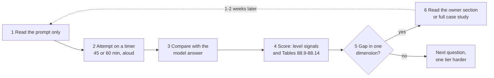

**Reading the diagram.** The loop has six steps, run left to right. You read only the prompt (step 1) and attempt the design aloud on a timer, ideally to a peer acting as interviewer (step 2), with the pacing of Table 87.4. Only then do you open the model answer (step 3) and score your attempt (step 4) against the question's level signals and the six rubric dimensions of §88.9. The decision diamond (step 5) routes you: a gap in one dimension, for example estimation or failure handling, sends you to the owning section or the full case study (step 6), and the dotted edge is the delayed re-attempt, one or two weeks later, that turns reading into recall. No gap sends you to a harder question. The failure point of the loop is step 3 done first; the scaling lesson is spacing: three attempts of one question spread over a month teach more than three questions in an evening.

### 91.3.2 Difficulty tiers

Difficulty describes how much of the design is non-standard, not how large the system is. A URL shortener at 280,000 RPS is still *Easy* because every component is a standard part; a calendar with a few thousand writes per second is *Medium* because recurrence and time zones need original thought.

**Table 91.1 — Difficulty tiers in this library.**

| Tier | Questions | What the prompt demands | Typical slot | Level it best discriminates |
|---|---|---|---|---|
| Easy | Q1–Q12 | One core component or pattern; a correct standard design plus one deep dive | 45 min | Junior to mid (L3–L4); a senior warm-up |
| Medium | Q13–Q28 | A complete product with two or three interacting subsystems and a clear hard part | 45–60 min | Mid to senior (L4–L5) |
| Hard | Q29–Q44 | Strong correctness or scale constraints (money, ordering, global state) where the obvious design fails | 60 min | Senior to staff (L5–L6) |
| Expert | Q45–Q56 | Infrastructure that other systems are built on; consensus, durability or migration under live load | 60 min, often a design review | Staff to principal (L6–L7) |

A senior candidate should be able to finish any Easy question in 30 minutes with time left for extensions. Interviewers often use an Easy prompt for a senior loop and then push it to Hard with follow-ups ("now make it multi-region", "now guarantee no double charge"); the follow-up questions in each answer show where that push usually goes.

### 91.3.3 The per-question format

Every question uses the same headings, in the order you would cover them in the room:

- **Prompt** — what the interviewer says, in one to three sentences. Read only this before attempting.
- **Clarifying questions and assumptions** — the questions worth asking, and the answers the model solution assumes. Your interviewer may answer differently; follow their answers, not these.
- **Requirements** — functional requirements (FRs) and non-functional requirements (NFRs) with numbers.
- **Estimation** — an `example` callout with the few numbers that decide something. Formulas are those of Chapter 89 and are cited, not re-derived. Unless stated otherwise the defaults of Chapter 89's opening conventions note apply: busiest-hour share $h = 0.10$ and burst factor $b = 2$ (peak-to-average ratio 4.8), target utilization $u = 0.6$, decimal units (1 KB = 10³ bytes).
- **API and data model** — the core calls and the main entities with their keys.
- **High-level design** — one diagram with a "Reading the diagram" paragraph.
- **Deep dives** — the two or three topics that decide the interview, with the reasoning a strong answer gives.
- **Trade-offs and alternatives** — the main choices, each with the condition that would reverse it.
- **Follow-up questions** — four to six likely follow-ups, each with a short model answer.
- **What distinguishes levels** — observable mid-level, senior and staff signals for this prompt.

Questions with a full case study elsewhere in the book have **compact answers** (about 500–700 words): the interview-length answer plus the cross-reference. Questions without one have **full answers** (about 1,000–1,200 words). In both cases the model answer is *one* good answer. Interviewers reward a different design that is justified with numbers and trade-offs just as much.

::: tip
**How to read a model answer after your attempt.** Do not check whether your boxes match. Check four things: did you find the same hard part; did your numbers reach the same order of magnitude; did your deep dive contain a mechanism (not just a component name); and could you answer at least four of the follow-ups. Those four checks map onto the rubric dimensions that most often separate levels (§88.9).
:::

::: mistake
**Memorizing model answers.** Interviewers change one constraint ("links never expire", "payments must be exactly once", "the users are in one city") precisely to see whether you reason or recite. Practice the reasoning: for each question, write down which assumption, if changed, would change the design most. That sentence is worth more than the diagram.
:::

### 91.3.4 Index of all 56 questions

Table 91.2 lists every question in both parts of the library. "Related" names the full case study where one exists (the compact answers point there) and otherwise the sections that own the key techniques.

**Table 91.2 — Index of the traditional practice library.**

| Q | Title | Difficulty | Related sections |
|---|---|---|---|
| 1 | URL shortener | Easy | §52.4 (full case); §17.10, §20.15 |
| 2 | Pastebin | Easy | §52.5 (full case); §15.8.2, §15.9 |
| 3 | Rate limiter | Easy | §52.6 (full case); §22.4–§22.8 |
| 4 | Distributed LRU cache | Easy | §20.9, §20.14, §20.15, §38.10.3, §52.8 |
| 5 | Unique ID generator | Easy | §17.10, §26.11, §53.6.8 |
| 6 | Like/view counter | Easy | §53.6.8, §17.5, §56.7 |
| 7 | Parking-lot reservation system | Easy | §38.10.1, §55.8, §22.15 |
| 8 | Real-time leaderboard | Easy | §12.4.2, §17.7, §20.6 |
| 9 | Notification service | Easy | §52.7 (full case); §22.15, §30.10 |
| 10 | File upload service (presigned URLs) | Easy | §15.8, §52.5, §21.3 |
| 11 | Feature-flag service | Easy | §43.7, §9.4, §57.14 |
| 12 | API gateway | Easy | §34.6, Ch 22, §52.6 |
| 13 | News feed | Medium | §53.7, §53.8 (full cases); §23.6.1 |
| 14 | Chat/messaging app | Medium | §53.4, §53.5 (full cases); §9.9 |
| 15 | Photo-sharing app | Medium | §53.6 (full case); §15.8, Ch 21 |
| 16 | Typeahead/autocomplete | Medium | §16.9 (worked design), §56.4; §17.11 |
| 17 | Web crawler | Medium | §52.10 (full case); §17.4 |
| 18 | E-commerce catalog search | Medium | Ch 16, §55.7, §81.7 |
| 19 | Ticket booking (seat reservation) | Medium | §55.8 (full case); §26.11 |
| 20 | Ride-hailing dispatch | Medium | §55.4, §55.5 (full cases); §17.9 |
| 21 | Food delivery | Medium | §2.11, §18.11.5 (QuickBite); §55.5, §32.7.2 |
| 22 | File sync (Dropbox-like) | Medium | §54.8 (full case); §54.7, §15.8.3 |
| 23 | Video upload and streaming | Medium | §54.4 (full case); §21.8 |
| 24 | Metrics monitoring system | Medium | §56.6 (full case); §12.8, §40.5 |
| 25 | Distributed logging pipeline | Medium | §56.6 (full case); Ch 31 |
| 26 | Email service | Medium | §52.7, Ch 15, Ch 16 |
| 27 | Calendar and scheduling | Medium | §52.9, §52.7, §55.8 |
| 28 | Collaborative document editing | Medium | §54.7 (full case); §27.14, §45.6 |
| 29 | Payment system | Hard | §55.9 (full case); §22.15, §32.5 |
| 30 | Stock-exchange matching engine | Hard | §27.4, Ch 31, §4.11 |
| 31 | Distributed key-value store | Hard | §52.8 (full case); §14.8 |
| 32 | Distributed message queue | Hard | §30.4, Ch 31 |
| 33 | Resharding a live SQL database | Hard | §14.7, §14.9, §43.13 |
| 34 | Global CDN | Hard | Ch 21, §19.9 |
| 35 | Distributed cache at very large scale | Hard | §20.14, §20.15, §44.7 |
| 36 | Real-time search over posts | Hard | §16.10, §53.8 |
| 37 | Ad-click aggregation | Hard | §56.7 (full case); §29.8 |
| 38 | Top-K heavy hitters | Hard | §17.6, §53.8 |
| 39 | Multi-region active-active social app | Hard | Ch 44, §27.14 |
| 40 | Distributed cron/job scheduler | Hard | §52.9 (full case); §26.13 |
| 41 | Live streaming platform | Hard | §21.8, §54.4 |
| 42 | Proximity service | Hard | §17.9, §55.4 |
| 43 | Maps and routing | Hard | §55.6 (full case) |
| 44 | Multiplayer game backend | Hard | §9.6, §9.9, §44.4 |
| 45 | Globally consistent database | Expert | §28.8, §44.12 |
| 46 | Distributed file system | Expert | §15.5 |
| 47 | Object storage service | Expert | §15.4, §15.6 |
| 48 | Durable workflow engine | Expert | §32.7, §32.11 |
| 49 | Multi-tenant SaaS platform with tenant isolation | Expert | Ch 47 |
| 50 | Tracing and observability platform at exabyte scale | Expert | §40.6, §56.6 |
| 51 | Zero-downtime monolith-to-microservices migration | Expert | §34.13, §43.13 |
| 52 | Coordination and configuration service | Expert | §26.7–§26.9 |
| 53 | Digital wallet with double-entry ledger and reconciliation | Expert | §55.9, §32.5 |
| 54 | Global edge rate limiting and DDoS protection | Expert | §52.6, §10.11, §21.11 |
| 55 | Lakehouse and data warehouse | Expert | §49.6, §61.8 |
| 56 | Bank-grade disaster recovery (RPO 0 across regions) | Expert | §39.8, §44.11 |

### 91.3.5 Choosing what to practice

If your interview is weeks away, work through one tier at a time and finish each tier with two questions you have not seen, attempted cold. If it is days away, pick by pattern rather than by number: most prompts are variations on six recurring shapes, and one question per shape covers more ground than ten questions of the same shape.

**Table 91.3 — Six recurring shapes and the questions that train them.**

| Shape | The hard part it trains | Questions |
|---|---|---|
| Read-heavy lookup | Cache hierarchy, hot keys, key generation | Q1, Q2, Q4, Q5, Q16 |
| Counting and aggregation | Hot counters, windows, approximation | Q3, Q6, Q8, Q24, Q37, Q38 |
| Fan-out | Push versus pull, celebrity accounts, delivery guarantees | Q9, Q13, Q14, Q15, Q26 |
| Inventory with holds | No double booking, contention, timeouts | Q7, Q19, Q21, Q27, Q29 |
| Real-time connections and location | Connection fleets, geospatial indexes, presence | Q14, Q20, Q21, Q28, Q42, Q44 |
| Blob and media pipelines | Direct-to-storage upload, processing state machines, CDN | Q10, Q15, Q22, Q23, Q41, Q47 |

::: recommendation
**A four-week plan for a senior loop.** Week 1: Q1, Q3, Q6, Q9 (Easy, one per shape) plus the §89.18 drills. Week 2: Q13, Q14, Q19, Q21 (Medium, four widely practiced prompts). Week 3: Q16, Q22, Q26, Q28, re-attempting any week-1 question you scored below senior. Week 4: two Hard questions from part B and two cold Medium questions, then rest. This is general advice, not a published recommendation of any company.
:::

## 91.4 Easy questions (Q1–Q12)

The Easy tier trains standard components done well. Each answer is short on architecture and long on the one mechanism that a mid-level candidate usually leaves vague: code generation, expiry, counting, eviction, ID layout, hot counters, holds, ranking, priorities, upload state, flag propagation and gateway policy.

### 91.4.1 Q1. URL shortener

**Difficulty:** Easy · **Time:** 45 min · **Related:** §52.4 (full case study); §17.10 (IDs), §20.15 (hot keys)

#### Prompt

"Design a service like bit.ly: users submit a long URL and get a short link; anyone who opens the short link is redirected. Assume large public scale."

#### Clarifying questions and assumptions

- Custom aliases and expiry? Yes to both, optional per link. Analytics? Click counts per link, minutes of delay acceptable.
- Scale? Assume 50 million new links per day and 100 redirects per link (§52.4.4). Links kept 10 years.
- Can short codes be guessable? No: sequential codes would let anyone enumerate private links.

#### Requirements

- **FR:** create a short link (optionally custom alias, expiry); redirect; per-link click statistics; delete or disable a link (abuse takedown).
- **NFR:** redirect p99 < 50 ms at the edge region; redirect availability 99.99%; create 99.9%; no two long URLs ever share a code by accident; codes 7 characters.

#### Estimation

::: example
**Worked example — The numbers that shape the shortener (§52.4.4, formulas of §89.5 and §89.6).**

1. Creates: $50 \times 10^6 \times 0.10 / 3{,}600 \times 2 = 2{,}778$/s at peak. Redirects: $5 \times 10^9$/day, peak $277{,}778$ RPS.
2. Ten years of links: $50 \times 10^6 \times 3{,}650 = 1.825 \times 10^{11}$; 7 base62 characters give $62^7 = 3.52 \times 10^{12}$ codes, so 5.2% of the space is used.
3. Storage at 500 B per link: 9.1 TB/year; 274 TB over ten years with three replicas.
4. Cache: 200 million links clicked per day × 500 B × 2 overhead = 200 GB; at a 95% hit ratio, $277{,}778 \times 0.05 = 13{,}889$ reads/s reach the store.

**Interpretation.** A read-dominated lookup at 280,000 RPS with a modest write rate. **Implication.** Design the redirect path around caches; the create path's difficulty is correctness of code generation, not throughput.
:::

#### API and data model

- `POST /v1/links {long_url, alias?, expires_at?}` with an `Idempotency-Key` header → `201 {code, short_url}`.
- `GET /{code}` → `302 Location: long_url` (or `404`/`410`).
- `links(code PK, long_url, owner_id, created_at, expires_at, status)` in a partitioned key-value or wide-column store keyed by `code`; clicks go to an event log, not to this table.

#### High-level design

**Figure 91.2 — URL shortener: cache-first redirects, asynchronous analytics.**

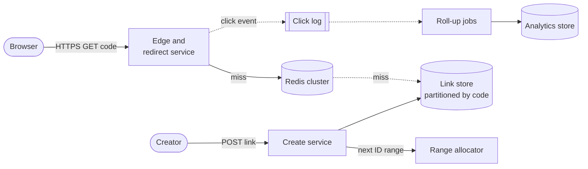

**Reading the diagram.** Redirects arrive over HTTPS at a stateless redirect tier with an in-process cache; a miss goes to a shared Redis cluster and then to the link store (cylinders are storage boundaries). Creates take a block of IDs from a range allocator, permute them into codes and write the link store. Click events leave asynchronously (dotted) through a log to roll-up jobs, so analytics can lag or fail without touching redirects. Failure points: the Redis cluster (a cold cache multiplies store load by 20) and the allocator (it must never hand out a range twice). The redirect tier and caches scale horizontally; the store scales by code partitions.

#### Deep dives

1. **Code generation.** Hashing the URL and truncating to 7 characters collides at billions of links and merges different users' links; random codes need a uniqueness check on insert; counter ranges (each create node leases a block of, say, 10,000 IDs) need no per-create coordination. Pass the counter through a keyed permutation before base62 encoding so that codes are not enumerable (§52.4.8).
2. **Redirect caching and hot keys.** Two cache layers (in-process, then Redis) plus negative caching for unknown codes protect the store from scans. A viral link at 50,000 RPS is absorbed by the in-process layer (§20.15). Use **302**, not 301, if you need click counts and the ability to disable a link; 301 is cached by browsers indefinitely.
3. **Analytics off the critical path.** At 1 TB/day the click stream is the largest write load; emit it asynchronously and roll it up.

#### Trade-offs and alternatives

- Counter ranges versus random codes: ranges are cheaper per create; random codes avoid the allocator as a durable-state hazard. Reverse if creates are rare and you prefer fewer moving parts.
- 302 versus 301: 302 costs more redirect traffic; choose 301 only for permanent links with no analytics or takedown needs.

#### Follow-up questions

1. *"Why not hash the URL?"* Truncated hashes collide, so you still need a uniqueness check, and two users shortening the same URL would share statistics.
2. *"How do you stop enumeration?"* Keyed permutation or random codes, rate-limited 404s per client, and no reliance on obscurity for private content.
3. *"The same user wants the same code for the same URL."* Add an `(owner_id, hash(long_url)) → code` index checked before creating.
4. *"How do expired links stop working?"* Check `expires_at` on every redirect and bound cache TTLs by it; delete rows lazily (§52.5.8).
5. *"What changes at 100× creates?"* Eight-character codes ($62^8 = 2.2 \times 10^{14}$) and larger ID blocks; code length is a parameter, not a constant.

#### What distinguishes levels

- **Mid:** a working create/redirect design with a database and a cache; base62 encoding explained.
- **Senior:** quantifies the read path and the keyspace; justifies 302; handles hot keys, negative caching and enumeration.
- **Staff:** notices the click stream is the largest write load, treats abuse takedown as a subsystem protecting the domain's reputation, and treats the allocator as durable state that a restored backup must not rewind.

### 91.4.2 Q2. Pastebin

**Difficulty:** Easy · **Time:** 45 min · **Related:** §52.5 (full case study); §15.8.2 (presigned URLs), §15.9 (lifecycle)

#### Prompt

"Design Pastebin: users paste text, get a link, and others can view it. Pastes can expire."

#### Clarifying questions and assumptions

- Visibility? Public, unlisted and private. Expiry options? 10 minutes to never, plus "burn after reading". Size limit? 10 MB per paste.
- Scale? 10 million pastes/day, 5 reads per paste, mean size 20 KB (median 2 KB; log dumps pull the mean up).

#### Requirements

- **FR:** create with visibility and expiry; read by link; burn after reading; delete; syntax highlighting (client side).
- **NFR:** read p99 < 200 ms; an expired paste is never served, even from a cache; 99.9% availability; content durable until expiry.

#### Estimation

::: example
**Worked example — Pastebin is shaped by lifecycle, not throughput (§52.5.4; §89.5, §89.6).**

1. Peak creates $10^7 \times 0.10 / 3{,}600 \times 2 = 556$/s; peak reads 2,778 RPS; peak egress $2{,}778 \times 20$ KB $= 55.6$ MB/s.
2. Live expiring content at steady state, by Little's Law summed over expiry classes: about 57.6 million pastes, 1.15 TB, constant over time.
3. Never-expiring pastes (30%) accumulate $10^7 \times 0.3 \times 365 \times 20$ KB $= 21.9$ TB/year.
4. Physical deletions: 7 million/day, about 389/s at peak.

**Interpretation.** Request rates are small; the 30% that never expire hold 95% of the bytes after a year. **Implication.** Put content in object storage with lifecycle rules, keep metadata small, and build a dedicated expiry pipeline.
:::

#### API and data model

- `POST /v1/pastes {visibility, expires_in, burn_after_read}` → `{id, upload_url?}`; small pastes inline, large ones through a presigned upload URL.
- `GET /v1/pastes/{id}` → content or `404`.
- `pastes(id PK, owner_id, visibility, expires_at, burn, state, size, blob_key | inline_content)`; an expiry index bucketed by hour: `expiry_bucket(hour, id)`.

#### High-level design

**Figure 91.3 — Pastebin: metadata and blob split with an expiry pipeline.**

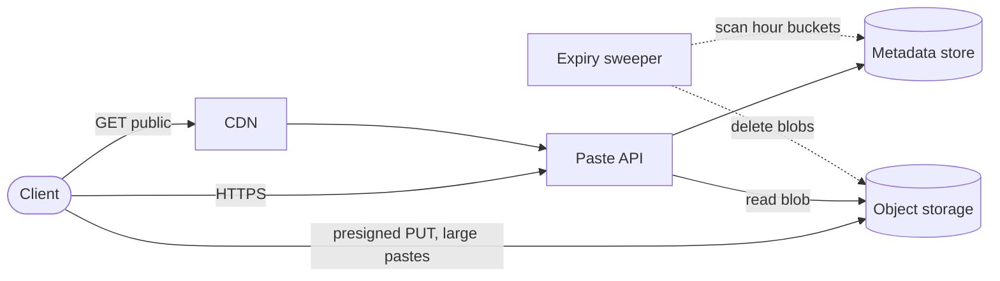

**Reading the diagram.** The API owns metadata (cylinder) and checks `expires_at` and visibility on every read; large bodies go directly from the client to object storage with a presigned URL, so they never pass through the API. Public pastes are cached at the CDN with a TTL bounded by remaining lifetime; private pastes are never cached there. The sweeper (dotted, asynchronous) walks hourly expiry buckets and deletes rows and blobs; an object-store lifecycle rule is a backstop. Failure points: sweeper lag (storage cost, not correctness) and orphaned blobs from abandoned uploads, reconciled periodically. Everything scales horizontally; the metadata store partitions by `id`.

#### Deep dives

1. **Logical versus physical deletion.** Correctness comes from the read-time check; physical deletion is a lagging, idempotent cleanup. Cache lifetimes must be capped at the remaining time to expiry.
2. **Burn after reading.** A conditional state transition (`UPDATE … SET state='burned' WHERE id=? AND state='live'`) before returning content; only one reader wins.
3. **Blob/metadata split.** Inline pastes under a few KB in the metadata row; larger ones in object storage, keeping the database small and compaction cheap.

#### Trade-offs and alternatives

- Inline versus object storage: inline is one read; object storage is cheaper per byte and has lifecycle rules. The threshold moves with the size distribution.
- A TTL-capable store (native row TTL) can replace the sweeper for metadata, but blobs still need cleanup.

#### Follow-up questions

1. *"How do you guarantee an expired paste is never shown?"* Check on every read; cap every cache TTL by remaining lifetime.
2. *"Ten-minute expiry with day-granularity lifecycle rules?"* The read check is correct; the sweeper deletes within the hour; lifecycle rules are only a backstop.
3. *"Deduplicate identical pastes?"* Content hash as blob key with reference counts; worthwhile only if many large pastes repeat, and it complicates deletion.
4. *"Abuse: leaked credentials pasted publicly?"* Scan new public pastes asynchronously for secrets and malware, with a takedown path.

#### What distinguishes levels

- **Mid:** a database-backed design with expiry handled by a cron job.
- **Senior:** separates blobs from metadata, uses presigned uploads, and keeps reads correct independent of deletion lag.
- **Staff:** reads from the estimate that permanent pastes dominate storage and proposes a product policy; designs reconciliation between the two stores; treats private-content caching as a tested security property.

### 91.4.3 Q3. Rate limiter

**Difficulty:** Easy · **Time:** 45 min · **Related:** §52.6 (full case study); §22.4–§22.8 (algorithms and distributed counting)

#### Prompt

"Design a rate limiter that protects our public API. Limits are per API key and per endpoint, and the API runs in several regions."

#### Clarifying questions and assumptions

- Where does it run: client library, gateway, or separate service? A library in the gateway, backed by a regional service for precise limits.
- Accuracy? Within about 5% for paid-tier limits; looser for fairness limits. Failure policy if the limiter is down? Per rule.
- Scale? 1 million API RPS at peak across three regions; 3 rules matched per request; 20 million active keys per 10 minutes (§52.6.4).

#### Requirements

- **FR:** evaluate rules (per key, per endpoint, per tenant) and return allow/deny with `429` and `Retry-After`; rules configurable without deploys; shadow mode for new rules.
- **NFR:** added latency p99 < 1 ms locally, < 5 ms for central checks; the limiter must never take the API down; per-key limits within 5%.

#### Estimation

::: example
**Worked example — Decisions, central load and memory (§52.6.4; §89.10).**

1. Decisions at peak: $10^6 \times 3 = 3 \times 10^6$/s.
2. All central: $3 \times 10^6 / (50{,}000 \times 0.6) = 100$ Redis shards and 4.8 Gb/s of limiter traffic.
3. Only the 20% that need precision central: $6 \times 10^5 / 30{,}000 = 20$ shards across three regions.
4. Memory: $20 \times 10^6 \times 150$ B $= 3$ GB.
5. A hot tenant at 100,000 RPS on one key exceeds one shard; leasing tokens in batches of 100 cuts it to 1,000 calls/s.

**Interpretation.** Memory is trivial; operations per second per key decide the design. **Implication.** Evaluate most rules locally, centralize only precise ones, and batch hot keys.
:::

#### API and data model

- In-process `check(key, endpoint, cost) → {allow, remaining, reset_at}`; regional RPC `Acquire(bucket_id, tokens)` for central rules and token leases.
- Rule: `{id, scope, match, algorithm, limit, window, failure_mode: open|closed, shadow}`; bucket state in Redis: `bucket:{id} → (tokens, last_refill)`, updated by one atomic Lua script.

#### High-level design

**Figure 91.4 — Tiered rate limiting: local, regional and leased.**

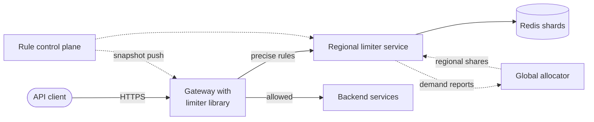

**Reading the diagram.** Every request is checked in the gateway's in-process library (synchronous, sub-millisecond) against a rule snapshot pushed asynchronously by the control plane. Rules needing precision call the regional limiter, which runs an atomic token-bucket script on Redis (cylinder). Cross-region limits are never checked synchronously: a global allocator assigns each region a share from reported demand every second (dotted). Failure points: Redis or the regional service (handled by each rule's failure mode behind a short timeout), and a bad rule push (shadow mode and rollback). Scaling: Redis shards by bucket key; hot keys use leases.

#### Deep dives

1. **Algorithm choice, briefly.** Token bucket for rates with bursts, sliding-window counter for per-minute limits, fixed windows for daily quotas (§22.4–§22.7). Then move on: the algorithm is not the hard part.
2. **Where to count.** Local counters are fast but imprecise across many gateways; central counters are precise but cost a network hop and can fail; leased batches combine the two for hot keys (§22.8).
3. **Failure policy per rule.** Fail open (fall back to local limits) for fairness rules; fail closed for security and cost rules such as login attempts or SMS sends.

#### Trade-offs and alternatives

- Central precision versus local speed: reverse toward central only for rules whose overshoot costs money.
- A sidecar or gateway plugin versus a separate service: a library avoids a hop but couples releases to the gateway.

#### Follow-up questions

1. *"Redis goes down?"* Each rule's failure mode applies after a short timeout and a circuit breaker; fairness rules degrade to local limits.
2. *"Global limit across regions?"* Allocate regional shares from demand and reconcile each second; accept a small overshoot during shifts.
3. *"Race between two gateways reading the same counter?"* The Lua script makes read-modify-write atomic on the shard.
4. *"What headers do you return?"* `429` with `Retry-After`, and remaining/limit headers so well-behaved clients back off.

#### What distinguishes levels

- **Mid:** explains token bucket and puts counters in Redis.
- **Senior:** atomic scripts, correct 429 semantics, local versus central placement with numbers.
- **Staff:** per-rule failure policy, control plane separated from data plane (shadow mode, rollback), hot-key leasing and multi-region allocation, and insists that the limiter cannot become the outage it prevents.

### 91.4.4 Q4. Distributed LRU cache

**Difficulty:** Easy · **Time:** 45 min · **Related:** §20.9 (eviction), §20.14 (distributed caching), §20.15 (hot keys), §38.10.3 (single-node LRU), §52.8 (key-value store)

#### Prompt

"Design a distributed in-memory cache, like a Memcached or Redis cluster, that many services use to cache database reads. When memory is full it evicts the least recently used entries."

#### Clarifying questions and assumptions

- Is it a cache or a store? A cache: losing entries costs latency and database load, never correctness. This single answer removes most of the hard problems of §52.8.
- Data? Opaque byte values, average 1 KB, maximum 1 MB, with optional TTL. Operations: `get`, `set`, `delete`, `get_multi`.
- Scale? 500 million hot keys; 1.2 million operations/s at peak, 95% reads; clients in three availability zones of one region.
- Consistency with the database? The cache is look-aside; the service that owns the data invalidates on write.

#### Requirements

- **FR:** get/set/delete with TTL; batch get; LRU (or LRU-approximating) eviction per node; add and remove nodes without a full cold start; per-tenant namespaces and memory quotas.
- **NFR:** p99 < 1 ms within a zone; 99.9% availability for the cache tier, with clients treating any cache error as a miss; hit ratio above 90%; losing one node must not overload the database.

#### Estimation

::: example
**Worked example — Memory, throughput and miss load (§89.8 working set and hit ratio; §89.10 fleet size).**

1. Memory, one copy: $M = 5 \times 10^8 \times 1{,}000 \times 1.5 = 750$ GB (overhead factor 1.5 for keys, pointers and allocator slack).
2. Throughput: at $10^5$ ops/s per node and $u = 0.6$, $1.2 \times 10^6 / 60{,}000 = 20$ shards. Memory per shard at 20 shards: 37.5 GB. Choose 24 shards (8 per zone, 31 GB each) on 64 GB nodes, each with one replica in another zone: 48 nodes.
3. Hit ratio, Zipf over 2 billion requested keys with the hottest 500 million cached: $h \approx (\ln 5 \times 10^8 + 0.577) / (\ln 2 \times 10^9 + 0.577) = 0.937$.
4. Misses reaching databases: $(1 - 0.937) \times 1.14 \times 10^6 \approx 72{,}000$ reads/s. Losing one shard without a replica adds $1.14 \times 10^6 / 24 = 47{,}500$ reads/s, two-thirds of the normal miss load, in one second.
5. Network: $1.2 \times 10^6 \times 1$ KB $= 9.6$ Gb/s aggregate, 0.4 Gb/s per shard: not binding.

**Interpretation.** Throughput, not memory, sets the shard count, and the failure case, not the steady state, sets the replication decision. **Implication.** Replicate shards across zones so a node loss promotes a warm replica instead of sending 47,500 extra reads per second to the databases.
:::

#### API and data model

- Client library: `get(key)`, `get_multi(keys)`, `set(key, value, ttl)`, `delete(key)`, `cas(key, value, version)`; keys are prefixed by namespace (`tenant:service:entity:id`).
- Per node: a hash table from key to entry, and LRU ordering. A strict LRU keeps a doubly linked list moved on every access (§38.10.3); production caches approximate it to avoid a global lock per read: Redis samples a few keys and evicts the oldest of the sample, Memcached uses segmented LRU per slab class (§20.6.5, §20.9.4).
- Cluster metadata: 16,384 hash slots mapped to shards (the Redis Cluster model, §20.14), versioned and stored in a small consensus-backed configuration service.

#### High-level design

**Figure 91.5 — A sharded, zone-replicated cache cluster.**

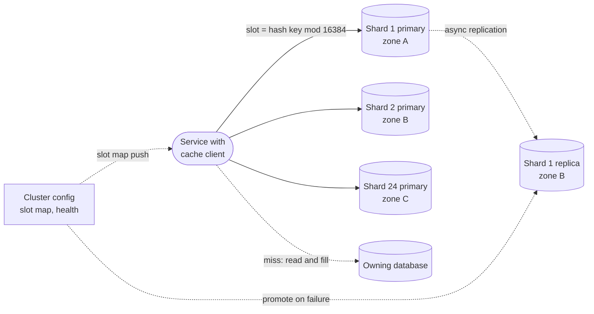

**Reading the diagram.** Each service embeds a client library that hashes a key to one of 16,384 slots and sends the request directly to the primary that owns the slot (synchronous, one hop, no proxy). Each primary replicates asynchronously (dotted) to a replica in another zone. A configuration service holds the slot map and node health; it pushes map changes to clients and promotes a replica when a primary fails. On a miss the calling service reads its own database and fills the cache; the cache never reads the database itself. Failure points: a primary (replica promoted in seconds, with the last few writes lost, acceptable for a cache), a stale slot map in a client (the node answers `MOVED` and the client refreshes), and a hot key that saturates one shard. Scaling: move slots to new nodes; more replicas for read-heavy shards.

#### Deep dives

1. **Partitioning and rebalancing.** `hash(key) mod N` remaps about $N/(N+1)$ of keys when a node is added, which empties the cache. Consistent hashing with virtual nodes, or a fixed slot map, moves only the share that the new node takes: going from 24 to 25 shards moves 4% of keys (20 million). A slot map is easier to reason about than a ring: migration moves whole slots, one at a time, with the old owner redirecting requests for keys already moved (§20.14).
2. **Hot keys.** One key at 200,000 reads/s exceeds a shard regardless of how many shards exist. Detect it with a sampled Count-Min sketch in the client (§17.6), then serve it from a per-process L1 with a 1-second TTL or from replicated copies `k#0…k#r-1` (§20.15). With 500 service instances and a 1-second L1, remote load for that key is at most 500/s.
3. **Staleness and stampedes.** Look-aside caching has a classic race: a reader misses, reads an old value, a writer updates the database and deletes the key, and the reader then sets the old value. Leases fix it: the miss returns a token, a delete invalidates outstanding tokens, and a `set` with an invalid token is ignored. The same lease lets only one client recompute a popular expired key while others wait briefly or serve stale (§20.11).

#### Trade-offs and alternatives

- **Client-side routing versus a proxy tier.** Direct routing saves a hop (about 0.2 ms); a proxy (mcrouter or Twemproxy style) centralizes routing, replication and failover logic for thin clients in many languages. Choose a proxy when you have many client languages.
- **Strict versus approximate LRU.** Strict LRU costs a lock and pointer updates on every read; sampled LRU loses a little hit ratio and scales across cores. Prefer frequency-aware policies (TinyLFU, §20.9) if scans pollute the cache.
- **Replicas versus a gutter pool.** Replicas double memory; a small gutter pool absorbs a failed node's keys with short TTLs at much lower cost but starts cold.

#### Follow-up questions

1. *"Why not make the cache strongly consistent with the database?"* The cost is a distributed transaction or synchronous invalidation on every write. Use delete-on-write plus leases and short TTLs, and keep data that must be fresh out of the cache.
2. *"How do you add capacity during peak without a miss storm?"* Move one slot at a time and copy entries before switching ownership; or add replicas first and promote them.
3. *"A tenant fills the cache with huge values."* Per-namespace memory quotas and a value-size cap (1 MB); evict within the tenant's quota first.
4. *"How do you warm a new cluster?"* Shadow-fill from live traffic (dual-write sets to old and new) for a TTL period before cutting reads over.
5. *"What about cross-region?"* Run an independent cache per region and invalidate through the database's change stream; never make a cache read cross a region.

#### What distinguishes levels

- **Mid:** hash map plus linked list per node, and consistent hashing across nodes.
- **Senior:** sizes shards from throughput and memory, replicates across zones because of the miss-load arithmetic, and handles hot keys and the stale-set race.
- **Staff:** separates the routing control plane from the data path, plans live rebalancing and warm-up, and treats the cache as a load-shedding device for the database whose failure modes must be budgeted with the database team.

### 91.4.5 Q5. Unique ID generator

**Difficulty:** Easy · **Time:** 45 min · **Related:** §17.10 (ID schemes, Snowflake), §26.11 (leases), §53.6.8 (IDs in a photo-sharing system)

#### Prompt

"Design a service that generates unique IDs for every new object in our company: posts, orders, messages. It must work across many machines and data centers."

#### Clarifying questions and assumptions

- Size? 64 bits, so IDs fit a `BIGINT` key and an index entry stays small. Sortable? Roughly by creation time, so recent objects cluster in indexes and "newest first" is a range scan.
- Strictly increasing across the company? No. Strict global order needs one sequencer; "roughly time-ordered, unique" is what the clients need.
- Rate? 200,000 IDs/s on average, 500,000/s at peak, across three regions. Guessable IDs acceptable? Yes for internal keys; public identifiers can be encrypted separately.

#### Requirements

- **FR:** return one or a batch of unique 64-bit IDs; IDs sort by creation time to within a few milliseconds; decode an ID into time and origin for debugging.
- **NFR:** no duplicates ever; p99 < 1 ms (ideally zero network: generated in-process); generation continues during a region partition; 70-year lifetime.

#### Estimation

::: example
**Worked example — Bits, rates and lifetime (§17.10.3; §89.5).**

1. Volume: $2 \times 10^5 \times 31{,}536{,}000 = 6.3 \times 10^{12}$ IDs per year: far below $2^{63} \approx 9.2 \times 10^{18}$, so 64 bits are enough if laid out well.
2. Snowflake layout: 41 bits of milliseconds last $2^{41} / (1{,}000 \times 86{,}400 \times 365.25) = 69.7$ years from a custom epoch.
3. 10 bits of worker ID give 1,024 generators; 12 bits of sequence give 4,096 IDs per millisecond per worker, 4.1 million/s.
4. Peak 500,000/s is 12% of one worker's ceiling, so capacity is not the constraint; uniqueness of worker IDs and clocks is.
5. Key size: 8-byte IDs instead of 16-byte UUIDs save $8 \times 10^{12}$ bytes, 8 TB, per index over a trillion rows.

**Interpretation.** The arithmetic is easy; the design is about the two inputs that can break uniqueness: worker IDs and time. **Implication.** Spend the deep dive on worker-ID leasing and clock-regression handling.
:::

#### API and data model

- Preferred: an in-process library `next_id()` with no network call. Optionally a service `GET /v1/ids?count=100` for languages without the library.
- ID layout (most significant first): 1 sign bit (0) · 41 bits milliseconds since a custom epoch · 10 bits worker ID (for example 3 bits region + 7 bits worker) · 12 bits sequence.
- Worker registry in a consensus store (etcd or ZooKeeper, §26.9): `worker/{id} → {host, lease_expiry}`.

#### High-level design

**Figure 91.6 — Snowflake-style generation with leased worker IDs.**

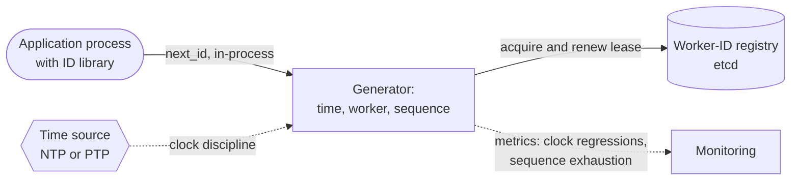

**Reading the diagram.** The application calls the generator in-process (synchronous, no network), so ID generation has the availability of the process itself. At startup, and periodically afterward, the generator acquires a worker ID by creating a leased key in a consensus-backed registry (cylinder); it is the only network dependency and is off the per-ID path. The clock is disciplined by a time service (hexagon, external). Metrics flow asynchronously to monitoring. Failure points: losing the lease (the generator must stop issuing IDs before the lease expires), and the clock jumping backward. Scaling is free: each new process takes one more worker ID, up to 1,024.

#### Deep dives

1. **Worker-ID uniqueness.** Two processes with the same worker ID produce duplicates in the same millisecond. Assign IDs from a registry with leases (§26.11): a process creates `worker/{n}` with a 30-second lease and renews every 10 s; if it cannot renew before expiry it stops generating. A paused process (long GC) may wake after its lease expired, so the generator checks the lease deadline against a monotonic clock before every batch.
2. **Clocks moving backward.** NTP can step the clock back. If the current millisecond is behind the last one used, wait until it catches up when the gap is small (a few milliseconds), and refuse and alert when it is large. Persisting the last timestamp at shutdown prevents reuse after a restart into a lagging clock.
3. **Sequence exhaustion and ordering.** If 4,096 IDs are used within one millisecond, spin to the next millisecond. Ordering across workers is only as good as clock agreement, typically a few milliseconds: IDs are *k-sorted*, not strictly ordered. Anything needing strict order (a per-conversation sequence in chat, §53.4) needs its own sequencer.

**Table 91.4 — ID schemes compared (§17.10).**

| Scheme | Size | Coordination per ID | Time-ordered | Choose when |
|---|---|---|---|---|
| UUIDv4 | 128 bits | None | No | Keys are not indexed in B-trees, or simplicity wins |
| UUIDv7 / ULID | 128 bits | None | Yes (ms) | You want time order without worker IDs and accept 16-byte keys |
| Snowflake-style | 64 bits | None (lease at startup) | Yes (k-sorted) | Large tables, 64-bit keys, many generators |
| DB sequence or ticket server | 64 bits | One round trip per block | Strict within one server | Low rates, or strict order needed, with block leasing |

#### Trade-offs and alternatives

- **Snowflake versus UUIDv7.** UUIDv7 needs no registry at all, at the price of 16-byte keys; choose it unless index size or a 64-bit API constraint matters.
- **Ticket server with ranges.** A database hands out blocks of 1,000 IDs; simple and strictly ordered per block, but a dependency for every block and a durable-state hazard if a backup rewinds the counter (the same hazard as the allocator in §52.4).

#### Follow-up questions

1. *"Can two regions generate the same ID?"* Not if region bits are part of the worker ID and each region has its own registry namespace.
2. *"How do you hide order volume from competitors?"* Expose an encrypted or permuted form of the ID publicly; keep the raw ID internal.
3. *"What happens in 70 years?"* Choose the epoch at launch; plan a layout version bit, or a migration to 128-bit keys, well before exhaustion.
4. *"Why not one central counter?"* It is a single point of failure and a cross-region round trip per ID; strict order is rarely required.
5. *"Can I sort events by ID to reconstruct causality?"* Only within a few milliseconds of clock error; use per-entity sequence numbers or logical clocks where causality matters.

#### What distinguishes levels

- **Mid:** describes the Snowflake bit layout and why 64 bits.
- **Senior:** derives lifetime and per-worker capacity, and handles worker-ID assignment and backward clocks explicitly.
- **Staff:** distinguishes k-sorted from strictly ordered IDs and says which consumers need which, plans the layout's evolution, and recognizes the generator as a library rather than a service so it never becomes a shared outage.

### 91.4.6 Q6. Like/view counter

**Difficulty:** Easy · **Time:** 45 min · **Related:** §53.6.8 (likes and counters at scale), §17.5 (HyperLogLog), §56.7 (real-time analytics)

#### Prompt

"Design the system that counts views and likes for videos on a large video platform and shows the counts on every video page."

#### Clarifying questions and assumptions

- Exactness? Likes are exact per user (a user likes once and can unlike, and must see their own like immediately); totals may lag by seconds. Views are approximate and may lag by up to a minute; invalid views (bots, rapid refreshes) are excluded.
- Unique viewers? Yes, for creator analytics, within about 1%.
- Scale? 2 billion views/day and 200 million likes/day; peak-to-average ratio 3; a viral video can draw 50,000 views/s; counts are read 500,000 times per second at peak.

#### Requirements

- **FR:** record a view; like/unlike; read view count, like count and "did I like this"; daily unique viewers per video for creators.
- **NFR:** count reads p99 < 20 ms; view counts fresh within 60 s, like totals within 5 s; no lost likes; a hot video must not overload any single partition.

#### Estimation

::: example
**Worked example — Event rates and the effect of aggregation (§89.5; §89.11).**

1. Views: $2 \times 10^9 / 86{,}400 = 23{,}148$/s average; 69,444/s at peak. Likes: 6,944/s at peak.
2. Naive design, one database increment per view: 69,444 writes/s overall and 50,000/s on one row for a viral video. A row lock held for 1 ms caps one row at about 1,000 updates/s, so the naive design fails by 50×.
3. With 5-second windowed aggregation in a stream processor: a window holds $69{,}444 \times 5 = 347{,}000$ events; if they touch 100,000 distinct videos, the store receives $100{,}000 / 5 = 20{,}000$ increments/s, and the viral video receives one increment every 5 s.
4. Like edges: 200 million/day × 40 bytes ≈ 8 GB/day, 2.9 TB/year: an ordinary partitioned table.
5. Unique viewers with HyperLogLog: 12 KB per counter at 0.81% standard error (§17.5); 10 million active videos would need 123 GB with dense sketches, so use the sparse encoding for the long tail.

**Interpretation.** The total rate is moderate; the per-key rate of a viral video is the problem. **Implication.** Aggregate before writing, so that write load depends on distinct keys per window, not on events.
:::

#### API and data model

- `POST /v1/videos/{id}/views {session_id, position}` → `202` (fire and forget); `PUT /v1/videos/{id}/like` and `DELETE …/like` (idempotent by user); `GET /v1/videos/{id}/counts` → `{views, likes, liked_by_me}`.
- `likes(video_id, user_id, created_at)` partitioned by `video_id`, plus a `user_likes(user_id, video_id)` index for "did I like it"; `counters(video_id, kind, value, updated_at)`; HyperLogLog sketches per video per day.

#### High-level design

**Figure 91.7 — Counting with a log, windowed aggregation and a counter store.**

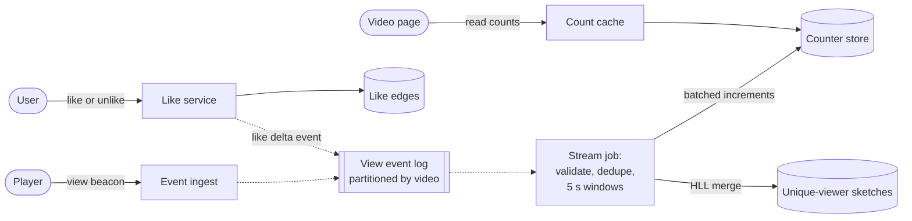

**Reading the diagram.** View beacons are accepted by a thin ingest tier and appended asynchronously (dotted) to a log partitioned by video. A stream job validates and deduplicates views (same session within a window, known bots), sums them per video per 5-second window, and writes one increment per video per window to the counter store (cylinder); it also merges each viewer into the video's HyperLogLog sketch. Likes are written synchronously as edges, which gives exactness and "did I like it", and publish a delta event that the same job folds into the like total. Pages read counts through a cache with a short TTL. Failure points: the stream job (lag delays counts but loses nothing, because the log retains events) and duplicate processing after a restart (handled by idempotent window commits). Scaling: log partitions and stream workers scale with event rate; the counter store scales with distinct keys.

#### Deep dives

1. **Hot counters.** Aggregation in the stream job removes most per-key pressure. Where writes still concentrate, such as likes on a celebrity post, split the counter into $N$ sub-counters chosen at random and sum them on read, or coalesce in memory and flush every second (§53.6.8). Reads sum at most $N$ rows and are cached.
2. **Exactly-once counting, honestly.** The log gives at-least-once delivery. Commit each window's increments together with the consumer offset (transactionally, or by writing `(video_id, window_id) → delta` idempotently), so a replay rewrites the same window rather than adding twice (§32.9).
3. **Validity before counting.** View counts are a fraud target. Count a view only after a minimum watch time, deduplicate per session, and allow later correction: a batch job recomputes daily counts from raw events and overwrites the streaming value, which is why "approximate, then corrected" is the right contract.

#### Trade-offs and alternatives

- **Streaming plus batch correction versus streaming only.** The batch path catches fraud found later and bugs in the stream job; drop it only if counts carry no money (creator payouts usually do).
- **Exact unique viewers versus HyperLogLog.** Exact sets cost bytes per viewer; HyperLogLog costs 12 KB per video at 0.81% error. Use exact sets only where a contract requires them.
- **Counter in the cache only.** Redis `INCR` is fast, but a lost node loses counts; keep the durable value in the store.

#### Follow-up questions

1. *"Why do counts sometimes go down?"* Fraud removal and batch correction overwrite the streaming estimate; show rounded counts ("1.2M") to make small corrections invisible.
2. *"How does a user see their own like immediately?"* Read `liked_by_me` from the edge table (or a session cache) and add one locally to a stale total.
3. *"Can likes be double counted if a user taps twice?"* No: the edge insert is idempotent on `(video_id, user_id)` and only a state change emits a delta.
4. *"How would you show views in the last hour?"* Keep per-minute buckets for recent windows and sum them; roll older buckets up.
5. *"The stream job falls 10 minutes behind."* Counts freeze but nothing is lost; scale consumers and alert on lag measured in seconds.

#### What distinguishes levels

- **Mid:** a counter column incremented per event, with a cache in front.
- **Senior:** identifies the hot-key ceiling with numbers, aggregates through a log, and separates exact like edges from approximate totals.
- **Staff:** designs replay-safe window commits, a batch correction path, fraud filtering as part of the contract, and explains which counts carry money and therefore need reconciliation.

### 91.4.7 Q7. Parking-lot reservation system

**Difficulty:** Easy · **Time:** 45 min · **Related:** §38.10.1 (object model of one lot), §55.8 (holds and contention in ticketing), §22.15 (idempotency)

#### Prompt

"Design a system where drivers can find and reserve parking in garages across many cities, then enter and leave the garage using the reservation."

#### Clarifying questions and assumptions

- Does a reservation hold a specific spot? No: it holds capacity of a spot type (standard, large, EV) in a garage for a time interval; the gate assigns no spot, and the garage keeps a share for drive-up customers. This choice removes most contention.
- Time granularity? 15-minute slots; bookings up to 90 days ahead.
- Scale? 5,000 garages averaging 500 spots (2.5 million spots); 1 million reservations/day; 20 million searches/day.
- Payment? Authorize at booking, capture at exit, through an external provider.

#### Requirements

- **FR:** search garages near a place and time with price and availability; reserve (hold, pay, confirm); cancel; enter and exit by license-plate recognition or QR code; overstay charges.
- **NFR:** never sell more reserved capacity than the garage allocated (no overbooking); search p99 < 300 ms; reservation p99 < 1 s; gates work offline for at least an hour.

#### Estimation

::: example
**Worked example — Small rates, many time slots (§89.5; §89.6).**

1. Reservations at peak: $10^6 \times 0.10 / 3{,}600 \times 2 = 55.6$/s; searches 1,111/s.
2. Inventory rows: 5,000 garages × 3 spot types × 96 slots/day × 90 days = 129.6 million rows × 100 B ≈ 13 GB.
3. A 3-hour booking updates 12 slot rows, all in one garage.

**Interpretation.** Everything fits a single relational cluster; throughput is not the problem. **Implication.** Spend the interview on correctness: the multi-slot capacity check, holds that expire, and gates that keep working when the network does not.
:::

#### API and data model

- `GET /v1/availability?lat=&lng=&start=&end=&type=` → garages with price and remaining capacity.
- `POST /v1/reservations {garage_id, type, start, end}` with `Idempotency-Key` → `{id, status: HELD, hold_expires_at}`; `POST /v1/reservations/{id}/confirm {payment_token}`; `DELETE /v1/reservations/{id}`.
- `slot_inventory(garage_id, type, slot_start, capacity, reserved)`, primary key `(garage_id, type, slot_start)`, partitioned by `garage_id`; `reservations(id, user_id, garage_id, type, start, end, status, plate, hold_expires_at)`; `gate_events(garage_id, plate, ts, direction)`.

#### High-level design

**Figure 91.8 — Garage reservations with a per-garage inventory and offline gates.**

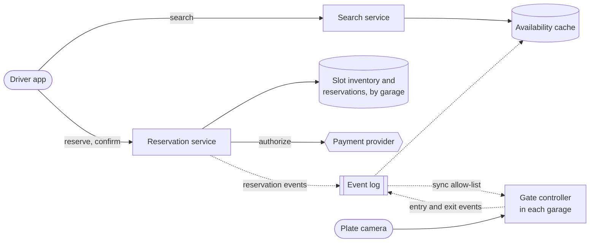

**Reading the diagram.** Search reads a cache of per-garage availability that the event log refreshes asynchronously, so search can be seconds stale. Reservations go synchronously to the reservation service, which runs one transaction against the garage's partition of the inventory store (cylinder) and calls the external payment provider (hexagon) to authorize. Each garage's gate controller holds a local allow-list of today's reservations, synchronized asynchronously, and reports entry and exit events back. Failure points: the payment provider (hold the capacity, retry, release on timeout), and the network link to a garage (the gate decides locally). Scaling: partition inventory by garage; search scales with cache replicas.

#### Deep dives

1. **The capacity check across slots.** In one transaction on the garage's partition: `UPDATE slot_inventory SET reserved = reserved + 1 WHERE garage_id = ? AND type = ? AND slot_start BETWEEN ? AND ? AND reserved < capacity`, and commit only if the update count equals the number of slots (12 for three hours). Because all rows share the garage key, this is a single-shard transaction; no distributed locking is needed. Conditional updates avoid the read-then-write race that causes overbooking.
2. **Holds and payment.** The booking first creates a `HELD` reservation that has already incremented `reserved`, with `hold_expires_at` 10 minutes ahead. Confirmation authorizes payment and flips it to `CONFIRMED`. A sweeper releases expired holds by decrementing the same slots, idempotently keyed by reservation ID. This is the hold pattern of §55.8, with far less contention.
3. **Gates without the cloud.** The gate controller opens for any plate on its local allow-list for the current window, records events locally, and uploads them when connected. If a plate is unknown it can fall back to a ticket for drive-up pricing. Reconciliation later matches events to reservations for overstay charges.

#### Trade-offs and alternatives

- **Capacity counting versus assigning spots.** Counting is simple and avoids fragmentation; assigning specific spots is needed only for premium or EV-charger spots, which can be modeled as their own spot type with capacity 1.
- **Overbooking on purpose.** Like airlines, a garage may sell 105% of reserved capacity if no-shows are common; that is a business rule applied to `capacity`, not a race condition.

#### Follow-up questions

1. *"Two drivers book the last space at once."* The conditional update succeeds for one; the other's update count falls short and the transaction rolls back.
2. *"A driver arrives early or leaves late."* The gate accepts entry within a grace window; overstay is charged at exit from the recorded events.
3. *"How do you show availability fast?"* Precompute per-garage remaining capacity for popular windows in the cache; confirm exactly only at reservation time.
4. *"The payment provider times out."* Keep the hold, retry with the same idempotency key, and release the hold at expiry if authorization never succeeds.
5. *"How would you add dynamic pricing?"* A pricing service writes price per garage, type and slot from occupancy forecasts; the reservation records the price it quoted.

#### What distinguishes levels

- **Mid:** an object model of lots, spots and tickets with a reservations table.
- **Senior:** chooses capacity counting per time slot, makes the multi-slot check atomic within one partition, and handles holds, payment and expiry.
- **Staff:** designs for offline gates and reconciliation, separates business overbooking from accidental overbooking, and notices that the low estimate means one well-run relational cluster beats a distributed design.

### 91.4.8 Q8. Real-time leaderboard

**Difficulty:** Easy · **Time:** 45 min · **Related:** §12.4.2 (Redis data structures), §17.7 (skip lists), §20.6 (Redis internals)

#### Prompt

"Design a leaderboard for a mobile game with hundreds of millions of players. Players see the global top 100, their own rank, and how they compare with friends, updated in real time."

#### Clarifying questions and assumptions

- Which boards? Global all-time, daily and weekly, plus per-region. Score semantics? Best score per player (keep the maximum), not a sum.
- Exact ranks for everyone? Exact for the top 10,000; a player ranked 48,213,907th is satisfied with "top 16%". This answer shapes the design.
- Scale? 300 million players, 50 million DAU; 20 games per DAU per day; 10 leaderboard views per DAU per day; 200 friends on average.

#### Requirements

- **FR:** submit a score; read top-N; read my rank and neighbors; friends leaderboard; daily and weekly resets; ties broken by who reached the score first.
- **NFR:** a new score visible on the board within 1 s; reads p99 < 50 ms; scores durable (rebuildable after a cache loss); cheat-resistant submission.

#### Estimation

::: example
**Worked example — Updates, reads and memory (§89.5; §89.8).**

1. Score submissions: $50 \times 10^6 \times 20 = 10^9$/day; average 11,574/s; peak $10^9 \times 0.10 / 3{,}600 \times 2 = 55{,}556$/s.
2. Leaderboard reads: $5 \times 10^8$/day; peak 27,778/s.
3. One sorted set of 300 million members at about 100 bytes per member (skip-list node, hash entry, member string) is 30 GB: it fits in one node's memory.
4. But one Redis node executes commands on one core at roughly $10^5$ simple operations/s (§89.4), and `ZADD` on a 300-million-member skip list is $O(\log n)$, about 28 levels: 55,556 updates/s plus reads is too close to the ceiling with no headroom for the daily and weekly boards.

**Interpretation.** Memory fits; single-key throughput does not, once three boards update on every game. **Implication.** Filter writes (only improvements change a best-score board) and partition the long tail, keeping one exact structure for the top.
:::

#### API and data model

- `POST /v1/scores {player_id, game_id, score, match_id, signature}` → `202`; `GET /v1/boards/{board}/top?n=100`; `GET /v1/boards/{board}/players/{id}` → `{rank or percentile, score, neighbors}`; `GET /v1/boards/{board}/friends/{id}`.
- Durable: `scores(player_id, board, best_score, achieved_at)` in a partitioned database, and the score event log. Serving: Redis sorted sets; the member's sort score encodes ties as `score × 2^22 + (2^22 − seconds since board start)`, so that among equal scores the earlier achiever ranks higher. (A double holds integers exactly up to $2^{53}$, so scores must stay below $2^{31}$; $2^{22}$ seconds is 48 days, enough for daily and weekly boards, and the all-time board uses a coarser time unit.)

#### High-level design

**Figure 91.9 — Leaderboard: durable scores, exact top tier, bucketed tail.**

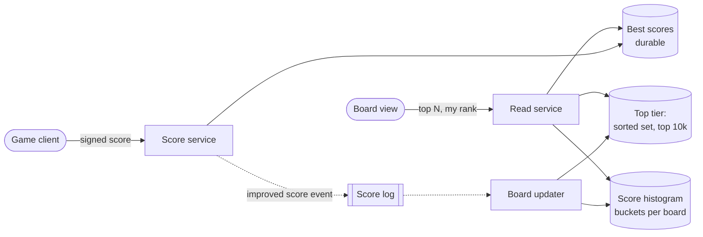

**Reading the diagram.** The score service validates the signed submission against the match record, writes the player's best score to the durable store (cylinder) only if it improved, and emits an event asynchronously (dotted). The board updater maintains, per board, an exact sorted set of the top 10,000 and a histogram of score buckets for everyone (counts per score range). Reads of the top N come from the sorted set; "my rank" for a top player is `ZREVRANK`, and for anyone else it is the sum of histogram buckets above their score, a percentile accurate to the bucket width. Failure points: losing the Redis node (rebuild from the durable store or replay the log) and a flood of fake scores (validation at the service). Scaling: boards are independent keys, so they spread across nodes; the histogram is tiny.

#### Deep dives

1. **Write filtering.** For best-score boards, most games do not beat the player's best, so the durable compare-and-set filters writes; only improvements reach the boards. If one game in five is a personal best, board updates fall to about 11,000/s at peak.
2. **Exact top, approximate tail.** The top tier needs exactness because players inspect it; the tail needs only a believable rank. A sorted set capped at 10,000 members (trim with `ZREMRANGEBYRANK`) costs about 1 MB, and the histogram with 10,000 buckets turns "my rank" into a prefix sum. If exact ranks for everyone are required, shard the board by score range (each shard holds a contiguous range, so rank = members in higher shards + rank within the shard), and rebalance ranges as the score distribution shifts.
3. **Friends and time windows.** Friends boards are computed on read: fetch 200 friends' scores with one `ZMSCORE` (or from the durable store), sort, and cache for a few seconds. Daily and weekly boards are separate keys named by period (`board:daily:2026-11-11`) with a TTL, so a reset is a key change, not a mass delete.

#### Trade-offs and alternatives

- **Redis sorted sets versus a database index.** An index on `(board, score DESC)` gives top N cheaply but "my rank" is a count over millions of rows; sorted sets give $O(\log n)$ rank. Reverse for small boards where a database is already present.
- **Exact ranks for all versus percentiles.** Range sharding gives exact ranks at the cost of rebalancing; percentiles cost nothing. Choose by product need, not by habit.

#### Follow-up questions

1. *"How do you stop cheaters?"* Server-authoritative scoring where possible, signed results tied to a match ID, plausibility checks (score per second), and a shadow-ban list filtered at read time.
2. *"What happens at the weekly reset?"* Readers switch to the new period's key at the boundary; the old key is archived from the durable store and expires.
3. *"Redis loses the data."* Rebuild the top tier from the durable best-scores table (an indexed top-10,000 query) and the histogram from a scan; serve the stale cache meanwhile.
4. *"Ties?"* Encode the achievement time into the sort score so the earlier achiever ranks higher, within a double's 53 exact bits.
5. *"A tournament with 1 million concurrent players updating every second?"* Batch updates per 100 ms in the updater and publish the top 100 to clients over a push channel instead of having them poll.

#### What distinguishes levels

- **Mid:** a Redis sorted set with `ZADD`, `ZREVRANGE` and `ZREVRANK`.
- **Senior:** sizes memory and per-node throughput, filters writes, encodes ties, and keeps a durable source of truth for rebuilds.
- **Staff:** challenges the requirement for exact ranks in the tail, designs the two-tier structure from that answer, and addresses cheating as part of the system rather than an afterthought.

### 91.4.9 Q9. Notification service

**Difficulty:** Easy · **Time:** 45 min · **Related:** §52.7 (full case study); §22.15 (idempotency), §30.10 (retries and poison messages)

#### Prompt

"Design a service that every product team uses to send push notifications, emails and SMS to users, including both one-off messages like password codes and large marketing campaigns."

#### Clarifying questions and assumptions

- Channels? Push, email, SMS, in-app. Priorities? Critical (one-time passcodes, security alerts), transactional, marketing.
- User controls? Per-category opt-outs, quiet hours, frequency caps. Delivery tracking? Sent, delivered, opened where the channel reports it.
- Scale? 500 million notifications/day (400 million push, 80 million email, 10 million SMS, 10 million in-app); a 50-million-user campaign must finish in 30 minutes (§52.7.4).

#### Requirements

- **FR:** send API with template and recipient; preference and suppression checks; scheduling and time-zone-aware campaigns; multi-provider delivery per channel; status tracking.
- **NFR:** critical messages handed to a provider within 5 s at p99, even during campaigns; no duplicate SMS (each costs money); 99.95% acceptance availability; every message ends in a recorded terminal state.

#### Estimation

::: example
**Worked example — Campaign bursts set capacity (§52.7.4; §89.5, §89.11).**

1. Average: $5 \times 10^8 / 86{,}400 = 5{,}787$/s. Transactional peak (30% of volume): 8,333/s.
2. Campaign: $5 \times 10^7 / 1{,}800$ s $= 27{,}778$/s. Provision 50,000 sends/s.
3. Drain time with critical traffic reserved: $5 \times 10^7 / (50{,}000 - 8{,}333) = 1{,}200$ s, 20 minutes. If an SMS provider caps you at 20,000/s, the same calculation gives 71 minutes.
4. Log: 500 GB/day; 45 TB for 90 days. SMS spend at an illustrative \$0.01: \$100,000/day.

**Interpretation.** Average load is small; bursts and provider quotas shape the design. **Implication.** Separate queues and worker pools per priority, and treat provider quotas as the true capacity.
:::

#### API and data model

- `POST /v1/notifications {user_id | segment_id, template_id, params, category, priority}` with `Idempotency-Key` → `202 {notification_id}`.
- `notification_log(user_id, notification_id, channel, state, provider, updated_at)` partitioned by user; `preferences(user_id, category, channel, opted_in, quiet_hours)`; `devices(user_id, token, platform)`.

#### High-level design

**Figure 91.10 — Priority-separated notification pipeline.**

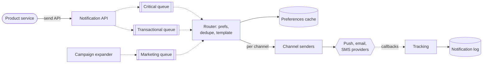

**Reading the diagram.** The API validates, deduplicates by idempotency key and enqueues asynchronously into one of three priority queues; campaigns are expanded into per-user messages by a separate expander, per time zone. Routers consume with pools sized per priority, check preferences (cached, cylinder), render templates and hand messages to channel senders, which call external providers (hexagons) with health-based failover. Provider callbacks update the log through tracking. Failure points: a provider outage (circuit breaker, second provider), a provider timeout of unknown outcome (the duplicate risk), and a campaign flooding shared workers (prevented by separate pools). Scaling: queues and workers scale horizontally; provider quotas are the real ceiling.

#### Deep dives

1. **Priority isolation.** Separate queues, worker pools and reserved provider capacity mean a 50-million campaign cannot delay a passcode.
2. **Deduplication and the timeout problem.** Dedupe keys per `(notification_id, channel)` and forward-only state transitions; when a provider times out, the outcome is unknown, so choose per channel: retry push (duplicates are cheap) but query or skip SMS (duplicates cost money and annoy users). Exactly-once delivery to a phone is impossible; at-least-once plus deduplication is the honest guarantee (§32.9).
3. **Campaign expansion.** Expand per time zone and schedule each slice for local time; quiet hours defer rather than drop.

#### Trade-offs and alternatives

- One queue with priority fields is simpler but cannot guarantee isolation; reverse only at small scale.
- Single provider per channel is cheaper to integrate; multi-provider is needed once a provider outage costs logins.

#### Follow-up questions

1. *"How does an OTP arrive fast during a campaign?"* Critical queue, reserved pool and provider capacity, short TTL, provider failover.
2. *"How do you avoid sending twice?"* Idempotency keys at the API, dedupe keys per recipient and channel, and per-channel timeout policy.
3. *"A user opts out mid-campaign."* Preferences are checked at routing time, not at expansion time.
4. *"How do you know email was delivered?"* Provider events (delivered, bounced, complained) via callbacks; maintain suppression lists for hard bounces.

#### What distinguishes levels

- **Mid:** API, queue, workers and providers.
- **Senior:** priority isolation with numbers, idempotency, preference checks at send time, provider failover.
- **Staff:** identifies provider quotas as capacity, designs the timeout ambiguity explicitly, requires a terminal state per message, and treats email reputation and opt-out correctness as system requirements.

### 91.4.10 Q10. File upload service (presigned URLs)

**Difficulty:** Easy · **Time:** 45 min · **Related:** §15.8 (multipart upload, presigned URLs), §52.5 (Pastebin uploads), §21.3 (CDN)

#### Prompt

"Design a service that lets users of our apps upload files, from small images to multi-gigabyte videos, and later download or share them."

#### Clarifying questions and assumptions

- Sizes? Mostly under 10 MB; up to 5 GB; average 5 MB. Who downloads? The owner and anyone they share with; some files are public.
- Post-processing? Malware scan for all; thumbnails for images. Mobile networks? Yes: uploads must resume after a dropped connection.
- Scale? 10 million uploads/day; retention until the user deletes.

#### Requirements

- **FR:** start an upload, upload (resumable for large files), complete; get file status and metadata; download via a time-limited link; share; delete.
- **NFR:** application servers never carry file bytes; an upload survives network drops without restarting from zero; a file is not downloadable by others until scanned; 11 nines durability; metadata p99 < 100 ms.

#### Estimation

::: example
**Worked example — Bytes bypass the API (§89.5, §89.6, §89.7).**

1. Uploads at peak: $10^7 \times 0.10 / 3{,}600 \times 2 = 556$/s; API calls (start and complete) 1,111/s.
2. Ingress at peak: $556 \times 5$ MB $= 2.8$ GB/s $= 22$ Gb/s. Through application servers this would need dozens of 10 Gb/s NICs; direct to object storage, it costs the API nothing.
3. Storage: 50 TB/day, 18.25 PB/year logical, 25.6 PB/year raw with erasure coding at 1.4× (§15.6).
4. A 5 GB file in 64 MiB parts is 75 parts, far under the 10,000-part limit of S3-style multipart upload (§15.8.1).

**Interpretation.** Metadata traffic is about 1,000 RPS; byte traffic is 22 Gb/s. **Implication.** Separate the control path (API, metadata) from the data path (client to object storage), which is exactly what presigned URLs do.
:::

#### API and data model

- `POST /v1/uploads {filename, size, content_type, sha256?}` → `{upload_id, method: single|multipart, urls[] or part_url_endpoint, expires_at}`.
- `POST /v1/uploads/{id}/complete {parts: [{n, etag}]}` → `{file_id, state: PROCESSING}`; `GET /v1/files/{id}` → metadata and, if permitted, a short-lived download URL.
- `files(file_id, owner_id, object_key, size, sha256, content_type, state: PENDING|UPLOADED|PROCESSING|AVAILABLE|QUARANTINED|DELETED, created_at)`; `shares(file_id, grantee, role)`. Object keys are generated by the server (`tenant/yyyy/mm/dd/file_id`), never taken from the client.

#### High-level design

**Figure 91.11 — Control path through the API, data path straight to storage.**

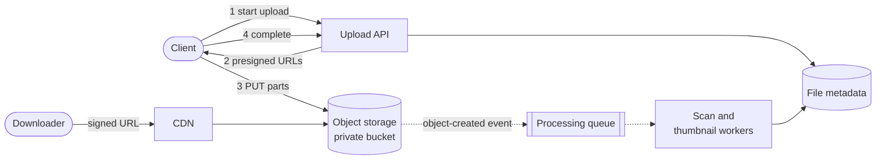

**Reading the diagram.** The client asks the API to start an upload; the API writes a `PENDING` row (cylinder) and returns presigned URLs scoped to one key, method, size and expiry. The client uploads bytes, in parallel parts if large, directly to a private bucket. On completion the API verifies the object (size, checksum) and marks it `UPLOADED`; the object-created event also flows asynchronously (dotted) to workers that scan for malware, generate thumbnails and move the file to `AVAILABLE` or `QUARANTINED`. Downloads use short-lived signed URLs through a CDN. Failure points: abandoned uploads (orphaned parts), a lost completion call (the storage event recovers it), and the scanner backlog (files wait, they are not exposed). Scaling: the API scales with metadata RPS; bytes scale with object storage and the CDN.

#### Deep dives

1. **Presigned URL scope.** Each URL allows one method on one server-chosen key, expires in minutes, and where the store supports it carries conditions on content length and type (a POST policy). Validate the actual object after upload anyway: the client controls the bytes and the declared type. Never serve user uploads from your main domain with their declared content type; use a separate download domain and `Content-Disposition: attachment` for untrusted types.
2. **Resumability.** Multipart upload makes each part independently retryable; the client stores `upload_id` and completed part ETags locally and resumes by listing parts. Choose part sizes that keep the count far below the 10,000-part limit, and add a lifecycle rule that aborts incomplete multipart uploads after, say, 7 days, or orphaned parts accumulate silently (§15.8.1).
3. **The state machine and reconciliation.** States move forward only. Because completion can arrive twice (client retry, storage event) the transitions are idempotent compare-and-set updates. A daily reconciler lists `PENDING` rows older than a day and objects without rows, and deletes both.

#### Trade-offs and alternatives

- **Proxying through the API.** Simpler authorization and inspection, but the API must carry 22 Gb/s; choose it only for tiny files or strict inline scanning requirements.
- **Content-hash deduplication.** Saves storage when many users upload identical files, but complicates deletion (reference counts) and can leak whether a file exists; use it within one owner or tenant.
- **Resumable protocol (tus) versus native multipart.** A protocol layer gives one client API across storage vendors at the cost of running upload servers again.

#### Follow-up questions

1. *"How do you enforce a per-user quota?"* Reserve the declared size at start, reconcile with the actual size at completion, release on abort.
2. *"How do you stop someone uploading 5 GB to a URL meant for an avatar?"* Size conditions in the signed policy, then a post-upload size check that deletes violators.
3. *"Public files at viral scale?"* Serve through the CDN with long-cached immutable keys; the origin sees only misses.
4. *"How do you delete a user's files for a privacy request?"* Mark rows deleted (stop serving immediately), delete objects asynchronously, purge CDN keys, and record completion.
5. *"What if the scan service is down?"* Uploads continue and wait in `PROCESSING`; the owner can see their file, nobody else can.

#### What distinguishes levels

- **Mid:** uploads through the application to object storage, with a metadata table.
- **Senior:** presigned URLs with scoped conditions, multipart resumability, and a state machine that gates sharing on scanning.
- **Staff:** treats the client as untrusted end to end (keys, types, sizes, domains), designs reconciliation and lifecycle cleanup, and prices the bytes (egress, CDN, erasure coding) as the dominant cost.

### 91.4.11 Q11. Feature-flag service

**Difficulty:** Easy · **Time:** 45 min · **Related:** §43.7 (feature flags, rollouts, kill switches), §9.4 (long polling), §57.14 (A/B testing statistics)

#### Prompt

"Design a feature-flag service used by all our backend services and mobile apps, so teams can turn features on for some users, roll them out gradually and switch them off instantly."

#### Clarifying questions and assumptions

- Targeting? Per user, per attribute (country, plan, app version) and percentage rollouts. Experiments? Yes: flags can define variants, and exposures must be logged.
- How fast must a kill switch take effect? Within 10 s on servers; mobile apps within one app launch or a few minutes.
- Scale? 20,000 flags across 500 services; 50,000 server instances; 100 million mobile devices, each opening the app 3 times a day.

#### Requirements

- **FR:** create flags with rules and variants; evaluate a flag for a context (user, attributes); percentage rollouts that are sticky per user; kill switch; audit log and approvals; exposure events for experiments.
- **NFR:** evaluation adds no network hop (microseconds); flag changes propagate to servers in < 10 s at p99; if the flag service is down, applications keep working with last-known values; changes are audited.

#### Estimation

::: example
**Worked example — Configuration is small; fan-out and exposure events are not (§89.5; §89.11).**

1. Rules: 20,000 flags × 2 KB = 40 MB in total; a service needs only its own ~200 flags, about 400 KB.
2. Server connections: 50,000 instances holding a streaming connection; at 2,500 connections per relay node, 20 relays.
3. One flag change pushed to every subscribed instance: at most $50{,}000 \times 2$ KB $= 100$ MB, seconds of relay bandwidth.
4. Mobile: $10^8 \times 3 = 3 \times 10^8$ fetches/day; peak $3 \times 10^8 \times 0.10 / 3{,}600 \times 2 = 16{,}667$/s, each returning evaluated flags for one user.
5. Exposure events: if instances evaluate 1,000 experiment flags/s each and log 1%, that is 500,000 events/s; log only the first exposure per user per flag per day.

**Interpretation.** Rules fit in memory everywhere; the expensive parts are client fan-out and exposure logging. **Implication.** Evaluate locally in an SDK, stream rule changes through relays, and deduplicate exposures at the source.
:::

#### API and data model

- Admin API: `PUT /v1/flags/{key}` with rules, variants and rollout percentages; changes require approval for production and are versioned.
- Server SDK: `variation(flag_key, context, default)` evaluated in-process; `stream(service)` delivers rule snapshots and deltas.
- Mobile endpoint: `POST /v1/evaluate {user_context}` → `{flag_key: variant}`, evaluated server-side so targeting rules are not exposed to clients.
- `flags(key, project, version, rules_json, updated_by, updated_at)`; `flag_audit(key, version, diff, actor, approved_by, ts)`.

#### High-level design

**Figure 91.12 — Local evaluation with streamed rule updates.**

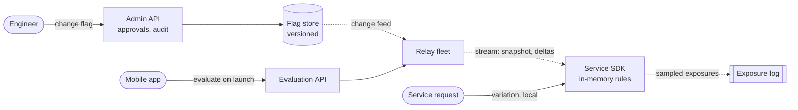

**Reading the diagram.** Engineers change flags through an admin API that enforces approvals and writes a versioned, audited record (cylinder). The change feed reaches a relay fleet, which streams snapshots and deltas over long-lived connections to SDKs in every service (dotted, asynchronous). A service request evaluates a flag in-process against in-memory rules (synchronous, no network). Mobile apps call a server-side evaluation API on launch, which uses the relays' rule copies. Exposures are logged asynchronously and deduplicated. Failure points: relays or the store down (SDKs keep last-known rules and on-disk snapshots; defaults in code apply only on a cold start with no snapshot), and a bad flag change (instant rollback to the previous version). Scaling: relays scale with connections; evaluation scales with the services themselves.

#### Deep dives

1. **Sticky percentage rollouts.** Hash `flag_key:user_id` with a stable hash into 10,000 buckets; a user is in the rollout if their bucket is below the percentage. Including the flag key gives each flag an independent population; raising the percentage only adds users (§43.7.2). Never use a language's randomized per-process hash.
2. **Propagation and the kill switch.** Streaming (server-sent events or long polling, §9.4) gets changes to SDKs in seconds; a periodic full-snapshot poll every 60 s repairs any missed delta. Each snapshot carries a version so SDKs apply changes in order. Measure propagation as an SLI: the age of the newest version seen by each instance.
3. **Failure semantics.** The flag service must never be on the request path: SDKs persist the last snapshot to disk, start from it, and evaluate with in-code defaults only when nothing else is available. Design each kill switch so that "off" is a safe degraded behavior, and test that path.

#### Trade-offs and alternatives

- **Local evaluation versus remote evaluation per request.** Remote evaluation centralizes logic but adds a network hop and a dependency to every request; use it only for clients that must not see rules (mobile, browsers).
- **Build versus buy.** Commercial and open-source flag platforms exist; building makes sense only with unusual scale, compliance or integration needs.
- **Flags versus configuration.** Long-lived operational settings belong in a configuration system with its own review; flags should expire (§43.7.3).

#### Follow-up questions

1. *"How do you avoid flag debt?"* Expiry dates on release flags, owner fields, and a report of flags at 100% for 30 days that triggers code removal.
2. *"A rollout increases errors; how fast can you react?"* Automated guardrails watch error rates per variant and flip the flag back, within the propagation SLO.
3. *"How do you keep experiment assignment consistent between server and mobile?"* Same hash function and bucketing on both paths, keyed by a stable user ID rather than a device ID where users log in.
4. *"Someone changes a production flag by mistake."* Approvals for risky flags, an audit diff, and one-click rollback to the previous version.
5. *"How do you test flag combinations?"* Test the default and the new path of each flag in isolation; avoid flags that depend on other flags.

#### What distinguishes levels

- **Mid:** a flag table queried by services, with a cache.
- **Senior:** in-process evaluation, streamed updates, deterministic bucketing and last-known-good behavior when the service is down.
- **Staff:** treats propagation time and safe defaults as SLOs, adds governance (approvals, audit, expiry) and connects exposure logging to experiment validity.

### 91.4.12 Q12. API gateway

**Difficulty:** Easy · **Time:** 45 min · **Related:** §34.6 (API gateways and backends for frontends), Chapter 22 (traffic management), §52.6 (rate limiter)

#### Prompt

"Design the API gateway that sits in front of all our microservices: it terminates client traffic, authenticates requests, applies rate limits and routes to the right backend."

#### Clarifying questions and assumptions

- Clients? Public mobile and web clients plus partner APIs. Protocols? HTTPS (HTTP/1.1 and HTTP/2) and WebSockets; gRPC to backends.
- Authentication? OAuth 2.0 access tokens as signed JWTs for users; API keys for partners.
- Scale? 500,000 RPS at peak, average response 10 KB; 300 backend services; three availability zones per region, several regions.
- Who changes routes? Service teams, self-service, many times a day.

#### Requirements

- **FR:** TLS termination; routing by host, path and header; authentication and coarse authorization; rate limiting; request/response transformation (limited); canary and weighted routing; observability (logs, metrics, trace propagation).
- **NFR:** added latency p99 < 5 ms; 99.99% availability; a bad route or plugin change must not take down unrelated APIs; configuration changes live within 30 s.

#### Estimation

::: example
**Worked example — Gateway fleet and bandwidth (§89.7; §89.10).**

1. If one gateway node proxies 20,000 RPS at saturation, at $u = 0.6$ it carries 12,000: $\lceil 500{,}000 / 12{,}000 \rceil = 42$ nodes.
2. Zone-safe with one of three zones lost: $\lceil 42 \times 3/2 \rceil = 63$, rounded to 66 (22 per zone).
3. Bandwidth: $500{,}000 \times 10$ KB $= 5$ GB/s $= 40$ Gb/s at peak, about 0.6 Gb/s per node.
4. TLS: if 10% of requests open a new connection, 50,000 handshakes/s; session resumption and long-lived HTTP/2 connections keep this CPU cost bounded.
5. Retries: a 10% retry budget allows at most 50,000 extra backend requests/s during an incident, instead of tripling load with three retries per request.

**Interpretation.** The fleet is moderate; the risks are in configuration and retry behavior, not raw capacity. **Implication.** Separate the control plane from the data plane and put explicit budgets on retries.
:::

#### API and data model

- Route configuration, owned by service teams and validated by the control plane: `{host, path_prefix, methods, backend_service, timeout_ms, retry_policy, auth: {required_scopes}, rate_limit_rules, canary: {version, weight}}`.
- Control plane API: `PUT /v1/routes/{id}` with schema validation, ownership check and staged rollout; data-plane nodes receive versioned snapshots.
- Service discovery: backends register endpoints (§34.7.3); the gateway load-balances across healthy endpoints.

#### High-level design

**Figure 91.13 — Gateway data plane with a separate control plane.**

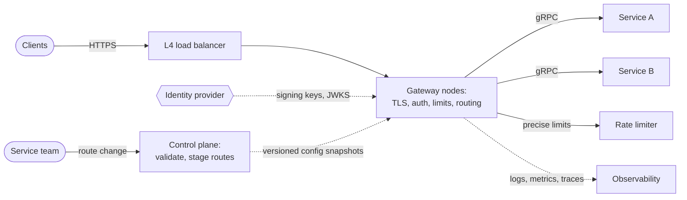

**Reading the diagram.** Client connections arrive at an L4 load balancer and terminate TLS on gateway nodes, which verify JWTs locally using the identity provider's published signing keys (fetched asynchronously, cached), check rate limits (locally or via the limiter service for precise rules) and route to backends over gRPC. Service teams change routes through a control plane that validates and stages them; nodes receive versioned snapshots asynchronously and keep serving the last good one if the control plane is down. Telemetry flows out asynchronously. Failure points: a bad configuration push (staged rollout to a few nodes first, automatic rollback), a slow backend exhausting gateway connections (per-route timeouts and concurrency limits), and an identity-provider outage (local verification continues with cached keys). Scaling: stateless nodes behind the L4 balancer; cells per region for blast-radius control.

#### Deep dives

1. **Control plane versus data plane.** The data plane must keep working with the last known configuration when everything else fails; the control plane validates schemas, checks route ownership (a team cannot route another team's path), and rolls changes out to 1% of nodes before the rest. Most gateway outages in practice are configuration changes, so this is the senior deep dive.
2. **Authentication cost.** Verifying a JWT signature locally costs microseconds and needs no network; calling an introspection endpoint per request adds a dependency and milliseconds. The price of local verification is revocation delay: keep access tokens short-lived (minutes) and push a small deny-list for emergencies.
3. **Protecting backends from the gateway.** Per-route timeouts shorter than the client's, retry budgets (retries at most 10% of requests, only for idempotent methods, with jittered backoff, §22.12), per-backend concurrency limits, and load shedding by priority (checkout before recommendations) so overload degrades gracefully instead of cascading (§22.10).

#### Trade-offs and alternatives

- **One shared gateway versus backends for frontends.** A shared gateway centralizes policy; per-client BFFs (§34.6.2) let mobile and web teams shape responses. A common pattern is a thin shared edge gateway plus BFFs behind it.
- **Gateway versus service mesh.** The gateway handles north–south traffic and client concerns; a mesh handles east–west traffic between services. Do not push business logic into either.
- **Plugins in the gateway.** Convenient, but every plugin runs on every request path; require performance budgets and isolate risky plugins per route.

#### Follow-up questions

1. *"How do you roll out a new backend version?"* Weighted routing (1%, 5%, 25%) driven by the control plane, with automatic rollback on error-rate guardrails.
2. *"How do you handle WebSockets?"* Long-lived connections pin to a node; drain gracefully on deploy and size nodes for concurrent connections, not only RPS (§9.9.7).
3. *"The gateway is the single point of failure."* It is replicated across zones and regions behind an L4 balancer and DNS failover, stateless, and run in cells so one bad node or config affects a fraction of traffic.
4. *"Where do you do authorization?"* Coarse checks (token valid, scope present) at the gateway; fine-grained resource checks in services, which own the data.
5. *"How do you trace a request?"* The gateway creates or propagates a trace context header and logs the route, latency and status per request.

#### What distinguishes levels

- **Mid:** lists gateway responsibilities and puts it behind a load balancer.
- **Senior:** sizes the fleet zone-safe, verifies tokens locally, and adds timeouts, retry budgets and rate limiting with clear placement.
- **Staff:** treats configuration change as the main outage risk and designs the control plane around it, uses cells to bound blast radius, and draws the boundary between gateway, BFF and mesh responsibilities.

## 91.5 Medium questions (Q13–Q28)

Medium questions are complete products. Each has two or three subsystems that interact and one clearly harder part: fan-out, ordering, contention, location, synchronization or ranking. Twelve of the sixteen have full case studies in Book I, so most answers below are compact; the four without one (catalog search, food delivery, email and calendar) are complete.

### 91.5.1 Q13. News feed

**Difficulty:** Medium · **Time:** 45 min · **Related:** §53.7, §53.8 (full case studies); §23.6.1 (fan-out amplification), §89.18.3 (drill)

#### Prompt

"Design the home timeline of a Twitter-like service: users follow others and see recent posts from the people they follow."

#### Clarifying questions and assumptions

- Ranked or chronological? Reverse-chronological first, ranking as an extension. Follow graph? Asymmetric, with accounts of up to 100 million followers.
- Scale (§53.8.4)? 250 million DAU; 500 million posts/day; 30 timeline loads per DAU per day; delivered fan-out 100 per post after excluding inactive followers and large accounts.

#### Requirements

- **FR:** post; follow/unfollow; home timeline with pagination; "N new posts" indicator.
- **NFR:** timeline read p99 < 200 ms; a post visible to followers within 5 s normally, minutes during bursts; posting never blocked by fan-out; 99.95% read availability.

#### Estimation

::: example
**Worked example — Fan-out versus reads (§53.8.4; §89.5, §89.8).**

1. Posts: $5 \times 10^8 / 86{,}400 = 5{,}787$/s average. Timeline inserts: $\times 100 = 578{,}700$/s.
2. Timeline reads: $2.5 \times 10^8 \times 30 / 86{,}400 \times 3 = 260{,}000$/s at peak.
3. Cache of 800 post IDs at 16 B for 400 million recently active users: 5.1 TB, 15.4 TB with three replicas.
4. One post by a 100-million-follower account would be $10^8$ inserts: 100 s even at $10^6$ inserts/s.

**Interpretation.** Push makes reads cheap and writes heavy-tailed. **Implication.** Push for ordinary authors, pull for large accounts, merged at read time.
:::

#### API and data model

- `POST /v1/posts`; `GET /v1/timeline?cursor=` returning hydrated posts; `POST /v1/follows/{id}`.
- `posts(post_id, author_id, body, created_at)` partitioned by `post_id`; `follows(follower, followee)` with the reverse index; timeline cache `timeline:{user_id}` → list of post IDs.

#### High-level design

**Figure 91.14 — Hybrid fan-out timeline.**

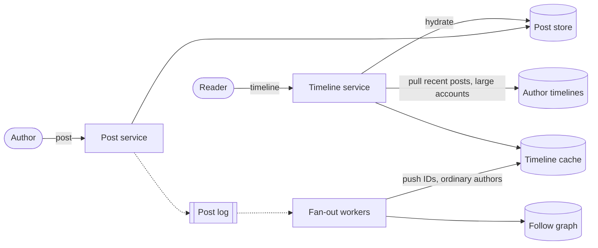

**Reading the diagram.** Posting writes the post synchronously and appends to a log; fan-out workers consume asynchronously (dotted), read follower lists and push post IDs into each active follower's cached timeline. Large accounts are not fanned out: the timeline service merges their recent posts at read time from per-author timelines, then hydrates IDs into posts. Failure points: fan-out backlog during bursts (posts arrive late, posting stays fast), loss of the timeline cache (rebuild from follows and author timelines), and hot author timelines (replicated). Scaling: workers with log partitions; cache by user ID.

#### Deep dives

1. **Where to cut push.** Total push cost is proportional to followers, so a threshold (for example one million followers) plus "skip followers inactive for 30 days" bounds bursts; §53.7.8 shows the knee.
2. **Burst drain.** A 30-second burst of 150,000 posts/s creates 450 million inserts; at 2 million inserts/s it drains in 225 s. Size fan-out for sustained load plus a drain target.
3. **The timeline is a rebuildable index**, not a source of truth: losing it costs latency, not data.

#### Trade-offs and alternatives

- Pure pull (§53.7) avoids fan-out writes and suits ranked feeds whose candidate index fits in memory; reverse toward pull when ranking needs all candidates anyway.
- Storing post IDs, not copies, keeps edits and deletes in one place.

#### Follow-up questions

1. *"A 100-million-follower account posts."* Nothing fans out; followers merge it at read time from a hot, replicated author timeline.
2. *"Unfollow?"* Filter at read time; lazily remove entries.
3. *"'N new posts'?"* Poll with `since_id` or push the newest ID over an existing connection.
4. *"Add ranking?"* Fetch a few hundred candidates, then score in a staged funnel (§53.7.8).

#### What distinguishes levels

- **Mid:** push model with a cache.
- **Senior:** compares push and pull with numbers and lands on the hybrid with a threshold.
- **Staff:** sizes burst drain time, treats the timeline as a rebuildable index, and explains why inactive followers and burstiness set the threshold.

### 91.5.2 Q14. Chat/messaging app

**Difficulty:** Medium · **Time:** 45 min · **Related:** §53.4, §53.5 (full case studies); §9.9 (connection gateways), §89.18.2 (drill)

#### Prompt

"Design a messaging app like WhatsApp or Messenger with one-to-one and group chats, delivery receipts and multiple devices per user."

#### Clarifying questions and assumptions

- Groups? Up to 256 members, average 20. Receipts? Delivered and read. History? Server-stored, synced to new devices. End-to-end encryption? Out of scope for this answer (§53.5 covers it).
- Scale (§53.4.4)? 100 million DAU × 40 messages/day; 30% group messages; peak-to-average ratio 3; 25% of DAU connected at peak.

#### Requirements

- **FR:** send and receive in real time; offline delivery; per-conversation order; receipts; history sync; presence.
- **NFR:** delivery p99 < 500 ms when online; no lost or duplicated messages as displayed; 99.99% send availability.

#### Estimation

::: example
**Worked example — Messages, deliveries and connections (§53.4.4; §89.5, §89.6).**

1. Messages: $4 \times 10^9$/day; peak $138{,}900$/s. Deliveries at 6.4 recipients per message: $888{,}900$/s at peak.
2. Receipts as per-conversation watermarks: 69,400/s average, 8.5× fewer than per-message receipts.
3. Text storage: 1.2 TB/day; 1.31 PB/year at replication factor 3, stored once per conversation.
4. Connections: 25 million at peak; 81 gateways at a 500,000-connection ceiling, zone-safe.

**Interpretation.** Throughput is large but partitionable; storage grows forever. **Implication.** Partition by conversation, store once per conversation, model receipts as watermarks.
:::

#### API and data model

- Over WebSocket: `send {conv_id, client_msg_id, body}` → `ack {seq}`; server pushes `msg {conv_id, seq, …}`; `sync {conv_id, after_seq}`.
- `messages(conv_id, seq, sender, body, ts)` clustered by `seq` in a wide-column store; `inbox(user_id, conv_id, last_seq)`; `read_watermark(conv_id, user_id, seq)`.

#### High-level design

**Figure 91.15 — Chat: gateways, per-conversation sequencing and a durable log.**

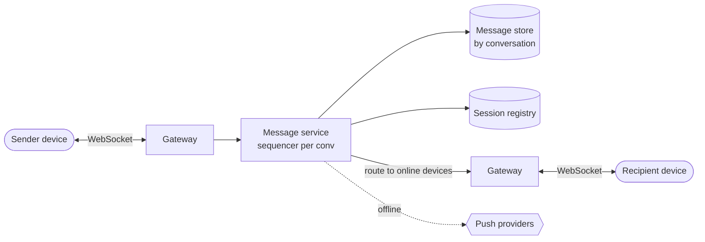

**Reading the diagram.** Devices hold WebSocket connections to gateways. The message service assigns the next sequence number for the conversation, writes the message durably (cylinder), acknowledges the sender, and looks up recipients' sessions in a registry to route the message to their gateways. Offline devices get a push notification (dotted) and sync from the store on reconnect. Failure points: a gateway crash (clients reconnect with jitter and sync from their last seq), and the sequencer for a conversation (leased ownership with fencing). Scaling: gateways by connections, store and sequencing by conversation ID.

#### Deep dives

1. **Ordering and idempotency.** `client_msg_id` makes sends idempotent; the per-conversation `seq` defines order and makes delivery idempotent at the client. Display is exactly-once, transport at-least-once.
2. **Durable path versus live path.** The store is the truth; live pushes are an optimization that may be lost, and sync by `after_seq` repairs it.
3. **Group fan-out and receipts.** Fan-out per member's devices; receipts as watermarks per member, not per message.

#### Trade-offs and alternatives

- Wide-column store by `(conv_id, seq)` versus relational: the former scales storage-bound growth; relational suits small deployments.
- Global ordering is unnecessary; per-conversation order is what users perceive.

#### Follow-up questions

1. *"Two people send at once?"* The sequencer decides; clients re-sort pending messages when their `seq` arrives.
2. *"New device?"* Ranged reads by `seq`, newest first, lazily per conversation.
3. *"Delete for everyone?"* A `delete(seq)` message in the same log; the store tombstones the body.
4. *"Presence at scale?"* Heartbeats with coarse TTLs, fanned out only to contacts currently viewing (§9.9.5).

#### What distinguishes levels

- **Mid:** gateways, a message service and a database.
- **Senior:** per-conversation sequence numbers with idempotent sends, durable versus live paths, watermark receipts.
- **Staff:** shows storage, not throughput, dominates over time; designs sequencer failure (leases, fencing) and multi-region conversation homing.

### 91.5.3 Q15. Photo-sharing app

**Difficulty:** Medium · **Time:** 45 min · **Related:** §53.6 (full case study); §15.8 (uploads), Chapter 21 (CDN)

#### Prompt

"Design Instagram: users upload photos, follow others, see a feed of photos and like them."

#### Clarifying questions and assumptions

- Video, stories, direct messages? Photos, feed and likes in scope; stories as an extension; video and messaging out.
- Scale (§53.6.4)? 500 million DAU; 100 million posts/day at 3 MB originals plus 390 KB of renditions; 20 feed loads per DAU per day, 10 images each; peak-to-average ratio 3; CDN hit ratio 95%.

#### Requirements

- **FR:** upload with caption; feed; like and comment; follow; profile grid.
- **NFR:** feed p99 < 300 ms excluding images; images from the edge; uploads never lost once acknowledged; 11 nines media durability.

#### Estimation

::: example
**Worked example — Bytes dominate (§53.6.4; §89.6, §89.7).**

1. Posts: 1,160/s average, 3,470/s peak. Media: 339 TB/day; about 173 PB/year erasure-coded.
2. Feed requests 347,000/s at peak; image fetches 3.47 million/s at peak.
3. Image egress: 15 PB/day, 1.39 Tb/s average; origin at 95% hit ratio: about 57,900 fetches/s.
4. A celebrity post's 2 million likes in 10 minutes: 3,330 likes/s on one counter.

**Interpretation.** Requests are modest for the application tier; bytes and hot counters are not. **Implication.** Keep bytes off application servers, and design counters for the hottest key.
:::

#### API and data model

- `POST /v1/uploads` → presigned URL; `POST /v1/posts {upload_id, caption}`; `GET /v1/feed?cursor=`; `PUT /v1/posts/{id}/like`.
- `posts(post_id, user_id, caption, media_keys, created_at)` sharded by user with 64-bit time-ordered IDs (§53.6.8); `likes(post_id, user_id)`; `like_counts(post_id, shard, count)`.

#### High-level design

**Figure 91.16 — Photo sharing: direct upload, asynchronous processing, CDN delivery.**

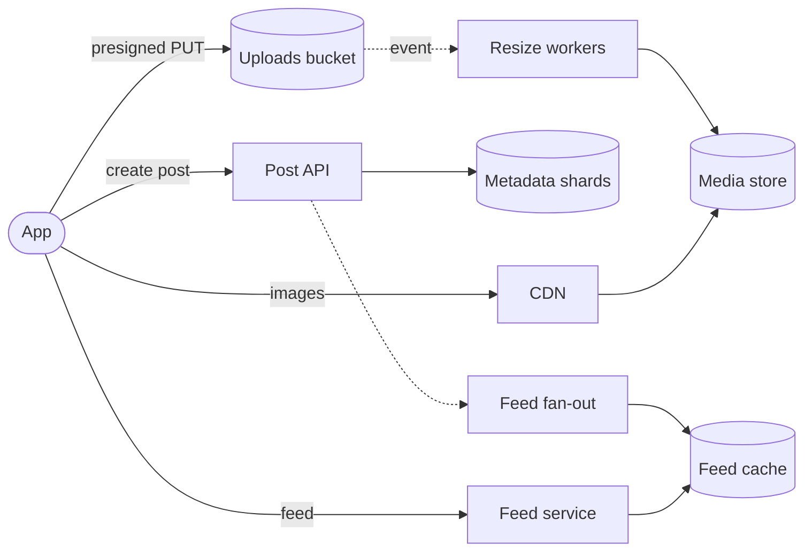

**Reading the diagram.** Originals go straight from the app to a private uploads bucket; resize workers produce four renditions asynchronously into the media store. The post API writes metadata to user-sharded stores and triggers feed fan-out (hybrid, as in Q13). Feed reads return metadata and rendition URLs; images come from the CDN, whose misses reach the media store. Failure points: processing backlog (posts wait in a pending state), CDN cold caches (origin load multiplies), and hot like counters. Scaling: workers by upload rate, CDN by egress, metadata by user shards.

#### Deep dives

1. **Upload pipeline.** A state machine (uploaded, processed, published) with idempotent workers; nothing references a photo until it is validated.
2. **Hot counters.** Exact per-user like edges; approximate totals from sharded or coalesced counters (as in Q6).
3. **IDs and sharding.** Time-ordered 64-bit IDs carrying a logical shard number let posts be placed and moved without a lookup table (§53.6.8).

#### Trade-offs and alternatives

- Eager renditions at upload versus on-demand resizing at the edge: eager costs storage, on-demand costs CPU on cache misses.
- Push versus pull feeds: as in Q13.

#### Follow-up questions

1. *"Avoid serving an unchecked photo?"* The bucket is private and no post references it until processed.
2. *"'Liked by your friend X'?"* Intersect the viewer's following set with recent likers in a bounded query.
3. *"Delete a post?"* Mark deleted, filter at hydration, purge CDN keys asynchronously.
4. *"Stories that expire in 24 hours?"* TTL filter at read time; physical deletion later.

#### What distinguishes levels

- **Mid:** upload service, object storage, feed and database.
- **Senior:** bytes off the application tier, idempotent asynchronous processing, exact likes separated from approximate counts.
- **Staff:** quantifies egress cost and CDN hit ratio, and connects ID design to sharding and rebalancing.

### 91.5.4 Q16. Typeahead/autocomplete

**Difficulty:** Medium · **Time:** 45 min · **Related:** §16.9 (worked design), §56.4 (search engine), §17.11 (tries)

#### Prompt

"Design the search-box autocomplete for a large search engine: as the user types, show the top ten completions."

#### Clarifying questions and assumptions

- Source of suggestions? Past queries ranked by popularity with recency decay; personalization and trending as extensions. Freshness? Trending queries within minutes; the base corpus daily.
- Scale (§56.4.4)? 5 billion searches/day, 3 suggestion requests per search after debouncing, peak-to-average ratio 2; 100 million distinct queries in the corpus.

#### Requirements

- **FR:** top-10 completions for a prefix; filtering of offensive or unsafe suggestions; trending suggestions; per-language and per-region corpora.
- **NFR:** end-to-end under about 100 ms, so the server lookup p99 < 5 ms (Table 16.12); 99.99% availability with graceful empty results.

#### Estimation

::: example
**Worked example — Load and memory (§16.9.1 formula; §56.4.4).**

1. Suggestion requests: $3 \times 5 \times 10^9 = 1.5 \times 10^{10}$/day; peak $347{,}222$/s.
2. Precomputed top-10 lists: about $6 \times 10^8$ trie nodes (six per query after prefix sharing, the ratio of §16.9.1) × 10 × 4 B $= 24$ GB, plus strings: it fits in one server's memory.
3. Nodes: at 50,000 lookups/s per node and $u = 0.6$, $\lceil 347{,}222 / 30{,}000 \rceil = 12$; zone-safe 18.

**Interpretation.** Small data, very high read rate, tight latency. **Implication.** Replicate a precomputed, read-only structure everywhere; do not compute at query time.
:::

#### API and data model

- `GET /v1/suggest?q=hea&lang=en&region=us` → ten completions; cacheable for short prefixes.
- Offline: query-log aggregates `(query, region, count_decayed)`; online: an immutable trie or finite-state transducer with top-k per node, versioned per build.

#### High-level design

**Figure 91.17 — Precomputed suggestions with a streaming trending layer.**

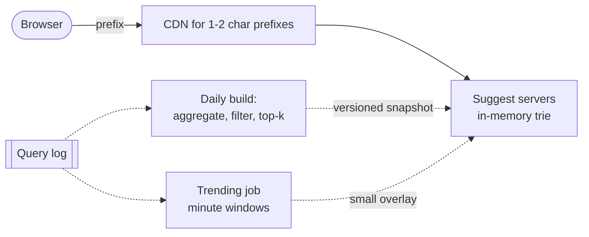

**Reading the diagram.** Short prefixes are cached at the CDN; other requests reach suggest servers that look up the prefix node in an in-memory trie and return its stored list (synchronous, microseconds). A daily batch job aggregates the query log, applies safety filters, computes top-k per node and ships a versioned snapshot that servers load and swap atomically (dotted). A streaming job detects trending queries per minute and pushes a small overlay merged at lookup. Failure points: a bad build (keep the previous version and roll back), and an unsafe suggestion (block list applied in both build and overlay). Scaling: identical replicas behind a load balancer; shard by prefix range only if memory outgrows a node.

#### Deep dives

1. **Top-k stored at each node** turns lookup into $O(\text{prefix length})$ regardless of subtree size (§16.9.2).
2. **Freshness by layering:** a daily base plus a trending overlay avoids rebuilding a 24 GB structure every minute.
3. **Safety filtering** belongs in the build pipeline and the overlay, with an emergency block list served from configuration.

#### Trade-offs and alternatives

- Trie versus search-engine prefix queries: prefix queries are flexible but slower at p99; precomputation wins at this load.
- Personalization adds a per-user re-rank of the top 50 candidates, at a few milliseconds.

#### Follow-up questions

1. *"Typos?"* Fuzzy matching on the FST or a spelling-correction candidate generator, within the latency budget.
2. *"Reduce requests?"* Client debounce of 30–50 ms and client caching of earlier prefixes.
3. *"A breaking-news query?"* The trending overlay surfaces it within minutes.
4. *"Multiple languages?"* Separate builds per language and region, chosen by request headers.

#### What distinguishes levels

- **Mid:** a trie with a database of query counts.
- **Senior:** precomputed top-k per node, latency budget, snapshot builds with atomic swap.
- **Staff:** layers freshness, treats suggestion safety as a requirement, and sizes the fleet from the request multiplier over search.

### 91.5.5 Q17. Web crawler

**Difficulty:** Medium · **Time:** 45 min · **Related:** §52.10 (full case study); §17.4 (Bloom filters)

#### Prompt

"Design a web crawler that downloads billions of pages a month for a search engine, politely."

#### Clarifying questions and assumptions

- Content types? HTML only. Politeness? Obey robots.txt (RFC 9309) and a per-host delay. Recrawl? Pages change at different rates.
- Scale (§52.10.4)? 3 billion pages per 30-day cycle; 100 KB per page (25 KB compressed); 50 links per page; 30 billion known URLs.

#### Requirements

- **FR:** fetch, parse, extract links, deduplicate URLs and content, store pages, schedule recrawls.
- **NFR:** never exceed a host's allowed rate; complete the cycle; survive node loss without recrawling everything; avoid crawler traps.

#### Estimation

::: example
**Worked example — Rates and the politeness bound (§52.10.4).**

1. Average rate $3 \times 10^9 / 2{,}592{,}000 = 1{,}157$ pages/s; provision 2,000; bandwidth 1.6 Gb/s.
2. Storage: 75 TB per cycle compressed. Discovered links: 100,000/s to test against the seen set.
3. Seen set: a Bloom filter at 1% false positives, 9.6 bits per URL × 30 billion = 36 GB, partitioned.
4. Politeness: with a 5 s delay per host, at least $2{,}000 \times 5 = 10{,}000$ hosts must have URLs ready at every moment.

**Interpretation.** Bandwidth is easy; the frontier and seen-set lookups are the design. **Implication.** Partition by host and keep per-URL structures in memory.
:::

#### API and data model

- Internal only: `enqueue(url, priority)`; `fetch_result(url, status, content_hash, links)`.
- URL store keyed by reversed host; host table `(host, next_allowed_at, delay, robots, ip)`; WARC-style compressed archive files in object storage.

#### High-level design

**Figure 91.18 — Host-partitioned crawler.**

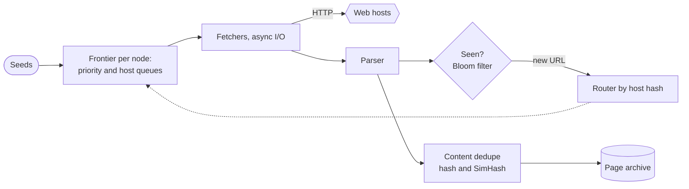

**Reading the diagram.** Each node owns the hosts that hash to it, so politeness and robots caching are local. The frontier keeps priority queues and per-host queues with a heap of next-allowed times; fetchers issue asynchronous HTTP requests to external hosts. Parsed links are tested against the Bloom filter, and new URLs are routed (dotted, asynchronous) to the owning node's frontier. Content is deduplicated exactly and approximately before archiving. Failure points: a node crash (its hosts move to other nodes; the frontier is checkpointed), traps (depth and URL-length limits), and slow hosts (adaptive delay). Scaling: add nodes and rebalance host ranges.

#### Deep dives

1. **Frontier design:** front queues for priority, back queues per host, adaptive delay from response time.
2. **Duplicates:** URL normalization, Bloom filter for seen URLs, exact hash plus SimHash with a 3-bit threshold for near-duplicates.
3. **Recrawl as budget allocation** by estimated change rate, with conditional GETs.

#### Trade-offs and alternatives

- Host partitioning versus URL partitioning: host partitioning makes politeness local; URL partitioning balances load better but needs global coordination per host.
- Bloom filter false positives skip a few new URLs; acceptable for a crawler, not for billing.

#### Follow-up questions

1. *"robots.txt returns 500?"* Treat the host as fully disallowed until reachable (RFC 9309).
2. *"A site with 10 million pages?"* Per-host rate overrides: 0.26 s delay to finish in 30 days, only if the host can take it.
3. *"Crawler traps?"* Limits on depth, URL length and pages per host; detect repeating path patterns.
4. *"Same content on many URLs?"* Canonical tags and content hashes collapse them.

#### What distinguishes levels

- **Mid:** queue of URLs, fetchers, a seen set.
- **Senior:** frontier with politeness and Bloom-filter dedupe, partitioned by host.
- **Staff:** derives the ready-hosts bound and the large-site problem from numbers, and treats recrawl as a budget problem.

### 91.5.6 Q18. E-commerce catalog search

**Difficulty:** Medium · **Time:** 45 min · **Related:** Chapter 16 (search systems), §55.7 (e-commerce platform), §81.7 (search ranking), §89.18.6 (drill)

#### Prompt

"Design product search for a large online store: users type a query, filter by brand, price and rating, and see relevant, in-stock products."

#### Clarifying questions and assumptions

- Catalog? 500 million products, 10 KB of attributes each (§55.7.4), of which about 1.5 KB is searchable text and facet fields.
- Freshness? Price and stock changes visible in search within a minute; new products within 15 minutes. Changes arrive at about 5,000 per second at peak.
- Scale? 500 million searches/day, peak-to-average ratio 5 (sales events); a results cache hits 30% of queries.
- Ranking? Text relevance plus business signals (sales, rating, availability); a learned ranker as an extension (§81.7).

#### Requirements

- **FR:** keyword search with typo tolerance and synonyms; facets with counts (brand, price ranges, rating); sort by relevance, price or newest; filters for in-stock and delivery location; pagination.
- **NFR:** p99 < 300 ms server-side; 99.95% availability with degraded results preferred to errors; out-of-stock items never ranked at the top; index freshness as above.

#### Estimation

::: example
**Worked example — Index size and serving fleet (§89.5; §89.10; shard arithmetic as in §56.4.4).**

1. Searches: $5 \times 10^8 / 86{,}400 = 5{,}787$/s average; peak $\times 5 = 28{,}935$/s; after a 30% results cache, 20,255/s reach the index.
2. Searchable source: $5 \times 10^8 \times 1.5$ KB $= 750$ GB; with inverted index, doc values for facets and overhead, about 1 TB. At 50 GB per shard, 20 shards.
3. CPU: if one shard spends 2 ms per query and every query visits all 20 shards, $20{,}255 \times 20 \times 0.002 / 0.5 = 1{,}620$ cores at 50% utilization.
4. One full copy on 20 nodes of 64 cores serves $20 \times 64 \times 0.5 / (20 \times 0.002) = 16{,}000$ queries/s, so 2 copies carry the peak; 3 copies across three zones survive a zone loss: 60 nodes.
5. Updates: 5,000/s is 432 million field changes a day, nearly the whole catalog: most of them price and stock.

**Interpretation.** The index fits a modest cluster; the update rate on two fields is the unusual part. **Implication.** Treat price and stock as fast-changing fields with their own update path, and keep the text index for slowly changing content.
:::

#### API and data model

- `GET /v1/search?q=running+shoes&filters=brand:acme,price:50-100&sort=relevance&page_token=` → products, facet counts, spelling suggestion.
- Index document: `{product_id, title, brand, category_path, attributes, description_terms, price, in_stock_regions, rating, sales_30d, updated_at}`, partitioned by `product_id` hash.
- Source of truth stays in the catalog, pricing and inventory services; the index is a derived view fed by their change streams.

#### High-level design

**Figure 91.19 — Catalog search: derived index, query understanding and staged ranking.**

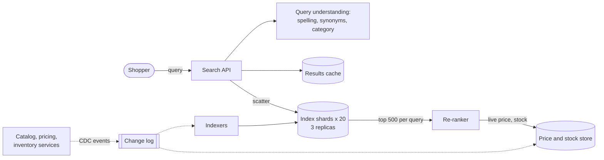

**Reading the diagram.** A query passes through query understanding (spelling correction, synonym expansion, predicted category), then a results cache, then a scatter to all 20 shards, each returning its best candidates by text relevance and filters. A re-ranker merges the candidates, joins live price and stock from a fast key-value store, applies business signals and returns a page with facet counts. Changes flow asynchronously (dotted) from the owning services through a change log into indexers, which write to shards with a near-real-time refresh of about 1 s (§16.10), and into the price-and-stock store directly. Failure points: indexer lag (results slightly stale, alert on lag), a slow shard (per-shard timeout, return partial results), and the price store (fall back to indexed values). Scaling: replicas for query rate, shards for index size.

#### Deep dives

1. **Fast fields versus slow fields.** Re-indexing a whole document for every price change is wasteful at 5,000 changes per second. Keep price and stock as doc-value fields updated in place (or partial updates) for filtering, and verify the final page against the live store in the re-ranker, so a just-sold-out item drops before display. Text and attributes are re-indexed only when they change.
2. **Query understanding.** Most of the relevance gain in e-commerce comes before retrieval: spelling correction, synonyms ("sneakers" = "trainers"), unit normalization, and predicting the category so that "apple" ranks phones over fruit. These are dictionaries and small models built offline from query logs and clicks.
3. **Facets at scale.** Facet counts are aggregations over every matching document, the most expensive part of a broad query. Compute them on doc values per shard and merge; for very broad queries, approximate counts from a sample, and cache facets for popular queries.

#### Trade-offs and alternatives

- **Document-partitioned versus category-partitioned shards.** Category partitioning lets a category-filtered query hit fewer shards, but unfiltered queries still scatter and hot categories skew load. Start with hash partitioning; route by category only if most queries are category-filtered.
- **BM25 plus rules versus learning to rank.** Rules are transparent and quick to ship; a learned ranker on clicks and purchases (§81.7) wins once you have logging and an experiment platform.
- **Managed search engine versus self-run.** Elasticsearch or OpenSearch (§16.8) handles shards, replicas and refresh; self-run at very large scale only with a team to operate it.

#### Follow-up questions

1. *"An item sells out during a flash sale."* The re-ranker checks live stock for the page it returns; the index catches up within a second.
2. *"Zero results?"* Relax the query step by step: spelling correction, dropping the least important term, broader category; log zero-result queries as a product signal.
3. *"Sponsored products?"* A separate ad auction fills reserved slots, blended after organic ranking with clear labeling.
4. *"Personalization?"* Re-rank the top few hundred with user features in the re-ranker, under a few milliseconds.
5. *"Reindex the whole catalog with a new analyzer?"* Build a new index in parallel from a snapshot plus the change log, compare quality offline, then switch an alias.

#### What distinguishes levels

- **Mid:** an Elasticsearch index fed from the catalog database, with filters.
- **Senior:** sizes shards and replicas, separates fast-changing fields, and adds query understanding and facets with their costs.
- **Staff:** treats the index as a derived, rebuildable view with lag SLOs, plans the ranking evolution with experiments, and handles flash-sale consistency between search and inventory explicitly.

### 91.5.7 Q19. Ticket booking (seat reservation)

**Difficulty:** Medium · **Time:** 45 min · **Related:** §55.8 (full case study); §26.11 (leases)

#### Prompt

"Design Ticketmaster: users pick specific seats for concerts and pay. Popular shows sell out in minutes with millions of people trying at once."

#### Clarifying questions and assumptions

- Seat selection? Reserved seating, chosen on a map, held while paying. Payment window? 6 minutes.
- Scale (§55.8.4)? Normal days are small: 3.8 orders/s on average. A stadium on-sale: 50,000 seats, 2.5 tickets per order, 2 million people in the queue, 80% of admitted buyers complete.

#### Requirements

- **FR:** browse events and seat maps; hold seats; pay and confirm; release holds on timeout; virtual waiting room for on-sales.
- **NFR:** never sell a seat twice; holds expire reliably; the purchase flow stays responsive during on-sales; fairness (first come, first served through the queue); bots limited.

#### Estimation

::: example
**Worked example — The on-sale arithmetic (§55.8.4).**

1. Sell-out position: $q^* = 50{,}000 / (2.5 \times 0.8) = 25{,}000$: 98.75% of a 2-million queue cannot get tickets.
2. Admission rate for 30,000 concurrent buyers spending 360 s each (Little's Law): $30{,}000 / 360 = 83.3$ buyers/s; position 25,000 is admitted after 300 s.
3. Waiting-room polling: 2 million clients every 30 s is 66,667 requests/s, far more than the purchase flow.

**Interpretation.** The purchase path is small; the queue and the information you give it are large. **Implication.** Protect inventory with a waiting room that admits at the rate the flow can serve, and tell people early when tickets are gone.
:::

#### API and data model

- `POST /v1/events/{id}/holds {seat_ids}` → `{hold_id, expires_at}` or `409`; `POST /v1/holds/{id}/purchase {payment_token}` with idempotency key; waiting-room `GET /v1/queue/{token}` → position and admission token.
- `seats(event_id, seat_id, status: AVAILABLE|HELD|SOLD, hold_id, hold_expires_at, version)` partitioned by event; `orders(order_id, hold_id, user_id, status)`.

#### High-level design

**Figure 91.20 — On-sale: waiting room in front of an inventory service.**

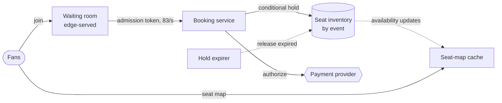

**Reading the diagram.** During an on-sale, fans join a waiting room served largely from the edge, which issues signed admission tokens at the rate the booking flow can absorb. Admitted buyers read a cached seat map and request holds; the booking service makes a conditional update on the event's inventory partition (cylinder) and later authorizes payment with the external provider. An expirer releases holds asynchronously at their deadline, and availability changes refresh the seat-map cache. Failure points: the payment provider (holds outlive a short outage only up to their TTL), the inventory partition for one hot event (sized by admission rate, not by fans), and bots (tokens bound to verified sessions). Scaling: the waiting room at the edge; inventory by event.

#### Deep dives

1. **No double sale:** `UPDATE seats SET status='HELD', hold_id=? WHERE event_id=? AND seat_id IN (…) AND status='AVAILABLE'`, all or nothing in one partition; purchase flips `HELD` to `SOLD` only if the hold is still valid.
2. **Holds with TTL:** the expiry is data, checked on every read, with a background release; a late payment against an expired hold is refunded.
3. **Admission control:** admit at $L_{\max} / W$ and stop admitting once projected holds exceed remaining seats.

#### Trade-offs and alternatives

- Pessimistic row locks versus conditional updates: conditional updates avoid holding locks across user think time.
- Best-available assignment instead of seat maps reduces contention on the same popular seats.

#### Follow-up questions

1. *"Two users click the same seat."* One conditional update wins; the other gets `409` and a refreshed map.
2. *"Payment succeeds after the hold expired."* Detect at confirmation and refund, or extend holds briefly while a payment is in flight.
3. *"How do you stop bots?"* Verified accounts, per-account limits, challenges at queue entry, and tokens bound to sessions.
4. *"Tell users early that it is sold out?"* Publish $q^*$ estimates to the queue page as inventory drains.

#### What distinguishes levels

- **Mid:** seats table with locking and a payment step.
- **Senior:** conditional holds with TTL, idempotent purchase, waiting room.
- **Staff:** derives admission rate and sell-out position from Little's Law and designs the queue experience and bot policy around them.

### 91.5.8 Q20. Ride-hailing dispatch

**Difficulty:** Medium · **Time:** 45 min · **Related:** §55.4, §55.5 (full case studies); §17.9 (geospatial indexing), §89.18.5 (drill)

#### Prompt

"Design the core of Uber: riders request a ride, and the system finds a nearby driver, who accepts; both see each other's location until pickup."

#### Clarifying questions and assumptions

- Scope? Matching and location; pricing and payments as neighbors. Matching quality? Minimize pickup ETA, not distance.
- Scale (§55.4.4)? 30 million trips/day, peak 3× average; 2 million drivers online at peak sending a location every 4 s; 5 million riders with the app open, refreshing nearby cars every 5 s.

#### Requirements

- **FR:** driver location updates; nearby cars; request, match, offer, accept; trip state machine; live tracking.
- **NFR:** match within 10 s at p95; location reads p99 < 100 ms; no driver assigned to two trips; per-city failure isolation.

#### Estimation

::: example
**Worked example — Locations outnumber trips (§55.4.4; §89.5).**

1. Trips: 347/s average, about 1,000 requests/s at peak.
2. Location updates: $2 \times 10^6 / 4 = 500{,}000$/s, 0.8 Gb/s; nearby-car reads 1,000,000/s.
3. Supply index: 2 million drivers × 200 B = 400 MB of state.
4. Location writes per trip request at peak: about 480.

**Interpretation.** The location stream, not trips, is the load; the state is tiny. **Implication.** Keep live locations in memory, partitioned by city and geospatial cell, and never write each update to a database synchronously.
:::

#### API and data model

- Driver: `PUT /v1/drivers/me/location` over a persistent connection; rider: `POST /v1/trips {pickup, dropoff}`; `POST /v1/offers/{id}/accept`.
- In memory: `cell_id → set(driver_id, position, status, ts)` with H3 cells (§17.9.5); durable: `trips(trip_id, rider, driver, state, …)` with a forward-only state machine; location history appended to a log.

#### High-level design

**Figure 91.21 — Dispatch: in-memory supply index per city.**

```mermaid
flowchart LR
  D([Driver app]) <-->|WebSocket| GW[Gateways]
  GW -->|location| LOC[Location service]
  LOC --> IDX[(Supply index<br/>by city and cell)]
  LOC -.-> LOG[[Location log]]
  R([Rider app]) -->|request| TR[Trip service] --> TDB[(Trips)]
  TR --> M[Matcher per city]
  M --> IDX
  M -->|ETA| ETA[ETA service]
  M -->|offer| GW
```

**Reading the diagram.** Drivers stream locations over persistent connections; the location service updates an in-memory index keyed by city and cell and appends to a log asynchronously (dotted) for history and analytics. A trip request creates a durable trip record and asks the city's matcher, which searches k-rings of cells for idle drivers, ranks them by ETA and sends an offer through the driver's gateway. Failure points: a matcher or index node (rebuilt from the location stream within seconds), lost offers (timeouts, then the next candidate), and double assignment (prevented by a conditional state change on the driver). Scaling: partition by city; add index nodes for dense cities.

#### Deep dives

1. **Candidate search:** expand k-rings until enough idle drivers are found ($k = 1$ downtown, $k = 7$ in a suburb, §55.5.4), then rank by road ETA, not straight-line distance.
2. **Offer and accept:** expected offers $1 / 0.7 = 1.43$; a conditional driver-state transition prevents assigning one driver twice.
3. **Batch matching:** collecting requests for a second or two and solving an assignment problem lowers total pickup time over greedy matching.

#### Trade-offs and alternatives

- Greedy versus batched matching: batching adds seconds of delay for better global ETAs.
- Geohash versus H3: hexagons give uniform neighbor distances.

#### Follow-up questions

1. *"Driver's phone loses connectivity mid-offer?"* Offer times out; the trip moves to the next candidate.
2. *"A city's matcher crashes?"* Another instance takes the partition and rebuilds state from the stream.
3. *"Surge pricing?"* A neighbor service computes multipliers from supply and demand per cell (§83.6).
4. *"Reduce location traffic?"* Adaptive update intervals: faster while on a trip, slower while idle and parked.

#### What distinguishes levels

- **Mid:** location table, nearby query, assignment.
- **Senior:** in-memory geospatial index, ETA-based ranking, conditional assignment, numbers for location load.
- **Staff:** per-city cells for isolation, batch matching trade-offs, and offer-timeout tail math.

### 91.5.9 Q21. Food delivery

**Difficulty:** Medium · **Time:** 60 min · **Related:** §2.11 and §18.11.5 (QuickBite estimates and capacity plan), §55.5 (matching), §32.7.2 (order saga), §60.6 (ETA inference)

#### Prompt

"Design a food-delivery app like DoorDash or Uber Eats: customers browse nearby restaurants, order and pay, restaurants prepare the food, and couriers deliver it while the customer tracks the order live."

#### Clarifying questions and assumptions

- One country, many cities; three parties with their own apps: customer, restaurant (tablet), courier (phone).
- Scale, reusing the book's running example QuickBite (§2.11): 2 million DAU, 500,000 orders/day; busiest-hour share 0.20 (dinner) and burst factor 2; 50,000 restaurants; 50,000 registered couriers, 20,000 active at peak, sending a location every 4 s.
- Payment? Card authorized at checkout, captured at delivery, through an external provider. ETA predictions come from an ML service (Book II); here it is a dependency.

#### Requirements

- **FR:** browse restaurants deliverable to an address, with menus and ETAs; cart and checkout; restaurant accepts and marks ready; courier dispatch, pickup and drop-off; live tracking; cancellations and refunds.
- **NFR:** checkout p99 < 1 s and 99.95% available; no order lost or charged twice; restaurant notified within 5 s; courier assigned so that arrival matches food-ready time; tracking updates every 5 s.

#### Estimation

::: example
**Worked example — QuickBite's numbers (§2.11; peak formula §89.5, Little's Law §4.11).**

1. Orders: 500,000/day, 5.8/s average; dinner peak $500{,}000 \times 0.20 / 3{,}600 \times 2 = 55.6$, design 60 orders/s.
2. Browse reads: 60 million/day; design peak 7,000 RPS; menus total 5 GB and fit in memory.
3. Courier locations: $20{,}000 / 4 = 5{,}000$ writes/s at peak, 83 times the order rate.
4. Orders in the delivery leg at once: $27.8$ orders/s × 900 s ≈ 25,000; if half the customers watch with 5-second refresh, 2,500 tracking reads/s.
5. Order storage: 1 GB/day, about 5.5 TB over five years with indexes and a standby: one relational cluster.

**Interpretation.** Orders are few but valuable and multi-party; locations are many but disposable. **Implication.** A transactional order service with a strict state machine, and a separate, in-memory location path, exactly the split of Table 2.18.
:::

#### API and data model

- Customer: `GET /v1/restaurants?address_id=` (with ETAs), `GET /v1/restaurants/{id}/menu`, `POST /v1/orders` with `Idempotency-Key` → `{order_id, status}`, `GET /v1/orders/{id}/track` (or a push channel).
- Restaurant: `POST /v1/orders/{id}/accept {prep_minutes}`, `POST /v1/orders/{id}/ready`. Courier: `PUT /v1/couriers/me/location`, `POST /v1/jobs/{id}/accept`, `POST /v1/jobs/{id}/picked_up`, `…/delivered`.
- `orders(order_id, customer_id, restaurant_id, items, total, status, payment_auth_id, created_at)`; `order_events(order_id, seq, type, ts)` as the audit trail; `jobs(job_id, order_id, courier_id, status)`; live courier positions in memory by delivery zone.

#### High-level design

**Figure 91.22 — Food delivery: order saga, dispatch and location paths.**

```mermaid
flowchart LR
  C([Customer app]) -->|browse| CAT[Catalog and search] --> MC[(Menu cache)]
  C -->|checkout| ORD[Order service]
  ORD --> ODB[(Orders and events)]
  ORD -->|authorize| PAY{{Payment provider}}
  ORD -.->|order events| K[[Event log]]
  K -.-> RN[Restaurant notifier] -->|push| R([Restaurant tablet])
  K -.-> DSP[Dispatch per zone]
  DSP --> LOCS[(Courier locations<br/>in memory)]
  DSP -->|ETA| ETA[ETA service]
  DSP -->|job offer| CR([Courier app])
  CR -->|"location every 4 s"| LOC[Location service] --> LOCS
  C -->|track| TRK[Tracking] --> LOCS
```

**Reading the diagram.** Browsing reads menus from an in-memory cache. Checkout is a synchronous call to the order service, which writes the order and its first event in one transaction (cylinder), authorizes the card with the external provider and returns. Everything after that is event-driven (dotted): the restaurant notifier pushes the order to the tablet, and dispatch for the order's zone chooses a courier using live positions held in memory and predicted ETAs, then offers the job. Couriers stream locations to the location service; tracking reads the same in-memory store. Failure points: the payment provider (bounded retries with the idempotency key), the tablet being offline (escalate by phone call after a timeout), courier no-shows (re-dispatch), and dispatch for one zone (stateless, restarted from the event log). Scaling: browsing by cache replicas; locations by zone; orders by one cluster until about 5× growth, then partition by city.

#### Deep dives

1. **The order as a saga with a state machine.** States move forward only: `PLACED → AUTHORIZED → ACCEPTED → READY → PICKED_UP → DELIVERED`, with `CANCELED` and `REFUNDED` branches. Each step is a local transaction plus an event, published through a transactional outbox (§32.5) so no event is lost or invented. Compensations undo earlier steps: a restaurant rejection voids the authorization; a cancellation after pickup triggers a partial refund by policy. Every external call carries an idempotency key, so retries cannot charge twice (§32.7.2).
2. **Dispatch timing.** Assigning the nearest courier at checkout makes couriers wait at restaurants; assigning at "ready" makes food wait. Dispatch aims for courier arrival ≈ food-ready time: it schedules the assignment for when $t_{\text{ready}} - t_{\text{travel}}$ approaches, using the restaurant's prep estimate and the courier's predicted travel ETA. Within a zone, batching requests for 30–60 s and solving an assignment problem, including stacking two orders from the same restaurant, reduces courier time per order (the matching techniques of §55.5).
3. **Location path separation.** 5,000 writes/s of positions go to an in-memory store keyed by zone, with a TTL, and to a log for history; they never touch the order database. Tracking reads that store, and pushes to watching customers only on change.

#### Trade-offs and alternatives

- **Orchestrated versus choreographed saga.** An orchestrator (the order service, or a workflow engine, §32.11) makes the flow visible and testable; choreography through events decouples teams but makes "where is this order stuck?" harder. Prefer orchestration for the money path.
- **Monolith first.** At 60 orders/s, a modular monolith with one database is defensible (§2.8); split out location and dispatch first because their load profile differs by 83×.
- **Auth-then-capture versus charge at checkout.** Auth-and-capture handles substitutions and cancellations cleanly; immediate charge simplifies but makes refunds common.

#### Follow-up questions

1. *"The restaurant tablet is offline."* Retry push, then an automated phone call; if not accepted within a few minutes, cancel and void the authorization.
2. *"How do you show an ETA before ordering?"* Batch-precompute zone-to-restaurant ETAs for browsing and call the ETA model for the final quote at checkout (§60.6).
3. *"A courier accepts two jobs at once due to a race."* Job assignment is a conditional update on the courier's state; the second fails and is re-dispatched.
4. *"Lunch peak doubles next year."* Orders still fit one cluster (about 120/s); the location fleet and dispatch scale by zone; plan city partitioning at about 5×.
5. *"How do you handle surge demand?"* Delivery fees and radius shrink dynamically per zone; courier incentives raise supply (a pricing service, as in §83.6).

#### What distinguishes levels

- **Mid:** a clean three-party flow with services for orders, restaurants and couriers.
- **Senior:** derives the location-versus-order asymmetry, designs the order state machine with idempotent payment and outbox events, and times dispatch to food readiness.
- **Staff:** argues the monolith-first boundary from the numbers, chooses orchestration for the money path, and plans failure handling for each party's device being offline.

### 91.5.10 Q22. File sync (Dropbox-like)

**Difficulty:** Medium · **Time:** 45 min · **Related:** §54.8 (full case study); §54.7 (Google Drive), §15.8.3 (content-defined chunking)

#### Prompt

"Design Dropbox: users keep a folder in sync across their devices; changes on one device appear on the others."

#### Clarifying questions and assumptions

- Files up to tens of GB; offline edits allowed; sharing folders between users as an extension.
- Scale (§54.8.4)? 50 million DAU with 2 devices each; 20 changes per DAU per day; 1 MB of new data per change after deduplication; each change notifies 3 other devices; peak 3× average.

#### Requirements

- **FR:** upload changed files in blocks; download changes; per-namespace change journal; conflict handling; version history.
- **NFR:** a change visible on other online devices within 10 s; no silent data loss; resumable transfers; 11 nines durability.

#### Estimation

::: example
**Worked example — Commits, bytes and connections (§54.8.4).**

1. Commits: $10^9$/day, 11,600/s average, 34,700/s at peak.
2. New data: 1 PB/day, about 93 Gb/s of average upload.
3. Notifications: 104,000 wake-ups/s at peak; $10^8$ idle connections, 400 notification servers at 250,000 each.
4. Block index for 1 EB in 2 MB blocks: $5 \times 10^{11}$ entries × 64 B = 32 TB.

**Interpretation.** Metadata commits are moderate; bytes and idle connections are huge. **Implication.** Split metadata from block storage, deduplicate by content hash, and use cheap long-lived notification connections.
:::

#### API and data model

- `POST /v1/blocks/check {hashes}` → missing hashes; `PUT /v1/blocks/{hash}`; `POST /v1/commit {namespace, path, block_list, base_journal_id}` → new journal ID or conflict; `GET /v1/list_changes?cursor=`; long-poll `GET /v1/notify?cursor=`.
- `journal(namespace_id, journal_id, path, block_list, …)` in a sharded relational store; block store keyed by SHA-256.

#### High-level design

**Figure 91.23 — File sync: metadata journal, content-addressed blocks, notifications.**

```mermaid
flowchart LR
  D1([Device A]) -->|"missing blocks"| BS[(Block store<br/>by SHA-256)]
  D1 -->|commit| MS[Metadata service] --> J[(Namespace journals)]
  MS -.->|change| NS[Notification servers]
  NS -.->|"long poll wake-up"| D2([Device B])
  D2 -->|list changes| MS
  D2 -->|fetch blocks| BS
```

**Reading the diagram.** A device splits a changed file into blocks, asks which hashes are missing, uploads only those to the content-addressed block store, then commits the new block list to the namespace journal through the metadata service. The commit triggers an asynchronous wake-up (dotted) on other devices' long-poll connections; they list changes since their cursor and fetch missing blocks. Failure points: a commit referencing blocks not yet stored (rejected; the client retries), concurrent edits (conflicted copies), and notification loss (the next poll catches up by cursor). Scaling: blocks in object storage, journals sharded by namespace, notification servers by connections.

#### Deep dives

1. **Block-level dedup and delta sync:** only changed blocks travel; content hashes make uploads idempotent.
2. **The journal as the sync protocol:** ordered per namespace, read by cursor; clients reconcile from it after any outage.
3. **Conflicts:** a commit against a stale `base_journal_id` produces a "conflicted copy" rather than a silent overwrite.

#### Trade-offs and alternatives

- Fixed-size versus content-defined chunking: content-defined chunks survive insertions in the middle of a file (§15.8.3).
- Long polling versus WebSockets for notifications: long polling is simpler for idle, rarely woken connections.

#### Follow-up questions

1. *"A 10 GB file changes by one byte."* One block re-uploads (or a few with content-defined chunking).
2. *"Device offline for a month."* It lists changes from its cursor; if the journal was compacted, it falls back to a full listing.
3. *"Deleting data shared by deduplication?"* Reference counts or mark-and-sweep garbage collection over blocks.
4. *"Shared folders?"* A namespace per shared folder mounted into each user's tree.

#### What distinguishes levels

- **Mid:** upload files to storage and record metadata.
- **Senior:** block hashing, dedup, journal with cursors, conflict copies.
- **Staff:** sizes the block index and connection fleet, designs garbage collection and journal compaction, and explains the consistency contract per namespace.

### 91.5.11 Q23. Video upload and streaming

**Difficulty:** Medium · **Time:** 45 min · **Related:** §54.4 (full case study); §21.8 (segments and adaptive bitrate), §89.18.4 (drill)

#### Prompt

"Design YouTube: creators upload videos, and viewers around the world stream them on any device."

#### Clarifying questions and assumptions

- Live streaming out of scope (part B, Q41). Recommendations and comments out of scope.
- Scale (§54.4.4)? 500 hours of video uploaded per minute at 10 Mb/s source bitrate; 1 billion watch-hours per day at 2.5 Mb/s average delivered; peak 2× average.

#### Requirements

- **FR:** resumable upload; transcoding into an adaptive bitrate ladder; playback with adaptive switching; video metadata and view counts.
- **NFR:** playback start p95 < 2 s; rebuffering below 1% of watch time; video available within minutes of upload for short videos; no upload lost once acknowledged.

#### Estimation

::: example
**Worked example — Ingest, compute and egress (§54.4.4; §89.7).**

1. Upload: $500 \times 3{,}600 / 60 = 30{,}000$ video-seconds per second; ingest 300 Gb/s average; originals 3.24 PB/day.
2. Transcoding an H.264 ladder at 4 core-seconds per video-second: 120,000 cores busy continuously.
3. Egress: $10^9 \times 3{,}600 \times 2.5 \times 10^6 / 86{,}400 \approx 104$ Tb/s average, 208 Tb/s at peak.
4. Views: 115,700/s average; metadata cache for 80% of views about 530 GB.

**Interpretation.** Delivery bytes dwarf everything; transcoding compute is the second cost. **Implication.** CDN-first delivery, and encoding policy (which renditions and codecs for which videos) as a cost lever.
:::

#### API and data model

- `POST /v1/uploads` → resumable session; `GET /v1/videos/{id}/manifest` → HLS or DASH manifest URL on the CDN.
- `videos(video_id, owner, state, renditions, duration, …)`; segments stored in object storage under `video_id/rendition/segment_n`.

#### High-level design

**Figure 91.24 — Upload, transcode, package and deliver.**

```mermaid
flowchart LR
  CR([Creator]) -->|resumable upload| UP[Upload service] --> ORIG[(Originals)]
  UP -.-> Q[[Transcode jobs]]
  Q -.-> TC[Transcoder fleet<br/>per segment]
  TC --> SEG[(Segments and<br/>manifests)]
  TC --> MD[(Video metadata)]
  V([Viewer]) -->|manifest, segments| CDN[CDN edges]
  CDN -.->|miss| SEG
```

**Reading the diagram.** Creators upload resumably to an upload service that stores originals and enqueues transcode work asynchronously. The transcoder fleet splits each video into chunks encoded in parallel into every rendition, writes segments and manifests, and marks the video ready in metadata. Viewers fetch manifests and segments from CDN edges; misses go to the segment store. Failure points: transcoder failures (chunk-level retries), popular new videos hitting a cold CDN (origin shield), and metadata hot spots (cache). Scaling: transcoders by upload rate, CDN by egress.

#### Deep dives

1. **Parallel, chunked transcoding** makes latency proportional to chunk length, not video length.
2. **Adaptive bitrate:** segments of 2–6 s at several bitrates; the player switches by measured throughput and buffer (§21.8.3).
3. **Encoding policy:** expensive codecs only for videos predicted to be popular; that trades compute against egress.

#### Trade-offs and alternatives

- Eager versus lazy renditions for the long tail of rarely watched videos.
- Own CDN versus commercial CDN: at this egress, owning edge capacity changes the cost curve.

#### Follow-up questions

1. *"Upload drops at 90%."* Resume from the last acknowledged chunk.
2. *"A video goes viral in minutes."* Origin shield collapses misses; pre-warm popular edges.
3. *"Count views?"* Heartbeats into a log, aggregated as in Q6.
4. *"Copyright?"* Fingerprint matching in the processing pipeline before publication.

#### What distinguishes levels

- **Mid:** upload, storage, transcoding and CDN boxes.
- **Senior:** chunked parallel transcoding, adaptive bitrate mechanics, egress arithmetic.
- **Staff:** treats codec and rendition choice as an economic policy, and plans origin protection and multi-CDN delivery.

### 91.5.12 Q24. Metrics monitoring system

**Difficulty:** Medium · **Time:** 45 min · **Related:** §56.6 (full case study); §12.8 (time-series databases), §40.5 (metrics), §89.18.7 (drill)

#### Prompt

"Design a metrics monitoring and alerting system, like Prometheus or Datadog, for a company running 100,000 containers."

#### Clarifying questions and assumptions

- Pull or push? Pull (scrape) inside the cluster, push for short-lived jobs. Query language? PromQL-like aggregation over labels.
- Scale (§56.6.4)? 50 million active series scraped every 15 s; 15 days at full resolution, 13 months downsampled to 5 minutes.

#### Requirements

- **FR:** ingest samples; query by label with aggregation; dashboards; alert rules evaluated continuously with notification routing.
- **NFR:** data queryable within 30 s; alert evaluation every 30–60 s; dashboard queries p95 < 2 s over 24 h; monitoring must stay up when what it monitors is down.

#### Estimation

::: example
**Worked example — Samples, bytes and memory (§56.6.4; §89.6).**

1. Samples: $5 \times 10^7 / 15 = 3.33 \times 10^6$/s.
2. Storage at 1.37 bytes/sample (Gorilla-style compression, §12.8.2): 395 GB/day; 5.9 TB for 15 days; 7.8 TB for 13 months at 5-minute resolution.
3. Ingester memory at about 4 KB per active series, replication factor 3: 600 GB across the fleet.

**Interpretation.** Bytes are small thanks to compression; active series (cardinality) drive memory and cost. **Implication.** Control label cardinality as a first-class limit.
:::

#### API and data model

- Scrape endpoint `/metrics` on each target; remote-write `POST /api/v1/push`; query `GET /api/v1/query_range?query=&start=&end=&step=`.
- Series identity = metric name + sorted label set; an inverted index from label pairs to series IDs; compressed chunks per series per 2-hour block.

#### High-level design

**Figure 91.25 — Metrics: scrape, ingest, compact, query, alert.**

```mermaid
flowchart LR
  T([Targets]) -->|scrape every 15 s| AG[Collectors]
  AG -->|remote write| ING[Ingesters<br/>RF 3, in-memory heads]
  ING -.->|"2 h blocks"| OBJ[(Object storage)]
  CMP[Compactor and<br/>downsampler] -.-> OBJ
  Q[Query frontend] --> ING
  Q --> SG[Store gateways] --> OBJ
  RULE[Rule evaluator] --> Q
  RULE -.->|firing alerts| AM[Alert manager] --> PG{{Paging}}
```

**Reading the diagram.** Collectors scrape targets and remote-write samples to ingesters partitioned by series hash with replication factor 3, which keep recent data in memory and flush immutable 2-hour blocks to object storage asynchronously. A compactor merges and downsamples blocks. Queries fan out to ingesters for recent data and to store gateways for older blocks. A rule evaluator runs alert queries on a schedule and sends firing alerts to an alert manager that deduplicates, groups and pages. Failure points: a cardinality explosion (per-tenant series limits), an ingester loss (replicas), and the monitoring system sharing failure domains with production (run it separately, with an external heartbeat check). Scaling: ingesters by active series; queries by caching and splitting time ranges.

#### Deep dives

1. **Cardinality:** a label like `user_id` multiplies series; enforce limits at ingest and reject with a clear error.
2. **Compression and blocks:** delta-of-delta timestamps and XOR values give about 1.37 bytes per sample; immutable blocks make object storage the cheap long-term tier.
3. **Alerting reliability:** evaluate alerts close to ingesters, deduplicate across replicas, and alert on the absence of data ("dead man's switch").

#### Trade-offs and alternatives

- Pull versus push: pull detects dead targets and controls load; push suits short-lived jobs and crossing networks.
- Self-run versus SaaS: SaaS cost scales with series; self-run costs a team.

#### Follow-up questions

1. *"A deploy adds a high-cardinality label."* Per-tenant limits reject it; dashboards show the top offenders.
2. *"Query over a year is slow."* Use downsampled data and cache results per step-aligned range.
3. *"Ingester crashes before flushing."* A write-ahead log plus replicas recovers the head.
4. *"Who monitors the monitoring?"* An independent, minimal external check.

#### What distinguishes levels

- **Mid:** time-series database, collectors, dashboards, alerts.
- **Senior:** estimates samples and memory, explains compression and cardinality limits.
- **Staff:** designs failure-domain separation and alert reliability, and treats cardinality as a cost-governance problem.

### 91.5.13 Q25. Distributed logging pipeline

**Difficulty:** Medium · **Time:** 45 min · **Related:** §56.6 (full case study); Chapter 31 (Kafka), §89.11 (queues and streams)

#### Prompt

"Design a centralized logging system that collects logs from all our services, lets engineers search them, and keeps some for a year for audit."

#### Clarifying questions and assumptions

- Scale (§56.6.4)? 100,000 containers × 20 lines/s × 400 bytes; incident peak 3× average. Retention: 7 days hot and searchable, 30 days warm, audit streams (10%) one year.
- Search style? Filter by service, time and fields, plus substring search over the hot window.

#### Requirements

- **FR:** collect from every host; parse and enrich; search and tail; retention tiers; access control for sensitive logs.
- **NFR:** searchable within 30 s; no loss during a 6-hour storage outage; incident peaks absorbed; cost per GB controlled.

#### Estimation

::: example
**Worked example — Volume, tiers and buffer (§56.6.4; §89.6, §89.11).**

1. Ingest: $10^5 \times 20 \times 400 = 800$ MB/s average, 69.12 TB/day raw; 2.4 GB/s at incident peak.
2. At 10:1 compression: hot 7 days × 2 copies = 96.8 TB of SSD; warm 159 TB; audit archive 232 TB.
3. A full-text inverted index over the hot window would need about 484 TB of SSD, five times the columnar hot tier.
4. Kafka buffer for 24 h at 4:1 producer compression and replication factor 3: 51.8 TB; with consumers at 2× ingest, a 6-hour outage drains in 6 h.

**Interpretation.** Indexing choice dominates cost. **Implication.** Store logs in compressed columnar or chunked form with label indexes, and full-text index only what needs it.
:::

#### API and data model

- Agents ship batches over gRPC or HTTP with backpressure; query `GET /v1/logs?query={service="checkout"} |= "timeout"&start=&end=`.
- Log record: timestamp, service, host, level, trace ID, message, structured fields; chunks keyed by `(tenant, stream labels, time range)`.

#### High-level design

**Figure 91.26 — Logging: agents, durable buffer, tiered storage.**

```mermaid
flowchart LR
  H([Host agents]) -->|batched, compressed| KF[[Kafka buffer<br/>24 h retention]]
  KF -.-> ING[Ingesters:<br/>parse, enrich, chunk]
  ING --> HOT[(Hot tier SSD<br/>7 days)]
  ING -.->|"flush chunks"| WARM[(Object storage<br/>warm and archive)]
  E([Engineer]) -->|query| QF[Query service]
  QF --> HOT
  QF --> WARM
```

**Reading the diagram.** Agents on every host batch, compress and send logs to a Kafka buffer that holds 24 hours, decoupling producers from storage. Ingesters consume asynchronously, parse and enrich (adding service and trace IDs), and write compressed chunks with label indexes to the hot tier, flushing older chunks to object storage. Queries read the hot tier for recent data and scan warm chunks in parallel for older ranges. Failure points: storage outages (Kafka absorbs up to its retention), agent buffers filling on a disconnected host (local disk spool, then drop by priority), and runaway log volume from one service (per-tenant quotas). Scaling: Kafka partitions and ingesters with volume; query workers for scans.

#### Deep dives

1. **Durable buffering** sized from outage duration and drain rate (§89.11).
2. **Index labels, not content:** label indexes plus brute-force scan of compressed chunks is far cheaper than full-text indexing.
3. **Sampling and quotas:** drop or sample debug logs under pressure; never drop audit streams.

#### Trade-offs and alternatives

- Full-text index (Elasticsearch-style) gives fast arbitrary search at about 5× storage cost; use it for a small, high-value subset.
- Logs versus traces and metrics: high-volume repetitive events are cheaper as metrics.

#### Follow-up questions

1. *"PII in logs?"* Redact at the agent or ingester; restrict access by stream; audit queries.
2. *"Search 30 days for one trace ID?"* Bloom filters per chunk on trace IDs skip most chunks.
3. *"A service logs 100× normal."* Per-tenant rate limits with alerts to the owner.
4. *"Exactly-once?"* At-least-once with chunk-level deduplication by `(source, offset)`.

#### What distinguishes levels

- **Mid:** agents, a queue and Elasticsearch.
- **Senior:** tiers sized with compression and replication, buffer sized for outages, cost of full-text indexing.
- **Staff:** treats logging as a cost-governed platform with quotas, sampling policy, PII controls and tenant isolation.

### 91.5.14 Q26. Email service

**Difficulty:** Medium · **Time:** 60 min · **Related:** §52.7 (notification system, email channel), Chapter 15 (object storage), Chapter 16 (search), §54.8 (sync journals)

#### Prompt

"Design a web-mail service like Gmail: users send and receive email with the rest of the internet, read it on web and mobile, organize it with labels and search it."

#### Clarifying questions and assumptions

- Internet interoperability: mail arrives and leaves over SMTP (RFC 5321); authentication of senders through SPF, DKIM and DMARC. IMAP access as an extension.
- Scale? 100 million mailboxes, 40 million DAU; each mailbox receives 40 accepted messages per day (spam rejected at the door is extra traffic); average message 50 KB including attachments, 10 KB of text; users send 5 messages per day; peak-to-average ratio 3 (business hours).
- Storage quota? 15 GB per user; messages kept until deleted.

#### Requirements

- **FR:** receive from the internet with spam and malware filtering; send with retries and bounces; mailbox views (inbox, labels, threads); search; multi-device sync with push.
- **NFR:** never lose an accepted message (once SMTP replies 250, the message is durable); inbox list p99 < 300 ms; search p95 < 1 s; inbound delivered to the mailbox within 10 s; outbound reputation protected.

#### Estimation

::: example
**Worked example — Messages, bytes and indexes (§89.5; §89.6).**

1. Inbound: $10^8 \times 40 = 4 \times 10^9$ messages/day; 46,300/s average; 139,000/s at peak.
2. Storage: $4 \times 10^9 \times 50$ KB $= 200$ TB/day; 73 PB/year logical; 102 PB/year raw with erasure coding at 1.4×.
3. Metadata at 1 KB per message: 4 TB/day. Search index at 30% of 10 KB of text: 12 TB/day.
4. Mailbox reads: $4 \times 10^7 \times 50 = 2 \times 10^9$/day; 69,400/s at peak.
5. Outbound: $4 \times 10^7 \times 5 = 2 \times 10^8$/day, 2,315/s average.

**Interpretation.** Inbound volume and storage dominate; outbound is small but carries reputation risk. **Implication.** Separate bodies (object storage) from per-user metadata (partitioned by mailbox), and design inbound acceptance around durability.
:::

#### API and data model

- Client: `GET /v1/mailbox/threads?label=INBOX&cursor=`; `GET /v1/messages/{id}`; `POST /v1/messages/send` with idempotency key; `POST /v1/messages/{id}/labels`; `GET /v1/search?q=`; `GET /v1/changes?since=history_id`.
- `messages(user_id, message_id, thread_id, history_id, labels, headers_summary, body_ref, size)` partitioned by `user_id`; `threads(user_id, thread_id, last_ts, snippet)`; bodies and attachments in object storage keyed by content hash; a per-user inverted index; a per-user change log ordered by `history_id`.

#### High-level design

**Figure 91.27 — Web mail: inbound MTA, mailbox store, outbound queue.**

```mermaid
flowchart LR
  EXT{{Internet mail servers}} -->|SMTP| MX[Inbound MTAs]
  MX --> FIL[Spam and malware<br/>filtering]
  FIL --> DLV[Delivery service]
  DLV --> MB[(Mailbox metadata<br/>by user)]
  DLV --> BL[(Bodies and attachments)]
  DLV -.-> IX[Indexer] --> SI[(Per-user search index)]
  DLV -.->|change| PUSH[Push and sync]
  U([Web and mobile]) -->|API| API[Mail API] --> MB
  API --> BL
  API --> SI
  API -->|send| OQ[[Outbound queue]]
  OQ -.-> OMTA[Outbound MTAs<br/>DKIM signing] -->|SMTP| EXT
```

**Reading the diagram.** Internet servers connect over SMTP to inbound MTAs, which check SPF, DKIM and DMARC and pass messages through spam and malware filters. The delivery service writes the body to object storage and the metadata row to the recipient's mailbox partition, and only then lets the MTA answer `250` to the sender. Indexing and change notification follow asynchronously (dotted). Clients use the mail API; sends go into a durable outbound queue whose MTAs sign with DKIM and deliver to the recipient domains, retrying temporary failures. Failure points: the mailbox store during inbound (the MTA answers a temporary `4xx`, so the sender retries; no message lost), outbound reputation (per-domain throttling and bounce handling), and the indexer lag (search briefly stale). Scaling: MTAs and filters by connection rate; mailboxes by user partition; blobs by object storage.

#### Deep dives

1. **Durability at the SMTP boundary.** SMTP is store-and-forward: once you reply `250`, the message is your responsibility. Write the body and metadata durably (replicated) before replying; if any write fails, reply with a temporary failure and let the sender retry. For a message to many local recipients, store the body once and write a metadata row per recipient.
2. **Mailbox model and sync.** Labels rather than folders make a message appear in several views without copies; threads group by headers and subject. Every change increments the mailbox's `history_id`, and clients sync with "changes since history_id" (the journal pattern of §54.8), with push notifications to wake mobile devices.
3. **Outbound deliverability.** Sending is queued, not synchronous. MTAs sign with DKIM, publish SPF and DMARC records, throttle per destination domain, retry temporary failures with backoff for several days as SMTP expects, process bounces into suppression lists, and isolate bulk or suspicious senders on separate IP pools so one abuser cannot damage everyone's reputation.

#### Trade-offs and alternatives

- **Per-user partitioning versus per-message partitioning.** Per-user keeps a mailbox's list, labels and search local and cheap; it makes very large mailboxes hot, which per-user sub-partitioning by time solves.
- **Attachment deduplication by hash.** Saves storage for widely forwarded attachments; requires reference counting for deletion and care about cross-user existence leaks.
- **Per-user search indexes versus one global index.** Per-user indexes are small, private by construction and easy to delete; a global index is cheaper to build but needs ACL filtering on every query.

#### Follow-up questions

1. *"A user receives a message while offline on mobile."* Delivery writes it and records a change; a push wakes the app, which syncs from its last `history_id`.
2. *"How do you handle a recipient's server that is down?"* Keep the message in the outbound queue, retry with backoff, warn the sender after a delay, bounce when the retry window ends.
3. *"How do you filter spam at 139,000 messages per second?"* Reject cheaply first (connection reputation, authentication results), then content classifiers; user "report spam" actions feed retraining.
4. *"Delete an account?"* Mark the mailbox deleted, remove index and metadata, then garbage-collect blobs whose reference counts reach zero.
5. *"Quota enforcement?"* Track bytes per mailbox on delivery; above quota, return a permanent failure to senders with a clear reason.

#### What distinguishes levels

- **Mid:** web API, a database of messages and an SMTP server.
- **Senior:** separates bodies from metadata, partitions by user, ties durability to the SMTP `250`, and designs sync and search.
- **Staff:** treats deliverability and abuse as system requirements (authentication, IP pools, suppression), and plans storage economics and data-deletion obligations at petabyte scale.

### 91.5.15 Q27. Calendar and scheduling

**Difficulty:** Medium · **Time:** 60 min · **Related:** §52.9 (job scheduler), §52.7 (notifications), §55.8 (holds and contention)

#### Prompt

"Design a calendar service like Google Calendar: users create events, invite others, see each other's availability, book meeting rooms and get reminders."

#### Clarifying questions and assumptions

- Recurring events? Yes, with exceptions ("every Tuesday except next week, and move the one after to Wednesday"). Time zones? Users and attendees in different zones, across daylight-saving changes.
- Interoperability? Invitations by email (iCalendar, RFC 5545) and device sync as extensions.
- Scale? 200 million users, 50 million DAU; 150 million event creates and edits per day; 4 attendees per event on average; 30 calendar views per DAU per day; 250 million reminders per day.

#### Requirements

- **FR:** create, edit and delete events, including recurring ones with exceptions; invite and RSVP; free/busy lookup and "find a time"; room booking without double booking; reminders; sharing calendars.
- **NFR:** calendar view p99 < 300 ms; reminders fire within 30 s of their time; no lost edits; a room never double-booked; correct local times across DST changes.

#### Estimation

::: example
**Worked example — Small writes, spiky reminders (§89.5; §89.6; §89.11).**

1. Writes: $1.5 \times 10^8 / 86{,}400 = 1{,}736$/s average; peak $1.5 \times 10^8 \times 0.10 / 3{,}600 \times 2 = 8{,}333$/s; attendee rows at 4 per event, 33,333/s.
2. Views: $50 \times 10^6 \times 30 = 1.5 \times 10^9$/day; peak 83,333/s.
3. Storage per year: events $5.5 \times 10^{10}$ × 1 KB = 54.75 TB; attendee rows at 100 B each, 21.9 TB.
4. Reminders: 250 million/day averages 2,900/s, but meetings start on the hour: if 3% of a day's reminders fall in one minute (10 minutes before 09:00 in the busiest time zone), that minute needs $7.5 \times 10^6 / 60 = 125{,}000$/s.

**Interpretation.** Storage and average writes are modest; reminders are 43 times more concentrated at the top of the hour than on average. **Implication.** Precompute reminder buckets ahead of time and spread delivery within the allowed 30 s.
:::

#### API and data model

- `POST /v1/calendars/{id}/events {start, end, tz, rrule?, attendees, room?}`; `PATCH /v1/events/{id}?instance=2026-11-17T10:00` (edit one occurrence) or `?scope=following`; `GET /v1/calendars/{id}/events?from=&to=` (expanded instances); `POST /v1/freebusy {users, from, to}`; `POST /v1/events/{id}/rsvp`.
- `events(event_id, calendar_id, organizer, start_local, end_local, tzid, rrule, version)`; `exceptions(event_id, original_start, override_fields | canceled)`; `attendees(event_id, user_id, rsvp)`; `user_events(user_id, event_id)` index for each attendee; `reminders(fire_minute, user_id, event_id, instance)` bucketed by minute; rooms modeled as calendars with a booking constraint.

#### High-level design

**Figure 91.28 — Calendar: event store, expansion, free/busy and reminders.**

```mermaid
flowchart LR
  U([User]) -->|create, edit| ES[Event service]
  ES --> EDB[(Events, exceptions,<br/>attendees by calendar)]
  ES -.-> K[[Change log]]
  K -.-> FB[Free/busy builder] --> FBC[(Busy intervals<br/>per user, 90 days)]
  K -.-> RP[Reminder planner] --> RB[(Reminder buckets<br/>by minute)]
  RB -.-> RD[Reminder dispatcher] --> NOT[Notification service]
  K -.-> INV[Invitation sender]
  U -->|view range| VS[View service] --> EDB
  U -->|find a time| FT[Scheduling service] --> FBC
```

**Reading the diagram.** Edits go synchronously to the event service, which stores events, recurrence rules, exceptions and attendee rows partitioned by calendar (cylinder) and appends to a change log. From the log, asynchronous builders (dotted) maintain per-user busy intervals for the next 90 days, plan reminders into per-minute buckets, and send invitations. Views expand recurring events for the requested range at read time; "find a time" intersects busy intervals. A dispatcher reads each minute's bucket and hands reminders to the notification service (Q9). Failure points: builder lag (free/busy briefly stale; booking still checks the source of truth), the reminder dispatcher at the top of the hour (pre-loaded buckets and horizontal workers), and DST rule changes (recompute affected instances). Scaling: events by calendar ID; reminder buckets by minute and user hash.

#### Deep dives

1. **Recurrence and exceptions.** Store a recurring series once as a rule (RRULE, RFC 5545) plus exceptions keyed by original start time; expand instances only for the requested window. Materializing every instance forever is impossible for "every weekday, no end". Edits are "this instance" (an exception), "this and following" (split the series into two rules) or "all" (edit the rule and keep exceptions that still match).
2. **Time zones.** Store recurring events in local wall time with an IANA time-zone ID, not in UTC: a 09:00 weekly meeting in New York must stay at 09:00 local after the DST change, which moves it by an hour in UTC. Single events can be stored as instants. When governments change DST rules, the time-zone database update changes future instances, so expansion must happen with the current database.
3. **Rooms without double booking, and reminders at :00.** Booking a room is an inventory problem like Q7: a conditional insert into the room's calendar that fails if an overlapping confirmed booking exists, run inside the room's partition (for recurring bookings, check the expanded instances within a horizon). Reminders are planned ahead into minute buckets and dispatched by many workers, each owning a hash range of users, with jitter inside the 30-second budget so the 125,000/s minute stays manageable.

#### Trade-offs and alternatives

- **Expand at read versus materialize instances.** Reading expands cheaply for one user's week; materializing a 90-day horizon speeds free/busy across many users. Do both: read-time expansion for views, a materialized busy-interval cache for scheduling.
- **Per-attendee copies versus one event with attendee rows.** One event plus attendee rows keeps edits consistent; per-attendee copies (common for cross-organization invitations by email) allow private notes and different reminders but must be reconciled by `UID` and sequence number.
- **Reminder planning horizon.** Planning a day ahead keeps buckets small; any edit must update the plan, so planning is triggered by the change log.

#### Follow-up questions

1. *"An organizer moves a recurring meeting from Tuesdays to Wednesdays starting next month."* Split the series at that date: end the old rule, create a new one, and move future exceptions.
2. *"Find a 30-minute slot for 10 people next week."* Fetch each person's busy intervals, merge into one sorted list, and scan for gaps within working hours in each person's time zone.
3. *"Two people book the last room at once."* The conditional insert succeeds for one; the other sees a conflict and alternatives.
4. *"A user edits an event offline on a phone."* The client sends the edit with the event's version; a conflicting server version produces a merge per field or asks the user.
5. *"Invite someone at another company?"* Send an iCalendar invitation by email; their replies update RSVP by event `UID`.

#### What distinguishes levels

- **Mid:** events and attendees tables, a view API and a cron job for reminders.
- **Senior:** recurrence as rules plus exceptions, local time with time-zone IDs, conditional room booking, and reminder buckets sized for the top-of-hour spike.
- **Staff:** separates the source of truth from derived views (free/busy, reminder plans) with lag budgets, handles time-zone database changes, and designs cross-organization invitations as eventually consistent copies.

### 91.5.16 Q28. Collaborative document editing

**Difficulty:** Medium · **Time:** 45 min · **Related:** §54.7 (full case study, including operational transformation); §27.14 and §45.6 (CRDTs)

#### Prompt

"Design Google Docs: several people edit the same document at the same time and see each other's changes and cursors in real time."

#### Clarifying questions and assumptions

- Rich text, comments and version history in scope; offline editing for short periods; up to about 100 simultaneous editors per document.
- Scale (§54.7.4)? 5 million documents open for editing at peak, 20% with someone typing; clients batch keystrokes into at most 2 operation batches per second per active document.

#### Requirements

- **FR:** concurrent editing with convergence; presence and cursors; comments; version history and restore; access control from the file service.
- **NFR:** own keystrokes applied locally (0 ms); others' edits visible within 500 ms at p95; no acknowledged edit lost; all replicas converge.

#### Estimation

::: example
**Worked example — Many tiny independent streams (§54.7.4).**

1. Active documents: $5 \times 10^6 \times 0.2 = 10^6$.
2. Operation batches: $10^6 \times 2 = 2 \times 10^6$ commits/s, each fanned out to the document's other editors.
3. At 5,000 active documents per session server, about 200 servers carry typing load, plus headroom.

**Interpretation.** Aggregate load is large but each document's rate is tiny and independent. **Implication.** Partition by document and serialize each document's operations on one owner.
:::

#### API and data model

- WebSocket per open document: client sends `ops {base_revision, ops[]}`; server returns `ack {revision}` and broadcasts transformed ops; `presence {cursor}`.
- `doc_ops(doc_id, revision, ops, author, ts)` append-only; periodic `snapshots(doc_id, revision, content)`; metadata and ACLs in the file service.

#### High-level design

**Figure 91.29 — Collaborative editing: one session owner per document.**

```mermaid
flowchart LR
  A([Editor A]) <-->|WebSocket| SS[Session server<br/>owns doc 42]
  B([Editor B]) <-->|WebSocket| SS
  SS -->|"append ops, revision n"| OL[(Operation log)]
  SS -.->|periodic| SN[(Snapshots)]
  SS -->|check access| ACL[File and ACL service]
  RTR[Document router] -.->|"doc id to owner"| SS
```

**Reading the diagram.** All editors of a document connect to the session server that currently owns it, found through a router (a lease-based assignment). The owner transforms each incoming batch against operations committed since its base revision, appends it to the operation log at the next revision (cylinder), acknowledges the sender and broadcasts to the others. Snapshots are written periodically so loading a document does not replay its whole history. Access is checked against the file service. Failure points: the session server (another takes the lease, loads the snapshot plus later ops, and clients resend unacknowledged batches), and an editor offline for long (larger transforms or a CRDT merge). Scaling: documents spread across session servers by consistent hashing; a very popular document becomes read-mostly with viewers fed from a fan-out tier.

#### Deep dives

1. **Operational transformation with a central server:** the server's total order per document makes OT simple; clients transform their pending ops against what the server sends (§54.7.8).
2. **CRDT alternative:** CRDTs converge without a central sequencer, which suits offline and peer-to-peer editing, at the cost of metadata per character (§45.6).
3. **Durability and history:** acknowledge only after the op is in the log; history is the log, compacted into snapshots.

#### Trade-offs and alternatives

- OT with a server versus CRDT: OT is compact and proven with a central owner; CRDTs win when offline or decentralized editing matters.
- One owner per document limits a document to one server's capacity, ample for 100 editors.

#### Follow-up questions

1. *"Two users type at the same position."* The server orders them; transformation shifts the later one; both converge.
2. *"Session server crashes mid-edit."* New owner loads snapshot plus log; clients resend unacknowledged ops with their base revision.
3. *"Restore a version from last week?"* Replay to that revision or load the nearest snapshot, then commit the restore as a new operation.
4. *"10,000 viewers on one document?"* Separate viewers from editors and fan out committed ops through a broadcast tier.

#### What distinguishes levels

- **Mid:** WebSockets and saving the document repeatedly.
- **Senior:** single owner per document, OT or CRDT explained, revision-based acknowledgment and recovery.
- **Staff:** compares OT and CRDT by product needs (offline, decentralization), plans ownership leases and failover, and separates viewer fan-out from the editing path.

