## 91.6 Hard questions (Q29–Q44)

Hard prompts are the ones where the obvious design is wrong. A payment system built like a CRUD app double-charges people; a matching engine built like a web service is too slow and not deterministic; a cache tier built like a single Redis cluster collapses the database the first time it restarts. Each answer below names the constraint that breaks the obvious design within the first minutes and spends the deep dives on the mechanism that survives it. Expect a 60-minute slot, a senior or staff interviewer, and follow-ups that change one constraint to see whether you reason or recite.

All designs are teaching designs (*Evidence: Illustrative*). Estimates use the formulas of Chapter 89 and, unless a question says otherwise, its defaults: peak-to-average ratio 4.8, target utilization $u = 0.6$, decimal units.

### 91.6.1 Q29. Payment system

**Difficulty:** Hard · **Time:** 60 min · **Related:** §55.9 (full case study); §22.15, §32.5, §11.11 (transactions)

#### Prompt

"Design the payment system for an online marketplace. Buyers pay by card; sellers are paid out later. Nobody may be charged twice."

#### Clarifying questions and assumptions

- *Do we process cards ourselves?* No: a payment service provider (PSP) talks to card networks; we orchestrate, record and reconcile.
- *Which flows?* Authorize, capture, refund, seller payouts; chargebacks arrive from the PSP.
- *Scale?* 50 million payments per day, peak 5× average (holiday sales), the numbers of §55.9.4.
- *Currencies?* Several; store integer minor units with ISO 4217 codes.

#### Requirements

**Functional.** Create payment with an idempotency key; authorize and capture through the PSP; refund; record every money movement in a ledger; pay sellers on a schedule; ingest PSP webhooks; reconcile daily. **Non-functional.** Zero double charges caused by our retries; ledger append-only and balanced per currency; RPO 0 for payment state; 99.99% API availability; p99 authorization under 2 s (PSP-bound); PCI scope minimized.

#### Estimation

::: example
**Worked example — Small throughput, large consequences.** Using §89.5 and the §55.9.4 assumptions:

1. Average $5 \times 10^7 / 86{,}400 = 579$ payments/s; peak $\times 5 = 2{,}894$/s.
2. In-flight PSP calls by Little's Law (§89.10) at 1.5 s average PSP latency: $2{,}894 \times 1.5 = 4{,}341$ concurrent requests, so the PSP client must be asynchronous or heavily pooled.
3. Ledger: 6 lines × 200 B per payment $= 60$ GB/day; seven-year retention $\approx 153$ TB before replication (§89.6).
4. Without idempotency, a 0.1% client timeout rate with half the timed-out calls having succeeded gives $5 \times 10^7 \times 0.001 \times 0.5 = 25{,}000$ double charges a day.

**Interpretation.** Throughput fits one well-provisioned relational cluster; correctness under retries is the design. **Engineering implication.** Spend the deep dives on idempotency and the ledger, not on sharding.
:::

#### API and data model

```text
POST /v1/payments            Idempotency-Key: <uuid>   {order_id, amount_minor, currency, payment_method_token}
POST /v1/payments/{id}/capture | /refunds              Idempotency-Key required on every POST
POST /internal/psp-webhooks  (signed; deduplicated by psp_event_id)

payment(id PK, order_id, state, amount_minor, currency, psp_ref, version)
payment_attempt(id PK, payment_id, psp_idempotency_key UNIQUE, status, request_hash)
ledger_line(txn_id, line_no, account_id, amount_minor, currency, posted_at)   -- append-only
idempotency(key PK, request_hash, response, expires_at)
```

#### High-level design

**Figure 91.30 — Payment system: synchronous money path and asynchronous bookkeeping.**

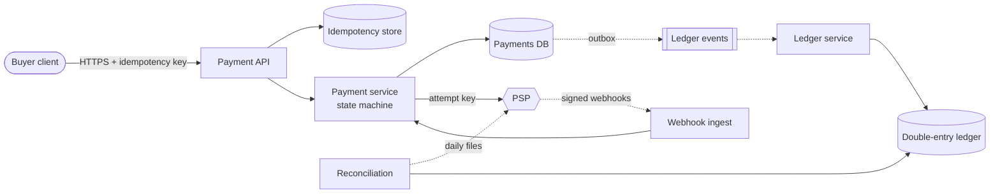

**Reading the diagram.** The buyer's request travels synchronously through the API, which checks the idempotency store, to the payment service, which persists a state transition and a payment attempt *before* calling the PSP with a deterministic attempt key. The PSP's result returns synchronously or later through signed webhooks (dotted, asynchronous), deduplicated by event ID. Every state change writes an outbox row in the same transaction (§32.5), so ledger postings flow asynchronously into the append-only double-entry ledger. Reconciliation compares the ledger with the PSP's settlement files daily. Failure points: a PSP timeout (outcome unknown), webhook duplicates and reordering, and a relay outage that delays the ledger without losing postings. Scaling: the API tier is stateless; the payments database partitions by merchant if it ever must.

#### Deep dives

1. **Idempotency at every hop.** The client key protects the API; a persisted attempt with its own key protects the PSP call; webhook IDs protect ingestion; posting keys protect the ledger. A timeout is *unknown*, never *failed*: query the PSP by attempt key before retrying, and never fail over to a second PSP while an outcome is unknown (§55.9.8).
2. **The ledger.** Every transaction's lines sum to zero per currency; balances are derived or maintained as checked aggregates; corrections are reversals, never edits. Hot platform accounts (fees, commission) are split into sub-accounts to avoid lock contention.
3. **Reconciliation as a system.** Three-way match of ledger, PSP report and bank statement; unmatched items go to a queue with owners and ageing alerts.

#### Trade-offs and alternatives

Synchronous capture is simpler; delayed capture (authorize now, capture on shipment) matches marketplace reality and makes the state machine longer. A relational database with serializable transactions per payment is right at 2,900/s; event sourcing the payment is attractive for audit but the ledger already gives an immutable history. Reverse the choice of a single PSP only when the business needs routing for cost or approval rates, and then only with per-attempt PSP ownership.

#### Follow-up questions

1. *"Can you guarantee exactly-once charging?"* Not per hop; at-least-once delivery plus idempotent processing at every hop gives effectively-once outcomes, and reconciliation catches the rest.
2. *"The PSP does not support idempotency keys."* Record the attempt reference first, query by it before any retry, and accept that reconciliation becomes the last line of defense.
3. *"Why not floats?"* Binary floating point cannot represent 0.10; use integer minor units.
4. *"How do refunds and chargebacks post?"* As new balanced transactions referencing the original, never as edits.
5. *"What is in PCI scope?"* Only the tokenization edge; card numbers never reach our services.

#### What distinguishes levels

- **Mid:** idempotency key on the API, a payments table and a PSP call with retries.
- **Senior:** traces the key through every hop, treats timeouts as unknown, designs a balanced append-only ledger and the outbox.
- **Staff:** makes reconciliation a first-class system with ownership, removes hot-account contention, refuses PSP failover under unknown outcomes, and frames PCI scope as an architectural boundary. The full treatment is §55.9.

### 91.6.2 Q30. Stock-exchange matching engine

**Difficulty:** Hard · **Time:** 60 min · **Related:** §27.4 (primary–backup), Ch 31 (logs), §4.11 (Little's Law), §18.3 (vertical scaling)

#### Prompt

"Design the core of a stock exchange: members send orders, the exchange matches buyers with sellers and publishes trades and market data. Latency and fairness matter."

#### Clarifying questions and assumptions

- *Order types?* Limit and market orders, cancel and modify; no auctions or complex orders in scope.
- *Fairness?* Strict price–time priority: better price first, then earlier arrival.
- *Scale?* 10,000 symbols; 1 million order messages/s at peak, 100,000/s averaged over a 6.5-hour session.
- *Latency target?* p99 under 100 µs from gateway receipt to acknowledgment, inside one data center; members co-locate.
- *Recovery?* No acknowledged order may be lost; failover to a hot standby in seconds.

#### Requirements

**Functional.** Accept, validate and risk-check orders; match by price–time priority; acknowledge, report fills, publish trades and order-book changes; cancel and modify; end-of-day clearing feed. **Non-functional.** Determinism (replaying the input log reproduces every trade); p99 ≤ 100 µs and low jitter; RPO 0 for acknowledged orders; 99.99% during trading hours; fair, equal-latency access for members.

#### Estimation

::: example
**Worked example — The engine is latency-bound, not throughput-bound.** Assumptions above; 100 B per order message; matching costs about 2 µs per message on one core (an assumption to benchmark); the busiest symbol carries 3% of peak flow; books hold 20,000 resting orders per symbol at 100 B each.

1. Daily messages: $10^5 \times 23{,}400 = 2.34 \times 10^9$; input log $2.34 \times 10^9 \times 100 = 234$ GB/day, 702 GB with three copies (§89.6).
2. One core matches $1 / 2\,\mu\text{s} = 500{,}000$ messages/s. Busiest symbol at peak: $0.03 \times 10^6 = 30{,}000$/s, 6% of one core.
3. With 16 matching partitions (symbol groups), average peak load is 62,500/s each, 12.5% of a core.
4. Order books: $10^4 \times 2 \times 10^4 \times 100 = 20$ GB in total, 1.25 GB per partition: memory-resident.

**Interpretation.** A single thread per symbol group has ample throughput; queueing (§4.11) and jitter, not capacity, decide whether p99 stays under 100 µs. **Engineering implication.** Keep matching single-threaded and in memory, avoid locks and garbage-collection pauses, and spend the budget on the sequencing and replication path.
:::

#### API and data model

```text
FIX or binary protocol over TCP per member session:
  NewOrder{cl_ord_id, symbol, side, qty, price, type, tif}   -> Ack{order_id, seq}
  Cancel{cl_ord_id, order_id}                                -> CancelAck | Reject
  ExecutionReport{order_id, fill_qty, fill_price, trade_id, seq}
Market data: multicast UDP, per-partition sequence numbers, snapshot + incremental

Order book (in memory, per symbol): price levels in two sorted maps (bids desc, asks asc);
  each level a FIFO queue of resting orders; order_id -> node index for O(1) cancel
Journal: (partition, seq) -> input message, append-only
```

#### High-level design

**Figure 91.31 — Matching engine: sequence, replicate, then match deterministically.**

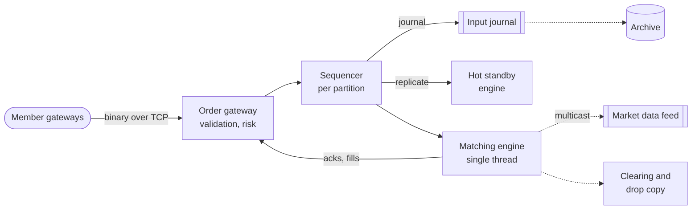

**Reading the diagram.** Orders arrive over persistent TCP sessions at gateways that validate and apply pre-trade risk checks. Each symbol group's sequencer assigns a monotonically increasing sequence number, appends to the journal and replicates to the hot standby before the engine processes the message, so the standby holds the same input in the same order. The matching engine is a single-threaded state machine over in-memory order books; it returns acknowledgments and fills synchronously to gateways and publishes market data asynchronously by multicast (dotted) with sequence numbers so subscribers detect gaps. The journal is the storage boundary; the archive is downstream. Failure points: the sequencer (mitigated by the standby replaying the journal), a slow consumer on the market-data path (multicast never waits for it), and garbage-collection or OS jitter. Scaling: add symbol partitions; never split a symbol.

#### Deep dives

1. **Determinism through a sequenced log.** The engine is a replicated state machine (§26.3.2): same inputs in the same order give the same trades. Time comes from the sequencer's stamp, never from the engine's clock; random numbers and hash-map iteration order are banned in matching code. Recovery is "load snapshot, replay journal from its sequence number"; a failover standby is already caught up.
2. **The latency budget.** Kernel-bypass networking, pinned cores, preallocated object pools and lock-free ring buffers between stages. Table 91.5 allocates the 100 µs budget; replication to the standby is the largest single term, which is why the standby sits in the same data center and the cross-site disaster-recovery copy is asynchronous.
3. **Order-book data structure.** Price levels as arrays indexed by tick offset (or a balanced tree for wide ranges), each a FIFO list; an index from order ID to node gives O(1) cancel, which matters because cancels often outnumber new orders.

**Table 91.5 — An illustrative p99 latency budget for one order (assumptions to measure).**

| Stage | Budget | Why |
|---|---|---|
| Network in and gateway parse, risk check | 20 µs | Kernel bypass, precomputed limits |
| Sequencer and journal append | 10 µs | Memory-mapped journal, batched flush |
| Replication to standby, acknowledged | 30 µs | Same-site link; largest term |
| Matching | 5 µs | Single thread, in memory |
| Acknowledgment out to member | 20 µs | Gateway encode and send |
| Headroom for jitter | 15 µs | GC-free, pinned cores |
| **Total** | **100 µs** | |

::: industry
**LMAX.** Martin Fowler's description of the LMAX retail exchange architecture reports a single-threaded business-logic processor holding all state in memory, fed by input and output ring buffers (the Disruptor) that journal and replicate events, processing about 6 million orders per second on one thread.
*Evidence: Primary* — [Fowler 2011; Thompson et al. 2011]
:::

#### Trade-offs and alternatives

A database-backed matching service is simpler and fails the latency target by two orders of magnitude. Multi-threaded matching within a symbol breaks price–time determinism. Consensus-replicated sequencing (Raft across three nodes) gives automatic failover at the cost of a quorum round per message; primary–backup with a fenced failover is the usual choice when every microsecond counts. Batch auctions (match every few milliseconds) trade continuous latency for fairness against speed races.

#### Follow-up questions

1. *"How do you fail over without duplicates or losses?"* The standby holds the replicated journal; it takes over at the last sequence number with a fencing epoch so the old primary's late outputs are rejected (§26.13). Members resend unacknowledged orders with their client order IDs, which deduplicate.
2. *"How do market-data subscribers recover a lost packet?"* Gap detection by sequence number, retransmission service or snapshot plus replay.
3. *"How is fairness between members ensured?"* Equal cable lengths and gateway paths for co-located members, arrival stamps at one point, and optional speed bumps.
4. *"Where does pre-trade risk run?"* At the gateway, against per-member limits kept in memory and updated from fills.
5. *"How would you scale to 100,000 symbols?"* More partitions; symbols never span partitions, and cross-symbol orders are out of scope.

#### What distinguishes levels

- **Mid:** an order-book data structure and a matching service in front of a database.
- **Senior:** a single-threaded in-memory engine, a sequenced journal, deterministic replay and a latency budget with numbers.
- **Staff:** explains why replication sits before matching, designs fencing for failover, separates the market-data path so slow subscribers cannot stall matching, and discusses fairness mechanisms as a product decision.

### 91.6.3 Q31. Distributed key-value store

**Difficulty:** Hard · **Time:** 60 min · **Related:** §52.8 (full case study); §14.8, §27.7–§27.14, §13.8

#### Prompt

"Design a highly available key-value store, like Dynamo, that many internal services use. It must stay writable during node and zone failures."

#### Clarifying questions and assumptions

- *Value sizes and API?* Keys ≤ 256 B, values ≤ 1 MB; `get`, `put`, `delete`; no range scans or multi-key transactions.
- *Consistency?* Tunable per table: $N$, $R$, $W$; eventual by default.
- *Scale?* 100 TB logical, 2 million reads/s and 1 million writes/s at peak (§52.8.4).

#### Requirements

**Functional.** Get/put/delete with version context; per-table $N$, $R$, $W$ and conflict policy; online node addition; optional multi-datacenter replication. **Non-functional.** 99.99% write availability including the loss of one zone; p99 ≤ 10 ms within a region; convergence within an hour after healing; rebalancing uses ≤ 20% of node bandwidth.

#### Estimation

::: example
**Worked example — Throughput sets the node count.** From §52.8.4: 100 billion 1 KB items; RF 3; LSM space amplification 1.3; 8 TB nodes filled to 70%; 100,000 replica operations/s per node at $u = 0.6$.

1. Raw storage $100 \times 3 \times 1.3 = 390$ TB: 70 nodes would hold it (§89.9).
2. Replica operations with reads touching all three replicas: $2 \times 10^6 \times 3 + 10^6 \times 3 = 9 \times 10^6$/s, so $9 \times 10^6 / 60{,}000 = 150$ nodes.
3. Reading from $R = 2$ replicas instead: $4 \times 10^6 + 3 \times 10^6 = 7 \times 10^6$/s, 117 nodes.

**Interpretation.** The cluster is throughput-bound by a factor of two. **Engineering implication.** Per-table quorum settings change hardware cost directly; disk size does not.
:::

#### API and data model

```text
get(key) -> ([value...], context)      put(key, value, context)      delete(key, context)
Placement: Q = 16,384 fixed partitions; partition -> preference list of N nodes in distinct zones
Storage: LSM tree per node (memtable, SSTables, Bloom filters); version vector per value
```

#### High-level design

**Figure 91.32 — Dynamo-style store: any node coordinates, quorums decide.**

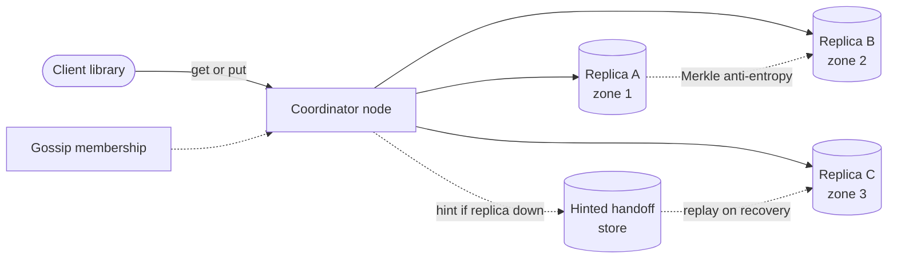

**Reading the diagram.** The client (or a partition-aware library) sends a request to a coordinator, normally the first healthy node in the key's preference list. The coordinator sends it to all $N$ replicas in different zones and answers after $W$ write or $R$ read acknowledgments (synchronous). If a replica is down, a stand-in stores a hinted write and replays it on recovery (dotted, asynchronous); Merkle-tree anti-entropy and read repair converge replicas in the background; gossip spreads membership. Each replica is a storage boundary with an LSM engine. Failure points: sloppy quorums weaken read-your-writes, and tombstones must outlive the longest rejoin window. Scaling: add nodes and move whole partitions.

#### Deep dives

1. **Quorums and their limits.** $R + W > N$ makes read and write sets overlap, but not with sloppy quorums, concurrent writes or partial failed writes (§27.8.2).
2. **Conflicts.** Version vectors detect concurrent writes and return siblings to the application; last-writer-wins silently drops one (§27.14).
3. **Repair and rebuild.** Fixed partitions spread a dead node's data across about 50 peers, so a rebuild takes minutes instead of hours (§52.8.4).

#### Trade-offs and alternatives

Leaderless quorums buy write availability at the cost of conflict handling. A Raft group per partition (§26.7) gives linearizable keys and simpler semantics at the cost of a leader per range and unavailability for a minority partition. Choose leaderless for carts and sessions, consensus for anything with invariants.

#### Follow-up questions

1. *"What does $R + W > N$ buy you?"* Overlap with the latest acknowledged write under strict quorums; nothing under sloppy quorums.
2. *"Why not timestamps for conflicts?"* Clock skew plus LWW loses concurrent writes.
3. *"How does a new node get data?"* It takes partitions from many peers, streaming in parallel and throttled.
4. *"How do replicas detect divergence cheaply?"* Merkle trees per partition (§17.8).
5. *"Hot key?"* Client-side caching or key splitting; quorums do not spread one key's load.

#### What distinguishes levels

- **Mid:** consistent hashing and replication with a correct read and write path.
- **Senior:** quorums, hinted handoff, version vectors, read repair and anti-entropy explained as mechanisms.
- **Staff:** explains how they interact (sloppy quorums versus $R + W > N$, tombstones versus rejoin windows, partition count versus rebuild time) and makes conflict policy a per-table product decision. Full case: §52.8.

### 91.6.4 Q32. Distributed message queue

**Difficulty:** Hard · **Time:** 60 min · **Related:** §30.4, Ch 31 (Kafka), §89.11

#### Prompt

"Design a distributed message queue that hundreds of teams use to pass events between services. It must not lose acknowledged messages and must let consumers replay."

#### Clarifying questions and assumptions

- *Queue or log semantics?* A partitioned, replicated **log**: consumers track offsets and can replay; per-key ordering within a partition. Per-message acknowledgment (queue semantics) is a layer on top.
- *Scale?* 2 GB/s average, 5 GB/s peak ingest; 1 KB messages; three consumer groups read each topic on average; 7-day retention; compression 3:1.
- *Durability?* An acknowledged message survives the loss of any one node or zone.

#### Requirements

**Functional.** Create topics with partitions; produce with keys (same key, same partition, in order); consume in consumer groups with committed offsets; replay from an offset or time; retention by time and size; dead-letter handling for poison messages. **Non-functional.** No loss of acknowledged messages (replicated to three zones, acknowledged by two); p99 produce latency under 20 ms; consumer lag observable in seconds; per-team quotas; 99.95% availability.

#### Estimation

::: example
**Worked example — Disk, network and the effect of tiered storage.** Using §89.11 with the assumptions above; brokers have 48 TB of disk filled to 60% and 25 Gb/s NICs used at 60% (1.875 GB/s).

1. Peak messages: $5 \times 10^9 / 10^3 = 5$ million/s. Compressed peak ingest: $5 / 3 = 1.67$ GB/s.
2. Broker disk: $B = (2 / 3)\ \text{GB/s} \times 604{,}800\ \text{s} \times 3 = 1.21$ PB, so $1.21\ \text{PB} / 28.8\ \text{TB} = 42$ brokers.
3. Network out of brokers at peak: consumers $3 \times 1.67 = 5.0$ GB/s plus replication $2 \times 1.67 = 3.33$ GB/s $= 8.33$ GB/s, only 4.4 brokers' worth.
4. Tiered storage keeping 1 day local and older segments in object storage: local disk $1.21 / 7 = 0.173$ PB, 6 brokers' worth.
5. Partitions at 10 MB/s of consumer throughput each, with 1.5× headroom: $1.5 \times 5{,}000 / 10 = 750$.

**Interpretation.** Without tiering the cluster is disk-bound at 42 brokers while network needs fewer than 5; with tiering the binding term shifts to network and partitions, and the cluster shrinks several-fold (12 brokers for spread and failure headroom). **Engineering implication.** Retention is a storage-tier decision, not a broker-count decision; separate them.
:::

#### API and data model

```text
produce(topic, key, value, headers) -> (partition, offset)      acks = all, idempotent producer
fetch(topic, partition, offset, max_bytes) -> records            consumer pulls
commit(group, topic, partition, offset)
Log segment files per partition replica: [offset, timestamp, key, value, headers], index files
Metadata (controller quorum): topics, partition -> leader, ISR, leader epoch, quotas
```

#### High-level design

**Figure 91.33 — Partitioned, replicated log with a metadata quorum and tiered storage.**

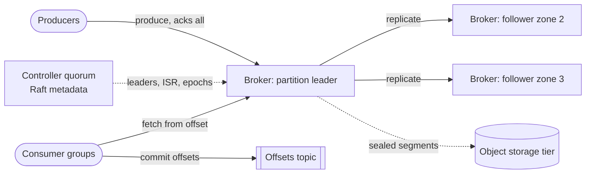

**Reading the diagram.** Producers send batches to the partition leader, which appends to its local segment and replicates to followers in other zones; with `acks=all` and a minimum in-sync replica count of 2, the producer is acknowledged once two zones hold the batch (synchronous). The controller quorum, itself a Raft log, owns metadata: which broker leads which partition, the in-sync replica set and leader epochs (dotted, asynchronous updates). Sealed segments move asynchronously to object storage, the long-term storage boundary. Consumers pull from offsets and commit them to an internal compacted topic. Failure points: leader loss (a new leader from the in-sync set, with epoch-based truncation), a slow follower dropping out of the ISR, and consumer rebalances. Scaling: add partitions and brokers; consumers scale up to the partition count.

#### Deep dives

1. **Durability without losing order.** Leader epochs let a returning follower truncate entries the new leader never had (§31.9.4); unclean leader election is disabled for durable topics. Idempotent producers carry a producer ID and sequence numbers so retries do not duplicate within a partition (§31.6.3).
2. **Queue semantics on a log.** Many teams want "acknowledge each message, redeliver after a timeout, dead-letter after N attempts". Either offer share groups (cooperative per-record consumption, §31.7.4) or a per-message state layer with visibility timeouts (§30.4.2). Make the trade explicit: per-record acknowledgment gives up per-key ordering.
3. **Multi-tenancy.** Produce and fetch byte-rate quotas per client, partition-count limits per team, and separate clusters for the few topics whose bursts would starve others (§47.8).

#### Trade-offs and alternatives

**Table 91.6 — Log versus queue for a company-wide messaging service.**

| Aspect | Partitioned log (Kafka-style) | Broker queue (RabbitMQ/SQS-style) |
|---|---|---|
| Replay | Yes, by offset or time | No; consumed messages are gone |
| Ordering | Per partition | Per queue at best, lost with competing consumers |
| Per-message acknowledgment and redelivery | Layered on top | Native |
| Fan-out to many consumer groups | Cheap: each reads the same bytes | Copies per subscription |
| Choose when | Event streams, CDC, analytics, replay | Task queues, per-job retries, low volume |

#### Follow-up questions

1. *"How do you guarantee ordering for one customer?"* Key by customer ID; one partition, one consumer in the group at a time; never increase the partition count of a keyed topic without a migration (§31.5.3).
2. *"Exactly-once?"* Idempotent producer plus transactions give exactly-once within the log; side effects outside need idempotent consumers (§32.10).
3. *"A consumer is stuck on a poison message."* Bounded retries, then a dead-letter topic with the original offset; alert on dead-letter rate (§30.11).
4. *"What do you monitor?"* Under-replicated partitions, ISR shrink rate, produce p99, consumer lag in seconds, disk and tier upload lag.
5. *"Why a separate metadata quorum?"* Metadata needs linearizable updates and fast failover; data replication uses the cheaper in-sync-replica scheme (§31.9.2).

#### What distinguishes levels

- **Mid:** topics, partitions, consumer groups and replication described correctly.
- **Senior:** sizes disk, network and partitions; explains ISR, `acks=all`, idempotent producers and lag.
- **Staff:** separates storage tiering from compute, offers queue semantics deliberately with its ordering cost, and designs quotas and cluster isolation for hundreds of teams.

### 91.6.5 Q33. Resharding a live SQL database

**Difficulty:** Hard · **Time:** 60 min · **Related:** §14.7, §14.9.5 (online migration), §43.13, §32.6 (CDC)

#### Prompt

"Your product runs on one large PostgreSQL primary with read replicas. It will run out of disk in about six weeks. Split it into shards without downtime."

#### Clarifying questions and assumptions

- *Data and load?* 8 TB on a 10 TB volume; 20,000 writes/s and 150,000 reads/s at peak; data grows 15% a month.
- *Access pattern?* Almost every query is scoped by `account_id`; a few admin and analytics queries span accounts.
- *Downtime budget?* No planned outage; a write pause of a few seconds per shard at cutover is acceptable.
- *Team constraints?* The application can change, but not all at once; rollback must be possible at every step.

#### Requirements

**Functional.** Partition all account-scoped tables by `account_id`; route queries to the right shard; keep cross-account queries working (possibly slower or offline); support adding shards later without repeating the project. **Non-functional.** Zero data loss, verified by checksums; write pause ≤ 5 s per shard at cutover; p99 latency unchanged during the copy (copy throttled); reversible until the final cleanup.

#### Estimation

::: example
**Worked example — How urgent is it, and how long does the copy take?** Assumptions above; rows average 1 KB in the change stream; a single throttled copy stream runs at 200 MB/s; the change applier sustains 60 MB/s.

1. Time to 95% disk: $8 \times 1.15^{n} = 9.5$ gives $n = \ln(1.1875)/\ln(1.15) = 1.23$ months: about five weeks, not six.
2. Single-stream backfill: $8 \times 10^{12} / (2 \times 10^8) = 40{,}000$ s $= 11.1$ h.
3. Changes accumulated meanwhile: $20{,}000 \times 1\ \text{KB} = 20$ MB/s, so $20\ \text{MB/s} \times 40{,}000\ \text{s} = 800$ GB; catch-up time (§89.11) $= 800\ \text{GB} / (60 - 20)\ \text{MB/s} = 20{,}000$ s $= 5.6$ h.
4. Sixteen parallel streams from replicas at 100 MB/s each: $8 \times 10^{12} / (1.6 \times 10^9) = 5{,}000$ s; only 100 GB of changes accumulate.
5. Shard count by §89.9: storage term at the 24-month horizon ($8 \times 1.15^{24} \approx 229$ TB, or far less after archiving) dominates; plan for 1,024 logical shards on 16 physical shards to start.

**Interpretation.** A naive single-stream copy plus catch-up takes most of a day and must be restarted if anything fails. **Engineering implication.** Parallelize backfill by key range from replicas, archive cold data first to buy time, and decouple logical from physical shards so the next split is a move, not a project.
:::

#### API and data model

```text
Shard map (in a small consistent store): logical_shard (0..1023) -> physical_shard, state
  logical_shard = hash(account_id) mod 1024
Migration state per logical shard: COPYING | CATCHING_UP | VERIFYING | READS_SWITCHED | WRITES_SWITCHED | DONE
Routing layer: library or proxy (Vitess/Citus-style) resolves account_id -> connection
Global tables (plans, feature flags): replicated to every shard, written in one place
```

#### High-level design

**Figure 91.34 — Online resharding: change capture, backfill, verify, switch.**

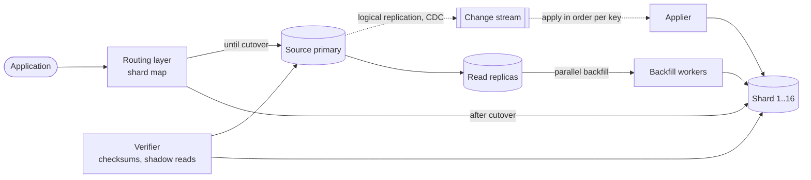

**Reading the diagram.** The application reaches the database only through the routing layer, which consults the shard map. Change capture starts first, at a recorded log position, from the source primary's logical replication stream (dotted, asynchronous); backfill workers then copy existing rows in parallel from read replicas into the 16 target shards. The applier replays captured changes in commit order per key until the targets trail by seconds. A verifier compares per-range checksums and runs shadow reads against both sides. Reads, then writes, switch per logical shard by changing the shard map; the source remains a storage boundary with a reverse stream for rollback. Failure points: replication-slot growth on the source if the applier stalls, schema changes during the migration, and the brief write freeze. Scaling: logical shards move independently, so later growth repeats only the move step.

#### Deep dives

1. **Choosing the shard key.** `account_id` matches 95% of queries, keeps transactions single-shard and spreads load, but whale accounts can still create hot shards: place them on dedicated physical shards via the directory (§47.6.2). Cross-account queries move to a CDC-fed analytics store instead of scatter-gather on the primaries (§14.12).
2. **Cutover without loss.** Per logical shard: stop writes for that range (the router returns retryable errors or queues them for a few seconds), wait until the applier passes the last source position, flip the map with a version number, fence the source range (revoke writes), and resume. A reverse stream from target to source keeps rollback possible for a window (§14.9.5).
3. **Application changes first.** Before any data moves, every query must carry `account_id` and go through the routing layer; queries that cannot are found by logging, not by reading code. Auto-increment IDs must become globally unique (§17.10) before two shards can insert.

**Table 91.7 — Migration phases and their rollback.**

| Phase | Done when | Rollback |
|---|---|---|
| Route all queries via shard map | 100% of traffic through router, one physical shard | Remove router |
| Capture + backfill | Targets trail by < 5 s | Drop targets |
| Verify | Checksums match; shadow-read diff rate 0 for 48 h | Drop targets |
| Switch reads | Reads from targets; source still primary | Flip reads back |
| Switch writes | Writes to targets; reverse stream running | Flip map back, replay reverse stream |
| Clean up | Rollback window closed | None: one-way door |

#### Trade-offs and alternatives

Vertical scaling or archiving cold rows buys months and should be done first. Application-level dual writes avoid CDC tooling but are hard to make atomic and to verify (§32.5.1). A distributed SQL database (§28.10) removes manual sharding at the cost of a platform migration of similar size. Reverse to a managed sharding layer if the team cannot own a routing layer long-term.

#### Follow-up questions

1. *"What if the applier falls behind?"* The source's replication slot retains WAL and its disk fills: alert on slot lag, throttle backfill, and have a kill switch that drops the slot.
2. *"How do you handle foreign keys across shards?"* Co-locate related tables by the same key; global reference tables are replicated; cross-shard constraints become application checks.
3. *"How do you verify 8 TB?"* Per-range checksums computed on both sides at the same log position, plus sampled row comparisons and shadow-read diffs.
4. *"Schema change mid-migration?"* Freeze DDL or apply it through the migration tool on both sides with expand-and-contract (§43.13.2).
5. *"How will you add shard 17 next year?"* Move logical shards; the hash function never changes.

#### What distinguishes levels

- **Mid:** picks a shard key and describes copying data and switching over.
- **Senior:** CDC-first ordering, parallel backfill, verification, per-shard cutover with a short write freeze, and logical shards.
- **Staff:** does the arithmetic that shows the deadline is tighter than stated, starts with routing and ID changes, plans rollback per phase, and removes cross-shard queries from the primaries entirely.

### 91.6.6 Q34. Global CDN

**Difficulty:** Hard · **Time:** 60 min · **Related:** Ch 21, §19.9, §10.11, §89.7

#### Prompt

"Design a content delivery network that thousands of customer websites put in front of their origins. Serve static and video content worldwide with low latency."

#### Clarifying questions and assumptions

- *Scale?* 50 Tb/s peak egress across 200 points of presence (PoPs); average object 100 KB.
- *Content?* Static web assets, images, video segments; dynamic content passes through with connection reuse.
- *Customer features?* Custom domains and TLS certificates, cache rules, purge within seconds, logs and analytics.
- *Security?* DDoS absorption and a web application firewall are part of the product (Q54 goes deeper).

#### Requirements

**Functional.** Route users to a nearby healthy PoP; terminate TLS; serve from cache or fetch from the customer origin; honor HTTP caching semantics (RFC 9111); purge by URL, tag or prefix; per-customer configuration; real-time logs. **Non-functional.** Byte offload ≥ 95%; p50 time to first byte for cache hits under 30 ms in served metros; 99.99% availability per PoP region with automatic failover; global purge p99 under 5 s; configuration changes live within a minute.

#### Estimation

::: example
**Worked example — Which resource sizes a PoP?** Assumptions above; the largest PoPs carry 3× the average; one edge server serves 80 Gb/s or 50,000 TLS requests/s at target utilization; edge hit ratio 90% and shield hit ratio on misses 50%.

1. Requests: $50 \times 10^{12} / 8 / 10^5 = 62.5$ million/s globally; per average PoP 250 Gb/s and 312,500 requests/s.
2. Largest PoP: 750 Gb/s and 937,500 requests/s. Servers by bandwidth $750 / 80 = 9.4$; by requests $937{,}500 / 50{,}000 = 18.75$. Requests bind: 19 servers, plus N+2.
3. Composite offload (§21.5.2): $1 - (1 - 0.9)(1 - 0.5) = 0.95$; origin egress (§89.7) $50 \times 0.05 = 2.5$ Tb/s across all customers. Without the shield tier it would be 5 Tb/s.

**Interpretation.** Small objects make TLS handshakes and request handling, not bandwidth, the binding constraint at big PoPs; the shield tier halves origin load. **Engineering implication.** Optimize per-request CPU (session resumption, HTTP/2 and HTTP/3 connection reuse) and design a two-tier cache hierarchy.
:::

#### API and data model

```text
Customer control plane: PUT /zones/{zone}/config {origins, cache_rules, tls_cert_ref, waf_rules}
                        POST /zones/{zone}/purge {urls | tags | prefix}
Edge cache key: (zone, scheme, host, normalized path, selected query params, Vary headers)
Cache entry: object bytes, headers, expiry, surrogate tags; stored in RAM + SSD tiers
Config distribution: versioned config blobs pushed to every PoP; edge reads local copy
```

#### High-level design

**Figure 91.35 — CDN: anycast edge, shield tier, origin, and the control plane.**

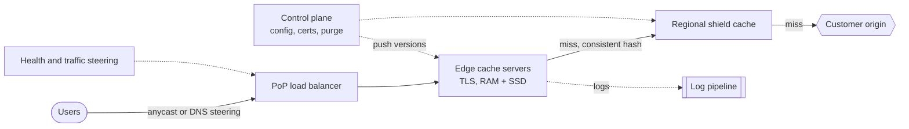

**Reading the diagram.** Users reach a nearby PoP by anycast or DNS steering (§21.3.3). Inside the PoP, a layer-4 load balancer spreads connections over edge servers, which terminate TLS and serve from RAM and SSD caches. Misses go synchronously to a regional shield chosen by consistent hashing on the cache key, so each object is fetched from the origin once per region (§21.5.3), and shield misses reach the customer origin. The control plane pushes versioned configuration, certificates and purge commands asynchronously (dotted); logs stream out asynchronously. Storage boundaries: edge and shield caches. Failure points: a PoP outage (traffic steering withdraws its anycast route or DNS record), a shield outage (edges fall back to another shield or the origin), a bad configuration push (the largest outage risk, so staged rollouts), and a cold cache after purge. Scaling: more servers per PoP, more PoPs, more shields.

#### Deep dives

1. **Request routing.** Anycast is simple and absorbs DDoS but gives coarse control; DNS steering is precise but limited by resolver location and TTLs. A hybrid uses anycast for the network and DNS or load-feedback to shift load between PoPs (§21.3.3).
2. **Cache hierarchy and keys.** A bad cache key (including irrelevant query parameters or cookies) fragments the cache and destroys hit ratio; normalize keys and let customers whitelist parameters. Consistent hashing inside the PoP stops each server from caching the same popular objects separately; very hot objects are replicated to all servers.
3. **Purge and configuration at global scale.** Purge is a fan-out to every PoP: publish to a replicated message broker, apply locally by URL or surrogate tag, acknowledge; 200 PoPs within 5 s is feasible. Configuration pushes are the riskiest operation: canary to a few PoPs, check error rates, then widen (§43.6).

#### Trade-offs and alternatives

Fewer, larger PoPs raise hit ratios (more users per cache) but add latency; many small PoPs cut round trips but fragment caches, which the shield tier offsets. Embedding caches inside ISPs (as Netflix Open Connect does for its own video, §21.10) suits one large tenant with predictable content, not thousands of customers. Pull-through caching suits web content; pre-positioning suits large video libraries.

#### Follow-up questions

1. *"How do you fail over a PoP?"* Health checks withdraw its anycast prefix or DNS answers; neighboring PoPs must have headroom, so plan capacity for losing the largest PoP in each region.
2. *"How do you serve customers' TLS certificates?"* Keys stay in a central key service or are distributed encrypted; SNI selects the certificate at the edge; some customers require keyless signing at their own servers.
3. *"Cache stampede on a popular new object?"* Request collapsing at edge and shield: one fetch per object per tier (§20.11).
4. *"Live video?"* Short segments, blocking playlist requests and collapsing; see Q41.
5. *"How do you bill?"* From edge logs aggregated per zone, deduplicated by request ID.

#### What distinguishes levels

- **Mid:** edge caches, origin, TTLs and DNS routing.
- **Senior:** offload arithmetic, the shield tier, cache-key normalization, purge fan-out and request collapsing.
- **Staff:** identifies the per-request CPU bind at large PoPs, treats configuration pushes as the main outage risk, and plans capacity for PoP loss and DDoS together.

### 91.6.7 Q35. Distributed cache at very large scale

**Difficulty:** Hard · **Time:** 60 min · **Related:** §20.6, §20.11–§20.15, §89.8, §44.7

#### Prompt

"Design the caching tier for a social network that serves 200 million cache reads per second in front of its databases."

#### Clarifying questions and assumptions

- *What is cached?* Database query results and objects (profiles, posts, counts), look-aside (§20.7.1).
- *Data size?* 10 billion hot items of about 1 KB.
- *Consistency?* Stale reads acceptable for seconds; a user must see their own writes.
- *Regions?* Several regions; one region holds the primary database for writes.

#### Requirements

**Functional.** Get, multi-get, set, delete; invalidation on database writes; regional replication of invalidations. **Non-functional.** p99 under 1 ms for single gets inside a region; 99% hit ratio; the database must survive a cache-node failure and a cache-cluster restart; no stale value persisting more than a few seconds after a write.

#### Estimation

::: example
**Worked example — Throughput, not memory, sizes the tier.** Assumptions: overhead factor 1.5; a node offers 200 GB of cache memory and 1 million operations/s at saturation ($u = 0.6$); a page multi-gets 100 keys.

1. Memory (§89.8): $10^{10} \times 1{,}000 \times 1.5 = 15$ TB, which is 75 nodes.
2. Throughput: $2 \times 10^8 / (10^6 \times 0.6) = 334$ nodes. Those nodes hold $334 \times 200\ \text{GB} = 66.8$ TB, 4.45 copies of the working set.
3. Multi-get fan-out: 100 keys spread uniformly over 334 nodes touch $334\,(1 - (1 - 1/334)^{100}) \approx 87$ nodes per page.
4. Database load at 99% hit ratio: $2 \times 10^8 \times 0.01 = 2$ million reads/s; at 95%, 10 million/s, five times more.
5. One key carrying 1% of traffic needs 2 million reads/s, twice one node's saturation capacity.

**Interpretation.** The tier is throughput-bound, so spare memory should buy hit ratio or replication; fan-out and hot keys, not size, break it. **Engineering implication.** Replicate pools, batch multi-gets per node, and plan specifically for hot keys and cold restarts.
:::

#### API and data model

```text
get(k), get_multi([k...]), set(k, v, ttl, lease_token), delete(k)
Client library: consistent hashing over pool members, batching per server, timeouts
Lease: on miss, server returns a token; set succeeds only with a valid token (delete voids it)
Invalidation stream: database commit log -> invalidation daemons -> delete(k) in every region
```

#### High-level design

**Figure 91.36 — Large cache tier: routed pools, leases, and invalidation from the commit log.**

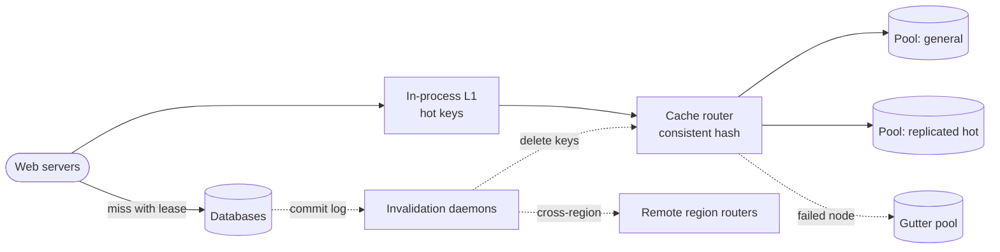

**Reading the diagram.** Web servers check a small in-process L1 for the hottest keys, then a router (in the client library or a proxy) that hashes each key to a node in the right pool: a large general pool and a smaller pool whose keys are replicated on several nodes for hot items. On a miss, the web server reads the database and sets the value with a lease token (synchronous). Writes go to the database; invalidation daemons tail its commit log and delete affected keys in every region (dotted, asynchronous). When a cache node fails, the router sends its keys to a small gutter pool with short TTLs instead of rehashing them onto healthy nodes. Storage boundaries: cache pools (soft state) and databases (truth). Failure points: node failure, cold restart, hot keys, invalidation lag. Scaling: add nodes to pools; add pools by workload.

#### Deep dives

1. **Stale sets and stampedes: leases.** A reader that misses gets a lease token; a concurrent delete voids it, so a stale value read before the write cannot be set after it. The server hands out at most one token per key per few seconds, so a popular miss triggers one database read, not thousands (§20.11.1).
2. **Failure and warm-up.** Rehashing a failed node's keys onto survivors shifts its load plus misses onto them; a gutter pool absorbs it instead. A new or restarted cluster is warmed by reading from a warm cluster ("cold cluster warm-up") rather than from the database, because the database cannot absorb the 5× load of a 95% hit ratio.
3. **Hot keys and fan-out.** Detect hot keys by sampling; replicate them across a pool or serve them from L1 with short TTLs. Reduce multi-get fan-out by co-locating related keys (hash on a prefix such as `user_id`) and by batching per node; cap per-request parallelism to avoid incast.

::: industry
**Memcache at Facebook.** Nishtala et al. describe look-aside memcached clusters serving billions of requests per second, with leases to prevent stale sets and thundering herds, a gutter pool for failed servers, mcrouter for routing, regional pools, cold-cluster warm-up and invalidations driven by the MySQL commit log across regions.
*Evidence: Primary* — [Nishtala et al. 2013]
:::

#### Trade-offs and alternatives

Look-aside keeps the cache simple and the database authoritative; write-through simplifies consistency but couples write latency to the cache (§20.7). Memcached's threads and slabs suit simple values at high throughput; Redis offers data structures and replication at lower per-node throughput (§20.16). Replicating every key everywhere maximizes hit ratio and read capacity but multiplies invalidation traffic.

#### Follow-up questions

1. *"How does a user see their own write?"* Delete on write in the local region, and route that user's reads to the primary region or set a short "recently wrote" marker that bypasses replicas.
2. *"What if invalidation messages are lost?"* TTLs bound staleness; the commit-log tailer is replayable from a position.
3. *"How do you add nodes without a miss storm?"* Consistent hashing moves $1/n$ of keys; add nodes slowly, off-peak, and pre-warm.
4. *"Why not cache everything forever?"* Memory cost and invalidation correctness; TTLs are a safety net.
5. *"How do you know the tier is healthy?"* Hit ratio per pool, database fallback rate, p99 per node, evictions, hot-key alerts.

#### What distinguishes levels

- **Mid:** consistent hashing, TTLs, look-aside caching.
- **Senior:** throughput-bound sizing, invalidation from the commit log, stampede control, hot keys.
- **Staff:** leases versus stale sets, gutter pools versus rehashing, cold-cluster warm-up, fan-out and incast, and cross-region invalidation as one coherent failure plan.

### 91.6.8 Q36. Real-time search over posts

**Difficulty:** Hard · **Time:** 60 min · **Related:** §16.10, §53.8 (Twitter case, real-time search component), §16.7

#### Prompt

"Users publish short posts. Design search so a post is findable within seconds of publication, ranked mostly by recency, even during breaking news."

#### Clarifying questions and assumptions

- *Corpus window?* The real-time index covers 7 days; older posts go to an archive index with slower freshness.
- *Volume?* 200 million posts/day, peak 3× average, bursts to 50,000 posts/s; 50,000 queries/s at peak.
- *Ranking?* Recency plus engagement signals; a "top" mode re-ranks.
- *Freshness?* Searchable within 10 s at p99.

#### Requirements

**Functional.** Keyword, hashtag and author search; "latest" and "top" modes; deletions removed within seconds; filters (language, media). **Non-functional.** Freshness p99 ≤ 10 s; query p99 ≤ 200 ms; 99.95% availability; graceful degradation under write bursts (stay fresh, possibly with partial results).

#### Estimation

::: example
**Worked example — Small index, high churn.** Assumptions: 20 indexed terms per post and 4 bytes per compressed posting (§16.3.5); 16 partitions; one partition server answers 2,000 queries/s.

1. Ingest: $2 \times 10^8 / 86{,}400 = 2{,}315$ posts/s average, 6,944/s at peak, bursts to 50,000/s.
2. Index size: 7 days $= 1.4 \times 10^9$ posts $\times 20 \times 4 = 112$ GB per replica, 7 GB per partition: memory-resident.
3. Query fan-out: $50{,}000 \times 16 = 800{,}000$ partition queries/s; replicas per partition $50{,}000 / 2{,}000 = 25$, so 400 partition servers.

**Interpretation.** The index fits in memory many times over; the challenges are a write burst of 50,000 posts/s and scatter-gather tail latency. **Engineering implication.** Use in-memory, append-optimized segments partitioned by time, and avoid touching all partitions for "latest" queries.
:::

#### API and data model

```text
GET /search?q=&mode=latest|top&cursor=&count=20
Post event (from the post log): {post_id (time-ordered, §17.10), author_id, text, lang, created_at, deleted}
Segment: in-memory inverted index for a time slice; postings lists in post_id (time) order
Deleted set: bitmap per segment, applied at query time
```

#### High-level design

**Figure 91.37 — Real-time search: indexers fed from the post log, time-sliced segments, a broker.**

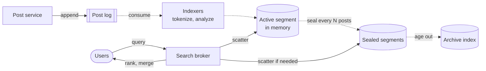

**Reading the diagram.** The post service appends each post to a partitioned log (synchronous for the author). Indexers consume asynchronously (dotted), analyze text and append postings to the active in-memory segment of each partition; when a segment reaches its size it is sealed and optimized, and segments older than 7 days age out to an archive index on disk. A query reaches the broker, which scatters to the partition replicas, newest segments first, gathers the top results, re-ranks and returns. Storage boundaries: in-memory segments per partition replica, rebuilt from the log on failure. Failure points: indexer lag during bursts, a slow replica inflating tail latency, and deletions that must apply immediately. Scaling: replicas for query load, partitions for write load, and time slicing for both.

#### Deep dives

1. **Append-only postings in time order.** Because post IDs are time-ordered, a new posting appends to the end of each list; readers walk lists backward for "latest" and stop after enough hits. Single-writer segments with lock-free readers keep freshness in seconds without the refresh-and-merge cost of a general engine (§16.10.1).
2. **Early termination and time slicing.** A "latest" query searches the newest segments first and stops when it has 20 good results, so most queries touch a fraction of the index. "Top" queries retrieve a few hundred candidates per partition and re-rank with engagement features.
3. **Burst handling.** Partition the log by post ID hash so bursts spread evenly; give indexers headroom of 2× peak; if they fall behind, serve partial freshness and show it, rather than slow queries.

::: industry
**Earlybird.** Busch et al. describe Twitter's real-time search engine: in-memory inverted indexes over time-ordered tweets, partitioned and replicated, with a single writer and lock-free concurrent readers per segment and tweets searchable within about ten seconds.
*Evidence: Primary* — [Busch et al. 2012]
:::

#### Trade-offs and alternatives

Elasticsearch with a 1 s refresh interval (§16.10) is easier to operate and adequate at a few thousand posts per second; at 50,000/s bursts the custom in-memory design wins. Term partitioning would reduce fan-out but makes hot terms during breaking news overload one partition; document partitioning spreads them. A separate archive index trades freshness for cost on older posts.

#### Follow-up questions

1. *"How are deletions handled?"* A deleted-post bitmap per segment checked at query time, applied within seconds from the post log; physical removal at seal or merge time.
2. *"What happens when a partition replica dies?"* Others serve; a new replica rebuilds from the log from the oldest retained segment's offset.
3. *"How do you handle a trending term with millions of matches?"* Early termination by recency; for "top", precomputed engagement scores and a capped candidate set.
4. *"Multi-language?"* Language detection at indexing; per-language analyzers; queries analyzed in the detected language plus a fallback (§16.4.7).
5. *"How do you test freshness?"* Synthetic canary posts searched continuously; freshness p99 is an SLI.

#### What distinguishes levels

- **Mid:** inverted index, sharding and replication with an indexing pipeline.
- **Senior:** in-memory time-ordered segments, freshness budget, fan-out sizing and deletes.
- **Staff:** early termination as a capacity lever, document versus term partitioning under bursts, and a clear degradation policy.

### 91.6.9 Q37. Ad-click aggregation

**Difficulty:** Hard · **Time:** 60 min · **Related:** §56.7 (full case study); §29.8, §31.11, §17.6

#### Prompt

"Advertisers are billed per click. Aggregate ad clicks per ad per minute, show advertisers near-real-time counts and return the top 100 ads of the last few minutes. Counts must be billing-accurate."

#### Clarifying questions and assumptions

- *Volume?* 1 billion clicks/day, peak 5× average; 2 million active ads; 100-byte click events with a unique click ID and event time.
- *Accuracy?* Billing totals exact after a daily close; live numbers within 0.5%.
- *Late events?* Clicks arrive up to minutes late from mobile clients; fraud filtering retracts clicks hours later.

#### Requirements

**Functional.** Per-ad counts per minute; top-N ads per window; filters by country and device; daily billing totals; retractions. **Non-functional.** Live freshness ≤ 30 s; final minute values ≤ 2 min after the minute ends; no double counting or loss in billing totals; replay of a day on demand.

#### Estimation

::: example
**Worked example — Modest rate, strict correctness.**

1. Rates (§89.5): $10^9 / 86{,}400 = 11{,}574$ clicks/s average, 57,870/s at peak; raw data $10^9 \times 100\ \text{B} = 100$ GB/day.
2. Deduplication state for a 1-hour window at average rate: $11{,}574 \times 3{,}600 = 4.17 \times 10^7$ click IDs × 16 B $\approx 0.67$ GB, partitioned across the job.
3. Per-minute aggregate rows are at most 2 million (one per active ad), far fewer in practice.

**Interpretation.** One streaming job handles the rate; the design effort goes into event time, deduplication and reconciliation. **Engineering implication.** Choose event-time windows with watermarks and an exactly-once sink, and keep raw events for recomputation.
:::

#### API and data model

```text
GET /v1/ads/{ad_id}/clicks?from=&to=&granularity=minute&filter=country:US
GET /v1/ads/top?window=5m&n=100
click_event(click_id, ad_id, user_hash, country, device, event_time)
agg_minute(ad_id, minute, country, device, clicks)   -- OLAP store, partitioned by advertiser
```

#### High-level design

**Figure 91.38 — Click aggregation: log, event-time stream job, OLAP store, batch reconciliation.**

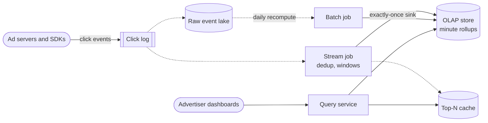

**Reading the diagram.** Clicks are appended to a durable, partitioned log. A stream job consumes asynchronously, deduplicates by click ID, assigns clicks to event-time minute windows using watermarks, and writes rollups to an OLAP store transactionally; it also maintains per-window top-N lists. Raw events land in a lake, from which a daily batch job recomputes billing-grade totals and overwrites the day (the Lambda-style safety net of §29.10). Dashboards query rollups and the top-N cache synchronously. Failure points: consumer crashes (checkpoints and replay), late events beyond the watermark (side output, corrected by the batch job), and hot ads (pre-aggregation). Scaling: partitions of the log and parallelism of the job.

#### Deep dives

1. **Event time and watermarks.** Windows close on event time after an allowed lateness; later events update the minute or go to a correction path (§29.8.3).
2. **Exactly-once.** Checkpointed state plus a transactional or idempotent sink keyed by (ad, minute) gives effectively-once counts; checkpoint interval bounds freshness (§56.7.4).
3. **Top-N.** Partition by ad ID so each partition's local top-N is exact, then merge the partition lists (Q38).

#### Trade-offs and alternatives

Aggregating in the stream gives cheap queries; aggregating raw events in the OLAP store at query time gives flexibility at higher cost. A Kappa design replays the log instead of running a batch job, which works if the log retains enough history (§29.10).

#### Follow-up questions

1. *"A click arrives two hours late."* It misses live numbers, goes to the correction path and appears in the daily close.
2. *"How do you handle fraud retractions?"* Negative events keyed by click ID; billing uses the corrected totals.
3. *"Hot ad during a campaign launch?"* Pre-aggregate per producer or salt the key, then merge (§29.6.3).
4. *"How do you prove the numbers?"* Reconcile stream totals with batch totals per day; alert on drift above 0.5%.

#### What distinguishes levels

- **Mid:** stream counting per minute with a database.
- **Senior:** event time, watermarks, deduplication and an exactly-once sink.
- **Staff:** reconciliation between stream and batch, retraction semantics, and the freshness cost of exactly-once. Full case: §56.7.

### 91.6.10 Q38. Top-K heavy hitters

**Difficulty:** Hard · **Time:** 60 min · **Related:** §17.6 (Count-Min, Space-Saving), §17.12, §53.8 (trends)

#### Prompt

"Show the top 100 most-played songs globally over the last minute, hour and day, updated continuously."

#### Clarifying questions and assumptions

- *Volume?* 10 billion play events/day, peak 3× average; 50 million distinct songs played per day.
- *Exactness?* Approximate is acceptable for the 1-minute and 1-hour lists if errors are bounded; the daily chart is exact.
- *Dimensions?* Global first; per-country charts as a follow-up.
- *Freshness?* Lists update within 30 s.

#### Requirements

**Functional.** Top-100 per window (1 min, 1 h, 24 h, sliding); per-country variant; history of charts. **Non-functional.** Freshness ≤ 30 s; read p99 ≤ 50 ms (charts are cached); bounded error for approximate windows; tolerate an aggregator failure without wrong charts.

#### Estimation

::: example
**Worked example — When are sketches needed?** Assumptions: 16 bytes per exact counter (8-byte song ID, 8-byte count) with 2× hash-table overhead; Count-Min sketch with 4-byte counters.

1. Rates (§89.5): $10^{10} / 86{,}400 = 115{,}741$ events/s average, 347,222/s at peak.
2. Exact daily counts: $5 \times 10^7 \times 16 \times 2 = 1.6$ GB: fits in memory, partitioned over a few nodes.
3. One hour holds $N = 10^{10}/24 = 4.17 \times 10^8$ events. A Count-Min sketch (§17.6.1) with error $\varepsilon N$ for $\varepsilon = 10^{-6}$ needs width $e / \varepsilon = 2.72$ million and depth $\lceil \ln(1/0.01) \rceil = 5$: $54$ MB, overestimating any count by at most 417 plays with 99% probability.
4. Per-country charts (200 countries) multiply keys; most (song, country) pairs are rare, which is where sketches or Space-Saving pay off.

**Interpretation.** At global granularity exact counting is affordable; approximation becomes necessary when keys multiply by dimensions or memory is constrained. **Engineering implication.** Say so in the interview: start exact, and introduce sketches where the arithmetic demands them.
:::

#### API and data model

```text
GET /charts/top?window=1m|1h|24h&country=&n=100  -> [(song_id, count, rank)]
play_event(song_id, user_id, country, event_time)
Aggregator state per partition: minute buckets {song_id -> count}; 60-bucket ring for 1 h; 24 hour buckets for 1 day
Chart store: (window, country, computed_at) -> top-100 list
```

#### High-level design

**Figure 91.39 — Top-K: partition by item, count locally, merge small lists.**

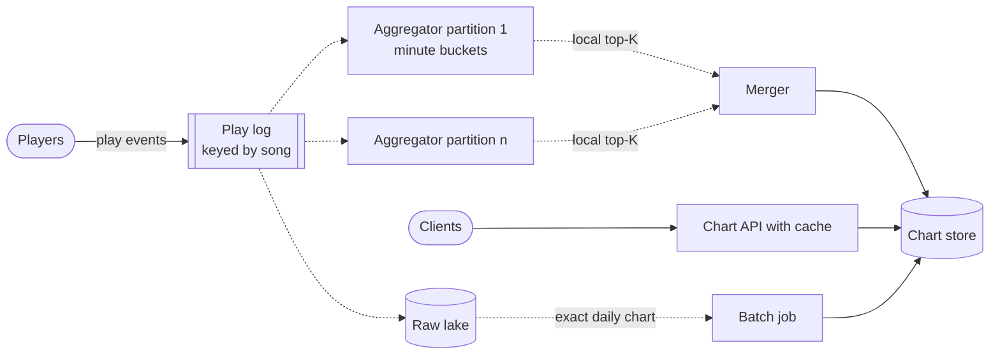

**Reading the diagram.** Play events are appended to a log partitioned by song ID, so all plays of one song reach one aggregator partition. Each partition keeps per-minute counts and rolls them into sliding hour and day windows; every few seconds it emits its local top-K (dotted, asynchronous) to a merger, which computes the global top-K and writes it to the chart store. Clients read cached charts synchronously. The raw lake feeds an exact daily batch chart that supersedes the streaming one. Failure points: an aggregator crash (state restored from a checkpoint and log replay), a viral song concentrating load on one partition, and late events. Scaling: more partitions; the merger handles only K × partitions entries.

#### Deep dives

1. **Why partition by item.** If every song's plays land in one partition, that partition's count is exact and the global top-K is contained in the union of local top-Ks: merging is exact. If events are partitioned randomly, a song can be ranked 101st everywhere and first globally, so local lists must carry more candidates or sketches.
2. **Sliding windows cheaply.** Keep counts in minute buckets; the hour total is the sum of 60 buckets, updated by adding the newest and subtracting the expired one. A heap or sorted structure per partition yields the local top-K.
3. **Hot items.** A viral song can exceed one partition's capacity: pre-aggregate at producers or in a first stage keyed by (song, random salt), then sum by song in a second stage (§29.6.3). Space-Saving (§17.6.2) keeps a bounded set of candidates when the key space per partition is too large for exact maps.

#### Trade-offs and alternatives

Exact counting with item partitioning is simple and correct at this scale; Count-Min plus a candidate heap uses fixed memory with a bounded overcount; Space-Saving guarantees all items above a frequency threshold appear. A batch-only design (hourly jobs) is simplest but misses the 1-minute freshness requirement.

#### Follow-up questions

1. *"Per country?"* Key by (country, song); exact for large countries, Space-Saving for the long tail.
2. *"What does Count-Min guarantee?"* Never undercounts; overcounts by at most $\varepsilon N$ with probability $1 - \delta$.
3. *"How do you stop bots from gaming the chart?"* Deduplicate per user per song per window, apply fraud filters before counting, and use distinct listeners (HyperLogLog, §17.5) as a ranking signal.
4. *"An aggregator restarts."* Restore checkpointed buckets and replay the log from the checkpoint offset; charts briefly hold the previous value.
5. *"Trending rather than top?"* Rank by growth against a baseline, not by absolute count (§53.8).

#### What distinguishes levels

- **Mid:** counts in a hash map and sorts; may reach for Redis sorted sets.
- **Senior:** windowed buckets, partition-by-item exact merge, sketches with stated error bounds.
- **Staff:** does the arithmetic to decide exact versus approximate, handles hot items with two-stage aggregation, and separates popularity from trending and abuse.

### 91.6.11 Q39. Multi-region active-active social app

**Difficulty:** Hard · **Time:** 60 min · **Related:** Ch 44 (§44.6, §44.7, §44.8, §44.11), §27.14, §25.6

#### Prompt

"Our social app runs in one region. Make it serve users from three regions with low latency, and keep working if any one region goes down."

#### Clarifying questions and assumptions

- *Users and regions?* 200 million DAU split across the Americas, Europe and Asia-Pacific.
- *Writes?* 10 per DAU per day (posts, likes, comments, follows, profile edits), 1 KB each; reads 100× writes.
- *Consistency?* Users must read their own writes; others may see changes within a second or two.
- *Residency?* EU users' data must stay in the EU at rest (a common follow-up).

#### Requirements

**Functional.** All reads and writes served from the user's nearest region; replication to other regions; region evacuation. **Non-functional.** p99 write latency ≤ 100 ms (no cross-region round trip on the write path); replication lag p99 ≤ 2 s; RPO ≤ 5 s and RTO ≤ 5 min on region loss; survive loss of one region at full peak load.

#### Estimation

::: example
**Worked example — Replication is cheap; capacity headroom is not.** Global PAR 2 (Table 89.7).

1. Writes: $2 \times 10^8 \times 10 = 2 \times 10^9$/day, $23{,}148$/s average, $46{,}296$/s peak; reads about 4.6 million/s at peak.
2. Cross-region replication: each 1 KB write goes to two other regions, $2 \times 2$ TB $= 4$ TB/day, about 46 MB/s average.
3. Headroom (§89.10): with three regions and one allowed to fail, each needs $Z/(Z-f) = 3/2$, so 50% more capacity than its own peak.

**Interpretation.** Bytes between regions are small; the cost is 50% spare capacity everywhere and the correctness work of concurrent writes. **Engineering implication.** Spend design time on ownership and conflicts, and on regular evacuation drills that prove the headroom exists.
:::

#### API and data model

```text
Unchanged client API; a global front door routes to the nearest healthy region
user(user_id PK, home_region, ...)            -- home region owns profile and settings writes
post(post_id PK, author_id, ...)              -- written in author's home region
like_counter(post_id, region, count)          -- per-region counters, summed on read (a G-counter CRDT)
follow(edge_id, follower, followee, version)  -- add/remove set semantics
```

#### High-level design

**Figure 91.40 — Active-active with home-region ownership and asynchronous replication.**

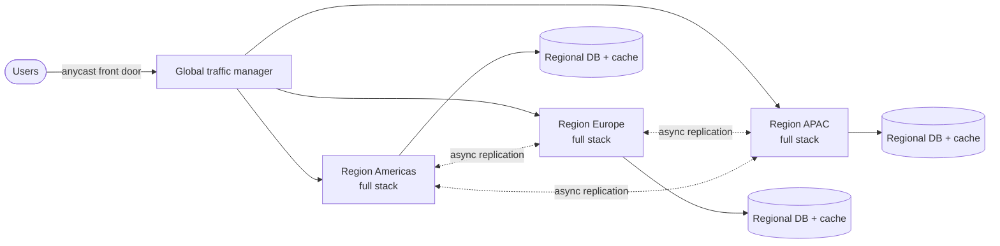

**Reading the diagram.** A global traffic manager sends each user to the nearest healthy region (synchronous). Every region runs the full stack with its own databases and caches, the storage boundaries. Writes commit locally and replicate asynchronously to the other two regions (dotted), so writes never wait for an ocean crossing. Records owned by a home region (profiles, posts) are written only there; requests landing elsewhere are forwarded, or the user is routed home. Commutative data (counters, sets) accepts writes anywhere and merges. Failure points: replication lag (a user switching regions may not see their writes), conflicting concurrent writes, and region loss with unreplicated writes (the RPO). Scaling: add regions, at the cost of more replication links and higher headroom planning.

#### Deep dives

1. **Avoid conflicts by construction.** Give each mutable record an owner: a user's home region owns their profile, posts and settings, so concurrent cross-region writes to the same record cannot happen (§44.7.3). Only data that is naturally commutative is multi-writer: likes as per-region counters, follows as add/remove sets with CRDT semantics (§27.14.3).
2. **Read-your-writes across regions.** Clients carry a token holding the latest write position or timestamp; a region that has not replicated that far waits briefly or forwards the read (§25.6.2). Sticky routing keeps most users in one region anyway.
3. **Evacuation.** Losing a region shifts its users to the others: each needs 50% headroom, DNS and anycast changes take effect in seconds to minutes (§44.5.2), and home-region ownership for the dead region's users must move, accepting that the last ≤ 5 s of their unreplicated writes may be lost or reconciled later. Practice evacuations regularly (§44.11.3).

**Table 91.8 — Conflict strategy per data type.**

| Data | Strategy | Why |
|---|---|---|
| Profile, settings, posts | Home-region single writer | Conflicts impossible; edits rare |
| Likes, view counts | Per-region counters summed (G-counter) | Commutative; high write rate |
| Follows, group membership | Add/remove set CRDT | Concurrent add and remove resolvable |
| Usernames, payments | Global single writer or consensus | Uniqueness and invariants need coordination |

#### Trade-offs and alternatives

Active-passive (one write region) is far simpler and adds 100–200 ms to writes from far regions; active-active with a globally consistent database (Q45) removes conflicts but puts cross-region quorums on the write path. Home-region partitioning also satisfies residency rules if EU users' home is the EU and only derived, non-personal data replicates out (§44.9).

#### Follow-up questions

1. *"Two users edit a shared group name at once in two regions."* Group metadata has a home region; route edits there, or use LWW with a hybrid logical clock and accept it for low-value fields.
2. *"How do you make usernames unique?"* A global uniqueness service with consensus, or reservations owned by one region; it is on the slow path of sign-up only.
3. *"A region is cut off but still running."* It must stop accepting writes for records it does not own, and owned records are not reassigned until it is fenced (§26.13).
4. *"How do you detect replication lag?"* Heartbeat rows with timestamps per link; alert on lag in seconds.
5. *"What about caches?"* Invalidate per region from each region's replication stream (Q35).

#### What distinguishes levels

- **Mid:** replicas in three regions and DNS failover.
- **Senior:** asynchronous replication, conflict resolution per data type, read-your-writes, 50% headroom.
- **Staff:** removes most conflicts by ownership, ties RPO to replication lag, designs fencing and evacuation drills, and handles residency with the same mechanism.

### 91.6.12 Q40. Distributed cron/job scheduler

**Difficulty:** Hard · **Time:** 60 min · **Related:** §52.9 (full case study); §26.11, §26.13, Ch 46

#### Prompt

"Design a cron-as-a-service platform for the whole company: recurring and delayed jobs, fired on time, never silently skipped."

#### Clarifying questions and assumptions

- *Scale?* 10 million recurring schedules and 50 million one-off delayed jobs per day (§52.9.4).
- *Targets?* HTTP callback, queue message or container task.
- *Guarantee?* At-least-once with a stable execution ID; jobs must be idempotent.

#### Requirements

**Functional.** Cron expressions with time zones; delays; retries with backoff; concurrency and misfire policies; pause, trigger now, run history. **Non-functional.** Dispatch p99 ≤ 1 s (≤ 10 s at the top of the hour); zero silent skips; duplicates ≤ 1 in 10⁴; failover within 15 s; 99.99% for firing.

#### Estimation

::: example
**Worked example — The top-of-hour burst.** From §52.9.4: 250 million executions/day (2,892/s average); about 1.03 million firings due at :00, so dispatching them within 10 s requires 103,000 dispatches/s, 36× the average. Spreading ":00" jobs uniformly over the first minute would cut the burst to $1.03 \times 10^6 / 60 \approx 17{,}200$/s.

**Interpretation.** Average load is trivial; the burst decides the design. **Engineering implication.** Pre-load timers into memory, avoid a database write per firing on the critical path, partition the schedule space, and offer (or enforce) jitter.
:::

#### API and data model

```text
POST /v1/jobs {cron, tz, target, retry, concurrency_policy, misfire_policy}
POST /v1/jobs/{id}:trigger | :pause
job(job_id, partition, cron, tz, next_fire_at, ...); execution(execution_id = job_id + scheduled_time, state, attempt)
partition_watermark(partition, fired_through)   -- replayed after failover
```

#### High-level design

**Figure 91.41 — Partitioned schedulers with leases, timing wheels and a dispatch queue.**

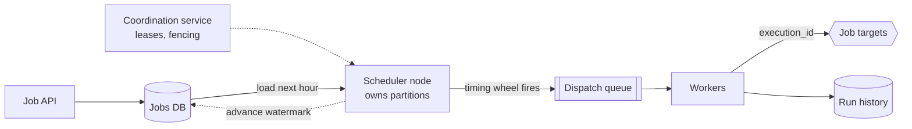

**Reading the diagram.** Jobs are stored in a sharded database. Scheduler nodes hold leases on partitions of the job space from a coordination service, with fencing tokens. Each node loads the next hour of firings for its partitions into an in-memory timing wheel; when a timer fires it enqueues a dispatch message carrying the deterministic execution ID (synchronous to the queue), and periodically advances a per-partition watermark rather than writing every firing. Workers execute against targets and record history. Failure points: a node pause causing two owners (fencing rejects the stale one; duplicates share an execution ID), a failover (the new owner replays from the watermark), and the :00 burst. Scaling: more partitions and nodes; cells at 100×.

#### Deep dives

1. **Ownership without double firing.** Leases plus fencing tokens (§26.13); duplicates that slip through are harmless because the execution ID is stable.
2. **No silent skips.** The watermark records "fired through T"; after failover, everything between the watermark and now is fired or recorded as a misfire per policy.
3. **Time zones and DST.** Compute next fire time in the job's zone; define behavior for skipped and repeated local hours.

#### Trade-offs and alternatives

A database-polling scheduler is simple to about thousands of jobs per second; the timing-wheel design wins at the burst. A single leader is simpler than partitioned leases but caps throughput and lengthens failover.

#### Follow-up questions

1. *"Exactly-once?"* No; a worker can crash after the side effect. Offer at-least-once with a stable ID.
2. *"Job runs longer than its interval?"* Concurrency policy: forbid, replace or allow.
3. *"Why a timing wheel?"* O(1) insert and expiry for millions of timers (§52.9.8).
4. *"Workflow dependencies?"* A DAG layer above firing, or a workflow engine (Q48).

#### What distinguishes levels

- **Mid:** a scheduler polling a database and pushing to a queue.
- **Senior:** partitioned ownership with leases, retries and idempotent execution IDs.
- **Staff:** finds the :00 burst in the arithmetic, uses watermarks instead of per-firing writes, fences correctly and treats DST as a correctness requirement. Full case: §52.9.

### 91.6.13 Q41. Live streaming platform

**Difficulty:** Hard · **Time:** 60 min · **Related:** §21.8 (video delivery, live latency), §54.4 (YouTube, video on demand), §89.7, §9.6 (chat)

#### Prompt

"Design a live streaming platform: creators broadcast from their computers, viewers watch with a few seconds of delay and chat alongside."

#### Clarifying questions and assumptions

- *Scale?* 100,000 concurrent channels and 10 million concurrent viewers at peak; the most popular channel has 1 million viewers.
- *Latency?* Glass-to-glass under 5 s for most viewers.
- *Quality?* Creators send 6 Mb/s 1080p; viewers get adaptive bitrate, averaging 4 Mb/s.
- *Scope?* Ingest, transcoding, delivery, chat; recordings (VOD) as a follow-up.

#### Requirements

**Functional.** Authenticated ingest per stream key; transcoding into a bitrate ladder; adaptive playback on web and mobile; live chat; stream start and stop notifications; recording. **Non-functional.** Latency ≤ 5 s p50; rebuffering ratio under 0.5%; ingest tolerant of creator network blips; 99.95% playback availability; cost per viewer-hour as a first-class metric.

#### Estimation

::: example
**Worked example — Egress dominates, skew concentrates it.** Using §89.7; transcoding: one server produces 10 full ladders in real time (assumption); only the 20% of channels with enough viewers get a full ladder, the rest are passed through.

1. Ingest: $10^5 \times 6\ \text{Mb/s} = 600$ Gb/s.
2. Viewer egress: $10^7 \times 4\ \text{Mb/s} = 40$ Tb/s, the dominant cost.
3. Transcoding: $20{,}000 / 10 = 2{,}000$ servers; a full ladder for every channel would need 10,000.
4. The top channel alone: $10^6 \times 4\ \text{Mb/s} = 4$ Tb/s. With 1 s low-latency parts, each viewer fetches about one part and one playlist per second: 2 million requests/s for one stream. With request collapsing at 200 PoPs and 5 renditions, the origin sees $200 \times 5 \times 2 = 2{,}000$ requests/s.
5. Latency with 1 s parts (§21.8.4): $L \approx 1 + 3 \times 1 + 0.5 = 4.5$ s.

**Interpretation.** Requests and bytes for one popular channel are CDN-scale; transcoding is a selective compute decision. **Engineering implication.** Collapse requests at every cache tier, transcode by popularity, and treat low-latency segments as the main source of request amplification.
:::

#### API and data model

```text
Ingest: RTMP or SRT to ingest.example/live/{stream_key}  (WebRTC/WHIP for ultra-low latency)
GET /live/{channel}/master.m3u8 -> renditions; /live/{channel}/{rendition}/playlist.m3u8 (blocking reload)
channel(channel_id, owner, stream_key_hash, state, ingest_node, started_at)
Chat: WebSocket per viewer; messages partitioned by channel_id
```

#### High-level design

**Figure 91.42 — Live pipeline: ingest, transcode, package, CDN fan-out, and chat.**

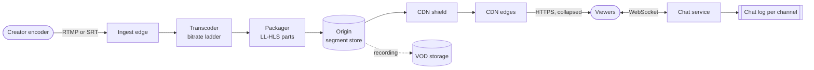

**Reading the diagram.** The creator's encoder pushes a continuous stream to the nearest ingest edge over RTMP or SRT. The ingest node forwards to a transcoder that produces the ladder (or passes the source through for small channels), and a packager cuts low-latency HLS or CMAF parts and playlists into the origin store, the storage boundary for live segments. Viewers fetch playlists and parts through edges and shields, which collapse concurrent requests for the same part into one upstream fetch. Chat runs on a separate WebSocket fleet with a per-channel log (bidirectional, synchronous to the gateway, fan-out asynchronous). Recording copies segments asynchronously to VOD storage. Failure points: an ingest or transcoder node failure mid-stream (the encoder reconnects; a standby transcoder takes over from the next keyframe), origin overload from uncollapsed requests, and chat fan-out for huge channels. Scaling: CDN capacity for viewers, transcoder pools for channels, chat partitioning per channel.

#### Deep dives

1. **Latency versus stability.** Glass-to-glass latency is dominated by segment duration times buffered segments (§21.8.4). Partial segments and blocking playlist reloads cut it to about 4.5 s; WebRTC delivery reaches sub-second but costs far more per viewer because it does not use HTTP caches. Offer a low-latency mode only where interaction matters.
2. **Request collapsing and the hot channel.** Every edge and shield must hold concurrent requests for an in-progress part and serve them all from one fetch; without it the 2 million requests/s of the top channel reach the origin. Pre-warm shields when a large channel goes live.
3. **Chat at 1 million viewers.** Fan-out of every message to every viewer is $O(\text{messages} \times \text{viewers})$; sample or rate-limit the displayed stream for huge channels, batch messages every 100–200 ms into one frame (§9.6), and partition gateways so each holds a share of viewers subscribed to the channel's topic.

#### Trade-offs and alternatives

HLS/DASH over CDN scales to millions at the lowest cost per viewer with 3–5 s latency; WebRTC with selective forwarding units gives sub-second latency for interactive formats at higher cost (§9.7.2). Transcoding everything maximizes quality for small channels but multiplies compute five-fold; source-only for small channels is the usual compromise. Cloud transcoding versus hardware encoders is a cost decision at this volume.

#### Follow-up questions

1. *"The creator's connection drops for 3 seconds."* Ingest keeps the session open briefly; the player rides its buffer; on reconnect the packager continues with a discontinuity marker.
2. *"How do you start playback fast?"* Begin at the latest independent part with a short buffer and the lowest rendition, then ramp up (§21.8.3).
3. *"How do you stop stream-key theft?"* Keys are secret, rotatable and bound to an account; ingest checks them and rejects concurrent use.
4. *"How do you estimate cost per viewer-hour?"* $4\ \text{Mb/s} \times 3{,}600\ \text{s} / 8 = 1.8$ GB per viewer-hour times the CDN price per GB, plus a small transcoding share.
5. *"Recording and clips?"* Segments already exist; write them to object storage and build a VOD manifest.

#### What distinguishes levels

- **Mid:** ingest, transcode, CDN delivery with HLS.
- **Senior:** latency formula and low-latency parts, request collapsing, popularity-based transcoding, chat fan-out.
- **Staff:** quantifies the hot channel end to end, prices cost per viewer-hour, and chooses where WebRTC is worth its cost.

### 91.6.14 Q42. Proximity service

**Difficulty:** Hard · **Time:** 45–60 min · **Related:** §17.9 (geospatial indexing, §17.9.6), §55.4–§55.5 (moving objects), Ch 20

#### Prompt

"Design the backend for 'find restaurants and shops near me': given a location and radius, return nearby businesses ranked by distance and rating."

#### Clarifying questions and assumptions

- *Static or moving objects?* Businesses rarely move; updates are infrequent. (Moving drivers are Q20 and §55.5.)
- *Scale?* 200 million businesses worldwide; 100 million DAU making 5 searches a day; peak 3× average.
- *Query shape?* Radius 0.5–20 km, optional category filter, top 20 results, pagination.
- *Freshness?* New or edited businesses visible within minutes.

#### Requirements

**Functional.** Nearby search by radius and category; business details; owners add and edit businesses; reviews and ratings (summary only). **Non-functional.** p99 search ≤ 200 ms; 99.99% availability for search; edits visible within 10 minutes; low cost per query.

#### Estimation

::: example
**Worked example — The index is tiny; reads dominate.** Assumptions: 1 KB per business record; 16 bytes per index entry (8-byte cell ID, 8-byte business ID); 1% of businesses edited per day; one search node handles 5,000 queries/s.

1. Searches: $10^8 \times 5 / 86{,}400 = 5{,}787$/s average, 17,361/s peak (§89.5).
2. Business data: $2 \times 10^8 \times 1\ \text{KB} = 200$ GB; geo index $2 \times 10^8 \times 16 = 3.2$ GB.
3. Edits: $2 \times 10^6$/day, 23/s.
4. Search nodes: $17{,}361 / (5{,}000 \times 0.6) = 5.8$, so 6, or 9 with zone headroom (§89.10).

**Interpretation.** The whole index fits in every node's memory; write rate is negligible. **Engineering implication.** Do not shard the index; replicate it in full to stateless search nodes in each region and rebuild it periodically from the database.
:::

#### API and data model

```text
GET /v1/search/nearby?lat=&lng=&radius_m=&category=&limit=20&cursor=
GET /v1/businesses/{id}        POST/PUT /v1/businesses (owner)
business(business_id PK, name, lat, lng, category, rating, ...)       -- relational, replicated
geo_index(cell_id, business_id)     -- in memory: geohash precision 6 or S2 level ~13
```

#### High-level design

**Figure 91.43 — Proximity search: replicated in-memory geo index, database for details.**

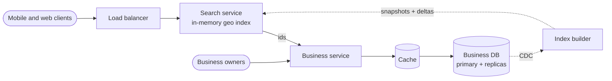

**Reading the diagram.** A search request reaches a stateless search node that holds the entire geo index in memory. It computes the cells covering the search circle, gathers candidate IDs, filters by exact distance and category, ranks, and fetches details for the top 20 through the business service and its cache (synchronous). Owners' edits go to the relational database; change data capture feeds an index builder that publishes periodic snapshots and incremental deltas to search nodes (dotted, asynchronous). Storage boundaries: the database (truth), the cache, and each node's in-memory index. Failure points: a stale index on a node (version and freshness checks), dense areas returning thousands of candidates, and cross-cell boundary misses. Scaling: add search replicas per region; the index stays small.

#### Deep dives

1. **Choosing the cell index.** Geohash is easy and works in any ordered store but distorts near the poles and has boundary quirks; S2 and H3 give uniform cells (Table 17.8). Geohash precision 6 cells are about 1.2 km × 0.6 km at the equator, precision 5 about 4.9 km × 4.9 km; choose the precision from the radius and search the covering cell set, always including neighbors so points just across a boundary are found (§17.9.2).
2. **Density.** Midtown Manhattan has thousands of businesses per cell; rural areas have none for kilometers. Either use an adaptive structure (quadtree, §17.9.3) or start with a small radius and expand until 20 candidates are found, capped at the maximum radius.
3. **Ranking and pagination.** Rank by a blend of distance, rating and relevance; paginate with a cursor carrying the last score and ID so pages are stable while the index refreshes.

#### Trade-offs and alternatives

A database with a geospatial index (PostGIS, Elasticsearch geo queries) is the simplest correct answer and fine to tens of thousands of queries per second; the in-memory replicated index is cheaper and faster at this scale. Sharding by region is needed only if the index outgrows memory, for example with billions of points of interest or per-user data.

#### Follow-up questions

1. *"Why not shard by geography?"* 3.2 GB fits in RAM; sharding adds hot shards (cities) and cross-shard queries for nothing.
2. *"How fresh is the index?"* Deltas every minute, full snapshot daily; edits visible within the 10-minute target.
3. *"How do you search along a route?"* Cover the route's buffer polygon with cells.
4. *"What if 200 million becomes 20 billion places?"* Index of 320 GB: shard by S2 cell range and route by covering cells.
5. *"Opening hours filter?"* Store as a structured field and filter after candidate retrieval; precompute "open now" buckets if needed.

#### What distinguishes levels

- **Mid:** geohash or quadtree with a database.
- **Senior:** computes that the index fits in memory, replicates instead of sharding, handles boundaries and density.
- **Staff:** justifies the cell system, plans freshness via CDC snapshots, and states the scale at which sharding would become necessary.

### 91.6.15 Q43. Maps and routing

**Difficulty:** Hard · **Time:** 60 min · **Related:** §55.6 (full case study); §17.9, §21.3, §83.5 (ETA model)

#### Prompt

"Design a maps product: pan and zoom the map, search places, and get driving directions with live traffic."

#### Clarifying questions and assumptions

- *Scale?* 300 million DAU; 100 tile requests, 1.5 routes and 2 searches per user per day (§55.6.4).
- *Scope?* Tiles, search, routing with traffic; Street View and transit ingestion out.
- *Latency?* Tiles p99 < 100 ms at the edge; city routes p99 < 500 ms.

#### Requirements

**Functional.** Map display at zoom 0–20 in several styles; place search and geocoding; directions with alternatives; ETA with live traffic; rerouting. **Non-functional.** 99.99% for tiles and routing; traffic speeds ≤ 3 min old; tiles and routing graph from the same map version.

#### Estimation

::: example
**Worked example — Three subsystems, three scaling levers.** From §55.6.4:

1. Tiles: $3 \times 10^{10}$/day, 694,444/s at peak; 95% CDN hits leave 34,722/s for the origin.
2. Vector tile pyramid to zoom 14: $(4^{15} - 1)/3 = 3.58 \times 10^8$ tiles, 30% land, 20 KB each: about 2.15 TB per map version.
3. Routes: 15,625/s at peak; probe ingestion from 20 million navigating users every 10 s: 2 million points/s.
4. Road graph with contraction-hierarchy shortcuts: about 46 GB per copy, memory-resident.

**Interpretation.** Tiles are a CDN problem, probes a streaming problem, routing an algorithm-plus-memory problem. **Engineering implication.** Design them as separate subsystems sharing one versioned map build.
:::

#### API and data model

```text
GET /tiles/{style}/{z}/{x}/{y}.mvt?v={map_version}
GET /route?from=&to=&mode=drive&depart=now  -> polyline, steps, eta
POST /probes (batched GPS points)
Road graph: nodes, directed edges with static and live weights; CH shortcuts; partitions + overlay
```

#### High-level design

**Figure 91.44 — Maps: offline build, tile CDN, routing cluster, traffic pipeline.**

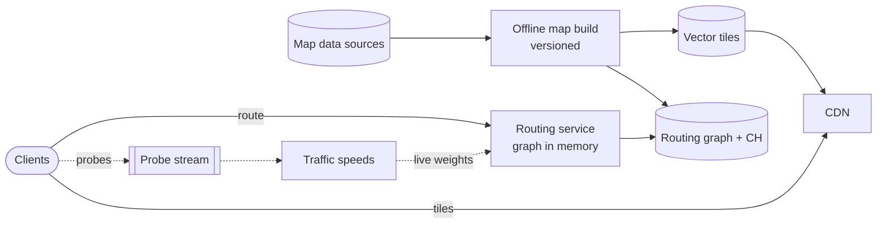

**Reading the diagram.** An offline build turns source data into one versioned set of artifacts: vector tiles served through the CDN, and a routing graph with contraction-hierarchy shortcuts loaded into routing servers' memory. Clients fetch tiles from the CDN and request routes synchronously. Navigating clients upload probe points asynchronously; a streaming pipeline computes per-segment speeds that update routing weights. Failure points: version skew between tiles and graph, stale traffic, and a routing node reload. Scaling: CDN for tiles, replicas and regional partitions for routing, stream partitions for probes.

#### Deep dives

1. **Tiles.** Precompute vector tiles to about zoom 14–16, overzoom on the client, version URLs so caches never serve mixed versions.
2. **Routing.** Dijkstra → A* → contraction hierarchies; CH preprocessing assumes fixed weights, so live traffic needs customizable variants or re-scoring of candidate routes (§55.6.8).
3. **Traffic.** Map-match probes to segments, aggregate speeds per segment per minute, apply privacy thresholds.

#### Trade-offs and alternatives

Raster tiles are simpler for clients but hundreds of terabytes per style; vector tiles move rendering to clients. Plain A* on a partitioned graph is easier to update than CH but slower for long routes.

#### Follow-up questions

1. *"A road closes."* Live weight override immediately; rebuild tiles and graph in the next version.
2. *"Cross-continent routes?"* Partitioned graph plus an overlay of boundary nodes.
3. *"How do you keep tiles and routes consistent?"* Pin one map version per session.
4. *"ETA accuracy?"* An ML model over route features and live speeds (§83.5).

#### What distinguishes levels

- **Mid:** tile server with a CDN and Dijkstra.
- **Senior:** tile pyramid arithmetic, vector tiles, A* and CH.
- **Staff:** reconciles CH with live traffic, versions every artifact, and designs the probe pipeline with privacy. Full case: §55.6.

### 91.6.16 Q44. Multiplayer game backend

**Difficulty:** Hard · **Time:** 60 min · **Related:** §9.6, §9.9 (connections), §44.4 (latency physics), Ch 46 (scheduling), §22.3

#### Prompt

"Design the backend for an online battle-royale game: 100 players per match, fast-paced, worldwide."

#### Clarifying questions and assumptions

- *Scale?* 2 million concurrent players at peak; matches last 20 minutes.
- *Fairness and cheating?* Authoritative servers: clients send inputs, never state.
- *Latency?* Round trip under about 80 ms to the match server for most players.
- *Scope?* Matchmaking, match servers, player profiles and progression; store and voice chat out of scope.

#### Requirements

**Functional.** Login and profile; matchmaking by skill and region; allocate a match server; real-time simulation and state sync; results, rewards and leaderboards; reconnect to a running match. **Non-functional.** Tick rate 30 Hz; p95 player RTT ≤ 80 ms; matchmaking ≤ 60 s p95; a match-server crash affects one match only; launch-day spikes absorbed.

#### Estimation

::: example
**Worked example — Matches, servers and bandwidth.** Assumptions: 16 matches per 32-core server; delta-compressed snapshots of 500 bytes per player per tick.

1. Concurrent matches: $2 \times 10^6 / 100 = 20{,}000$; servers $20{,}000 / 16 = 1{,}250$ plus headroom (§89.10).
2. Match starts: $20{,}000 / 1{,}200\ \text{s} = 16.7$/s, so about 1,667 players/s leave matchmaking.
3. Inputs per match: $100 \times 30 = 3{,}000$ packets/s in.
4. Downlink per player: $30 \times 500 \times 8 = 120$ kb/s; total egress $2 \times 10^6 \times 120\ \text{kb/s} = 240$ Gb/s, spread across regions.

**Interpretation.** Per-match compute and per-region placement dominate; backend services (profiles, matchmaking) see modest load. **Engineering implication.** Treat match servers as a fleet of stateful, short-lived processes scheduled per region, and keep everything else conventional.
:::

#### API and data model

```text
POST /matchmaking/tickets {player_id, mode, party, skill, region_pings}  -> ticket_id
GET  /matchmaking/tickets/{id} -> {state, server_addr, match_token}
UDP game protocol: client inputs {seq, tick, buttons, aim}; server snapshots {tick, ack_seq, entity deltas}
match(match_id, region, server_id, players[], state, started_at); result(match_id, player_id, placement, stats)
```

#### High-level design

**Figure 91.45 — Game backend: matchmaking, fleet allocation, authoritative match servers.**

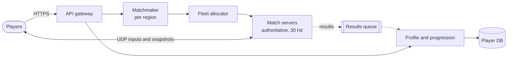

**Reading the diagram.** Players use HTTPS for login, profile and matchmaking through a gateway. A regional matchmaker groups tickets by skill, party and measured ping, then asks the fleet allocator for a ready server in the chosen region; players receive its address and a signed match token. Gameplay is a bidirectional UDP exchange directly with the authoritative match server, which simulates at 30 Hz and sends each player snapshots of nearby entities. When the match ends, results go asynchronously to a queue consumed by progression services and the player database (the durable storage boundary; match state itself is in memory). Failure points: a match server crash (one match lost; players compensated), matchmaker backlog on launch day, and the player database on result bursts. Scaling: more servers per region, autoscaled ahead of demand.

#### Deep dives

1. **Authoritative simulation and lag compensation.** Clients predict their own movement and interpolate others about 100 ms in the past; the server validates inputs, rewinds entity positions by the shooter's latency to resolve hits, and corrects clients that diverge. This makes cheating by state injection impossible and latency feel lower (§9.6).
2. **Interest management and bandwidth.** Each player receives only entities within relevance range, with delta compression against the last acknowledged snapshot; this is what keeps 120 kb/s per player feasible with 100 players.
3. **Matchmaking and placement.** Matchmaking trades wait time against skill spread and ping: widen the skill window as wait grows. Place matches in the region minimizing the worst player's RTT; physics bounds this (§44.4.1), so cross-continent parties get a compromise region.

::: industry
**Source engine networking.** Valve's documentation of Source multiplayer networking describes an authoritative server simulating in fixed ticks, client-side prediction, entity interpolation with a default interpolation period of 100 ms, and lag compensation by rewinding player positions on the server when processing a shot.
*Evidence: Primary* — [Valve Developer Community: Source Multiplayer Networking]
:::

#### Trade-offs and alternatives

Peer-to-peer or client-authoritative designs avoid server cost but invite cheating and NAT problems. Higher tick rates (60 Hz) improve responsiveness at roughly double compute and bandwidth. Dedicated servers per match isolate failures; packing many matches per process improves cost but widens blast radius.

#### Follow-up questions

1. *"A player disconnects briefly."* Keep their slot; the match token allows rejoin to the same server within a grace period.
2. *"How do you scale for launch day?"* Pre-provision a regional buffer of warm servers, queue players with honest wait estimates, and rate-limit login (§22.9).
3. *"How do you stop speed hacks?"* Server-side validation of movement against physics limits; anomaly detection on results.
4. *"Where do leaderboards live?"* Sorted sets per season updated from the results queue (Q8).
5. *"How do you deploy a new server version?"* New matches go to new servers; running matches finish on old ones (drain, §9.9.7).

#### What distinguishes levels

- **Mid:** game servers with WebSockets and a database.
- **Senior:** authoritative UDP servers, prediction and interpolation, matchmaking trade-offs, fleet sizing.
- **Staff:** lag compensation and interest management with bandwidth arithmetic, regional placement under physics limits, and launch-day capacity planning.

## 91.7 Expert questions (Q45–Q56)

Expert prompts ask you to design the infrastructure other systems are built on, or to change a running system without stopping it. The interviewer is usually a staff or principal engineer, the session often becomes a design review, and the decisive signals are precise failure semantics, explicit invariants and a plan for evolution. Answers are full unless a case study exists; all are *Evidence: Illustrative* unless an `industry` callout says otherwise.

### 91.7.1 Q45. Globally consistent database

**Difficulty:** Expert · **Time:** 60 min · **Related:** §28.8 (Spanner and TrueTime), §28.10, §44.4.3, §44.12, §26.7

#### Prompt

"Design a SQL database that spans continents, offers serializable transactions with external consistency, and survives the loss of a whole region."

#### Clarifying questions and assumptions

- *Data and load?* 1 PB; 500,000 writes/s and several million reads/s globally.
- *Latency expectations?* Writes may take tens of milliseconds; reads should be local where staleness is acceptable.
- *Regions?* Five regions in two continents; data placement configurable per table or row.
- *Clocks?* We can deploy GPS and atomic time references in each data center (or accept a hybrid logical clock with weaker guarantees).

#### Requirements

**Functional.** SQL with serializable read-write transactions across any rows; consistent snapshot reads at any timestamp; bounded-staleness local reads; schema changes online; placement policies. **Non-functional.** External consistency (if T1 commits before T2 starts, T1's timestamp is smaller); survive one region's loss with RPO 0 and automatic failover in seconds; p99 single-region-homed write ≤ 20 ms where placement allows.

#### Estimation

::: example
**Worked example — Ranges, quorums and replica placement.** Assumptions: 10 GB ranges, five replicas each; RTTs from the leader region: same-region replica 1 ms, nearby region 12 ms, cross-continent 65–150 ms (the Figure 44.2 values); clock uncertainty $\varepsilon \approx 4$ ms on average.

1. Ranges: $10^{15} / 10^{10} = 100{,}000$, so 500,000 replicas, each range its own consensus group.
2. One voter per region (five regions): commit waits for the second-fastest follower, about 65 ms.
3. Placement 2–2–1 (two voters in the leader's region, two in a nearby region, one far): quorum of 3 = leader plus local follower plus the nearby region, about 12 ms. Losing any one region leaves at least 3 voters (§44.4.3), so region survival holds.
4. Commit wait of about $2\varepsilon = 8$ ms overlaps the 12 ms consensus round, adding nothing.
5. A transaction spanning two ranges with leaders in different places adds a two-phase commit round: roughly twice the slowest participant's consensus time.

**Interpretation.** Replica placement, not clock uncertainty, sets write latency. **Engineering implication.** Home each range's leader and quorum near its writers, and make cross-range transactions the exception through schema design (interleaving related rows).
:::

#### API and data model

```text
SQL: BEGIN; ...; COMMIT (serializable)   SELECT ... AS OF SYSTEM TIME t   (snapshot)
Placement: ALTER TABLE orders SET LOCALITY REGIONAL BY ROW (home region column)
Internals: key space split into ranges; per range a consensus log (Paxos or Raft), a leaseholder,
           MVCC versions keyed by (key, commit_timestamp); lock table for in-flight writes
Directory: range -> replicas, leaseholder (itself stored in system ranges)
```

#### High-level design

**Figure 91.46 — Globally consistent database: ranges as consensus groups, 2PC across groups, clock service.**

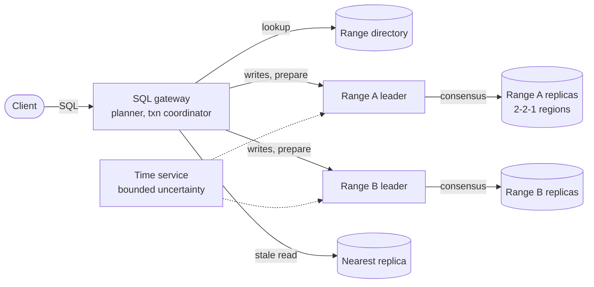

**Reading the diagram.** Clients send SQL to a gateway in their region, which plans the query, looks up range locations and acts as transaction coordinator. Writes buffer locks at each range leader; at commit, the coordinator runs two-phase commit across participant leaders, each of which logs the prepare and the commit through its own consensus group (synchronous). Leaders obtain timestamps from a time service exposing an uncertainty interval (dotted: polled, not on the critical path) and delay making a commit visible until the interval has passed. Stale or snapshot reads go to the nearest replica that is caught up to the requested timestamp. Storage boundaries: each range's replica set. Failure points: a leader loss (election in seconds), a coordinator crash during 2PC (participants block until recovery, which is safe because the coordinator's own state is replicated), and widened clock uncertainty (slower commits, never incorrect ones). Scaling: split ranges and add nodes.

#### Deep dives

1. **External consistency.** Assign each transaction a commit timestamp no earlier than the current time's upper bound, then wait until the lower bound passes it (commit wait). Any transaction starting afterward gets a larger timestamp, so timestamp order matches real-time order (§28.8.3). Without tight clocks, hybrid logical clocks plus read-time uncertainty restarts give serializability with weaker real-time guarantees (§24.12.4).
2. **2PC on top of consensus.** Classical 2PC blocks when the coordinator dies; here every participant and the coordinator are replicated state machines, so a crash becomes a leader election rather than an indefinite block (§28.4.8).
3. **Reads that do not cross oceans.** Snapshot reads at a timestamp slightly in the past are served by any replica whose safe time has passed it; strongly consistent reads go to the leaseholder. Offer "exact staleness 10 s" reads for dashboards.

::: industry
**Spanner.** Corbett et al. describe Spanner's TrueTime API, which exposes clock uncertainty from GPS and atomic-clock references, Paxos groups per split, two-phase commit across groups, and commit wait to achieve external consistency; they report uncertainty that typically varies between about 1 and 7 ms.
*Evidence: Primary* — [Corbett et al. 2012]
:::

#### Trade-offs and alternatives

Asynchronous multi-region replication (Q39) is faster and loses the last seconds of writes on region loss; a single-region database with cross-region replicas is simpler and cannot provide RPO 0 automatically. Calvin-style deterministic ordering (§28.9) avoids 2PC at the cost of declaring read and write sets in advance.

#### Follow-up questions

1. *"What if the time service fails?"* Uncertainty grows, commit wait lengthens, throughput falls; correctness holds. Alert on $\varepsilon$.
2. *"Where does the leader live for a global table?"* Near most writers; read-mostly global tables can write at future timestamps so reads are local everywhere (§28.10.1).
3. *"How do you handle a hot range?"* Load-based splitting; for a single hot row, redesign (sharded counters).
4. *"What is the cost of surviving a region?"* At least three regions with voters and cross-region quorum latency for every write.
5. *"How does schema change work online?"* Versioned schemas with intermediate states so two versions in use are always compatible.

#### What distinguishes levels

- **Mid:** replication across regions with a primary.
- **Senior:** consensus per range, 2PC across ranges, and the latency consequence of quorum placement.
- **Staff:** explains commit wait and external consistency precisely, designs replica placement for region survival at low latency, and offers bounded-staleness reads as the main latency lever.

### 91.7.2 Q46. Distributed file system

**Difficulty:** Expert · **Time:** 60 min · **Related:** §15.5 (GFS, HDFS, Colossus, Tectonic), §15.6, §15.7, §49.4

#### Prompt

"Design a distributed file system for a data center: hundreds of petabytes, large files, used by batch analytics and by services storing blobs."

#### Clarifying questions and assumptions

- *Semantics?* Hierarchical namespace; files are mostly written once (append) and read many times; no random overwrite in the middle.
- *Scale?* 100 PB logical, 1 billion files averaging 100 MB; 100,000 metadata operations/s.
- *Clients?* Batch jobs (high throughput) and services (moderate latency).
- *Durability?* Survive two simultaneous disk or node failures and one rack failure.

#### Requirements

**Functional.** Create, open, append, read, rename, delete, list; snapshots; quotas per tenant. **Non-functional.** Aggregate read throughput in the Tb/s range; metadata p99 ≤ 10 ms; durability of eleven nines per file per year (design target); repair begins within minutes of a failure; storage overhead ≤ 1.5×.

#### Estimation

::: example
**Worked example — Metadata and repair decide the architecture.** Assumptions: 64 MB chunks; 64 bytes of metadata per chunk and per file (GFS-style); RS(6,3) erasure coding (§15.6); 20 TB disks filled to 70%; 2% annual disk failure rate; repair reads at 50 MB/s per source disk across 1,000 disks.

1. Chunks: $10^{17} / (6.4 \times 10^7) = 1.56 \times 10^9$; chunk metadata 100 GB plus file metadata 64 GB: too much and too busy for one master's memory.
2. Raw storage (§89.6): $100 \times 1.5 = 150$ PB, $150\ \text{PB} / (20\ \text{TB} \times 0.7) = 10{,}714$ disks.
3. Failures: $10{,}714 \times 0.02 = 214$ disks a year, about 0.6 a day.
4. Repair of one failed disk (14 TB of data): RS(6,3) reads 6 fragments per lost fragment, 84 TB, about 28 minutes across 1,000 disks; three-way replication would read only 14 TB (under 5 minutes) but cost 3× storage.

**Interpretation.** A single in-memory master no longer fits at this scale, and erasure coding trades storage for six times the repair traffic. **Engineering implication.** Distribute metadata in a sharded, replicated store and reserve network bandwidth for continuous repair.
:::

#### API and data model

```text
Client library: open(path) -> handle; append(handle, bytes); read(handle, offset, len); rename; list
Namespace service: path -> inode (directory tree in a sharded KV store, keyed by (parent_id, name))
File service: inode -> [block ids]; Block service: block -> fragment locations, version, checksum
Storage nodes: fragments on disks, checksummed per 64 KB
```

#### High-level design

**Figure 91.47 — Layered metadata over a sharded store, data on storage nodes.**

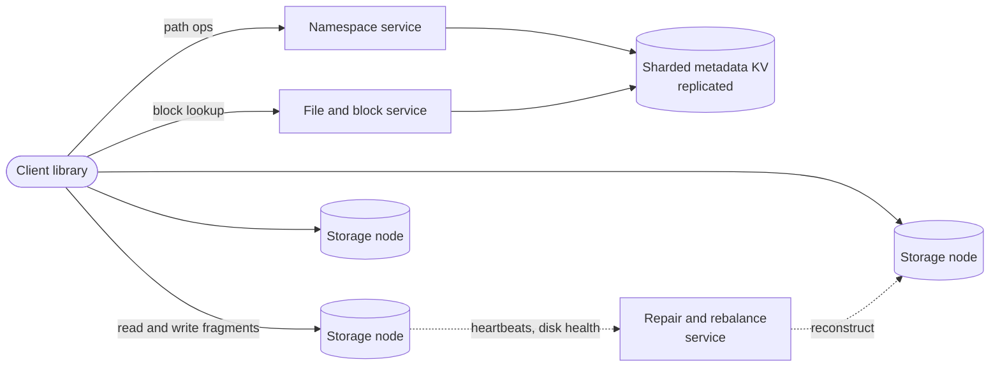

**Reading the diagram.** The client library resolves paths through a stateless namespace service and block locations through a file-and-block service; both keep their state in a sharded, replicated metadata key-value store, so metadata scales by adding shards (as Colossus and Tectonic do, §15.5.3). Data never passes through metadata services: the client writes data and parity fragments directly to storage nodes in different racks and reads them back directly (synchronous). Storage nodes report health asynchronously to a repair service, which reconstructs lost fragments elsewhere and rebalances. Storage boundaries: the metadata store and the storage nodes. Failure points: a metadata shard (replicated; a hot directory can overload one shard), correlated failures (rack or power domain), and repair falling behind failures. Scaling: storage nodes for capacity, metadata shards for operations.

#### Deep dives

1. **Scaling metadata.** Store the directory tree as rows keyed by (parent inode, name), sharded by parent; file and block metadata sharded by file ID. Rename within a directory is a single-shard transaction; across directories it needs a cross-shard transaction or is restricted. Huge directories are split further.
2. **Write path and consistency.** An appending writer holds a lease on the file's last block; fragments carry a version, and the block becomes visible when enough fragments are durable. Readers verify checksums and fall back to reconstruction if a fragment is bad.
3. **Durability through placement and repair.** Place the 9 fragments of each block on 9 different racks; prioritize repair of blocks that have lost the most fragments; throttle repair against foreground load but never let it fall behind the failure rate.

::: industry
**Tectonic.** Pan et al. describe Meta's Tectonic file system, which consolidated several storage systems into exabyte-scale clusters by disaggregating metadata into name, file and block layers stored in a sharded key-value store, with client-side Reed–Solomon encoding and tenant-specific tuning.
*Evidence: Primary* — [Pan et al. 2021]
:::

#### Trade-offs and alternatives

A single master (GFS, HDFS NameNode) is simpler and adequate to hundreds of millions of files; federation or a distributed metadata store is needed beyond. Replication suits hot, small or latency-sensitive data; erasure coding suits large, cold data (Table 89.8). Object storage (Q47) drops the hierarchical namespace and in exchange scales metadata more easily.

#### Follow-up questions

1. *"How do you handle small files?"* Pack them into larger blocks (container files), with an index; metadata per file is the cost, not bytes.
2. *"What happens on a rack failure?"* At most one fragment per block is lost with rack-aware placement; repair proceeds at rack scale.
3. *"How is a hot file served?"* Cache in client or storage-node memory; add replicas for read-hot blocks.
4. *"Strong or eventual metadata?"* Strong: linearizable per shard, because rename and create semantics depend on it.
5. *"How do you verify durability?"* Background scrubbing reads every fragment periodically and checks checksums.

#### What distinguishes levels

- **Mid:** master plus chunk servers with replication, GFS-style.
- **Senior:** computes that metadata outgrows one master, chooses erasure coding with rack-aware placement.
- **Staff:** designs sharded metadata semantics (rename, large directories), sizes repair bandwidth against failure rates, and argues replication versus coding by data temperature.

### 91.7.3 Q47. Object storage service

**Difficulty:** Expert · **Time:** 60 min · **Related:** §15.4, §15.6, §15.8, §49.4.3, §52.5

#### Prompt

"Design an S3-like object storage service: buckets, keys, PUT and GET of objects from bytes to terabytes, eleven nines of durability."

#### Clarifying questions and assumptions

- *Scale?* 100 billion objects, 100 PB logical; 1 million GETs/s and 100,000 PUTs/s at peak.
- *Consistency?* Strong read-after-write for PUT and LIST, as major providers now offer.
- *Features?* Multipart upload, versioning, lifecycle tiers, presigned URLs; no in-place partial updates.
- *Region model?* Single region with three availability zones; cross-region replication as a feature.

#### Requirements

**Functional.** Create bucket; PUT, GET (including ranges), DELETE, HEAD; LIST by prefix with pagination; multipart upload; versioning; lifecycle rules. **Non-functional.** Durability design target of eleven nines per object per year; 99.99% availability; first-byte latency p99 ≤ 100 ms for small objects; survive a zone loss without losing data or write availability.

#### Estimation

::: example
**Worked example — Metadata is a database, data is erasure-coded disks.** Assumptions: 500 B of metadata per object; metadata replicated 3×; data in RS(10,4), 1.4× (Table 89.8); 20 TB disks at 80% fill; metadata nodes with 4 TB usable at 60%.

1. Metadata: $10^{11} \times 500 = 50$ TB, 150 TB replicated: $150 / 2.4 = 63$ metadata nodes, storage-bound (§89.9).
2. Data: $100 \times 1.4 = 140$ PB raw, $140\ \text{PB} / 16\ \text{TB} = 8{,}750$ disks.
3. Expected loss at eleven nines (§89.12): $10^{11} \times 10^{-11} = 1$ object per year.

**Interpretation.** At this scale "eleven nines" still means about one object a year; durability comes from fragment placement, fast repair and checksums, plus defenses against bugs and operator error. **Engineering implication.** Separate the metadata index (a range-partitioned, strongly consistent store) from data placement, and treat repair and scrubbing as permanent workloads.
:::

#### API and data model

```text
PUT /{bucket}/{key}           GET /{bucket}/{key} [Range]      DELETE ...      HEAD ...
GET /{bucket}?list-type=2&prefix=&continuation-token=
POST /{bucket}/{key}?uploads ; PUT ?partNumber=&uploadId= ; POST ?uploadId= (complete)
object_index((bucket, key, version) PK, size, etag, placement_ref, created_at, state)   -- range-partitioned
placement: data_id -> [fragment locations across zones], checksums
```

#### High-level design

**Figure 91.48 — Object store: front ends, a strongly consistent index, erasure-coded data.**

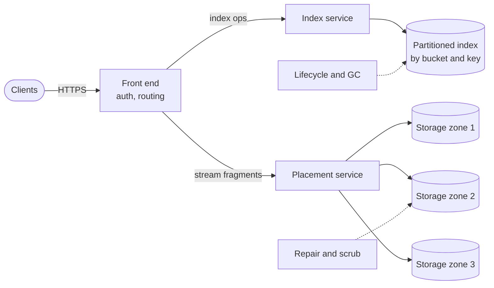

**Reading the diagram.** Front ends authenticate, authorize and route requests. A PUT streams data through the placement service, which erasure-codes it and writes fragments across three zones (synchronous); only after enough fragments are durable does the front end commit the index entry, which makes the object visible atomically. A GET reads the index entry, then fetches enough fragments in parallel, preferring the local zone. The index is range-partitioned by (bucket, key) so LIST by prefix is a range scan. Lifecycle and garbage collection run asynchronously over the index; repair and scrubbing run continuously over storage. Failure points: an index partition hot from sequential key names, orphaned fragments after failed PUTs (garbage-collected), and correlated zone failures. Scaling: split index ranges by load; add storage nodes.

#### Deep dives

1. **Commit protocol and strong consistency.** Write data first, then a single index commit; readers see either the old or the new version, never a partial object. Overwrites create a new version and atomically switch the index pointer; garbage collection removes unreferenced data later.
2. **Index partitioning and hot prefixes.** Range partitioning preserves LIST order but concentrates sequential keys (timestamps) on one range: split ranges automatically on load, and advise key prefixes with high-entropy components.
3. **Small and large objects.** Objects under about 1 MB are packed into large append-only volumes to avoid per-object fragment overhead; large objects use multipart upload with parts coded independently and a manifest committed last (§15.8.1).

#### Trade-offs and alternatives

Hash-partitioned indexes spread load perfectly but make LIST a scatter-gather; range partitioning with load-based splits keeps LIST efficient. RS(10,4) halves raw storage compared with three replicas at the cost of repair traffic and higher small-read latency; small hot objects may be replicated instead. Cross-region replication is asynchronous and per bucket.

#### Follow-up questions

1. *"How do you give read-after-write consistency?"* All index operations go to a strongly consistent store, and caches in the front ends are invalidated or bypassed for metadata.
2. *"What if a PUT fails halfway?"* No index commit means invisible data; GC reclaims orphaned fragments after a grace period.
3. *"How do you defend durability against software bugs?"* Checksums end to end, staged deployments per zone, object versioning, deletion delays and audits of placement.
4. *"How do presigned URLs work?"* A signature over method, bucket, key and expiry with the owner's key; front ends verify without a database lookup (§15.8.2).
5. *"Tiering?"* Lifecycle moves cold objects to denser, cheaper media with slower retrieval.

#### What distinguishes levels

- **Mid:** metadata database plus blob servers with replication.
- **Senior:** erasure coding across zones, commit-after-data protocol, range-partitioned index with hot-range splits.
- **Staff:** interprets durability nines at scale, designs for software-bug and operator failure modes, and handles small-object packing and LIST semantics explicitly.

### 91.7.4 Q48. Durable workflow engine

**Difficulty:** Expert · **Time:** 60 min · **Related:** §32.11 (durable execution), §32.7 (sagas), §52.9, §26.13

#### Prompt

"Design a workflow engine that lets developers write long-running business processes as ordinary code (order fulfillment, onboarding), which survive crashes and can run for months."

#### Clarifying questions and assumptions

- *Programming model?* Workflow code is deterministic and replayed; side effects run as activities executed by workers.
- *Scale?* 10 million workflow starts/day, about 20 activities each, 60 history events per workflow; peak 5× average.
- *Guarantees?* Workflow state never lost; activities at-least-once with retries; timers durable for months.
- *Tenancy?* Many teams, isolated by namespace.

#### Requirements

**Functional.** Start, signal, query and cancel workflows; activities with retry policies and timeouts; durable timers; child workflows; versioning of workflow code; visibility (search by status). **Non-functional.** RPO 0 for history; task dispatch p99 ≤ 100 ms; a workflow resumes within seconds after a worker or service failure; 99.99% availability.

#### Estimation

::: example
**Worked example — History is the database.** Assumptions: 500 B per history event; 30-day retention after close; 3 replicas; 1,024 history shards.

1. Events: $10^7 \times 60 = 6 \times 10^8$/day, 6,944/s average, 34,722/s at peak.
2. Storage (§89.6): $6 \times 10^8 \times 500 = 300$ GB/day; 30 days 9 TB, 27 TB replicated.
3. Per shard at peak: $34{,}722 / 1{,}024 \approx 34$ events/s, so shards exist for parallelism and failover granularity, not capacity.

**Interpretation.** The load is moderate; correctness of the per-workflow state machine is the design. **Engineering implication.** Choose a store with conditional writes per workflow and shard ownership with fencing; size for retention, not throughput.
:::

#### API and data model

```text
StartWorkflow(namespace, workflow_id, type, input)  SignalWorkflow(id, signal, payload)  QueryWorkflow(id, query)
Worker API: PollWorkflowTask(queue) -> history; RespondWorkflowTaskCompleted(commands)
            PollActivityTask(queue) -> task; RespondActivityCompleted(result) | heartbeat
history_event(workflow_id, event_id, type, payload)       -- append-only, ordered per workflow
mutable_state(workflow_id, next_event_id, pending activities, timers, version)   -- conditional updates
timer(fire_at, shard, workflow_id, timer_id); task_queue(name) -> pending tasks
```

#### High-level design

**Figure 91.49 — Durable execution: history shards, task queues, timers and replaying workers.**

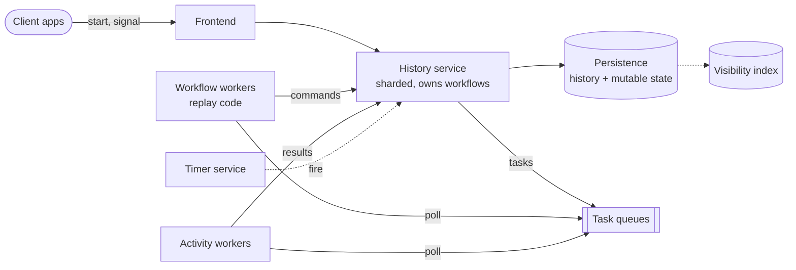

**Reading the diagram.** Clients start and signal workflows through a frontend, which routes by workflow ID to the history service node that owns its shard (ownership by lease with a fencing range ID). The history service appends events and updates mutable state with a conditional write, then places a workflow task on a task queue. A workflow worker polls, receives the history, replays the deterministic code up to the new event and returns commands (schedule activity, start timer, complete), which the history service records as new events. Activity workers poll activity tasks, perform side effects and report results. Durable timers fire back into the history service asynchronously. A visibility index is updated asynchronously for search. Storage boundary: persistence. Failure points: worker crashes (tasks time out and are redispatched), shard owner failover (the fencing token rejects the old owner's writes), and non-deterministic code changes (replay mismatch). Scaling: more shards, more workers per task queue.

#### Deep dives

1. **Deterministic replay.** Workflow code may not read clocks, random numbers or the network directly; those come from the engine as recorded events. A worker can therefore crash at any point and another rebuilds the exact state by replay. Code changes need explicit versioning markers so running histories replay the old branch.
2. **Exactly-once state transitions over at-least-once tasks.** Every history update is a conditional write on `next_event_id`; duplicate task completions fail the condition and are discarded. Activities remain at-least-once, so they need idempotency keys derived from workflow ID and activity ID (§22.15).
3. **Long histories and timers.** Workflows running for months accumulate events: "continue-as-new" starts a fresh history with carried-over state. Timers are stored by fire time per shard and loaded ahead, like the scheduler in Q40.

#### Trade-offs and alternatives

**Table 91.9 — Ways to run a long business process.**

| Approach | State lives in | Strength | Weakness |
|---|---|---|---|
| Choreographed events (§32.8) | Each service | Loose coupling | Process logic scattered; hard to see status |
| Orchestrated saga in a service | Service database | Simple for one flow | Retries, timers, versioning rebuilt each time |
| State-machine service (Step Functions-style, §32.11.2) | Engine, as JSON definitions | Visual, managed | Limited expressiveness |
| Durable execution (replayed code) | Engine history | Ordinary code, long-running, testable | Determinism discipline; replay cost for long histories |

#### Follow-up questions

1. *"A developer calls `datetime.now()` in workflow code."* Replay diverges; the SDK should forbid or intercept it and tests should replay recorded histories.
2. *"How are activities retried?"* Per-activity policies with backoff and maximum attempts; heartbeats detect stuck long activities.
3. *"How do you isolate tenants?"* Namespaces with quotas on task dispatch and persistence; noisy namespaces rate-limited (§47.8).
4. *"How is the shard owner fenced?"* A range ID incremented on each ownership change and checked by every conditional write (§26.13).
5. *"How do you migrate the engine's database?"* Shard by shard, with the same capture-backfill-cutover pattern as Q33.

#### What distinguishes levels

- **Mid:** a job queue with a state table and retries.
- **Senior:** event history, replay, task queues, durable timers and idempotent activities.
- **Staff:** conditional writes and fencing as the exactly-once core, determinism and versioning as the developer contract, and continue-as-new for unbounded workflows.

### 91.7.5 Q49. Multi-tenant SaaS platform with tenant isolation

**Difficulty:** Expert · **Time:** 60 min · **Related:** Ch 47 (§47.4–§47.13), §14.7.2, §22.8, §44.10

#### Prompt

"Design the platform for a B2B SaaS product used by 50,000 companies, from free teams to large enterprises. One tenant must never see, slow down or break another."

#### Clarifying questions and assumptions

- *Load shape?* 100,000 RPS at peak; tenant sizes roughly Zipf: the largest tenant is 8% of load, the top 50 together 40%.
- *Tiers?* Free and standard (pooled), business, enterprise (dedicated options, customer-managed keys, residency).
- *Isolation requirements?* Data isolation is absolute; performance isolation is "a tenant's spike may not raise others' p99 by more than 10%".
- *Operations?* One code base and deployment pipeline for all tiers.

#### Requirements

**Functional.** Tenant onboarding and offboarding; tenant-scoped authentication and authorization; per-tenant configuration and feature flags; tier migration; per-tenant usage metering. **Non-functional.** Zero cross-tenant data access; noisy-neighbor containment as above; blast radius of a bad deploy or cell failure ≤ 10% of tenants; 99.95% availability for pooled tiers, 99.99% for enterprise; data deletion within 30 days of offboarding.

#### Estimation

::: example
**Worked example — Cells and whales.** Assumptions: a pooled cell (application tier plus database cluster) handles 10,000 RPS at saturation, 6,000 at $u = 0.6$.

1. Pooled cells: $10^5 / 6{,}000 = 16.7$, so 17 cells; a cell failure touches $1/17 = 5.9\%$ of tenants, inside the 10% target.
2. Largest tenant: $0.08 \times 10^5 = 8{,}000$ RPS, more than one cell's usable capacity: it needs a dedicated cell (or several, partitioned within the tenant).
3. The top 50 tenants carry 40,000 RPS; placing them evenly needs a placement service that tracks load, not tenant count (§47.6.2).

**Interpretation.** Average tenants are tiny, but the largest exceeds a cell, so "one cell per tenant" and "all tenants pooled" both fail. **Engineering implication.** A tenant directory maps each tenant to a cell; small tenants share pooled cells, whales get dedicated ones, and the same code runs in both.
:::

#### API and data model

```text
Every request carries a tenant context derived from the authenticated token, never from a URL parameter
tenant_directory(tenant_id PK, tier, cell_id, region, kms_key_ref, state, limits)
Pooled data: shared tables with tenant_id in every primary key + row-level security
Enterprise data: database (or schema) per tenant; per-tenant encryption keys
Usage: meter_event(tenant_id, metric, quantity, ts) -> billing
```

#### High-level design

**Figure 91.50 — Cell-based multi-tenant platform with a global control plane.**

```mermaid
flowchart LR
  U([Tenant users]) -->|HTTPS| ED[Edge and auth<br/>tenant context]
  ED --> RT[Cell router]
  RT -->|lookup| TD[(Tenant directory)]
  RT --> C1[Pooled cell<br/>apps + shared DB]
  RT --> C2[Pooled cell n]
  RT --> CW[Dedicated cell<br/>enterprise tenant]
  CP[Control plane<br/>onboarding, placement, flags] -.-> TD
  CP -.-> C1
  C1 -.->|usage events| MT[[Metering pipeline]]
  CW -.-> MT
```

**Reading the diagram.** Users authenticate at the edge, which attaches a tenant context to the request. The cell router looks up the tenant's cell in the directory (cached) and forwards synchronously to a pooled or dedicated cell; each cell is a complete, independent stack with its own databases, the storage boundary. The control plane, outside the request path, onboards tenants, places and moves them between cells, and distributes configuration and flags asynchronously. Usage events flow asynchronously to metering. Failure points: a cell outage (affects only its tenants), a bad deploy (rolled out cell by cell), a stale directory entry during tenant migration (versioned entries and fencing), and a missing tenant filter in a query (prevented in depth, below). Scaling: add cells; move tenants between cells.

#### Deep dives

1. **Data isolation in depth.** Tenant ID comes only from the authenticated token; the data-access layer adds it to every query; row-level security in the database enforces it again (§47.5.2); per-tenant encryption keys for enterprise tenants make crypto-shredding the deletion mechanism (§47.5.4). Automated cross-tenant tests try to read other tenants' data on every release (§47.12.4).
2. **Performance isolation.** Per-tenant rate limits and quotas at the edge, weighted fair queuing into shared resources such as worker pools and database connections (§47.8.2), and per-tenant limits on expensive operations (exports, searches). Detect noisy neighbors with per-tenant resource attribution (§47.7.2).
3. **Tier migration.** Moving a growing tenant to a dedicated cell uses capture, backfill, verify and cutover per tenant (Q33): the directory entry flips with a brief write pause, and the old copy is deleted after a rollback window.

#### Trade-offs and alternatives

Silo-per-tenant maximizes isolation and simplifies compliance but costs far more per tenant and multiplies operations; pool maximizes efficiency with the weakest isolation; the bridge model (pooled compute, per-tenant databases) sits between (§47.4). Cells limit blast radius at the price of cross-cell features (global search, cross-tenant analytics) needing separate pipelines.

#### Follow-up questions

1. *"An enterprise demands its data stay in Germany."* Place its cell in an EU region; the directory and control plane store only non-personal metadata globally.
2. *"How do you deploy safely?"* Canary cell with internal tenants, then cells in waves with automated rollback (§43.6).
3. *"How do you charge fairly?"* Meter per tenant at the edge and at resource boundaries; reconcile metered totals against infrastructure cost for showback (§47.11.2).
4. *"How do you offboard?"* Disable, export, delete data and destroy the tenant key; verify by audit.
5. *"Can one shared database handle 30,000 small tenants?"* Yes, with tenant ID leading every key; the risk is a hot tenant, handled by moving it out.

#### What distinguishes levels

- **Mid:** a `tenant_id` column and per-tenant rate limits.
- **Senior:** silo, pool and bridge with costs; row-level security; fair queuing; tenant directory.
- **Staff:** cells for blast radius with arithmetic for whales, isolation tested continuously, tier migration as a routine operation, and residency through placement.

### 91.7.6 Q50. Tracing and observability platform at exabyte scale

**Difficulty:** Expert · **Time:** 60 min · **Related:** §40.6 (tracing, sampling), §40.7 (OpenTelemetry), §56.6 (logging and monitoring case), §29.8

#### Prompt

"Design distributed tracing for a company whose services would generate exabytes of spans a year if everything were kept. Engineers must still find the slow and failing requests."

#### Clarifying questions and assumptions

- *Volume?* 200 million spans/s at 100% capture, 500 bytes each.
- *What must never be dropped?* Error traces and traces slower than the service's latency objective.
- *Uses?* Trace lookup by ID, search by attributes, service dependency maps, latency breakdowns, and RED metrics (rate, errors, duration).
- *Retention?* 30 days hot; aggregates for 13 months.

#### Requirements

**Functional.** Instrumentation via OpenTelemetry; context propagation across services and queues; tail-based sampling; trace search and retrieval; derived metrics and dependency graphs; links from metrics and logs (exemplars). **Non-functional.** A trace is queryable within 60 s; trace retrieval p99 ≤ 2 s; 100% retention of error and slow traces; instrumentation overhead under 1% CPU; the platform degrades by sampling harder, never by blocking services.

#### Estimation

::: example
**Worked example — Sample after deciding, compute metrics before.** Assumptions: tail sampling keeps all errors and slow traces (2% of traces) plus 1% of the rest, about 3% of bytes; columnar compression 10:1; 2 replicas; traces complete within a 30 s window.

1. Generated: $2 \times 10^8 \times 500 = 100$ GB/s, $8.64$ PB/day, $3.15$ EB/year (§89.6).
2. Kept: $100 \times 0.03 = 3$ GB/s, $259$ TB/day raw, $25.9$ TB/day compressed; 30 days $\times$ 2 replicas $\approx 1.56$ PB.
3. Tail-sampling buffer: $100\ \text{GB/s} \times 30\ \text{s} = 3$ TB held in memory across the sampler tier.
4. Metrics computed from 100% of spans before sampling cost a few million time series, not petabytes.

**Interpretation.** The raw stream is exabytes a year, but the stored system is petabytes; the hard part is a 3 TB in-flight buffer and routing every span of a trace to the same sampler. **Engineering implication.** Derive RED metrics and dependency graphs from all spans at the collectors, and store full traces only for the sampled 3%.
:::

#### API and data model

```text
OTLP export from SDKs -> local agent -> regional collectors
span(trace_id, span_id, parent_id, service, operation, start, duration, status, attributes{...})
Trace store: columnar files partitioned by (day, hour), sorted by trace_id; index on (service, operation, status, duration bucket)
GET /traces/{trace_id}; POST /traces/search {service, attrs, duration>, time range}
```

#### High-level design

**Figure 91.51 — Tracing pipeline: agents, trace-ID-routed tail samplers, metrics before sampling.**

```mermaid
flowchart LR
  S([Instrumented services]) -->|OTLP| AG[Local agents<br/>batch, head limits]
  AG --> LB[Collector routing<br/>hash by trace_id]
  LB --> TS[Tail samplers<br/>30 s buffer]
  LB -.->|all spans| MG[Metrics and<br/>dependency derivation]
  MG --> TSDB[(Metrics store)]
  TS -->|kept traces| K[[Kept-span stream]]
  K -.-> WR[Writers]
  WR --> OS[(Columnar trace store<br/>object storage)]
  Q([Engineers]) --> QS[Query service]
  QS --> OS
  QS --> TSDB
```

**Reading the diagram.** Services export spans over OTLP to a local agent, which batches them and enforces a rate ceiling so a misbehaving service cannot flood the pipeline. A routing tier hashes trace ID so that every span of a trace reaches the same tail sampler (consistent hashing). Samplers buffer each trace for about 30 s, then keep it if any span errored or exceeded its latency objective, or by a probabilistic rule otherwise. In parallel, every span updates RED metrics and the dependency graph (dotted, asynchronous) before any sampling. Kept traces stream to writers that build columnar files in object storage, the long-term storage boundary. Engineers query traces and metrics, with exemplars linking metric spikes to stored traces. Failure points: sampler node loss (its buffered traces are lost, so keep the buffer short), late spans arriving after a decision (attach to a kept trace or drop), and query load on hot time ranges. Scaling: samplers and writers scale horizontally by trace-ID hash.

#### Deep dives

1. **Tail versus head sampling.** Head sampling decides at the root and cannot know the request will fail; tail sampling decides after seeing the whole trace, at the cost of buffering every span and routing by trace ID (§40.6.3). A hybrid uses head sampling to cap volume from very chatty services and tail sampling for the rest.
2. **Metrics before sampling.** Sampled traces cannot give correct request rates or percentiles; compute them from the full stream at collectors, and record sampling probabilities on kept traces so analyses can reweight.
3. **Storage layout.** Columnar files sorted by trace ID make "fetch trace X" a few range reads; a separate small index on (service, operation, status, duration bucket, time) makes search efficient. Old traces downsample to aggregates.

::: industry
**Dapper and Canopy.** Sigelman et al. describe Dapper's low-overhead tracing at Google with aggressive sampling (early versions sampled about one request in 1,024) and out-of-band collection; Kaldor et al. describe Facebook's Canopy, which processes traces into derived datasets that engineers query instead of raw spans.
*Evidence: Primary* — [Sigelman et al. 2010; Kaldor et al. 2017]
:::

#### Trade-offs and alternatives

Keeping 100% of spans in cheap object storage with query-time scanning is possible for smaller fleets but not at 3 EB a year. Pure head sampling is simplest and loses rare failures. Storing traces in a search engine gives flexible queries at much higher cost per byte than columnar files.

#### Follow-up questions

1. *"How do you propagate context through Kafka?"* Trace context in message headers; consumer spans link to producer spans (§40.6.2).
2. *"A team adds a high-cardinality attribute."* Allowed on spans (stored, not indexed); forbidden as a metric label (§40.5.3).
3. *"How do you keep overhead low?"* Asynchronous export, batching, bounded queues that drop rather than block.
4. *"How are tenants and PII handled?"* Attribute redaction at collectors; per-team quotas; access control on trace queries (§40.4.5).
5. *"Collector region outage?"* Agents buffer briefly, then drop with counters; observability must never take down production.

#### What distinguishes levels

- **Mid:** spans, trace IDs, a collector and a storage backend.
- **Senior:** tail sampling with trace-ID routing, metrics derived before sampling, cost arithmetic.
- **Staff:** computes the buffer and storage regimes, designs degradation that never blocks services, and connects metrics, traces and logs through exemplars and sampling weights.

### 91.7.7 Q51. Zero-downtime monolith-to-microservices migration

**Difficulty:** Expert · **Time:** 60 min · **Related:** §34.13 (strangler fig, branch by abstraction), §34.11, §43.13, §32.5–§32.6

#### Prompt

"Our e-commerce monolith serves 30,000 RPS from one shared database. Leadership wants microservices. Plan the migration without downtime or a feature freeze."

#### Clarifying questions and assumptions

- *Why migrate?* Release contention among 20 teams and one database at its limits; not microservices for their own sake.
- *Shape?* 400 endpoints; a 5 TB database with 600 tables, many joined across domains.
- *Constraints?* No downtime; features keep shipping; the migration must deliver value incrementally and be stoppable at any point.

#### Requirements

**Functional.** Same external API and behavior throughout; extracted services own their data; events replace cross-domain joins. **Non-functional.** No user-visible downtime; latency regression ≤ 10 ms p99 per extracted call path; availability at least as good as today (99.95%); each step reversible; measurable progress (share of traffic and tables migrated).

#### Estimation

::: example
**Worked example — Why naive extraction makes things worse.** Assumptions: each service hop adds about 2 ms; a typical request crosses 4 hops after extraction; five services each at 99.95% sit in series on the checkout path.

1. Added latency: $4 \times 2 = 8$ ms, inside the 10 ms budget but with no room for chatty calls (§34.8.2).
2. Series availability (§89.12): $0.9995^5 = 0.99750$, about 21.9 hours of downtime a year, against $0.0005 \times 8{,}760 = 4.38$ hours for the monolith at 99.95%.
3. Shadow traffic during verification doubles load on the extracted service for that endpoint: size it for 2× its share while shadowing.

**Interpretation.** Splitting a synchronous call chain into five independently failing services can multiply downtime by five. **Engineering implication.** Extract along domain boundaries with few synchronous dependencies, take non-critical calls off the request path with events, and add timeouts, bulkheads and fallbacks before splitting.
:::

#### API and data model

```text
Edge routing table: path/method -> monolith | service (percent split, per-tenant overrides)
Per extracted domain: service API + its own database; events published via outbox (catalog.updated, order.placed)
Anticorruption layer in the monolith: interface -> old implementation | client of the new service (branch by abstraction)
```

#### High-level design

**Figure 91.52 — Strangler fig: edge routing, extracted services, data synchronized by events.**

```mermaid
flowchart LR
  C([Clients]) --> GW[Edge gateway<br/>routing table]
  GW -->|unmigrated paths| MO[Monolith]
  GW -->|migrated paths| SV[Catalog service]
  MO --> MDB[(Shared database)]
  SV --> SDB[(Catalog database)]
  MDB -.->|CDC during migration| SDB
  SV -.->|outbox events| EV[[Event stream]]
  EV -.-> MO
  GW -.->|shadow copy| SV
  CMP[Comparator] -.-> SV
```

**Reading the diagram.** All traffic enters through an edge gateway whose routing table sends each path to the monolith or to an extracted service, with percentage splits for gradual rollout. Initially the new catalog service is fed by change data capture from the shared database (dotted) and receives shadow copies of requests whose responses a comparator checks against the monolith's. After cutover the service owns its data; the monolith reads catalog data through the service API or a replicated read model fed by the service's outbox events. Storage boundaries: the shared database and each service's database. Failure points: dual writes during the transition (avoid; one writer at a time per table), divergent behavior found only in production (shadowing catches most), and new synchronous dependencies. Scaling: each extracted service scales independently.

#### Deep dives

1. **Choosing the order.** Map domains and their table ownership; extract first a domain that changes often, has few inbound joins and clear value (for example, catalog or notifications), not the hardest core (orders, payments). Each extraction must pay for itself in release independence.
2. **Data migration per domain.** Make the domain's tables owned by one code path inside the monolith first (branch by abstraction, §34.13.2); then replicate them to the new database by CDC; switch reads, then writes, with a reverse stream for rollback (the Q33 pattern); finally remove the monolith's access. Cross-domain joins become API calls, replicated read models or events (§34.11.3).
3. **Verification and rollback.** Shadow traffic with response comparison, then canary percentages at the gateway, per-endpoint error budgets, and an instant route flip back. Track progress as share of traffic and tables migrated.

#### Trade-offs and alternatives

A modular monolith (enforced module boundaries, separate schemas inside one deployable) solves release contention at a fraction of the cost and is often the right first step. A big-bang rewrite promises a clean design and historically fails or overruns; the strangler approach accepts a long hybrid period in exchange for continuous delivery. Reverse the decision to split a domain if it needs synchronous transactions with another domain on most requests.

#### Follow-up questions

1. *"How do you handle a transaction that spans orders and inventory after the split?"* A saga with compensation and reservations (§32.7), or keep both in one service if the invariant is tight.
2. *"How do you avoid a distributed monolith?"* Services own data, communicate asynchronously where possible, deploy independently, and do not share libraries that encode domain logic (§34.14).
3. *"How long will it take?"* Months per major domain; plan in increments that each deliver value and can stop.
4. *"What do you measure?"* Deployment frequency and lead time per team (§43.3.3), incident rate, p99 latency per path, and migrated share.
5. *"Who owns the gateway routing table?"* A platform team, with changes reviewed and automated.

#### What distinguishes levels

- **Mid:** strangler fig at the gateway, one service at a time.
- **Senior:** data ownership migration with CDC and cutover, shadow traffic, sagas for cross-domain transactions.
- **Staff:** questions the goal (modular monolith first), computes availability and latency costs of splitting, orders extraction by value and coupling, and keeps every step reversible.

### 91.7.8 Q52. Coordination and configuration service

**Difficulty:** Expert · **Time:** 60 min · **Related:** §26.7 (Raft), §26.8 (ZooKeeper), §26.9 (etcd), §26.10–§26.14

#### Prompt

"Design a coordination service, like ZooKeeper or etcd, that other systems use for leader election, distributed locks, service configuration and membership."

#### Clarifying questions and assumptions

- *Data size?* Small: a few gigabytes of keys and values, values under 1 MB.
- *Clients?* 100,000 sessions; 1 million watches; 5,000 writes/s and 200,000 reads/s at peak.
- *Guarantees?* Linearizable writes; reads linearizable on request, sequentially consistent by default; sessions with expiry; watches notify changes.
- *Deployment?* One cluster per region, five members across three zones.

#### Requirements

**Functional.** Hierarchical or flat key space; create, get, set, delete, compare-and-set, multi-key transactions; ephemeral keys tied to sessions; sequential keys; watches; leases. **Non-functional.** Write p99 ≤ 20 ms within a region; survive one zone loss; session expiry detection within the session timeout (10 s); no split brain under any partition.

#### Estimation

::: example
**Worked example — Heartbeats and watches dominate, not writes.** Assumptions: session timeout 10 s with heartbeats every 3 s; one server delivers 50,000 watch notifications/s; five servers.

1. Session heartbeats: $10^5 / 3 = 33{,}333$/s, spread across followers so the leader does not handle them all.
2. Writes: 5,000/s through one Raft leader, each batched and fsynced; group commit keeps fsyncs to a few hundred per second.
3. A configuration key watched by all 100,000 clients changes: $10^5 / (5 \times 10^4 \times 5) = 0.4$ s to notify everyone, and then 100,000 clients may re-read it at once.

**Interpretation.** The write path is modest; fan-out (heartbeats, watch notifications, herd re-reads) is the scaling risk. **Engineering implication.** Serve sessions, reads and watches from followers or proxies, and design recipes that avoid herds.
:::

#### API and data model

```text
put(key, value, lease?)  get(key | range, linearizable?)  delete(key)
txn(if: [compare(key.version == v)], then: [ops], else: [ops])
lease_grant(ttl) -> lease_id; keepalive(lease_id); watch(key | prefix, from_revision)
Store: MVCC map key -> (value, create_rev, mod_rev, version, lease); global revision counter; Raft log + snapshots
```

#### High-level design

**Figure 91.53 — Coordination service: Raft-replicated state machine with follower reads and watches.**

```mermaid
flowchart LR
  CL([Clients]) -->|reads, watches, keepalives| F1[Follower zone 1]
  CL -->|writes forwarded| LD[Leader zone 2]
  LD -->|Raft append| F1
  LD -->|Raft append| F2[Follower zone 3]
  LD -->|Raft append| F3[Followers 4 and 5]
  LD --> WAL[(WAL + snapshots)]
  F1 -.->|watch events| CL
  PX[Proxies for<br/>large client fleets] -.-> F2
```

**Reading the diagram.** Five members form a Raft group across three zones; the leader orders all writes, appends them to its write-ahead log and replicates to followers, committing once a majority (three) has them (synchronous). Clients connect to any member; writes are forwarded to the leader, reads and watches are served locally (linearizable reads first confirm the leader's commit index, §26.7.10). Watch events stream to clients asynchronously from the member they are connected to. Proxies aggregate many clients' watches and sessions into a few upstream connections. Storage boundary: each member's log and snapshots. Failure points: leader loss (election within a few seconds; writes pause), a minority partition (its members refuse writes and linearizable reads), slow disks (fsync latency is the write latency), and herd effects after a change. Scaling: reads, watches and sessions scale with members and proxies; writes do not, so keep the service small and shard by use case if needed.

#### Deep dives

1. **Leases, sessions and fencing.** Ephemeral keys and locks are tied to a lease kept alive by heartbeats; when it expires, the key disappears. A client paused longer than its lease may still believe it holds a lock, so every protected resource must check a fencing token, such as the key's revision, on each write (§26.13).
2. **Recipes without herds.** A lock implemented by "everyone watches the lock key" wakes all waiters on release; the standard recipe creates sequential keys and has each waiter watch only its predecessor (§26.8.3). Configuration consumers should watch with a revision and apply deltas rather than re-read everything.
3. **Membership changes and disaster recovery.** Change membership one member at a time through the log (§26.7.9); snapshot regularly; losing a majority permanently requires a manual, audited recovery from the most up-to-date member, never automatic.

::: industry
**Chubby.** Burrows describes Chubby, Google's lock service for coarse-grained locking and small-file storage, run as cells of typically five replicas using Paxos, with sessions kept alive by KeepAlive messages, event notifications, and sequencers that let servers reject requests from clients whose lock has been lost.
*Evidence: Primary* — [Burrows 2006]
:::

#### Trade-offs and alternatives

Three members tolerate one failure with lower write latency; five tolerate two at the cost of a larger quorum. ZooKeeper's hierarchical namespace and sequential nodes suit recipes; etcd's flat MVCC key space with revisions suits Kubernetes-style watches from a revision (§26.9.1). Embedding Raft in each application avoids a dependency but repeats hard work in every team.

#### Follow-up questions

1. *"Why not use this as a general database?"* All writes go through one leader and every member stores everything; it is a consensus kernel, not a scalable store.
2. *"Can a follower serve a stale read?"* Yes by default; linearizable reads use ReadIndex or leader leases.
3. *"A client's GC pause exceeds its lease."* Its lock is gone; fencing tokens stop its late writes.
4. *"Cross-region coordination?"* Usually avoided: one cluster per region, with a global cluster only for rare global decisions, because quorum latency spans regions (§44.4.3).
5. *"How do you upgrade without downtime?"* Rolling, one member at a time, leader last, checking quorum health between steps.

#### What distinguishes levels

- **Mid:** a replicated key-value store with leader election.
- **Senior:** Raft details, leases and sessions, watches, linearizable versus follower reads.
- **Staff:** fencing as mandatory, herd-free recipes, fan-out arithmetic, and operational rules for membership and majority loss.

### 91.7.9 Q53. Digital wallet with double-entry ledger and reconciliation

**Difficulty:** Expert · **Time:** 60 min · **Related:** §55.9 (payment system, ledger and reconciliation); §32.5, §32.7, §28.4, §11.21 (double-entry exercise)

#### Prompt

"Design a digital wallet: 100 million users hold balances, send money to each other and to merchants, and top up or withdraw through banks. Money must never be created or lost."

#### Clarifying questions and assumptions

- *Volume?* 50 million transfers/day, peak 5× average; some merchants receive thousands of payments per second.
- *Regulation?* Customer funds held in a safeguarded bank account; daily reconciliation against it.
- *Consistency?* A sender can never go negative; a confirmed transfer is final.
- *Relation to Q29?* Card acquiring is Q29 and §55.9; here money moves between internal balances, so the ledger *is* the product.

#### Requirements

**Functional.** Balance, transfer (P2P, to merchant), top-up and withdrawal via bank rails, transaction history, refunds, holds for pending operations. **Non-functional.** No negative balances; every transaction balanced; RPO 0; transfer p99 ≤ 300 ms; 99.99% availability; full audit trail; daily reconciliation 100% explained.

#### Estimation

::: example
**Worked example — Contention, not volume.** Assumptions: 3 ledger lines of 200 B per transfer (two sides plus a fee line); 64 ledger shards by account; a balance update holds a row lock for 2 ms.

1. Transfers: $5 \times 10^7 / 86{,}400 = 579$/s average, 2,894/s peak (§89.5); ledger $5 \times 10^7 \times 3 \times 200 = 30$ GB/day.
2. With accounts hashed over 64 shards, $1 - 1/64 = 98.4\%$ of transfers cross shards.
3. One account row with a 2 ms lock admits at most $1 / 0.002 = 500$ updates/s; a merchant receiving 1,000 payments/s cannot be one row. Splitting it into 16 sub-accounts gives each about 62 updates/s.

**Interpretation.** Almost every transfer is distributed and hot merchants exceed a single row's capacity. **Engineering implication.** Design the cross-shard transfer protocol and hot-account handling first; throughput is otherwise small.
:::

#### API and data model

```text
POST /v1/transfers  Idempotency-Key  {from_wallet, to_wallet, amount_minor, currency}  -> {transfer_id, state}
GET  /v1/wallets/{id}/balance ;  GET /v1/wallets/{id}/transactions?cursor=
account(account_id PK, wallet_id, type, currency, balance_minor, version)   -- balance = checked aggregate
ledger_entry(entry_id, transfer_id, account_id, amount_minor, currency, posted_at)  -- append-only
transfer(transfer_id PK, state: PENDING|DEBITED|COMPLETED|REVERSED, idempotency_key UNIQUE)
outbox(shard, event_id, payload)
```

#### High-level design

**Figure 91.54 — Wallet: sharded ledger, holds and an outbox-driven transfer saga.**

```mermaid
flowchart LR
  U([Wallet apps]) -->|HTTPS + idempotency key| API[Transfer API]
  API --> TS[Transfer orchestrator]
  TS -->|debit with hold| SA[(Ledger shard A<br/>sender)]
  SA -.->|outbox event| BUS[[Transfer events]]
  BUS -.-> TS
  TS -->|credit| SB[(Ledger shard B<br/>receiver)]
  BR{{Bank rails}} <-.->|top-up, payout files| GWB[Bank gateway]
  GWB --> TS
  REC[Reconciliation] -.-> SA
  REC -.-> SB
  REC -.-> BR
```

**Reading the diagram.** A transfer request with an idempotency key reaches the orchestrator, which first debits the sender in the sender's ledger shard in one local transaction: it checks the balance, writes balanced entries against the sender and an internal in-transit account, and appends an outbox event (synchronous). The event (dotted, asynchronous) drives the credit in the receiver's shard, again balanced against the in-transit account, and the transfer completes. Bank top-ups and payouts flow through a gateway as files and callbacks. Reconciliation compares internal balances, the ledger and bank statements daily. Storage boundaries: ledger shards. Failure points: a crash between debit and credit (the outbox replays the credit; idempotent by transfer ID), a credit that cannot apply (closed account: a compensating reversal), and bank file mismatches. Scaling: more shards; split hot accounts.

#### Deep dives

1. **Cross-shard transfers without 2PC.** The in-transit account makes each step a balanced local transaction, so the books balance at every instant; the saga only moves money from "in transit" to the receiver or back (§32.7). The invariant "no negative balance" is checked locally at the debit. The alternative is a distributed SQL database with serializable cross-shard transactions (Q45), simpler to reason about at higher latency.
2. **Hot accounts.** Split a merchant into N sub-accounts chosen at random for credits; the merchant's balance is their sum; debits (payouts) sweep sub-accounts. Fee and float accounts get the same treatment.
3. **Reconciliation.** Daily: sum of all customer balances plus in-transit equals the safeguarded bank balance plus timing differences; every bank line matches a ledger entry; in-transit older than minutes is an alert. Discrepancies get owners and ageing, as in §55.9.8.

#### Trade-offs and alternatives

Deriving balances from the ledger on every read is always correct and too slow for hot paths; a maintained balance updated in the same transaction as the entries, checked against the ledger nightly, is the usual compromise. Event sourcing the wallet makes history primary; it still needs the same invariants and snapshots.

#### Follow-up questions

1. *"The credit fails after the debit."* Retry idempotently; if the receiver is invalid, post a reversal back to the sender from in-transit.
2. *"Two transfers race to spend the same balance."* The debit is a conditional update (`balance >= amount`, version check) in one shard; one fails.
3. *"Multi-currency transfers?"* FX through explicit conversion accounts per currency; each currency balances separately.
4. *"How do users see pending money?"* Available versus ledger balance; holds reduce available balance.
5. *"How long is data retained?"* Years, per jurisdiction; partition the ledger by time for archival.

#### What distinguishes levels

- **Mid:** a balances table updated in a transaction.
- **Senior:** append-only double-entry ledger, idempotent transfers, cross-shard saga with an in-transit account.
- **Staff:** finds hot-account contention in the arithmetic, keeps books balanced at every step, and makes reconciliation with the safeguarding bank a designed system.

### 91.7.10 Q54. Global edge rate limiting and DDoS protection

**Difficulty:** Expert · **Time:** 60 min · **Related:** §52.6 (rate limiter case), §22.3–§22.9, §10.11 (DDoS), §21.11, §48.8

#### Prompt

"Design rate limiting and DDoS protection that runs at 300 edge locations worldwide, in front of thousands of customer APIs."

#### Clarifying questions and assumptions

- *Normal traffic?* 10 million legitimate RPS globally at peak.
- *Threats?* Volumetric floods of 2 Tb/s; application-layer floods of 50 million RPS from 500,000 residential IPs; credential stuffing at lower rates.
- *Customer limits?* Per API key, per IP, per route; global limits such as "1,000 RPS per key worldwide".
- *Accuracy?* Abuse limits tolerate brief overshoot; billing quotas must not exceed by more than 1%.

#### Requirements

**Functional.** Rules by key, IP, path and header fingerprint; local and global limits; actions (block, challenge, throttle, log); rule updates within seconds; attack dashboards. **Non-functional.** Added latency under 1 ms at p99; mitigation of volumetric attacks automatic within seconds; no single PoP or central service on the critical path; legitimate traffic error rate under 0.1% during attacks.

#### Estimation

::: example
**Worked example — Where attacks land and what limits can do.** Assumptions: PoP capacity 400 Gb/s; 30% of the volumetric attack concentrates on 10 PoPs; a PoP admits a local floor of 10 RPS per key before it learns the key's global count, synchronized every 1 s.

1. Volumetric: $2\ \text{Tb/s} / 300 = 6.7$ Gb/s per PoP on average; concentrated, $0.3 \times 2\ \text{Tb/s} / 10 = 60$ Gb/s per PoP: within capacity thanks to anycast spreading.
2. Application flood: $5 \times 10^7 / 300 = 166{,}667$ RPS per PoP; a per-IP limit of 20 RPS still admits $5 \times 10^5 \times 20 = 10^7$ RPS, as much as all legitimate traffic.
3. Global limit overshoot: an attacker hitting all 300 PoPs at once gets up to $300 \times 10 = 3{,}000$ RPS for up to 1 s against a 1,000 RPS limit.

**Interpretation.** Anycast absorbs volume; per-IP limits do not stop distributed floods; synchronized global limits overshoot briefly. **Engineering implication.** Layer defenses: stateless packet filtering, behavioral fingerprints and challenges for distributed floods, and different synchronization strength for abuse limits and billing quotas.
:::

#### API and data model

```text
PUT /zones/{zone}/rules [{match: {path, key_header, ip, fingerprint}, limit: {rate, burst, scope: local|global}, action}]
Edge counter: (rule_id, key) -> token bucket or sliding-window counter in PoP memory
Global aggregation: per (rule_id, key) counts per PoP per second -> regional aggregators -> shares back
Attack signatures: packet and request fingerprints pushed to all PoPs
```

#### High-level design

**Figure 91.55 — Layered edge defense with local counters and asynchronous global aggregation.**

```mermaid
flowchart LR
  A([Clients and attackers]) -->|anycast| L34[L3 and L4 filtering<br/>stateless, SYN cookies]
  L34 --> TLS[TLS termination]
  TLS --> L7[L7 rules engine<br/>fingerprints, challenges]
  L7 --> RL[Local rate limiter<br/>in-memory buckets]
  RL --> O{{Customer origin}}
  RL -.->|per-second counts| AGG[Regional aggregators]
  AGG -.->|global counts, shares| RL
  DET[Attack detection] -.->|signatures, rules| L34
  DET -.-> L7
```

**Reading the diagram.** Traffic reaches the nearest PoP by anycast. Stateless packet filters drop malformed and known-bad traffic and absorb SYN floods without connection state; TLS terminates next; an application-layer rules engine evaluates fingerprints and serves challenges; the local rate limiter applies token buckets in PoP memory and forwards admitted requests to the origin (all synchronous, in one process where possible). Every second each PoP sends per-key counts to regional aggregators, which return global counts or per-PoP shares (dotted, asynchronous), so no request waits on a remote call. Attack detection pushes signatures to all PoPs. Storage boundaries: in-memory counters only, which may be lost without harm. Failure points: aggregator lag (local limits keep working with stale shares), false positives blocking legitimate users, and rule pushes (canary them). Scaling: PoP capacity and anycast for volume; sharded aggregators for keys.

#### Deep dives

1. **Global limits without a central counter.** Each PoP enforces its share of a global limit, recomputed every second from recent traffic distribution; a new key starts with a small floor. For billing quotas, use a stricter scheme: PoPs lease token blocks from the key's home aggregator and cannot exceed leased tokens (§22.8.3), trading a little latency on lease refill for bounded overshoot.
2. **Distributed application floods.** Per-IP limits fail against residential botnets; combine request fingerprints (TLS and HTTP characteristics), behavior (paths, timing), reputation and proof-of-work or interactive challenges, and protect expensive endpoints with stricter per-key limits and caching (§10.11).
3. **Fail-open versus fail-closed.** If the rules engine or aggregators fail, abuse limits fail open (availability), while authentication and billing quotas fail to their last known state; decide per rule type, and document it.

#### Trade-offs and alternatives

A central Redis counter per key (§22.8.2) is exact and adds a cross-region round trip, unacceptable at the edge. Purely local limits are fastest and allow overshoot proportional to PoP count. Origin-side limiting is simpler but lets attack traffic consume the expensive path to the origin.

#### Follow-up questions

1. *"How do you return limits to clients?"* 429 with Retry-After and RateLimit headers (§22.3.4).
2. *"How do you avoid blocking a whole carrier-grade NAT?"* Limits by key and fingerprint rather than IP alone; challenges instead of blocks.
3. *"How fast do new rules propagate?"* Versioned push to all PoPs in seconds, canaried first.
4. *"How do you test mitigation?"* Replayed attack traffic in staging PoPs and scheduled game days.
5. *"Can the aggregator be attacked?"* It receives only PoP summaries on a private network; it is not internet-facing.

#### What distinguishes levels

- **Mid:** token buckets per key with a shared counter store.
- **Senior:** layered L3/L4 and L7 defense, local enforcement with asynchronous global sync, overshoot arithmetic.
- **Staff:** separates abuse limits from billing quotas by accuracy and failure mode, handles distributed floods beyond per-IP limits, and treats rule pushes as an outage risk.

### 91.7.11 Q55. Lakehouse and data warehouse

**Difficulty:** Expert · **Time:** 60 min · **Related:** §61.8 (table formats, lakehouses), §49.5–§49.6, §29.5, §13.13 (columnar storage)

#### Prompt

"Design the company's analytical data platform: ingest data from hundreds of services, store years of history cheaply, and let thousands of analysts and ML jobs query it."

#### Clarifying questions and assumptions

- *Volume?* 50 TB/day of raw events and database changes; Parquet compresses 5:1; three years of history.
- *Users?* 5,000 analysts running 200,000 queries a business day (10 hours); ML training jobs; dashboards.
- *Freshness?* Most tables hourly; a few within minutes.
- *Governance?* Personal data must be deletable on request; column-level access control.

#### Requirements

**Functional.** Batch and streaming ingestion; tables with ACID commits, schema evolution and time travel; SQL for analysts; Spark or Python access for ML; catalog with lineage and access control; deletion requests. **Non-functional.** Interactive query p50 under 10 s on curated tables; freshness 1 h (5 min for selected tables); storage cost near object-storage prices; deletions applied within 30 days.

#### Estimation

::: example
**Worked example — Storage is cheap, scanning is not.** Assumptions: average query would scan 100 GB without pruning and 2 GB with partitioning, file statistics and clustering; an assumed \$5 per TB scanned; streaming commits every minute produce 1,000 small files each.

1. Stored: $50 / 5 = 10$ TB/day, $10 \times 365 \times 3 = 10.95$ PB over three years in object storage (§89.6).
2. Queries: $2 \times 10^5 / 36{,}000\ \text{s} = 5.6$/s average in business hours, about 17/s at 3× peak.
3. Scanned per day: $2 \times 10^5 \times 100\ \text{GB} = 20$ PB unpruned versus 400 TB pruned; cost \$100,000 versus \$2,000 a day.
4. Streaming files: $1{,}440 \times 1{,}000 = 1.44$ million small files a day, against about 19,500 files if compacted to 512 MB.

**Interpretation.** The dominant cost and latency lever is bytes scanned, controlled by layout; small files are the dominant operational hazard. **Engineering implication.** Invest in partitioning, clustering, file statistics and continuous compaction before buying more compute.
:::

#### API and data model

```text
Catalog: database.table -> current metadata pointer (atomic swap on commit), schema, partition spec, ACLs
Table format (Iceberg/Delta): snapshots -> manifest lists -> manifests (file paths + column min/max/null counts)
Zones: raw (as landed) -> cleaned and conformed -> curated marts (the bronze/silver/gold pattern)
Access: SQL engine (Trino/Spark SQL/warehouse), DataFrame APIs, BI connectors
```

#### High-level design

**Figure 91.56 — Lakehouse: object storage with a table format, a catalog, and separate compute engines.**

```mermaid
flowchart LR
  SVC([Services]) -.->|CDC, events| K[[Kafka]]
  K -.-> SI[Streaming ingest<br/>Flink or Spark]
  B([Batch sources]) --> BI[Batch ingest]
  SI --> OS[(Object storage<br/>Parquet files)]
  BI --> OS
  SI --> CAT[(Catalog<br/>metadata pointers, ACLs)]
  BI --> CAT
  CMP[Compaction and<br/>maintenance] -.-> OS
  Q([Analysts, dashboards, ML]) --> ENG[Query engines<br/>elastic clusters]
  ENG --> CAT
  ENG --> OS
```

**Reading the diagram.** Service events and database changes flow asynchronously through Kafka into streaming ingest jobs; batch sources load periodically. Both write Parquet files to object storage, the single storage boundary, and commit by atomically swapping the table's metadata pointer in the catalog, so readers see whole snapshots (§61.8.2). Maintenance jobs compact small files, cluster data and expire old snapshots asynchronously. Analysts, dashboards and ML jobs use separate elastic compute clusters that read metadata from the catalog to prune files, then read only needed columns and row groups. Failure points: concurrent writers conflicting on commit (optimistic retry), small-file growth from streaming, catalog availability, and runaway queries. Scaling: compute clusters scale independently of storage; workloads are isolated per cluster.

#### Deep dives

1. **Table format mechanics.** Commits are optimistic: write files, then compare-and-swap the metadata pointer; conflicts retry. Snapshots give time travel and reproducible ML training sets; schema and partition evolution change metadata, not files (§61.8.3).
2. **Layout for pruning.** Partition by date; cluster by common filter columns (Z-order or sort); keep file-level min/max statistics so engines skip files. Copy-on-write suits read-heavy tables, merge-on-read suits frequent updates with compaction (§61.8.4).
3. **Governance and deletion.** Row-level deletes for data-subject requests written as delete files and compacted within the deadline; column masking and access control in the catalog; lineage from ingestion to marts (§61.12).

#### Trade-offs and alternatives

A managed cloud warehouse offers the best interactive performance with the least operation at a higher price per byte and some lock-in; an open lakehouse keeps data in open formats readable by many engines; many companies run both, with the warehouse reading lakehouse tables. Lambda-style separate batch and streaming paths are giving way to one table format both write (§29.10).

#### Follow-up questions

1. *"Two jobs write the same table."* Optimistic concurrency on the metadata pointer; non-overlapping partitions commit without conflict.
2. *"How do you reproduce last month's training set?"* Read the table at the snapshot ID recorded with the model.
3. *"How do you control cost?"* Per-team compute clusters with quotas, scan limits and showback (§51.5).
4. *"Late-arriving data?"* Upserts by key into the affected partitions; downstream jobs reprocess changed partitions.
5. *"Minute-level freshness?"* Streaming ingest with frequent commits plus aggressive compaction, or a real-time OLAP store for those few tables (§56.7).

#### What distinguishes levels

- **Mid:** a data lake of files with Spark jobs and a warehouse.
- **Senior:** table formats with atomic commits, partitioning, compaction, separate compute.
- **Staff:** prices scans versus storage, plans small-file and deletion operations, and isolates workloads with governance built into the catalog.

### 91.7.12 Q56. Bank-grade disaster recovery (RPO 0 across regions)

**Difficulty:** Expert · **Time:** 60 min · **Related:** §39.8 (RTO, RPO), §39.9 (backups), §44.4.3, §44.6, §44.11, §28.8

#### Prompt

"A bank's core ledger runs in one region. The regulator requires that losing a whole region loses no committed transaction and service resumes within minutes. Design it."

#### Clarifying questions and assumptions

- *Load?* 5,000 transactions/s at peak, 4 KB of redo log per transaction.
- *Regions?* Three regions within one country: B is 8 ms round trip from A (about 800 km of fiber), C is 20 ms from A.
- *Targets?* RPO 0 for committed transactions; RTO 5 minutes for a region loss; protection against logical corruption as well as physical loss.
- *Latency budget?* Commit p99 ≤ 30 ms is acceptable.

#### Requirements

**Functional.** Synchronous replication of every commit to another region; automatic or one-step failover; point-in-time recovery; immutable backups; regular DR tests. **Non-functional.** RPO 0, RTO ≤ 5 min; survive the loss of any one region without manual data reconciliation; survive operator error and ransomware (logical failures) with RPO of minutes; evidence of tested recovery for regulators.

#### Estimation

::: example
**Worked example — What RPO 0 costs.** Assumptions above; local fsync 1 ms.

1. Redo bandwidth: $5{,}000 \times 4\ \text{KB} = 20$ MB/s $= 160$ Mb/s per replication link (§89.7): trivial.
2. Fiber: 8 ms RTT at about 5 µs per km one way corresponds to $0.004 / (5 \times 10^{-6}) = 800$ km of fiber.
3. Majority quorum across A, B, C with the leader in A: commit at the faster of B and C, $1 + 8 \approx 9$ ms; if B is down, $1 + 20 = 21$ ms, still within budget.
4. In-flight commits by Little's Law: $5{,}000 \times 0.009 = 45$, so group commit keeps throughput independent of latency.

**Interpretation.** Bandwidth is negligible; RPO 0 costs one inter-region round trip per commit and a third region to break ties. **Engineering implication.** Choose regions close enough for synchronous commits but far enough apart for independent failure, and use a three-region quorum so failover needs no human judgment about which copy is current.
:::

#### API and data model

```text
Unchanged application API; database cluster: leader + synchronous voters in three regions
Recovery artifacts: continuous WAL archive (immutable, separate account), daily snapshots with object lock
Runbook as code: failover, failback, region evacuation; DR test schedule and evidence store
```

#### High-level design

**Figure 91.57 — RPO 0 with a three-region quorum, plus immutable backups for logical failures.**

```mermaid
flowchart LR
  APP([Banking services]) --> GTM[Global traffic manager]
  GTM --> RA[Region A<br/>leader + app tier]
  GTM -.->|failover| RB[Region B<br/>voter + warm app tier]
  RA -->|sync replicate| RB
  RA -->|sync replicate| RC[Region C<br/>voter, witness-capable]
  RA -.->|WAL archive| VAULT[(Immutable backup vault)]
  RB -.-> VAULT
  ORC[Failover orchestrator] -.-> GTM
```

**Reading the diagram.** Banking services reach region A, where the database leader and active application tier run. Every commit is replicated synchronously to voters in B and C, and acknowledged once a majority (A plus the faster of B and C) has it durably. Region B runs a warm application tier ready to take traffic; C holds a full voter (or a log-only witness) so that any two regions form a quorum. WAL and snapshots stream asynchronously to an immutable vault in a separate account. On A's loss, B and C still form a majority, elect a leader with every committed transaction, and the orchestrator shifts traffic. Storage boundaries: each region's replica and the vault. Failure points: correlated failure of two regions, a partition isolating A (A loses quorum and stops accepting writes, preventing split brain), and logical corruption replicated everywhere (recovered from the vault). Scaling: write throughput is bounded by the leader; partition the ledger into several quorum groups if needed.

#### Deep dives

1. **Why two regions are not enough.** With synchronous replication to one standby, a link failure forces a choice: stop writing (availability loss) or continue asynchronously (RPO > 0), and on primary loss a human must decide whether the standby is complete. A majority quorum across three regions makes both decisions automatic and safe (§44.4.3, §26.4).
2. **RPO 0 is not protection from everything.** Synchronous replication copies a bad migration or ransomware encryption instantly. Point-in-time recovery from an immutable, separately administered WAL archive gives an RPO of minutes for logical failures (§39.9.3); restore drills measure the real RTO.
3. **Proving the RTO.** Failover is automated and rehearsed: quarterly region evacuation in production, DNS and connection-pool behavior verified, dependencies (HSMs, payment networks, identity) failed over too. An RTO that has not been measured is a hope (§44.11.3).

**Table 91.10 — DR options for a core ledger.**

| Option | RPO | RTO | Commit latency cost | Main risk |
|---|---|---|---|---|
| Backups only, restore in another region | Hours | Hours to days | None | Restore never tested |
| Asynchronous standby region | Seconds of lag | Minutes, manual decision | None | Lost tail of transactions |
| Synchronous standby (two regions) | 0 while link up | Minutes, manual decision | One RTT | Link failure forces stop or RPO > 0 |
| Three-region majority quorum | 0 | Seconds to minutes, automatic | RTT to nearest other region | Two-region correlated failure |
| Plus immutable PITR vault | Minutes for logical failures | Hours | None | Must be restored regularly to stay trustworthy |

#### Trade-offs and alternatives

Regions far apart (cross-continent) give stronger independence but 60–150 ms commits, often unacceptable for a core ledger; nearby regions risk sharing a disaster (a regional power grid, a regulatory event). A Spanner-style database (Q45) provides the quorum natively; a traditional database with synchronous standbys needs careful fencing to avoid split brain.

#### Follow-up questions

1. *"Region C is only a witness. What changes?"* It votes and stores the log tail but cannot serve; after A's loss, B leads with C's vote, and B must not lose its disks before a new replica is built.
2. *"What about in-flight transactions at failure?"* Uncommitted ones abort; clients retry with idempotency keys (§22.15).
3. *"How do you fail back?"* Rebuild A as a follower, let it catch up, then move leadership in a planned window.
4. *"Does RPO 0 cover the message queue and caches?"* Every system holding state of record must meet it or be rebuildable from the ledger; list them.
5. *"How do you satisfy the regulator?"* Documented RPO/RTO, test evidence, independent backups, and post-incident reviews (§39.12).

#### What distinguishes levels

- **Mid:** a standby region with replication and backups.
- **Senior:** synchronous replication with the latency cost computed, RTO automation, PITR for logical errors.
- **Staff:** three-region quorum to remove human judgment from failover, separation of physical and logical recovery, and an evidence-producing test program.

## 91.8 Summary and revision notes

::: summary
- **Hard prompts break the obvious design.** Name the constraint that breaks it in the first ten minutes: unknown outcomes in payments (Q29), determinism and microseconds in matching (Q30), throughput rather than disk in key-value stores (Q31), the :00 burst in schedulers (Q40), the hot channel in live video (Q41).
- **Estimate to find the regime, then stop.** Several answers turned on one comparison: 42 brokers for disk versus under 5 for network (Q32), 334 cache nodes for throughput versus 75 for memory (Q35), a 3.2 GB index that should be replicated rather than sharded (Q42), exabytes generated versus petabytes stored (Q50).
- **Ownership removes conflicts.** Home-region ownership (Q39), one shard owner with fencing (Q40, Q48, Q52) and one writer per table during migration (Q33, Q51) avoid coordination instead of resolving it.
- **Exactly-once is built, not bought.** At-least-once delivery plus idempotent, conditional state transitions at every hop gives effectively-once outcomes (Q29, Q37, Q48, Q53); reconciliation catches the rest.
- **Quorums and placement set latency.** A 2–2–1 replica layout gave region survival at about 12 ms instead of 65 ms (Q45); a three-region majority gave RPO 0 with automatic failover at one nearby round trip (Q56).
- **Fan-out is the scaling risk of read-heavy infrastructure.** Multi-get incast (Q35), watch storms (Q52), chat at a million viewers (Q41) and scatter-gather search (Q36) need batching, early termination and herd-free recipes.
- **Migrations follow one pattern.** Route through an indirection, capture changes first, backfill, verify, switch reads, switch writes, keep a reverse path, clean up last (Q33, Q49, Q51).
- **Durability nines are counts at scale.** Eleven nines over 100 billion objects is about one loss a year (Q47); repair bandwidth (Q46) and protection from logical corruption (Q56) matter as much as replication.
- **Staff signals** across this tier: questioning the goal (Q51), separating accuracy classes (Q54), making reconciliation and DR testing first-class systems (Q53, Q56), and stating the scale at which a choice would reverse (Q42).
:::

**Table 91.11 — Hard and expert questions grouped by the mechanism that decides them.**

| Deciding mechanism | Questions | Owner sections |
|---|---|---|
| Idempotency, ledgers, reconciliation | Q29, Q37, Q53 | §22.15, §55.9 |
| Replicated logs and deterministic state machines | Q30, Q32, Q48, Q52 | §26.3, Ch 31, §32.11 |
| Quorums, placement and consensus | Q31, Q45, Q56 | §27.8, §28.8, §44.4.3 |
| Online data movement | Q33, Q49, Q51 | §14.9.5, §34.13, §47.13 |
| Cache hierarchies and request collapsing | Q34, Q35, Q41 | Ch 20, Ch 21 |
| Streaming aggregation and sketches | Q36, Q37, Q38, Q50 | §29.8, §17.6, §40.6 |
| Ownership and conflict avoidance across regions | Q39, Q44, Q54 | Ch 44, §22.8 |
| Metadata scaling and durable storage | Q46, Q47, Q55 | §15.5–§15.7, §61.8 |
| Spatial and graph indexes | Q42, Q43 | §17.9, §55.6 |
| Partitioned timers and ownership | Q40 | §52.9, §26.13 |

## 91.9 Knowledge checkpoint

1. Why must a payment timeout be treated as "unknown" rather than "failed"?
2. Why does the matching engine replicate the input before matching rather than replicating the output after?
3. In Q31, what single setting reduced the node count from 150 to 117, and why?
4. What changed the binding resource of the message-queue cluster in Q32?
5. In Q33, why must change capture start before backfill?
6. Why did the largest CDN PoP in Q34 need more servers for requests than for bandwidth?
7. What problem does a cache lease solve, and how?
8. Why is merging local top-K lists exact when events are partitioned by item?
9. Name three data types in Q39 and the conflict strategy for each.
10. Why is the proximity index in Q42 replicated instead of sharded?
11. Why does a 2–2–1 replica layout survive a region loss with five voters?
12. Why does tail sampling require routing by trace ID?
13. Compute the series availability of five services at 99.95% each.
14. How does an in-transit account let a wallet transfer cross shards without two-phase commit?
15. Why does RPO 0 across regions not protect against a bad schema migration?

<details><summary>Answers</summary>

1. The PSP may have charged the card; retrying blindly could double-charge. Query by the attempt's idempotency key first, and never fail over to another PSP while the outcome is unknown.
2. So that the standby has the same inputs in the same order and, being deterministic, reproduces the same outputs; on failover it continues from the last sequence number without divergence.
3. Reading from $R = 2$ replicas instead of all three cut replica operations from 9 to 7 million per second; the cluster is throughput-bound, so node count falls proportionally.
4. Tiered storage: keeping only one day on broker disks cut local disk from 1.21 PB to 0.173 PB, so network and partitions rather than disk set the broker count.
5. Changes made during the copy must not be missed; starting capture at a recorded position and backfilling from a snapshot at that position lets the applier replay everything after it.
6. Objects average 100 KB, so 937,500 requests/s needed 19 servers at 50,000 TLS requests/s each, while 750 Gb/s needed only 9.4 at 80 Gb/s.
7. A stale set after a concurrent write, and stampedes: the cache issues one token per missed key; a delete voids it, so a value read before a write cannot be stored after it, and only the token holder fills the key.
8. All events of an item are in one partition, so its count there is exact; any global top-K item must be in its own partition's top-K, so the union contains the answer.
9. Profiles and posts: home-region single writer; likes: per-region counters summed; follows: add/remove set CRDT; usernames: global single writer or consensus (any three).
10. The whole index is 3.2 GB and changes 23 times a second; it fits in every node's memory, so replication gives capacity and availability without hot shards or cross-shard queries.
11. Losing the region with two voters leaves 3 of 5, still a majority ($N - n_r = 3 \geq q = 3$).
12. The keep-or-drop decision needs every span of the trace; spans arrive from many services, so a hash of the trace ID must send them all to the same sampler.
13. $0.9995^5 = 0.99750$, about 21.9 hours of downtime a year.
14. The debit moves money from the sender to in-transit in the sender's shard, the credit from in-transit to the receiver in the receiver's shard; each is a balanced local transaction, and the outbox makes the second step reliable and idempotent.
15. Synchronous replication copies the corruption to every replica immediately; recovery needs point-in-time restore from an independent, immutable backup.
</details>

## 91.10 Interview questions

These questions are about the meta-skill the library trains: approaching a prompt you have never practiced. Model answers are graded by level as in §88.13.

### Basic

**Q1. You are given a prompt you have never seen. What do you do in the first five minutes?**
**Answer.** *L4:* ask clarifying questions about features and scale, then list functional and non-functional requirements. *L5:* the same, but aimed at finding the hard part: "Which property must never be violated, and what is the largest number?" Then state assumptions on the board and say which one would change the design most. *L6:* also map the prompt to a known shape (lookup, fan-out, aggregation, inventory, connections, blobs, or infrastructure such as a log or quorum store) and say aloud which parts of that shape do not fit.

**Q2. The interviewer asks for a design "like Dynamo" or "like Kafka". Should you describe the real system?**
**Answer.** *L4:* describe what you know of it. *L5:* design from requirements, borrowing published mechanisms by name with the reason each fits ("leader epochs because a returning follower must truncate"), and never claim internal details that are not published. *L6:* also state where your requirements diverge from the original's and therefore where your design should too.

### Intermediate

**Q3. Halfway through, your estimate shows the system is ten times smaller than you assumed. What do you do?**
**Answer.** *L4:* correct the number and continue. *L5:* say what the new number removes ("no sharding, the index fits in memory") and simplify the design on the board; interviewers reward removing boxes. *L6:* also say which number would bring the complexity back and how you would detect it in production, so the simpler design has a stated reversal condition.

**Q4. How do you pick the two or three deep dives in an unfamiliar Hard prompt?**
**Answer.** *L4:* pick the components you know best. *L5:* pick where the obvious design fails: the invariant (money, ordering, uniqueness), the largest number (a burst, a hot key, a fan-out) and the most likely failure. *L6:* rank them by cost of being wrong, ask the interviewer which they prefer, and connect them ("the fencing token also solves the duplicate-dispatch problem").

### Advanced

**Q5. The interviewer changes a constraint late: "Now it must survive a region loss with no data loss." How do you respond?**
**Answer.** *L5:* identify what the change touches: synchronous cross-region replication, its latency, and a third region for quorum. Compute one number (the round trip added per commit). *L6:* also identify what it does not touch and what new failure it introduces (logical corruption replicated instantly), and propose the cheapest design that meets it, perhaps for a subset of data only. *L7:* question the scope: which datasets truly need RPO 0, at what cost, and who signs off on that trade.

**Q6. How would you approach a design-review style Expert prompt where the interviewer keeps challenging your choices?**
**Answer.** *L5:* defend choices with numbers and acknowledge costs. *L6:* treat each challenge as a trade-off with a reversal condition, distinguish one-way from two-way doors, and change the design when the challenge is right. *L7:* steer the review toward the decisions with the largest blast radius (data ownership, consistency model, migration path) and away from easily changed details, and summarize decisions and open risks at the end as you would for stakeholders.

## 91.11 Practical exercises

1. Attempt Q32 and Q35 cold on a 60-minute timer, then redo their estimates with your own hardware numbers (§89.4); note where the binding term changes.
2. Rewrite the Q33 phase table (Table 91.7) for a MongoDB or DynamoDB migration instead of PostgreSQL; which phases change?
3. For Q38, implement exact minute-bucket counting and a Count-Min sketch in Python on a synthetic Zipf stream of 10 million events with a fixed seed; measure the sketch's overcount against the $\varepsilon N$ bound.
4. Take Q45's replica-placement arithmetic and compute commit latency and region survival for 3, 5 and 7 voters across your cloud provider's real regions (use measured RTTs).
5. Pick three Hard questions and write, for each, the one assumption whose change would alter the design most and how.

## 91.12 Design challenges

1. **Combine Q29 and Q53.** A marketplace with a stored-value wallet and card payments: design the shared ledger and show how a card top-up, a P2P transfer and a payout post.
2. **Q39 with residency.** Make the social app comply with EU, India and US data-residency rules while keeping a global follow graph; identify which data leaves its home region.
3. **Q41 at sub-second latency.** Redesign live streaming for interactive auctions with 500 ms glass-to-glass and 200,000 viewers per stream; price the cost per viewer-hour against the HLS design.
4. **Q50 plus Q54.** Use the tracing pipeline's derived metrics to detect an application-layer flood within 30 s and push a mitigation rule to all PoPs; define the false-positive budget.

## 91.13 References

1. Xu, A. *System Design Interview – An Insider's Guide*. Independently published, 2020.
2. Xu, A., Lam, S. *System Design Interview – An Insider's Guide: Volume 2*. Byte Code LLC, 2022.
3. Kleppmann, M. *Designing Data-Intensive Applications*. O'Reilly, 2017.
4. DeCandia, G., Hastorun, D., Jampani, M., Kakulapati, G., Lakshman, A., Pilchin, A., Sivasubramanian, S., Vosshall, P., Vogels, W. *Dynamo: Amazon's Highly Available Key-value Store*. ACM SOSP, 2007.
5. Kreps, J., Narkhede, N., Rao, J. *Kafka: a Distributed Messaging System for Log Processing*. NetDB Workshop, 2011.
6. Fowler, M. *The LMAX Architecture*. martinfowler.com, 2011. https://martinfowler.com/articles/lmax.html
7. Thompson, M., Farley, D., Barker, M., Gee, P., Stewart, A. *Disruptor: High performance alternative to bounded queues for exchanging data between concurrent threads*. LMAX, 2011.
8. Nishtala, R., et al. *Scaling Memcache at Facebook*. USENIX NSDI, 2013.
9. Busch, M., Gade, K., Larson, B., Lok, P., Luckenbill, S., Lin, J. *Earlybird: Real-Time Search at Twitter*. IEEE ICDE, 2012.
10. Cormode, G., Muthukrishnan, S. "An Improved Data Stream Summary: The Count-Min Sketch and Its Applications." *Journal of Algorithms* 55(1), 2005.
11. Metwally, A., Agrawal, D., El Abbadi, A. "Efficient Computation of Frequent and Top-k Elements in Data Streams." *ICDT*, 2005.
12. Nygren, E., Sitaraman, R. K., Sun, J. "The Akamai Network: A Platform for High-Performance Internet Applications." *ACM SIGOPS Operating Systems Review* 44(3), 2010.
13. Pantos, R., May, W. *HTTP Live Streaming*. RFC 8216, IETF, 2017.
14. Valve Developer Community. *Source Multiplayer Networking*. https://developer.valvesoftware.com/wiki/Source_Multiplayer_Networking
15. Corbett, J. C., et al. *Spanner: Google's Globally-Distributed Database*. USENIX OSDI, 2012.
16. Taft, R., et al. *CockroachDB: The Resilient Geo-Distributed SQL Database*. ACM SIGMOD, 2020.
17. Ghemawat, S., Gobioff, H., Leung, S.-T. *The Google File System*. ACM SOSP, 2003.
18. Pan, S., et al. *Facebook's Tectonic Filesystem: Efficiency from Exascale*. USENIX FAST, 2021.
19. Muralidhar, S., et al. *f4: Facebook's Warm BLOB Storage System*. USENIX OSDI, 2014.
20. Sigelman, B. H., et al. *Dapper, a Large-Scale Distributed Systems Tracing Infrastructure*. Google Technical Report dapper-2010-1, 2010.
21. Kaldor, J., et al. *Canopy: An End-to-End Performance Tracing and Analysis System*. ACM SOSP, 2017.
22. Fowler, M. *StranglerFigApplication*. martinfowler.com, 2004. https://martinfowler.com/bliki/StranglerFigApplication.html
23. Burrows, M. "The Chubby Lock Service for Loosely-Coupled Distributed Systems." *USENIX OSDI*, 2006.
24. Hunt, P., Konar, M., Junqueira, F. P., Reed, B. "ZooKeeper: Wait-free Coordination for Internet-scale Systems." *USENIX ATC*, 2010.
25. Ongaro, D., Ousterhout, J. "In Search of an Understandable Consensus Algorithm." *USENIX ATC*, 2014.
26. Armbrust, M., Ghodsi, A., Xin, R., Zaharia, M. *Lakehouse: A New Generation of Open Platforms that Unify Data Warehousing and Advanced Analytics*. CIDR, 2021.
27. Armbrust, M., Das, T., et al. *Delta Lake: High-Performance ACID Table Storage over Cloud Object Stores*. PVLDB 13(12), 2020.
28. Verbitski, A., et al. "Amazon Aurora: Design Considerations for High Throughput Cloud-Native Relational Databases." *ACM SIGMOD*, 2017.

## 91.14 Open verification items

- Fowler 2011 (LMAX): confirm the "about 6 million orders per second on a single thread" figure against the article.
- Corbett et al. 2012: confirm the reported TrueTime uncertainty range of roughly 1–7 ms.
- Valve Developer Community: confirm the default 100 ms interpolation period and the wording on lag compensation (wiki page, may change).
- Sigelman et al. 2010: confirm the 1/1,024 sampling figure for early Dapper.
- Busch et al. 2012: confirm the "searchable within about ten seconds" claim.
- Geohash cell sizes (precision 5 ≈ 4.9 km, precision 6 ≈ 1.2 × 0.6 km at the equator) are commonly cited approximations; confirm against §17.9.2.
- All capacity figures (per-node throughputs, \$5 per TB scanned, 50,000 TLS requests/s per edge server, 2 µs per order) are teaching assumptions, not measurements.
- Integration: merge part A's citations into §91.13 and renumber part B's figures (91.30–91.57) and tables (91.5–91.11).
