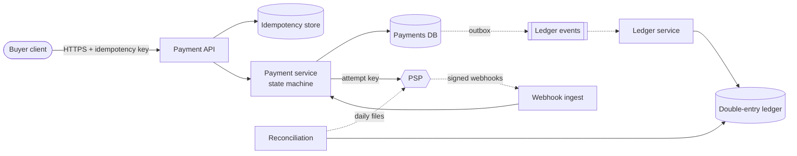
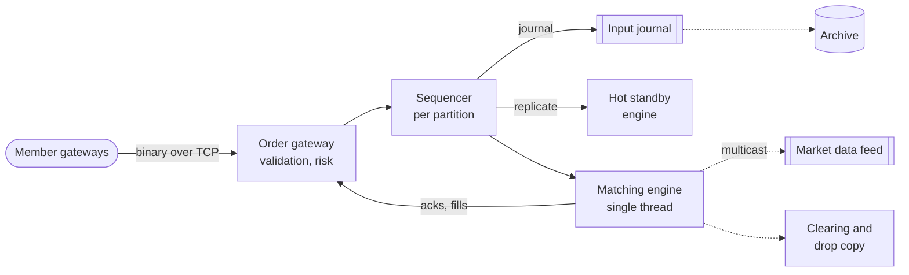
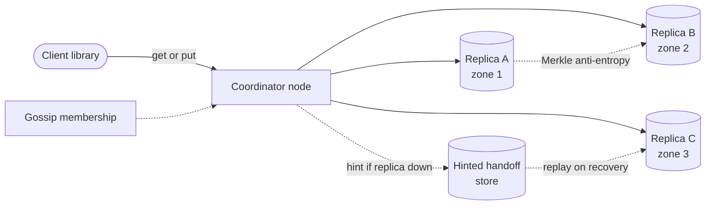
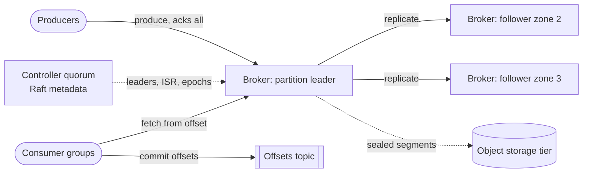

## 91.6 Hard questions (Q29–Q44)

Hard prompts are the ones where the obvious design is wrong. A payment system built like a CRUD app double-charges people; a matching engine built like a web service is too slow and not deterministic; a cache tier built like a single Redis cluster collapses the database the first time it restarts. Each answer below names the constraint that breaks the obvious design within the first minutes and spends the deep dives on the mechanism that survives it. Expect a 60-minute slot, a senior or staff interviewer, and follow-ups that change one constraint to see whether you reason or recite.

All designs are teaching designs (*Evidence: Illustrative*). Estimates use the formulas of Chapter 89 and, unless a question says otherwise, its defaults: peak-to-average ratio 4.8, target utilization $u = 0.6$, decimal units.

### 91.6.1 Q29. Payment system

**Difficulty:** Hard · **Time:** 60 min · **Related:** §55.9 (full case study); §22.15, §32.5, §11 (transactions)

#### Prompt

"Design the payment system for an online marketplace. Buyers pay by card; sellers are paid out later. Nobody may be charged twice."

#### Clarifying questions and assumptions

- *Do we process cards ourselves?* No: a payment service provider (PSP) talks to card networks; we orchestrate, record and reconcile.
- *Which flows?* Authorize, capture, refund, seller payouts; chargebacks arrive from the PSP.
- *Scale?* 50 million payments per day, peak 5× average (holiday sales), the numbers of §55.9.4.
- *Currencies?* Several; store integer minor units with ISO 4217 codes.

#### Requirements

**Functional.** Create payment with an idempotency key; authorize and capture through the PSP; refund; record every money movement in a ledger; pay sellers on a schedule; ingest PSP webhooks; reconcile daily. **Non-functional.** Zero double charges caused by our retries; ledger append-only and balanced per currency; RPO 0 for payment state; 99.99% API availability; p99 authorization under 2 s (PSP-bound); PCI scope minimized.

#### Estimation

::: example
**Worked example — Small throughput, large consequences.** Using §89.5 and the §55.9.4 assumptions:

1. Average $5 \times 10^7 / 86{,}400 = 579$ payments/s; peak $\times 5 = 2{,}894$/s.
2. In-flight PSP calls by Little's Law (§89.10) at 1.5 s average PSP latency: $2{,}894 \times 1.5 = 4{,}341$ concurrent requests, so the PSP client must be asynchronous or heavily pooled.
3. Ledger: 6 lines × 200 B per payment $= 60$ GB/day; seven-year retention $\approx 153$ TB before replication (§89.6).
4. Without idempotency, a 0.1% client timeout rate with half the timed-out calls having succeeded gives $5 \times 10^7 \times 0.001 \times 0.5 = 25{,}000$ double charges a day.

**Interpretation.** Throughput fits one well-provisioned relational cluster; correctness under retries is the design. **Engineering implication.** Spend the deep dives on idempotency and the ledger, not on sharding.
:::

#### API and data model

```text
POST /v1/payments            Idempotency-Key: <uuid>   {order_id, amount_minor, currency, payment_method_token}
POST /v1/payments/{id}/capture | /refunds              Idempotency-Key required on every POST
POST /internal/psp-webhooks  (signed; deduplicated by psp_event_id)

payment(id PK, order_id, state, amount_minor, currency, psp_ref, version)
payment_attempt(id PK, payment_id, psp_idempotency_key UNIQUE, status, request_hash)
ledger_line(txn_id, line_no, account_id, amount_minor, currency, posted_at)   -- append-only
idempotency(key PK, request_hash, response, expires_at)
```

#### High-level design

**Figure 91.101 — Payment system: synchronous money path and asynchronous bookkeeping.**



**Reading the diagram.** The buyer's request travels synchronously through the API, which checks the idempotency store, to the payment service, which persists a state transition and a payment attempt *before* calling the PSP with a deterministic attempt key. The PSP's result returns synchronously or later through signed webhooks (dotted, asynchronous), deduplicated by event ID. Every state change writes an outbox row in the same transaction (§32.5), so ledger postings flow asynchronously into the append-only double-entry ledger. Reconciliation compares the ledger with the PSP's settlement files daily. Failure points: a PSP timeout (outcome unknown), webhook duplicates and reordering, and a relay outage that delays the ledger without losing postings. Scaling: the API tier is stateless; the payments database partitions by merchant if it ever must.

#### Deep dives

1. **Idempotency at every hop.** The client key protects the API; a persisted attempt with its own key protects the PSP call; webhook IDs protect ingestion; posting keys protect the ledger. A timeout is *unknown*, never *failed*: query the PSP by attempt key before retrying, and never fail over to a second PSP while an outcome is unknown (§55.9.8).
2. **The ledger.** Every transaction's lines sum to zero per currency; balances are derived or maintained as checked aggregates; corrections are reversals, never edits. Hot platform accounts (fees, commission) are split into sub-accounts to avoid lock contention.
3. **Reconciliation as a system.** Three-way match of ledger, PSP report and bank statement; unmatched items go to a queue with owners and ageing alerts.

#### Trade-offs and alternatives

Synchronous capture is simpler; delayed capture (authorize now, capture on shipment) matches marketplace reality and makes the state machine longer. A relational database with serializable transactions per payment is right at 2,900/s; event sourcing the payment is attractive for audit but the ledger already gives an immutable history. Reverse the choice of a single PSP only when the business needs routing for cost or approval rates, and then only with per-attempt PSP ownership.

#### Follow-up questions

1. *"Can you guarantee exactly-once charging?"* Not per hop; at-least-once delivery plus idempotent processing at every hop gives effectively-once outcomes, and reconciliation catches the rest.
2. *"The PSP does not support idempotency keys."* Record the attempt reference first, query by it before any retry, and accept that reconciliation becomes the last line of defense.
3. *"Why not floats?"* Binary floating point cannot represent 0.10; use integer minor units.
4. *"How do refunds and chargebacks post?"* As new balanced transactions referencing the original, never as edits.
5. *"What is in PCI scope?"* Only the tokenization edge; card numbers never reach our services.

#### What distinguishes levels

- **Mid:** idempotency key on the API, a payments table and a PSP call with retries.
- **Senior:** traces the key through every hop, treats timeouts as unknown, designs a balanced append-only ledger and the outbox.
- **Staff:** makes reconciliation a first-class system with ownership, removes hot-account contention, refuses PSP failover under unknown outcomes, and frames PCI scope as an architectural boundary. The full treatment is §55.9.

### 91.6.2 Q30. Stock-exchange matching engine

**Difficulty:** Hard · **Time:** 60 min · **Related:** §27.4 (primary–backup), Ch 31 (logs), §4.11 (Little's Law), §18 (vertical scaling)

#### Prompt

"Design the core of a stock exchange: members send orders, the exchange matches buyers with sellers and publishes trades and market data. Latency and fairness matter."

#### Clarifying questions and assumptions

- *Order types?* Limit and market orders, cancel and modify; no auctions or complex orders in scope.
- *Fairness?* Strict price–time priority: better price first, then earlier arrival.
- *Scale?* 10,000 symbols; 1 million order messages/s at peak, 100,000/s averaged over a 6.5-hour session.
- *Latency target?* p99 under 100 µs from gateway receipt to acknowledgment, inside one data center; members co-locate.
- *Recovery?* No acknowledged order may be lost; failover to a hot standby in seconds.

#### Requirements

**Functional.** Accept, validate and risk-check orders; match by price–time priority; acknowledge, report fills, publish trades and order-book changes; cancel and modify; end-of-day clearing feed. **Non-functional.** Determinism (replaying the input log reproduces every trade); p99 ≤ 100 µs and low jitter; RPO 0 for acknowledged orders; 99.99% during trading hours; fair, equal-latency access for members.

#### Estimation

::: example
**Worked example — The engine is latency-bound, not throughput-bound.** Assumptions above; 100 B per order message; matching costs about 2 µs per message on one core (an assumption to benchmark); the busiest symbol carries 3% of peak flow; books hold 20,000 resting orders per symbol at 100 B each.

1. Daily messages: $10^5 \times 23{,}400 = 2.34 \times 10^9$; input log $2.34 \times 10^9 \times 100 = 234$ GB/day, 702 GB with three copies (§89.6).
2. One core matches $1 / 2\,\mu\text{s} = 500{,}000$ messages/s. Busiest symbol at peak: $0.03 \times 10^6 = 30{,}000$/s, 6% of one core.
3. With 16 matching partitions (symbol groups), average peak load is 62,500/s each, 12.5% of a core.
4. Order books: $10^4 \times 2 \times 10^4 \times 100 = 20$ GB in total, 1.25 GB per partition: memory-resident.

**Interpretation.** A single thread per symbol group has ample throughput; queueing (§4.11) and jitter, not capacity, decide whether p99 stays under 100 µs. **Engineering implication.** Keep matching single-threaded and in memory, avoid locks and garbage-collection pauses, and spend the budget on the sequencing and replication path.
:::

#### API and data model

```text
FIX or binary protocol over TCP per member session:
  NewOrder{cl_ord_id, symbol, side, qty, price, type, tif}   -> Ack{order_id, seq}
  Cancel{cl_ord_id, order_id}                                -> CancelAck | Reject
  ExecutionReport{order_id, fill_qty, fill_price, trade_id, seq}
Market data: multicast UDP, per-partition sequence numbers, snapshot + incremental

Order book (in memory, per symbol): price levels in two sorted maps (bids desc, asks asc);
  each level a FIFO queue of resting orders; order_id -> node index for O(1) cancel
Journal: (partition, seq) -> input message, append-only
```

#### High-level design

**Figure 91.102 — Matching engine: sequence, replicate, then match deterministically.**



**Reading the diagram.** Orders arrive over persistent TCP sessions at gateways that validate and apply pre-trade risk checks. Each symbol group's sequencer assigns a monotonically increasing sequence number, appends to the journal and replicates to the hot standby before the engine processes the message, so the standby holds the same input in the same order. The matching engine is a single-threaded state machine over in-memory order books; it returns acknowledgments and fills synchronously to gateways and publishes market data asynchronously by multicast (dotted) with sequence numbers so subscribers detect gaps. The journal is the storage boundary; the archive is downstream. Failure points: the sequencer (mitigated by the standby replaying the journal), a slow consumer on the market-data path (multicast never waits for it), and garbage-collection or OS jitter. Scaling: add symbol partitions; never split a symbol.

#### Deep dives

1. **Determinism through a sequenced log.** The engine is a replicated state machine (§26.3.2): same inputs in the same order give the same trades. Time comes from the sequencer's stamp, never from the engine's clock; random numbers and hash-map iteration order are banned in matching code. Recovery is "load snapshot, replay journal from its sequence number"; a failover standby is already caught up.
2. **The latency budget.** Kernel-bypass networking, pinned cores, preallocated object pools and lock-free ring buffers between stages. Table 91.101 allocates the 100 µs budget; replication to the standby is the largest single term, which is why the standby sits in the same data center and the cross-site disaster-recovery copy is asynchronous.
3. **Order-book data structure.** Price levels as arrays indexed by tick offset (or a balanced tree for wide ranges), each a FIFO list; an index from order ID to node gives O(1) cancel, which matters because cancels often outnumber new orders.

**Table 91.101 — An illustrative p99 latency budget for one order (assumptions to measure).**

| Stage | Budget | Why |
|---|---|---|
| Network in and gateway parse, risk check | 20 µs | Kernel bypass, precomputed limits |
| Sequencer and journal append | 10 µs | Memory-mapped journal, batched flush |
| Replication to standby, acknowledged | 30 µs | Same-site link; largest term |
| Matching | 5 µs | Single thread, in memory |
| Acknowledgment out to member | 20 µs | Gateway encode and send |
| Headroom for jitter | 15 µs | GC-free, pinned cores |
| **Total** | **100 µs** | |

::: industry
**LMAX.** Martin Fowler's description of the LMAX retail exchange architecture reports a single-threaded business-logic processor holding all state in memory, fed by input and output ring buffers (the Disruptor) that journal and replicate events, processing about 6 million orders per second on one thread.
*Evidence: Primary* — [Fowler 2011; Thompson et al. 2011]
:::

#### Trade-offs and alternatives

A database-backed matching service is simpler and fails the latency target by two orders of magnitude. Multi-threaded matching within a symbol breaks price–time determinism. Consensus-replicated sequencing (Raft across three nodes) gives automatic failover at the cost of a quorum round per message; primary–backup with a fenced failover is the usual choice when every microsecond counts. Batch auctions (match every few milliseconds) trade continuous latency for fairness against speed races.

#### Follow-up questions

1. *"How do you fail over without duplicates or losses?"* The standby holds the replicated journal; it takes over at the last sequence number with a fencing epoch so the old primary's late outputs are rejected (§26.13). Members resend unacknowledged orders with their client order IDs, which deduplicate.
2. *"How do market-data subscribers recover a lost packet?"* Gap detection by sequence number, retransmission service or snapshot plus replay.
3. *"How is fairness between members ensured?"* Equal cable lengths and gateway paths for co-located members, arrival stamps at one point, and optional speed bumps.
4. *"Where does pre-trade risk run?"* At the gateway, against per-member limits kept in memory and updated from fills.
5. *"How would you scale to 100,000 symbols?"* More partitions; symbols never span partitions, and cross-symbol orders are out of scope.

#### What distinguishes levels

- **Mid:** an order-book data structure and a matching service in front of a database.
- **Senior:** a single-threaded in-memory engine, a sequenced journal, deterministic replay and a latency budget with numbers.
- **Staff:** explains why replication sits before matching, designs fencing for failover, separates the market-data path so slow subscribers cannot stall matching, and discusses fairness mechanisms as a product decision.

### 91.6.3 Q31. Distributed key-value store

**Difficulty:** Hard · **Time:** 60 min · **Related:** §52.8 (full case study); §14.8, §27.7–§27.14, §13.8

#### Prompt

"Design a highly available key-value store, like Dynamo, that many internal services use. It must stay writable during node and zone failures."

#### Clarifying questions and assumptions

- *Value sizes and API?* Keys ≤ 256 B, values ≤ 1 MB; `get`, `put`, `delete`; no range scans or multi-key transactions.
- *Consistency?* Tunable per table: $N$, $R$, $W$; eventual by default.
- *Scale?* 100 TB logical, 2 million reads/s and 1 million writes/s at peak (§52.8.4).

#### Requirements

**Functional.** Get/put/delete with version context; per-table $N$, $R$, $W$ and conflict policy; online node addition; optional multi-datacenter replication. **Non-functional.** 99.99% write availability including the loss of one zone; p99 ≤ 10 ms within a region; convergence within an hour after healing; rebalancing uses ≤ 20% of node bandwidth.

#### Estimation

::: example
**Worked example — Throughput sets the node count.** From §52.8.4: 100 billion 1 KB items; RF 3; LSM space amplification 1.3; 8 TB nodes filled to 70%; 100,000 replica operations/s per node at $u = 0.6$.

1. Raw storage $100 \times 3 \times 1.3 = 390$ TB: 70 nodes would hold it (§89.9).
2. Replica operations with reads touching all three replicas: $2 \times 10^6 \times 3 + 10^6 \times 3 = 9 \times 10^6$/s, so $9 \times 10^6 / 60{,}000 = 150$ nodes.
3. Reading from $R = 2$ replicas instead: $4 \times 10^6 + 3 \times 10^6 = 7 \times 10^6$/s, 117 nodes.

**Interpretation.** The cluster is throughput-bound by a factor of two. **Engineering implication.** Per-table quorum settings change hardware cost directly; disk size does not.
:::

#### API and data model

```text
get(key) -> ([value...], context)      put(key, value, context)      delete(key, context)
Placement: Q = 16,384 fixed partitions; partition -> preference list of N nodes in distinct zones
Storage: LSM tree per node (memtable, SSTables, Bloom filters); version vector per value
```

#### High-level design

**Figure 91.103 — Dynamo-style store: any node coordinates, quorums decide.**



**Reading the diagram.** The client (or a partition-aware library) sends a request to a coordinator, normally the first healthy node in the key's preference list. The coordinator sends it to all $N$ replicas in different zones and answers after $W$ write or $R$ read acknowledgments (synchronous). If a replica is down, a stand-in stores a hinted write and replays it on recovery (dotted, asynchronous); Merkle-tree anti-entropy and read repair converge replicas in the background; gossip spreads membership. Each replica is a storage boundary with an LSM engine. Failure points: sloppy quorums weaken read-your-writes, and tombstones must outlive the longest rejoin window. Scaling: add nodes and move whole partitions.

#### Deep dives

1. **Quorums and their limits.** $R + W > N$ makes read and write sets overlap, but not with sloppy quorums, concurrent writes or partial failed writes (§27.8.2).
2. **Conflicts.** Version vectors detect concurrent writes and return siblings to the application; last-writer-wins silently drops one (§27.14).
3. **Repair and rebuild.** Fixed partitions spread a dead node's data across about 50 peers, so a rebuild takes minutes instead of hours (§52.8.4).

#### Trade-offs and alternatives

Leaderless quorums buy write availability at the cost of conflict handling. A Raft group per partition (§26.7) gives linearizable keys and simpler semantics at the cost of a leader per range and unavailability for a minority partition. Choose leaderless for carts and sessions, consensus for anything with invariants.

#### Follow-up questions

1. *"What does $R + W > N$ buy you?"* Overlap with the latest acknowledged write under strict quorums; nothing under sloppy quorums.
2. *"Why not timestamps for conflicts?"* Clock skew plus LWW loses concurrent writes.
3. *"How does a new node get data?"* It takes partitions from many peers, streaming in parallel and throttled.
4. *"How do replicas detect divergence cheaply?"* Merkle trees per partition (§17.8).
5. *"Hot key?"* Client-side caching or key splitting; quorums do not spread one key's load.

#### What distinguishes levels

- **Mid:** consistent hashing and replication with a correct read and write path.
- **Senior:** quorums, hinted handoff, version vectors, read repair and anti-entropy explained as mechanisms.
- **Staff:** explains how they interact (sloppy quorums versus $R + W > N$, tombstones versus rejoin windows, partition count versus rebuild time) and makes conflict policy a per-table product decision. Full case: §52.8.

### 91.6.4 Q32. Distributed message queue

**Difficulty:** Hard · **Time:** 60 min · **Related:** §30.4, Ch 31 (Kafka), §89.11

#### Prompt

"Design a distributed message queue that hundreds of teams use to pass events between services. It must not lose acknowledged messages and must let consumers replay."

#### Clarifying questions and assumptions

- *Queue or log semantics?* A partitioned, replicated **log**: consumers track offsets and can replay; per-key ordering within a partition. Per-message acknowledgment (queue semantics) is a layer on top.
- *Scale?* 2 GB/s average, 5 GB/s peak ingest; 1 KB messages; three consumer groups read each topic on average; 7-day retention; compression 3:1.
- *Durability?* An acknowledged message survives the loss of any one node or zone.

#### Requirements

**Functional.** Create topics with partitions; produce with keys (same key, same partition, in order); consume in consumer groups with committed offsets; replay from an offset or time; retention by time and size; dead-letter handling for poison messages. **Non-functional.** No loss of acknowledged messages (replicated to three zones, acknowledged by two); p99 produce latency under 20 ms; consumer lag observable in seconds; per-team quotas; 99.95% availability.

#### Estimation

::: example
**Worked example — Disk, network and the effect of tiered storage.** Using §89.11 with the assumptions above; brokers have 48 TB of disk filled to 60% and 25 Gb/s NICs used at 60% (1.875 GB/s).

1. Peak messages: $5 \times 10^9 / 10^3 = 5$ million/s. Compressed peak ingest: $5 / 3 = 1.67$ GB/s.
2. Broker disk: $B = (2 / 3)\ \text{GB/s} \times 604{,}800\ \text{s} \times 3 = 1.21$ PB, so $1.21\ \text{PB} / 28.8\ \text{TB} = 42$ brokers.
3. Network out of brokers at peak: consumers $3 \times 1.67 = 5.0$ GB/s plus replication $2 \times 1.67 = 3.33$ GB/s $= 8.33$ GB/s, only 4.4 brokers' worth.
4. Tiered storage keeping 1 day local and older segments in object storage: local disk $1.21 / 7 = 0.173$ PB, 6 brokers' worth.
5. Partitions at 10 MB/s of consumer throughput each, with 1.5× headroom: $1.5 \times 5{,}000 / 10 = 750$.

**Interpretation.** Without tiering the cluster is disk-bound at 42 brokers while network needs fewer than 5; with tiering the binding term shifts to network and partitions, and the cluster shrinks several-fold (12 brokers for spread and failure headroom). **Engineering implication.** Retention is a storage-tier decision, not a broker-count decision; separate them.
:::

#### API and data model

```text
produce(topic, key, value, headers) -> (partition, offset)      acks = all, idempotent producer
fetch(topic, partition, offset, max_bytes) -> records            consumer pulls
commit(group, topic, partition, offset)
Log segment files per partition replica: [offset, timestamp, key, value, headers], index files
Metadata (controller quorum): topics, partition -> leader, ISR, leader epoch, quotas
```

#### High-level design

**Figure 91.104 — Partitioned, replicated log with a metadata quorum and tiered storage.**



**Reading the diagram.** Producers send batches to the partition leader, which appends to its local segment and replicates to followers in other zones; with `acks=all` and a minimum in-sync replica count of 2, the producer is acknowledged once two zones hold the batch (synchronous). The controller quorum, itself a Raft log, owns metadata: which broker leads which partition, the in-sync replica set and leader epochs (dotted, asynchronous updates). Sealed segments move asynchronously to object storage, the long-term storage boundary. Consumers pull from offsets and commit them to an internal compacted topic. Failure points: leader loss (a new leader from the in-sync set, with epoch-based truncation), a slow follower dropping out of the ISR, and consumer rebalances. Scaling: add partitions and brokers; consumers scale up to the partition count.

#### Deep dives

1. **Durability without losing order.** Leader epochs let a returning follower truncate entries the new leader never had (§31.9.4); unclean leader election is disabled for durable topics. Idempotent producers carry a producer ID and sequence numbers so retries do not duplicate within a partition (§31.6.3).
2. **Queue semantics on a log.** Many teams want "acknowledge each message, redeliver after a timeout, dead-letter after N attempts". Either offer share groups (cooperative per-record consumption, §31.7.4) or a per-message state layer with visibility timeouts (§30.4.2). Make the trade explicit: per-record acknowledgment gives up per-key ordering.
3. **Multi-tenancy.** Produce and fetch byte-rate quotas per client, partition-count limits per team, and separate clusters for the few topics whose bursts would starve others (§47.8).

#### Trade-offs and alternatives

**Table 91.102 — Log versus queue for a company-wide messaging service.**

| Aspect | Partitioned log (Kafka-style) | Broker queue (RabbitMQ/SQS-style) |
|---|---|---|
| Replay | Yes, by offset or time | No; consumed messages are gone |
| Ordering | Per partition | Per queue at best, lost with competing consumers |
| Per-message acknowledgment and redelivery | Layered on top | Native |
| Fan-out to many consumer groups | Cheap: each reads the same bytes | Copies per subscription |
| Choose when | Event streams, CDC, analytics, replay | Task queues, per-job retries, low volume |

#### Follow-up questions

1. *"How do you guarantee ordering for one customer?"* Key by customer ID; one partition, one consumer in the group at a time; never increase the partition count of a keyed topic without a migration (§31.5.3).
2. *"Exactly-once?"* Idempotent producer plus transactions give exactly-once within the log; side effects outside need idempotent consumers (§32.10).
3. *"A consumer is stuck on a poison message."* Bounded retries, then a dead-letter topic with the original offset; alert on dead-letter rate (§30.11).
4. *"What do you monitor?"* Under-replicated partitions, ISR shrink rate, produce p99, consumer lag in seconds, disk and tier upload lag.
5. *"Why a separate metadata quorum?"* Metadata needs linearizable updates and fast failover; data replication uses the cheaper in-sync-replica scheme (§31.9.2).

#### What distinguishes levels

- **Mid:** topics, partitions, consumer groups and replication described correctly.
- **Senior:** sizes disk, network and partitions; explains ISR, `acks=all`, idempotent producers and lag.
- **Staff:** separates storage tiering from compute, offers queue semantics deliberately with its ordering cost, and designs quotas and cluster isolation for hundreds of teams.

