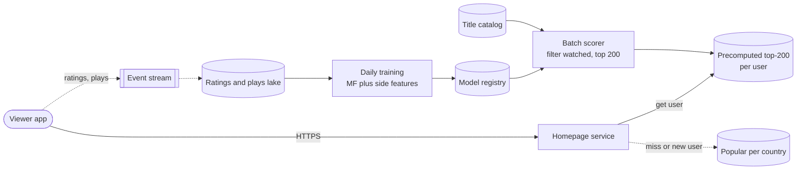
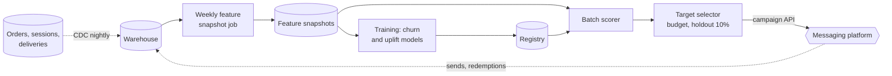

# Chapter 92 — Interview Practice Library II: ML and AI System Design

> **Level:** 3–5 · **Track:** B (ML/AI) · **Estimated reading time:** 12 h (a reference library; work through it one question at a time)

Chapter 88 extended the interview method with eleven ML steps, from problem formulation to responsible ML (§88.6), and added the concerns that become first-class when the model is a large language model (§88.8). Chapter 89 supplied the estimation formulas, including the ML forms for training rows, feature reads, embedding memory and inference fleets (§89.13–§89.17). This chapter is where you practice both. It holds 52 ML and AI system-design prompts, graded from easy to expert, each with a model answer written the way a strong candidate would deliver it in 45 or 60 minutes.

The library does not replace the case studies. Book II already contains 29 ML case studies (Chapters 81–86) and several worked designs (QuickBite ETA in §60.15, QuickBite recommendations in §68.16, fraud monitoring in §70.8, Deal Nudge in §88.7). Where one of them covers a prompt, the model answer here is deliberately compact: it shows what fits in the room and points to the full treatment. Where none does, the answer is complete enough to stand alone. Every design in this chapter is a teaching design with assumed numbers. *Evidence: Illustrative* — no design here describes any company's system, and no question is attributed to any company's interview.

## 92.1 Learning objectives

After working through this chapter you should be able to:

- **Attempt** any of 52 ML and AI prompts under a 45- or 60-minute clock, producing a formulation, a label definition, an estimate, a baseline and a serving design before the deep-dive mark.
- **Translate** a business goal into an ML task, a label with its delay and bias, an offline metric and an online metric, and state the link between them in one sentence.
- **Reuse** the estimation formulas of Chapter 89, especially §89.5 (traffic), §89.10 (fleets) and §89.13 (ML workloads), on unfamiliar prompts, sizing from predictions per second rather than requests per second.
- **Identify** the decision that dominates each prompt (the label, the latency budget, the human-review workforce, the feedback loop or the cost per prediction) and spend most of your deep-dive time on it.
- **Name**, for every design, a heuristic baseline, a fallback when the model is unavailable, the silent-failure modes and the monitor that detects each.
- **Score** your own attempt against each question's level signals and the rubric of §88.9, and choose the next question that targets your weakest dimension.

## 92.2 Prerequisites

- **The ML extension and LLM additions** — §88.6–§88.8. The per-question format below is the eleven ML steps compressed into interview headings; read the Deal Nudge walk-through (§88.7) once before starting.
- **Interview technique and pacing** — Chapter 87 and the 45-minute ML budget in §88.6.1.
- **Estimation** — §89.5 (traffic), §89.10 (fleets), §89.13 (training rows, feature reads, embedding memory, inference fleet), §89.14 (GPU memory), §89.15 (training compute), §89.17 (cost), and the drills of §89.18. The estimates here cite these sections rather than re-derive them.
- **ML fundamentals** — metrics and calibration (§57.10–§57.12), A/B testing (§57.14), the lifecycle and label delay (§59.4, §59.12), and the architecture tiers and fleet formula (§60.7, §60.11).
- **Recommendation, features and monitoring** — the funnel and ranking models (§68.4–§68.7), feature stores and point-in-time joins (§62.8–§62.10), labeling and imbalance (§63.4, §63.11) and drift and delayed-label monitoring (§70.5, §70.8).
- **The ML case-study method** — §81.3. Read at least two Book II case studies end to end before relying on the compact answers.

## 92.3 How to use this library

### 92.3.1 The practice loop

Use the library for retrieval practice, as described for the traditional library in §91.3.1: read only the prompt, attempt the design aloud on a timer, then open the model answer, score yourself and read the owner section for any dimension you missed. Reading model answers first feels productive and teaches little. Two habits matter more for ML prompts than for traditional ones. First, **write the label before anything else**: if you cannot say what a positive example is, when it becomes known and who never gets one, every later step is guesswork. Second, **say the baseline aloud** before naming a model; interviewers use it to judge whether your model choice is justified.

### 92.3.2 Difficulty tiers

Difficulty describes how much of the design is non-standard, not how large the system is. Language identification at 115,000 predictions per second is *Easy* because the model is cheap and the components are standard; credit scoring at 63 requests per second is *Medium* because labels arrive a year late and every decision must be explainable.

**Table 92.1 — Difficulty tiers in this library.**

| Tier | Questions | What the prompt demands | Typical slot | Level it best discriminates |
|---|---|---|---|---|
| Easy | Q1–Q10 | One model with a clear label; a correct pipeline, a baseline and one deep dive | 45 min | Mid (L4); a senior warm-up |
| Medium | Q11–Q26 | A product-facing ML system with a hard part in labels, latency, feedback loops or people | 45 min | Mid to senior (L4–L5) |
| Hard | Q27–Q40 | ML platforms and multi-model systems; streaming features, retrieval at scale, LLM applications | 60 min | Senior to staff (L5–L6) |
| Expert | Q41–Q52 | AI infrastructure and frontier systems; GPU fleets, training at scale, agents, safety | 60 min, often a design review | Staff to principal (L6–L7) |

A senior candidate should finish any Easy question in 30 minutes and use the remainder for the follow-ups, which push the prompt toward the Medium or Hard tier ("now the labels arrive 90 days late", "now serve it at 100 times the traffic").

### 92.3.3 The per-question format

Every question uses the same headings, in the order you would cover them in the room. Table 92.2 maps each heading onto the ML steps of §88.6 and gives a time budget for a 45-minute slot.

**Table 92.2 — The per-question format, the ML steps it covers and a 45-minute budget.**

| Heading | What it contains | ML steps (§88.6) | Minutes |
|---|---|---|---|
| Prompt | What the interviewer says, in one to three sentences | — | — |
| Clarifying questions and assumptions | The questions worth asking and the answers assumed | M1 | 3 |
| Requirements | FRs, NFRs with numbers, and a quality requirement | M1 | 4 |
| Estimation | An `example` callout citing Chapter 89 formulas | M5, M7 | 4 |
| Data, labels and features | Sources, label definition and delay, leakage, feature groups and freshness | M2, M3 | 8 |
| Model and evaluation | Baseline → production model; offline metrics and gate; online test | M4, M6, M8 | 7 |
| High-level design | One diagram with "Reading the diagram" | M5, M7 | 5 |
| Serving and monitoring | Latency budget, fallback, monitors, retraining | M7, M9, M10 | 6 |
| Deep dives | The two or three points that decide the interview | any | 6 |
| Trade-offs and alternatives | Main choices with their reversal conditions | M4, M7 | 2 |
| Follow-up questions | Four to six, with short model answers | any | 3 |
| What distinguishes levels | Mid, senior and staff signals | M11 and all | 3 |

Unless a question states otherwise, estimates use the conventions of Chapter 89: decimal units, busiest-hour share $h = 0.10$ and burst factor $b = 2$ (peak-to-average ratio 4.8), target utilization $u = 0.6$ for GPUs and $u = 0.5$ for latency-sensitive CPU services, 16-vCPU nodes at \$0.77 per hour, \$2.50 per GPU-hour and the hosted small-model API prices of Chapter 79 (\$0.15 per million input tokens and \$0.60 per million output tokens), all illustrative and as of 2026.

Questions with a full case study or worked design elsewhere in the book have **compact answers** (about 500–750 words): the interview-length answer plus the cross-reference, usually reusing the case study's numbers so the book tells one consistent story. Questions without one have **full answers** (about 1,000–1,300 words). The model answer is *one* good answer; a different design justified with numbers, a baseline and a label definition earns the same credit.

**Figure 92.1 — How one model answer flows through the ML steps.**

**Reading the diagram.** Each box is a block of the model answer, in speaking order from left to right. The diamond is the decision every ML answer must pass: a named baseline beaten offline for a stated reason; when it is not, the answer returns to data, labels and features rather than reaching for a bigger model. The dotted arrow is the asynchronous loop that distinguishes ML systems from traditional ones: production outcomes become the next training labels, so monitoring and retraining are part of the design, not an appendix. *Failure points:* skipping the label definition (every later box is ungrounded) and running out of time before serving and monitoring, where most production failures live (§88.6.1). *Scaling:* the same flow applies to an LLM prompt, with the additions of Table 88.8 (evaluation first, cost per request, guardrails) attached to the requirements, estimation and deep-dive boxes.

::: tip
**How to read a model answer after your attempt.** Check five things: did you define the same label (or a defensible different one) with its delay; did your numbers reach the same order of magnitude, sized from predictions rather than requests; did you name a baseline and a fallback; did your deep dive contain a mechanism (not just a model name); and could you answer at least four follow-ups. These map onto the rubric dimensions that most often separate levels in ML loops (§88.9).
:::

::: mistake
**Answering every ML prompt with the same architecture.** A candidate who draws "feature store, training pipeline, model server" for spam, credit scoring and document extraction has drawn nothing. The differences are the answer: spam is decided mostly by sender reputation before the content is read, credit scoring by a label that arrives a year late, document extraction by the human-review workforce. Find the prompt's hard part in the first ten minutes.
:::

### 92.3.4 Index of all 52 questions

Table 92.3 lists every question in both parts of the library. "Related" names the full case study or worked design where one exists (the compact answers point there) and otherwise the sections that own the key techniques.

**Table 92.3 — Index of the ML and AI practice library.**

| Q | Title | Difficulty | Related sections |
|---|---|---|---|
| 1 | Email spam classifier | Easy | §82.6 (full case); §60.13.2, §63.11 |
| 2 | Movie rating prediction | Easy | §68.5.2, §81.6, §57.11 |
| 3 | Image tagging service | Easy | §84.5 (full case); §66.6, §63.8 |
| 4 | Sentiment analysis API | Easy | §63.6, §66.7, §76.13 |
| 5 | Churn prediction | Easy | §59.4, §62.8, §57.14 |
| 6 | Duplicate-question detection | Easy | §16.5, §74.9, §75.9 |
| 7 | Product categorization | Easy | §63.9, §63.10, §79.8.1 |
| 8 | Store-level demand forecasting | Easy | §83.4 (related case); §57.11.2, §61.5 |
| 9 | Language identification service | Easy | §62.3.4, §66.3, §75.5 |
| 10 | Click-through-rate prediction basics | Easy | §68.7.5, §68.9, §81.9 |
| 11 | News feed ranking | Medium | §81.5 (full case); §53.7, §68.7.4 |
| 12 | Video recommendations | Medium | §81.4 (full case); §68.6, §56.5 |
| 13 | Search ranking | Medium | §81.7 (full case); §56.4 |
| 14 | People You May Know | Medium | §68.5.3, §68.12, §71.9 |
| 15 | Payment fraud detection | Medium | §82.4 (full case); §70.8, §89.18.9 |
| 16 | ETA prediction | Medium | §60.15 (worked design), §83.5 (full case); §89.18.10 |
| 17 | Ad CTR prediction at scale | Medium | §81.9 (full case); §68.7.5 |
| 18 | Content moderation | Medium | §82.7 (full case); §63.14.3 |
| 19 | Visual search | Medium | §74.9, §74.11, §84.5 |
| 20 | Playlist generation | Medium | §54.6, §68.10, §68.15 |
| 21 | Notification ranking and send-time optimization | Medium | §88.7 (worked design); §52.7 |
| 22 | ML query autocomplete | Medium | §16.9 (worked design); §81.7, §68.12.2 |
| 23 | Dynamic pricing | Medium | §83.6 (full case); §83.4 |
| 24 | Credit scoring | Medium | §82.5 (full case); §71.7, §71.8 |
| 25 | Metrics anomaly detection | Medium | §56.6, §70.5, §70.6.4 |
| 26 | Document OCR and extraction pipeline | Medium | §63.14.4, §66.13, §75.5 |
| 27 | Feature store | Hard | §85.4 (full case); Ch 62 |
| 28 | ML training platform | Hard | §85.5 (full case); Ch 65, Ch 69 |
| 29 | Model serving platform | Hard | §85.6 (full case); Ch 66 |
| 30 | Real-time personalization with streaming features | Hard | §85.7 (full case); §68.13, §62.10 |
| 31 | Billion-scale embedding retrieval | Hard | §68.6, §74.13, §81.4 |
| 32 | Enterprise RAG assistant | Hard | §86.4 (full case); Ch 75 |
| 33 | LLM customer-support agent | Hard | §86.7 (full case); Ch 77 |
| 34 | Speech recognition | Hard | §84.6 (full case) |
| 35 | Machine translation | Hard | §84.7 (full case) |
| 36 | Perception data engine for autonomous driving | Hard | §63.5, §63.9, §80.6 |
| 37 | Experimentation platform | Hard | §57.14, §66.12, §68.14 |
| 38 | ML monitoring platform | Hard | Ch 70, §69.12 |
| 39 | Federated learning for a mobile keyboard | Hard | §71.10, §71.11 |
| 40 | Two-sided marketplace matching | Hard | §55.5, §83.5, §83.6 |
| 41 | LLM inference platform | Expert | §86.5 (full case); Ch 73 |
| 42 | LLM pre-training infrastructure | Expert | Ch 65, Ch 80, §89.15 |
| 43 | Multi-tenant fine-tuning service (LoRA) | Expert | §76.8, §76.9, §79.10 |
| 44 | AI coding assistant | Expert | §86.6 (full case) |
| 45 | Multi-agent orchestration platform | Expert | §77.8, §77.9, Ch 79 |
| 46 | LLM evaluation platform | Expert | Ch 78, §78.17 |
| 47 | AI answer engine | Expert | §86.8 (full case); Ch 75 |
| 48 | GPU cluster scheduler | Expert | §64.15, §79.8, §80.11 |
| 49 | Billion-scale vector database | Expert | §74.13, §74.14 |
| 50 | Guardrails and safety system for an LLM product | Expert | §77.11, §78.12, §78.13 |
| 51 | Image-generation (diffusion) service at scale | Expert | §66.6, §73.6, §80.13 |
| 52 | Cold-start marketplace recommendations with bandits | Expert | §68.11, §68.15 |

### 92.3.5 Choosing what to practice

If your interview is weeks away, work through one tier at a time and finish each with two unseen questions attempted cold. If it is days away, pick by shape: most ML prompts are variations on six recurring shapes, and one question per shape covers more ground than five of the same shape.

**Table 92.4 — Six recurring ML shapes and the questions that train them.**

| Shape | The hard part it trains | Questions |
|---|---|---|
| Classifier with a decision threshold | Imbalance, asymmetric error costs, calibration, delayed labels | Q1, Q5, Q15, Q18, Q24 |
| Retrieval and ranking funnel | Candidate sources, multi-task heads, position bias, feature fan-out | Q2, Q10, Q11, Q12, Q13, Q14, Q17, Q20, Q22 |
| Embedding similarity | Embedding training, ANN indexes, versioning and re-embedding | Q6, Q19, Q20 |
| Forecasting and control | Censored labels, quantiles, feedback through prices or supply | Q8, Q16, Q23, Q25 |
| Content understanding at scale | Throughput economics, multi-label taxonomies, human review | Q3, Q4, Q7, Q9, Q18, Q26 |
| Decision policies over time | Exploration, off-policy evaluation, long-term holdouts | Q5, Q21, Q23 |

::: recommendation
**A four-week plan for a senior ML loop.** Week 1: Q1, Q5, Q6, Q10 and the ML drills of §89.18.8–§89.18.10. Week 2: Q11, Q15, Q16, Q18, the four most common Medium prompts. Week 3: Q14, Q19, Q21, Q26, re-attempting any week-1 question you scored below senior. Week 4: two Hard questions from part B and two cold Medium questions, then rest. This is general advice, not a published recommendation of any company.
:::

## 92.4 Easy questions (Q1–Q10)

The Easy tier trains one model done well. Each answer is short on architecture and long on the step a mid-level candidate usually leaves vague: the cheap pre-model filter, the label that does not measure the goal, the throughput economics, the weak labels, the targeting decision, the retrieval stage, the human-review threshold, the censored demand, the library-versus-service choice and the calibration that an auction needs.

### 92.4.1 Q1. Email spam classifier

**Difficulty:** Easy · **Time:** 45 min · **Related:** §82.6 (full case study, at 1.5 billion mailboxes); §60.13.2 (cascades), §63.11 (imbalance)

#### Prompt

"Design the spam filter for an email provider with 20 million mailboxes. Spam should go to the spam folder; legitimate mail must reach the inbox."

#### Clarifying questions and assumptions

- Volume? Assume 50 inbound messages per mailbox per day, 1 billion a day, peak twice the average. About 40% of messages that reach classification are spam.
- Which error is worse? A legitimate message in the spam folder (a job offer, a bank alert); the target is at most 1 in 10,000 legitimate messages misfiled.
- Is phishing in scope? Yes, as a separate label with a warning banner; malware scanning is a separate system.
- Can we read message content? Automated processing only; humans see content only in donated or consented samples (§82.6.3).

#### Requirements

- **FR:** reject or defer at connection time using sender reputation; classify each message as spam, phishing or legitimate; "Report spam" and "Not spam" feedback; per-user allow and block lists.
- **NFR:** classification p99 ≤ 200 ms inside delivery (SMTP retries make this soft); mail never lost when a classifier fails (deliver with defaults or defer); false-positive rate ≤ 0.01% of legitimate mail; catch rate ≥ 99.5%; sender reputation updated within 5 minutes of new reports.

#### Estimation

::: example
**Worked example — Volume, fleet and the false-positive count (§89.5, §89.10, §60.11.1).** Assumptions: 1 billion messages a day, peak 2× average; connection-time reputation rejects half before the body is transmitted; feature extraction and the content model cost 2 ms of vCPU per message; 16-vCPU nodes at $u = 0.5$; three zones.

1. Inbound: $10^9 / 86{,}400 = 11{,}574$/s average, **23,148/s peak**.
2. Classified: $5 \times 10^8$/day, 11,574/s at peak. Busy vCPU $= 11{,}574 \times 0.002 = 23.1$; at $u = 0.5$, 46.3 vCPU, 3 nodes; surviving the loss of one zone, $\lceil 3 \times 3/2 \rceil = 5$ nodes.
3. Legitimate classified mail: $5 \times 10^8 \times 0.6 = 3 \times 10^8$/day. At 0.01% false positives, **30,000** wanted messages a day land in spam folders; at 0.1%, 300,000.
4. Spam classified: $2 \times 10^8$/day; a 0.5% miss rate puts 1 million spam messages a day in inboxes.

**Interpretation.** Compute is a handful of nodes; the false-positive count is the number that matters. **Implication.** Spend model capacity on precision for legitimate mail and measure it on graded samples, because users rarely open their spam folder to report errors.
:::

#### Data, labels and features

- **Labels:** user "Report spam" (positive) and "Not spam" (negative, the scarce and valuable one), spam-trap addresses (positives no person ever wanted), analyst verdicts. All are noisy and partly adversarial: spammers mark their own mail "Not spam" from botnet accounts, so weight feedback by reporter trust and count distinct reporters (§82.6.8).
- **Features:** sender reputation keyed by authenticated identity (SPF/DKIM-aligned domain, IP, /24 prefix) as decayed counts of reports and engagement; authentication results; URL-domain reputation; content (hashed character n-grams of subject and body, robust to obfuscation); recipient relation (contact, past replies).
- **Leakage:** reputation features must be computed as of delivery time; a sender's later reports must not leak into its own training rows (§62.8).

#### Model and evaluation

Baseline: authentication failures plus a block list and reputation thresholds. Model: logistic regression or gradient-boosted trees over reputation and hashed content features, with a heavier neural text model on the uncertain 5% (a cascade, §60.13.2). Offline gate: recall at a fixed false-positive rate of 0.01%, measured on a human-graded sample of the inbox and the spam folder, sliced by language and sender type (newsletters, transactional mail). Online: randomize by recipient, but note that reputation updates leak between arms; evaluate reputation changes by sender cohort.

#### High-level design

**Figure 92.2 — Spam filtering as a funnel: reputation first, content second.**

**Reading the diagram.** Sending servers connect over SMTP to the gateway, which looks up reputation (an in-memory store, the first storage boundary) and rejects or defers the worst senders before the body is transmitted. Accepted messages go synchronously to the content classifier; uncertain ones go to a heavier model, and delivery files the result. Dotted arrows are asynchronous: user feedback streams into the reputation updater (minutes) and into training data (daily). *Failure points:* if the classifier is down, deliver with reputation-only decisions rather than drop mail; a poisoned feedback stream corrupts reputation, so it is trust-weighted. *Scaling:* the gateway and classifiers are stateless and scale with message rate; reputation is partitioned by key.

#### Serving and monitoring

The classifier runs in-process at the gateway tier; the fallback ladder is full cascade → trees only → reputation only → deliver. Monitor the spam-folder rate per large sender (a sudden jump for a bank is an incident), "Not spam" rate, graded false-positive rate weekly, feature freshness of reputation, and score drift (§70.5). Retrain content models daily; reputation updates continuously.

#### Deep dives

1. **Reputation before content.** Half the traffic is rejected for the price of a key lookup; keyed on authenticated domains, reputation is hard to fake and changes slowly while content changes daily.
2. **Measuring false positives.** Users do not report them, so sample the spam folder for human grading under privacy rules and report recall at a fixed false-positive rate, not accuracy.
3. **Campaigns.** Near-duplicate detection with MinHash over shingles groups a campaign's variants so one verdict moves all copies, including those already delivered (§82.6.8).

#### Trade-offs and alternatives

- Per-user personalization (a newsletter one user wants is spam to another) improves precision but needs per-user data and is slower to learn; start with global models plus user lists.
- A large language model on every message is accurate but unaffordable at 11,574 messages per second; reserve heavy models for the uncertain slice.

#### Follow-up questions

1. *"Why not train only on content?"* Content is cheap for spammers to change and costly to process; sender identity and its history carry most of the signal.
2. *"How do you handle a brand-new sending domain?"* A cautious prior (rate limits, more content scrutiny) that relaxes as engagement accumulates.
3. *"How do you stop 'Not spam' abuse?"* Trust-weighted reporters, distinct-reporter thresholds and account reputation.
4. *"What if the model is down?"* Reputation-only decisions and delivery; never lose mail.
5. *"How do you know the catch rate?"* Spam traps and graded samples of the inbox.

#### What distinguishes levels

- **Mid:** a text classifier with user reports as labels and a threshold.
- **Senior:** reputation before content, the false-positive count quantified, graded-sample evaluation and a fallback that never loses mail.
- **Staff:** treats feedback as adversarial data, keys reputation on authenticated identity, notices reputation leaking across A/B arms, and sets thresholds per sender class from the cost of each error.

### 92.4.2 Q2. Movie rating prediction

**Difficulty:** Easy · **Time:** 45 min · **Related:** §68.5.2 (biased matrix factorization), §81.6 (homepage recommendations), §57.11 (regression metrics), §57.12 (ranking metrics)

#### Prompt

"Users rate movies from one to five stars. Design a system that predicts the rating a user would give to movies they have not seen, so the product can show 'movies you'll love'."

#### Clarifying questions and assumptions

- What is the prediction for? Ordering a personalized row of movies on the homepage; the predicted star value is also displayed as "match".
- Scale? 30 million monthly users, 10 million daily; 50,000 titles; 5 billion historical ratings; 5 million new ratings a day.
- Do we have implicit feedback (plays, completion)? Yes; the prompt emphasizes explicit ratings, but plays are far more plentiful.
- Freshness? A new rating should influence recommendations the next day; new releases need predictions on launch day.

#### Requirements

- **FR:** predicted rating for any (user, title) pair; a ranked list of the top titles per user excluding those already watched; explanation ("because you rated X highly").
- **NFR:** homepage row served in p99 ≤ 50 ms; recommendations refreshed daily per user; new titles rankable on release day; graceful fallback to popular-in-country.
- **Quality:** beat the user-and-item-bias baseline offline, and lift play starts and completed hours per user online.

#### Estimation

::: example
**Worked example — Is precomputing every prediction affordable? (§89.13, §89.6)** Assumptions: matrix factorization with $d = 64$ factors in FP32; 30 million users, 50,000 titles; top 200 titles stored per user at 6 bytes each (4-byte ID, 2-byte score); 3 homepage loads per daily user; PAR 4.8.

1. Embeddings: users $3 \times 10^7 \times 64 \times 4 = 7.68$ GB; titles $5 \times 10^4 \times 64 \times 4 = 12.8$ MB.
2. Brute-force scoring of every pair: $3 \times 10^7 \times 5 \times 10^4 = 1.5 \times 10^{12}$ dot products, $\times 2 \times 64 = 1.92 \times 10^{14}$ FLOPs, about 2 GPU-seconds at an effective 100 TFLOP/s. The cost is keeping the top 200 per user, not computing the scores.
3. Precomputed store: $3 \times 10^7 \times 200 \times 6 = 36$ GB.
4. Reads: $10^7 \times 3 = 3 \times 10^7$/day, 347/s average, 1,667/s at peak: a key-value lookup.
5. Training data: $5 \times 10^9$ ratings at 12 bytes = 60 GB; new ratings arrive at 58/s on average.

**Interpretation.** Everything fits in memory on one machine except the precomputed lists, and even those are 36 GB. **Implication.** Batch-precompute daily and serve from a key-value store; spend the interview on the label and evaluation, not on serving scale.
:::

#### Data, labels and features

- **Label:** the star rating, but note that ratings are **missing not at random**: users rate what they chose to watch, mostly things they liked, so the average observed rating overstates what an unseen movie would earn. Implicit signals (play, completion above 70%, abandonment in 10 minutes) are 100 times more plentiful and closer to the business goal.
- **Features:** user and title IDs (for learned factors), user rating bias, title average and count, genres, cast, release year, user genre affinities, recency of activity, device and time of day for context.
- **Splits:** by time (train on ratings before day $T$, test after) rather than at random, which would let the model see a user's future tastes (§57.7).

#### Model and evaluation

Baselines: global mean; then global mean plus user bias plus item bias, which already captures much of the predictable variance. Model: biased matrix factorization trained with stochastic gradient descent or alternating least squares (§68.5.2), with side features added to handle new titles; later, a ranking model (gradient-boosted trees or a two-tower network) trained on implicit signals with the predicted rating as one feature. Offline: RMSE on the time-split test set for the rating prediction, but the gate is a ranking metric (recall@20 and NDCG@20 of next-week plays, §57.12), because a lower RMSE on movies nobody would choose does not help ordering. Online: A/B test by user on play starts per user and hours watched; guardrail on catalog coverage.

#### High-level design

**Figure 92.3 — Movie rating prediction: daily batch with an online fallback.**

**Reading the diagram.** The synchronous path is short: the app calls the homepage service over HTTPS, which reads one precomputed list per user from a key-value store and filters it by availability; new or unknown users fall back to a popular-in-country list. Dotted arrows are asynchronous: ratings and plays stream to the lake, a daily job trains the model, registers it, and a batch scorer ranks every user's unseen titles and writes the top 200. Storage boundaries are the lake, registry, catalog and the two serving stores. *Failure points:* a failed batch job leaves yesterday's lists in place (stale but correct); a corrupted model is caught by the offline gate before scoring. *Scaling:* scoring is embarrassingly parallel by user; the serving store is a replicated key-value store.

#### Serving and monitoring

Serve precomputed lists with a 50 ms budget; filter titles watched since the batch run using a small real-time "recently watched" set. New titles get a content-based score from side features on launch day and enter the factor model after a day of ratings. Monitor batch completion and age of lists, coverage (share of the catalog recommended to anyone), mean predicted versus observed rating per segment, and online play-start rate.

#### Deep dives

1. **Selection bias in explicit ratings.** The model learns from ratings people chose to give. Correct it by modeling the probability of rating (propensity weighting, §68.12.2) or by training on implicit data with the explicit rating as a refinement; evaluate on a small randomized-exposure sample where possible.
2. **RMSE versus ranking.** RMSE rewards being right about mediocre movies equally with the top of the list. The production model is judged by ranking metrics on what users actually played next.
3. **Cold start.** New users: ask for three to five ratings at signup or use popular-in-segment lists; new titles: metadata-based embeddings until ratings accumulate (§68.15).

#### Trade-offs and alternatives

- Daily batch versus online scoring: batch is simple and cheap at this scale; switch to online ranking when in-session context (what was just watched) matters, as in §81.6.
- Matrix factorization versus item-to-item similarity: item-to-item is easier to explain ("because you watched") and needs no per-user training; factorization generalizes better for active users.

#### Follow-up questions

1. *"Why not just show the highest-rated movies?"* That ignores taste; it is the popularity baseline the model must beat.
2. *"How do you handle a user who rates everything five stars?"* The user bias term absorbs it; rank by the residual preference.
3. *"Shared accounts?"* Profiles per viewer; without them, session context in an online ranker.
4. *"How do you prevent a filter bubble?"* Diversity re-ranking and exploration slots, measured by coverage (§68.10).
5. *"What if a model update lowers all predicted ratings?"* The displayed match percentage changes; calibrate the display separately from ranking and monitor mean prediction.

#### What distinguishes levels

- **Mid:** matrix factorization with RMSE and a time split.
- **Senior:** names the bias baseline, explains missing-not-at-random ratings, evaluates with ranking metrics, and chooses batch serving from the estimate.
- **Staff:** questions whether star ratings are the right target at all, ties the metric to play starts and retention, plans exploration to collect unbiased data, and separates displayed match scores from ranking scores.

### 92.4.3 Q3. Image tagging service

**Difficulty:** Easy · **Time:** 45 min · **Related:** §84.5 (full case study, multi-tenant classification API); §66.6 (batching), §63.8 (weak supervision), §53.6 (photo app)

#### Prompt

"Our photo-sharing app gets 100 million uploads a day. Design a service that tags each photo with labels such as 'beach', 'dog' or 'birthday' for search and organization."

#### Clarifying questions and assumptions

- How many tags? A taxonomy of about 5,000 labels; each photo gets up to 20 (multi-label).
- How fast? Tags within one minute of upload; search can wait, so the path is asynchronous.
- Sensitive labels? Faces, people's attributes and anything that infers identity or demographics are out of scope by policy.
- Existing data? Captions and hashtags on public posts, and search clicks on photos.

#### Requirements

- **FR:** tag every new photo; return tags with confidences; re-tag the back catalog when the model improves; user corrections ("not a dog") recorded.
- **NFR:** p95 ≤ 60 s from upload to tags; per-tag precision ≥ 90% at the serving threshold for tags shown to users; no upload blocked by tagging failure.

#### Estimation

::: example
**Worked example — Throughput economics (§84.5.4, §60.11.1).** Assumptions: 100 million photos a day, PAR 3; a ResNet-50-class backbone sustaining 2,500 images/s per L4-class GPU at batch 32 and 5 ms of vCPU for reduced-scale JPEG decode (both from §84.5.4); $u = 0.6$; \$0.80 per GPU-hour and \$0.04 per vCPU-hour as in that case.

1. Rate: $10^8 / 86{,}400 = 1{,}157$/s average, **3,472/s peak**.
2. GPUs: $3{,}472 / (2{,}500 \times 0.6) = 2.3$, so 3, plus 1 spare = 4.
3. Decode: $3{,}472 \times 0.005 / 0.6 = 29$ cores.
4. Daily cost if provisioned for peak all day: $4 \times 0.80 \times 24 = \$76.80$ plus $29 \times 0.04 \times 24 = \$27.84$, about \$0.001 per 1,000 photos.
5. Outputs: 20 tags × 8 bytes = 160 bytes per photo, 16 GB/day; a 512-dimension FP16 embedding per photo adds 102.4 GB/day and is worth keeping for visual search (Q19).

**Interpretation.** A handful of GPUs tags every upload. **Implication.** Tag at upload rather than lazily, keep the embedding, and size the decode tier as carefully as the GPU tier (§84.5.4).
:::

#### Data, labels and features

- **Labels:** weak labels from hashtags and captions mapped to the taxonomy (noisy, biased to what people bother to tag), search-click pairs (query "beach" → clicked photo), and a human-verified evaluation set of 50,000 photos with full tag lists (§63.8).
- **Input:** the decoded image at 224×224; optional EXIF time and coarse location as context features if privacy policy allows.

#### Model and evaluation

Baseline: an off-the-shelf pretrained classifier mapped to the taxonomy. Model: a pretrained backbone fine-tuned with a sigmoid output per label (multi-label), with per-label thresholds set to reach 90% precision on the verified set. Offline: mean average precision and per-label precision and recall, sliced by photo source (camera, screenshot), region and lighting. Online: search success on tag-backed queries and correction rate.

#### High-level design

**Figure 92.4 — Asynchronous tagging at upload.**

**Reading the diagram.** The upload completes synchronously once the photo is in object storage; tagging is asynchronous (dotted). The decode pool reads from object storage, resizes, and hands tensors to GPU workers that batch to 32; tags and embeddings land in a store that feeds the search indexer. *Failure points:* a GPU outage grows the queue but never blocks uploads; poison images (corrupt files) are sent to a dead-letter queue after retries. *Scaling:* both pools autoscale on queue depth; back-catalog re-tagging runs in off-peak hours on the same GPUs.

#### Serving and monitoring

Queue lag p95 under 60 s; per-label tag rate per day (a label that triples overnight indicates a bug or drift); correction rate per label; embedding drift (§70.7.4). Model versions are recorded with each tag so a re-tag job knows what to update.

#### Deep dives

1. **Thresholds per label.** One global threshold gives 99% precision on "dog" and 60% on "wedding"; set thresholds per label on the verified set and hide labels that cannot reach the precision floor.
2. **Re-tagging the back catalog.** Billions of stored photos: re-tag only when a new version changes outputs materially, store model version with tags, and run in troughs.
3. **Sensitive inferences.** Exclude labels that infer protected attributes; review the taxonomy as part of responsible-ML review (Ch 71).

#### Trade-offs and alternatives

- Fixed taxonomy versus open-vocabulary image–text embeddings: open vocabulary handles any query but is harder to threshold and audit; use it for search ranking and keep a fixed taxonomy for displayed tags.
- On-device tagging protects privacy and saves server cost but fragments model versions across devices.

#### Follow-up questions

1. *"Why not tag at query time?"* Every search would run the model on millions of photos; tagging once at upload is cheaper.
2. *"How do you add a new label?"* Few-shot training on the shared backbone with a new head, verified on a labeled sample before display.
3. *"What about duplicate uploads?"* Hash the bytes or a perceptual hash and reuse tags.
4. *"How would you cut GPU cost further?"* Smaller backbone via distillation and INT8 (Ch 67); the decode tier may matter more.

#### What distinguishes levels

- **Mid:** a CNN classifier behind a queue.
- **Senior:** multi-label with per-label thresholds, asynchronous design sized in GPUs and decode cores, a verified evaluation set.
- **Staff:** prices the whole pipeline per 1,000 photos, plans versioned re-tagging, and governs the taxonomy for sensitive inferences.

### 92.4.4 Q4. Sentiment analysis API

**Difficulty:** Easy · **Time:** 45 min · **Related:** §63.6 (annotator agreement), §66.7 (CPU versus GPU serving), §76.13 (distillation), §63.3.2 (QuickBite reviews)

#### Prompt

"Several product teams want sentiment for text: customer reviews, support messages and social mentions. Design a shared sentiment analysis API."

#### Clarifying questions and assumptions

- Output? Negative, neutral or positive with calibrated probabilities; aspect-level sentiment ("food great, delivery late") as a later phase.
- Volume? 10 million online requests a day and 40 million texts a day in batch jobs; texts up to 128 tokens after truncation.
- Languages? English plus four others at launch.
- Latency? Online p99 ≤ 100 ms (support routing waits on it); batch within hours.

#### Requirements

- **FR:** `POST /v1/sentiment {texts[], language?, domain?}` returning a label, probabilities and `model_version` per text; batch jobs over a table or bucket; feedback endpoint for corrected labels; pinned model versions per client.
- **NFR:** online p99 ≤ 100 ms for up to 16 texts; 99.9% availability; a pinned version never changes outputs silently; texts not retained beyond 30 days unless a client opts in.
- **Quality:** macro-F1 above the client's current tool on each client's evaluation set; probability calibration within 5 points per decile.

#### Estimation

::: example
**Worked example — CPU is enough (§89.10, §60.11.1).** Assumptions: a distilled transformer of about 66 million parameters, INT8 on CPU, measured at 15 ms of vCPU per 128-token text; online PAR 4.8; 16-vCPU nodes at \$0.77/h and $u = 0.5$; batch at \$0.048 per vCPU-hour.

1. Online: $10^7 / 86{,}400 = 116$/s average, **556/s peak**. Busy vCPU $556 \times 0.015 = 8.3$; at $u = 0.5$, 16.7 vCPU: 2 nodes, 3 with zone redundancy.
2. Batch: $4 \times 10^7 \times 0.015 = 600{,}000$ vCPU-s = 167 vCPU-hours a day, about **\$8 a day**.
3. FLOPs per text: $2 \times 6.6 \times 10^7 \times 128 = 1.7 \times 10^{10}$; at 556/s, $9.4 \times 10^{12}$ FLOP/s, a fraction of one GPU.
4. Alternative, a hosted small LLM at \$0.15/M input and \$0.60/M output with 300 input and 5 output tokens: $5 \times 10^7 \times (300 \times 0.15 + 5 \times 0.60)/10^6 = \$2{,}400$ a day, 300 times the CPU batch cost.

**Interpretation.** A distilled encoder on CPUs serves all traffic for tens of dollars a day. **Implication.** Use the LLM to *label* training data and handle rare hard cases, not to serve every call (§76.13).
:::

#### Data, labels and features

- **Labels:** human annotation with written guidelines (what is "neutral"? is sarcasm negative?), three annotators on the initial set, agreement measured with Cohen's or Fleiss' κ (§63.6); distant supervision from review star ratings (1–2 stars negative, 4–5 positive), which is plentiful but domain-specific; LLM-assisted labels with human review for new languages (§63.14.4).
- **Domains differ:** "the battery dies fast" is negative in reviews; "this track is sick" is positive in social posts. Keep a domain tag on every example and an evaluation set per client domain.
- **Input:** text only, normalized (Unicode, emoji kept: they carry sentiment), truncated to 128 tokens with head and tail kept for long texts.

#### Model and evaluation

Baselines: a sentiment lexicon, then TF-IDF with logistic regression per language. Production: a multilingual transformer fine-tuned on pooled labels with a domain token, distilled into the 66-million-parameter student. Offline gate: macro-F1 per (client domain, language) slice, calibration error, and a regression suite of tricky cases (negation, sarcasm, mixed sentiment). Online: each client team runs its own A/B test on its business metric (support routing accuracy, review triage time); the platform tracks agreement with client corrections.

#### High-level design

**Figure 92.5 — A shared sentiment API with online and batch paths.**

**Reading the diagram.** Online clients call the gateway over HTTPS; it authenticates, applies per-client quotas and forwards to stateless CPU servers that load the model version the client pinned from the registry. Batch clients submit a manifest; the batch runner streams texts through the same servers (or a separate pool) and writes results to a bucket. Dotted arrows are asynchronous: corrections go to a feedback log, through a labeling queue and into training. *Failure points:* a noisy client can starve others without quotas; a silently changed model breaks downstream thresholds, hence version pinning. *Scaling:* servers scale horizontally; batch runs in a separate pool so it never competes with online latency.

#### Serving and monitoring

Online budget: 5 ms gateway, 10 ms tokenization, 40 ms model for a batch of 16, rest headroom. Fallback: the logistic-regression model in-process if the transformer pool is overloaded, flagged in the response. Monitor predicted class shares per client and language (a shift from 20% to 40% negative overnight is either news or a bug), calibration on client corrections, input-language mix, and latency per batch size.

#### Deep dives

1. **One model or many?** One multilingual model with a domain token is cheaper to operate; per-client fine-tunes only when a client's slice cannot meet its gate, served as adapters on the shared model.
2. **Label quality.** Low κ on "neutral" means the guideline is ambiguous, not that annotators are careless; fix the guideline before buying more labels.
3. **Versioning as a contract.** Clients build thresholds on probabilities; a new version is a new endpoint version with a migration window and a published comparison on each client's evaluation set.

#### Trade-offs and alternatives

- Distilled encoder versus LLM per call: the encoder is 300 times cheaper; switch to an LLM only for aspect-level extraction with free-form aspects, and only on sampled traffic.
- Three classes versus a continuous score: a score is more flexible for ranking but harder for clients to threshold consistently.

#### Follow-up questions

1. *"How do you handle sarcasm?"* Accept limited accuracy; add sarcastic examples to labels and the regression suite, and report it as a known weakness in the model card.
2. *"A client says accuracy dropped."* Check their input-language and domain mix first; then evaluate on their recent corrections.
3. *"How do you add a sixth language?"* LLM-assisted labels with human review on a sample, a per-language gate, and launch behind the language flag.
4. *"Should the API return explanations?"* Token attributions are cheap for a linear baseline and costly for transformers; offer them only in batch.

#### What distinguishes levels

- **Mid:** fine-tune a transformer and expose an endpoint.
- **Senior:** computes that CPUs suffice, separates batch from online, defines labels with guidelines and κ, and pins versions.
- **Staff:** treats the API as a platform product (quotas, contracts, per-client gates), uses LLMs for labeling rather than serving, and plans domain shift across clients.

### 92.4.5 Q5. Churn prediction

**Difficulty:** Easy · **Time:** 45 min · **Related:** §59.4 (problem framing), §62.8 (point-in-time joins), §57.14 (A/B tests); QuickBite assumptions (§57)

#### Prompt

"QuickBite wants to reduce customer churn. Design a system that identifies customers likely to stop ordering so the retention team can send them offers."

#### Clarifying questions and assumptions

- Definition of churn? A customer with at least one order in the last 60 days who places none in the next 30 days. About 5 million customers qualify each week (QuickBite has about 4 million weekly active users); the 30-day churn rate is 20%.
- Action? A \$5 voucher by push and email; the team can send about 500,000 a week.
- Value? A retained customer is worth about \$40 of margin over the next three months.
- Cadence? Weekly scores are enough; nobody acts within the hour.

#### Requirements

- **FR:** weekly scores for every eligible customer; a ranked target list within the voucher budget; holdout control groups; reason summaries for the retention team.
- **NFR:** scores ready every Monday 06:00; reproducible from snapshotted features; no use of sensitive attributes for targeting.
- **Quality:** incremental retained customers per voucher dollar, measured against a randomized holdout, not churn-model AUC.

#### Estimation

::: example
**Worked example — Data volume and the economics of targeting (§89.13, §89.17).** Assumptions: 5 million eligible customers weekly; 200 features of 4 bytes; 52 weekly snapshots kept; a gradient-boosted model at 200 µs per row on CPU; the top-scored 10% (500,000) receive the voucher, of whom 30% redeem it; in the top decile 50% would churn without action.

1. Training rows per year: $5 \times 10^6 \times 52 = 2.6 \times 10^8$; at 800 bytes, 208 GB.
2. Weekly scoring: $5 \times 10^6 \times 200\ \mu s = 1{,}000$ core-seconds, under 20 core-minutes.
3. Voucher cost: $5 \times 10^5 \times 0.30 \times \$5 = \$750{,}000$ per campaign.
4. If the voucher lowers churn by 5 percentage points among the targeted, $5 \times 10^5 \times 0.05 = 25{,}000$ customers are saved, worth \$1.0 million: net \$250,000.
5. If targeting by *uplift* finds customers whose churn falls by 10 points, 50,000 are saved, \$2.0 million: net **\$1.25 million**, five times better with the same budget.

**Interpretation.** Compute is negligible; the decision of whom to target is worth millions. **Implication.** Design around the treatment effect and the holdout, not around the churn classifier's AUC.
:::

#### Data, labels and features

- **Label:** churned = no order in the 30 days after the snapshot date; known only 30 days later, so the newest usable training snapshot is a month old (label delay, §59.12.2).
- **Features** (all as of the snapshot date, joined point-in-time, §62.8): recency, frequency and monetary value of orders; trend in weekly orders; late deliveries and refunds in the last 30 days (service failures drive churn); app sessions without order; voucher history; cuisine diversity; city supply (restaurants available at the address).
- **Leakage traps:** account-closure or "subscription canceled" events recorded after the snapshot; counts computed over windows that extend past it.

#### Model and evaluation

Baseline: a rule ("no order in 21 days"). Model: gradient-boosted trees for churn probability, then an **uplift model** (for example a two-model or T-learner approach: one model on treated, one on control customers, uplift = difference) trained on past campaigns that had randomized holdouts. Offline: AUC and calibration for churn; for uplift, the Qini or uplift curve on held-out randomized data. Online: every campaign keeps a random 10% of the target list untreated; the primary metric is incremental orders and margin per voucher dollar over 30 days.

#### High-level design

**Figure 92.6 — Weekly churn scoring and campaign loop.**

**Reading the diagram.** Operational data is copied nightly into the warehouse (dotted, asynchronous); a weekly job builds point-in-time feature snapshots (a storage boundary that makes every score reproducible). Training reads matured snapshots; the batch scorer scores current ones; the selector applies the budget, randomly withholds 10% as control and calls the messaging platform. Campaign outcomes flow back to the warehouse, closing the loop. *Failure points:* a late snapshot delays the campaign (acceptable); a leaky feature inflates offline AUC and is caught only if training uses strict snapshot dates. *Scaling:* all steps are batch jobs measured in minutes.

#### Serving and monitoring

No online serving. Monitor the score distribution week over week (PSI, §70.5.1), the share of the target list that is new versus repeat, calibration once labels mature, and incremental retention per campaign against its holdout. Retrain monthly; retrain the uplift model after each campaign adds randomized data.

#### Deep dives

1. **Prediction versus intervention.** The customers most likely to churn may be lost causes (moved city) and the least likely do not need a voucher; the profit is in persuadable customers, which only uplift modeling with randomized data can find.
2. **Feedback loop.** Once vouchers are targeted by the model, future training data contain treated customers whose churn the voucher changed; keep the holdout permanent and label treatment explicitly.
3. **Root causes.** Late deliveries and refunds predict churn; sending the insight to operations (fix delivery in a city) may beat any voucher.

#### Trade-offs and alternatives

- Survival models (time to churn) instead of a fixed 30-day window handle censoring naturally and give timing; worth it when the team acts on timing.
- Real-time triggers ("third late delivery this month") complement weekly scores; build them as rules first.

#### Follow-up questions

1. *"Why not just maximize AUC?"* AUC ranks churn risk, not responsiveness to the offer.
2. *"How big must the holdout be?"* Large enough to detect the expected uplift with power (§57.14.2); 10% of 500,000 is ample for a 5-point effect.
3. *"Customers learn to wait for vouchers."* Monitor voucher-dependent ordering, cap offers per customer, and include it as a long-term guardrail.
4. *"How do you explain scores to the retention team?"* Top features per customer from tree attributions (§71.7), shown as reasons.

#### What distinguishes levels

- **Mid:** defines churn, builds a classifier and a weekly batch job.
- **Senior:** point-in-time features, label delay, holdout-based measurement and voucher economics.
- **Staff:** reframes the problem as uplift under a budget, makes the holdout permanent to break the feedback loop, and routes root causes to operations.

