# Chapter 92 — Interview Practice Library II: ML and AI System Design

> **Level:** 3–5 · **Track:** B (ML/AI) · **Estimated reading time:** 12 h (a reference library; work through it one question at a time)

Chapter 88 extended the interview method with eleven ML steps, from problem formulation to responsible ML (§88.6), and added the concerns that become first-class when the model is a large language model (§88.8). Chapter 89 supplied the estimation formulas, including the ML forms for training rows, feature reads, embedding memory and inference fleets (§89.13–§89.17). This chapter is where you practice both. It holds 52 ML and AI system-design prompts, graded from easy to expert, each with a model answer written the way a strong candidate would deliver it in 45 or 60 minutes.

The library does not replace the case studies. Book II already contains 29 ML case studies (Chapters 81–86) and several worked designs (QuickBite ETA in §60.15, QuickBite recommendations in §68.16, fraud monitoring in §70.8, Deal Nudge in §88.7). Where one of them covers a prompt, the model answer here is deliberately compact: it shows what fits in the room and points to the full treatment. Where none does, the answer is complete enough to stand alone. Every design in this chapter is a teaching design with assumed numbers. *Evidence: Illustrative* — no design here describes any company's system, and no question is attributed to any company's interview.

## 92.1 Learning objectives

After working through this chapter you should be able to:

- **Attempt** any of 52 ML and AI prompts under a 45- or 60-minute clock, producing a formulation, a label definition, an estimate, a baseline and a serving design before the deep-dive mark.
- **Translate** a business goal into an ML task, a label with its delay and bias, an offline metric and an online metric, and state the link between them in one sentence.
- **Reuse** the estimation formulas of Chapter 89, especially §89.5 (traffic), §89.10 (fleets) and §89.13 (ML workloads), on unfamiliar prompts, sizing from predictions per second rather than requests per second.
- **Identify** the decision that dominates each prompt (the label, the latency budget, the human-review workforce, the feedback loop or the cost per prediction) and spend most of your deep-dive time on it.
- **Name**, for every design, a heuristic baseline, a fallback when the model is unavailable, the silent-failure modes and the monitor that detects each.
- **Score** your own attempt against each question's level signals and the rubric of §88.9, and choose the next question that targets your weakest dimension.

## 92.2 Prerequisites

- **The ML extension and LLM additions** — §88.6–§88.8. The per-question format below is the eleven ML steps compressed into interview headings; read the Deal Nudge walk-through (§88.7) once before starting.
- **Interview technique and pacing** — Chapter 87 and the 45-minute ML budget in §88.6.1.
- **Estimation** — §89.5 (traffic), §89.10 (fleets), §89.13 (training rows, feature reads, embedding memory, inference fleet), §89.14 (GPU memory), §89.15 (training compute), §89.17 (cost), and the drills of §89.18. The estimates here cite these sections rather than re-derive them.
- **ML fundamentals** — metrics and calibration (§57.10–§57.12), A/B testing (§57.14), the lifecycle and label delay (§59.4, §59.12), and the architecture tiers and fleet formula (§60.7, §60.11).
- **Recommendation, features and monitoring** — the funnel and ranking models (§68.4–§68.7), feature stores and point-in-time joins (§62.8–§62.10), labeling and imbalance (§63.4, §63.11) and drift and delayed-label monitoring (§70.5, §70.8).
- **The ML case-study method** — §81.3. Read at least two Book II case studies end to end before relying on the compact answers.

## 92.3 How to use this library

### 92.3.1 The practice loop

Use the library for retrieval practice, as described for the traditional library in §91.3.1: read only the prompt, attempt the design aloud on a timer, then open the model answer, score yourself and read the owner section for any dimension you missed. Reading model answers first feels productive and teaches little. Two habits matter more for ML prompts than for traditional ones. First, **write the label before anything else**: if you cannot say what a positive example is, when it becomes known and who never gets one, every later step is guesswork. Second, **say the baseline aloud** before naming a model; interviewers use it to judge whether your model choice is justified.

### 92.3.2 Difficulty tiers

Difficulty describes how much of the design is non-standard, not how large the system is. Language identification at 115,000 predictions per second is *Easy* because the model is cheap and the components are standard; credit scoring at 63 requests per second is *Medium* because labels arrive a year late and every decision must be explainable.

**Table 92.1 — Difficulty tiers in this library.**

| Tier | Questions | What the prompt demands | Typical slot | Level it best discriminates |
|---|---|---|---|---|
| Easy | Q1–Q10 | One model with a clear label; a correct pipeline, a baseline and one deep dive | 45 min | Mid (L4); a senior warm-up |
| Medium | Q11–Q26 | A product-facing ML system with a hard part in labels, latency, feedback loops or people | 45 min | Mid to senior (L4–L5) |
| Hard | Q27–Q40 | ML platforms and multi-model systems; streaming features, retrieval at scale, LLM applications | 60 min | Senior to staff (L5–L6) |
| Expert | Q41–Q52 | AI infrastructure and frontier systems; GPU fleets, training at scale, agents, safety | 60 min, often a design review | Staff to principal (L6–L7) |

A senior candidate should finish any Easy question in 30 minutes and use the remainder for the follow-ups, which push the prompt toward the Medium or Hard tier ("now the labels arrive 90 days late", "now serve it at 100 times the traffic").

### 92.3.3 The per-question format

Every question uses the same headings, in the order you would cover them in the room. Table 92.2 maps each heading onto the ML steps of §88.6 and gives a time budget for a 45-minute slot.

**Table 92.2 — The per-question format, the ML steps it covers and a 45-minute budget.**

| Heading | What it contains | ML steps (§88.6) | Minutes |
|---|---|---|---|
| Prompt | What the interviewer says, in one to three sentences | — | — |
| Clarifying questions and assumptions | The questions worth asking and the answers assumed | M1 | 3 |
| Requirements | FRs, NFRs with numbers, and a quality requirement | M1 | 4 |
| Estimation | An `example` callout citing Chapter 89 formulas | M5, M7 | 4 |
| Data, labels and features | Sources, label definition and delay, leakage, feature groups and freshness | M2, M3 | 8 |
| Model and evaluation | Baseline → production model; offline metrics and gate; online test | M4, M6, M8 | 7 |
| High-level design | One diagram with "Reading the diagram" | M5, M7 | 5 |
| Serving and monitoring | Latency budget, fallback, monitors, retraining | M7, M9, M10 | 6 |
| Deep dives | The two or three points that decide the interview | any | 6 |
| Trade-offs and alternatives | Main choices with their reversal conditions | M4, M7 | 2 |
| Follow-up questions | Four to six, with short model answers | any | 3 |
| What distinguishes levels | Mid, senior and staff signals | M11 and all | 3 |

Unless a question states otherwise, estimates use the conventions of Chapter 89: decimal units, busiest-hour share $h = 0.10$ and burst factor $b = 2$ (peak-to-average ratio 4.8), target utilization $u = 0.6$ for GPUs and $u = 0.5$ for latency-sensitive CPU services, 16-vCPU nodes at \$0.77 per hour, \$2.50 per GPU-hour and the hosted small-model API prices of Chapter 79 (\$0.15 per million input tokens and \$0.60 per million output tokens), all illustrative and as of 2026.

Questions with a full case study or worked design elsewhere in the book have **compact answers** (about 500–750 words): the interview-length answer plus the cross-reference, usually reusing the case study's numbers so the book tells one consistent story. Questions without one have **full answers** (about 1,000–1,300 words). The model answer is *one* good answer; a different design justified with numbers, a baseline and a label definition earns the same credit.

**Figure 92.1 — How one model answer flows through the ML steps.**

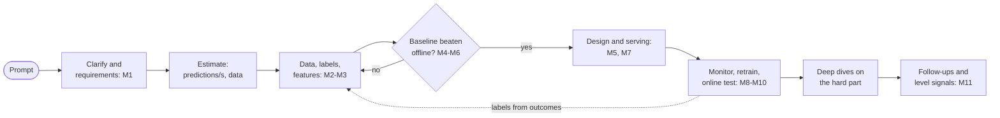

**Reading the diagram.** Each box is a block of the model answer, in speaking order from left to right. The diamond is the decision every ML answer must pass: a named baseline beaten offline for a stated reason; when it is not, the answer returns to data, labels and features rather than reaching for a bigger model. The dotted arrow is the asynchronous loop that distinguishes ML systems from traditional ones: production outcomes become the next training labels, so monitoring and retraining are part of the design, not an appendix. *Failure points:* skipping the label definition (every later box is ungrounded) and running out of time before serving and monitoring, where most production failures live (§88.6.1). *Scaling:* the same flow applies to an LLM prompt, with the additions of Table 88.8 (evaluation first, cost per request, guardrails) attached to the requirements, estimation and deep-dive boxes.

::: tip
**How to read a model answer after your attempt.** Check five things: did you define the same label (or a defensible different one) with its delay; did your numbers reach the same order of magnitude, sized from predictions rather than requests; did you name a baseline and a fallback; did your deep dive contain a mechanism (not just a model name); and could you answer at least four follow-ups. These map onto the rubric dimensions that most often separate levels in ML loops (§88.9).
:::

::: mistake
**Answering every ML prompt with the same architecture.** A candidate who draws "feature store, training pipeline, model server" for spam, credit scoring and document extraction has drawn nothing. The differences are the answer: spam is decided mostly by sender reputation before the content is read, credit scoring by a label that arrives a year late, document extraction by the human-review workforce. Find the prompt's hard part in the first ten minutes.
:::

### 92.3.4 Index of all 52 questions

Table 92.3 lists every question in both parts of the library. "Related" names the full case study or worked design where one exists (the compact answers point there) and otherwise the sections that own the key techniques.

**Table 92.3 — Index of the ML and AI practice library.**

| Q | Title | Difficulty | Related sections |
|---|---|---|---|
| 1 | Email spam classifier | Easy | §82.6 (full case); §60.13.2, §63.11 |
| 2 | Movie rating prediction | Easy | §68.5.2, §81.6, §57.11 |
| 3 | Image tagging service | Easy | §84.5 (full case); §66.6, §63.8 |
| 4 | Sentiment analysis API | Easy | §63.6, §66.7, §76.13 |
| 5 | Churn prediction | Easy | §59.4, §62.8, §57.14 |
| 6 | Duplicate-question detection | Easy | §16.5, §74.9, §75.9 |
| 7 | Product categorization | Easy | §63.9, §63.10, §79.8.1 |
| 8 | Store-level demand forecasting | Easy | §83.4 (related case); §57.11.2, §61.5 |
| 9 | Language identification service | Easy | §62.3.4, §66.3, §75.5 |
| 10 | Click-through-rate prediction basics | Easy | §68.7.5, §68.9, §81.9 |
| 11 | News feed ranking | Medium | §81.5 (full case); §53.7, §68.7.4 |
| 12 | Video recommendations | Medium | §81.4 (full case); §68.6, §56.5 |
| 13 | Search ranking | Medium | §81.7 (full case); §56.4 |
| 14 | People You May Know | Medium | §68.5.3, §68.12, §71.9 |
| 15 | Payment fraud detection | Medium | §82.4 (full case); §70.8, §89.18.9 |
| 16 | ETA prediction | Medium | §60.15 (worked design), §83.5 (full case); §89.18.10 |
| 17 | Ad CTR prediction at scale | Medium | §81.9 (full case); §68.7.5 |
| 18 | Content moderation | Medium | §82.7 (full case); §63.14.3 |
| 19 | Visual search | Medium | §74.9, §74.11, §84.5 |
| 20 | Playlist generation | Medium | §54.6, §68.10, §68.15 |
| 21 | Notification ranking and send-time optimization | Medium | §88.7 (worked design); §52.7 |
| 22 | ML query autocomplete | Medium | §16.9 (worked design); §81.7, §68.12.2 |
| 23 | Dynamic pricing | Medium | §83.6 (full case); §83.4 |
| 24 | Credit scoring | Medium | §82.5 (full case); §71.7, §71.8 |
| 25 | Metrics anomaly detection | Medium | §56.6, §70.5, §70.6.4 |
| 26 | Document OCR and extraction pipeline | Medium | §63.14.4, §66.13, §75.5 |
| 27 | Feature store | Hard | §85.4 (full case); Ch 62 |
| 28 | ML training platform | Hard | §85.5 (full case); Ch 65, Ch 69 |
| 29 | Model serving platform | Hard | §85.6 (full case); Ch 66 |
| 30 | Real-time personalization with streaming features | Hard | §85.7 (full case); §68.13, §62.10 |
| 31 | Billion-scale embedding retrieval | Hard | §68.6, §74.13, §81.4 |
| 32 | Enterprise RAG assistant | Hard | §86.4 (full case); Ch 75 |
| 33 | LLM customer-support agent | Hard | §86.7 (full case); Ch 77 |
| 34 | Speech recognition | Hard | §84.6 (full case) |
| 35 | Machine translation | Hard | §84.7 (full case) |
| 36 | Perception data engine for autonomous driving | Hard | §63.5, §63.9, §80.6 |
| 37 | Experimentation platform | Hard | §57.14, §66.12, §68.14 |
| 38 | ML monitoring platform | Hard | Ch 70, §69.12 |
| 39 | Federated learning for a mobile keyboard | Hard | §71.10, §71.11 |
| 40 | Two-sided marketplace matching | Hard | §55.5, §83.5, §83.6 |
| 41 | LLM inference platform | Expert | §86.5 (full case); Ch 73 |
| 42 | LLM pre-training infrastructure | Expert | Ch 65, Ch 80, §89.15 |
| 43 | Multi-tenant fine-tuning service (LoRA) | Expert | §76.8, §76.9, §79.10 |
| 44 | AI coding assistant | Expert | §86.6 (full case) |
| 45 | Multi-agent orchestration platform | Expert | §77.8, §77.9, Ch 79 |
| 46 | LLM evaluation platform | Expert | Ch 78, §78.17 |
| 47 | AI answer engine | Expert | §86.8 (full case); Ch 75 |
| 48 | GPU cluster scheduler | Expert | §64.15, §79.8, §80.11 |
| 49 | Billion-scale vector database | Expert | §74.13, §74.14 |
| 50 | Guardrails and safety system for an LLM product | Expert | §77.11, §78.12, §78.13 |
| 51 | Image-generation (diffusion) service at scale | Expert | §66.6, §73.6, §80.13 |
| 52 | Cold-start marketplace recommendations with bandits | Expert | §68.11, §68.15 |

### 92.3.5 Choosing what to practice

If your interview is weeks away, work through one tier at a time and finish each with two unseen questions attempted cold. If it is days away, pick by shape: most ML prompts are variations on six recurring shapes, and one question per shape covers more ground than five of the same shape.

**Table 92.4 — Six recurring ML shapes and the questions that train them.**

| Shape | The hard part it trains | Questions |
|---|---|---|
| Classifier with a decision threshold | Imbalance, asymmetric error costs, calibration, delayed labels | Q1, Q5, Q15, Q18, Q24 |
| Retrieval and ranking funnel | Candidate sources, multi-task heads, position bias, feature fan-out | Q2, Q10, Q11, Q12, Q13, Q14, Q17, Q20, Q22 |
| Embedding similarity | Embedding training, ANN indexes, versioning and re-embedding | Q6, Q19, Q20 |
| Forecasting and control | Censored labels, quantiles, feedback through prices or supply | Q8, Q16, Q23, Q25 |
| Content understanding at scale | Throughput economics, multi-label taxonomies, human review | Q3, Q4, Q7, Q9, Q18, Q26 |
| Decision policies over time | Exploration, off-policy evaluation, long-term holdouts | Q5, Q21, Q23 |

::: recommendation
**A four-week plan for a senior ML loop.** Week 1: Q1, Q5, Q6, Q10 and the ML drills of §89.18.8–§89.18.10. Week 2: Q11, Q15, Q16, Q18, the four most common Medium prompts. Week 3: Q14, Q19, Q21, Q26, re-attempting any week-1 question you scored below senior. Week 4: two Hard questions from part B and two cold Medium questions, then rest. This is general advice, not a published recommendation of any company.
:::

## 92.4 Easy questions (Q1–Q10)

The Easy tier trains one model done well. Each answer is short on architecture and long on the step a mid-level candidate usually leaves vague: the cheap pre-model filter, the label that does not measure the goal, the throughput economics, the weak labels, the targeting decision, the retrieval stage, the human-review threshold, the censored demand, the library-versus-service choice and the calibration that an auction needs.

### 92.4.1 Q1. Email spam classifier

**Difficulty:** Easy · **Time:** 45 min · **Related:** §82.6 (full case study, at 1.5 billion mailboxes); §60.13.2 (cascades), §63.11 (imbalance)

#### Prompt

"Design the spam filter for an email provider with 20 million mailboxes. Spam should go to the spam folder; legitimate mail must reach the inbox."

#### Clarifying questions and assumptions

- Volume? Assume 50 inbound messages per mailbox per day, 1 billion a day, peak twice the average. About 40% of messages that reach classification are spam.
- Which error is worse? A legitimate message in the spam folder (a job offer, a bank alert); the target is at most 1 in 10,000 legitimate messages misfiled.
- Is phishing in scope? Yes, as a separate label with a warning banner; malware scanning is a separate system.
- Can we read message content? Automated processing only; humans see content only in donated or consented samples (§82.6.3).

#### Requirements

- **FR:** reject or defer at connection time using sender reputation; classify each message as spam, phishing or legitimate; "Report spam" and "Not spam" feedback; per-user allow and block lists.
- **NFR:** classification p99 ≤ 200 ms inside delivery (SMTP retries make this soft); mail never lost when a classifier fails (deliver with defaults or defer); false-positive rate ≤ 0.01% of legitimate mail; catch rate ≥ 99.5%; sender reputation updated within 5 minutes of new reports.

#### Estimation

::: example
**Worked example — Volume, fleet and the false-positive count (§89.5, §89.10, §60.11.1).** Assumptions: 1 billion messages a day, peak 2× average; connection-time reputation rejects half before the body is transmitted; feature extraction and the content model cost 2 ms of vCPU per message; 16-vCPU nodes at $u = 0.5$; three zones.

1. Inbound: $10^9 / 86{,}400 = 11{,}574$/s average, **23,148/s peak**.
2. Classified: $5 \times 10^8$/day, 11,574/s at peak. Busy vCPU $= 11{,}574 \times 0.002 = 23.1$; at $u = 0.5$, 46.3 vCPU, 3 nodes; surviving the loss of one zone, $\lceil 3 \times 3/2 \rceil = 5$ nodes.
3. Legitimate classified mail: $5 \times 10^8 \times 0.6 = 3 \times 10^8$/day. At 0.01% false positives, **30,000** wanted messages a day land in spam folders; at 0.1%, 300,000.
4. Spam classified: $2 \times 10^8$/day; a 0.5% miss rate puts 1 million spam messages a day in inboxes.

**Interpretation.** Compute is a handful of nodes; the false-positive count is the number that matters. **Implication.** Spend model capacity on precision for legitimate mail and measure it on graded samples, because users rarely open their spam folder to report errors.
:::

#### Data, labels and features

- **Labels:** user "Report spam" (positive) and "Not spam" (negative, the scarce and valuable one), spam-trap addresses (positives no person ever wanted), analyst verdicts. All are noisy and partly adversarial: spammers mark their own mail "Not spam" from botnet accounts, so weight feedback by reporter trust and count distinct reporters (§82.6.8).
- **Features:** sender reputation keyed by authenticated identity (SPF/DKIM-aligned domain, IP, /24 prefix) as decayed counts of reports and engagement; authentication results; URL-domain reputation; content (hashed character n-grams of subject and body, robust to obfuscation); recipient relation (contact, past replies).
- **Leakage:** reputation features must be computed as of delivery time; a sender's later reports must not leak into its own training rows (§62.8).

#### Model and evaluation

Baseline: authentication failures plus a block list and reputation thresholds. Model: logistic regression or gradient-boosted trees over reputation and hashed content features, with a heavier neural text model on the uncertain 5% (a cascade, §60.13.2). Offline gate: recall at a fixed false-positive rate of 0.01%, measured on a human-graded sample of the inbox and the spam folder, sliced by language and sender type (newsletters, transactional mail). Online: randomize by recipient, but note that reputation updates leak between arms; evaluate reputation changes by sender cohort.

#### High-level design

**Figure 92.2 — Spam filtering as a funnel: reputation first, content second.**

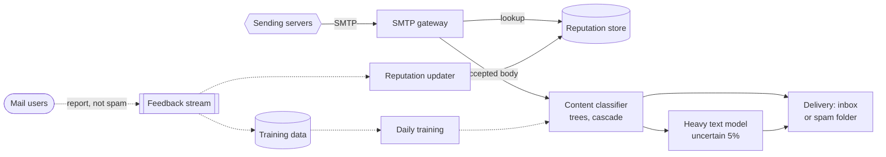

**Reading the diagram.** Sending servers connect over SMTP to the gateway, which looks up reputation (an in-memory store, the first storage boundary) and rejects or defers the worst senders before the body is transmitted. Accepted messages go synchronously to the content classifier; uncertain ones go to a heavier model, and delivery files the result. Dotted arrows are asynchronous: user feedback streams into the reputation updater (minutes) and into training data (daily). *Failure points:* if the classifier is down, deliver with reputation-only decisions rather than drop mail; a poisoned feedback stream corrupts reputation, so it is trust-weighted. *Scaling:* the gateway and classifiers are stateless and scale with message rate; reputation is partitioned by key.

#### Serving and monitoring

The classifier runs in-process at the gateway tier; the fallback ladder is full cascade → trees only → reputation only → deliver. Monitor the spam-folder rate per large sender (a sudden jump for a bank is an incident), "Not spam" rate, graded false-positive rate weekly, feature freshness of reputation, and score drift (§70.5). Retrain content models daily; reputation updates continuously.

#### Deep dives

1. **Reputation before content.** Half the traffic is rejected for the price of a key lookup; keyed on authenticated domains, reputation is hard to fake and changes slowly while content changes daily.
2. **Measuring false positives.** Users do not report them, so sample the spam folder for human grading under privacy rules and report recall at a fixed false-positive rate, not accuracy.
3. **Campaigns.** Near-duplicate detection with MinHash over shingles groups a campaign's variants so one verdict moves all copies, including those already delivered (§82.6.8).

#### Trade-offs and alternatives

- Per-user personalization (a newsletter one user wants is spam to another) improves precision but needs per-user data and is slower to learn; start with global models plus user lists.
- A large language model on every message is accurate but unaffordable at 11,574 messages per second; reserve heavy models for the uncertain slice.

#### Follow-up questions

1. *"Why not train only on content?"* Content is cheap for spammers to change and costly to process; sender identity and its history carry most of the signal.
2. *"How do you handle a brand-new sending domain?"* A cautious prior (rate limits, more content scrutiny) that relaxes as engagement accumulates.
3. *"How do you stop 'Not spam' abuse?"* Trust-weighted reporters, distinct-reporter thresholds and account reputation.
4. *"What if the model is down?"* Reputation-only decisions and delivery; never lose mail.
5. *"How do you know the catch rate?"* Spam traps and graded samples of the inbox.

#### What distinguishes levels

- **Mid:** a text classifier with user reports as labels and a threshold.
- **Senior:** reputation before content, the false-positive count quantified, graded-sample evaluation and a fallback that never loses mail.
- **Staff:** treats feedback as adversarial data, keys reputation on authenticated identity, notices reputation leaking across A/B arms, and sets thresholds per sender class from the cost of each error.

### 92.4.2 Q2. Movie rating prediction

**Difficulty:** Easy · **Time:** 45 min · **Related:** §68.5.2 (biased matrix factorization), §81.6 (homepage recommendations), §57.11 (regression metrics), §57.12 (ranking metrics)

#### Prompt

"Users rate movies from one to five stars. Design a system that predicts the rating a user would give to movies they have not seen, so the product can show 'movies you'll love'."

#### Clarifying questions and assumptions

- What is the prediction for? Ordering a personalized row of movies on the homepage; the predicted star value is also displayed as "match".
- Scale? 30 million monthly users, 10 million daily; 50,000 titles; 5 billion historical ratings; 5 million new ratings a day.
- Do we have implicit feedback (plays, completion)? Yes; the prompt emphasizes explicit ratings, but plays are far more plentiful.
- Freshness? A new rating should influence recommendations the next day; new releases need predictions on launch day.

#### Requirements

- **FR:** predicted rating for any (user, title) pair; a ranked list of the top titles per user excluding those already watched; explanation ("because you rated X highly").
- **NFR:** homepage row served in p99 ≤ 50 ms; recommendations refreshed daily per user; new titles rankable on release day; graceful fallback to popular-in-country.
- **Quality:** beat the user-and-item-bias baseline offline, and lift play starts and completed hours per user online.

#### Estimation

::: example
**Worked example — Is precomputing every prediction affordable? (§89.13, §89.6)** Assumptions: matrix factorization with $d = 64$ factors in FP32; 30 million users, 50,000 titles; top 200 titles stored per user at 6 bytes each (4-byte ID, 2-byte score); 3 homepage loads per daily user; PAR 4.8.

1. Embeddings: users $3 \times 10^7 \times 64 \times 4 = 7.68$ GB; titles $5 \times 10^4 \times 64 \times 4 = 12.8$ MB.
2. Brute-force scoring of every pair: $3 \times 10^7 \times 5 \times 10^4 = 1.5 \times 10^{12}$ dot products, $\times 2 \times 64 = 1.92 \times 10^{14}$ FLOPs, about 2 GPU-seconds at an effective 100 TFLOP/s. The cost is keeping the top 200 per user, not computing the scores.
3. Precomputed store: $3 \times 10^7 \times 200 \times 6 = 36$ GB.
4. Reads: $10^7 \times 3 = 3 \times 10^7$/day, 347/s average, 1,667/s at peak: a key-value lookup.
5. Training data: $5 \times 10^9$ ratings at 12 bytes = 60 GB; new ratings arrive at 58/s on average.

**Interpretation.** Everything fits in memory on one machine except the precomputed lists, and even those are 36 GB. **Implication.** Batch-precompute daily and serve from a key-value store; spend the interview on the label and evaluation, not on serving scale.
:::

#### Data, labels and features

- **Label:** the star rating, but note that ratings are **missing not at random**: users rate what they chose to watch, mostly things they liked, so the average observed rating overstates what an unseen movie would earn. Implicit signals (play, completion above 70%, abandonment in 10 minutes) are 100 times more plentiful and closer to the business goal.
- **Features:** user and title IDs (for learned factors), user rating bias, title average and count, genres, cast, release year, user genre affinities, recency of activity, device and time of day for context.
- **Splits:** by time (train on ratings before day $T$, test after) rather than at random, which would let the model see a user's future tastes (§57.7).

#### Model and evaluation

Baselines: global mean; then global mean plus user bias plus item bias, which already captures much of the predictable variance. Model: biased matrix factorization trained with stochastic gradient descent or alternating least squares (§68.5.2), with side features added to handle new titles; later, a ranking model (gradient-boosted trees or a two-tower network) trained on implicit signals with the predicted rating as one feature. Offline: RMSE on the time-split test set for the rating prediction, but the gate is a ranking metric (recall@20 and NDCG@20 of next-week plays, §57.12), because a lower RMSE on movies nobody would choose does not help ordering. Online: A/B test by user on play starts per user and hours watched; guardrail on catalog coverage.

#### High-level design

**Figure 92.3 — Movie rating prediction: daily batch with an online fallback.**


**Reading the diagram.** The synchronous path is short: the app calls the homepage service over HTTPS, which reads one precomputed list per user from a key-value store and filters it by availability; new or unknown users fall back to a popular-in-country list. Dotted arrows are asynchronous: ratings and plays stream to the lake, a daily job trains the model, registers it, and a batch scorer ranks every user's unseen titles and writes the top 200. Storage boundaries are the lake, registry, catalog and the two serving stores. *Failure points:* a failed batch job leaves yesterday's lists in place (stale but correct); a corrupted model is caught by the offline gate before scoring. *Scaling:* scoring is embarrassingly parallel by user; the serving store is a replicated key-value store.

#### Serving and monitoring

Serve precomputed lists with a 50 ms budget; filter titles watched since the batch run using a small real-time "recently watched" set. New titles get a content-based score from side features on launch day and enter the factor model after a day of ratings. Monitor batch completion and age of lists, coverage (share of the catalog recommended to anyone), mean predicted versus observed rating per segment, and online play-start rate.

#### Deep dives

1. **Selection bias in explicit ratings.** The model learns from ratings people chose to give. Correct it by modeling the probability of rating (propensity weighting, §68.12.2) or by training on implicit data with the explicit rating as a refinement; evaluate on a small randomized-exposure sample where possible.
2. **RMSE versus ranking.** RMSE rewards being right about mediocre movies equally with the top of the list. The production model is judged by ranking metrics on what users actually played next.
3. **Cold start.** New users: ask for three to five ratings at signup or use popular-in-segment lists; new titles: metadata-based embeddings until ratings accumulate (§68.15).

#### Trade-offs and alternatives

- Daily batch versus online scoring: batch is simple and cheap at this scale; switch to online ranking when in-session context (what was just watched) matters, as in §81.6.
- Matrix factorization versus item-to-item similarity: item-to-item is easier to explain ("because you watched") and needs no per-user training; factorization generalizes better for active users.

#### Follow-up questions

1. *"Why not just show the highest-rated movies?"* That ignores taste; it is the popularity baseline the model must beat.
2. *"How do you handle a user who rates everything five stars?"* The user bias term absorbs it; rank by the residual preference.
3. *"Shared accounts?"* Profiles per viewer; without them, session context in an online ranker.
4. *"How do you prevent a filter bubble?"* Diversity re-ranking and exploration slots, measured by coverage (§68.10).
5. *"What if a model update lowers all predicted ratings?"* The displayed match percentage changes; calibrate the display separately from ranking and monitor mean prediction.

#### What distinguishes levels

- **Mid:** matrix factorization with RMSE and a time split.
- **Senior:** names the bias baseline, explains missing-not-at-random ratings, evaluates with ranking metrics, and chooses batch serving from the estimate.
- **Staff:** questions whether star ratings are the right target at all, ties the metric to play starts and retention, plans exploration to collect unbiased data, and separates displayed match scores from ranking scores.

### 92.4.3 Q3. Image tagging service

**Difficulty:** Easy · **Time:** 45 min · **Related:** §84.5 (full case study, multi-tenant classification API); §66.6 (batching), §63.8 (weak supervision), §53.6 (photo app)

#### Prompt

"Our photo-sharing app gets 100 million uploads a day. Design a service that tags each photo with labels such as 'beach', 'dog' or 'birthday' for search and organization."

#### Clarifying questions and assumptions

- How many tags? A taxonomy of about 5,000 labels; each photo gets up to 20 (multi-label).
- How fast? Tags within one minute of upload; search can wait, so the path is asynchronous.
- Sensitive labels? Faces, people's attributes and anything that infers identity or demographics are out of scope by policy.
- Existing data? Captions and hashtags on public posts, and search clicks on photos.

#### Requirements

- **FR:** tag every new photo; return tags with confidences; re-tag the back catalog when the model improves; user corrections ("not a dog") recorded.
- **NFR:** p95 ≤ 60 s from upload to tags; per-tag precision ≥ 90% at the serving threshold for tags shown to users; no upload blocked by tagging failure.

#### Estimation

::: example
**Worked example — Throughput economics (§84.5.4, §60.11.1).** Assumptions: 100 million photos a day, PAR 3; a ResNet-50-class backbone sustaining 2,500 images/s per L4-class GPU at batch 32 and 5 ms of vCPU for reduced-scale JPEG decode (both from §84.5.4); $u = 0.6$; \$0.80 per GPU-hour and \$0.04 per vCPU-hour as in that case.

1. Rate: $10^8 / 86{,}400 = 1{,}157$/s average, **3,472/s peak**.
2. GPUs: $3{,}472 / (2{,}500 \times 0.6) = 2.3$, so 3, plus 1 spare = 4.
3. Decode: $3{,}472 \times 0.005 / 0.6 = 29$ cores.
4. Daily cost if provisioned for peak all day: $4 \times 0.80 \times 24 = \$76.80$ plus $29 \times 0.04 \times 24 = \$27.84$, about \$0.001 per 1,000 photos.
5. Outputs: 20 tags × 8 bytes = 160 bytes per photo, 16 GB/day; a 512-dimension FP16 embedding per photo adds 102.4 GB/day and is worth keeping for visual search (Q19).

**Interpretation.** A handful of GPUs tags every upload. **Implication.** Tag at upload rather than lazily, keep the embedding, and size the decode tier as carefully as the GPU tier (§84.5.4).
:::

#### Data, labels and features

- **Labels:** weak labels from hashtags and captions mapped to the taxonomy (noisy, biased to what people bother to tag), search-click pairs (query "beach" → clicked photo), and a human-verified evaluation set of 50,000 photos with full tag lists (§63.8).
- **Input:** the decoded image at 224×224; optional EXIF time and coarse location as context features if privacy policy allows.

#### Model and evaluation

Baseline: an off-the-shelf pretrained classifier mapped to the taxonomy. Model: a pretrained backbone fine-tuned with a sigmoid output per label (multi-label), with per-label thresholds set to reach 90% precision on the verified set. Offline: mean average precision and per-label precision and recall, sliced by photo source (camera, screenshot), region and lighting. Online: search success on tag-backed queries and correction rate.

#### High-level design

**Figure 92.4 — Asynchronous tagging at upload.**

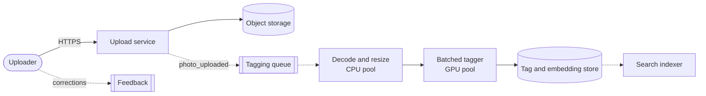

**Reading the diagram.** The upload completes synchronously once the photo is in object storage; tagging is asynchronous (dotted). The decode pool reads from object storage, resizes, and hands tensors to GPU workers that batch to 32; tags and embeddings land in a store that feeds the search indexer. *Failure points:* a GPU outage grows the queue but never blocks uploads; poison images (corrupt files) are sent to a dead-letter queue after retries. *Scaling:* both pools autoscale on queue depth; back-catalog re-tagging runs in off-peak hours on the same GPUs.

#### Serving and monitoring

Queue lag p95 under 60 s; per-label tag rate per day (a label that triples overnight indicates a bug or drift); correction rate per label; embedding drift (§70.7.4). Model versions are recorded with each tag so a re-tag job knows what to update.

#### Deep dives

1. **Thresholds per label.** One global threshold gives 99% precision on "dog" and 60% on "wedding"; set thresholds per label on the verified set and hide labels that cannot reach the precision floor.
2. **Re-tagging the back catalog.** Billions of stored photos: re-tag only when a new version changes outputs materially, store model version with tags, and run in troughs.
3. **Sensitive inferences.** Exclude labels that infer protected attributes; review the taxonomy as part of responsible-ML review (Ch 71).

#### Trade-offs and alternatives

- Fixed taxonomy versus open-vocabulary image–text embeddings: open vocabulary handles any query but is harder to threshold and audit; use it for search ranking and keep a fixed taxonomy for displayed tags.
- On-device tagging protects privacy and saves server cost but fragments model versions across devices.

#### Follow-up questions

1. *"Why not tag at query time?"* Every search would run the model on millions of photos; tagging once at upload is cheaper.
2. *"How do you add a new label?"* Few-shot training on the shared backbone with a new head, verified on a labeled sample before display.
3. *"What about duplicate uploads?"* Hash the bytes or a perceptual hash and reuse tags.
4. *"How would you cut GPU cost further?"* Smaller backbone via distillation and INT8 (Ch 67); the decode tier may matter more.

#### What distinguishes levels

- **Mid:** a CNN classifier behind a queue.
- **Senior:** multi-label with per-label thresholds, asynchronous design sized in GPUs and decode cores, a verified evaluation set.
- **Staff:** prices the whole pipeline per 1,000 photos, plans versioned re-tagging, and governs the taxonomy for sensitive inferences.

### 92.4.4 Q4. Sentiment analysis API

**Difficulty:** Easy · **Time:** 45 min · **Related:** §63.6 (annotator agreement), §66.7 (CPU versus GPU serving), §76.13 (distillation), §63.3.2 (QuickBite reviews)

#### Prompt

"Several product teams want sentiment for text: customer reviews, support messages and social mentions. Design a shared sentiment analysis API."

#### Clarifying questions and assumptions

- Output? Negative, neutral or positive with calibrated probabilities; aspect-level sentiment ("food great, delivery late") as a later phase.
- Volume? 10 million online requests a day and 40 million texts a day in batch jobs; texts up to 128 tokens after truncation.
- Languages? English plus four others at launch.
- Latency? Online p99 ≤ 100 ms (support routing waits on it); batch within hours.

#### Requirements

- **FR:** `POST /v1/sentiment {texts[], language?, domain?}` returning a label, probabilities and `model_version` per text; batch jobs over a table or bucket; feedback endpoint for corrected labels; pinned model versions per client.
- **NFR:** online p99 ≤ 100 ms for up to 16 texts; 99.9% availability; a pinned version never changes outputs silently; texts not retained beyond 30 days unless a client opts in.
- **Quality:** macro-F1 above the client's current tool on each client's evaluation set; probability calibration within 5 points per decile.

#### Estimation

::: example
**Worked example — CPU is enough (§89.10, §60.11.1).** Assumptions: a distilled transformer of about 66 million parameters, INT8 on CPU, measured at 15 ms of vCPU per 128-token text; online PAR 4.8; 16-vCPU nodes at \$0.77/h and $u = 0.5$; batch at \$0.048 per vCPU-hour.

1. Online: $10^7 / 86{,}400 = 116$/s average, **556/s peak**. Busy vCPU $556 \times 0.015 = 8.3$; at $u = 0.5$, 16.7 vCPU: 2 nodes, 3 with zone redundancy.
2. Batch: $4 \times 10^7 \times 0.015 = 600{,}000$ vCPU-s = 167 vCPU-hours a day, about **\$8 a day**.
3. FLOPs per text: $2 \times 6.6 \times 10^7 \times 128 = 1.7 \times 10^{10}$; at 556/s, $9.4 \times 10^{12}$ FLOP/s, a fraction of one GPU.
4. Alternative, a hosted small LLM at \$0.15/M input and \$0.60/M output with 300 input and 5 output tokens: $5 \times 10^7 \times (300 \times 0.15 + 5 \times 0.60)/10^6 = \$2{,}400$ a day, 300 times the CPU batch cost.

**Interpretation.** A distilled encoder on CPUs serves all traffic for tens of dollars a day. **Implication.** Use the LLM to *label* training data and handle rare hard cases, not to serve every call (§76.13).
:::

#### Data, labels and features

- **Labels:** human annotation with written guidelines (what is "neutral"? is sarcasm negative?), three annotators on the initial set, agreement measured with Cohen's or Fleiss' κ (§63.6); distant supervision from review star ratings (1–2 stars negative, 4–5 positive), which is plentiful but domain-specific; LLM-assisted labels with human review for new languages (§63.14.4).
- **Domains differ:** "the battery dies fast" is negative in reviews; "this track is sick" is positive in social posts. Keep a domain tag on every example and an evaluation set per client domain.
- **Input:** text only, normalized (Unicode, emoji kept: they carry sentiment), truncated to 128 tokens with head and tail kept for long texts.

#### Model and evaluation

Baselines: a sentiment lexicon, then TF-IDF with logistic regression per language. Production: a multilingual transformer fine-tuned on pooled labels with a domain token, distilled into the 66-million-parameter student. Offline gate: macro-F1 per (client domain, language) slice, calibration error, and a regression suite of tricky cases (negation, sarcasm, mixed sentiment). Online: each client team runs its own A/B test on its business metric (support routing accuracy, review triage time); the platform tracks agreement with client corrections.

#### High-level design

**Figure 92.5 — A shared sentiment API with online and batch paths.**

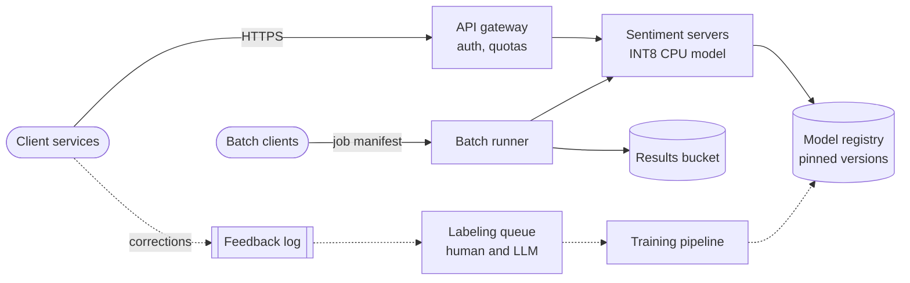

**Reading the diagram.** Online clients call the gateway over HTTPS; it authenticates, applies per-client quotas and forwards to stateless CPU servers that load the model version the client pinned from the registry. Batch clients submit a manifest; the batch runner streams texts through the same servers (or a separate pool) and writes results to a bucket. Dotted arrows are asynchronous: corrections go to a feedback log, through a labeling queue and into training. *Failure points:* a noisy client can starve others without quotas; a silently changed model breaks downstream thresholds, hence version pinning. *Scaling:* servers scale horizontally; batch runs in a separate pool so it never competes with online latency.

#### Serving and monitoring

Online budget: 5 ms gateway, 10 ms tokenization, 40 ms model for a batch of 16, rest headroom. Fallback: the logistic-regression model in-process if the transformer pool is overloaded, flagged in the response. Monitor predicted class shares per client and language (a shift from 20% to 40% negative overnight is either news or a bug), calibration on client corrections, input-language mix, and latency per batch size.

#### Deep dives

1. **One model or many?** One multilingual model with a domain token is cheaper to operate; per-client fine-tunes only when a client's slice cannot meet its gate, served as adapters on the shared model.
2. **Label quality.** Low κ on "neutral" means the guideline is ambiguous, not that annotators are careless; fix the guideline before buying more labels.
3. **Versioning as a contract.** Clients build thresholds on probabilities; a new version is a new endpoint version with a migration window and a published comparison on each client's evaluation set.

#### Trade-offs and alternatives

- Distilled encoder versus LLM per call: the encoder is 300 times cheaper; switch to an LLM only for aspect-level extraction with free-form aspects, and only on sampled traffic.
- Three classes versus a continuous score: a score is more flexible for ranking but harder for clients to threshold consistently.

#### Follow-up questions

1. *"How do you handle sarcasm?"* Accept limited accuracy; add sarcastic examples to labels and the regression suite, and report it as a known weakness in the model card.
2. *"A client says accuracy dropped."* Check their input-language and domain mix first; then evaluate on their recent corrections.
3. *"How do you add a sixth language?"* LLM-assisted labels with human review on a sample, a per-language gate, and launch behind the language flag.
4. *"Should the API return explanations?"* Token attributions are cheap for a linear baseline and costly for transformers; offer them only in batch.

#### What distinguishes levels

- **Mid:** fine-tune a transformer and expose an endpoint.
- **Senior:** computes that CPUs suffice, separates batch from online, defines labels with guidelines and κ, and pins versions.
- **Staff:** treats the API as a platform product (quotas, contracts, per-client gates), uses LLMs for labeling rather than serving, and plans domain shift across clients.

### 92.4.5 Q5. Churn prediction

**Difficulty:** Easy · **Time:** 45 min · **Related:** §59.4 (problem framing), §62.8 (point-in-time joins), §57.14 (A/B tests); QuickBite assumptions (§57)

#### Prompt

"QuickBite wants to reduce customer churn. Design a system that identifies customers likely to stop ordering so the retention team can send them offers."

#### Clarifying questions and assumptions

- Definition of churn? A customer with at least one order in the last 60 days who places none in the next 30 days. About 5 million customers qualify each week (QuickBite has about 4 million weekly active users); the 30-day churn rate is 20%.
- Action? A \$5 voucher by push and email; the team can send about 500,000 a week.
- Value? A retained customer is worth about \$40 of margin over the next three months.
- Cadence? Weekly scores are enough; nobody acts within the hour.

#### Requirements

- **FR:** weekly scores for every eligible customer; a ranked target list within the voucher budget; holdout control groups; reason summaries for the retention team.
- **NFR:** scores ready every Monday 06:00; reproducible from snapshotted features; no use of sensitive attributes for targeting.
- **Quality:** incremental retained customers per voucher dollar, measured against a randomized holdout, not churn-model AUC.

#### Estimation

::: example
**Worked example — Data volume and the economics of targeting (§89.13, §89.17).** Assumptions: 5 million eligible customers weekly; 200 features of 4 bytes; 52 weekly snapshots kept; a gradient-boosted model at 200 µs per row on CPU; the top-scored 10% (500,000) receive the voucher, of whom 30% redeem it; in the top decile 50% would churn without action.

1. Training rows per year: $5 \times 10^6 \times 52 = 2.6 \times 10^8$; at 800 bytes, 208 GB.
2. Weekly scoring: $5 \times 10^6 \times 200\ \mu s = 1{,}000$ core-seconds, under 20 core-minutes.
3. Voucher cost: $5 \times 10^5 \times 0.30 \times \$5 = \$750{,}000$ per campaign.
4. If the voucher lowers churn by 5 percentage points among the targeted, $5 \times 10^5 \times 0.05 = 25{,}000$ customers are saved, worth \$1.0 million: net \$250,000.
5. If targeting by *uplift* finds customers whose churn falls by 10 points, 50,000 are saved, \$2.0 million: net **\$1.25 million**, five times better with the same budget.

**Interpretation.** Compute is negligible; the decision of whom to target is worth millions. **Implication.** Design around the treatment effect and the holdout, not around the churn classifier's AUC.
:::

#### Data, labels and features

- **Label:** churned = no order in the 30 days after the snapshot date; known only 30 days later, so the newest usable training snapshot is a month old (label delay, §59.12.2).
- **Features** (all as of the snapshot date, joined point-in-time, §62.8): recency, frequency and monetary value of orders; trend in weekly orders; late deliveries and refunds in the last 30 days (service failures drive churn); app sessions without order; voucher history; cuisine diversity; city supply (restaurants available at the address).
- **Leakage traps:** account-closure or "subscription canceled" events recorded after the snapshot; counts computed over windows that extend past it.

#### Model and evaluation

Baseline: a rule ("no order in 21 days"). Model: gradient-boosted trees for churn probability, then an **uplift model** (for example a two-model or T-learner approach: one model on treated, one on control customers, uplift = difference) trained on past campaigns that had randomized holdouts. Offline: AUC and calibration for churn; for uplift, the Qini or uplift curve on held-out randomized data. Online: every campaign keeps a random 10% of the target list untreated; the primary metric is incremental orders and margin per voucher dollar over 30 days.

#### High-level design

**Figure 92.6 — Weekly churn scoring and campaign loop.**

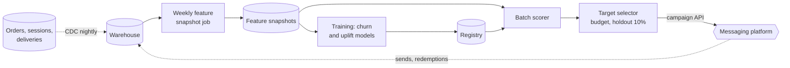

**Reading the diagram.** Operational data is copied nightly into the warehouse (dotted, asynchronous); a weekly job builds point-in-time feature snapshots (a storage boundary that makes every score reproducible). Training reads matured snapshots; the batch scorer scores current ones; the selector applies the budget, randomly withholds 10% as control and calls the messaging platform. Campaign outcomes flow back to the warehouse, closing the loop. *Failure points:* a late snapshot delays the campaign (acceptable); a leaky feature inflates offline AUC and is caught only if training uses strict snapshot dates. *Scaling:* all steps are batch jobs measured in minutes.

#### Serving and monitoring

No online serving. Monitor the score distribution week over week (PSI, §70.5.1), the share of the target list that is new versus repeat, calibration once labels mature, and incremental retention per campaign against its holdout. Retrain monthly; retrain the uplift model after each campaign adds randomized data.

#### Deep dives

1. **Prediction versus intervention.** The customers most likely to churn may be lost causes (moved city) and the least likely do not need a voucher; the profit is in persuadable customers, which only uplift modeling with randomized data can find.
2. **Feedback loop.** Once vouchers are targeted by the model, future training data contain treated customers whose churn the voucher changed; keep the holdout permanent and label treatment explicitly.
3. **Root causes.** Late deliveries and refunds predict churn; sending the insight to operations (fix delivery in a city) may beat any voucher.

#### Trade-offs and alternatives

- Survival models (time to churn) instead of a fixed 30-day window handle censoring naturally and give timing; worth it when the team acts on timing.
- Real-time triggers ("third late delivery this month") complement weekly scores; build them as rules first.

#### Follow-up questions

1. *"Why not just maximize AUC?"* AUC ranks churn risk, not responsiveness to the offer.
2. *"How big must the holdout be?"* Large enough to detect the expected uplift with power (§57.14.2); 10% of 500,000 is ample for a 5-point effect.
3. *"Customers learn to wait for vouchers."* Monitor voucher-dependent ordering, cap offers per customer, and include it as a long-term guardrail.
4. *"How do you explain scores to the retention team?"* Top features per customer from tree attributions (§71.7), shown as reasons.

#### What distinguishes levels

- **Mid:** defines churn, builds a classifier and a weekly batch job.
- **Senior:** point-in-time features, label delay, holdout-based measurement and voucher economics.
- **Staff:** reframes the problem as uplift under a budget, makes the holdout permanent to break the feedback loop, and routes root causes to operations.

### 92.4.6 Q6. Duplicate-question detection

**Difficulty:** Easy · **Time:** 45 min · **Related:** §16.5 (BM25), §74.9 (product quantization), §75.9 (cross-encoder reranking), §63.11 (hard negatives and sampling)

#### Prompt

"On our question-and-answer site, many new questions duplicate existing ones. Design a system that suggests likely duplicates while the user is writing, and helps moderators close duplicates."

#### Clarifying questions and assumptions

- Corpus? 50 million existing questions; 100,000 new questions a day, from about 300,000 drafts.
- When? Suggestions as the user finishes the title and again before posting (about three lookups per draft); a moderator queue after posting.
- Languages? English only at first.
- Action on a match? Suggest, never block; moderators close duplicates.

#### Requirements

- **FR:** given a draft title and body, return up to 5 existing questions with a duplicate probability; flag high-confidence duplicates to moderators after posting; record accepted suggestions and moderator closures.
- **NFR:** suggestion p99 ≤ 300 ms; new questions searchable as candidates within 10 minutes; suggestions shown only above 70% precision on the evaluation set.

#### Estimation

::: example
**Worked example — Index memory and reranking compute (§74.9, §74.14, §89.13).** Assumptions: 384-dimension sentence embeddings; 900,000 lookups a day; PAR 4.8; a 22-million-parameter cross-encoder reading 256 tokens per (draft, candidate) pair over 100 candidates.

1. Index memory: FP32 $5 \times 10^7 \times 384 \times 4 = 76.8$ GB; INT8 19.2 GB; product quantization at 64 bytes per vector 3.2 GB.
2. Lookups: $9 \times 10^5 / 86{,}400 = 10.4$/s average, **50/s peak**. New questions to embed: $10^5 / 86{,}400 = 1.2$/s.
3. Cross-encoder: $2 \times 2.2 \times 10^7 \times 256 = 1.13 \times 10^{10}$ FLOPs per pair; $1.13 \times 10^{12}$ per lookup; $5.6 \times 10^{13}$ FLOP/s at peak, well under one GPU.

**Interpretation.** The index fits in one machine's memory even uncompressed, and reranking needs at most one GPU. **Implication.** Use exact or lightly compressed vectors with a replicated index, and spend the design effort on labels and thresholds.
:::

#### Data, labels and features

- **Positives:** pairs moderators closed as duplicates; accepted suggestions (a user clicked a suggestion and abandoned the draft).
- **Negatives:** random pairs are too easy. Use **hard negatives**: candidates retrieved for a question that moderators reviewed and did not close, and questions sharing many words but asking something different ("sort a list in Python" versus "sort a dictionary in Python").
- **Label noise:** many true duplicates are never closed; treat unclosed pairs as unlabeled rather than negative, and build a judged evaluation set of 5,000 queries with graded duplicates.
- **Features for the final model:** cross-encoder score, BM25 score, tag overlap, whether the candidate has an accepted answer, candidate age and views.

#### Model and evaluation

Baseline: BM25 over titles and bodies (§16.5). Retrieval: hybrid BM25 plus a bi-encoder trained contrastively on duplicate pairs with in-batch and hard negatives; recall@100 of judged duplicates is the retrieval gate. Ranking: a cross-encoder on the top 100, calibrated, plus a small model over the features above. Offline gate: precision at the suggestion threshold and recall@5 on the judged set, sliced by tag (programming languages differ). Online: randomize by drafting user; primary metric is the share of drafts resolved by a suggestion without lowering the rate of new, answered questions (a guardrail against suppressing legitimate questions).

#### High-level design

**Figure 92.7 — Retrieve, rerank, suggest.**

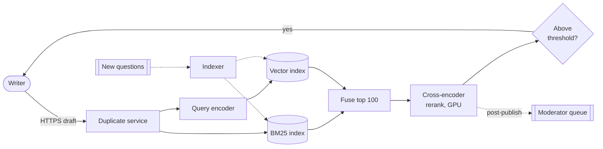

**Reading the diagram.** The draft goes over HTTPS to the duplicate service, which encodes it and queries both indexes in parallel (storage boundaries), fuses the top 100, reranks them on one GPU pool and returns suggestions only above the calibrated threshold. Dotted arrows are asynchronous: new questions are indexed within minutes; posted questions with a high duplicate score go to a moderator queue. *Failure points:* if the GPU pool is slow, return BM25-only suggestions with a higher threshold; if the vector index is stale, recent duplicates are missed. *Scaling:* the indexes are replicated; at 100 times the corpus, compress vectors with product quantization.

#### Serving and monitoring

Budget: 30 ms retrieval, 150 ms reranking with batching, remainder headroom; debounce on the client so lookups fire on pauses. Monitor suggestion click-through, moderator agreement with high-score flags, index freshness, and the new-question rate per tag (a drop may mean suggestions are suppressing real questions).

#### Deep dives

1. **Bi-encoder versus cross-encoder.** The bi-encoder embeds each question once and supports ANN retrieval; the cross-encoder reads both texts together and is much more accurate but costs one forward pass per pair, so it runs only on the top 100.
2. **Threshold by cost.** A wrong suggestion costs the writer a few seconds; a wrong moderator closure discourages a user. Use a lower threshold for suggestions and a higher one for moderator flags.
3. **Re-embedding.** A new encoder version requires re-embedding 50 million questions; at 2,000 questions a second per GPU that is about 7 GPU-hours, so build the new index beside the old and swap atomically.

#### Trade-offs and alternatives

- Exact search versus ANN: at 50 million vectors and 50 lookups a second, a compressed exact scan on GPU is feasible; ANN becomes necessary at higher rates or larger corpora (§74.5.2).
- Using an LLM judge for final verification improves precision on borderline cases at a cost per call; restrict it to the moderator queue.

#### Follow-up questions

1. *"How do you handle questions that are similar but not duplicates?"* Hard negatives in training, and a precision-oriented threshold.
2. *"What if the original question has no good answer?"* Prefer candidates with accepted answers in ranking; a duplicate without an answer helps nobody.
3. *"How do you evaluate recall when duplicates are rarely labeled?"* A judged set built from pooled candidates of several systems.
4. *"How would this extend to 20 languages?"* A multilingual encoder for cross-lingual retrieval, and per-language thresholds.

#### What distinguishes levels

- **Mid:** embeddings plus nearest neighbors with a threshold.
- **Senior:** hybrid retrieval and cross-encoder reranking sized by the estimate, hard negatives, judged evaluation set.
- **Staff:** treats unclosed pairs as unlabeled, guards against suppressing legitimate questions, and plans re-embedding as an index migration.

### 92.4.7 Q7. Product categorization

**Difficulty:** Easy · **Time:** 45 min · **Related:** §63.9 (active learning), §63.10 (label noise), §63.14.4 (LLM-assisted labeling), §79.8.1 (QuickBite menu enrichment)

#### Prompt

"Sellers on our marketplace list millions of products and often pick the wrong category. Design a system that assigns each listing to the right category in our taxonomy."

#### Clarifying questions and assumptions

- Taxonomy? About 6,000 leaf categories in a tree five levels deep; it changes monthly.
- Volume? 500 million listings in the catalog; 5 million new or edited listings a day, arriving in bulk uploads with peaks ten times the average.
- Inputs? Title, description, attributes, images, the seller's chosen category.
- Consequence of an error? Wrong search results and wrong fees or legal restrictions (age-restricted categories).

#### Requirements

- **FR:** assign a leaf category with confidence to every new or edited listing; route low-confidence listings to human review; re-categorize the catalog after taxonomy changes; seller can dispute.
- **NFR:** categorized within 5 minutes of listing; leaf accuracy ≥ 95% on auto-assigned listings weighted by traffic; restricted categories at ≥ 99% precision.

#### Estimation

::: example
**Worked example — The human-review budget sets the threshold (§89.10, §63.5.2).** Assumptions: 20 ms of vCPU per listing for text features and model (image embedding computed once at upload); review takes 20 s per listing; 6.5 productive review hours per reviewer per day.

1. Rate: $5 \times 10^6 / 86{,}400 = 58$/s average, **579/s** during bulk-upload peaks. Busy vCPU $579 \times 0.02 = 11.6$; at $u = 0.5$, 23 vCPU, two nodes.
2. Full re-categorization of the catalog: $5 \times 10^8 \times 0.02 = 10^7$ vCPU-s = 2,778 vCPU-hours, about \$133 at \$0.048 per vCPU-hour.
3. Human review at different confidence thresholds (Table 92.5).

**Table 92.5 — Review workload by share of listings routed to people.**

| Share routed | Listings/day | Review hours/day | Reviewers | Cost/day at \$15/h |
|---|---|---|---|---|
| 1% | 50,000 | 278 | 43 | \$4,167 |
| 3% | 150,000 | 833 | 128 | \$12,500 |
| 8% | 400,000 | 2,222 | 342 | \$33,333 |

**Interpretation.** Compute costs a few dollars a day; people cost thousands. **Implication.** The interview question is where to set the confidence threshold: every point of automation traded against accuracy is worth about 43 reviewers.
:::

#### Data, labels and features

- **Labels:** seller-chosen categories (plentiful, perhaps 80–85% correct, and biased toward cheap-fee categories), human-reviewed listings (clean but few), and buyer signals (a listing searched for and bought under "running shoes"). Use confident learning to find likely mislabeled seller choices (§63.10.2) and active learning to choose which listings humans label (§63.9).
- **Features:** title tokens (most informative), attribute keys and values, description, image embedding, seller's category history, the seller-chosen category itself (a strong but noisy feature; drop it in an ablation to check the model is not just copying it).

#### Model and evaluation

Baseline: keyword rules per category plus the seller's choice. Model: a text classifier (fine-tuned small transformer) fused with the image embedding, predicting the leaf with a hierarchical loss so mistakes at sibling leaves cost less than mistakes across top-level branches; an LLM given the candidate subtree handles the long tail and new categories with few examples. Offline: leaf and path accuracy on a human-audited sample, weighted by listing traffic, per top-level branch; coverage at the accuracy target. Online: search conversion on categorized listings; dispute rate.

#### High-level design

**Figure 92.8 — Categorization with confidence routing.**

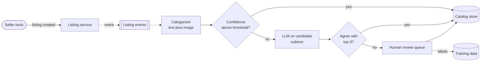

**Reading the diagram.** Listings are created synchronously; categorization is asynchronous on the listing-event stream. The categorizer assigns a leaf with confidence; confident results write straight to the catalog store. Uncertain listings go to an LLM constrained to the top candidate subtree; agreement with the categorizer's top three is accepted, disagreement goes to human review, whose decisions are the cleanest training labels. *Failure points:* a taxonomy change invalidates leaves, so taxonomy versions are stored with each assignment; a review backlog leaves listings with the seller's category, which is the safe default. *Scaling:* the categorizer scales with the event rate; reviewers are the capacity constraint.

#### Serving and monitoring

Monitor the share routed to review per day (a jump means drift or a new seller segment), the category distribution of new listings, audited accuracy weekly, and disputes per category. Retrain weekly with new review labels; after a taxonomy change, map old leaves to new ones by rule where possible and re-categorize only affected subtrees.

#### Deep dives

1. **Threshold economics.** Table 92.5 turns a modeling choice into a staffing budget; a per-branch threshold (stricter for restricted categories) beats a global one.
2. **Noisy seller labels.** Training on seller labels teaches the model their mistakes; reweight by estimated label quality and evaluate only on audited labels.
3. **Taxonomy evolution.** Models with a flat softmax over leaves must be retrained when leaves change; a hierarchical model or an embedding-matching model (listing embedding against category-description embeddings) absorbs new leaves with fewer examples.

#### Trade-offs and alternatives

- LLM for every listing: simpler to start and good on the long tail, but at 5 million a day it costs more and is harder to pin to a version; use it for the uncertain slice.
- Flat versus hierarchical classifier: flat is simpler and often as accurate at the leaf; hierarchical degrades more gracefully.

#### Follow-up questions

1. *"Sellers game categories to pay lower fees."* Use the model's category for fees above a confidence, and audit sellers with frequent overrides.
2. *"How do you handle a product that fits two categories?"* Allow a primary and secondary category, or define the taxonomy rule explicitly.
3. *"A new category launches tomorrow."* Seed it with rules and LLM-labeled examples, route its predictions to review for the first week.
4. *"How do you know accuracy on the auto-assigned 97%?"* A weekly random audit sample, stratified by branch.

#### What distinguishes levels

- **Mid:** a text classifier over the taxonomy.
- **Senior:** confidence routing sized against reviewer cost, noisy-label handling, audited evaluation.
- **Staff:** turns the threshold into a business decision per branch, plans for taxonomy versioning, and treats sellers' incentives as adversarial.

### 92.4.8 Q8. Store-level demand forecasting

**Difficulty:** Easy · **Time:** 45 min · **Related:** §83.4 (ride demand forecasting, full case on a related problem); §57.11.2 (pinball loss), §61.5 (batch pipelines)

#### Prompt

"A grocery chain with 2,000 stores wants daily forecasts of how many units of each product each store will sell, to drive automatic replenishment orders."

#### Clarifying questions and assumptions

- Granularity? Store × product × day, for the next 14 days, refreshed nightly; about 20,000 active products per store, so 40 million series.
- How are forecasts used? An ordering system converts them into order quantities given lead time, pack sizes and shelf life.
- Data? Point-of-sale history, prices and promotions (planned weeks ahead), stock levels, holidays, weather.
- Perishables? Yes: overstock is waste, understock is a lost sale.

#### Requirements

- **FR:** nightly quantile forecasts (P10, P50, P90) per series for 14 days; promotion "what-if" forecasts for planners; aggregation to distribution-center level.
- **NFR:** forecasts published by 04:00 for orders cut at 06:00; every forecast reproducible from snapshotted inputs; fallback to seasonal-naive forecasts if the job fails.
- **Quality:** lower weighted absolute percentage error (WAPE) and pinball loss than the current method in a 52-week backtest, without increasing bias.

#### Estimation

::: example
**Worked example — Forty million series is a batch job (§89.6, §89.13).** Assumptions: 40 million series; 14 horizons × 3 quantiles; 4 bytes per value; a global gradient-boosted model at 20 µs per row per quantile; two years of daily history.

1. Outputs per night: $4 \times 10^7 \times 14 \times 3 = 1.68 \times 10^9$ values, **6.7 GB**.
2. Inference: $1.68 \times 10^9 \times 20\ \mu s = 33{,}600$ core-seconds = 9.3 core-hours; in a 2-hour window, 5 cores.
3. Training rows: $4 \times 10^7 \times 730 = 2.9 \times 10^{10}$ store-product-days over two years; sampling 2% gives $5.8 \times 10^8$ rows, a normal tree-training job.

**Interpretation.** Inference and storage are small; feature construction over 29 billion history rows dominates. **Implication.** Build features incrementally (append yesterday's sales to running aggregates) and spend the design on the label and the evaluation.
:::

#### Data, labels and features

- **The label is not sales.** When a product is out of stock, sales are zero but demand was not; training on raw sales teaches the model to forecast stockouts and order less, which causes more stockouts. Mark stockout days from inventory records and either exclude them or impute demand (the censored-demand problem of §83.4.8).
- **Features:** lags and rolling means of demand (7, 28, 364 days), day of week, holidays and paydays, planned price and promotion type, product hierarchy (category, brand), store attributes, local events, weather forecasts.
- **Leakage:** only information known at forecast time; promotions planned after the cutoff and actual weather must not enter backtests.

#### Model and evaluation

Baselines: seasonal naive (same weekday last week) and a 4-week weekday average. Model: one global gradient-boosted model across all series with quantile loss, which shares strength across sparse series; most store-product-days for slow movers are zero or one unit, so quantiles matter more than means. Offline: rolling-origin backtest (forecast each week of the last year as if it were the present), WAPE and pinball loss by category, bias, and coverage of the P10–P90 interval. Online: test by store (half the stores order from the new forecast) on stockout rate, waste for perishables and inventory days; stores interact through distribution centers only weakly.

#### High-level design

**Figure 92.9 — Nightly forecasting feeding replenishment.**

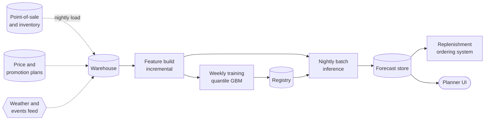

**Reading the diagram.** All data movement is batch: point-of-sale, inventory, promotion plans and external feeds land in the warehouse overnight (dotted). An incremental feature build feeds weekly training and nightly inference; forecasts land in a store read by the ordering system and planners. *Failure points:* a late point-of-sale load means yesterday's sales are missing; detect missing partitions and either wait or use the seasonal-naive fallback for affected stores rather than forecasting from a hole. *Scaling:* inference is parallel by store; training samples rows.

#### Serving and monitoring

Monitor input completeness per store (a store whose sales feed is missing looks like zero demand), forecast bias by category weekly, interval coverage, stockout and waste rates, and the share of orders that planners override (a rising override rate is a quality signal). Retrain weekly; refresh features nightly.

#### Deep dives

1. **Censored demand.** Explained above; the most common reason forecasting projects make shortages worse.
2. **Quantile choice follows cost.** Ordering at the newsvendor critical ratio $c_u/(c_u + c_o)$ (underage over underage plus overage cost) means a perishable with \$0.30 lost margin per missed unit and \$0.70 waste per unsold unit should be stocked near the P30 of demand, while a shelf-stable product with \$0.40 and \$0.05 should be near the P89. The forecaster supplies quantiles; the ordering policy chooses.
3. **Promotions and cannibalization.** A promoted product's lift partly comes from its substitutes; include category-level promotion features and evaluate on promoted weeks separately.

#### Trade-offs and alternatives

- Global model versus per-series classical models (exponential smoothing per series): classical models are interpretable and strong for long, regular series; a global model wins on sparse and new products.
- Deep sequence models can capture complex patterns but are rarely worth it before the global tree model plateaus.

#### Follow-up questions

1. *"How do you forecast a new product?"* Borrow from similar products (same category and price band) via the global model's hierarchy features.
2. *"Can you sum store forecasts to the distribution center?"* Means add; quantiles do not, so reconcile or simulate (§83.4.8).
3. *"A pandemic changes everything."* Shorten training windows, raise the weight of recent data and widen intervals; let planners override with annotations.
4. *"Why not forecast weekly?"* Ordering is daily and weekday patterns are strong; weekly forecasts lose them.

#### What distinguishes levels

- **Mid:** a time-series model per product with MAPE.
- **Senior:** global quantile model, rolling-origin backtest, censored-demand awareness and a fallback.
- **Staff:** separates forecasting from the ordering policy via cost-based quantiles, quantifies waste and stockouts as the business metrics, and plans for promotions and data gaps.

### 92.4.9 Q9. Language identification service

**Difficulty:** Easy · **Time:** 45 min · **Related:** §62.3.4 (text features), §66.3 (inference modes), §75.5 (document ingestion)

#### Prompt

"Many of our systems need to know what language a piece of text is in: search, moderation, translation and ads. Design a language identification service."

#### Clarifying questions and assumptions

- Coverage? About 200 languages and major scripts, including romanized forms such as Hindi written in Latin script.
- Volume? 5 billion texts a day across posts, comments and search queries; peak twice the average.
- Text length? From two-word queries to long documents; short texts dominate by count.
- Mixed language? Common (code-switching); return the top languages with probabilities and an "undetermined" result when unsure.

#### Requirements

- **FR:** `identify(text, hints?)` returning the top 3 languages with probabilities, or `und`; optional hints (user interface language, region); per-span detection for long mixed documents.
- **NFR:** p99 ≤ 1 ms added to callers' latency; 99.99% availability (callers block on it); model under 10 MB so it can ship to every service and to mobile clients.
- **Quality:** macro-F1 across languages above the current library, with per-language precision ≥ 95% on texts of 50 characters or more.

#### Estimation

::: example
**Worked example — The network costs more than the model (§89.5, §89.10).** Assumptions: 5 billion texts a day, PAR 2; a character n-gram linear model costs 10 µs of CPU per short text; a remote call costs about 0.3 ms of CPU on each side for serialization and networking; hashed n-gram embeddings of 2 million buckets × 16 dimensions.

1. Rate: $5 \times 10^9 / 86{,}400 = 57{,}870$/s average, **115,741/s peak**.
2. Model CPU at peak: $115{,}741 \times 10\ \mu s = 1.2$ busy vCPU across the whole company.
3. As a remote service: $115{,}741 \times 0.3\ \text{ms} \times 2 = 69$ busy vCPU for the calls alone, 60 times the model, plus a network round trip of about 0.5 ms.
4. Model size: $2 \times 10^6 \times 16 \times 4 = 128$ MB in FP32, 32 MB in INT8; pruning rare buckets and product quantization bring it near 1 MB.

**Interpretation.** Running the model costs almost nothing; calling it remotely costs most of the CPU and the latency budget. **Implication.** Ship it as a versioned in-process library, with a central service only for long documents and for clients that cannot embed it.
:::

#### Data, labels and features

- **Training data:** text with known language from Wikipedia editions, parallel corpora, and curated web text, balanced so large languages do not swamp small ones; romanized and dialect data collected separately.
- **Hard cases** need dedicated evaluation sets: very short texts (queries), closely related pairs (Malay and Indonesian; Serbian, Croatian and Bosnian; Danish and Norwegian Bokmål), romanized text, and code-switched posts. Label these with native speakers.
- **Features:** character n-grams of length 1–5 (script and orthography carry most of the signal), word unigrams for longer texts, and Unicode script. Hints (interface language, region) enter as a prior, not as a feature learned from biased data.

#### Model and evaluation

Baseline: Unicode-script rules (Thai, Greek, Korean, Hebrew are identified by script alone) plus an open-source n-gram identifier. Model: a hashed character n-gram embedding averaged and fed to a linear softmax (fastText-style), or a tiny neural network; both are microsecond-scale. A **prior** from hints combines by Bayes' rule: if the text alone gives a likelihood ratio of 1.5 for Indonesian over Malay, but the user's region gives prior odds of 0.1 to 0.8, the posterior for Indonesian is $1.5 \times 0.1 / (1.5 \times 0.1 + 0.8) = 0.16$, so the answer is Malay. Offline: macro-F1 and per-language precision and recall by length bucket; confusion pairs tracked explicitly; calibration so the `und` threshold means something. Online: downstream metrics (translation request rate, search success for non-English queries) in an A/B test by user.

#### High-level design

**Figure 92.10 — Language identification as an embedded library with a central service.**

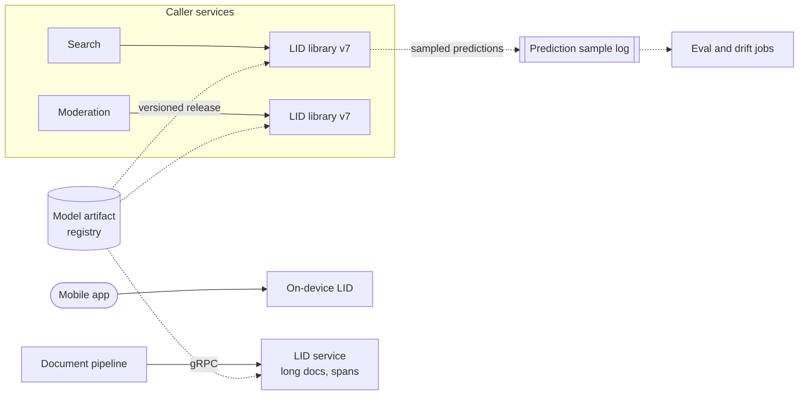

**Reading the diagram.** Most callers link the library in-process (no network edge), so identification adds microseconds. Mobile clients run the same model on device. Long documents and span-level detection go over gRPC to a central service. Model artifacts are released from a registry as versioned library builds (dotted, asynchronous). Callers log a small sample of predictions for evaluation and drift detection. *Failure points:* version skew between callers (search on v6, moderation on v7) produces inconsistent routing; enforce upgrade windows and log the version with each prediction. *Scaling:* the library scales with its callers; the central service scales on document volume.

#### Serving and monitoring

Monitor the predicted language mix per surface (a sudden rise in one language may be a real event or a model bug), the `und` rate, confusion-pair rates on sampled human-reviewed texts, and library version adoption. Retrain quarterly or when a new language is added.

#### Deep dives

1. **Library versus service.** The estimate decides it: the model is cheaper than the call.
2. **Short texts and priors.** For a two-word query, the prior from user context often outweighs the text; expose hints in the API and combine them by Bayes' rule rather than mixing them into training.
3. **Fairness across languages.** Small languages get lower accuracy and their speakers lose search, translation and moderation quality; report per-language metrics and set a minimum per-language bar (§71.5).

#### Trade-offs and alternatives

- A large multilingual transformer is more accurate on hard pairs but thousands of times costlier; use it offline to label data or in the document service.
- Returning a single label is simpler for callers; returning probabilities lets each caller choose its own threshold.

#### Follow-up questions

1. *"How do you add a new language?"* Collect data, add the class, retrain, check that confusable languages do not regress, release a new library version.
2. *"Mixed-language posts?"* Sliding-window detection in the document service; return spans.
3. *"How do you know accuracy in production?"* Sampled human review stratified by predicted language and length.
4. *"Why not trust the user's interface language?"* Many people write in languages other than their interface language; use it as a prior only.

#### What distinguishes levels

- **Mid:** an n-gram classifier with an endpoint.
- **Senior:** library-versus-service decision from the estimate, short-text and confusion-pair evaluation, priors from hints.
- **Staff:** manages version skew across the company, sets per-language quality floors, and decides where heavy models are worth their cost.

### 92.4.10 Q10. Click-through-rate prediction basics

**Difficulty:** Easy · **Time:** 45 min · **Related:** §68.7.5 (recalibration after downsampling), §68.9 (feature crosses), §81.9 (ads at scale, see Q17), §89.13

#### Prompt

"QuickBite is launching sponsored restaurant listings: restaurants bid per click to appear in two slots on the home feed. Design the click-through-rate prediction model that decides which sponsored listing to show."

#### Clarifying questions and assumptions

- Traffic? Sponsored slots are requested alongside QuickBite's recommendation requests, 2,500/s at peak (§68.16); size as if every request carries them. About 6 million home-feed views a day display the 2 slots.
- Candidates? About 50 eligible campaigns per request after delivery-area and budget filters.
- Auction? Rank by bid × predicted CTR; charge the second-price per click.
- Click rate? About 2% at launch.

#### Requirements

- **FR:** predict calibrated pCTR per (user, restaurant, slot, context); log impressions and clicks; exclude restaurants the user cannot order from; frequency caps.
- **NFR:** CTR scoring ≤ 15 ms inside the 120 ms recommendation budget; calibration ratio (Σ predicted / Σ observed clicks) within 0.95–1.05 per city; no organic ranking change when the ad system fails (slots fall back to organic results).
- **Quality:** lower log loss than the baseline, and an online increase in ad revenue without reducing orders per session.

#### Estimation

::: example
**Worked example — Predictions, training rows and the calibration correction (§89.13, §68.7.5).** Assumptions: 2,500 requests/s × 50 candidates; 12 million impressions a day; 2% CTR; keep all clicks and 10% of non-clicks; 300 bytes per row; a gradient-boosted model at 10 µs per prediction.

1. Predictions at peak: $2{,}500 \times 50 = 125{,}000$/s; CPU $125{,}000 \times 10\ \mu s = 1.25$ busy vCPU, 2.5 at $u = 0.5$. Even a 50 µs model needs 12.5 vCPU.
2. Clicks: $1.2 \times 10^7 \times 0.02 = 240{,}000$/day. Training rows: $240{,}000 + 0.1 \times 1.176 \times 10^7 = 1.42 \times 10^6$/day, 0.42 GB.
3. Correction: a model trained with negatives kept at $w = 0.1$ outputs $p' = 0.15$; the true probability is $p = p' / (p' + (1 - p')/w) = 0.15 / (0.15 + 8.5) = 0.0173$.

**Interpretation.** Serving is cheap and data is modest; the error that matters is a probability that is off by a factor of nine if the correction is forgotten. **Implication.** Put the correction inside the served model artifact and monitor calibration per city.
:::

#### Data, labels and features

- **Label:** click within the session on an impression that was actually viewed (at least 50% of the card on screen for 1 s), so unseen impressions do not count as negatives.
- **Features:** user (order history, cuisine affinities, price sensitivity), restaurant (rating, delivery time, cuisine, historical CTR as a smoothed decayed counter), context (time of day, weather, slot position, device), and **crosses** such as user cuisine × restaurant cuisine (§68.9). Restaurant and user IDs enter as hashed categorical features.
- **Position bias:** slot 1 gets more clicks regardless of quality; train with position as a feature and predict at a fixed position, so ranking compares restaurants on equal terms.

#### Model and evaluation

Baseline: smoothed historical CTR per restaurant. Model 1: logistic regression with hashed features and crosses, fast and well calibrated. Model 2: gradient-boosted trees or a small deep-and-cross network once data accumulates. Offline: log loss, normalized entropy and AUC on the next day's data, calibration ratio per city and per restaurant decile. Online: A/B test by user; primary metric revenue per 1,000 requests; guardrails organic order rate, sponsored-order cancellation rate, and restaurant return on ad spend.

#### High-level design

**Figure 92.11 — Sponsored listings: eligibility, prediction, auction.**

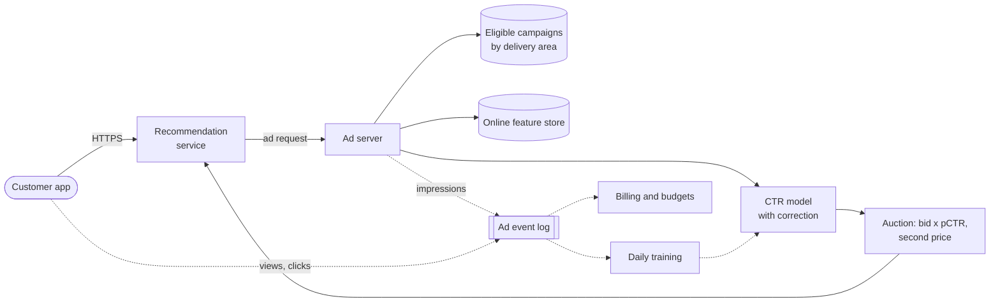

**Reading the diagram.** The recommendation service asks the ad server for two listings inside its budget; the ad server reads eligible campaigns for the address and features (storage boundaries), scores candidates, runs the auction and returns winners and prices. Dotted arrows are asynchronous: impressions, views and clicks join in an event log that feeds training and billing. *Failure points:* if the ad server times out, the recommendation service fills slots organically; a missing correction or a calibration drift misprices every auction. *Scaling:* the ad server is stateless; the eligible-campaign table is small and replicated.

#### Serving and monitoring

Monitor calibration ratio hourly per city, CTR by slot, revenue per 1,000 requests, spend pacing per campaign, and feature freshness. Retrain daily with a warm start; roll out through a shadow comparison of log loss on live traffic.

#### Deep dives

1. **Why calibration matters.** Ranking by bid × pCTR uses absolute probabilities. With restaurant A bidding \$0.50 at pCTR 4% (expected \$20 per 1,000 impressions) and B bidding \$0.80 at 2% (\$16), A wins and pays $16/1{,}000/0.04 = \$0.40$ per click; a 30% overprediction for B makes it \$20.80 and flips the winner.
2. **Downsampling and correction** (estimation step 3).
3. **Cold start for new restaurants.** Smoothed priors from similar restaurants and a small exploration budget so new advertisers get impressions (§68.15).

#### Trade-offs and alternatives

- Logistic regression versus trees or deep models: start linear for calibration and speed; switch when the log-loss gain is worth its operational cost.
- Separate ad and organic rankers versus one blended ranker: separate is simpler to govern; blending needs a common value currency (orders versus revenue).

#### Follow-up questions

1. *"Why not rank by bid alone?"* Users would see irrelevant listings; revenue falls because they do not click.
2. *"How do you measure calibration?"* Σ predicted over Σ observed clicks per segment, and reliability curves (§57.10.3).
3. *"What if a restaurant's CTR is high but orders are low?"* Add a conversion model and move to cost per order, the target design in Q17.
4. *"How do you keep ads from hurting the user experience?"* Relevance floors, frequency caps and organic-order guardrails.

#### What distinguishes levels

- **Mid:** logistic regression on features with AUC.
- **Senior:** calibration, downsampling correction, position bias and an auction-aware evaluation.
- **Staff:** prices calibration errors in auction outcomes, sets guardrails for users and restaurants, and plans exploration for new advertisers.

## 92.5 Medium questions (Q11–Q26)

The Medium tier trains product-facing ML systems whose hard part is not the model. Ten of the sixteen prompts have full case studies elsewhere in the book, so their answers are compact and focus on what a 45-minute interview can hold; the other six are complete.

### 92.5.1 Q11. News feed ranking

**Difficulty:** Medium · **Time:** 45 min · **Related:** §81.5 (full case study); §53.7 (feed serving), §68.7.4 (multi-task fusion), §89.18.3

#### Prompt

"Design the ranking system for a social app's home feed, which mixes posts from accounts a user follows with recommended posts."

#### Clarifying questions and assumptions

- Scale as in §81.5: 500 million daily users, 20 feed loads each, peak three times average, pages of 10 posts.
- Objective? Long-term engagement and satisfaction, not clicks; integrity (no violating content recommended) is in scope.
- Freshness? A new post from a followed account is eligible within one minute.

#### Requirements

- **FR:** ranked pages mixing connected and recommended posts; viewer controls ("not interested", mute) applied on the next request; impressions logged with features.
- **NFR:** p99 ≤ 250 ms; chronological connected feed as fallback; post engagement counters ≤ 30 s old; per-head calibration within 0.95–1.05.

#### Estimation

::: example
**Worked example — Feature fetch, not GPUs, is the load (§81.5.4, §89.13).**

1. Feed requests: $5 \times 10^8 \times 20 = 10^{10}$/day, **347,222/s peak**.
2. Heavy ranker on 500 candidates at 50 MFLOPs each: with Explore traffic, 98 GPUs at $u = 0.6$, **150** across three regions sized for one loss.
3. Per-candidate feature lookups: about **184 million/s** at peak.

**Interpretation.** The ranker is a modest GPU fleet; the feature fetch is the system. **Implication.** Co-locate post features with rankers in a sharded in-memory cache and fetch only the viewer's features remotely.
:::

#### Data, labels and features

Labels are per action: like, comment, share, save, dwell above a threshold, and negative actions ("see fewer", hide, report), arriving within minutes. Features: viewer–author affinity, post engagement counters (decayed, §68.13), content embeddings, post age, viewer session context. Integrity classifier scores are inputs to eligibility, not ranking features.

#### Model and evaluation

Baseline: reverse-chronological connected posts. Production: candidate sources (followed accounts, two-tower interest retrieval), a light ranker, then a multi-task heavy ranker whose calibrated heads are fused into one value with positive and negative weights (§68.7.4). Offline gate: per-head normalized entropy and calibration; online: daily active users and time spent with negative-feedback rate, prevalence of violating content and connected-content share as guardrails.

#### High-level design

**Figure 92.12 — Feed ranking funnel.**

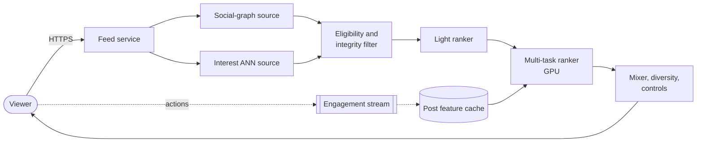

**Reading the diagram.** Two candidate sources feed a cheap eligibility filter that removes violating and muted content before any ranking compute; a light ranker narrows to 500 for the GPU ranker, which reads post features from a co-located cache; a mixer applies diversity, the connected-content share and viewer controls. Engagement events stream back (dotted) to refresh counters within seconds. *Failure points:* ranker failure falls back to chronological connected posts; a stale eligibility stream lets removed posts through. *Scaling:* sources and rankers scale with requests; the feature cache is sharded by post ID.

#### Serving and monitoring

Monitor per-head calibration by source, counter freshness, eligibility-stream lag, prevalence from sampled human labeling, and connected share. Retrain daily; keep a long-term holdout to measure cumulative effects.

#### Deep dives

1. **Value model.** Fused heads need calibration and weights set by experiment, not by intuition.
2. **Integrity before ranking.** Filtering after ranking wastes compute and lets the ranker learn to amplify borderline content.
3. **Gaming early signals.** Counters on new posts are easily inflated; weight engagement by account trust and use priors from author history.

#### Trade-offs and alternatives

Single-model end-to-end ranking is simpler but cannot meet the latency budget over thousands of candidates; a funnel trades some recall for cost (§68.4).

#### Follow-up questions

1. *"How do you rank a two-minute-old post?"* Author priors and content embedding, then Beta-smoothed counters.
2. *"Why not optimize time spent?"* It rewards passive scrolling; satisfaction surveys and negative feedback correct it.
3. *"Stop recommendations crowding out friends?"* A connected-share guardrail and a displacement margin.
4. *"How do you test ranking changes with network effects?"* Randomize by viewer; watch creator-side metrics separately.

#### What distinguishes levels

- **Mid:** staged ranking with an engagement model.
- **Senior:** multi-task heads with calibration, eligibility before ranking, feature fetch sized as the bottleneck.
- **Staff:** measures integrity as prevalence, designs anti-gaming into features, and accounts for creator-side effects.

### 92.5.2 Q12. Video recommendations

**Difficulty:** Medium · **Time:** 45 min · **Related:** §81.4 (full case study); §68.6 (two-tower), §56.5 (systems view), §54.4 (video platform)

#### Prompt

"Design the recommendations for a video platform's home page and 'up next' list."

#### Clarifying questions and assumptions

As in §81.4: 800 million daily viewers, 25 recommendation requests each, PAR 2; 500 million recommendable videos; objective is satisfied watch time, not clicks; new uploads eligible within 15 minutes.

#### Requirements

- **FR:** home page of 20 and up-next of 20 from a seed video; in-session adaptation; "not interested" honored on the next request.
- **NFR:** p99 ≤ 200 ms; 99.99% availability of *some* page via popular-in-region fallback; impressions joined to outcomes ≥ 99.9%.

#### Estimation

::: example
**Worked example — Where the GPUs go (§81.4.4, §89.18.8).**

1. Requests: $8 \times 10^8 \times 25 = 2 \times 10^{10}$/day; **462,963/s peak**.
2. Heavy ranker on 500 candidates at 200 MFLOPs: $4.63 \times 10^{16}$ FLOP/s; at 150 TFLOP/s effective and $u = 0.6$, 515 GPUs; **774** across three regions sized for one loss.
3. Retrieval index with 32-byte product quantization: $5 \times 10^8 \times 32 = 16$ GB per replica.

**Interpretation.** Retrieval is cheap; the ranker's input size sets the bill. **Implication.** Invest in the light ranker's recall so the heavy ranker can score fewer items.
:::

#### Data, labels and features

Labels: click, watch time given click, like, dismissal, and survey responses on a sample; delays from seconds to days. Features: watch history sequence, video embeddings and engagement counters, creator, context, seed video. Negatives are sampled and corrected; impressions log the features used at serving time (§59.5.3).

#### Model and evaluation

Baseline: popular-in-region and co-watch item-to-item lists. Production: two-tower retrieval trained as next-watch prediction with sampling-bias correction (§68.6), several retrieval sources, a light ranker and a multi-task heavy ranker with watch-time weighting. Offline gates: recall@500 for retrieval, per-head log loss and calibration; online: satisfied watch time per viewer, with dismissals, survey score and creator coverage as guardrails.

#### High-level design

**Figure 92.13 — Video recommendation funnel.**

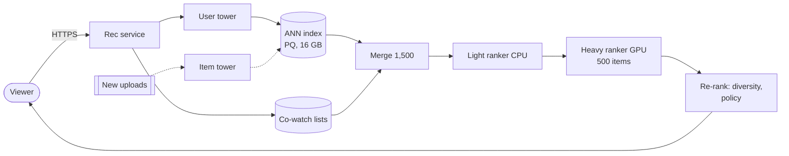

**Reading the diagram.** The request runs the user tower, queries the ANN index and other sources, merges about 1,500 candidates, narrows them on CPU, scores 500 on GPU and re-ranks for diversity and policy before returning 20. New uploads are embedded asynchronously and inserted into the index (dotted). *Failure points:* a mismatch between user-tower and index versions silently ruins retrieval, so they are versioned and swapped together; GPU loss degrades to light-ranker order. *Scaling:* regions replicate the index; rankers scale with requests.

#### Serving and monitoring

Budget roughly 20 ms retrieval, 30 ms light ranking, 80 ms heavy ranking. Monitor per-head calibration, freshness of newest indexed video, candidate-source marginal recall and embedding drift. Rankers retrain daily with warm start; the candidate model weekly.

#### Deep dives

1. **Objective design:** watch-time weighting and satisfaction heads against clickbait.
2. **Retrieval at scale:** two-tower with log-Q correction, index updates for fresh uploads.
3. **Feedback loops:** exploration slots for new videos and a long-term holdout.

#### Trade-offs and alternatives

Fewer heavy-ranker items save GPUs at the risk of recall; generative sequence recommenders are an alternative where latency allows.

#### Follow-up questions

1. *"Why not optimize clicks?"* Clickbait; satisfied watch time is the target.
2. *"How does a new video get impressions?"* Content-based item tower plus fresh-upload source and exploration.
3. *"How do you keep tower and index consistent?"* Version together, swap atomically per region.
4. *"Halve the GPU bill?"* Distill the light ranker and cut heavy-ranker input from 500 to 250.

#### What distinguishes levels

- **Mid:** two-tower retrieval and a ranker.
- **Senior:** funnel with numbers, multi-task heads, label delays and versioned index swaps.
- **Staff:** argues the objective, prices each stage, and treats feedback loops and creator effects as guardrails.

### 92.5.3 Q13. Search ranking

**Difficulty:** Medium · **Time:** 45 min · **Related:** §81.7 (full case study); §56.4 (search serving), §16.5 (BM25), §68.12.2 (position bias)

#### Prompt

"Design the ranking models for a web search engine: given a query, order candidate documents so the best result is first."

#### Clarifying questions and assumptions

Serving from §56.4 is assumed: 81,019 queries/s reach ranking at peak; a leaf-level retrieval and first-pass stage hands 3,000 candidates to the root. Labels: graded human judgments and clicks. Personalization beyond locale is out of scope.

#### Requirements

- **FR:** query understanding (spelling, intent, rewrites), hybrid lexical and dense retrieval, multi-stage ranking, freshness boosts for news intent, impression logging.
- **NFR:** ranking ≤ 110 ms inside the 300 ms end-to-end p99; ranking degrades to the previous stage's order rather than failing; no NDCG regression on any major slice.

#### Estimation

::: example
**Worked example — Price each stage (§81.7.4).**

1. Second pass (LambdaMART, 10 µs per document × 3,000): $81{,}019 \times 0.03 / 0.5 = $ **4,861 cores**.
2. Cross-encoder (22 million parameters, 128 tokens) on the top 30: $1.37 \times 10^{16}$ FLOP/s, **152 GPUs** at $u = 0.6$; a 110-million-parameter version needs 760.
3. Judgments: 600,000 per quarter; clicks: $3 \times 10^9$ per day.

**Interpretation.** The cross-encoder is the expensive stage, linear in model size and documents read. **Implication.** Distill it and apply it only to the top 30.
:::

#### Data, labels and features

Human judgments on a 0–4 scale are the trustworthy, scarce signal; clicks are plentiful but position-biased, so debias them with propensities from small randomized swaps (§68.12.2). Features: BM25 per field, dense similarity, link-based quality, freshness, spam scores, query–document click statistics, intent class.

#### Model and evaluation

Baseline: BM25 plus static quality. Production: L1 small model at leaves, L2 LambdaMART over a few hundred features, L3 distilled cross-encoder on the top 30. Offline: NDCG@10 on judged sets, gated per slice (navigational, long-tail, each major language); online: interleaving for sensitivity, then A/B on satisfied clicks with abandonment and reformulation as guardrails.

#### High-level design

**Figure 92.14 — Search ranking cascade.**

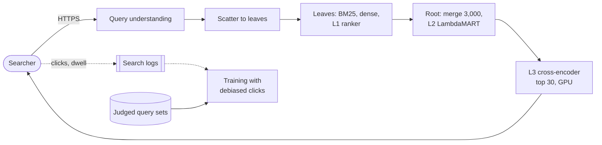

**Reading the diagram.** Query understanding runs once before the scatter; leaves retrieve and first-pass rank their shard; the root merges, applies L2 and sends the top 30 to the cross-encoder pool. Logs flow asynchronously into training together with judged sets (storage boundary). *Failure points:* L3 timeout returns L2 order; a stale propensity curve biases training silently. *Scaling:* leaves scale with index size, the root and L3 with query rate; caching L3 scores for head queries cuts GPU load.

#### Serving and monitoring

Weekly NDCG on a rotating judged set, L3 fallback rate, correction acceptance rate, abandonment by intent, propensity curve stability. Rankers retrain weekly; dictionaries daily.

#### Deep dives

1. **Labels:** judgments versus debiased clicks, and how propensities are estimated without hurting users.
2. **Cascade economics:** the cost of each stage and distillation.
3. **Evaluation hygiene:** slice gates and leakage from queries in both training and judged sets.

#### Trade-offs and alternatives

Neural ranking everywhere improves text matching but costs orders of magnitude more per document than trees; keep trees where features are engineered.

#### Follow-up questions

1. *"Why not train on clicks directly?"* The model would learn the old ranking's position bias.
2. *"How do you get propensities?"* Randomized adjacent swaps on 1% of traffic.
3. *"How do you handle a breaking-news query?"* A fresh-intent classifier and boosts from the real-time tier.
4. *"Why LambdaMART at L2?"* Strong on engineered features at 10 µs per document.

#### What distinguishes levels

- **Mid:** learning to rank with NDCG.
- **Senior:** cascade with costs, hybrid retrieval, position-bias correction.
- **Staff:** treats labels as the core problem, prices every stage, guards slices and evaluation leakage.

### 92.5.4 Q14. People You May Know

**Difficulty:** Medium · **Time:** 45 min · **Related:** §68.5.3 (item-to-item similarity), §68.12 (feedback loops), §71.9 (privacy risks), §53.7 (social graph)

#### Prompt

"Design the 'People You May Know' feature for a social network: suggest people the user is likely to know and connect with."

#### Clarifying questions and assumptions

- Scale? 1 billion users, 300 million daily; average 300 connections; connections are mutual (request and accept).
- Surfaces? A PYMK module shown twice a day per active user, 3 suggestions visible at a time; also in onboarding.
- Signals allowed? The graph, profile fields (schools, workplaces), and uploaded contacts with consent. No location history or messages.
- Goal? Accepted connections that lead to engagement, not requests sent.

#### Requirements

- **FR:** ranked suggestions per user; dismiss ("not now", "don't suggest"); new users get suggestions within minutes of signup or contact upload.
- **NFR:** module p99 ≤ 150 ms; candidates refreshed daily, with new connections reflected within an hour; never reveal private relationships (a suggestion must not imply that two people share a hidden contact).
- **Quality:** accepted connections per impression above the current system without raising report or block rates.

#### Estimation

::: example
**Worked example — Friends-of-friends is the expensive part (§89.6, §89.10, §89.13).** Assumptions: adjacency lists at 8 bytes per directed edge; 500 candidates kept per daily user at 12 bytes; 2 module loads per daily user per day, PAR 2; ranking 500 candidates at 10 µs each.

1. Graph: $10^9 \times 300 / 2 = 1.5 \times 10^{11}$ edges; both directions $2 \times 1.5 \times 10^{11} \times 8 = 2.4$ TB.
2. Two-hop paths for daily users: $3 \times 10^8 \times 300 \times 300 = 2.7 \times 10^{13}$ a day; sampling at most 100 neighbors of each friend: $9 \times 10^{12}$.
3. Candidate store: $3 \times 10^8 \times 500 \times 12 = 1.8$ TB.
4. Serving: $6 \times 10^8$ loads a day, 6,944/s average, **13,889/s peak**; $13{,}889 \times 5\ \text{ms} = 69$ busy vCPU, 139 at $u = 0.5$, 9 nodes.
5. Outcomes: $1.8 \times 10^9$ impressions a day; at 1% sending requests and 40% accepted, 7.2 million new connections a day.

**Interpretation.** Online ranking is a small fleet; the daily two-hop computation over a 2.4 TB graph is the heavy job. **Implication.** Precompute candidates offline with sampling for high-degree nodes, and rank online with fresh features.
:::

#### Data, labels and features

- **Label:** suggestion impression → request sent → accepted within 14 days. Train two heads (send, accept) because a suggestion people send but recipients ignore creates spam-like requests.
- **Candidates and features:** mutual-connection count and their strength (recent interaction, not just existence); shared schools and workplaces with overlapping years; contact-book matches (consented); graph-embedding similarity; recency of the candidate's join; whether the candidate has dismissed or blocked the user.
- **Leakage:** features must be computed as of the impression; the connection itself, if it happened later, must not leak into "mutual connections".

#### Model and evaluation

Baseline: rank by mutual-connection count. Model: gradient-boosted trees or a small neural ranker over the features, with graph embeddings (for example node2vec-style or a graph neural network trained on link prediction) as a candidate source and a feature. Offline: recall of next-week new connections among candidates (retrieval gate), AUC and calibration of both heads, sliced by user tenure and region. Online: randomize by viewer; primary metric accepted connections followed by interaction within 28 days; guardrails on decline, report and block rates for the *recipient*, who is outside the treated group (an interference effect, so also monitor recipients in aggregate).

#### High-level design

**Figure 92.15 — PYMK: offline candidates, online ranking.**

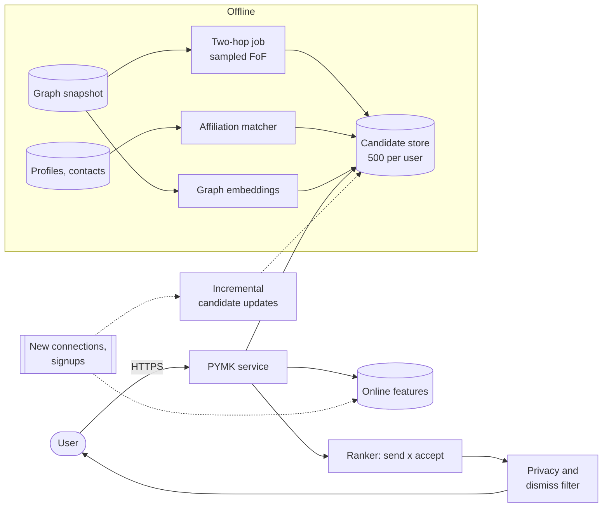

**Reading the diagram.** Offline jobs read a daily graph snapshot and profile data, generate candidates from sampled friends-of-friends, shared affiliations and embeddings, and write 500 per user to a candidate store. Online, the service reads candidates and fresh features, ranks by the product of send and accept probabilities, and filters by privacy rules and dismissals. Dotted arrows are streaming updates: new connections and signups update candidates and features within the hour. *Failure points:* a failed offline job serves yesterday's candidates (stale but safe); a broken privacy filter is a serious incident, so it is a separate, tested component. *Scaling:* the two-hop job partitions by user; serving scales horizontally.

#### Serving and monitoring

Monitor acceptance rate per impression, recipient decline and block rates, candidate-store freshness, and the share of suggestions from each source. Retrain weekly; regenerate candidates daily with incremental updates in between.

#### Deep dives

1. **Two-hop at scale.** High-degree nodes (celebrities) produce millions of paths; cap or sample their contribution and weight mutual connections by tie strength.
2. **Privacy.** Contact-upload matches can reveal sensitive relationships (a therapist and a patient who share a phone contact). Require consent, never show the reason "in your contacts" for one-directional uploads, and exclude sensitive categories by policy (§71.9).
3. **Feedback loop.** The network grows along suggested edges, so PYMK shapes the graph it learns from; keep an exploration slice and a holdout, and track diversity of new connections (not only within one cluster).

#### Trade-offs and alternatives

- Graph neural networks capture more structure than hand-made graph features but are heavy to train on 1.5×10¹¹ edges; start with features and embeddings.
- Fully online candidate generation is fresher but too expensive; incremental updates for recent events get most of the freshness.

#### Follow-up questions

1. *"Why model accept as well as send?"* Requests that are ignored annoy recipients and degrade trust.
2. *"New user with no connections?"* Contact upload, affiliations and popular-in-region accounts as cold-start candidates.
3. *"How do you A/B test with network effects?"* Randomize by viewer and monitor recipients; for larger changes use graph-cluster randomization.
4. *"A user complains PYMK suggested their ex."* Dismiss and block signals must be honored, and some relationships should be suppressible.

#### What distinguishes levels

- **Mid:** friends-of-friends ranked by mutual count.
- **Senior:** offline candidates sized against the graph, send and accept heads, fresh features online.
- **Staff:** privacy leaks through suggestions, interference on recipients, and the feedback loop on graph growth.

### 92.5.5 Q15. Payment fraud detection

**Difficulty:** Medium · **Time:** 45 min · **Related:** §82.4 (full case study); §70.8 (QuickBite fraud monitoring), §89.18.9, §63.4.2 (label delay)

#### Prompt

"Design a fraud detection system that decides, during authorization, whether to approve, challenge or decline a card payment."

#### Clarifying questions and assumptions

As in §82.4: a payment processor with 100 million authorizations a day, PAR 5, 0.1% fraud; fraud confirmed by chargebacks within 120 days. A smaller variant is QuickBite's order-fraud model (0.5% fraud, flags 0.7% of orders at 50% precision and 70% recall, §70.8).

#### Requirements

- **FR:** synchronous decision with score and reason codes; analyst rules deployable in minutes; streaming velocity features; case review; label ingestion; audit.
- **NFR:** p99 ≤ 50 ms, hard deadline 80 ms then fallback; 99.995% of authorizations get a decision; velocity counters fresh within 2 s.

#### Estimation

::: example
**Worked example — Counter updates dominate (§82.4.4, §89.18.9).**

1. Peak: **6,000 authorizations/s** (design).
2. Counter updates: 5 entities × 6 windows = 30 per authorization, **174,000/s**.
3. Feature state: 1.21 billion entities × 500 bytes = 605 GB, 1.8 TB replicated.
4. Fleet: 6 ms of vCPU per decision; **9 nodes** across three regions, set by redundancy.

**Interpretation.** Scoring is cheap; freshness of state is the system. **Implication.** Size the stream processor and feature store, not the model servers.
:::

#### Data, labels and features

Labels: chargebacks and issuer fraud reports (weeks late), analyst verdicts (fast), with declined transactions censored (no chargeback can happen). Train on matured windows with point-in-time features. Features: velocity counts and amounts per card, device, IP, email and merchant over 1 minute to 30 days; card–merchant history; device reputation; amount relative to the card's norm.

#### Model and evaluation

Baseline: rules (velocity limits, block lists). Production: gradient-boosted trees plus a small network, calibrated; a **decision policy** declines when expected loss $p \times \text{amount}$ exceeds the cost of a false decline, with step-up authentication in between (§82.4.8). Offline: recall of fraud *dollars* at a fixed decline rate, calibration per score decile; online: champion–challenger with a small random holdout that is approved regardless, to measure what declines would have been.

#### High-level design

**Figure 92.16 — Fraud decision inside authorization.**

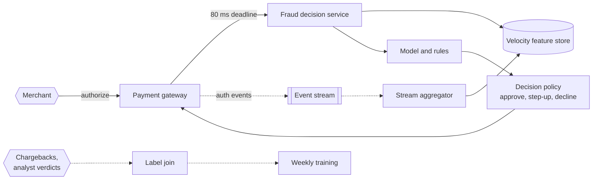

**Reading the diagram.** The gateway calls the fraud service synchronously with an 80 ms deadline; the service batch-reads velocity features, runs rules and the model, and the policy returns a decision. Events flow asynchronously to the stream aggregator that updates counters within seconds; chargebacks and verdicts join to logged decisions for training weeks later. *Failure points:* model timeout falls back to rules and request-only features, never to failing the payment; aggregator lag lets card-testing bursts through. *Scaling:* the service is stateless; counter state is partitioned by entity key.

#### Serving and monitoring

Decline and step-up rates per merchant segment hourly, score distribution drift, counter lag, and precision on immature labels corrected by the label-arrival curve (§70.8). Retrain weekly; rules deploy in minutes.

#### Deep dives

1. **Fresh velocity features** with read-your-own-write so a burst is counted.
2. **Cost-sensitive thresholds** from calibrated probabilities and amounts.
3. **Censored, delayed labels:** matured windows, fast labels, holdout.

#### Trade-offs and alternatives

Graph features (shared devices across cards) catch rings but add latency; compute them nearline and serve as features.

#### Follow-up questions

1. *"Why not optimize F1?"* Errors have different dollar costs.
2. *"The model is down."* Rules and request-only features; never block payments.
3. *"How do you measure recall of declined fraud?"* A random holdout with a loss budget.
4. *"How do fraudsters adapt?"* Probing with small amounts; use features expensive to fake.

#### What distinguishes levels

- **Mid:** classifier with imbalance handling.
- **Senior:** synchronous path with fallback, velocity features sized by updates, calibrated threshold.
- **Staff:** prices both errors, designs evaluation for censored delayed labels, governs rules and models together.

### 92.5.6 Q16. ETA prediction

**Difficulty:** Medium · **Time:** 45 min · **Related:** §60.15 (QuickBite worked design), §83.5 (full case study, ride-hailing), §66.16 (ETA serving), §89.18.10

#### Prompt

"QuickBite shows a delivery time next to every restaurant in search results and on the order screen. Design the ETA prediction system."

#### Clarifying questions and assumptions

QuickBite assumptions: 500,000 orders a day; 2,000 search requests/s at peak × 20 restaurants = **40,000 predictions/s**, 360 million a day, about 720 per order; median delivery 35 minutes. Being late costs more than being early (refunds, churn).

#### Requirements

- **FR:** ETA per restaurant in search; quoted ETA at checkout; re-prediction at each order status event.
- **NFR:** p99 ≤ 100 ms inside search; quality SLI: share of orders delivered within ±5 minutes of the quote, per city; fallback ladder so search never lacks an ETA.

#### Estimation

::: example
**Worked example — Size from predictions (§60.11.1, §89.18.10).**

1. Peak 40,000/s; average 4,167/s (PAR 9.6).
2. Trees at 0.1 ms vCPU: 4 busy vCPU; one node, **three** for zone redundancy, \$2.31/h.
3. Cost: \$0.000154 per 1,000 predictions, about \$0.00011 per order. A 2 ms deep model needs 11 nodes.

**Interpretation.** Redundancy, not compute, sizes the tree fleet. **Implication.** Spend on features and freshness (kitchen backlog, courier supply), not on hardware.
:::

#### Data, labels and features

Label: actual delivery time from order to drop-off, known about 35 minutes later; decompose into preparation, courier pickup and travel to give partial labels early. Features: restaurant preparation history by hour, live kitchen backlog, courier supply in the zone, travel time from a zone grid, weather, basket size. Leakage risk: features computed after order time.

#### Model and evaluation

Baseline: restaurant median preparation time plus grid travel time. Production: gradient-boosted trees predicting a high quantile (for example P80) with pinball loss (§57.11.2), so the quote is rarely late. Offline: pinball loss and within-±5-minute share per city and hour; online: A/B by city–time switchback because couriers are shared; conversion and lateness as joint metrics.

#### High-level design

**Figure 92.17 — QuickBite ETA (condensed from Figure 60.12).**

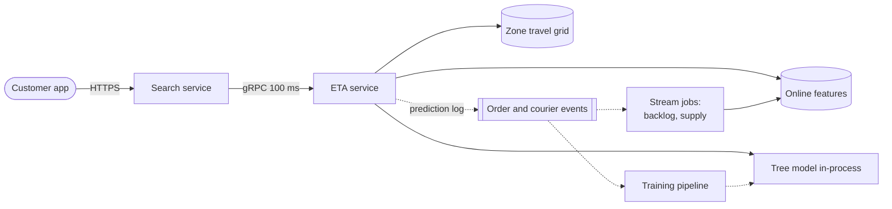

**Reading the diagram.** Search calls the ETA service with a 100 ms deadline; the service makes one multi-get to the feature store and grid and runs the model in-process. Stream jobs refresh kitchen backlog and courier supply within about a minute; predictions are logged and joined with delivery events for training (dotted). *Failure points and fallbacks:* feature store down → reduced model; model down → grid heuristic; stream lag → age checks flag stale features. *Scaling:* stateless service scaled on predictions per second.

#### Serving and monitoring

Within-±5-minute SLI per city with label delay of about 35 minutes; fallback rate; feature freshness; mean signed error (bias) by hour. Retrain twice a week.

#### Deep dives

1. **Asymmetric loss** and quoting a quantile.
2. **Real-time features**: backlog and supply freshness budget.
3. **Feedback**: quoted ETAs change behavior (customers choose fast restaurants, dispatch prioritizes), so evaluate with switchbacks.

#### Trade-offs and alternatives

Deep sequence models over the courier's route help at re-prediction time, not in search, where trees meet the budget at a fraction of the cost.

#### Follow-up questions

1. *"Why not predict the mean?"* Lateness is costlier; quote a high quantile.
2. *"How is ride-hailing ETA different?"* Dominated by driving over a road network and requested about six times as often (§83.5).
3. *"The kitchen backlog feed lags."* Detect by age and fall back to historical preparation times.
4. *"Why 720 ETAs per order?"* Every restaurant shown in every search counts.

#### What distinguishes levels

- **Mid:** regression on historical features.
- **Senior:** quantile loss, fallback ladder, fleet sized from predictions, real-time features.
- **Staff:** decomposes the label, designs switchback evaluation, and treats the quote as a marketplace lever.

### 92.5.7 Q17. Ad CTR prediction at scale

**Difficulty:** Medium · **Time:** 45 min · **Related:** §81.9 (full case study); §68.7.5 (recalibration), §68.8 (embedding tables); Q10 for the basics

#### Prompt

"Design click-through and conversion prediction for a large social platform's ad system, where predictions feed a real-time auction."

#### Clarifying questions and assumptions

As in §81.9: 1 billion daily users, 30 ad opportunities each, PAR 2; 5,000 eligible ads per request after targeting; CTR 1%; conversions reported by advertisers up to 28 days later.

#### Requirements

- **FR:** calibrated pCTR and pCVR per (user, ad, context); auction ranking and second pricing; budget pacing; exactly-once billing events.
- **NFR:** ad server p99 ≤ 100 ms (ranking ≤ 40 ms); calibration ratio 0.97–1.03 per major segment; continuous or hourly model updates.

#### Estimation

::: example
**Worked example — Every 0.1% is money (§81.9.4).**

1. Requests: $3 \times 10^{10}$/day; **694,444/s peak**.
2. Light model on 5,000 ads at 2 µs: 13,889 cores; heavy model on 500 at 20 MFLOPs: **117 GPUs** across three regions.
3. Feature lookups: **347 million/s**.
4. Revenue at \$5 per 1,000 impressions: \$150 million a day, so a 0.1% improvement is \$150,000 a day.

**Interpretation.** Model gains are worth more than the GPUs that produce them. **Implication.** Justify complexity in dollars and keep ad-side features in memory on each ad server.
:::

#### Data, labels and features

Impressions with clicks (seconds) and conversions (up to 28 days); all clicks and 5% of non-clicks kept, corrected at serving. Features: user embeddings and history, ad and advertiser IDs, creative embeddings, context, and crosses; large hashed ID embedding tables (§68.8).

#### Model and evaluation

Baseline: logistic regression with crosses. Production: a deep ranking model (DLRM or DCN style, §68.7.3) with multi-task CTR and CVR heads, trained continuously with daily full retrains; delayed conversions handled by modeling the delay or by correcting late positives. Offline: normalized entropy, AUC, calibration per segment; online: revenue per 1,000 requests with user engagement, ad hides and advertiser conversions per dollar as guardrails.

#### High-level design

**Figure 92.18 — Ad ranking and the money path.**

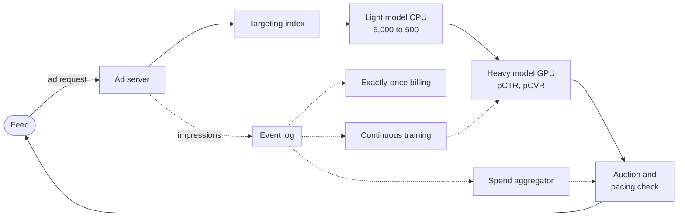

**Reading the diagram.** The synchronous path narrows 5,000 targeted ads to 500 on CPU, scores them on GPU, and runs the auction against pacing state. Asynchronously, events feed billing (exactly once), the spend aggregator that updates pacing, and continuous training. *Failure points:* spend-aggregator lag causes overspend; an online update with bad calibration misprices every auction within minutes, so updates pass gates and can be rolled back instantly. *Scaling:* ad servers scale with requests; GPU rankers with candidates scored.

#### Serving and monitoring

Calibration ratio per advertiser segment and placement, normalized entropy on a holdout stream, overspend, label-delay distribution. Rollback path for every model push.

#### Deep dives

1. **Calibration as a contract** (the auction uses absolute probabilities).
2. **Delayed conversions** and their effect on fresh models.
3. **Online updates** safely gated.

#### Trade-offs and alternatives

Larger embedding tables improve accuracy but need sharded training and serving; measure the revenue gain per GPU.

#### Follow-up questions

1. *"Why calibrate if you only rank?"* Prices depend on the probability.
2. *"Spend aggregator lags?"* Count pending spend and stop near the limit.
3. *"Training on conversions not yet reported?"* Delay modeling or late-positive correction.
4. *"How big is a meaningful gain?"* 0.1% revenue is \$150,000 a day here.

#### What distinguishes levels

- **Mid:** CTR model plus auction.
- **Senior:** calibration, downsampling correction, latency budget and pacing.
- **Staff:** prices model changes in dollars, makes the money path exactly-once and independent of model failures.

### 92.5.8 Q18. Content moderation

**Difficulty:** Medium · **Time:** 45 min · **Related:** §82.7 (full case study); §63.14.3 (annotator well-being), §63.6 (agreement)

#### Prompt

"Design content moderation for a social network with text, images and video, enforcing the platform's policies at scale."

#### Clarifying questions and assumptions

As in §82.7: 500 million posts, 3 billion comments, 300 million images and 20 million videos a day; policies from spam to imminent harm; human review, appeals and regional law are in scope.

#### Requirements

- **FR:** hash matching against known violating content; per-policy classifiers; human review queues; actions (remove, restrict, age-gate); reports and appeals; policy versioning.
- **NFR:** pre-publish checks p99 ≤ 300 ms; post-publish action p95 ≤ 10 min; automated removal precision ≥ 90% per policy; reviewer exposure limits.

#### Estimation

::: example
**Worked example — People dominate (§82.7.4).**

1. Items: $3.82 \times 10^9$/day; about **60 GPUs** classify everything at peak.
2. LLM policy classifier on the borderline 1% of text: about \$2,520 a day.
3. Human review: 3 million items a day × 45 s = 37,500 hours a day, about **10,000 reviewers** at 1,380 productive hours a year each.

**Interpretation.** Compute is cheap; review labor is the cost and the capacity constraint. **Implication.** Judge model work by review hours removed at equal accuracy.
:::

#### Data, labels and features

Labels from trained reviewers under versioned guidelines (with agreement measured), user reports (noisy, adversarial), and hash databases. Features: content embeddings per modality, account reputation, report history, context (where posted, audience).

#### Model and evaluation

Baseline: hash matching plus keyword rules. Production: multimodal multi-task classifiers with per-policy thresholds, an LLM policy classifier for borderline text whose prompt carries the current policy, and routing to review by severity, language and skill. Offline: per-policy precision and recall on golden sets labeled under the current policy version; online: **prevalence** (share of views that were violating, from random view samples) and appeal overturn rate.

#### High-level design

**Figure 92.19 — Moderation pipeline with people in the loop.**

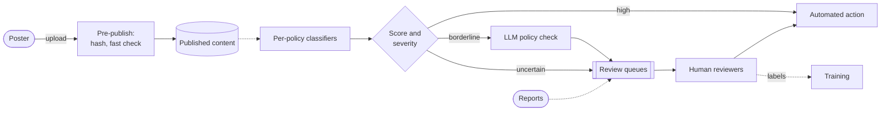

**Reading the diagram.** Severe known content is blocked before publication by hash matching and a fast check; everything else is published and classified asynchronously. High-confidence violations are actioned automatically; borderline items go through an LLM policy check and uncertain ones directly to queues routed by language and policy; reports join the same queues. Reviewer decisions become labels. *Failure points:* a classifier regression floods queues; a stale policy version mislabels data. *Scaling:* classifiers scale with GPUs; reviewers with hiring, so queue routing and automation determine capacity.

#### Serving and monitoring

Prevalence per policy from sampled views, queue age per severity, appeal overturn rate, reviewer occupancy (≤ 75% on graphic queues).

#### Deep dives

1. **Human workforce sizing** with Erlang C per queue and an occupancy cap.
2. **Policy versioning:** golden sets and labels tagged by version.
3. **Prevalence measurement** independent of the models.

#### Trade-offs and alternatives

Pre-publish checking of everything adds latency and over-blocks; reserve it for severe known content.

#### Follow-up questions

1. *"How do you measure what you missed?"* Prevalence from random view samples.
2. *"Policy changes tomorrow."* New golden set, LLM prompt update, re-labeling, retraining.
3. *"How many reviewers?"* Volume × handle time over productive hours, then Erlang C per queue.
4. *"Different laws per country?"* Regional scope on actions, not separate models.

#### What distinguishes levels

- **Mid:** classifiers plus human review.
- **Senior:** latency tiers, hash matching, per-policy thresholds, review routing.
- **Staff:** sizes the workforce and shows it dominates cost, measures prevalence, treats well-being and appeals as requirements.

### 92.5.9 Q19. Visual search

**Difficulty:** Medium · **Time:** 45 min · **Related:** §74.9 (product quantization), §74.11 (filtered search), §84.5 (image pipeline economics), §68.6 (two-tower training)

#### Prompt

"Design visual search for an e-commerce marketplace: a shopper photographs an item, or taps one in a picture, and we show similar products we sell."

#### Clarifying questions and assumptions

- Catalog? 200 million product images; 5 million added or changed a day.
- Queries? 20 million visual searches a day, PAR 3; photos from phone cameras.
- Results? 50 products, filtered by availability in the shopper's country, price range and category.
- Latency? Results within 1 s end to end; server-side p99 ≤ 400 ms.

#### Requirements

- **FR:** detect and crop the main objects in the query photo; let the shopper choose one; return similar in-stock products with filters; log clicks and purchases.
- **NFR:** server p99 ≤ 400 ms; new products searchable within 1 hour; index rebuild for a new embedding model without downtime.
- **Quality:** recall@50 of the exact or near-exact product on a judged set; online add-to-cart rate from visual search.

#### Estimation

::: example
**Worked example — Index memory and query compute (§74.14, §89.13).** Assumptions: 256-dimension embeddings; detection at 30 GFLOPs and embedding at 8 GFLOPs per query photo; an effective 50 TFLOP/s per GPU for small batches; HNSW-style graph with 64 neighbor links of 4 bytes per vector at the base layer.

1. Vectors: FP32 $2 \times 10^8 \times 256 \times 4 = 204.8$ GB; FP16 102.4 GB; product quantization at 64 bytes **12.8 GB**.
2. Graph links: $2 \times 10^8 \times 64 \times 4 = 51.2$ GB, so a graph index over PQ codes needs about 64 GB per replica.
3. Queries: $2 \times 10^7 / 86{,}400 = 231$/s average, **694/s peak**; GPU work $694 \times 3.8 \times 10^{10} = 2.6 \times 10^{13}$ FLOP/s, 0.9 GPUs at $u = 0.6$; deploy 2 plus a spare.
4. Re-embedding the catalog at 2,000 images/s per GPU: $2 \times 10^8 / 2{,}000 = 10^5$ s, about **28 GPU-hours**.

**Interpretation.** Query compute is small; the index and its rebuild are the large resources. **Implication.** Compress vectors, re-rank the top few hundred at full precision, and treat a model change as a 28-GPU-hour migration.
:::

#### Data, labels and features

- **Training pairs:** the domain gap is the problem: catalog photos are clean studio shots, queries are cluttered phone photos ("street-to-shop"). Positives: user photos in reviews paired with the reviewed product; the same product's different catalog images; query–purchase pairs from logs. Hard negatives: visually similar different products (same color, different cut).
- **Judged set:** 5,000 query photos with the correct product and graded similar products, per category.
- **Re-ranking features:** visual similarity, category match, price proximity, product popularity and rating, seller quality.

#### Model and evaluation

Baseline: a pretrained image embedding (no fine-tuning) with exact search on a category subset. Production: object detector for crops, an embedding model fine-tuned contrastively on the pairs above (a query tower and a catalog tower can share weights), an ANN index, then a learned re-ranker over the features. Offline: recall@50 and NDCG on the judged set by category; online: A/B by user on add-to-cart and purchase from visual search, with zero-result rate as a guardrail.

#### High-level design

**Figure 92.20 — Visual search: detect, embed, retrieve, re-rank.**

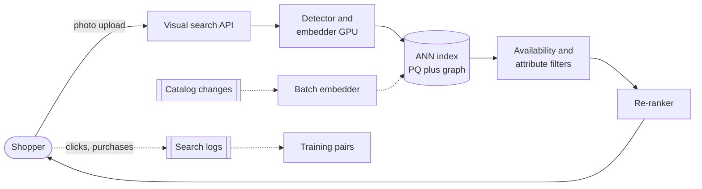

**Reading the diagram.** The query photo goes over HTTPS to the API, which runs detection and embedding on GPU, searches the ANN index (the storage boundary), applies filters and re-ranks. Catalog changes are embedded and inserted asynchronously; logs produce new training pairs. *Failure points:* filters applied after retrieval can leave too few results when most neighbors are out of stock (§74.11), so the index carries filterable attributes; a model update without re-indexing mixes incompatible embeddings. *Scaling:* index replicas scale with query rate; partitions by category scale with catalog size.

#### Serving and monitoring

Budget: 150 ms detection and embedding (including upload decode), 50 ms ANN, 50 ms re-ranking. Monitor zero-result and low-result rates per filter, click-through by position, index freshness, and embedding-norm drift. Retrain monthly; re-index with each embedding version.

#### Deep dives

1. **Domain gap.** Training only on catalog images fails on phone photos; review photos and query–purchase pairs bridge it, and augmentations (blur, perspective, lighting) help.
2. **Filtered ANN.** Shoppers filter by country and stock; pre-filtering by partition (per country) or filtered graph search keeps result counts stable (§74.11).
3. **Index versioning.** Build the new index beside the old, shadow-compare recall on the judged set, switch atomically.

#### Trade-offs and alternatives

- Multimodal image–text embeddings allow "like this but in red", at higher cost and harder evaluation.
- On-device embedding saves upload bandwidth and latency but freezes the model version per app release.

#### Follow-up questions

1. *"How do you handle an image with several items?"* The detector returns crops; the shopper picks one, or the top crop is searched by default.
2. *"Exact product versus similar style?"* Two result sections with different thresholds.
3. *"New products with no interactions?"* Image embeddings need none; they are searchable once indexed.
4. *"How do you cut index memory further?"* Shorter PQ codes with full-precision re-ranking of the top 500.

#### What distinguishes levels

- **Mid:** embeddings plus nearest-neighbor search.
- **Senior:** detection, domain-gap training data, ANN sized with compression, filtered search.
- **Staff:** treats embedding versions as index migrations, designs the judged set, and links retrieval quality to purchases.

### 92.5.10 Q20. Playlist generation

**Difficulty:** Medium · **Time:** 45 min · **Related:** §54.6 (music service), §68.10 (re-ranking and diversity), §68.15 (cold start), §68.11 (exploration)

#### Prompt

"For the music service of §54.6, design two features: a personalized weekly discovery playlist of 30 new-to-you tracks, and an endless 'radio' that continues from a seed track."

#### Clarifying questions and assumptions

- Scale from §54.6: 600 million monthly users, 240 million daily; 100 million tracks, of which about 30 million have enough plays to recommend confidently.
- Discovery playlist: 400 million weekly listeners; generated before Monday morning local time.
- Radio: a quarter of daily users start a radio session, about 4 requests per session for the next batch of tracks.
- Objective? Listening that users choose to continue: saves, full plays, return next week; not raw minutes.

#### Requirements

- **FR:** weekly 30-track playlist per user of tracks they have never played; radio returning the next 10 tracks given the seed, recent plays and skips; "don't play this" and skip feedback applied to the next batch.
- **NFR:** weekly generation within a 48-hour window; radio p99 ≤ 200 ms; no track repeated within a radio session; artist at most twice per playlist.
- **Quality:** save rate and skip rate on recommended tracks; weekly return to the discovery playlist.

#### Estimation

::: example
**Worked example — Weekly batch and online radio (§89.13, §89.10).** Assumptions: 1,000 candidates scored per user at 5 µs each; 8 bytes per stored track ID; 128-dimension FP32 track embeddings; radio PAR 2; radio ranks 300 candidates at 20 µs each; 16-vCPU nodes at $u = 0.5$.

1. Weekly scoring: $4 \times 10^8 \times 1{,}000 = 4 \times 10^{11}$ scores × 5 µs = 556 vCPU-hours, 12 cores over a 48-hour window.
2. Playlists: $4 \times 10^8 \times 30 \times 8 = 96$ GB.
3. Embeddings: all tracks $10^8 \times 128 \times 4 = 51.2$ GB; the 30 million recommendable tracks 15.4 GB, which fits one server's memory for ANN retrieval.
4. Radio: $2.4 \times 10^8 \times 0.25 \times 4 = 2.4 \times 10^8$ requests/day, 2,778/s average, **5,556/s peak**; $5{,}556 \times 6\ \text{ms} = 33$ busy vCPU, 67 at $u = 0.5$: 5 nodes plus redundancy.

**Interpretation.** Both products are cheap to compute. **Implication.** The design effort belongs in sequencing, novelty and feedback, not hardware.
:::

#### Data, labels and features

- **Labels from listening:** a play over 30 seconds (the qualifying-stream threshold of §54.6) is weakly positive, a full play or a save strongly positive, a skip within 30 seconds negative. Labels arrive within minutes; skips depend on position in the playlist (late tracks are skipped more), so log the position.
- **Features:** user taste embedding from listening history; track embeddings from collaborative signals (co-occurrence in user playlists) and from audio (for new tracks); track metadata (genre, tempo, key, energy, release date, language); user context (time of day, device, activity).

#### Model and evaluation

Baseline: popular tracks in the user's top genres that they have not played. Production: candidate retrieval by ANN over collaborative track embeddings plus an audio-embedding source for new tracks; a ranker predicting save and full-play probabilities; then **sequencing**: a re-ranker that enforces novelty, artist limits and smooth transitions (tempo and energy) while maximizing the sum of scores, with maximal marginal relevance for diversity (§68.10). Offline: recall@30 of tracks the user discovers and saves in the following weeks (on held-out discovery events), plus diversity and novelty metrics. Online: A/B by user on save rate, return to the playlist next week, and skip rate; artist-exposure concentration as a guardrail.

#### High-level design

**Figure 92.21 — Weekly discovery and online radio share embeddings.**

```mermaid
flowchart LR
  subgraph Weekly["Weekly batch"]
    LH[(Listening history)] --> EMB[Embedding training<br/>collab and audio]
    EMB --> TE[(Track embeddings)]
    TE --> GEN[Candidate, rank,<br/>sequence per user]
    GEN --> PL[(Playlist store)]
  end
  U([Listener]) -->|open playlist| PLS[Playlist service]
  PLS --> PL
  U -->|radio next| RAD[Radio service]
  RAD --> ANN[(ANN over<br/>track embeddings)]
  RAD --> SEQ[Rank and sequence<br/>with session skips]
  SEQ --> U
  U -.->|plays, skips, saves| EV[[Play events]]
  EV -.-> LH
  EV -.-> RAD
```

**Reading the diagram.** The weekly batch trains embeddings from listening history, generates, ranks and sequences each user's playlist and writes it to a store that the playlist service reads synchronously. The radio service retrieves candidates near the seed and the session's recent plays from the ANN index, then ranks and sequences them with in-session skips. Play events stream back (dotted) to history and to the radio's session state. *Failure points:* a failed weekly job must keep last week's playlist rather than show an empty one; radio falls back to precomputed similar-track lists. *Scaling:* weekly generation is parallel by user; radio scales with sessions.

#### Serving and monitoring

Monitor generation completion per region before the Monday deadline, save and skip rates by position, novelty (share of never-played tracks must be 100% for discovery), artist concentration, and audio-embedding coverage of new releases. Retrain embeddings weekly; rankers weekly.

#### Deep dives

1. **Sequencing.** A playlist is a set ordered for flow, not a top-30 list; greedy selection with transition costs and artist constraints is enough.
2. **Cold-start tracks.** New releases have no co-listening; audio embeddings place them, and a few exploration slots gather feedback (§68.11).
3. **Two-sided effects.** Recommendation concentrates plays on few artists; monitor exposure and reserve slots for emerging artists, because the catalog's supply depends on artists being heard.

#### Trade-offs and alternatives

- Sequence models over listening sessions capture flow directly but are harder to constrain; use them as a feature in the sequencer.
- Fully online generation of the weekly playlist adds freshness nobody needs; a weekly product can be a batch.

#### Follow-up questions

1. *"How do you measure discovery?"* Saves and later plays of tracks first heard in the playlist.
2. *"A user skips the first three radio tracks."* Shift the session embedding away from them and lower similarity to the seed.
3. *"Why not maximize minutes?"* Background listening inflates minutes; saves and returns reflect choice.
4. *"Licensing differs by country."* Filter candidates by market availability before ranking.

#### What distinguishes levels

- **Mid:** collaborative filtering top-30.
- **Senior:** batch versus online split from the estimate, sequencing constraints, skip-aware labels, cold start via audio.
- **Staff:** treats artist exposure and exploration as product requirements and designs metrics for discovery rather than consumption.

### 92.5.11 Q21. Notification ranking and send-time optimization

**Difficulty:** Medium · **Time:** 45 min · **Related:** §88.7 (Deal Nudge worked design); §52.7 (notification platform), §68.12.2 (IPS)

#### Prompt

"Users complain about too many notifications. Design an ML system that decides which notification, if any, each user receives, and when to send it."

#### Clarifying questions and assumptions

As in §88.7: 80 million eligible users a day, up to 5 candidate notifications each; the cost of a bad send is a user disabling notifications. New here: choosing the send hour.

#### Requirements

- **FR:** pick at most one notification per user per day; pick a send hour; hard caps and quiet hours; log sends with propensities.
- **NFR:** decisions ready before each time zone's day; send-time check re-reads fatigue counters; opt-out honored within a minute.

#### Estimation

::: example
**Worked example — Adding the send-time model (§88.7.2, §89.13).** Assumptions: 20 µs per score; 24 candidate hours per user; the policy sends to 15% of users (12 million a day).

1. Which-notification scores: $8 \times 10^7 \times 5 = 4 \times 10^8$, 2.2 vCPU-hours a day.
2. Send-time scores: $8 \times 10^7 \times 24 = 1.92 \times 10^9$, 10.7 vCPU-hours.
3. Delivery bursts: if 40% of sends land in one 10-minute window, $1.2 \times 10^7 \times 0.4 / 600 = 8{,}000$ sends/s; spread over 4 hours, 333/s.

**Interpretation.** Compute stays trivial; send timing reshapes the notification platform's peak. **Implication.** Coordinate send-time choices with the platform's rate limits (§52.7).
:::

#### Data, labels and features

Labels: open within 24 hours and opt-out within 48 hours (§88.7.1), plus, for timing, open within 1 hour of the chosen send time. Historical send times were chosen by campaigns, so open-by-hour data are confounded; collect exploration data with a randomized hour for 1% of sends, logged with its propensity. Features add the user's hourly app-activity profile and time zone.

#### Model and evaluation

Baseline: send at each user's most active hour. Production: Deal Nudge's open and opt-out models (§88.7.2), plus a send-time model predicting open probability by hour; choose the (notification, hour) pair maximizing $V \cdot p_{open} - K \cdot p_{off}$. Offline: inverse-propensity-weighted policy value on exploration data (§68.12.2); online: per-user randomization with a 2% no-send holdout; purchases over 28 days, opt-outs as guardrail.

#### High-level design

**Figure 92.22 — Which notification and when.**

```mermaid
flowchart LR
  CAND[Candidate notifications] --> SC[Batch scorer<br/>open, opt-out]
  ACT[(Hourly activity profiles)] --> ST[Send-time model]
  SC --> PICK[Choose pair:<br/>notification, hour]
  ST --> PICK
  PICK --> SQ[[Scheduled sends]]
  SQ --> CHK[Send-time check<br/>caps, quiet hours]
  CHK --> NP{{Notification platform}}
  NP -.->|opens, opt-outs| LOG[(Outcome log)]
  LOG -.-> SC
  LOG -.-> ST
```

**Reading the diagram.** A daily batch scores candidates and send hours and writes scheduled sends to a queue; at each scheduled time a deterministic check re-reads fatigue counters and quiet hours before handing the message to the notification platform. Outcomes flow back asynchronously to both models. *Failure points:* scoring failure means no sends that day, not a fallback to spam; clustering at the same hour overloads the platform, so the scheduler smooths within the chosen hour. *Scaling:* scoring parallel by user; delivery bounded by platform rate caps.

#### Serving and monitoring

Daily send volume, opens by hour versus predicted, opt-out rate, exploration share, platform queue depth at peak minutes.

#### Deep dives

1. **Confounded timing data** and randomized-hour exploration.
2. **Harm model and holdout** from §88.7.
3. **Interaction with platform capacity.**

#### Trade-offs and alternatives

A contextual bandit over hours learns online and handles drift; offline models with exploration logs are easier to evaluate first.

#### Follow-up questions

1. *"Why not send everyone at 18:00?"* Platform peak and lower opens for people busy then.
2. *"How do you know timing helps?"* A/B with users randomized between fixed-hour and model-hour.
3. *"Time zones change while traveling?"* Use device time zone at send time, not the profile's.
4. *"Multiple teams want to notify the same user?"* A single arbiter across teams with one daily cap.

#### What distinguishes levels

- **Mid:** open-probability model with thresholds.
- **Senior:** opt-out cost, caps, timing model with exploration.
- **Staff:** off-policy evaluation, a no-send holdout, cross-team arbitration and platform capacity.

### 92.5.12 Q22. ML query autocomplete

**Difficulty:** Medium · **Time:** 45 min · **Related:** §16.9 (worked design: trie and top-k serving), §81.7 (query understanding), §68.12.2 (position bias)

#### Prompt

"Our online store already has trie-based autocomplete that suggests the most popular completions. Design an ML version that ranks suggestions better, personalizes them and handles prefixes no one has typed before."

#### Clarifying questions and assumptions

- Scale from §16.9: 50 million searches a day, peak twice average, 8 characters typed per search, half of keystrokes send a request; 10 million distinct past queries.
- Budget? The whole round trip within 100 ms; the ranking step gets 10 ms.
- Personalization? Signed-in users' recent searches and category interests; nothing sensitive.
- Safety? Never suggest offensive, unsafe or trademark-abusive completions.

#### Requirements

- **FR:** top 10 completions per prefix; personalized re-ranking; completions for unseen prefixes; blocklist and safety filtering; trending queries within 15 minutes.
- **NFR:** suggestion p99 ≤ 50 ms server-side; never slower than the trie-only path (fallback); offensive-suggestion rate near zero on audited samples.
- **Quality:** fewer keystrokes per completed search and higher search success (a purchase or add-to-cart from the results).

#### Estimation

::: example
**Worked example — Personalization costs cache hits (§16.9.1, §89.8, §89.13).** Assumptions: the ML ranker re-ranks 50 trie candidates at 5 µs each; an unpersonalized response cache hits 60% of requests, a personalized one 20%; 10 suggestions shown per request; 5% of requests hit prefixes with too few completions and use a small generative model (60 million parameters, 20 tokens, beam 10).

1. Requests at peak: $1{,}157 \times 8 \times 0.5 = 4{,}630$/s (§16.9.1).
2. Ranking: $4{,}630 \times 50 = 231{,}500$ scores/s, 1.2 busy vCPU.
3. Backend load: unpersonalized, $4{,}630 \times 0.4 = 1{,}852$/s reach the trie service; personalized, $4{,}630 \times 0.8 = 3{,}704$/s.
4. Generation: $4{,}630 \times 0.05 = 231$/s × $2 \times 6 \times 10^7 \times 20 \times 10 = 2.4 \times 10^{10}$ FLOPs = $5.6 \times 10^{12}$ FLOP/s, a fraction of one GPU.
5. Training impressions: $5 \times 10^7 \times 8 \times 0.5 \times 10 = 2 \times 10^9$ suggestion impressions a day.

**Interpretation.** ML ranking is cheap; personalization doubles backend traffic by defeating the cache. **Implication.** Cache the unpersonalized top 50 and re-rank per user at the edge of the service, so the cache still works.
:::

#### Data, labels and features

- **Labels:** for each prefix shown, which suggestion was selected, or which query the user finally submitted (a better label, because it counts users who ignored the suggestions). Selections are position-biased: the first suggestion is chosen partly because it is first, so estimate position propensities from a small randomized shuffle and weight training examples (§68.12.2).
- **Features:** candidate's global and recent frequency (decayed counts for trending), prefix length, candidate's search success rate (does the query lead to purchases?), user's recent queries and category affinities, session context (the product page the user is on), device and locale.

#### Model and evaluation

Baseline: most popular completion (the existing trie). Production: candidates from the trie (top 50 per prefix), from the user's own history, and from a small generative model for sparse prefixes; a gradient-boosted listwise ranker; a safety filter (blocklist, classifier) after ranking. Offline: mean reciprocal rank of the submitted query and keystrokes saved, on held-out sessions, sliced by prefix length and new versus returning users. Online: A/B by user; search success rate and keystrokes per search; guardrails on latency and zero-result searches.

#### High-level design

**Figure 92.23 — Cached candidates, per-user re-ranking.**

```mermaid
flowchart LR
  B([Browser]) -->|HTTPS prefix| EDGE[Suggest service]
  EDGE --> RC[(Response cache<br/>unpersonalized top 50)]
  RC -.->|miss| TRIE[Trie service]
  EDGE --> UP[(User recent queries)]
  EDGE --> RK[Ranker 10 ms]
  RK --> SF[Safety filter]
  SF --> B
  EDGE -.->|sparse prefix| GEN[Generative<br/>completion GPU]
  LOGS[[Query and selection logs]] -.-> BUILD[Hourly trie build,<br/>trending counts]
  BUILD -.-> TRIE
  LOGS -.-> TR[Ranker training]
```

**Reading the diagram.** The browser sends the prefix over HTTPS; the suggest service reads unpersonalized candidates from a response cache (falling back to the trie service on a miss), reads the user's recent queries, re-ranks and filters before responding. Sparse prefixes trigger the generative model asynchronously from the main path, with a strict timeout. Logs feed an hourly trie build with trending counts and the ranker's training (dotted). *Failure points:* ranker timeout returns trie order; generation timeout returns fewer suggestions; a broken safety filter is unacceptable, so it runs in-process with no external dependency. *Scaling:* the cache absorbs most traffic; the trie scales by replication.

#### Serving and monitoring

Monitor p99 by stage, cache hit ratio, selection rate by position, offensive-suggestion audits, and trending freshness. Retrain weekly; rebuild the trie hourly.

#### Deep dives

1. **Cache-preserving personalization** (estimation step 3).
2. **Labels from submitted queries** with position debiasing.
3. **Safety of generated completions.** Generated text can produce unseen offensive or defamatory phrases; filter with a classifier and a blocklist, and show generated completions only above a confidence threshold.

#### Trade-offs and alternatives

- Generating all completions with a language model gives full coverage but cannot meet the latency budget at 4,630 requests/s on the head; use it only for the tail.
- Per-user tries are memory-prohibitive; re-ranking a shared candidate list achieves most of the benefit.

#### Follow-up questions

1. *"How do trending queries appear quickly?"* Decayed counts from the log stream merged into the hourly build, with a fast path for spikes.
2. *"Why use submitted queries as labels?"* Selections only exist when a suggestion was good enough to click.
3. *"How do you keep personalization from being creepy?"* Use only the user's own recent searches and clear them when the user deletes history.
4. *"How do you evaluate safety?"* Audited samples and a red-team list of prefixes.

#### What distinguishes levels

- **Mid:** ranks trie candidates with a model.
- **Senior:** position-debiased labels, latency budget with fallback, cache impact of personalization.
- **Staff:** separates head and tail strategies by cost, treats generated-suggestion safety as a requirement, and ties metrics to search success.

### 92.5.13 Q23. Dynamic pricing

**Difficulty:** Medium · **Time:** 45 min · **Related:** §83.6 (full case study, surge pricing); §83.4 (demand forecasts), §83.5 (pickup ETA)

#### Prompt

"Design dynamic pricing for a ride-hailing marketplace: set a price multiplier per area every minute so riders get cars quickly when demand exceeds supply."

#### Clarifying questions and assumptions

As in §83.6: 400,000 active hexagons at peak, re-priced every 60 s; multipliers capped by policy and regulation; the purpose is reliability (avoiding drivers chasing distant pickups), not revenue.

#### Requirements

- **FR:** multiplier per hexagon per minute; signed quotes valid for a few minutes; caps, smoothing and emergency mode; experimentation by switchback.
- **NFR:** quotes never blocked by pricing failures (last-good table decaying toward 1.0); prices identical for all riders in a hexagon at a time, with no personal inputs.

#### Estimation

::: example
**Worked example — Tiny compute, consequential numbers (§83.6.4).**

1. Pricing work: $400{,}000 / 60 = 6{,}667$ hexagons/s; table of 900,000 × 32 bytes = 28.8 MB, replicated in every pricing node.
2. Quote log: 150 million quotes a day, 75 GB, the training data for price response.
3. Clearing example: forecast 120 requests, supply 80, rider elasticity 0.5, supply elasticity 0.3, so $m^\ast = 1.5^{1.25} = 1.66$; a cap at 1.5 leaves about 7.6 requests per 15 minutes waiting.

**Interpretation.** The system is computationally trivial; elasticities and caps decide outcomes. **Implication.** Spend the design on estimation, stability and experiments.
:::

#### Data, labels and features

Inputs: demand forecasts (§83.4), supply counts and pickup ETAs (§83.5), and two learned response models: rider conversion given price (label: quote became a request) and driver supply response to multipliers. Prices are set by the system itself, so observational data are confounded; estimate elasticities from randomized price bands or discontinuities.

#### Model and evaluation

Baseline: multiplier = forecast demand ÷ supply, capped and smoothed. Production: a control loop using the clearing formula with learned elasticities, step limits and smoothing; monotonic conversion models. Offline: elasticity calibration on randomized data; simulation of pickup ETA and unfulfilled rate. Online: **switchback** experiments by city and time window, since riders in A/B arms share drivers.

#### High-level design

**Figure 92.24 — Sense, decide, act.**

```mermaid
flowchart LR
  EV[[Requests, sessions,<br/>driver locations]] -.-> AGG[Per-hexagon<br/>minute aggregates]
  FC[Demand forecaster] --> PR[Pricing controller]
  AGG --> PR
  EL[(Elasticity models)] --> PR
  PR --> TAB[(Multiplier table)]
  TAB --> QS[Quote service]
  R([Rider]) -->|fare quote| QS
  QS -.->|quotes, conversions| LOG[(Quote log)]
  LOG -.-> EL
```

**Reading the diagram.** Streaming aggregates and forecasts feed a controller that writes a replicated multiplier table each minute; the quote service reads it synchronously and signs quotes. Quotes and conversions return asynchronously to train elasticity models. *Failure points:* controller failure keeps the last-good table decaying toward 1.0; oscillation from over-reactive control is prevented by smoothing and step limits. *Scaling:* table replicated everywhere; controller partitioned by city.

#### Serving and monitoring

Pickup ETA and unfulfilled-request rate per hexagon (the targets), multiplier volatility, share of time at cap, complaints; audits that prices use no personal attributes.

#### Deep dives

1. **Confounded elasticity** and randomized price bands.
2. **Control stability**: smoothing, step limits, caps.
3. **Switchback experiment design** and sizing.

#### Trade-offs and alternatives

Personalized prices could raise revenue but undermine trust and invite regulation; area-level prices with caps are the defensible choice.

#### Follow-up questions

1. *"Why not A/B test by rider?"* Shared drivers bias the estimate.
2. *"Pricing service down?"* Last-good table decaying to 1.0; never block quotes.
3. *"A disaster strikes."* Emergency mode caps or freezes multipliers.
4. *"How does pricing affect forecasting?"* Price is a feature; forecast unconstrained demand.

#### What distinguishes levels

- **Mid:** demand-over-supply multiplier.
- **Senior:** control loop with caps and smoothing, quotes, fallback.
- **Staff:** explains why surge exists, handles confounded elasticity, and designs switchbacks.

