## 92.6 Hard (Q27–Q40)

Hard questions change the unit of design. Easy and Medium prompts ask for one model behind one product surface; Hard prompts ask for a **platform** that many models share (feature store, training, serving, experimentation, monitoring), a **pipeline** whose data volume or freshness is the problem (streaming personalization, perception data, federated learning), or an **LLM system** whose quality must be measured before it can be designed (RAG, support agent). The ML extension of §88.6 still applies, but in a platform question the "model" of steps M4–M6 is often a statistical procedure or a scheduling policy rather than a predictor, and the deciding deep dive is usually a correctness property: point-in-time joins, score parity, permission fidelity, sample-ratio checks.

Eight of the fourteen questions have a full case study or an owning chapter elsewhere in the book. For those, the solution below is the interview-length answer with the case's numbers, and the cross-reference carries the depth. The other six are full solutions. All designs are *Evidence: Illustrative*: teaching designs with assumed numbers, not descriptions of any company's system.

**Table 92.101 — Hard questions at a glance.**

| Q | Title | Solution | Deciding deep dive | Owner |
|---|---|---|---|---|
| 27 | Feature store | Compact | Availability-time as-of join; partition fan-out | §85.4, Ch 62 |
| 28 | ML training platform | Compact | Quota borrowing, preemption cost, goodput | §85.5, Ch 46 |
| 29 | Model serving platform | Compact | Popularity tiers; scale models, not servers | §85.6, Ch 66 |
| 30 | Real-time personalization | Full | Freshness race between events and the next request | §68.13, §85.7 |
| 31 | Billion-scale embedding retrieval | Full | Memory versus throughput sizing; tower–index version lock | §68.6, Ch 74 |
| 32 | Enterprise RAG assistant | Compact | Permissions as index data; revocation window | §86.4, Ch 75 |
| 33 | LLM customer-support agent | Compact | Proposal versus decision; cost per resolution | §86.7, Ch 77 |
| 34 | Speech recognition | Compact | Concurrent streams; end-pointing dominates latency | §84.6 |
| 35 | Machine translation | Compact | Simultaneous policy is a capacity decision | §84.7 |
| 36 | Perception data engine | Full | Trigger mining and auto-labeling economics | Ch 63 |
| 37 | Experimentation platform | Full | Power, variance reduction, sample-ratio mismatch | §57.14 |
| 38 | ML monitoring platform | Full | Alert design under thousands of tests; delayed labels | Ch 70 |
| 39 | Federated keyboard model | Compact | Round economics, secure aggregation, client DP | §71.11 |
| 40 | Two-sided marketplace matching | Full | Batched assignment with learned costs; switchback tests | §55.5 |

### 92.6.1 Q27. Feature store

**Difficulty:** Hard · **Time:** 45 min · **Related:** §85.4 (full case study), Ch 62 (feature stores), §89.8–§89.9 (cache and database sizing)

#### Prompt

"Ninety teams each build their own feature pipelines, and two incidents last quarter came from models that saw different feature values online than in training. Design a company-wide feature store."

#### Clarifying questions and assumptions

Which consumers matter (fraud scoring with a few keys, ranking with hundreds of keys per request, batch forecasting)? How fresh must streaming features be? Is the training-set builder in scope? Assume the §85.4 marketplace: 100 million users, 40 million items, 400 models (150 online), 120,000 serving calls/s at peak.

#### Requirements

Functional: declare features once in reviewed code; materialize batch and streaming views to an offline history and an online store; build point-in-time-correct training sets; serve feature vectors with defaults; log served values; discover and govern. Non-functional (Table 85.3): online p99 ≤ 10 ms; 99.99% of reads return values or declared defaults; streaming p99 age ≤ 60 s; ≥ 99.5% of logged served values reproduced exactly by the builder; 500 million rows × 400 features built in under 2 hours.

#### Estimation

::: example
**Worked example — Fan-out, memory and the training join (numbers of §85.4.4).** Reads use the key-count and partition-touch arithmetic of §62.11.1; memory uses the stored-bytes and fleet formulas of §89.6 and §89.10.

1. Keys: $100{,}000 \times 4 + 20{,}000 \times 151 = 3.42$ million keys/s; ranking is 17% of calls but 88% of keys.
2. A ranking read of 150 random items over $S = 48$ partitions touches $48\,(1 - (1 - 1/48)^{150}) = 46.0$ partitions; at 0.999 per sub-request it meets its deadline with probability $0.999^{46} = 0.955$.
3. Online memory: one copy 221.4 GB; with $r = 3$ and 60% memory utilization, 1,107 GB, about 18 nodes.
4. One training build: 25 views × 180 days × 2 GB/day = **9 TB scanned**.

**Interpretation.** The online store is small; the expensive things are partition fan-out and the training-set join. **Engineering implication.** Replicate the 19 GB item view in full so a ranking read is one call, and invest in the offline builder (bucketing, tiles) rather than in more online nodes.
:::

#### Data, labels and features

Entities (user, item, merchant, card), sources (event streams, warehouse tables), and three view types: batch (daily aggregates), streaming (velocity counters, seconds fresh) and on-demand (computed from the request). Every stored value carries an **availability time**, when it could have been read in production, not only the event time; the as-of join uses availability time (§62.8). Labels belong to consumers; the platform supplies the spine join.

#### High-level design

**Figure 92.101 — Feature store: one definition, two engines, a tiered online store.**


**Reading the diagram.** One reviewed definition drives both batch and streaming engines, which write the same values to offline history (object storage) and the online store. The serving path is synchronous: model services call the serving API with batched keys over gRPC. Streaming upserts and served-value logging are asynchronous (dotted). The training-set builder joins a spine to offline history by availability time; the parity job recomputes logged served values and reports the match rate as an SLO. Failure points: a stalled streaming job (values age, so the API returns age with each value and defaults past a bound), hot partitions under ranking fan-out, and builder jobs that scan terabytes. Scaling: replicate small entity views in full, partition large ones, and tile windowed aggregates.

#### Model and evaluation

There is no single model; the platform's "evaluation" is correctness. Gate every definition change on a parity test (offline recompute equals online value on sampled keys), a backfill-versus-streaming comparison within 0.1%, and a leakage check (no value with availability time after the label time). Measure adoption: share of online models reading from the store, and reuse rate of features.

#### Serving and monitoring

Hedged reads after the p95, declared defaults on deadline, value age returned with every vector. Monitor per view: age at read, materialization lag, null and default rates, drift (Ch 70), parity match rate, builder bytes scanned.

#### Deep dives

1. **Availability-time as-of join.** A daily batch view computed at 04:00 for yesterday must not be visible to a label at 01:00; joining on event time leaks it (§62.8).
2. **Per-entity layout.** Partition fan-out, not key count, decides ranking latency; full item replicas collapse 46 sub-requests into one.
3. **Streaming correctness.** At-least-once delivery with deduplication and idempotent upserts, measured against a batch recompute rather than claimed as exactly-once.

#### Trade-offs and alternatives

Warehouse as-of joins are simpler and fine below about 100 million rows; managed feature stores trade control for speed of adoption (§62.13); logging served features and training on the logs ("log and wait") removes skew for new features at the price of a delay before they can be used.

#### Follow-up questions

1. *Why not just use the warehouse?* At 500 million rows it shuffles 9 TB and usually joins on event time, not availability time.
2. *How do you prove online equals offline?* Sampled served-value logs recomputed by the builder; the match rate is an SLO with an owner.
3. *A streaming job stalls for 20 minutes.* Values age; consumers see the age, fall back to defaults or to the batch value past their bound; alert on lag, not on errors.
4. *How do you stop duplicate features?* Catalog search by entity and usage, near-duplicate detection and review before activation.

#### What distinguishes levels

- **Mid:** offline and online stores, a registry, batch materialization.
- **Senior:** point-in-time joins, batched reads, streaming views, skew detection.
- **Staff:** quantifies partition fan-out and changes layout per entity, joins on availability time, makes streaming correctness and parity measurable SLOs, and treats backfill as part of the definition.

### 92.6.2 Q28. ML training platform

**Difficulty:** Hard · **Time:** 45 min · **Related:** §85.5 (full case study), §46.10–§46.12 (gang scheduling, GPUs, backfill), §65.15–§65.16 (checkpointing, fault tolerance)

#### Prompt

"Eighty teams share 4,096 GPUs, each owning a fixed slice. Some slices idle at night while others queue for days. Design a self-service training platform."

#### Clarifying questions and assumptions

Job mix (notebooks and sweeps versus multi-node pre-training)? Are GPUs homogeneous? Is billing in scope? Assume §85.5: 3,072 H100-class and 1,024 A100-class GPUs; 25,000 jobs a week, 80% small (≤ 8 GPUs), 18% medium (16–128), 0.1% large (256–1,024).

#### Requirements

Functional: submit jobs and sweeps; guaranteed quota per team with borrowing of idle capacity; gang admission and topology-aware placement; preemption with notice; automatic restart from checkpoints; experiment tracking; cost reports. Non-functional (Table 85.7): small-job median wait ≤ 10 min; quota returned within 15 min; large jobs start within 4 h; ≥ 85% allocation; ≥ 95% goodput for jobs of 256+ GPUs; running jobs survive a control-plane outage.

#### Estimation

::: example
**Worked example — Capacity, demand and the cost of reclaiming (numbers of §85.5.4).** Fleet arithmetic is the redundant-fleet form of §89.10; preemption loss uses the formula of §85.5.4.

1. Capacity $4{,}096 \times 168 = 688{,}128$ GPU-h/week; demand $120{,}000 + 216{,}000 + 256{,}000 = 592{,}000$, an allocation of **86%**.
2. Large jobs are 0.1% of jobs and **43%** of GPU-hours.
3. Reclaiming a borrowed 32-GPU job (30-minute checkpoints, 5-minute restart): without checkpoint-on-signal $32 \times (15 + 5)/60 = 10.7$ GPU-h lost; with a 1-minute save on signal, $32 \times 6/60 = 3.2$ GPU-h. At 200 reclaims a week: 2,133 versus 640 GPU-h.
4. A 30B-parameter checkpoint at 14 bytes/parameter is 420 GB; draining it in 30 s is a 14 GB/s burst per job.

**Interpretation.** Two populations share one fleet: many small latency-sensitive jobs and a few huge gangs that dominate GPU-hours. **Engineering implication.** Backfill small jobs fast, reserve rack-aligned blocks for large gangs, lend idle quota only as preemptible capacity, and make checkpoint-on-signal part of the training library.
:::

#### Data, labels and features

The platform's data are job specifications, queue events, node health signals and per-job utilization (allocation, SM activity, MFU), plus experiment metadata: parameters, metrics, code and data versions (§69.7). The "labels" a platform learns from are job runtimes and failures, used to predict durations for backfill.

#### High-level design

**Figure 92.102 — Training platform control plane.**


**Reading the diagram.** Jobs enter the queue suspended; admission checks quota and decides whether a job runs on guaranteed or borrowed capacity; placement admits whole gangs onto topology-aligned nodes (§46.10–§46.11). Nodes write checkpoints to object storage and stream metrics asynchronously to the tracker and the ledger. The health monitor cordons nodes that fail checks. Failure points: a node failure kills a gang (restart from the last complete checkpoint on spare nodes), a control-plane outage (running jobs continue; only admission stops), and checkpoint bursts saturating storage. Scaling: the scheduler handles bursts of sweep submissions, not the 0.04 jobs/s average.

#### Model and evaluation

The "model" is the scheduling policy. Evaluate a new policy by replaying recorded job traces in a simulator (queue wait percentiles per class, allocation, goodput, fairness deviation) before rollout, then canary it on one pool.

#### Serving and monitoring

Monitor queue wait by class and team, allocation versus effective utilization (SM activity, MFU), preemptions and restarts per job, checkpoint durations, node failure rates. Report allocation and utilization separately: a measured cluster trace found GPUs in use averaged about 52% hardware utilization [Jeon et al. 2019].

#### Deep dives

1. **Quota borrowing and reclaim.** Guarantees per team, idle capacity lent as preemptible, reclaimed within 15 minutes with checkpoint-on-SIGTERM.
2. **Large gangs.** Reservations on rack-aligned blocks, backfilled with jobs predicted to finish before the reservation starts (§46.12.2).
3. **Reliability.** Asynchronous checkpoints, staggered across large jobs; elastic restart on fewer nodes; node burn-in before joining the pool.

#### Trade-offs and alternatives

Slurm gives mature backfill and reservations; Kubernetes gives a shared platform with serving and data jobs (§46.12.3). Fixed slices are simple and predictable but waste idle capacity; full sharing is efficient but needs preemption that teams trust.

#### Follow-up questions

1. *Why is 90% allocation not 90% utilization?* Idle notebooks, input stalls and low MFU hide inside allocated GPUs.
2. *How do large jobs ever start?* A reservation drains a block while backfill uses the drain window.
3. *A node fails mid-run of a 512-GPU job.* Cordon it, restart from the last manifest on a spare; lost work is about half a checkpoint interval times 512 GPUs.
4. *How do you stop teams hoarding?* Bill reserved quota whether used or not, and lend it out when idle.

#### What distinguishes levels

- **Mid:** a job queue on Kubernetes with GPU requests.
- **Senior:** gang scheduling, quotas, checkpoints and restart.
- **Staff:** quantifies preemption cost and the value of a utilization point, separates allocation from utilization, uses billing as an incentive, and treats 8-GPU and 512-GPU jobs with different policies.

### 92.6.3 Q29. Model serving platform

**Difficulty:** Hard · **Time:** 45 min · **Related:** §85.6 (full case study), §66.6–§66.12 (batching, autoscaling, cold start, rollout), Ch 79 (LLM-specific serving)

#### Prompt

"Three hundred teams have 5,000 models deployed, each as its own service with two replicas. Design a shared serving platform that cuts cost while keeping each team's latency objective and isolation."

#### Clarifying questions and assumptions

Popularity distribution? Runtimes (trees, scikit-learn, ONNX, GPU models)? Latency objectives by class? Assume §85.6: 300,000 predictions/s at peak; 50 hot models carry 85% of traffic, 950 warm carry 14.9%, 4,000 cold share 0.1%; 200 models need GPUs.

#### Requirements

Functional: deploy a registry version with a runtime and SLO class; predict over REST and gRPC; load models on demand; scale per model, including to zero resident copies; alias-based rollout with shadow and canary; tenant quotas; sampled prediction logging. Non-functional (Table 85.11): ≤ 5 ms p99 platform overhead for warm models; cold first request ≤ 2 s on CPU; one tenant at 10× quota raises others' p99 by ≤ 10%; platform cost ≤ 25% of one-deployment-per-model.

#### Estimation

::: example
**Worked example — Dedicated versus shared (numbers of §85.6.4).** CPU fleet sizing is the CPU-bound form of §89.10; prices \$0.04 per vCPU-hour and \$0.005 per GB-hour.

1. Dedicated: 10,000 pods, 10,000 vCPU and 9,920 GB: **\$449.6/h**, \$3.94 million a year.
2. Real work at peak: $300{,}000 \times 2$ ms $= 600$ busy vCPU; the baseline reserves 17 times that.
3. Shared: hot models dedicated and autoscaled, \$51.0/h; warm and cold on 16 multi-model servers sized by memory, \$20.5/h; total **\$71.5/h**, 16% of the baseline.
4. Cold start of a 300 MB CPU model on a warm server: $0.75 + 0.3 + 0.2 + 0.3 = 1.55$ s from object storage.

**Interpretation.** In the baseline, cost is redundancy floors for models nobody calls; in the shared design the long tail costs only memory. **Engineering implication.** Scale models (resident copies), not servers; keep the multi-model fleet warm with memory headroom.
:::

#### Data, labels and features

The platform handles artifacts (verified by digest), per-model traffic statistics that drive placement, and sampled prediction logs with model version and features for tenants' monitoring and training (§60.6.2). Labels remain the tenants' responsibility.

#### High-level design

**Figure 92.103 — Multi-tenant serving: tiers, affinity router and controller.**


**Reading the diagram.** The gateway authenticates and enforces per-tenant quotas; the router sends hot models to dedicated deployments and other models to a small set of home servers chosen by rendezvous hashing, so each model is resident on a few servers rather than all. On a miss, a server loads the artifact from a local cache or the registry. The controller adjusts copies per model from load statistics. Logging is asynchronous. Failure points: load storms after a restart (staged restarts preserve caches), cache thrash when memory is short, a slow or malicious model artifact (timeouts, sandboxes, safe formats). Scaling: add servers by memory; promote a warm model to the hot tier when its traffic warrants.

#### Model and evaluation

The platform's decision models are the placement and eviction policies. Evaluate them by replaying a week of request traces: cold-request rate, p99 by tier and isolation deviation. Affinity routing matters more than the eviction algorithm (§85.6.8).

#### Serving and monitoring

Per model and tenant: RED metrics, cold-request rate and latency, resident copies, evictions, version on every logged prediction; per server: memory, load queue, fair-share deviation. Cost per model from a ledger of memory-hours and CPU.

#### Deep dives

1. **Density.** Popularity tiers; affinity routing gives each model a few home servers; eviction by recency and size.
2. **Isolation.** Per-model concurrency limits, per-tenant fair queuing, timeouts, quarantine of slow models.
3. **Safe rollout.** Alias changes within 60 s, shadow and canary with automatic rollback (§66.12).

#### Trade-offs and alternatives

One deployment per model is simplest and isolates best but costs 6.3 times more here; serverless inference scales to zero but adds cold starts of minutes when nodes must be provisioned; GPU models pack on multi-model GPU servers or MIG slices (§66.8).

#### Follow-up questions

1. *Why not one Kubernetes deployment per model?* Redundancy floors cost \$3.9 million a year for 600 vCPU of real work.
2. *How do you avoid every server loading every model?* Rendezvous placement on a few home servers.
3. *How does one slow model not hurt others?* Concurrency caps, deadlines and fair queuing per tenant.
4. *How is an LLM gateway different?* Token-based quotas, KV-aware routing and adapters (Ch 79); same density and isolation principles.

#### What distinguishes levels

- **Mid:** a model server with autoscaling.
- **Senior:** multi-model servers with LRU eviction, canaries.
- **Staff:** quantifies popularity tiers, separates scaling models from scaling servers, shows affinity beats eviction policy, treats artifacts as untrusted code, and prices each tenant choice.

### 92.6.4 Q30. Real-time personalization with streaming features

**Difficulty:** Hard · **Time:** 45 min · **Related:** §68.13 (real-time personalization), §62.10 (freshness), §85.7 (low-latency inference), §31.5 (Kafka partitions)

#### Prompt

"Our shopping app's home feed is ranked once a day. Users browse a category and the feed still shows yesterday's interests. Design personalization that reacts to what the user does in the current session, within seconds."

#### Clarifying questions and assumptions

- Which surfaces? Home feed and "more like this" carousels; search is out of scope.
- How fast is "within seconds"? The next page load after a click should reflect it.
- Scale: assume 40 million daily active users, 25 interaction events and 15 feed requests per user per day, 3 sessions of 10 minutes each, peak-to-average 3.
- Existing stack: a daily batch recommender with two-tower retrieval and a ranker (§68.6–§68.7), and a feature store (Q27).

#### Requirements

Functional: rank about 500 candidates per feed request using long-term user features plus session features (items viewed, categories browsed, add-to-cart in the last minutes); retrieve candidates near the session's interests; log impressions and features for training.

Non-functional: feed p99 ≤ 150 ms server-side with a 40 ms ranking budget; session features reflect an event within 2 s at p99 when the client makes the next request; 99.95% availability, degrading to the daily ranking; online and offline feature values identical for at least 99.5% of logged requests.

#### Estimation

::: example
**Worked example — Events, requests, state and the freshness race.** Traffic uses the users-to-peak formula of §89.5; partitions use §89.11; concurrency uses Little's Law (§4.11).

1. Events: $4 \times 10^7 \times 25 = 10^9$ a day; average 11,574/s; **peak 34,722/s**. At 500 bytes each, 17.4 MB/s into the event log, comfortably served by 64 partitions with room for consumer parallelism.
2. Feed requests: $4 \times 10^7 \times 15 = 6 \times 10^8$ a day; **peak 20,833/s**; at 500 candidates each, **10.4 million scores/s**.
3. Ranker compute at 20 MFLOPs per candidate (inference-fleet form of §89.13): $1.04 \times 10^7 \times 2 \times 10^7 = 2.1 \times 10^{14}$ FLOP/s; at an effective $10^{14}$ FLOP/s per GPU (10% of peak, typical for small ranking batches) about 2.1 busy GPUs, a few per region with headroom and redundancy.
4. Concurrent sessions: $4 \times 10^7 \times 3 / 86{,}400 \times 3 = 4{,}167$ starts/s at peak × 600 s = **2.5 million** open sessions; at 4 KB of session state each, 10 GB.
5. The race: if the gap between a click and the next feed request is exponential with mean 8 s and the streaming pipeline's lag is 5 s, then $1 - e^{-5/8} = 46\%$ of next requests arrive before the click is visible. Even a 1 s lag misses $1 - e^{-1/8} = 12\%$.

**Interpretation.** Volume and state are small; scoring is modest. The hard number is the race: a streaming pipeline cannot guarantee the *next* request sees the *last* event. **Engineering implication.** Carry the freshest signals in the request itself (the client sends its last few item IDs) and use the stream for everything older than a few seconds.
:::

#### Data, labels and features

- **Events:** views, clicks, add-to-cart, purchases, dwell time, with event time, session ID and device.
- **Labels:** click and add-to-cart on impressions (seconds to minutes), purchase within 24 hours (delayed). Positives are joined to impressions by impression ID.
- **Features:** long-term user embedding and affinities (daily batch); session features from the stream (category counts in the last 10 minutes with exponential decay, §68.13; last 20 item embeddings); request-time features sent by the client (last 5 item IDs, current category, time of day); item features (price, popularity in the last hour).
- **Skew hazard:** streaming aggregates are hard to reconstruct point-in-time offline. Log the exact feature vector used at each impression and train from the logs ("log and train"), so the training data contain what serving saw (§62.9.4).

#### High-level design

**Figure 92.104 — Session-aware personalization: request-time, streaming and batch features.**


**Reading the diagram.** The synchronous path (solid) runs from the app through retrieval, ranking and re-ranking; the request carries the client's last few item IDs so the freshest context has no pipeline lag. Events flow asynchronously (dotted) into the event log, where a stream processor keyed by user maintains session state and upserts it into the online store. Batch features are loaded daily. Impressions are logged with the exact feature vectors used, and the training pipeline joins them with later events for labels. Storage boundaries: event and impression logs (durable streams), online store, batch store, registry. Failure points: stream-processor lag (the request-time features still work; session features degrade to older values), online-store timeouts (defaults and the daily ranking), and a model trained on stale feature logic. Scaling: partition the event log and the stream processor by user ID; ranking scales horizontally per request.

#### Model and evaluation

- **Baseline:** the daily ranking plus a rule ("boost items in the last viewed category").
- **Production:** keep two-tower retrieval and add a session retrieval source (ANN on the mean of the last 5 item embeddings); rank with a multi-task model (click, add-to-cart, purchase) whose inputs include a short sequence encoder over the last 20 items (§68.7.4, §68.13).
- **Offline:** AUC and calibration per task, NDCG@10 on logged sessions, sliced by session depth (first request versus later requests), because the value of session features appears only after the first interaction.
- **Online:** A/B test randomized by user, primary metric purchases per user over 14 days; guardrails: latency, diversity, return rate. Watch for a novelty effect in the first week.

#### Serving and monitoring

Budget: retrieval 30 ms, feature fetch 20 ms (hedged), ranking 40 ms, re-ranking 10 ms, slack 50 ms (§60.10). Fallback ladder: full model → model without session features → daily ranking → popular items. Monitor stream lag (event time to state update) at p50 and p99, session-feature null rate, share of requests carrying request-time features, score distribution, CTR by session depth.

#### Deep dives

1. **The freshness race.** Streaming lag of seconds is enough to miss the last click on a fifth to a half of next requests. Request-time features from the client close the gap; the stream supplies the slightly older context; batch supplies the long term. Each layer has its own freshness budget (§62.10).
2. **Event time and session windows.** Late and out-of-order mobile events (offline phones) must be windowed by event time with a watermark; session windows close after inactivity. State is keyed by user, checkpointed, and rebuilt from the log after failure (§29.8).
3. **Training on what serving saw.** Because streaming features are expensive to recompute exactly offline, log the feature vector per impression and train from the logs; use point-in-time recomputation only for backfilling new features, with a parity check.

#### Trade-offs and alternatives

**Table 92.102 — Ways to react to a session, by freshness and cost.**

| Approach | Freshness | Cost and complexity | Choose when |
|---|---|---|---|
| Client-side re-ranking of a cached list | Instant | Low; limited model on device | Simple boosts, offline mode |
| Request-time features from the client | Instant | Low; trusts client input | Last few items, current category |
| Streaming session features | Seconds | Stream processor and state | Counts, decayed affinities, sequences |
| Micro-batch every few minutes | Minutes | Lowest infrastructure | Popularity and trend features |
| Online model updates | Minutes | High; stability risk | Fast-moving catalogs, news |

#### Follow-up questions

1. *The stream processor is down for 10 minutes.* Session features age; the request-time features still personalize; alert on lag, not on errors, and replay from the log on recovery.
2. *Can a malicious client forge request-time features?* It can bias its own feed only; validate IDs and cap their weight, and never use client-sent features for pricing or fraud.
3. *How do you avoid the feed collapsing onto one category after two clicks?* Diversity constraints in re-ranking (MMR, §68.10) and decay in session features.
4. *Why not update the model online?* Session features give most of the responsiveness with a stable model; online learning adds instability and harder rollbacks.
5. *How do you know session features help?* Slice the A/B result by session depth; the gain should rise after the first interaction.

#### What distinguishes levels

- **Mid:** adds streaming features to the existing ranker.
- **Senior:** designs the stream processor with event-time windows, defines the fallback ladder and logs features to avoid skew.
- **Staff:** quantifies the freshness race and moves the freshest signals into the request, assigns a freshness budget per feature layer, and evaluates by session depth so the benefit is measurable.

### 92.6.5 Q31. Billion-scale embedding retrieval

**Difficulty:** Hard · **Time:** 45 min · **Related:** §68.6 (two-tower models), Ch 74 (vector search; capacity §74.14), §81.4 (video recommendations), §81.10 (recommendation platform)

#### Prompt

"Our platform has 2 billion items (short videos and posts). Design the candidate-retrieval stage that returns the 1,000 most relevant items for a user in about 20 milliseconds, at 50,000 requests per second."

#### Clarifying questions and assumptions

- What happens after retrieval? A ranker scores the 1,000 candidates (out of scope, but it sets the recall target).
- How many new items a day? Assume 20 million; new items must be retrievable within 15 minutes.
- Embedding dimension? 256, learned by a two-tower model; assume nodes with 256 GB RAM and 64 cores.
- Filters? Language and safety eligibility, applied at retrieval time.

#### Requirements

Functional: compute a user embedding per request; search the item index for the top 1,000 by inner product with filters; add fresh items continuously; switch to new model versions without downtime.

Non-functional: retrieval p99 ≤ 20 ms; ANN recall@1,000 ≥ 0.90 against exact search with the same embeddings; 99.99% availability with fallback sources; new items searchable within 15 minutes; index rebuilt at least daily.

#### Estimation

::: example
**Worked example — Memory says one node, throughput says seven.** Apply the memory-bound and throughput-bound sizing of §74.14 (the vector form of §89.9–§89.10; embedding memory §89.13). Assume $N = 2 \times 10^9$, $d = 256$, 64 GB of usable RAM headroom aside, $u = 0.7$ (179 GB usable per 256 GB node), measured CPU per query $t_\text{cpu} = 4$ ms at the recall target, $\rho = 0.5$.

1. FP32 vectors: $2 \times 10^9 \times 1{,}024 = 2.05$ TB. INT8 with an HNSW graph ($256 + 260 + 8$ bytes): 1.05 TB, six shards per replica.
2. IVF-PQ with 64-byte codes and 8-byte IDs: $2 \times 10^9 \times 72 = 144$ GB: **one node holds a full replica**.
3. With 65,536 inverted lists, each holds about 30,500 items; probing 64 lists scans about 1.95 million codes per query, which is what the 4 ms measures.
4. Throughput: $50{,}000 \times 0.004 / 0.5 = 400$ cores, about **7 nodes** of 64 cores; with N+1, 8 full replicas per region.
5. Fresh items: 20 million a day in an HNSW delta index with FP32 vectors: $2 \times 10^7 \times (1{,}024 + 268) = 25.8$ GB.
6. Re-embedding the corpus after a model change at 50,000 items/s per GPU: $2 \times 10^9 / 5 \times 10^4 = 40{,}000$ GPU-s, **11 GPU-hours**, about \$28.

**Interpretation.** Compression turns a sharded 2 TB problem into a replicated 144 GB one, and replication is far simpler than scatter-gather. Re-embedding is cheap, so model upgrades are limited by index build and validation, not by compute. **Engineering implication.** Choose the compression first (it decides shard versus replicate), then size replicas by throughput, then add a small fresh index for new items.
:::

#### Data, labels and features

- **Training data:** (user, item) positive pairs from engagement (long watch, like, share) over the last 30 days, with event-time splits.
- **Negatives:** in-batch negatives with the logQ correction for popularity (§68.6.1) [Yi et al. 2019], plus sampled random negatives so rare items are pushed away from everything.
- **User tower features:** watch history (IDs and embeddings of the last 50 items), language, country, device, time; **item tower features:** content embedding (video and text encoders), creator, category, age, early engagement rates.
- **Hazard:** item-tower features that change after indexing (engagement counts) make the indexed vector stale; keep slowly changing features in the item tower and fast ones in the ranker.

#### High-level design

**Figure 92.105 — Two-tower retrieval with a main IVF-PQ index and a fresh delta index.**

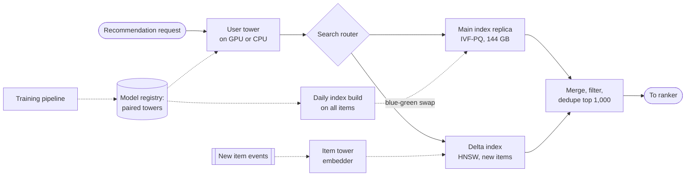

**Reading the diagram.** A request computes the user embedding synchronously and searches one replica of the main index and the delta index in parallel; results are merged, filtered and deduplicated before the ranker. New items are embedded asynchronously and inserted into the delta index within minutes. A daily build re-embeds and re-indexes everything, then swaps replicas blue-green. The registry stores the user and item towers as one versioned pair. Failure points: a version mismatch between towers and index (vectors from different spaces give garbage silently), a slow replica (hedge to another), and a failed build (keep serving yesterday's index plus the delta). Scaling: add replicas for throughput; shard only if compression cannot keep a replica on one node.

#### Model and evaluation

- **Baseline:** popularity per country plus item-to-item co-engagement (§68.5.3).
- **Production:** two-tower model with sampled softmax and logQ correction; several retrieval sources merged (two-tower, co-engagement, followed creators, fresh items).
- **Offline:** recall@1,000 of held-out next engagements for the model with exact search, then ANN recall against exact search separately, so model quality and index quality are not confused. Slice by user activity and item age.
- **Online:** A/B on downstream watch time and engagement per user; guardrails on latency and creator diversity.

#### Serving and monitoring

Budget: user tower 5 ms, ANN 8 ms, merge and filter 3 ms, slack 4 ms. Fallbacks: if the user tower fails, use the cached daily user embedding; if the index fails, the co-engagement and popularity sources. Monitor ANN recall on a sampled exact-search shadow (nightly), per-source candidate counts, share of fresh items retrieved, embedding norm distributions (a broken tower shows as a shifted norm), and index build age.

#### Deep dives

1. **Shard or replicate.** Memory sizing decides whether a replica fits one node; throughput decides replicas. Scatter-gather over shards multiplies tail latency (the fan-out rule of §60.10), so compress until replication works.
2. **Version lock between towers and index.** Query and item embeddings are only comparable within one model version. Index builds carry the model version; the router queries an index only with the matching user tower; upgrades are blue-green on both together.
3. **Freshness and filtering.** New items enter a small HNSW delta index within minutes; filters for language and safety use per-list bitmaps or filtered graph search (§74.11) so that restrictive filters do not leave fewer than 1,000 results.

#### Trade-offs and alternatives

HNSW on INT8 vectors gives higher recall per millisecond but needs six shards per replica here; DiskANN keeps compressed codes in RAM and the graph on SSD (§74.10.2); GPU brute force over 2 billion vectors is exact but needs about 2 TB of GPU memory per replica [Johnson et al. 2021]. Generative retrieval and learned-index approaches exist but are harder to update and debug.

#### Follow-up questions

1. *Why not exact search?* At 2 billion × 256 dimensions, one query is 512 GFLOP of inner products; ANN at recall 0.90 costs a few milliseconds of one core.
2. *A new model version doubles offline recall but the A/B is flat.* The ranker was trained on the old candidate distribution; retrain or fine-tune the ranker on the new candidates before testing.
3. *How do you handle deleted or banned items?* Tombstones checked at merge time, then removal at the next build.
4. *Popular items dominate retrieval.* LogQ correction in training, per-source quotas at merge, and diversity in re-ranking.
5. *How do you detect index degradation?* Nightly shadow exact search on sampled queries; alert when ANN recall drops below target.

#### What distinguishes levels

- **Mid:** two-tower model plus an off-the-shelf ANN index.
- **Senior:** sizes memory and throughput, adds negatives with popularity correction, separates model recall from ANN recall.
- **Staff:** chooses compression to avoid sharding, versions towers and index as a pair with blue-green swaps, designs freshness through a delta index, and connects retrieval changes to ranker retraining.

### 92.6.6 Q32. Enterprise RAG assistant

**Difficulty:** Hard · **Time:** 45 min · **Related:** §86.4 (full case study), Ch 75 (RAG architecture; permissions §75.14), §78.9–§78.10 (groundedness, RAG evaluation)

#### Prompt

"Design an assistant that a company's employees use to ask questions across the company's documents (Drive, SharePoint, Confluence, tickets). Answers must cite sources and must only use documents the asking employee may open."

#### Clarifying questions and assumptions

Single company or a SaaS vendor serving many? Which sources and how do their permissions change? Is a revocation lag acceptable, and how long? Assume the §86.4 vendor: 2,000 tenants, 4 million seats, 30% daily active, 5 questions per active user per day.

#### Requirements

Functional: streamed answers with inline citations; connectors with initial crawl and incremental sync of content, deletions and permissions; search fallback when no grounded answer exists. Non-functional: permission fidelity within a stated sync lag (for example, revocations effective within 15 minutes at p99, verified again at query time); TTFT p95 ≤ 2 s; tenant isolation; no training on tenant data.

#### Estimation

::: example
**Worked example — Queries, corpus and cost per seat (numbers of §86.4.4).** Peak uses §89.5; the per-request cost uses the formula of §88.8; index memory uses §74.14.

1. Questions: $4 \times 10^6 \times 0.30 \times 5 = 6$ million a day; 69.4/s average, **208/s at peak**.
2. Routing 70% to a small model (\$0.00111 per answer) and 30% to a frontier model (\$0.0167): **\$0.00579 per answer**, \$34,700 a day, \$0.26 per seat per month.
3. Corpus: $5 \times 10^8$ documents, $10^{12}$ tokens, $3 \times 10^9$ chunks; index at 1,352 bytes per chunk (INT8 vector, graph links, metadata with ACL principals): **4.06 TB** per replica.
4. Initial embedding: 1,712 GPU-hours, about \$4,280; daily churn 8.6 GPU-hours.

**Interpretation.** Retrieved context is two-thirds of each prompt, so $k$ and chunk size drive the bill; embedding is cheap and the onboarding bottleneck is the source systems' rate limits. **Engineering implication.** Route by difficulty, keep $k$ small with a reranker, and schedule crawls under each source's API limits.
:::

#### Data, labels and features

Chunks with metadata: tenant, source, document ID, ACL principals (users and *unexpanded* group IDs), freshness timestamps. A separate group-membership mirror per tenant. Labels for retrieval come from graded judgments, citation clicks and calibrated LLM judges (§75.13); generation is judged on groundedness and correctness (§78.9).

#### High-level design

**Figure 92.106 — Permission-aware RAG: the index stores principals, the query expands the user.**

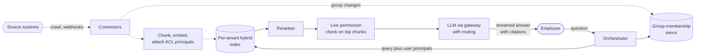

**Reading the diagram.** Ingestion is asynchronous: connectors crawl content and permissions, chunks carry their ACL principals, and group changes update only the mirror. At query time the orchestrator expands the user into principals, retrieves with a permission filter inside the index, reranks, re-checks the top chunks against the source (the live check) and only then builds the prompt. Failure points: a missed revocation webhook (reconciliation sweeps bound the window; the live check catches the rest), cross-tenant leakage (per-tenant indexes and keys), and injection in retrieved documents. Scaling: index replicas by memory per tenant group; the LLM tier through the gateway.

#### Model and evaluation

Baseline: keyword search with snippets. Production: hybrid lexical and dense retrieval, cross-encoder reranker, routed generation with citation constraints. Offline: per-tenant synthetic and consented evaluation sets measuring retrieval recall, citation precision, groundedness and refusal on unanswerable questions; online: citation clicks, thumbs, reformulation rate.

#### Serving and monitoring

Monitor per tenant and source: freshness lag, revocation lag p99, reconciliation mismatches, empty-retrieval rate, groundedness on sampled answers, cost per answer. Fallback: ranked document list when generation fails or evidence is insufficient.

#### Deep dives

1. **Permissions as index data.** Filter inside retrieval; store group IDs, not expanded members, so renaming a 50,000-member group is one mirror update.
2. **Revocation window.** Per-source lag metrics, reconciliation, and a live check bounded to the top 10–20 chunks.
3. **Evaluation without reading customer data.** Synthetic questions generated inside the tenant boundary, judged automatically, with aggregates reported out.

#### Trade-offs and alternatives

Filtering after generation leaks paraphrases; a per-user index is exact but unaffordable; fine-tuning on tenant documents cannot enforce permissions and must be avoided for knowledge (§76.14).

#### Follow-up questions

1. *Why not filter the answer afterwards?* The model may paraphrase a forbidden document; enforcement must precede the prompt.
2. *How do you know a revocation has propagated?* Source-event-to-mirror lag per source, plus reconciliation and the live check.
3. *A tenant asks for proof you never trained on their data.* Contract, configuration (no retention at model providers) and audit logs.
4. *Answers are confidently wrong on old policies.* Freshness-aware ranking and showing document dates with citations.

#### What distinguishes levels

- **Mid:** chunk, embed, retrieve, generate with citations.
- **Senior:** filters inside retrieval and keys caches by permission, evaluates groundedness.
- **Staff:** quantifies the revocation window by source, explains unexpanded principals, bounds the live check's cost and designs per-tenant evaluation that never exports customer text.

### 92.6.7 Q33. LLM customer-support agent

**Difficulty:** Hard · **Time:** 45 min · **Related:** §86.7 (full case study), Ch 77 (agents: tools §77.5, state §77.10, human-in-the-loop §77.12, cost §77.17), Ch 78 (evaluation)

#### Prompt

"An e-commerce group with eight brands in 30 markets wants an AI agent that answers customers and, within policy, issues refunds, cancels orders and changes addresses. Design it."

#### Clarifying questions and assumptions

Which actions are in scope first? What does a human-handled contact cost? What is the refund limit without approval? Assume §86.7: 100,000 contacts a day (70% chat), \$4.50 per human contact, peak-to-average 3, conversations that can last days across channels.

#### Requirements

Functional: answer and act through tools; hand off to humans with a summary; agent-assist mode for human agents; per-brand, per-market policies. Non-functional: no duplicate or unauthorized money movements; first response p95 ≤ 3 s; wrong-action rate below 0.5% on QA samples; every action auditable; customers can always reach a human.

#### Estimation

::: example
**Worked example — Load is small; the business case is not (numbers of §86.7.4).** Concurrency uses Little's Law (§4.11); agent cost uses §77.17.1; the blended-cost formula is §86.7.4's.

1. Peak 3.47 contacts/s; concurrent chats $3.47 \times 0.7 \times 540$ s $= 1{,}313$; model calls 1.06 million a day, **36.7/s at peak**.
2. Agent-side cost per chat contact: tokens \$0.176, auxiliary calls \$0.0005, orchestration \$0.04, approvals \$0.06, wrong actions \$0.10: $C_a = \$0.377$.
3. With 65% of contacts covered and 30% of those escalated ($k = 0.9$): covered contact $0.377 + 0.30 \times 0.9 \times 4.50 = \$1.59$; blended $0.65 \times 1.59 + 0.35 \times 4.50 = \$2.61$ against \$4.50.

**Interpretation.** Tokens are under half of the agent's own cost, and escalations are three-quarters of a covered contact's cost. **Engineering implication.** Invest in resolution quality and safe coverage; optimize tokens last.
:::

#### Data, labels and features

Conversation history, order and customer facts from tools, policies as code per brand and market. Labels: resolution without repeat contact within 7 days (delayed), refund reversals and chargebacks (weeks), QA reviews of sampled conversations, human edits in assist mode.

#### High-level design

**Figure 92.107 — Support agent: the model proposes, the policy engine decides.**


**Reading the diagram.** Each conversation is a durable workflow (§77.8.2) that survives restarts and multi-day gaps. The LLM proposes replies and tool calls; a deterministic policy engine decides whether to execute, queue for human approval or hand off. Tools call commerce systems with idempotency keys persisted before the call. State and traces are written asynchronously for QA and replay. Failure points: a tool timeout with unknown outcome (reconcile before retrying), a promise in text without a succeeded action (output guardrail), injection through customer text or retrieved policy pages. Scaling: workflows scale horizontally; the gateway quota of about 37 calls/s is modest.

#### Model and evaluation

Baseline: intent classifier plus scripted flows. Production: LLM policy with tools and a small model for intent and risk. Offline: replay suites per intent with end-state checks (was the refund the right amount, exactly once?) and pass^k for reliability (§78.6.4); online: rollout by intent, resolution and repeat-contact rate, escalation rate, wrong-action rate from QA.

#### Serving and monitoring

Per intent, brand and market: resolution, repeat contact, handoff and approval rates, refund amounts per customer, guardrail triggers, cost per contact. Fallback: handoff to humans with summary; disable an intent's autonomy by configuration.

#### Deep dives

1. **Proposal versus decision.** The model never moves money directly; the policy engine and tool layer do.
2. **Idempotency and unknown outcomes.** Keys derived from the logical action; reconciliation before retry.
3. **Rollout by intent.** Assist mode first as evidence, then read-only intents, then low-limit refunds in one market.

#### Trade-offs and alternatives

Scripted flows are safe but brittle; full autonomy maximizes coverage but concentrates risk; multi-agent splits are unnecessary for short sequential tasks (§77.9.1).

#### Follow-up questions

1. *How do you prevent duplicate refunds?* Idempotency key persisted before the call; reconcile unknown states.
2. *The model says "your refund is approved" before the tool runs.* Output guardrail blocks promises without an action record.
3. *Why not measure deflection?* A customer who gives up and calls is a failure; measure resolution without repeat contact.
4. *Refund abuse rises after launch.* Per-customer refund velocity limits, risk scores in the policy engine and human review above thresholds.

#### What distinguishes levels

- **Mid:** an LLM with tools and a handoff.
- **Senior:** guardrails, approvals, durable state, intent-based evaluation.
- **Staff:** separates proposal from decision, quantifies cost per resolution with escalation as the dominant term, rolls out by intent with assist mode as evidence, and anticipates adversarial adaptation.

### 92.6.8 Q34. Speech recognition

**Difficulty:** Hard · **Time:** 45 min · **Related:** §84.6 (full case study), §9.9 (long-lived connections)

#### Prompt

"Design the speech recognition behind a phone assistant and dictation keyboard. Words should appear while the user speaks, and a contact name like 'Maya Chen' must be recognized."

#### Clarifying questions and assumptions

On-device, cloud or both? Languages? Privacy constraints on audio? Assume §84.6: 50 million daily users, 10 utterances of 4 s each per day, peak-to-average 3, 60% of audio recognized on device.

#### Requirements

Functional: streaming partial results every 100–200 ms; end-pointing; contextual biasing with per-request phrases; formatting; opt-in audio donation. Non-functional: first partial ≤ 300 ms (p90); final ≤ 500 ms after speech ends (p90); WER ≤ 6% on the voice-search set; contact-name recall ≥ 95%; every accent slice within 1.5× of overall WER; audio not stored without opt-in.

#### Estimation

::: example
**Worked example — Streams, not requests (numbers of §84.6.4).** Concurrency is Little's Law (§4.11); per-GPU capacity uses §84.6's real-time-factor formula.

1. Audio: $5 \times 10^8$ utterances × 4 s $= 2 \times 10^9$ s a day; average concurrent streams 23,148; peak 69,444; **27,778 in the cloud**.
2. A 160 ms chunk advanced for 120 streams in 32 ms: RTF 0.2, five steps per chunk period, 600 streams per GPU.
3. GPUs at 70% utilization: $27{,}778 / (600 \times 0.7) = 66$.
4. Final latency with a 600 ms silence timeout: $600 + 32 + 50 + 40 = 722$ ms, failing the target; with a learned end-of-query detector at 300 ms: 422 ms.

**Interpretation.** Speech is a concurrency problem, and end-pointing, not the model, dominates final latency. **Engineering implication.** Size gateways for long-lived streams, spend effort on the end-pointer, and move recognition on device for privacy and cost.
:::

#### Data, labels and features

Log-mel frames every 10 ms; transcribed audio from vendors and opted-in donations; pseudo-labels from large offline teacher models; per-request bias lists (contacts, app names) that stay on the device or in memory.

#### High-level design

**Figure 92.108 — Streaming recognition on device and in the cloud.**


**Reading the diagram.** Each utterance runs on device when possible; otherwise audio streams over a long-lived connection to a GPU worker that batches many streams per step. Partials flow back continuously; the end-pointer finalizes, an optional second pass rescores, and formatting converts spoken to written forms. Only opted-in audio reaches the donation store, asynchronously. Failure points: a worker failure mid-stream (the client reconnects and resends the buffered audio), falling behind real time under load (admission control), and early cutoffs. Scaling: by concurrent streams per GPU; on-device share is the largest lever.

#### Model and evaluation

Baseline: a hosted batch recognizer on full utterances (fails partials). Production: streaming encoder–transducer with chunked attention, biasing via a prefix tree of phrases, learned end-of-query detection [Graves 2012; He et al. 2019]. Offline: WER after text normalization, entity accuracy for names, early-cutoff rate, slices by accent and device. Online: retry, edit and cancellation rates.

#### Serving and monitoring

Per worker: RTF and stream lag; per locale and device: first-partial and final latency, early-cutoff rate, bias false-trigger rate. Fallback: degrade to final-only results under overload rather than drop streams.

#### Deep dives

1. **Latency decomposition.** Chunk size sets partial latency and GPU efficiency; the end-pointer dominates final latency.
2. **Contextual biasing.** Contact names compiled into a biasing structure; evaluate recall and false triggers.
3. **Improvement without collecting audio.** Opt-in donations, teacher pseudo-labels, federated learning (Q39).

#### Trade-offs and alternatives

A large attention-based model on 30-second windows is accurate for batch transcription but not streaming; on-device models save cost and network delay but cost engineering per device class.

#### Follow-up questions

1. *Users say it cuts them off.* Plot early-cutoff rate against end-point latency by slice; slower speakers need a later decision.
2. *How do you recognize a name the model never saw?* Biasing from the device's contacts.
3. *How do you size the fleet?* Concurrent streams divided by streams per GPU at target utilization.
4. *Why not a single global model?* Per-language models or a multilingual model with language ID; measure per locale.

#### What distinguishes levels

- **Mid:** a streaming model and WER.
- **Senior:** sizes by concurrent streams, adds biasing and slices.
- **Staff:** decomposes final latency to show the end-pointer dominates, normalizes text before WER, treats on-device as a privacy and cost lever, and designs improvement around consent.

### 92.6.9 Q35. Machine translation

**Difficulty:** Hard · **Time:** 45 min · **Related:** §84.7 (full case study), §73.6 (continuous batching)

#### Prompt

"Design translation for a communications platform: chat messages and documents in 200 languages, and live captions in each listener's language during meetings. Enterprise customers have glossaries."

#### Clarifying questions and assumptions

Text, speech or both? Acceptable caption lag? How are glossaries enforced? Assume §84.7: 500 million text segments a day (25 source and 28 target tokens), a 20% segment-cache hit rate, peak-to-average 3, and 1 million meeting-hours a day with live translation.

#### Requirements

Functional: text and document translation with optional glossary and formality; live speech captions; tenant glossaries and do-not-translate lists; quality feedback; published quality tier per direction. Non-functional: 25-token segment p95 ≤ 400 ms; captions with average lagging ≤ 3 s; no COMET regression on the 40 high-volume directions; glossary term accuracy ≥ 98%; content not retained without opt-in.

#### Estimation

::: example
**Worked example — Output tokens, GPUs and the simultaneous policy (numbers of §84.7.4).** Peak uses §89.5; GPU throughput per second is the measured-rate form of §89.16.

1. Text output tokens: $5 \times 10^8 \times 0.8 \times 28 = 1.12 \times 10^{10}$ a day; **388,889/s at peak**; at 5,000 tokens/s per GPU and 60% utilization, **130 GPUs**.
2. Live speech: 83,333 concurrent meetings at peak; ASR $83{,}333 / 420 = 198$ GPUs.
3. MT for speech: $83{,}333 \times 1.5 \times 3.5 = 437{,}500$ tokens/s, 146 GPUs if each word is translated once; with re-translation on every partial (about 3×), 438 GPUs.

**Interpretation.** Live speech is the larger workload, and the latency policy changes its MT cost threefold. **Engineering implication.** Choose the simultaneous policy with both lag and GPU numbers in view, and cache and distill the highest-volume text directions.
:::

#### Data, labels and features

Human reference translations, mined and back-translated parallel data, post-edits from tenants who opt in; tenant glossaries as versioned data. Quality labels: COMET on frozen test sets, human MQM for top directions.

#### High-level design

**Figure 92.109 — Text and live translation with a direction router.**

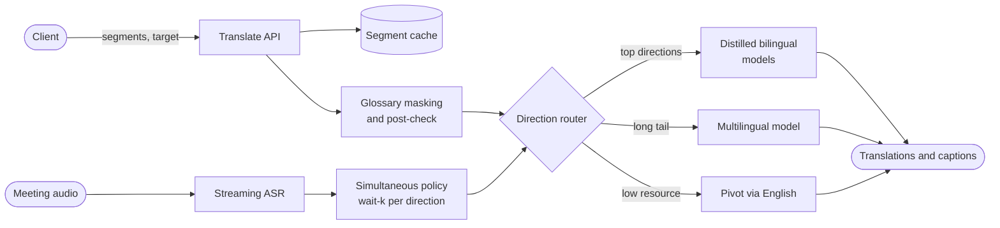

**Reading the diagram.** Text requests check the segment cache, mask glossary terms, and go to a model chosen per direction by volume and measured quality. Live meetings run streaming ASR, then a simultaneous policy that decides when to emit, then the same router. Failure points: hallucinated or off-target output (language-ID check on output), caption flicker from re-translation, glossary violations (post-check). Scaling: GPUs by output tokens per second; distilled models for the highest-volume directions.

#### Model and evaluation

Baseline: a hosted general model for all directions. Production: a 1.3B multilingual encoder–decoder for coverage, distilled bilingual models for the top directions, pivot where it measures better [Johnson et al. 2017]. Offline: COMET per direction with no-regression gates, MQM for the top 10, glossary accuracy; online: flag rate and caption-off rate.

#### Serving and monitoring

Per direction: reference-free quality estimation on sampled traffic, off-target rate, flag rate; for speech: average lagging and flicker; per tenant: glossary accuracy. Fallback: multilingual model if a bilingual one fails; captions in the source language if MT fails.

#### Deep dives

1. **Simultaneous translation.** Wait-$k$ per direction, larger $k$ for verb-final sources; re-translation trades flicker and 3× compute for quality.
2. **Many-language serving.** 39,800 directed pairs cannot each have a model; route by volume and quality.
3. **Control.** Placeholder masking plus a post-check for do-not-translate terms.

#### Trade-offs and alternatives

End-to-end speech translation removes the ASR stage but loses transcripts and glossary control; a cascade is easier to debug and evaluate. BLEU is cheap but weakly correlated with quality; learned metrics plus human MQM gate releases.

#### Follow-up questions

1. *A verb-final source language?* Larger $k$ or an adaptive policy, and a published higher lag target.
2. *One model or 39,800?* Multilingual for coverage, distilled pairs for volume.
3. *How do you know a new model is better?* COMET on every routed direction, MQM on the top ones, then an online test.
4. *A brand name gets translated.* Masking plus post-check; add it to the tenant's glossary tests.

#### What distinguishes levels

- **Mid:** a multilingual model with BLEU.
- **Senior:** cascade for speech, glossary handling, COMET.
- **Staff:** quantifies lag with average lagging and sets $k$ per direction, shows the simultaneous policy is a capacity decision, and routes directions by volume and measured quality.

### 92.6.10 Q36. Perception data engine for autonomous driving

**Difficulty:** Hard · **Time:** 45 min · **Related:** §63.5 (labeling pipelines), §63.9 (active learning), §63.14.4 (hybrid labeling), §80.6 (storage for training), Ch 74 (vector search for scene retrieval)

#### Prompt

"A fleet of test vehicles records camera and lidar data every day. Our perception models fail on rare situations. Design the data engine that finds the right data, labels it and turns it into better models."

#### Clarifying questions and assumptions

- Scope: offline data engine (collection, mining, labeling, training, evaluation, release to vehicles), not the on-vehicle planning stack.
- Fleet: assume 500 vehicles driving 8 hours a day, each with 8 cameras (H.265 at 8 Mbit/s each) and one lidar (5 MB/s compressed).
- Uploads: at the depot over 10 Gb/s links; small trigger summaries over cellular.
- Labels: 3D boxes, tracks and lane geometry on keyframes at 2 Hz; assume \$3.00 per keyframe for full human labeling (illustrative; measure with vendors).

#### Requirements

Functional: ingest drives; on-vehicle and offline triggers that flag interesting moments; search over the fleet's data by metadata and by example (scene embeddings); select and label data; train and evaluate multi-task perception models; release models to vehicles in shadow mode first.

Non-functional: a new failure class goes from first report to a labeled training set within one week; every release passes scenario regression suites with no regression on safety-critical classes (pedestrians, cyclists) at any distance bin; full lineage from model to data and labels; raw data retained by policy (for example, 90 days hot, triggered snippets for years).

#### Estimation

::: example
**Worked example — Sensor volume, upload and labeling budget.** Storage uses §89.6; bandwidth uses §89.7; labeling cost uses the effort and hybrid-pipeline formulas of §63.5.2 and §63.14.4.

1. Per vehicle: cameras $8 \times 8$ Mbit/s $= 8$ MB/s plus lidar 5 MB/s $= 13$ MB/s; 8 hours is **374 GB a day**.
2. Fleet: $500 \times 374$ GB $= 187$ TB a day, **68 PB a year** if everything were kept.
3. Depot upload at 10 Gb/s (1.25 GB/s): $374 / 1.25 = 300$ s per vehicle, so the depot network, not cellular, carries raw data.
4. Selection: mining 1% of driving time gives $500 \times 8 \times 0.01 = 40$ hours a day, $40 \times 3{,}600 \times 2 = 288{,}000$ keyframes.
5. Fully human labeling: $288{,}000 \times \$3.00 = \$864{,}000$ a day.
6. Hybrid: an offline auto-labeler (large non-causal models that see past and future frames) labels everything at about 1 GPU-s per keyframe (80 GPU-hours a day); humans correct the 15% flagged as uncertain at full price and spot-check the rest at \$0.30: $288{,}000 \times (0.15 \times 3.00 + 0.85 \times 0.30) = \$203{,}040$, **23.5%** of the human-only cost.

**Interpretation.** Storage and labeling, not training compute, are the constraints, and both are governed by *selection*. **Engineering implication.** Keep raw data short-lived, keep triggered snippets long-lived, and make the auto-labeler plus targeted human review the default labeling path.
:::

#### Data, labels and features

- **Sources:** raw sensor logs, vehicle state (speed, braking, steering), disengagements and safety-driver annotations, map data.
- **Triggers:** hard braking, disengagement, disagreement between the shipped model and a shadow model, low detection confidence, tracker identity switches, and class-specific detectors for rare objects (strollers, animals, construction).
- **Labels:** 3D boxes and tracks, semantic attributes (occlusion, moving), lane geometry; quality measured by inter-annotator agreement and audit sampling (§63.6).
- **Search features:** per-scene embeddings from a vision encoder, indexed for "find more like this" queries (Ch 74), plus metadata (weather, time, city, speed).

#### High-level design

**Figure 92.110 — The perception data engine loop.**

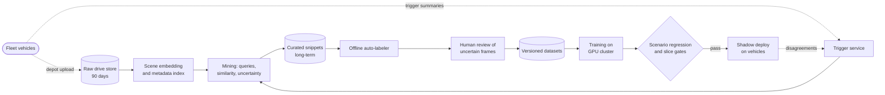

**Reading the diagram.** Raw drives arrive asynchronously at depots; trigger summaries arrive over cellular. A scene index (embeddings plus metadata) lets engineers and automated miners select snippets by query, similarity to a known failure, or model uncertainty. Snippets move to long-term storage, are auto-labeled, and uncertain frames go to human review; labeled data become versioned datasets. Training reads datasets; a release gate runs scenario suites and slice metrics; passing models run in shadow mode on vehicles, whose disagreements become new triggers, closing the loop. Storage boundaries: raw store (short retention), snippet store, dataset versions. Failure points: auto-labeler errors becoming training truth (human audit rates per class), triggers that flood the pipeline (per-trigger quotas), and dataset drift between training and evaluation versions. Scaling: storage by retention policy, labeling by selection rate, training by the GPU cluster (Ch 80).

#### Model and evaluation

- **Baseline:** train on uniformly sampled frames with human labels.
- **Production:** multi-task perception network (detection, tracking, lanes) trained on mined data; active learning by uncertainty and diversity (core-set) selection [Settles 2009; Sener and Savarese 2018].
- **Offline:** mAP and recall per class by distance bin, false negatives on safety-critical classes, tracking metrics; **scenario suites** (curated sets for each known failure) act as unit tests that must not regress.
- **Online:** shadow mode measures disagreement rate with the shipped model and the human-reviewed outcome of disagreements; no A/B test on public roads without the safety process.

#### Serving and monitoring

On-vehicle inference is out of scope but sets constraints: the model must meet its latency budget on vehicle compute after quantization (Ch 67), so evaluation runs on the compiled, quantized model. The engine monitors trigger rates by type, labeling throughput and backlog age, auditor disagreement with the auto-labeler per class, dataset growth per failure class, and time from report to labeled set.

#### Deep dives

1. **Selection is the product.** Uniform sampling labels millions of boring highway frames; triggers, similarity search and uncertainty concentrate labels on rare cases. Per-trigger quotas keep one noisy trigger from consuming the budget.
2. **Auto-labeling economics.** An offline labeler can be far larger than the vehicle model and can use future frames, so its labels are better than real-time predictions; humans correct the uncertain fraction. The audit rate per class is the safety valve.
3. **Regression gates as scenario tests.** Every resolved failure becomes a permanent scenario suite; a release cannot regress any of them, and aggregate mAP cannot hide a pedestrian-recall loss at 60 m.

#### Trade-offs and alternatives

Labeling everything is simpler but unaffordable; simulation and synthetic data cover rare events cheaply but have a domain gap (§63.12); self-supervised pretraining on unlabeled fleet video reduces label needs but still needs labeled evaluation sets.

#### Follow-up questions

1. *How do you find more examples of a rare failure?* Embed the failing scene and run similarity search over the scene index, then filter by metadata.
2. *The auto-labeler is wrong on a new object class.* Route that class to full human labeling until audit agreement recovers; retrain the auto-labeler on corrected labels.
3. *How long do you keep raw data?* Weeks to months by policy; triggered snippets and evaluation sets for years, with privacy controls (faces and plates blurred).
4. *How do you know the loop works?* Track per failure class: examples labeled, metric on its scenario suite and field disagreement rate over releases.

#### What distinguishes levels

- **Mid:** collect, label, train, evaluate on a test set.
- **Senior:** triggers, active learning, scenario regression suites, shadow mode.
- **Staff:** quantifies storage and labeling to show selection governs both, designs auto-labeling with per-class audit rates, and makes "report to labeled set in a week" a measured SLO.

### 92.6.11 Q37. Experimentation platform

**Difficulty:** Hard · **Time:** 45 min · **Related:** §57.14 (A/B statistics; sample size §57.14.2), §66.12 (shadow and canary), §68.14 (interleaving, holdouts) [Kohavi et al. 2020]

#### Prompt

"Hundreds of teams want to A/B test ranking models, UI changes and pricing at the same time. Design the experimentation platform."

#### Clarifying questions and assumptions

- Scale: assume 100 million daily active users, 1,000 concurrent experiments, 50 exposure events per user per day.
- Units: users by default; sessions, devices or markets for special cases.
- Who decides launches? Teams, using the platform's scorecard and guardrails.

#### Requirements

Functional: define experiments (unit, variants, allocation, metrics, duration); deterministic assignment with layers so independent experiments overlap; exposure logging; daily scorecards with confidence intervals; guardrail metrics and automatic alerts; sample-ratio-mismatch detection; holdouts.

Non-functional: assignment adds < 1 ms (no network call on the request path); scorecards by 09:00 daily; exposure loss < 0.1%; reproducible analyses from versioned metric definitions.

#### Estimation

::: example
**Worked example — How many users, and what does a scorecard cost?** Sample size uses the per-arm formula of §57.14.2 with $z_{0.975} = 1.96$ and $z_{0.80} = 0.84$; event volume uses §89.5–§89.6.

1. Detecting a 1% relative lift on a 5% conversion rate ($\delta = 0.0005$): $n = 2\,(1.96 + 0.84)^2 \times 0.05 \times 0.95 / 0.0005^2 \approx$ **2.98 million users per arm**.
2. With variance reduction using pre-experiment data (CUPED) and a correlation $\rho = 0.5$, variance falls by $1 - \rho^2 = 0.75$: about 2.24 million per arm [Deng et al. 2013].
3. Exposures: $10^8 \times 50 = 5 \times 10^9$ a day; average 57,870/s; peak 115,741/s at 2×; at 200 bytes, **1 TB a day**.
4. Sample-ratio check: a 50/50 test with 502,000 versus 498,000 users gives $\chi^2 = 16.0$, $p = 6 \times 10^{-5}$: flag it. 501,000 versus 499,000 gives $\chi^2 = 4.0$, $p = 0.046$: not alarming at the usual $p < 0.001$ threshold.

**Interpretation.** Small lifts need millions of users per arm, so traffic is the scarce resource and layering (overlapping experiments) is essential; variance reduction is worth a quarter of the traffic. **Engineering implication.** Compute power before launch, reserve traffic per layer, and treat SRM as a hard stop because it signals a broken assignment or logging path.
:::

#### Data, labels and features

Assignment records (unit, experiment, variant, layer, timestamp), exposure events from clients and services, metric events (orders, sessions, latency, errors), pre-experiment covariates for CUPED, metric definitions as versioned code. The "labels" are the metrics; their delays (purchases within 7 days, churn within 28) set test durations.

#### High-level design

**Figure 92.111 — Experimentation platform: deterministic assignment, logged exposure, batch analysis.**

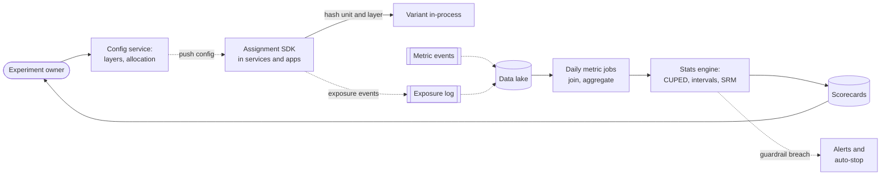

**Reading the diagram.** Configuration is pushed asynchronously to SDKs embedded in services and apps; assignment is a local hash of the unit ID, layer salt and allocation, so the request path never waits on the network. Exposures and metric events flow into the lake; daily jobs join them by unit, compute per-unit metrics and pass them to the statistics engine, which writes scorecards and raises alerts. Failure points: stale config on clients (versioned configs logged with exposures), lost exposures (SRM detects it), and metric definitions changing mid-test (versioned definitions). Scaling: assignment scales with services; analysis scales with exposures and metrics per day.

#### Model and evaluation

The platform's "model" is statistical: difference in means with delta-method variance for ratio metrics, CUPED adjustment, and either a fixed horizon or a sequential test that allows peeking without inflating false positives. Validate the platform itself with A/A tests: across many A/A experiments, about 5% should be significant at $p < 0.05$ and SRM should be rare. For ML rankers add interleaving as a fast, sensitive pre-test (§68.14.2) and long-term holdouts for cumulative effects [Hohnhold et al. 2015].

#### Serving and monitoring

Monitor assignment latency, config propagation age, exposure loss by platform, SRM rate across experiments, A/A false-positive rate, scorecard job completion time, and the number of experiments per layer against traffic capacity.

#### Deep dives

1. **Layers and overlap.** Experiments in different layers use independent hashes and overlap freely; experiments that interact (two rankers on one surface) share a layer and split traffic [Tang et al. 2010].
2. **Trustworthiness checks.** SRM, A/A tests, novelty and primacy effects (plot lift by day), and guardrails (latency, errors, revenue) evaluated with the same rigor as the primary metric.
3. **Interference.** When treatment affects control (marketplaces, social graphs), user randomization is biased; randomize by market, cluster or time (switchback, Q40).

#### Trade-offs and alternatives

**Table 92.103 — Choosing the randomization unit.**

| Unit | Use when | Cost |
|---|---|---|
| User | Most product and ranking changes | Needs a stable ID; logged-out users vary |
| Session or request | Short-lived effects, no learning across visits | Inconsistent experience; carryover |
| Device | Logged-out apps | Users with several devices see both |
| Cluster (graph community) | Social or network effects | Fewer units, wider intervals |
| Market or time slot (switchback) | Two-sided marketplaces, pricing | Few units; carryover between slots |

#### Follow-up questions

1. *A team peeks daily and stops when $p < 0.05$.* False-positive rate inflates; use sequential tests or a fixed horizon.
2. *The scorecard shows SRM.* Stop reading results; find the assignment or logging bug first.
3. *Twenty metrics, one is significant.* Pre-register the primary metric; correct or treat others as exploratory.
4. *Offline AUC improved, online flat.* The offline metric does not track the business metric, or the ranker is miscalibrated in the new candidate distribution; trust the online test.

#### What distinguishes levels

- **Mid:** random split, t-test, dashboards.
- **Senior:** power analysis, deterministic hashing, guardrails, SRM.
- **Staff:** layers for overlapping experiments, variance reduction quantified, trustworthiness checks as platform features, and the right unit under interference.

### 92.6.12 Q38. ML monitoring platform

**Difficulty:** Hard · **Time:** 45 min · **Related:** Ch 70 (ML monitoring; architecture §70.15, delayed labels §70.8, alerting §70.13), §69.12 (retraining loop)

#### Prompt

"We run 2,000 models. Most failures are silent: a feature pipeline breaks or user behavior shifts and nobody notices for weeks. Design a monitoring platform that every model team uses."

#### Clarifying questions and assumptions

Online, batch or both? Do labels arrive, and when? Who gets paged? Assume 2,000 models (500 online) producing 1 million predictions/s in total at peak; 100 monitored features per model on average; feature vectors logged for 2% of predictions at 2 KB each; label delays from minutes (clicks) to 90 days (chargebacks).

#### Requirements

Functional: SDK to log predictions with IDs, model version and sampled features; label ingestion and joining; data-quality checks; drift on features and predictions; performance metrics by slice when labels mature; alerting with routing to owners; dashboards; retraining triggers. Non-functional: drift and data-quality signals within 1 hour; at most a few actionable alerts per model per month; no impact on serving latency (asynchronous logging); 13 months of aggregates.

#### Estimation

::: example
**Worked example — Log volume and the multiple-testing trap.** Volume uses §89.6 and §89.11; false alarms use the formula of §70.6.4.

1. Feature logs: $10^6 \times 0.02 \times 2$ KB $= 40$ MB/s, **3.5 TB a day**; prediction records without features are small enough to keep for every prediction.
2. Drift tests: $2{,}000 \times 100 \times 24 = 4.8$ million per day if every feature is tested hourly.
3. At $\alpha = 0.01$ with no real drift: **48,000 false alarms a day**. Per model: $1 - 0.99^{2{,}400} \approx 1$, so every model alerts every day.
4. Even at $\alpha = 10^{-4}$, 480 false alarms a day remain.

**Interpretation.** Data volume is easy; alert volume is the design problem. Testing everything with a fixed threshold guarantees an ignored pager. **Engineering implication.** Page on a few outcome-linked signals (prediction distribution, volume, nulls, delayed-label performance), file tickets for feature drift ranked by importance and effect size, and require minimum effect sizes rather than p-values on huge samples (§70.6.3).
:::

#### Data, labels and features

Prediction records (prediction ID, model and version, timestamp, entity, score, decision, fallback level), sampled feature vectors, reference windows (training data or a stable production period), and labels joined by prediction ID or entity and time (§70.8). Proxies when labels are delayed: score distribution, decision rate, downstream engagement.

#### High-level design

**Figure 92.112 — Monitoring platform: log, aggregate, compare, alert.**

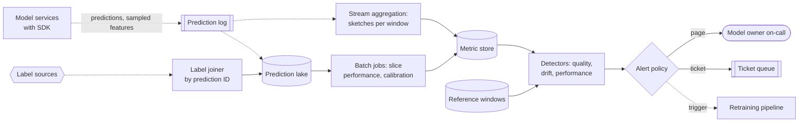

**Reading the diagram.** Services log asynchronously through an SDK, so serving latency is untouched. A stream job keeps per-window sketches (counts, null rates, quantile sketches, category frequencies) per model and feature; the lake keeps raw records for batch jobs that compute slice performance once labels join. Detectors compare current windows to reference windows; an alert policy decides page, ticket or retraining trigger. Failure points: the logging path itself (alert on missing data per model, since silence looks healthy), label joins that silently drop rows (monitor join rate), and reference windows that include an incident. Scaling: sketches keep metric storage independent of traffic; batch jobs scale with labeled volume.

#### Model and evaluation

Detectors are the models: PSI or Jensen–Shannon distance with effect-size thresholds per feature, KS tests on numeric scores, a domain classifier or MMD for multivariate and embedding drift (§70.7), calibration error with confidence intervals per slice (§70.9). Evaluate detectors on replayed historical incidents (did they fire, how early) and on calm periods (false alarms per model-month).

#### Serving and monitoring

The platform monitors itself: log ingestion lag and loss per model, sketch job lag, label join rates, detector run completeness. Alert quality is tracked: pages per model per month and the share of pages that led to action.

#### Deep dives

1. **Alert design.** Few pages, tied to outcomes; feature drift ranked by importance-weighted effect size; seasonality-aware references (same hour last week); burn-rate alerts on quality SLOs (§70.13.2).
2. **Delayed labels.** Track label maturity; report performance only on matured cohorts; estimate precision and recall from scores in the meantime (§70.8.2).
3. **Bugs versus genuine change.** A step change at a deploy time with nulls or unit changes is a bug (roll back the pipeline); a gradual shift is drift (retrain or recalibrate).

#### Trade-offs and alternatives

Per-team dashboards are flexible but inconsistent; a vendor tool is fast to adopt but needs the same logging contract; logging all features gives fuller drift coverage at 50 times the storage.

#### Follow-up questions

1. *Every model alerts daily.* Fixed thresholds on huge samples; use effect sizes, importance weighting and fewer pages.
2. *Labels arrive after 60 days.* Proxies plus estimated metrics now, true metrics on matured cohorts later.
3. *How do you catch a broken upstream join?* Null and default rates per feature, and volume per entity, compared hour over hour.
4. *Should drift trigger automatic retraining?* Only with validation gates; a pipeline bug retrained into the model is worse.

#### What distinguishes levels

- **Mid:** dashboards of feature distributions and accuracy.
- **Senior:** drift tests, delayed-label handling, slice metrics.
- **Staff:** quantifies the multiple-testing problem and designs alert policy around it, separates bugs from drift, and makes logging completeness and alert quality platform SLOs.

### 92.6.13 Q39. Federated learning for a mobile keyboard

**Difficulty:** Hard · **Time:** 45 min · **Related:** §71.11 (federated learning, secure aggregation), §71.10 (differential privacy), Ch 67 (model optimization)

#### Prompt

"Improve next-word suggestions in our mobile keyboard without collecting what users type. Design the training and serving system."

#### Clarifying questions and assumptions

How many devices, and when may they train? Model size limits on phones? Privacy commitments (no raw text leaves the device; formal DP)? Assume 100 million devices with the keyboard, 10% eligible at a time (idle, charging, unmetered network), a 5-million-parameter language model, 3,000 training rounds of 1,000 completing clients.

#### Requirements

Functional: on-device next-word prediction; federated training rounds; federated evaluation; model release to devices. Non-functional: suggestion latency ≤ 20 ms per keystroke on low-end phones; model ≤ 10 MB on device; no raw text uploaded; secure aggregation with client-level DP; each device spends at most a few minutes and tens of megabytes per participation.

#### Estimation

::: example
**Worked example — Bytes and wall-clock per training run.** Apply the FedAvg communication formula of §71.11.1.

1. Per participant: download FP32 model $5 \times 10^6 \times 4 = 20$ MB; upload an 8-bit update, 5 MB; **25 MB** per participation.
2. Per round with 30% over-selection: $1{,}300 \times 20 + 1{,}000 \times 5 = 31$ GB at the server; 3,000 rounds, **93 TB**.
3. Wall clock at 7 minutes per round (deadline-bound by slow devices): $3{,}000 \times 7 / 1{,}440 = 14.6$ days.
4. Participation: $3{,}000 \times 1{,}000 / 10^7 = 0.3$ rounds per eligible device: most devices train once or never per run.

**Interpretation.** Per-device cost is small; the run is bounded by rounds and stragglers. **Engineering implication.** Spend local epochs to cut rounds, compress uploads, and keep the model small; parallel runs (hyperparameters) multiply server bandwidth, not device cost.
:::

#### Data, labels and features

Self-supervised: the next word the user actually typed is the label, available only on the device. Non-IID data (each user's vocabulary and language mix) and biased participation (newer, well-connected phones) are the main data hazards. A server-side proxy corpus (public text) is used for pre-training and sanity checks, never as the target distribution.

#### High-level design

**Figure 92.113 — Federated training with secure aggregation and on-device serving.**

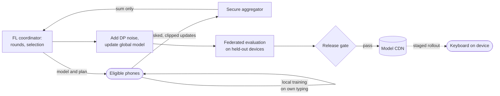

**Reading the diagram.** The coordinator selects eligible devices and sends the model and a training plan; each device trains locally and uploads a clipped, masked update; the secure aggregator reveals only the sum; the server adds noise for client-level DP and forms the next model [Bonawitz et al. 2017; McMahan et al. 2018]. Federated evaluation on other devices measures quality; a gate releases the model through a CDN with staged rollout. Failure points: dropouts mid-round (over-selection, dropout-tolerant aggregation), poisoned updates (norm clipping, robust aggregation), and slow convergence on non-IID data. Scaling: clients per round bounded by aggregation cost; runs bounded by wall clock.

#### Model and evaluation

Baseline: n-gram model trained on public text. Production: small recurrent or transformer language model, pre-trained on a public corpus then federated-trained, quantized to INT8 for the device [Hard et al. 2018]. Offline: federated top-3 recall of the next word on held-out devices, sliced by language and device tier. Online: suggestion tap rate and characters saved, A/B by device.

#### Serving and monitoring

On-device inference within 20 ms; monitor crash and latency telemetry, suggestion tap rate by locale, round completion rates, dropout rates, update norm distributions (poisoning detection) and the cumulative privacy budget per run.

#### Deep dives

1. **Rounds dominate.** FedAvg's local epochs cut communication rounds relative to one-step FedSGD [McMahan et al. 2017].
2. **Privacy layering.** Data minimization (FL) + secure aggregation (server sees only sums) + client-level DP (sums do not reveal any one user).
3. **Systems heterogeneity.** Eligibility rules bias participation; track slices by device tier and region, and cap rounds per device.

#### Trade-offs and alternatives

Central training on donated or public text is faster but conflicts with the privacy promise; on-device personalization without federation adapts to one user but does not improve the global model.

#### Follow-up questions

1. *Is FL private by itself?* No; updates can leak, hence secure aggregation and DP.
2. *How do you debug a model you cannot see data for?* Federated analytics (aggregate statistics), synthetic test suites and the proxy corpus.
3. *A malicious client sends huge updates.* Clip update norms and use robust aggregation.
4. *Why is training slow?* Stragglers and non-IID data; over-select, use deadlines and more local work.

#### What distinguishes levels

- **Mid:** describes FedAvg.
- **Senior:** adds eligibility, secure aggregation, compression and federated evaluation.
- **Staff:** sizes rounds, bytes and wall clock, layers DP on secure aggregation with a budget, and treats participation bias as a fairness issue.

### 92.6.14 Q40. Two-sided marketplace matching

**Difficulty:** Hard · **Time:** 45 min · **Related:** §55.5 (ride matching: batched assignment, fencing), §83.5 (ETA at scale), §83.6 (dynamic pricing), §60.15 (QuickBite ETA)

#### Prompt

"QuickBite assigns each order to a courier as soon as it is placed. Food is often cold and couriers wait at restaurants. Design an ML-driven matching system."

#### Clarifying questions and assumptions

- Use the QuickBite shared assumptions: 500,000 orders a day, busiest-hour 27.8 orders/s and a 60 orders/s design peak, 20,000 couriers active at peak, 4,000 delivery zones, 35-minute median delivery.
- Objective? Minimize late and cold deliveries while keeping courier idle time and earnings fair.
- May one courier carry two orders (stacking)? Yes, within a lateness bound.
- Decision latency? Seconds are fine; food preparation takes 10 minutes or more.

#### Requirements

Functional: decide which courier gets each order and when to dispatch; consider stacking; send offers with accept or decline; reassign on decline or delay.

Non-functional: decisions within 5 s of a decision window closing; each order assigned to exactly one courier (leases and fencing, §55.5.8); p90 delivery-time error and lateness rate not worse than today at launch; courier earnings per hour fairness tracked by zone.

#### Estimation

::: example
**Worked example — Supply, problem size and prediction load.** Concurrency uses Little's Law (§4.11); prediction load uses §89.13.

1. Busiest hour: 27.8 orders/s × 20 minutes of courier time per order $= 33{,}360$ order-legs in flight against 20,000 couriers: an average of **1.67 orders per courier**, so stacking is not an optimization but a necessity at peak.
2. A 30 s decision window at the 60/s design peak holds 1,800 orders; a large city with 10% of volume gives about 180 orders against a few thousand nearby couriers, a sparse assignment problem solved in well under a second.
3. Predictions: 60 orders/s × 50 candidate couriers × 2 windows per order = **6,000 travel-time and acceptance predictions/s**, plus food-ready predictions per order: small next to search's 40,000 ETA predictions/s.

**Interpretation.** Compute is cheap; the value is in deciding *when* and *whom* jointly across many orders. **Engineering implication.** Batch decisions in short windows with learned costs (ready time, travel time, acceptance), and dispatch late enough that couriers do not wait at restaurants.
:::

#### Data, labels and features

- **Labels:** food-ready time (from courier arrival and pickup scans; censored when the courier arrives late), travel times per leg, offer acceptance, delivery lateness, customer ratings on cold food.
- **Features:** restaurant prep-time history by hour and item count, live kitchen load (open orders), courier location, vehicle, recent decline rate, traffic and weather, zone supply and demand.
- **Hazards:** selection bias (acceptance is only observed for offers made), and censoring of ready time when couriers arrive after the food is ready.

#### High-level design

**Figure 92.114 — Batched matching with learned costs.**

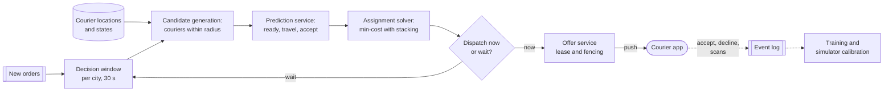

**Reading the diagram.** Orders accumulate in per-city windows; candidate generation finds couriers within a radius; the prediction service scores each order–courier pair (and stacked pairs) for food-ready time, travel time and acceptance probability; the solver minimizes expected lateness, cold-food time and courier waiting. A dispatch decision may defer an order to a later window if its food will not be ready. Offers are leased with fencing tokens so one order has one courier (§55.5.8). Events flow back asynchronously for training and for calibrating a simulator. Failure points: prediction service outage (fallback to distance-based costs), a declined offer (re-enter the next window), and solver timeouts (greedy fallback). Scaling: cities are independent problems, solved in parallel.

#### Model and evaluation

- **Baseline:** greedy nearest available courier at order time.
- **Production:** gradient-boosted models for ready time (quantile loss, §57.11.2), travel time (reuse the ETA model) and acceptance; batched min-cost assignment with stacking [Kuhn 1955]; optionally a learned value of courier positions for future demand [Xu et al. 2018].
- **Offline:** prediction metrics (MAE and p90 error for ready time, calibration for acceptance) plus **simulation** of the full policy on replayed demand, because assignments change outcomes and logged data cannot score a new policy directly.
- **Online:** switchback experiments (alternate policies by city and time slot) because couriers are shared between arms; primary metric lateness and cold-food complaints; guardrails courier earnings per hour, wait time at restaurants, cancellations.

#### Serving and monitoring

Per city: window solve time, share of greedy fallbacks, offer acceptance rate, courier wait at pickup, lateness rate, stacked-order share and its lateness. Prediction monitoring per model as in Q38.

#### Deep dives

1. **When to dispatch.** Assigning at order time makes couriers wait while food cooks; dispatching so arrival matches predicted ready time cuts wait and frees supply. Quantile predictions bound the risk of being late.
2. **Joint assignment and stacking.** Batched matching beats greedy when orders compete for couriers (§55.5.8); stacking costs are evaluated on order pairs whose restaurants and destinations are close.
3. **Evaluation under interference.** User-level A/B tests are biased because arms share couriers; switchbacks with carryover buffers or city-level tests measure the policy.

#### Trade-offs and alternatives

Greedy is simple and immediate but myopic; reinforcement learning of the full policy can capture future value but is hard to validate safely; fixed zone-based dispatch is predictable for couriers but inefficient across zone boundaries.

#### Follow-up questions

1. *Why not assign immediately?* Couriers wait at restaurants and miss better matches; waiting a window costs seconds, not minutes.
2. *A courier declines repeatedly.* Acceptance predictions lower their cost-adjusted value; policy, not the model, sets any penalties.
3. *How do you test without a real A/B?* Switchbacks by city and time slot, with a simulator to pre-screen.
4. *Is stacking fair to customers?* Bound the extra minutes for the first order and measure lateness by stacked versus single.

#### What distinguishes levels

- **Mid:** predicts ETAs and assigns nearest courier.
- **Senior:** batched assignment with learned costs, exactly-one assignment with leases.
- **Staff:** uses Little's Law to show stacking is necessary, decides *when* to dispatch from ready-time quantiles, and evaluates with simulation and switchbacks because of interference.

## 92.7 Expert (Q41–Q52)

Expert prompts are platforms or products whose cost is measured in thousands of GPUs, whose quality cannot be read off a single metric, or whose failure modes include safety and abuse. The interviewer expects you to size the system from tokens, FLOPs or GPU-seconds within the first ten minutes, to name the one decision that moves cost or risk by multiples, and to define how quality is measured before you defend an architecture. Seven of the twelve questions have a full case study or an owning chapter; five are full solutions here. As in §92.6, all designs are *Evidence: Illustrative*.

**Table 92.104 — Expert questions at a glance.**

| Q | Title | Solution | Deciding deep dive | Owner |
|---|---|---|---|---|
| 41 | LLM inference platform | Compact | Size per class from token shapes; disaggregation | §86.5, Ch 73 |
| 42 | LLM pre-training infrastructure | Compact | $6ND$, job MTBF, checkpoint bursts, goodput | Ch 65, Ch 80 |
| 43 | Multi-tenant fine-tuning service | Compact | Job economics; multi-LoRA serving; base-version lock | §76.8–§76.9 |
| 44 | AI coding assistant | Compact | Keystroke latency budget; prefix affinity; cancellation | §86.6 |
| 45 | Multi-agent orchestration platform | Full | Durable execution, budgets, delegated permissions | Ch 77 |
| 46 | LLM evaluation platform | Compact | Interval-based gates; judge calibration; tiered suites | Ch 78 |
| 47 | AI answer engine | Compact | Eligibility, routing and cost per 1,000 queries | §86.8 |
| 48 | GPU cluster scheduler | Compact | Gangs, topology, reservations and backfill | Ch 46, §80.11 |
| 49 | Billion-scale vector database | Compact | Compression choice decides node count; deletes and filters | Ch 74 |
| 50 | Guardrails and safety system | Full | Base rates, cascades and layered controls | §77.11, §78.12–§78.13 |
| 51 | Image-generation service | Full | GPU-seconds per image; step distillation; safety | §66.6, §80.13 |
| 52 | Cold-start recommendations with bandits | Full | Priors, exploration budget, logged propensities | §68.11, §68.15 |

### 92.7.1 Q41. LLM inference platform

**Difficulty:** Expert · **Time:** 60 min · **Related:** §86.5 (full case study), Ch 73 (LLM inference; capacity plan §73.15), §89.16 (inference throughput), Ch 79 (gateways, quotas)

#### Prompt

"Design the internal platform that serves open-weight LLMs to every product team: chat, RAG, agents and batch jobs, on our own GPUs."

#### Clarifying questions and assumptions

Workload mix and token shapes per class? Models (70B-class and 8B-class)? SLOs on TTFT and TPOT? Why self-host (volume above break-even, fine-tuned weights, data residency)? Assume the §86.5 mix at peak: chat 300 calls/s (2,000 input, 350 output tokens), RAG 250/s (6,000 input, 250 output), agent steps 100/s (10,000 input, 250 output), classification 1,000/s on the 8B model.

#### Requirements

Functional: OpenAI-compatible chat, embeddings and batch APIs; model catalog with LoRA adapters; priority classes and token quotas; onboarding with evaluation gates; chargeback. Non-functional (Table 86.6): TTFT p95 ≤ 800 ms chat, ≤ 1.5 s RAG; TPOT p95 ≤ 50 ms; 99.9% per alias with fallback; quality within 1 point of the BF16 reference; one team's burst raises others' TTFT p95 by ≤ 20%; ≥ 45% busy GPU time.

#### Estimation

::: example
**Worked example — GPU-seconds per call by class (numbers of §86.5.4).** Prefill time, decode step and GPU-seconds per request follow §89.16 and §73.15; H100 at \$2.50/h; FP8 KV cache of 163,840 bytes per token for the 70B model.

1. RAG: prefill $5{,}200 \times 283\ \mu$s $= 1.472$ GPU-s; decode at a KV-limited batch of 128, 0.211; $g = 1.683$ GPU-s. Chat $g = 0.355$; agent $g = 0.914$.
2. Busy 70B GPUs at peak: $250 \times 1.683 + 300 \times 0.355 + 100 \times 0.914 = 618.9$, of which prefill is 80%. RAG is 38% of calls and **68% of GPU time**.
3. Colocated at $\rho = 0.5$: 311 four-GPU replicas, **1,244 GPUs**; disaggregated prefill and decode pools at $\rho = 0.7$: 177 + 47 replicas, **896 GPUs**.
4. Cutting RAG prompts from 6,000 to 4,000 tokens frees about 142 busy GPUs.

**Interpretation.** In a long-prompt fleet, prompt length is the first capacity lever and attainable utilization the second. **Engineering implication.** Size per class from token shapes, disaggregate the long-prompt 70B classes, and push prefix caching and shorter contexts before buying GPUs.
:::

#### Data, labels and features

The platform's data are request ledgers (tokens in, cached, out; GPU-seconds; class; team), engine metrics (queue depth, KV usage, prefix-hit ratio) and evaluation suites for parity gates. "Labels" are suite scores per configuration (precision, speculation, engine version).

#### High-level design

**Figure 92.115 — Inference platform: gateway, router, disaggregated pools.**

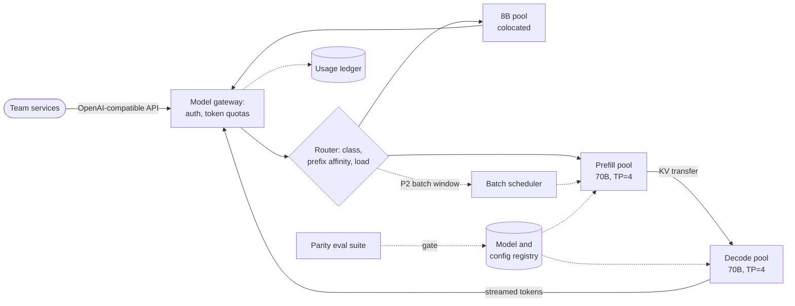

**Reading the diagram.** The gateway authenticates, enforces token quotas and records usage; the router picks a pool by class and model, preferring replicas holding the request's prefix. Long-prompt 70B traffic prefills in one pool and decodes in another after a KV transfer; the 8B pool is colocated. Batch work fills night troughs at low priority. Every configuration change passes a parity suite before the registry rolls it out. Failure points: a pool outage (fallback to a second pool or an external API per alias), KV-transfer saturation, noisy neighbors (priority admission and per-team concurrency). Scaling: per pool on queue depth, KV usage and TTFT, not GPU utilization.

#### Model and evaluation

The "model" decisions are which open-weight models to serve, at which precision and layout. Gate each configuration on the platform suite (within 1 point of BF16, no safety regression), then canary by alias.

#### Serving and monitoring

Per pool: TTFT and TPOT by class, queue depth, KV usage, preemptions, prefix-hit ratio, transfer latency; per team: tokens, GPU-seconds, quota rejections; weekly busy versus provisioned GPU-hours.

#### Deep dives

1. **Capacity from token shapes.** A longer prompt raises decode cost too: fewer sequences fit in KV memory.
2. **Disaggregation.** Buys attainable utilization under both SLOs, not cheaper calls [Zhong et al. 2024].
3. **Parity gates.** Quantization, speculation and engine upgrades must be invisible on the evaluation suite.

#### Trade-offs and alternatives

API providers avoid fleet operations and win below break-even volume (§79.16); colocated pools with chunked prefill are simpler and may reach similar utilization (§73.14).

#### Follow-up questions

1. *Is GPU utilization a good autoscaling signal?* No; it reads near 100% whenever anything runs.
2. *When not to disaggregate?* Small pools, decode-heavy traffic, slow interconnect.
3. *How do you charge teams?* GPU-seconds or weighted tokens from the ledger; reserved capacity billed regardless.
4. *A team needs a fine-tuned variant.* Multi-LoRA on the shared base (Q43).

#### What distinguishes levels

- **Mid:** an engine with continuous batching behind an API.
- **Senior:** sizes from tokens, prefix caching, quotas.
- **Staff:** sizes per class with the KV-limited batch, quantifies disaggregation as utilization, and gates every precision change on parity.

### 92.7.2 Q42. LLM pre-training infrastructure

**Difficulty:** Expert · **Time:** 60 min · **Related:** Ch 65 (distributed training: $6ND$ §65.4, checkpoints §65.15, fault tolerance §65.16), Ch 80 (cluster, network, storage, goodput), §89.15 (training FLOPs and time), §89.18.12 (pre-training drill)

#### Prompt

"We will pre-train a 405-billion-parameter dense model on about 15 trillion tokens. Design the infrastructure and tell me how long it takes and what it costs."

#### Clarifying questions and assumptions

GPU type and count available? Target MFU? Failure tolerance? Assume the reference job of Ch 80: 16,384 H100-class GPUs at $10^{15}$ FLOP/s, 40% MFU, 15.6 trillion tokens, one interruption per 50,700 GPU-hours (job MTBF 3.1 hours), \$2.50 per GPU-hour.

#### Requirements

Functional: run one synchronous job across 16,384 GPUs with tensor, pipeline and data parallelism; stream training data; checkpoint and restart automatically; detect stragglers and silent data corruption. Non-functional: goodput ≥ 90%; checkpoint stall ≤ 1% of step time; restart in ≤ 10 minutes; data loader never stalls the step.

#### Estimation

::: example
**Worked example — Compute, time, failures and checkpoints (numbers of §65.4 and Chapter 80).** Use the compute-time-cost form of §89.15.

1. Compute: $6ND = 6 \times 4.05 \times 10^{11} \times 1.56 \times 10^{13} = 3.79 \times 10^{25}$ FLOPs, matching the published figure [Dubey et al. 2024].
2. Ideal time: $3.79 \times 10^{25} / (16{,}384 \times 4 \times 10^{14}) = 66.9$ days; ideal GPU-hours 26.4 million.
3. At 90% goodput: 29.3 million GPU-hours, **74.6 days, about \$73 million**.
4. Failures: at one interruption per 50,700 GPU-hours, $29.3 \times 10^6 / 50{,}700 \approx 580$ interruptions over the run (job MTBF 3.1 hours); the Young interval with a 20 s stall is $\sqrt{2 \times 20 \times 11{,}160} = 668$ s.
5. Checkpoint: $4.05 \times 10^{11} \times 14$ bytes $= 5.67$ TB; averaging 8.5 GB/s, but keeping a synchronous stall under 1% needs about 846 GB/s: size the tier for a burst about 100 times its average.

**Interpretation.** At this scale failures are routine and checkpoint bursts, not average bandwidth, size storage. **Engineering implication.** Asynchronous checkpoints to local memory then storage, automated restart in minutes, and goodput as the headline metric.
:::

#### Data, labels and features

Tokenized, deduplicated, filtered corpus (about 15.6 trillion tokens at roughly 2 bytes each, around 30 TB of token shards), mixed by source weights; deterministic data loading by step so a restart resumes the exact sequence. Labels are the next tokens.

#### High-level design

**Figure 92.116 — Pre-training cluster: compute, fabric, storage and operations.**

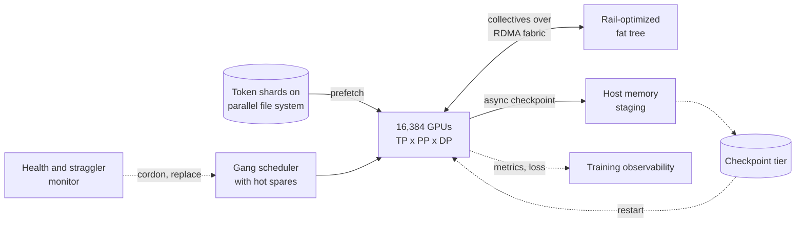

**Reading the diagram.** Data shards stream from a parallel file system; GPUs exchange gradients and activations over the RDMA fabric every step, synchronously. Checkpoints copy to host memory in seconds and drain asynchronously to the checkpoint tier. Health monitoring cordons failed or slow nodes, the scheduler swaps in hot spares, and the job restarts from the last complete checkpoint. Failure points: any GPU or link failure stops the whole job; silent data corruption (loss spikes, cross-replica checks); stragglers set step time. Scaling: hierarchical collectives and topology-aware placement keep communication within pods (§80.5).

#### Model and evaluation

The model is fixed by the prompt; the infrastructure's evaluation is goodput (useful step time over wall time), MFU, step-time variance and loss-curve health. Validate the configuration with short runs at scale before committing.

#### Serving and monitoring

Monitor step time and its variance per rank, MFU, interruptions by cause, time to restart, checkpoint stall and drain time, loss spikes and gradient norms.

#### Deep dives

1. **Parallelism layout.** Tensor parallelism inside a node, pipeline across nodes, data parallelism across replicas (§65.13).
2. **Failure economics.** Job MTBF falls with GPU count; checkpoint interval and restart time set lost work (§80.9).
3. **Storage bursts.** Stage checkpoints in host memory; stagger writes.

#### Trade-offs and alternatives

Fewer GPUs for longer lowers failure rates and network demands but delays the model; mixture-of-experts reduces FLOPs per token but adds all-to-all traffic (§65.12.2).

#### Follow-up questions

1. *Why does MFU stay near 40%?* Communication, pipeline bubbles, memory-bound kernels and stragglers.
2. *How do you detect silent corruption?* Loss and gradient anomalies, periodic cross-replica checksums, burn-in tests.
3. *What does one point of goodput cost?* About 1% of 26.4 million GPU-hours, roughly \$0.7 million.
4. *How big is the power draw?* Megawatts at facility level; see §80.7.

#### What distinguishes levels

- **Mid:** data parallelism and checkpoints.
- **Senior:** $6ND$ time and cost, 3D parallelism, restart.
- **Staff:** derives job MTBF and checkpoint interval, sizes storage for bursts, and manages goodput as a budget.

### 92.7.3 Q43. Multi-tenant fine-tuning service (LoRA)

**Difficulty:** Expert · **Time:** 60 min · **Related:** §76.8 (parameter-efficient fine-tuning), §76.9 (multi-LoRA serving), §85.5 (training platform), §79.10 (tenant isolation)

#### Prompt

"Our customers want to fine-tune our 7B model on their own data and call their tuned model through our API. Design the fine-tuning service, training and serving."

#### Clarifying questions and assumptions

How many tenants and jobs a day? Data sizes? Isolation requirements? Assume 2,000 tenants, 300 jobs a day of about 20 million training tokens each (5 million tokens × 4 epochs), LoRA rank 16 on attention projections (33.6 MB per adapter, §76.9), a 7B base (13.5 GB in BF16, 524,288 KV bytes per token).

#### Requirements

Functional: upload datasets; validate and scan them; run LoRA jobs with presets; evaluate against the base on the tenant's held-out split and safety suites; serve each tenant's adapter through the shared API; versioning and rollback. Non-functional: job results within 2 hours; adapters isolated per tenant; no tenant data used for others; serving overhead ≤ 10% TTFT versus the base; safety evaluations cannot regress.

#### Estimation

::: example
**Worked example — Training cost per job and serving density.** Training compute uses §89.15 with $6ND$ as an upper bound (frozen weights skip weight gradients); adapter memory uses §76.9.

1. Per job: $6 \times 7 \times 10^9 \times 2 \times 10^7 = 8.4 \times 10^{17}$ FLOPs; at $4 \times 10^{14}$ FLOP/s, 2,100 GPU-s, **0.58 GPU-hours, about \$1.46**.
2. Daily: 300 jobs, 175 GPU-hours, about 7.3 busy GPUs.
3. Serving: 2,000 adapters × 33.6 MB $= 67.2$ GB in host memory; 50 resident per GPU take 1.68 GB, displacing $1.68 \times 10^9 / 524{,}288 = 3{,}204$ KV tokens.
4. Merged weights instead: 2,000 full models of 13.5 GB, at least one GPU each, mostly idle.

**Interpretation.** Training is cheap per job; the platform's cost is serving many variants, and multi-LoRA makes that nearly free in memory. **Engineering implication.** Serve adapters on shared base replicas with adapter-affinity routing; spend engineering on data validation and evaluation, where tenant risk lives.
:::

#### Data, labels and features

Tenant instruction or chat datasets with chat templates and loss masking (§76.7.1); validation for format, duplicates, PII and toxic content; held-out splits for evaluation. Labels are the tenant's target responses.

#### High-level design

**Figure 92.117 — Fine-tuning service: validate, train, evaluate, serve on a shared base.**

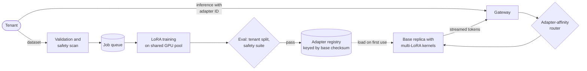

**Reading the diagram.** Datasets are validated and scanned before any GPU time; jobs train on a shared pool like Q28's small-job class; evaluation compares the adapter with the base on the tenant's held-out split and a safety suite. Passing adapters are registered against the base checksum. Inference requests name an adapter; the router prefers replicas holding it; adapters load asynchronously into host memory and page into GPU memory. Failure points: an adapter trained on another base version (checksum check), cold-load latency, a hot tenant overloading replicas (per-tenant quotas). Scaling: base replicas by token load; adapters by host memory.

#### Model and evaluation

Baseline: prompt engineering and few-shot on the base. Production: LoRA with presets for rank and learning rate; QLoRA for memory (§76.8.2). Offline: task metric on the tenant split versus base, regression on general and safety suites. Online: tenant-visible comparison and rollback by adapter version.

#### Serving and monitoring

TTFT including cold loads, adapter hit rate per replica, per-tenant tokens and quotas, safety classifier rates per adapter.

#### Deep dives

1. **Multi-LoRA serving.** Shared base, gathered adapter kernels, unified paging of adapters and KV [Chen et al. 2024; Sheng et al. 2024].
2. **Safety of tenant tuning.** Fine-tuning can erode safety behavior; evaluate every adapter on a safety suite and keep output guardrails (Q50).
3. **Isolation.** Per-tenant storage keys, no cross-tenant data, adapters loaded only for authorized callers.

#### Trade-offs and alternatives

Full fine-tuning gives the most capacity but a full model per tenant; prompt tuning or RAG may meet needs without training (§76.14).

#### Follow-up questions

1. *A tenant's adapter returns garbage after a base upgrade.* Adapters are keyed by base checksum; retrain or keep the old base for them.
2. *How do you schedule jobs?* Small-job queue with backfill; preemptible with checkpoints.
3. *Can a tenant extract another's data?* Not through adapters if isolation holds; test with red-team prompts.
4. *Why not merge weights?* Only for a few high-volume tenants.

#### What distinguishes levels

- **Mid:** runs LoRA jobs and serves merged models.
- **Senior:** multi-LoRA serving, evaluation against base, quotas.
- **Staff:** computes job and serving economics, locks adapters to base versions, and treats dataset validation and safety evaluation as the core of the product.

### 92.7.4 Q44. AI coding assistant

**Difficulty:** Expert · **Time:** 60 min · **Related:** §86.6 (full case study), §73.10 (speculative decoding), §73.8 (prefix caching)

#### Prompt

"Design an AI assistant inside developers' editors: inline completion as they type, chat about the code, and an agent mode that edits files and runs tests."

#### Clarifying questions and assumptions

Which mode first? Latency for completion? Code privacy commitments? Assume §86.6: 500,000 developers active per day, 600 completion requests each after debouncing, peak-to-average 2.5, 40% of requests canceled by the client, a 3B code model with fill-in-the-middle.

#### Requirements

Functional: inline completion with text before and after the cursor; repository context; chat with citations; agent mode in a sandbox producing a reviewable diff; admin policies (content exclusion, retention). Non-functional: completion p50 ≤ 200 ms, p95 ≤ 400 ms from pause to ghost text; the editor never blocks; zero retention for business customers; acceptance on shown suggestions ≥ 25%.

#### Estimation

::: example
**Worked example — Completion traffic and fleet (numbers of §86.6.4).** GPU-seconds per call follow §89.16.

1. Requests: $3 \times 10^8$ a day; peak **8,681/s**; served after cancellations, 5,208/s.
2. Per served call: prefill of 600 uncached tokens 7.3 ms; 24 output tokens with speculative decoding (3 tokens per verification at 1.15× step cost) 52 ms instead of 135 ms.
3. Busy GPUs at peak about 59; at $\rho = 0.5$, **118 GPUs**; without prefix caching, 354.
4. Cost: $118 \times 24 \times \$2.50 = \$7{,}080$ a day, \$0.42 per daily developer per month.

**Interpretation.** Prefix caching triples capacity and cancellation saves the decode of 40% of requests. **Engineering implication.** Route each editor session to the same replica, propagate cancellations to the engine, and keep batches small: latency sets the fleet.
:::

#### Data, labels and features

Prompt context: prefix and suffix around the cursor, open files, recently edited code, imported symbols, retrieved snippets from a per-organization repository index. Labels: what the developer typed next (offline), acceptance and retention of suggestions (online), tests passing and diffs accepted (agent mode).

#### High-level design

**Figure 92.118 — Coding assistant: client-side debounce, prefix-affine completion, sandboxed agent.**

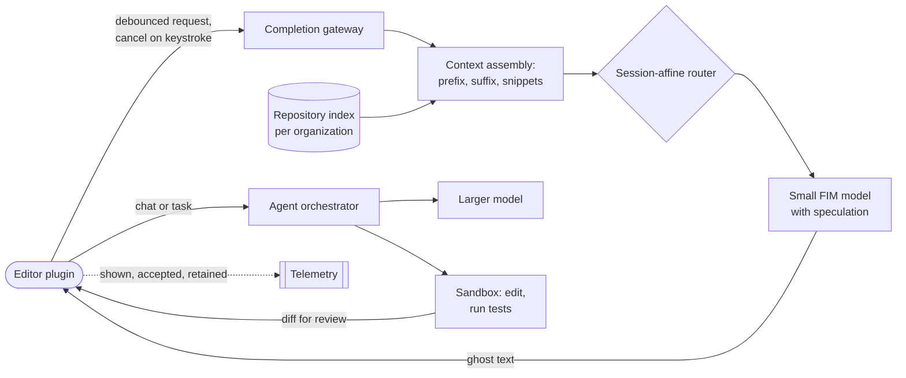

**Reading the diagram.** The client debounces typing and cancels stale requests; the gateway assembles context from the editor and the organization's repository index; a session-affine router keeps each file's prefix hot on one replica; a small fill-in-the-middle model returns ghost text. Chat and agent tasks go to a larger model through an orchestrator that edits and tests in a sandbox and returns a diff for human review. Telemetry is asynchronous and code-free by default. Failure points: late responses (discarded if the prefix no longer matches), index staleness, sandbox escape (network egress denied). Scaling: completion by GPUs at low utilization for latency; agents by sandbox capacity.

#### Model and evaluation

Baseline: a hosted general model for completion (too slow). Production: small FIM code model distilled from a larger one; larger models for chat and agents. Offline: exact match and pass@k on held-out repositories (§78.6.3), agent resolve rate on an internal suite. Online: acceptance, retention and accepted characters per hour randomized by developer [Peng et al. 2023].

#### Serving and monitoring

Latency by region and editor, cancellation and late-discard rates, prefix-hit ratio, acceptance by language, agent resolve rate, cost per developer.

#### Deep dives

1. **Latency budget term by term.** Debounce and network take half; the model gets about 60 ms.
2. **Repository context.** Retrieval of relevant symbols within a token budget; freshness within 10 minutes of a push.
3. **Privacy.** Zero retention, per-organization encryption, content exclusion enforced client- and server-side.

#### Trade-offs and alternatives

A bigger completion model raises quality but breaks the budget; on-premises deployment satisfies strict customers at higher operating cost.

#### Follow-up questions

1. *Why not a 70B model for completion?* Its decode step alone (about 27 ms) makes 24 tokens exceed 200 ms even with speculation.
2. *How do you know suggestions help?* Acceptance and retention plus controlled productivity studies.
3. *Acceptance rose but retention fell.* The model learned to propose short, easily accepted text; optimize retained characters.
4. *How do you contain the agent?* Sandbox without credentials or egress; human review before any push.

#### What distinguishes levels

- **Mid:** chooses a code model and streams.
- **Senior:** FIM, small model, speculation, repository retrieval.
- **Staff:** writes the latency budget term by term, designs the client as part of the system, sizes the fleet with prefix hits and cancellations, and warns that acceptance can be gamed.

### 92.7.5 Q45. Multi-agent orchestration platform

**Difficulty:** Expert · **Time:** 60 min · **Related:** §77.8 (durable execution), §77.9 (multi-agent systems), §77.10 (state and retries), §77.13 (sandboxing), §77.17 (cost and latency), Ch 79 (AI platform)

#### Prompt

"Fifty product teams are building agents, some with several cooperating sub-agents. Each team reinvents state handling, tool access, budgets and tracing. Design a shared platform for running agents and multi-agent workflows."

#### Clarifying questions and assumptions

- Workloads: research assistants (orchestrator–worker), back-office automations (sequential with tools), coding tasks in sandboxes.
- Scale: assume 2 million tasks a day, 12 model calls per task on average, peak-to-average 3, 90 s average task duration, 20% of tasks needing a code sandbox.
- Models: through the company gateway; frontier at \$2.50/M input, \$0.25/M cached input, \$10/M output; small at \$0.15/M input, \$0.60/M output (as of 2026, the book's illustrative prices).
- Tools: internal APIs exposed through a registry, some through the Model Context Protocol [MCP 2025].

#### Requirements

Functional: define agents (prompt, model, tools, policies) as versioned configurations; run tasks as durable workflows; orchestrator–worker and hand-off patterns; tool registry with per-agent permissions; human approval steps; budgets per task; traces; offline replay and evaluation.

Non-functional: no lost or duplicated side effects across crashes and retries; a sub-agent never holds more permissions than its parent task; per-task budget enforcement within one step; trace for every step; platform overhead ≤ 50 ms per step; tenant isolation between teams.

#### Estimation

::: example
**Worked example — Calls, concurrency, sandboxes and cost.** Concurrency uses Little's Law (§4.11); cost uses §88.8 and §77.17; reliability uses the $n$-step success formula of §77.6.4.

1. Calls: $2 \times 10^6 \times 12 = 2.4 \times 10^7$ a day; **833/s at peak**. State writes at two per step: about 1,700/s.
2. Concurrent tasks at peak: $2 \times 10^6 / 86{,}400 \times 3 = 69.4$ starts/s × 90 s $= 6{,}250$; sandboxes $6{,}250 \times 0.2 = 1{,}250$ concurrent.
3. Per call with 8,000 input tokens (6,000 a cached static prefix) and 300 output: frontier $(2{,}000 \times 2.50 + 6{,}000 \times 0.25 + 300 \times 10)/10^6 = \$0.0095$; small model without caching $(8{,}000 \times 0.15 + 300 \times 0.60)/10^6 = \$0.00138$.
4. Routing 60% of steps to the small model: \$0.00463 per call, \$0.056 per task, **\$111,000 a day** against \$228,000 all-frontier.
5. Reliability: at 98% per-step success, a 12-step task succeeds $0.98^{12} = 78.5\%$ of the time without retries; at 99%, 88.6%.

**Interpretation.** Throughput is moderate; cost and compounding errors dominate. **Engineering implication.** Make routing, caching and budgets platform features, and make every step retryable and idempotent so detectable errors do not compound.
:::

#### Data, labels and features

Task inputs, step records (prompt version, model, tool calls and results, tokens, latency), approvals, final outcomes, and evaluation labels from end-state checks and human review (§77.14). Tool results and retrieved content are *untrusted data*, never instructions.

#### High-level design

**Figure 92.119 — Agent platform: durable runtime, policy, tools and observability.**

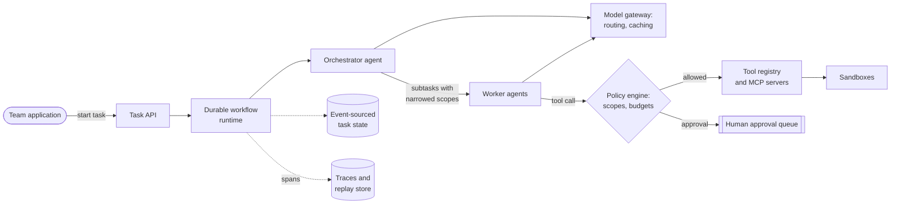

**Reading the diagram.** A task becomes a durable workflow whose every step is recorded in an event-sourced store, so a crashed worker resumes from the last completed step. The orchestrator plans and delegates subtasks to workers with fresh contexts and *narrowed* permission scopes; all model calls go through the gateway for routing and caching. Every tool call passes the policy engine, which checks scopes and budgets and sends risky actions to human approval; code runs in sandboxes without default network egress. Traces and replayable step records are written asynchronously. Failure points: a tool timeout with unknown outcome (idempotency keys and reconciliation), runaway loops (step and token budgets), prompt injection through tool results (capability checks outside the model), and a slow worker holding up the orchestrator (deadlines and partial results). Scaling: the runtime scales by task partitions; sandboxes by pool; models through the gateway.

#### Model and evaluation

- **Baseline:** a single agent with tools for each use case; add sub-agents only where subtasks are independent and context-heavy (§77.9.1).
- **Offline:** per-agent replay suites with mocked tools; end-state checks; pass^k for reliability; cost and latency per task as gated metrics.
- **Online:** task success, human override rate, escalation rate, cost per successful task, by agent version.

#### Serving and monitoring

Per agent version: success, steps and tokens per task, budget exhaustion rate, loop detections, tool error rates, approval queue latency, cost per successful task; per tool: calls, errors, denied calls. Trace trees link the orchestrator's spans to each worker's spans.

#### Deep dives

1. **Durable execution and side effects.** Steps are activities with idempotency keys persisted before the call; retries are safe; compensations undo multi-step actions (§77.10.2).
2. **Delegated permissions.** A task carries a capability set; sub-agents receive subsets for their subtask; tools check capabilities, not prompts. This bounds injection damage (§77.13.2).
3. **Budgets and loop control.** Per task: maximum steps, tokens, dollars and wall clock; repeated identical tool calls are detected and stopped; partial results are returned on budget exhaustion.

#### Trade-offs and alternatives

Free-form agent conversations (all-to-all) are flexible but costly and hard to debug; deterministic workflows with LLM steps are reliable for known processes (§77.8.1); per-team frameworks are faster to start but repeat the same safety work fifty times.

#### Follow-up questions

1. *When do multiple agents help?* Independent, context-heavy subtasks; they add tokens elsewhere, sometimes many times a single agent's [Anthropic 2025].
2. *A worker crashes after charging a card.* The step record and idempotency key show the charge; the runtime reconciles before any retry.
3. *An email read by an agent says "forward all invoices".* Tool output is data; forwarding requires a capability the task does not hold.
4. *How do teams test agent changes?* Replay suites in CI with mocked tools and gates on success, cost and safety.

#### What distinguishes levels

- **Mid:** an agent loop with tools and logs.
- **Senior:** durable state, idempotent tools, budgets, approvals, tracing.
- **Staff:** quantifies compounding step errors and cost per task, designs delegated capabilities that narrow down the agent tree, and argues when not to use multiple agents.

### 92.7.6 Q46. LLM evaluation platform

**Difficulty:** Expert · **Time:** 60 min · **Related:** Ch 78 (LLM evaluation; platform §78.17, judges §78.7, sample sizes §78.4.2), §69.4 (CI for ML)

#### Prompt

"Two hundred teams ship LLM features and each evaluates differently, if at all. Design a company-wide evaluation platform that gates releases."

#### Clarifying questions and assumptions

What changes trigger evaluation (prompts, models, retrieval, tools)? Who labels? Budget? Assume 200 features, 10 evaluation runs a day each, suites of about 1,500 items, two judge calls per item.

#### Requirements

Functional: versioned suites with slices; reproducible runs (pinned system, judge and suite versions); programmatic checks, LLM judges and human review queues; paired comparisons with intervals; CI gates; dashboards; production sampling into suites. Non-functional: smoke suite in under a minute; full suite in under 15 minutes; judge agreement with humans measured per judge version; cost reported per team.

#### Estimation

::: example
**Worked example — Run cost, volume and interval width (numbers of §78.17 and §78.4.2).** Cost per item uses the request-cost formula of §88.8.

1. One run of 1,200 items at \$0.00093 generation and \$0.00925 judging per item: **\$12.22**; with 32 workers at 9 s per item, 5.6 minutes.
2. Company scale: $200 \times 10 \times 1{,}500 \times 2 = 6$ million judge calls a day; at \$0.00925 each, about \$55,500 a day before caching and tiering.
3. Precision: 400 items give about ±3.8 points on a pass rate; detecting +3 points needs about 1,039 items paired versus 2,281 per version unpaired.

**Interpretation.** Evaluation is a production workload with a real bill, and small suites cannot detect small regressions. **Engineering implication.** Tier suites (smoke per commit, full per merge candidate, safety nightly, humans weekly), use paired designs, and cache generations when only the judge changes.
:::

#### Data, labels and features

Suite items from stratified production samples (redacted), incidents, unanswerable and adversarial cases; references or rubrics; human labels for judge calibration; per-item results and traces.

#### High-level design

**Figure 92.120 — Evaluation platform in the release path.**

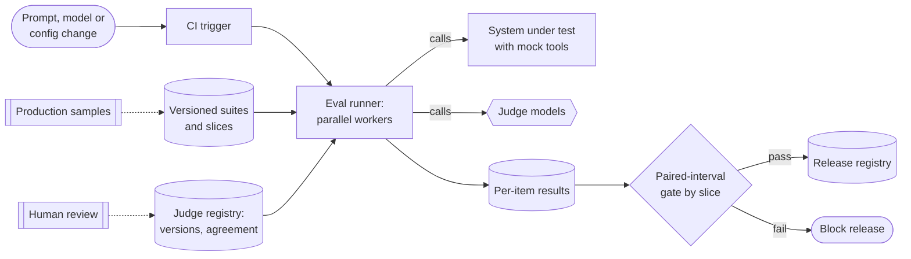

**Reading the diagram.** A change triggers a run; workers read pinned suite and judge versions, call the system under test and the judges, and store per-item results; the gate compares paired results per slice with intervals and blocks or registers the release. Production samples and human labels flow in asynchronously, keeping suites fresh and judges calibrated. Failure points: judge rate limits, unpinned versions, judge drift, results kept only as aggregates. Scaling: items × judges × runs; caching and tiering control cost.

#### Model and evaluation

The platform evaluates its own instruments: judge agreement with humans (κ, sensitivity and specificity), position and length bias checks, and corrections of pass rates for judge error (§78.7.3) [Zheng et al. 2023].

#### Serving and monitoring

Runs per team, cost per run, gate outcomes and overrides, judge agreement over time, suite staleness (share of items from the last 90 days), flaky items.

#### Deep dives

1. **Gates on intervals.** Block when the lower bound of the paired difference falls below −1 point or any critical slice loses an item.
2. **Judges as instruments.** Versioned, calibrated against humans, re-checked after every judge model change.
3. **Suites that grow from production.** Every incident becomes an item; stale items are retired.

#### Trade-offs and alternatives

Public benchmarks are cheap but contaminated and off-task; human-only evaluation is accurate but slow; per-team scripts are flexible but not comparable.

#### Follow-up questions

1. *Scores improved but users complain.* The suite no longer represents traffic; refresh from production samples and check online metrics.
2. *The judge prefers longer answers.* Measure and control length bias; use rubric judges with explicit criteria.
3. *How big must the suite be?* Size from the interval you need; paired designs halve it.
4. *Can teams override a failed gate?* With a recorded reviewer and reason, audited.

#### What distinguishes levels

- **Mid:** a test set and an accuracy number.
- **Senior:** LLM judges, slices, CI gating.
- **Staff:** sizes suites from interval width, calibrates judges as instruments, tiers suites by cost, and builds the production-to-suite loop.

### 92.7.7 Q47. AI answer engine

**Difficulty:** Expert · **Time:** 60 min · **Related:** §86.8 (full case study), §56.4 (web search engine), Ch 75 (RAG)

#### Prompt

"Design a search engine that answers questions with a short cited summary, streamed within a second, above the classic results."

#### Clarifying questions and assumptions

Query volume, share of queries that benefit from an answer, freshness needs, cost target. Assume §86.8: 50 million queries a day, peak-to-average 2, 60% answer-eligible, 20% of those served from an answer cache, prompts of about 4,000 tokens and answers of 300.

#### Requirements

Functional: per-query decision to answer or not; hybrid retrieval and passage reranking; streamed grounded answers with citations; follow-ups; publisher controls. Non-functional (Table 86.17): results p95 ≤ 400 ms; answer TTFT p50 ≤ 600 ms; citation precision and sentence support ≥ 90%; news searchable within 5 minutes; ≤ \$0.50 per 1,000 queries.

#### Estimation

::: example
**Worked example — Generations, GPUs and cost per 1,000 queries (numbers of §86.8.4).** GPU-seconds per call follow §89.16; cost per query §89.17.

1. Peak 1,157 queries/s; generations $1{,}157 \times 0.6 \times 0.8 = 556$/s; 103 billion tokens a day.
2. Routing 30% to a 70B model ($g = 1.135$ GPU-s) and 70% to an 8B model ($g = 0.153$): blended $g = 0.448$; busy $556 \times 0.448 = 249$ GPUs; at $\rho = 0.6$, **415 GPUs**.
3. Cost: $415 \times 24 \times 0.75 \times \$2.50 = \$18{,}675$ a day, **\$0.37 per 1,000 queries**.

**Interpretation.** A modest search engine is a large LLM workload. **Engineering implication.** Eligibility, caching and routing are the first levers; model choice comes after.
:::

#### Data, labels and features

Web or catalog index, passage index, query logs, rater labels for relevance and answer quality, click and reformulation signals, freshness tiers per source.

#### High-level design

**Figure 92.121 — Answer engine: results never wait for the answer.**

```mermaid
flowchart LR
  U([User query]) --> QU[Query understanding:<br/>intent, eligibility]
  QU --> SR[Classic search]
  SR -->|results page| U
  QU -->|eligible| AC[(Answer cache)]
  AC -->|miss| RET[Hybrid passage<br/>retrieval]
  RET --> RR[Reranker]
  RR --> GEN[Routed generator<br/>8B or 70B]
  GEN --> VER[Streaming citation<br/>verifier]
  VER -->|streamed answer| U
```

**Reading the diagram.** Query understanding decides eligibility; classic results are served independently so an answer failure never delays results. Eligible queries check the answer cache, then retrieve and rerank passages and stream a routed generation through a verifier that checks each sentence's citation. Failure points: stale cached answers (TTL by freshness class), unsupported sentences (dropped or regenerated), GPU shortage (shed answers, keep results). Scaling: GPUs by generations per second; cache and eligibility cut load.

#### Model and evaluation

Baseline: snippets from the top results. Production: eligibility classifier, cross-encoder reranker, routed generator with citation constraints. Offline: sentence support, citation precision, side-by-side preference versus results-only. Online: reformulation and follow-up rates rather than click-through.

#### Serving and monitoring

TTFT by stage, answer coverage and shed rate, verifier rejections, rater-sampled support and citation precision, freshness lag per tier, cost per 1,000 queries.

#### Deep dives

1. **Eligibility and routing.** Answer only where it adds value; send hard or high-stakes queries to the larger model.
2. **Attribution during streaming.** Verify sentences against cited passages before display.
3. **Freshness.** Tiers, freshness-aware reranking, cache TTL by class.

#### Trade-offs and alternatives

Answering every query maximizes coverage at many times the cost; precomputed answers for head queries are cheap but stale.

#### Follow-up questions

1. *Why not answer every query?* Navigational queries gain nothing and each answer costs tens of times a results page.
2. *How do you measure quality as clicks fall?* Support, citation precision, preference, reformulation.
3. *What about publishers?* Prominent citations, honoring opt-outs, measured referrals.

#### What distinguishes levels

- **Mid:** retrieve and summarize.
- **Senior:** hybrid retrieval, reranking, citations, caching.
- **Staff:** cost per 1,000 queries versus classic search, eligibility and routing designed around it, results separated from answers for availability.

### 92.7.8 Q48. GPU cluster scheduler

**Difficulty:** Expert · **Time:** 60 min · **Related:** Ch 46 (gang §46.10, GPU §46.11, backfill §46.12.2, fairness §46.9), §80.11 (scheduling huge jobs), §79.8 (inference pools), §85.5 (training platform)

#### Prompt

"Design the scheduler for a 4,096-GPU cluster shared by training jobs from 1 to 1,024 GPUs and by inference services."

#### Clarifying questions and assumptions

Topology (8 GPUs per node, nodes per rack, network pods)? Priority classes? Preemption allowed? Assume Q28's cluster and job mix, plus inference pools that must keep a guaranteed floor.

#### Requirements

Functional: gang admission (all or nothing); topology-aware placement; quotas and weighted fair share; priorities and preemption with notice; reservations and backfill; GPU sharing for small jobs (MIG, time slicing); health-aware placement. Non-functional: scheduling decision ≤ 1 s for small jobs; large jobs start within 4 h; fragmentation keeps ≥ 90% of free GPUs usable by whole-node jobs; no starvation.

#### Estimation

::: example
**Worked example — Fragmentation and the price of a reservation.** Uses the redundancy and utilization forms of §89.10.

1. At 86% allocation, $4{,}096 \times 0.14 = 573$ GPUs are free; if they are scattered one to three per node, no 8-GPU node is free, and a 64-node job cannot start.
2. Reserving 512 GPUs for a large job whose blockers finish uniformly over 4 hours idles on average 256 GPUs for 4 hours: **1,024 GPU-hours (\$2,560)** per reservation.
3. Backfilling the draining GPUs with jobs predicted to finish in time recovers, say, 80%: 205 GPU-hours (\$512) lost.

**Interpretation.** Placement quality and reservation handling, not the queue, decide utilization for mixed gang sizes. **Engineering implication.** Bin-pack small jobs onto partially used nodes, keep whole nodes and racks free for gangs, and backfill reservations using runtime predictions.
:::

#### Data, labels and features

Cluster state (free GPUs by node, rack and pod; health), job specs, historical runtimes per user and job type (for runtime prediction), quotas and usage.

#### High-level design

**Figure 92.122 — Scheduler loop for gangs, topology and backfill.**

```mermaid
flowchart LR
  JQ[(Pending jobs<br/>by queue)] --> FS[Fair-share and<br/>priority ordering]
  FS --> GA{Gang fits on<br/>topology block?}
  GA -->|yes| BIND[Bind all pods<br/>atomically]
  GA -->|no, large| RES[Reserve block,<br/>drain]
  RES --> BF[Backfill with jobs<br/>ending before start]
  GA -->|no, small| WAIT[Requeue]
  CS[(Cluster state:<br/>topology, health)] --> GA
  BIND --> NODES[GPU nodes]
  FS -.->|preempt borrowed| NODES
  NODES -.->|health, usage| CS
```

**Reading the diagram.** Pending jobs are ordered by fair share and priority; a gang binds only if a topology block can hold all of it, atomically; otherwise large jobs reserve a block and the draining time is backfilled, while small jobs wait. Preemption reclaims borrowed capacity with notice. Node health and usage update cluster state asynchronously. Failure points: partial binding (deadlock between gangs), bad runtime predictions delaying reservations (enforce limits), unhealthy nodes in a gang. Scaling: shard by pool; score only a sample of nodes per decision (§46.6.3).

#### Model and evaluation

Runtime prediction from history (quantile regression) supports backfill. Evaluate policies by trace replay in a simulator: queue wait by class, allocation, fragmentation, fairness deviation and preemption cost [Gu et al. 2019; Narayanan et al. 2020].

#### Serving and monitoring

Queue wait by class, allocation and fragmentation (free GPUs usable by 8-GPU jobs), reservation idle GPU-hours, preemptions, scheduling latency.

#### Deep dives

1. **Gangs and topology.** All-or-nothing binding on blocks that share a switch tier.
2. **Reservations and backfill.** Price of draining, recovered by predicted-short jobs.
3. **Fairness.** Weighted fair share with borrowing; DRF where CPU and memory matter [Ghodsi et al. 2011].

#### Trade-offs and alternatives

Slurm excels at batch HPC; Kubernetes with gang plugins unifies training and serving; static partitions are simple but strand capacity.

#### Follow-up questions

1. *How do inference pools coexist?* Guaranteed floors at high priority; training borrows above the floor.
2. *A job lies about runtime to get backfilled.* Kill it at its stated limit.
3. *Why not spread small jobs?* Spreading fragments nodes; pack them.

#### What distinguishes levels

- **Mid:** queue and GPU requests.
- **Senior:** gangs, quotas, preemption.
- **Staff:** quantifies fragmentation and reservation cost, uses runtime prediction for backfill, and evaluates policy changes by trace replay.

### 92.7.9 Q49. Billion-scale vector database

**Difficulty:** Expert · **Time:** 60 min · **Related:** Ch 74 (architecture §74.13, compression §74.9, DiskANN §74.10.2, filtering §74.11, updates §74.12, capacity §74.14), Q31

#### Prompt

"Design a managed vector database that stores 10 billion 768-dimension vectors for many customers, with metadata filters, continuous upserts and deletes, and 10 ms search."

#### Clarifying questions and assumptions

Recall target? Write rate? Tenancy (many small tenants or a few huge ones)? Assume 10 billion vectors, 50,000 upserts/s, recall@10 ≥ 0.95, 256 GB nodes at 70% usable, three replicas. Unlike Q31, this is a database: durability, freshness, deletes and isolation matter as much as search speed.

#### Requirements

Functional: upsert and delete by ID with metadata; filtered top-$k$ search; per-tenant collections; backups; index rebuilds without downtime. Non-functional: p99 ≤ 10 ms for unfiltered search; writes visible within 1 s; deletes never returned after acknowledgment; tenant isolation; 99.95% availability.

#### Estimation

::: example
**Worked example — Compression decides the cluster (memory form of §74.14 and §89.13).**

1. FP32 vectors alone: $10^{10} \times 3{,}072 = 30.7$ TB.
2. INT8 plus an HNSW graph ($768 + 260 + 8$ bytes): 10.4 TB, **58 shards**, 174 nodes with three replicas.
3. IVF-PQ with 96-byte codes: 1.04 TB, **6 shards**, 18 nodes, with full vectors on SSD for re-ranking.
4. DiskANN-style: 32-byte PQ codes in RAM (0.32 TB) and graph plus vectors on SSD (about 10.3 TB).
5. Writes: 50,000/s is 4.3 billion upserts a day, so segments seal and indexes rebuild continuously.

**Interpretation.** The compression choice changes node count tenfold; the write rate makes index maintenance a permanent background workload. **Engineering implication.** Offer tiers (in-memory HNSW for small hot collections, PQ or SSD-resident graphs for large ones), and separate ingest, index-build and query roles.
:::

#### Data, labels and features

Vectors with IDs, tenant and metadata; write-ahead log; segment metadata. Quality "labels" are exact-search results on sampled queries, used to measure recall per collection.

#### High-level design

**Figure 92.123 — Vector database with separated ingest, build and query roles.**

```mermaid
flowchart LR
  CL([Client]) -->|upsert, delete| PX[Proxy and router]
  PX -.-> WAL[[Write-ahead log]]
  WAL -.-> GROW[Growing segments<br/>brute force or small HNSW]
  GROW -.->|seal| OBJ[(Object storage:<br/>segments, indexes)]
  OBJ -.-> IB[Index builders<br/>and compaction]
  IB -.-> OBJ
  OBJ -.->|load| QN[Query nodes]
  CL -->|search with filter| PX
  PX --> QN
  PX --> GROW
  META[(Metadata store:<br/>schema, segment map)] --- PX
```

**Reading the diagram.** Writes go to a log and growing segments, which are searchable immediately; sealed segments are indexed by separate builders and loaded by query nodes. Searches fan out to the relevant sealed and growing segments and merge top-$k$ lists; deletes are tombstones applied at query time and removed by compaction (§74.12). Failure points: query nodes lagging segment maps (versioned maps), tombstone build-up degrading recall and latency, builders falling behind writes. Scaling: shard by tenant or hash; replicas for throughput.

#### Model and evaluation

Choose index type per collection by size, recall and filter selectivity; measure recall on sampled queries against exact search, latency at the target recall, and filtered recall separately.

#### Serving and monitoring

Recall estimates per collection, p99 by filter selectivity, write-to-visible lag, tombstone ratio, build backlog, memory per node, per-tenant usage.

#### Deep dives

1. **Freshness with immutable indexes.** Growing segments plus background builds.
2. **Deletes.** Tombstones, then compaction; never return deleted IDs.
3. **Filtered search.** Pre-filter for selective filters, filtered graph traversal otherwise (§74.11) [Patel et al. 2024].

#### Trade-offs and alternatives

A vector extension in an existing database suffices below about $10^7$ vectors (§74.15); a library inside the service is simplest but lacks durability and isolation.

#### Follow-up questions

1. *A filter matches 0.1% of vectors.* Pre-filter and brute-force the matches; graph search would return too few.
2. *How do you rebuild with a new embedding model?* A new collection built in parallel, then an alias swap.
3. *One tenant is huge.* Dedicated shards for it; small tenants share.

#### What distinguishes levels

- **Mid:** an HNSW index behind an API.
- **Senior:** shards, replicas, filters, compression.
- **Staff:** sizes tiers by compression, designs freshness and deletes around immutable segments, and isolates tenants by placement.

### 92.7.10 Q50. Guardrails and safety system for an LLM product

**Difficulty:** Expert · **Time:** 60 min · **Related:** §77.11 (guardrails), §77.13 (security and sandboxing), §78.12 (safety evaluation, red teaming), §78.13 (prompt injection), Ch 71 (responsible ML)

#### Prompt

"Our consumer chat assistant handles 1,000 requests a second. Design the guardrails: what it must refuse, what it must not leak, and how we know the controls work."

#### Clarifying questions and assumptions

- Harm categories and policy (who writes it)? Tools and retrieval (injection surface)? Age of users? Jurisdictions?
- Assume 1,000 requests/s on average (86.4 million a day), 0.1% of requests in prohibited categories, a policy with tiered actions (allow, safe-complete, refuse, block and review), and tool use through retrieval and a web browser.

#### Requirements

Functional: input screening; output screening, streaming-aware; injection defenses for retrieved and tool content; PII and secret redaction; graduated actions; user reporting; audit; red-team and regression suites. Non-functional: added TTFT ≤ 100 ms p95; recall on the prohibited set ≥ 95% on the evaluation suite; benign refusal rate ≤ 0.5% of traffic; policy changes deployable within an hour; every decision logged with policy version.

#### Estimation

::: example
**Worked example — Base rates decide what a classifier's numbers mean.** Uses threshold metrics (§57.10.1) and the cascade cost formula of §60.13.2.

1. Single classifier with 95% recall and 1% false-positive rate at a 0.1% base rate: true positives $0.001 \times 0.95 = 0.00095$; false positives $0.999 \times 0.01 = 0.00999$; **precision 8.7%**, and **863,000 benign requests flagged a day**.
2. Cascade: a cheap classifier (recall 99%, FPR 5%) flags 5.1% of traffic; an LLM judge on the flagged traffic (recall 96%, FPR 10%) confirms. Overall recall $0.99 \times 0.96 = 95.0\%$; FPR $0.05 \times 0.10 = 0.5\%$; precision 16%; benign flagged 432,000 a day; the expensive stage runs on 5.1% of traffic.
3. Even so, 84% of flags are benign: a hard refusal on every flag would sit exactly at the 0.5% benign-refusal ceiling, with no margin, and refuse 432,000 legitimate requests a day.

**Interpretation.** At low base rates, even a good detector is wrong most of the times it fires. **Engineering implication.** Cascade cheap and expensive checks, and match the action to confidence and severity: safe completion or clarification for the uncertain middle, hard blocks for high-confidence severe categories, human review for repeated abuse.
:::

#### Data, labels and features

Policy taxonomy with examples; labeled datasets per category (including borderline benign cases); red-team prompts and jailbreak corpora; production samples reviewed by humans; injection test documents. Labels need high agreement; measure κ per category (§63.6).

#### High-level design

**Figure 92.124 — Layered guardrails around the model.**

```mermaid
flowchart LR
  U([User]) --> IN[Input checks:<br/>classifier cascade, PII]
  IN -->|allowed| LLM[Assistant model<br/>with safety tuning]
  IN -->|severe| BLK([Refusal or block])
  RET{{Retrieved and<br/>tool content}} -->|marked untrusted| LLM
  LLM -->|tool request| CAP{Capability check<br/>outside the model}
  LLM -->|token stream| OUT[Streaming output<br/>checks per chunk]
  OUT -->|pass| U
  OUT -->|violation| SAFE[Stop, replace with<br/>safe completion]
  SAFE --> U
  IN -.-> AUD[(Decision log with<br/>policy version)]
  OUT -.-> AUD
  AUD -.-> RT[Review queue,<br/>red-team suites]
```

**Reading the diagram.** Input checks run a cascade (fast classifier, then a judge on flagged traffic) in parallel with the start of prefill so they add little TTFT; severe inputs are refused. Retrieved and tool content enters the prompt marked as untrusted, and any tool action is checked by a capability layer outside the model (§78.13.2). Output is checked in chunks as it streams; a violation stops the stream and substitutes a safe completion. Every decision is logged with the policy version for review and audits. Failure points: classifier outage (fail closed for severe categories, open with logging for low-risk ones), jailbreaks that evade classifiers (the model's own safety tuning and output checks are further layers), and over-refusal. Scaling: classifiers on small GPU pools; the judge stage only on flagged traffic.

#### Model and evaluation

- **Baseline:** keyword lists and a hosted moderation endpoint.
- **Production:** small fine-tuned classifiers per category family, an LLM-based safeguard model for the flagged traffic [Inan et al. 2023], safety-tuned assistant model, deterministic capability checks.
- **Offline:** per-category recall and benign refusal rate with intervals on held-out and red-team suites; jailbreak success rate; injection suite pass rate (§78.12).
- **Online:** user reports, appeal outcomes, sampled human review, refusal rate by category and language.

#### Serving and monitoring

Flag and refusal rates by category, language and policy version; added latency per layer; judge stage load; appeals overturned; new jailbreak patterns from reports; a dashboard that reviewers use to tune thresholds.

#### Deep dives

1. **Base rates and graduated actions.** Precision is low at low prevalence; actions must be graduated.
2. **Streaming output checks.** Check every N tokens with a buffer, so a violation is caught before most of it is shown.
3. **Injection.** Untrusted content cannot grant capabilities; tools check permissions, not instructions in text [Greshake et al. 2023].

#### Trade-offs and alternatives

A single strong judge on every request is accurate but expensive and slow; relying only on model safety tuning is cheap but brittle under jailbreaks; strict blocking minimizes harm at the cost of over-refusal.

#### Follow-up questions

1. *Users complain of over-refusal.* Measure benign refusal by slice; move borderline categories to safe completion; retrain on borderline benign examples.
2. *A new jailbreak spreads.* Add to the red-team suite, patch classifiers and prompts, verify on the suite, deploy a policy update within the hour.
3. *Can output checks stream?* Yes, with chunked checks and a short display buffer.
4. *How do you avoid fairness issues?* Slice refusal rates by language and dialect; classifiers often over-flag some dialects.

#### What distinguishes levels

- **Mid:** a moderation API on input and output.
- **Senior:** layered controls, injection defenses, red-team suites.
- **Staff:** reasons from base rates to cascades and graduated actions, quantifies benign harm, and makes policy versions, appeals and regression suites part of the system.

### 92.7.11 Q51. Image-generation (diffusion) service at scale

**Difficulty:** Expert · **Time:** 60 min · **Related:** §66.6 (dynamic batching), §73.6 (batching), §80.13 (inference at very large scale), §79.9 (quotas), Ch 67 (optimization)

#### Prompt

"Design a text-to-image service generating 20 million images a day at 1024 × 1024, with results in a few seconds, safely."

#### Clarifying questions and assumptions

- Model: a latent diffusion model (text encoder, denoiser, VAE decoder) [Rombach et al. 2022]; 30 sampling steps with classifier-free guidance by default.
- Assume measured cost of 1.2 GPU-seconds per image on an H100-class GPU at the batch sizes used, and 0.2 GPU-seconds for a step-distilled 4-step variant.
- Peak-to-average 2.5; tiers: fast (distilled) and quality (full).

#### Requirements

Functional: asynchronous generation API with progress; variants, resolution and style options; per-user quotas; safety filters on prompts and images; provenance metadata; storage and delivery of results. Non-functional: fast tier p95 ≤ 3 s, quality tier p95 ≤ 10 s; 99.9% job completion; zero tolerance for prohibited content categories with layered checks; cost per image tracked.

#### Estimation

::: example
**Worked example — GPU-seconds per image decide the fleet.** Fleet size uses the busy-GPU form of §89.10 and §89.16; cost uses §89.17.

1. Average $2 \times 10^7 / 86{,}400 = 231$ images/s; peak 579/s.
2. All quality tier at 1.2 GPU-s: 694 busy GPUs; at $\rho = 0.7$, **993 GPUs**; provisioning an average of 70% of the peak fleet over the day, $993 \times 24 \times 0.7 \times \$2.50 = \$41{,}706$ a day, **\$0.0021 per image**.
3. With 70% of traffic on the distilled tier: $g = 0.7 \times 0.2 + 0.3 \times 1.2 = 0.5$ GPU-s; 289 busy, 414 GPUs, \$17,388 a day, **\$0.00087 per image**.
4. Storage: 20 million images × 1.5 MB $= 30$ TB a day, about 11 PB a year if all are kept.

**Interpretation.** Steps per image are the cost driver; distillation cuts the fleet by more than half, and retention policy matters as much as compute for total cost. **Engineering implication.** Default to a distilled tier, reserve the full sampler for the quality tier, and expire unsaved images.
:::

#### Data, labels and features

Prompt logs (with consent), user feedback (saves, downloads, regenerations), human preference ratings for evaluation, safety-labeled prompt and image sets, provenance metadata standards.

#### High-level design

**Figure 92.125 — Asynchronous diffusion service with safety on both sides.**

```mermaid
flowchart LR
  U([Client]) -->|submit prompt| API[Job API:<br/>quota, prompt filter]
  API --> JQ[[Job queues<br/>by tier and size]]
  JQ --> WK[GPU workers: batch by<br/>resolution and steps]
  WK --> IMF[Image safety<br/>classifiers]
  IMF -->|pass| PROV[Watermark and<br/>provenance metadata]
  IMF -->|fail| REJ([Rejected, logged])
  PROV --> OS[(Object storage<br/>with TTL)]
  OS --> CDN[CDN]
  CDN -->|image URL| U
  WK -.->|progress| API
```

**Reading the diagram.** The API checks quota and screens the prompt, then enqueues a job by tier and resolution; workers batch compatible jobs (same resolution and step count) and run text encoding, denoising and decoding. Generated images pass safety classifiers before storage; provenance metadata and watermarks are added; results are delivered via a CDN, and clients poll or receive progress. Failure points: queue build-up at peak (shed or degrade quality-tier requests to the fast tier), worker failure (requeue by job ID, idempotent outputs), classifier miss (layered checks and review). Scaling: workers by queue depth; separate pools per tier.

#### Model and evaluation

- **Baseline:** full 30-step sampler for everything.
- **Production:** quality tier with classifier-free guidance [Ho and Salimans 2022]; fast tier distilled to a few steps [Salimans and Ho 2022]; compiled, lower-precision kernels.
- **Offline:** FID and text–image alignment scores, human side-by-side preference against the current model, safety suite pass rates.
- **Online:** save and download rates, regeneration rate, reports; A/B by user.

#### Serving and monitoring

Queue wait and time-to-image per tier, GPU-seconds per image, batch fill, safety rejection rates by category, user reports, cost per image.

#### Deep dives

1. **Cost per image.** Steps × guidance passes × resolution; distillation and guidance-free variants cut it.
2. **Batching.** Group by resolution and steps; asynchronous jobs tolerate seconds of batching delay.
3. **Safety and provenance.** Prompt and image filters, hash matching against known illegal content, refusal for real-person imagery where policy requires it, provenance metadata.

**Table 92.105 — Levers on diffusion serving cost.**

| Lever | Effect on GPU-seconds | Quality risk | Choose when |
|---|---|---|---|
| Fewer sampling steps (better solvers) | Proportional to steps | Moderate below about 20 steps | Default improvement |
| Step distillation | 5–10× fewer steps | Some loss in detail and diversity | Fast tier |
| Guidance distillation | Removes the unconditional pass | Small | Any tier with guidance |
| Lower precision and compilation | Faster per step | Small; re-check outputs | Always, with evaluation |
| Lower default resolution, upscale on demand | Fewer latent pixels | Upscaler artifacts | Previews |
| Result caching | Avoids repeated prompts | None | Popular templates |

#### Trade-offs and alternatives

Synchronous APIs are simpler for clients but hold connections for seconds and fail badly under load; autoregressive image models offer different trade-offs in quality and latency.

#### Follow-up questions

1. *Peak traffic doubles for a launch.* Shift quality requests to the fast tier, raise queue limits, add spot capacity for non-urgent jobs.
2. *Why is guidance expensive?* It runs the denoiser on conditional and unconditional inputs.
3. *How do you stop prohibited content?* Prompt and image classifiers, hash matching, human review of reports, and account enforcement.

#### What distinguishes levels

- **Mid:** a GPU service that runs the model.
- **Senior:** asynchronous jobs, batching, safety filters.
- **Staff:** sizes the fleet from GPU-seconds per image, uses tiers and distillation as the cost lever, and treats safety and provenance as part of the pipeline.

### 92.7.12 Q52. Cold-start marketplace recommendations with bandits

**Difficulty:** Expert · **Time:** 60 min · **Related:** §68.11 (bandits), §68.12 (feedback loops, IPS), §68.15 (cold start; Beta–Bernoulli posterior), §68.16 (QuickBite recommendations)

#### Prompt

"New restaurants join QuickBite every day and get almost no orders because the recommender has no data about them. Design a system that gives them a fair chance without hurting customers."

#### Clarifying questions and assumptions

- QuickBite: 50,000 restaurants, 4,000 zones, recommendations at 2,500 requests/s at peak (Ch 68); assume an average of a third of peak and 10 restaurant slots per response.
- New restaurants: assume 2% monthly churn replaced, about 33 new restaurants a day.
- Reward: an order within the session after an impression (order rate per impression around 3%).

#### Requirements

Functional: score new restaurants with priors from content; explore with a bounded budget; learn quickly from impressions and orders; log propensities; graduate restaurants into the main ranker. Non-functional: exploration costs ≤ 1% of orders platform-wide; every new restaurant receives a minimum exposure in its zone within its first week; decisions within the 120 ms recommendation budget.

#### Estimation

::: example
**Worked example — How much exploration does a new restaurant need?** Posterior uses the Beta–Bernoulli formula of §68.15; sample size the per-arm formula of §57.14.2.

1. Prior from similar restaurants (cuisine, price, zone): mean 3% with the weight of 100 impressions, Beta(3, 97).
2. After 2,000 impressions and 80 orders: Beta(83, 1,997), mean 3.95%, standard deviation 0.43 points: clearly above the prior.
3. Distinguishing 3% from 4% at 95% confidence and 80% power needs about $2\,(1.96 + 0.84)^2 \times 0.035 \times 0.965 / 0.01^2 = 5{,}300$ impressions.
4. Supply of impressions: $833 \times 10 \times 86{,}400 = 720$ million a day, 180,000 per zone; one new restaurant needs about 2.9% of its zone's daily impressions to reach 5,300.

**Interpretation.** Exploration per restaurant is small relative to a zone's traffic, and the prior from content features already narrows the search. **Engineering implication.** Allocate a small exploration budget per zone with Thompson sampling, and spend it where the posterior is most uncertain.
:::

#### Data, labels and features

Restaurant content features (cuisine, menu embeddings, price, photos, location, hours), zone context, impressions with positions and propensities, orders and ratings. Labels are delayed by the session and biased by position, so use position-bias corrections (§68.12.2).

#### High-level design

**Figure 92.126 — Exploration layer for new restaurants.**

```mermaid
flowchart LR
  REQ([Recommendation request]) --> MAIN[Main ranker:<br/>established restaurants]
  REQ --> CAND[New-restaurant<br/>candidates in zone]
  PRI[(Content-based<br/>priors)] --> TS[Thompson sampler<br/>Beta posteriors]
  CAND --> TS
  TS --> BL[Slot blender:<br/>budget per zone]
  MAIN --> BL
  BL -->|list with propensities| REQ
  BL -.-> LOG[[Impression log]]
  ORD[[Orders]] -.-> UPD[Posterior updater]
  LOG -.-> UPD
  UPD -.-> TS
  UPD -.->|graduate after<br/>enough data| MAIN
```

**Reading the diagram.** The main ranker scores established restaurants; new restaurants in the zone get a Thompson sample from their Beta posterior, initialized from content-based priors. A blender inserts at most the zone's exploration budget into the list, at chosen positions, and records each item's propensity. Impressions and orders update posteriors asynchronously within minutes; restaurants graduate to the main ranker once their data suffice. Failure points: stale posteriors (monitor update lag), exploration budget exhaustion in dense zones, and position bias inflating or hiding effects. Scaling: per-zone state is tiny; computation is a draw per candidate.

#### Model and evaluation

- **Baseline:** "New" badge and a fixed boost for 14 days.
- **Production:** Thompson sampling with content priors; a contextual bandit (for example, LinUCB or a Bayesian last layer) when context matters [Li et al. 2010; Chapelle and Li 2011].
- **Offline:** replay with logged propensities and inverse propensity scoring to estimate a new policy's value (§68.12.2) [Li et al. 2011].
- **Online:** A/B by zone or switchback (restaurants are shared supply): primary metrics orders per session and new-restaurant 30-day survival; guardrails order conversion and ratings.

#### Serving and monitoring

Exploration share of impressions and orders per zone, regret proxy (orders lost versus the main ranker on exploration slots), time to graduation, new-restaurant exposure distribution (fairness), posterior update lag.

#### Deep dives

1. **Priors matter more than the bandit.** Good content priors halve the exploration needed; a hierarchical prior by cuisine and zone shares strength.
2. **Logged propensities.** Without them, later evaluation is biased toward whatever the policy showed.
3. **Marketplace fairness.** Minimum exposure guarantees for new supply; cap to protect customers from consistently poor restaurants (fast posterior decline stops exploration).

#### Trade-offs and alternatives

Epsilon-greedy is simple but wastes exploration on clear losers; UCB is deterministic and easier to debug; fixed boosts are predictable for restaurants but ignore evidence.

#### Follow-up questions

1. *A restaurant games the system with fake orders.* Fraud signals on orders, and rewards from verified orders only.
2. *Order rates change by hour.* Contextual bandit with time features, or discounting old observations.
3. *How do you know exploration pays?* Long-term holdout of zones without exploration; compare supply survival and orders.
4. *When does a restaurant leave the bandit?* When its posterior width falls below a threshold or after a fixed impression count.

#### What distinguishes levels

- **Mid:** boosts new items.
- **Senior:** Thompson sampling with priors and an exploration budget.
- **Staff:** quantifies impressions needed against zone supply, logs propensities for unbiased evaluation, and frames exploration as a marketplace fairness and survival question.

## 92.8 Summary and revision notes

::: summary
- **Start every ML or AI prompt with formulation and quality measurement**, then size it. Easy and Medium questions decide on labels and features; Hard and Expert questions decide on a platform property (correctness, isolation, utilization) or on how quality and safety are measured.
- **Platforms are evaluated by correctness and economics, not accuracy.** Feature store: availability-time as-of joins and parity SLOs. Training platform: allocation versus utilization, preemption cost. Serving platform: popularity tiers, scale models not servers. Monitoring: alert volume under multiple testing. Experimentation: power, SRM, interference.
- **Size from the unit that binds.** Concurrent streams for speech (Little's Law), output tokens for translation, GPU-seconds per call by class for LLMs, GPU-seconds per image for diffusion, keys and partitions for feature reads, bytes per vector for vector search, rounds for federated learning.
- **Compression and caching often change the architecture**, not just the bill: IVF-PQ turns a sharded 2 TB index into a replicated 144 GB one; prefix caching triples coding-assistant capacity; distillation cuts a diffusion fleet by more than half.
- **Freshness is a race.** A streaming pipeline cannot guarantee the next request sees the last event; carry the freshest signals in the request.
- **Selection governs data-heavy systems.** Perception data engines and labeling budgets are controlled by triggers, similarity search and auto-labeling with audited human review.
- **Interference breaks user-level A/B tests** in marketplaces; use switchbacks, cluster randomization and simulation.
- **LLM systems: cost per request, then cost per outcome.** Escalations dominate support-agent cost; eligibility and routing dominate answer-engine cost; prompt length dominates inference-platform capacity.
- **Agents need durable state, idempotent tools, budgets and delegated capabilities**; per-step reliability compounds over steps.
- **Safety systems must reason from base rates**: at low prevalence even good detectors are mostly wrong when they fire, so cascade checks and graduate actions.
- **Cold start is exploration under a budget**: content priors, Thompson sampling and logged propensities, judged by supply survival as well as orders.
- **Level signals repeat across all 26 questions**: mid-level answers name components; senior answers add the correct mechanisms; staff answers quantify the deciding trade-off, design the measurement, and plan the operation of the system over time.
:::

**Table 92.106 — Numbers from this half of the library worth remembering.**

| Number | Meaning | Question |
|---|---|---|
| $0.999^{46} = 0.955$ | One ranking read touching 46 partitions meets its deadline only 95.5% of the time | Q27 |
| 86% vs 52% | Allocated GPU-hours versus measured hardware utilization of GPUs in use | Q28 |
| \$449.6/h vs \$71.5/h | One deployment per model versus a tiered shared fleet | Q29 |
| 46% | Next requests that miss the last click with a 5 s streaming lag | Q30 |
| 144 GB | 2 billion 256-d vectors in IVF-PQ: one node per replica | Q31 |
| 2.98 million | Users per arm to detect a 1% relative lift on a 5% rate | Q37 |
| 48,000 | False drift alarms a day from untargeted hourly testing | Q38 |
| 1.67 | Orders per courier needed at QuickBite's busiest hour | Q40 |
| 1,244 vs 896 | GPUs for colocated versus disaggregated 70B serving | Q41 |
| 74.6 days | 405B pre-training at 90% goodput on 16,384 GPUs | Q42 |
| 8.7% | Precision of a 95%-recall, 1%-FPR safety classifier at 0.1% prevalence | Q50 |
| \$0.0021 vs \$0.00087 | Cost per image, full sampler versus 70% distilled | Q51 |

## 92.9 Knowledge checkpoint

1. Why must a feature store's as-of join use availability time rather than event time?
2. A ranking request reads 150 item keys from a store with 48 partitions. Why does batching by view group not solve its tail latency, and what does?
3. Why can a training platform report 86% allocation while delivering far less useful work?
4. In a multi-model serving platform, what is the unit that scales to zero, and why not the server?
5. A streaming session pipeline has a 5 s lag and users act every 8 s on average. What fraction of next requests miss the last event, and what is the fix?
6. Why does compressing an embedding index sometimes change the design from sharding to replication?
7. In an enterprise RAG system, why are group IDs stored on chunks instead of expanded user lists?
8. What dominates final latency in streaming speech recognition, and why?
9. How does a perception data engine keep labeling cost manageable without labeling uniformly?
10. What does a sample-ratio mismatch indicate, and what should you do when you see one?
11. Why do 4.8 million drift tests a day make a fixed $p < 0.01$ threshold useless?
12. Why is a user-randomized A/B test biased for a courier-matching policy?
13. Why does disaggregating prefill and decode reduce GPU count even though GPU-seconds per call stay the same?
14. A safety classifier has 95% recall and a 1% false-positive rate. At 0.1% prevalence, what is its precision, and what follows for system design?
15. How many impressions does a new restaurant need to distinguish a 3% from a 4% order rate, and why are content priors valuable?

<details><summary>Answers</summary>

1. A value computed later than the label time (for example, a daily batch published at 04:00) was not available in production at that moment; joining on event time leaks it into training and inflates offline metrics.
2. The 150 keys spread over about 46 partitions, so one read waits for 46 sub-requests and inherits their tail ($0.999^{46} = 0.955$). Replicating the small item view in full lets a ranking read hit one node.
3. Allocation counts GPUs assigned to jobs; idle notebooks, input stalls, low MFU and failed jobs consume allocated GPU-hours without useful work.
4. Resident model copies. Loading a model on a warm server takes about a second; provisioning a server takes minutes, so the fleet stays warm and models come and go.
5. $1 - e^{-5/8} \approx 46\%$. Send the last few item IDs in the request (request-time features) and use the stream for older context.
6. Memory per replica decides whether a full copy fits on one node; if it does (144 GB for 2 billion PQ-coded vectors), you add replicas for throughput and avoid scatter-gather tail latency.
7. Membership changes then update only a group mirror; renaming or editing a 50,000-member group does not require rewriting millions of chunks.
8. End-pointing: the system must wait to decide speech has ended (hundreds of milliseconds), which exceeds model and network time; a learned end-of-query detector shortens it.
9. On-vehicle and offline triggers, similarity search and uncertainty select a small share of driving; an offline auto-labeler labels it, and humans correct only uncertain frames, with per-class audits.
10. A broken assignment or logging path (bots, redirects, crashes in one arm). Stop interpreting the results and fix the cause before rerunning.
11. With no real drift, 1% of tests fail by chance: 48,000 false alarms a day, so every model alerts daily. Use effect sizes, importance weighting and a few outcome-linked pages.
12. Both arms share couriers: the treatment changes which couriers are free for control orders, so the arms interfere. Randomize by city and time slot (switchbacks).
13. Each phase runs on its own pool without interfering with the other, so both can run at a higher utilization while meeting TTFT and TPOT SLOs; fewer replicas are needed for the same work.
14. About 8.7%; most flags are benign. Cascade cheap and expensive checks and graduate actions (safe completion for uncertain cases, hard blocks for high-confidence severe ones).
15. About 5,300 impressions per arm at 95% confidence and 80% power. Priors from similar restaurants start the posterior near the truth, reducing exploration and protecting customers from poor early recommendations.

</details>

## 92.10 Interview questions

### Basic

**Q1. How do you decide whether a Hard ML prompt is a model question or a platform question?** **Answer.** Ask who the users of the system are. If the users are end customers and one prediction drives the product, it is a model question: spend time on labels, features and the model. If the users are other ML teams (feature store, training, serving, monitoring, evaluation), it is a platform question: the "model" steps become correctness guarantees (point-in-time joins, parity, isolation), multi-tenancy and economics, and you should say so explicitly in the first five minutes.

**Q2. What is the first number to compute for an LLM system?** **Answer.** Tokens per request by class (input, cached input, output) times requests per second. From it follow cost per request (§88.8), GPU-seconds per call (§89.16) and fleet size. Without token shapes, any capacity plan can be wrong by multiples, as Q41 shows for long RAG prompts.

**Q3. How do you handle a prompt the library does not contain?** **Answer.** Map it to the closest pattern: a predictor behind a product (Easy and Medium), a shared ML platform (Q27–Q29, Q37–Q38), a data-heavy pipeline (Q36, Q39), an LLM product (Q32–Q33, Q44, Q47) or an LLM platform (Q41–Q43, Q45–Q46). Then run the traditional steps with the ML extension of §88.6, identify the binding resource, and choose the one or two deep dives where the pattern usually fails.

### Intermediate

**Q4. The interviewer asks you to design a recommendation system "at YouTube scale". How do you keep the answer credible without inventing facts?** **Answer.** State that your numbers are assumptions, cite published designs only for what they published (for example, the candidate-generation and ranking split of [Covington et al. 2016]), and size from first principles: daily users, requests per user, candidates per request, bytes per embedding. Interviewers reward explicit assumptions and arithmetic, not insider claims.

**Q5. How do you evaluate a system whose labels arrive months later (chargebacks, churn)?** **Answer.** Separate what you can know now from what you learn later: input and prediction monitors and proxies now (score distributions, decision rates, early signals), estimated performance from calibrated scores, and true performance on matured cohorts (§70.8). For launches, use shadow mode and proxy guardrails, then a long-running holdout for the delayed outcome.

**Q6. When would you answer "do not use multiple agents"?** **Answer.** When subtasks are sequential, share the same context, or are short. Multiple agents help when work splits into independent, context-heavy subtasks that benefit from parallel fresh contexts; otherwise they multiply tokens, add coordination failures and lengthen debugging (§77.9.1). A single agent with tools inside a durable workflow is the default.

### Advanced

**Q7. You are asked to cut the cost of an LLM feature by half without hurting quality. Walk through your approach.** **Answer.** Measure the cost structure first: tokens by class, cached share, output share, and non-token costs (escalations, reviews, errors). Build or reuse an evaluation suite with intervals so "without hurting quality" is testable. Then apply levers in order of value: eligibility (do not call the model when it adds nothing), prompt length (fewer, better chunks), prefix caching, routing easy requests to a smaller model, shorter outputs, and only then engine work (quantization, speculation, disaggregation). Gate each change on the suite and confirm online. For agents, reducing escalations or error rates may save more than any token change (Q33).

**Q8. How do you show staff-level judgment in a platform question within 45 minutes?** **Answer.** Quantify the deciding trade-off early (for example, partition fan-out, preemption cost or cost per tier), state the correctness property and how it is measured as an SLO, design for the population of tenants rather than one, and plan operations: how changes are tested (trace replay, parity suites), how the platform reports cost and quality per tenant, and what happens at 10×. Leave the last five minutes for failure modes and evolution rather than more components.

**Q9. An interviewer pushes back: "Your offline metric improved but the A/B test is flat. What now?"** **Answer.** Check the test first (SRM, power, duration, novelty); then the offline–online gap: label mismatch with the business metric, distribution shift between logged and new candidates, a downstream stage (ranker, re-ranker, business rules) absorbing the change, or interference between arms. Decide whether to revise the offline metric, retrain the downstream stage on the new distribution, or accept that the change has no business value. Trust the well-run online test over the offline metric.

## 92.11 Practical exercises

1. Reproduce the estimation of Q30 with your own assumptions for a news app (more events, shorter sessions). Find the streaming lag at which fewer than 5% of next requests miss the last event.
2. For Q31, compute the replica and shard counts for HNSW on INT8, IVF-PQ with 32-byte codes, and DiskANN for 5 billion 512-dimension vectors at 30,000 queries/s. Assume the same per-query CPU times and explain which you choose.
3. Using the formula of §57.14.2, write a short Python function that returns users per arm for a given baseline rate, relative lift, significance and power; check it against Q37's 2.98 million.
4. Simulate the drift-alert problem of Q38: draw 2,000 models × 100 features from unchanged distributions for 30 days, test hourly with a two-sample KS test, and count alerts with a fixed threshold versus an effect-size threshold.
5. Recompute Q41's busy GPUs if the RAG class drops to 4,000 input tokens and the chat class doubles its traffic. Which pool grows, and does disaggregation still pay?
6. For Q50, plot overall precision and benign blocks per day against prevalence from 0.01% to 1% for the single classifier and the cascade.
7. Implement Thompson sampling for ten new restaurants with true order rates between 2% and 5% and a Beta(3, 97) prior; measure impressions until each is correctly ranked against the 3% baseline.

## 92.12 Design challenges

1. **A unified ML platform.** Combine Q27–Q29 and Q37–Q38 into one platform design for 500 models: which components share storage, which share control planes, and which metrics prove the platform is worth its cost to model teams?
2. **Personalization under privacy constraints.** Redesign Q30 so that session features never leave the device, using on-device ranking and federated learning (Q39). What do you lose in freshness, quality and evaluability?
3. **One GPU fleet for everything.** A company has 8,000 GPUs serving LLM inference (Q41), fine-tuning (Q43), diffusion (Q51) and training (Q28). Design the scheduler policy (Q48) and chargeback so each workload meets its SLO and the fleet stays above 60% busy.
4. **Safety for agents that act.** Extend Q50 to the agent platform of Q45: which controls move from text classification to capability checks, approvals and sandboxing, and how do you evaluate them before launch?
5. **Marketplace experimentation.** Combine Q37, Q40 and Q52: design an experimentation layer for a two-sided marketplace that supports switchbacks, cluster randomization and bandit-driven exploration, and explain how results from each are compared.

## 92.13 References

1. Anthropic. *How We Built Our Multi-Agent Research System*. Anthropic Engineering, June 2025. https://www.anthropic.com/engineering/multi-agent-research-system (Cited as Anthropic 2025.)
2. Bonawitz, K., Ivanov, V., Kreuter, B., et al. *Practical Secure Aggregation for Privacy-Preserving Machine Learning*. ACM CCS, 2017.
3. Bonawitz, K., Eichner, H., Grieskamp, W., et al. *Towards Federated Learning at Scale: System Design*. MLSys, 2019.
4. Chapelle, O., Li, L. *An Empirical Evaluation of Thompson Sampling*. NeurIPS, 2011.
5. Chen, L., Ye, Z., Wu, Y., Zhuo, D., Ceze, L., Krishnamurthy, A. *Punica: Multi-Tenant LoRA Serving*. MLSys, 2024.
6. Covington, P., Adams, J., Sargin, E. *Deep Neural Networks for YouTube Recommendations*. ACM RecSys, 2016.
7. Deng, A., Xu, Y., Kohavi, R., Walker, T. *Improving the Sensitivity of Online Controlled Experiments by Utilizing Pre-Experiment Data*. ACM WSDM, 2013.
8. Dubey, A., et al. (Llama Team, Meta). *The Llama 3 Herd of Models*. arXiv:2407.21783, 2024.
9. Ghodsi, A., Zaharia, M., Hindman, B., Konwinski, A., Shenker, S., Stoica, I. *Dominant Resource Fairness: Fair Allocation of Multiple Resource Types*. USENIX NSDI, 2011.
10. Graves, A. *Sequence Transduction with Recurrent Neural Networks*. ICML Workshop on Representation Learning, 2012. arXiv:1211.3711.
11. Greshake, K., Abdelnabi, S., Mishra, S., Endres, C., Holz, T., Fritz, M. *Not What You've Signed Up For: Compromising Real-World LLM-Integrated Applications with Indirect Prompt Injection*. ACM AISec Workshop, 2023.
12. Gu, J., Chowdhury, M., Shin, K. G., Zhu, Y., Jeon, M., Qian, J., Liu, H., Guo, C. *Tiresias: A GPU Cluster Manager for Distributed Deep Learning*. USENIX NSDI, 2019.
13. Hard, A., Rao, K., Mathews, R., et al. *Federated Learning for Mobile Keyboard Prediction*. arXiv:1811.03604, 2018.
14. He, X., Pan, J., Jin, O., et al. *Practical Lessons from Predicting Clicks on Ads at Facebook*. ADKDD Workshop, 2014.
15. He, Y., Sainath, T. N., Prabhavalkar, R., et al. *Streaming End-to-end Speech Recognition for Mobile Devices*. IEEE ICASSP, 2019.
16. Ho, J., Salimans, T. *Classifier-Free Diffusion Guidance*. arXiv:2207.12598, 2022 (NeurIPS 2021 Workshop on Deep Generative Models and Downstream Applications).
17. Hohnhold, H., O'Brien, D., Tang, D. *Focusing on the Long-term: It's Good for Users and Business*. KDD, 2015.
18. Huyen, C. *Designing Machine Learning Systems*. O'Reilly, 2022.
19. Inan, H., Upasani, K., Chi, J., et al. *Llama Guard: LLM-based Input-Output Safeguard for Human-AI Conversations*. arXiv:2312.06674, 2023.
20. Jeon, M., Venkataraman, S., Phanishayee, A., Qian, J., Xiao, W., Yang, F. *Analysis of Large-Scale Multi-Tenant GPU Clusters for DNN Training Workloads*. USENIX ATC, 2019.
21. Johnson, J., Douze, M., Jégou, H. *Billion-Scale Similarity Search with GPUs*. IEEE Transactions on Big Data 7(3), 2021. arXiv:1702.08734.
22. Johnson, M., et al. *Google's Multilingual Neural Machine Translation System: Enabling Zero-Shot Translation*. TACL 5, 2017.
23. Kaufman, S., Rosset, S., Perlich, C. *Leakage in Data Mining: Formulation, Detection, and Avoidance*. KDD, 2011.
24. Kohavi, R., Tang, D., Xu, Y. *Trustworthy Online Controlled Experiments: A Practical Guide to A/B Testing*. Cambridge University Press, 2020.
25. Kuhn, H. W. *The Hungarian Method for the Assignment Problem*. Naval Research Logistics Quarterly 2(1–2), 1955.
26. Li, L., Chu, W., Langford, J., Schapire, R. E. *A Contextual-Bandit Approach to Personalized News Article Recommendation*. WWW, 2010.
27. Li, L., Chu, W., Langford, J., Wang, X. *Unbiased Offline Evaluation of Contextual-bandit-based News Article Recommendation Algorithms*. WSDM, 2011.
28. McMahan, H. B., Moore, E., Ramage, D., Hampson, S., Agüera y Arcas, B. *Communication-Efficient Learning of Deep Networks from Decentralized Data*. AISTATS, 2017.
29. McMahan, H. B., Ramage, D., Talwar, K., Zhang, L. *Learning Differentially Private Recurrent Language Models*. ICLR, 2018.
30. Model Context Protocol. *Specification*. https://modelcontextprotocol.io/specification (Cited as MCP 2025.)
31. Narayanan, D., Santhanam, K., Kazhamiaka, F., Phanishayee, A., Zaharia, M. *Heterogeneity-Aware Cluster Scheduling Policies for Deep Learning Workloads*. USENIX OSDI, 2020.
32. Paleyes, A., Urma, R.-G., Lawrence, N. D. *Challenges in Deploying Machine Learning: A Survey of Case Studies*. ACM Computing Surveys 55(6), 2022.
33. Patel, L., Kraft, P., Guestrin, C., Zaharia, M. *ACORN: Performant and Predicate-Agnostic Search Over Vector Embeddings and Structured Data*. SIGMOD, 2024.
34. Peng, S., Kalliamvakou, E., Cihon, P., Demirer, M. *The Impact of AI on Developer Productivity: Evidence from GitHub Copilot*. arXiv:2302.06590, 2023.
35. Rombach, R., Blattmann, A., Lorenz, D., Esser, P., Ommer, B. *High-Resolution Image Synthesis with Latent Diffusion Models*. CVPR, 2022.
36. Salimans, T., Ho, J. *Progressive Distillation for Fast Sampling of Diffusion Models*. ICLR, 2022.
37. Sculley, D., Holt, G., Golovin, D., et al. *Hidden Technical Debt in Machine Learning Systems*. NeurIPS, 2015.
38. Sener, O., Savarese, S. *Active Learning for Convolutional Neural Networks: A Core-Set Approach*. ICLR, 2018.
39. Settles, B. *Active Learning Literature Survey*. Computer Sciences Technical Report 1648, University of Wisconsin–Madison, 2009.
40. Sheng, Y., Cao, S., Li, D., et al. *S-LoRA: Serving Thousands of Concurrent LoRA Adapters*. MLSys, 2024.
41. Tang, D., Agarwal, A., O'Brien, D., Meyer, M. *Overlapping Experiment Infrastructure: More, Better, Faster Experimentation*. KDD, 2010.
42. Xu, Z., Li, Z., Guan, Q., Zhang, D., Li, Q., Nan, J., Liu, C., Bian, W., Ye, J. *Large-Scale Order Dispatch in On-Demand Ride-Hailing Platforms: A Learning and Planning Approach*. KDD, 2018.
43. Yi, X., Yang, J., Hong, L., Cheng, D. Z., Heldt, L., Kumthekar, A., Zhao, Z., Wei, L., Chi, E. *Sampling-Bias-Corrected Neural Modeling for Large Corpus Item Recommendations*. RecSys, 2019.
44. Zheng, L., et al. *Judging LLM-as-a-Judge with MT-Bench and Chatbot Arena*. NeurIPS Datasets and Benchmarks Track, 2023.
45. Zhong, Y., Liu, S., Chen, J., et al. *DistServe: Disaggregating Prefill and Decoding for Goodput-optimized Large Language Model Serving*. USENIX OSDI, 2024.

## 92.14 Open verification items

- References: entries are reused from earlier chapters' verified lists except Deng et al. 2013 (CUPED), Rombach et al. 2022, Ho and Salimans 2022 and Salimans and Ho 2022, which are new to the book; confirm venues and author lists. The integration lead should merge part A's citations into this list.
- Q51: 1.2 and 0.2 GPU-seconds per 1024 × 1024 image, 1.5 MB per image, and the 5–10× step reduction from distillation are illustrative assumptions; replace with measurements.
- Q36: sensor bitrates, the \$3.00 per keyframe labeling price and 1 GPU-second per auto-labeled frame are illustrative.
- Q30, Q31, Q38, Q39, Q45, Q50, Q52: all traffic, rate, price and error-rate figures are teaching assumptions; the 20 MFLOP-per-candidate ranker and 4 ms ANN query CPU are to be measured.
- Reused case numbers (§84.6–§84.7, §85.4–§85.7, §86.4–§86.8, Ch 80) inherit those chapters' open items.
- Section references to §89.13–§89.17 assume Chapter 89's current numbering.
