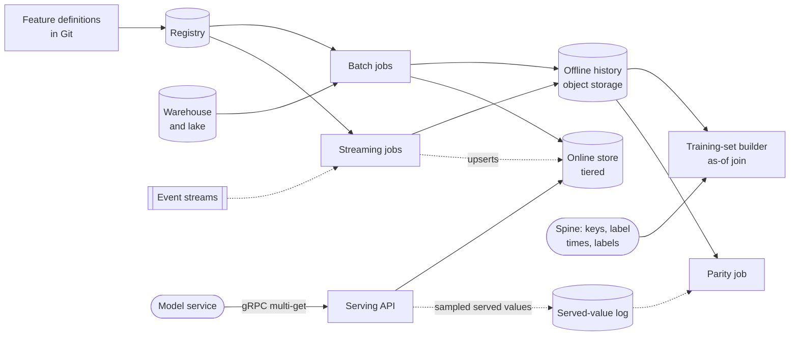
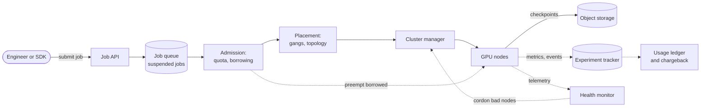
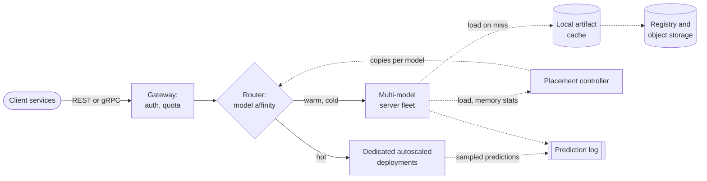
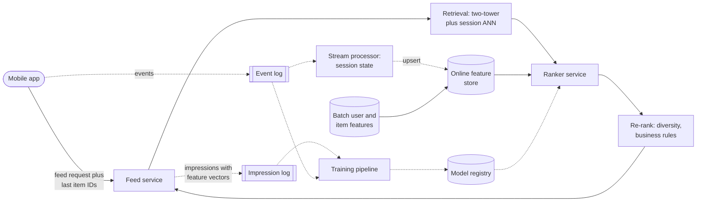
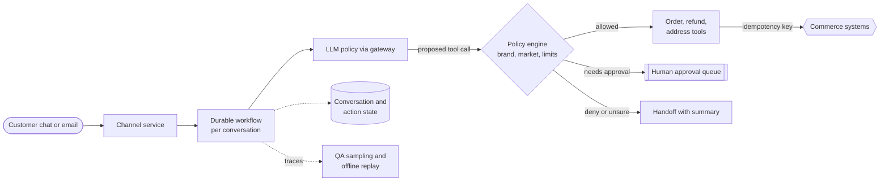
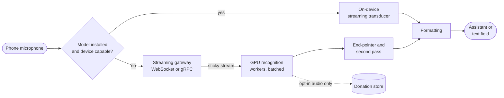

## 92.6 Hard (Q27–Q40)

Hard questions change the unit of design. Easy and Medium prompts ask for one model behind one product surface; Hard prompts ask for a **platform** that many models share (feature store, training, serving, experimentation, monitoring), a **pipeline** whose data volume or freshness is the problem (streaming personalization, perception data, federated learning), or an **LLM system** whose quality must be measured before it can be designed (RAG, support agent). The ML extension of §88.6 still applies, but in a platform question the "model" of steps M4–M6 is often a statistical procedure or a scheduling policy rather than a predictor, and the deciding deep dive is usually a correctness property: point-in-time joins, score parity, permission fidelity, sample-ratio checks.

Eight of the fourteen questions have a full case study or an owning chapter elsewhere in the book. For those, the solution below is the interview-length answer with the case's numbers, and the cross-reference carries the depth. The other six are full solutions. All designs are *Evidence: Illustrative*: teaching designs with assumed numbers, not descriptions of any company's system.

**Table 92.101 — Hard questions at a glance.**

| Q | Title | Solution | Deciding deep dive | Owner |
|---|---|---|---|---|
| 27 | Feature store | Compact | Availability-time as-of join; partition fan-out | §85.4, Ch 62 |
| 28 | ML training platform | Compact | Quota borrowing, preemption cost, goodput | §85.5, Ch 46 |
| 29 | Model serving platform | Compact | Popularity tiers; scale models, not servers | §85.6, Ch 66 |
| 30 | Real-time personalization | Full | Freshness race between events and the next request | §68.13, §85.7 |
| 31 | Billion-scale embedding retrieval | Full | Memory versus throughput sizing; tower–index version lock | §68.6, Ch 74 |
| 32 | Enterprise RAG assistant | Compact | Permissions as index data; revocation window | §86.4, Ch 75 |
| 33 | LLM customer-support agent | Compact | Proposal versus decision; cost per resolution | §86.7, Ch 77 |
| 34 | Speech recognition | Compact | Concurrent streams; end-pointing dominates latency | §84.6 |
| 35 | Machine translation | Compact | Simultaneous policy is a capacity decision | §84.7 |
| 36 | Perception data engine | Full | Trigger mining and auto-labeling economics | Ch 63 |
| 37 | Experimentation platform | Full | Power, variance reduction, sample-ratio mismatch | §57.14 |
| 38 | ML monitoring platform | Full | Alert design under thousands of tests; delayed labels | Ch 70 |
| 39 | Federated keyboard model | Compact | Round economics, secure aggregation, client DP | §71.11 |
| 40 | Two-sided marketplace matching | Full | Batched assignment with learned costs; switchback tests | §55.5 |

### 92.6.1 Q27. Feature store

**Difficulty:** Hard · **Time:** 45 min · **Related:** §85.4 (full case study), Ch 62 (feature stores), §89.8–§89.9 (cache and database sizing)

#### Prompt

"Ninety teams each build their own feature pipelines, and two incidents last quarter came from models that saw different feature values online than in training. Design a company-wide feature store."

#### Clarifying questions and assumptions

Which consumers matter (fraud scoring with a few keys, ranking with hundreds of keys per request, batch forecasting)? How fresh must streaming features be? Is the training-set builder in scope? Assume the §85.4 marketplace: 100 million users, 40 million items, 400 models (150 online), 120,000 serving calls/s at peak.

#### Requirements

Functional: declare features once in reviewed code; materialize batch and streaming views to an offline history and an online store; build point-in-time-correct training sets; serve feature vectors with defaults; log served values; discover and govern. Non-functional (Table 85.3): online p99 ≤ 10 ms; 99.99% of reads return values or declared defaults; streaming p99 age ≤ 60 s; ≥ 99.5% of logged served values reproduced exactly by the builder; 500 million rows × 400 features built in under 2 hours.

#### Estimation

::: example
**Worked example — Fan-out, memory and the training join (numbers of §85.4.4).** Reads use the key-count and partition-touch arithmetic of §62.11.1; memory uses the stored-bytes and fleet formulas of §89.6 and §89.10.

1. Keys: $100{,}000 \times 4 + 20{,}000 \times 151 = 3.42$ million keys/s; ranking is 17% of calls but 88% of keys.
2. A ranking read of 150 random items over $S = 48$ partitions touches $48\,(1 - (1 - 1/48)^{150}) = 46.0$ partitions; at 0.999 per sub-request it meets its deadline with probability $0.999^{46} = 0.955$.
3. Online memory: one copy 221.4 GB; with $r = 3$ and 60% memory utilization, 1,107 GB, about 18 nodes.
4. One training build: 25 views × 180 days × 2 GB/day = **9 TB scanned**.

**Interpretation.** The online store is small; the expensive things are partition fan-out and the training-set join. **Engineering implication.** Replicate the 19 GB item view in full so a ranking read is one call, and invest in the offline builder (bucketing, tiles) rather than in more online nodes.
:::

#### Data, labels and features

Entities (user, item, merchant, card), sources (event streams, warehouse tables), and three view types: batch (daily aggregates), streaming (velocity counters, seconds fresh) and on-demand (computed from the request). Every stored value carries an **availability time**, when it could have been read in production, not only the event time; the as-of join uses availability time (§62.8). Labels belong to consumers; the platform supplies the spine join.

#### High-level design

**Figure 92.101 — Feature store: one definition, two engines, a tiered online store.**

**Reading the diagram.** One reviewed definition drives both batch and streaming engines, which write the same values to offline history (object storage) and the online store. The serving path is synchronous: model services call the serving API with batched keys over gRPC. Streaming upserts and served-value logging are asynchronous (dotted). The training-set builder joins a spine to offline history by availability time; the parity job recomputes logged served values and reports the match rate as an SLO. Failure points: a stalled streaming job (values age, so the API returns age with each value and defaults past a bound), hot partitions under ranking fan-out, and builder jobs that scan terabytes. Scaling: replicate small entity views in full, partition large ones, and tile windowed aggregates.

#### Model and evaluation

There is no single model; the platform's "evaluation" is correctness. Gate every definition change on a parity test (offline recompute equals online value on sampled keys), a backfill-versus-streaming comparison within 0.1%, and a leakage check (no value with availability time after the label time). Measure adoption: share of online models reading from the store, and reuse rate of features.

#### Serving and monitoring

Hedged reads after the p95, declared defaults on deadline, value age returned with every vector. Monitor per view: age at read, materialization lag, null and default rates, drift (Ch 70), parity match rate, builder bytes scanned.

#### Deep dives

1. **Availability-time as-of join.** A daily batch view computed at 04:00 for yesterday must not be visible to a label at 01:00; joining on event time leaks it (§62.8).
2. **Per-entity layout.** Partition fan-out, not key count, decides ranking latency; full item replicas collapse 46 sub-requests into one.
3. **Streaming correctness.** At-least-once delivery with deduplication and idempotent upserts, measured against a batch recompute rather than claimed as exactly-once.

#### Trade-offs and alternatives

Warehouse as-of joins are simpler and fine below about 100 million rows; managed feature stores trade control for speed of adoption (§62.13); logging served features and training on the logs ("log and wait") removes skew for new features at the price of a delay before they can be used.

#### Follow-up questions

1. *Why not just use the warehouse?* At 500 million rows it shuffles 9 TB and usually joins on event time, not availability time.
2. *How do you prove online equals offline?* Sampled served-value logs recomputed by the builder; the match rate is an SLO with an owner.
3. *A streaming job stalls for 20 minutes.* Values age; consumers see the age, fall back to defaults or to the batch value past their bound; alert on lag, not on errors.
4. *How do you stop duplicate features?* Catalog search by entity and usage, near-duplicate detection and review before activation.

#### What distinguishes levels

- **Mid:** offline and online stores, a registry, batch materialization.
- **Senior:** point-in-time joins, batched reads, streaming views, skew detection.
- **Staff:** quantifies partition fan-out and changes layout per entity, joins on availability time, makes streaming correctness and parity measurable SLOs, and treats backfill as part of the definition.

### 92.6.2 Q28. ML training platform

**Difficulty:** Hard · **Time:** 45 min · **Related:** §85.5 (full case study), §46.10–§46.12 (gang scheduling, GPUs, backfill), §65.15–§65.16 (checkpointing, fault tolerance)

#### Prompt

"Eighty teams share 4,096 GPUs, each owning a fixed slice. Some slices idle at night while others queue for days. Design a self-service training platform."

#### Clarifying questions and assumptions

Job mix (notebooks and sweeps versus multi-node pre-training)? Are GPUs homogeneous? Is billing in scope? Assume §85.5: 3,072 H100-class and 1,024 A100-class GPUs; 25,000 jobs a week, 80% small (≤ 8 GPUs), 18% medium (16–128), 0.1% large (256–1,024).

#### Requirements

Functional: submit jobs and sweeps; guaranteed quota per team with borrowing of idle capacity; gang admission and topology-aware placement; preemption with notice; automatic restart from checkpoints; experiment tracking; cost reports. Non-functional (Table 85.7): small-job median wait ≤ 10 min; quota returned within 15 min; large jobs start within 4 h; ≥ 85% allocation; ≥ 95% goodput for jobs of 256+ GPUs; running jobs survive a control-plane outage.

#### Estimation

::: example
**Worked example — Capacity, demand and the cost of reclaiming (numbers of §85.5.4).** Fleet arithmetic is the redundant-fleet form of §89.10; preemption loss uses the formula of §85.5.4.

1. Capacity $4{,}096 \times 168 = 688{,}128$ GPU-h/week; demand $120{,}000 + 216{,}000 + 256{,}000 = 592{,}000$, an allocation of **86%**.
2. Large jobs are 0.1% of jobs and **43%** of GPU-hours.
3. Reclaiming a borrowed 32-GPU job (30-minute checkpoints, 5-minute restart): without checkpoint-on-signal $32 \times (15 + 5)/60 = 10.7$ GPU-h lost; with a 1-minute save on signal, $32 \times 6/60 = 3.2$ GPU-h. At 200 reclaims a week: 2,133 versus 640 GPU-h.
4. A 30B-parameter checkpoint at 14 bytes/parameter is 420 GB; draining it in 30 s is a 14 GB/s burst per job.

**Interpretation.** Two populations share one fleet: many small latency-sensitive jobs and a few huge gangs that dominate GPU-hours. **Engineering implication.** Backfill small jobs fast, reserve rack-aligned blocks for large gangs, lend idle quota only as preemptible capacity, and make checkpoint-on-signal part of the training library.
:::

#### Data, labels and features

The platform's data are job specifications, queue events, node health signals and per-job utilization (allocation, SM activity, MFU), plus experiment metadata: parameters, metrics, code and data versions (§69.7). The "labels" a platform learns from are job runtimes and failures, used to predict durations for backfill.

#### High-level design

**Figure 92.102 — Training platform control plane.**

**Reading the diagram.** Jobs enter the queue suspended; admission checks quota and decides whether a job runs on guaranteed or borrowed capacity; placement admits whole gangs onto topology-aligned nodes (§46.10–§46.11). Nodes write checkpoints to object storage and stream metrics asynchronously to the tracker and the ledger. The health monitor cordons nodes that fail checks. Failure points: a node failure kills a gang (restart from the last complete checkpoint on spare nodes), a control-plane outage (running jobs continue; only admission stops), and checkpoint bursts saturating storage. Scaling: the scheduler handles bursts of sweep submissions, not the 0.04 jobs/s average.

#### Model and evaluation

The "model" is the scheduling policy. Evaluate a new policy by replaying recorded job traces in a simulator (queue wait percentiles per class, allocation, goodput, fairness deviation) before rollout, then canary it on one pool.

#### Serving and monitoring

Monitor queue wait by class and team, allocation versus effective utilization (SM activity, MFU), preemptions and restarts per job, checkpoint durations, node failure rates. Report allocation and utilization separately: a measured cluster trace found GPUs in use averaged about 52% hardware utilization [Jeon et al. 2019].

#### Deep dives

1. **Quota borrowing and reclaim.** Guarantees per team, idle capacity lent as preemptible, reclaimed within 15 minutes with checkpoint-on-SIGTERM.
2. **Large gangs.** Reservations on rack-aligned blocks, backfilled with jobs predicted to finish before the reservation starts (§46.12.2).
3. **Reliability.** Asynchronous checkpoints, staggered across large jobs; elastic restart on fewer nodes; node burn-in before joining the pool.

#### Trade-offs and alternatives

Slurm gives mature backfill and reservations; Kubernetes gives a shared platform with serving and data jobs (§46.12.3). Fixed slices are simple and predictable but waste idle capacity; full sharing is efficient but needs preemption that teams trust.

#### Follow-up questions

1. *Why is 90% allocation not 90% utilization?* Idle notebooks, input stalls and low MFU hide inside allocated GPUs.
2. *How do large jobs ever start?* A reservation drains a block while backfill uses the drain window.
3. *A node fails mid-run of a 512-GPU job.* Cordon it, restart from the last manifest on a spare; lost work is about half a checkpoint interval times 512 GPUs.
4. *How do you stop teams hoarding?* Bill reserved quota whether used or not, and lend it out when idle.

#### What distinguishes levels

- **Mid:** a job queue on Kubernetes with GPU requests.
- **Senior:** gang scheduling, quotas, checkpoints and restart.
- **Staff:** quantifies preemption cost and the value of a utilization point, separates allocation from utilization, uses billing as an incentive, and treats 8-GPU and 512-GPU jobs with different policies.

### 92.6.3 Q29. Model serving platform

**Difficulty:** Hard · **Time:** 45 min · **Related:** §85.6 (full case study), §66.6–§66.12 (batching, autoscaling, cold start, rollout), Ch 79 (LLM-specific serving)

#### Prompt

"Three hundred teams have 5,000 models deployed, each as its own service with two replicas. Design a shared serving platform that cuts cost while keeping each team's latency objective and isolation."

#### Clarifying questions and assumptions

Popularity distribution? Runtimes (trees, scikit-learn, ONNX, GPU models)? Latency objectives by class? Assume §85.6: 300,000 predictions/s at peak; 50 hot models carry 85% of traffic, 950 warm carry 14.9%, 4,000 cold share 0.1%; 200 models need GPUs.

#### Requirements

Functional: deploy a registry version with a runtime and SLO class; predict over REST and gRPC; load models on demand; scale per model, including to zero resident copies; alias-based rollout with shadow and canary; tenant quotas; sampled prediction logging. Non-functional (Table 85.11): ≤ 5 ms p99 platform overhead for warm models; cold first request ≤ 2 s on CPU; one tenant at 10× quota raises others' p99 by ≤ 10%; platform cost ≤ 25% of one-deployment-per-model.

#### Estimation

::: example
**Worked example — Dedicated versus shared (numbers of §85.6.4).** CPU fleet sizing is the CPU-bound form of §89.10; prices \$0.04 per vCPU-hour and \$0.005 per GB-hour.

1. Dedicated: 10,000 pods, 10,000 vCPU and 9,920 GB: **\$449.6/h**, \$3.94 million a year.
2. Real work at peak: $300{,}000 \times 2$ ms $= 600$ busy vCPU; the baseline reserves 17 times that.
3. Shared: hot models dedicated and autoscaled, \$51.0/h; warm and cold on 16 multi-model servers sized by memory, \$20.5/h; total **\$71.5/h**, 16% of the baseline.
4. Cold start of a 300 MB CPU model on a warm server: $0.75 + 0.3 + 0.2 + 0.3 = 1.55$ s from object storage.

**Interpretation.** In the baseline, cost is redundancy floors for models nobody calls; in the shared design the long tail costs only memory. **Engineering implication.** Scale models (resident copies), not servers; keep the multi-model fleet warm with memory headroom.
:::

#### Data, labels and features

The platform handles artifacts (verified by digest), per-model traffic statistics that drive placement, and sampled prediction logs with model version and features for tenants' monitoring and training (§60.6.2). Labels remain the tenants' responsibility.

#### High-level design

**Figure 92.103 — Multi-tenant serving: tiers, affinity router and controller.**

**Reading the diagram.** The gateway authenticates and enforces per-tenant quotas; the router sends hot models to dedicated deployments and other models to a small set of home servers chosen by rendezvous hashing, so each model is resident on a few servers rather than all. On a miss, a server loads the artifact from a local cache or the registry. The controller adjusts copies per model from load statistics. Logging is asynchronous. Failure points: load storms after a restart (staged restarts preserve caches), cache thrash when memory is short, a slow or malicious model artifact (timeouts, sandboxes, safe formats). Scaling: add servers by memory; promote a warm model to the hot tier when its traffic warrants.

#### Model and evaluation

The platform's decision models are the placement and eviction policies. Evaluate them by replaying a week of request traces: cold-request rate, p99 by tier and isolation deviation. Affinity routing matters more than the eviction algorithm (§85.6.8).

#### Serving and monitoring

Per model and tenant: RED metrics, cold-request rate and latency, resident copies, evictions, version on every logged prediction; per server: memory, load queue, fair-share deviation. Cost per model from a ledger of memory-hours and CPU.

#### Deep dives

1. **Density.** Popularity tiers; affinity routing gives each model a few home servers; eviction by recency and size.
2. **Isolation.** Per-model concurrency limits, per-tenant fair queuing, timeouts, quarantine of slow models.
3. **Safe rollout.** Alias changes within 60 s, shadow and canary with automatic rollback (§66.12).

#### Trade-offs and alternatives

One deployment per model is simplest and isolates best but costs 6.3 times more here; serverless inference scales to zero but adds cold starts of minutes when nodes must be provisioned; GPU models pack on multi-model GPU servers or MIG slices (§66.8).

#### Follow-up questions

1. *Why not one Kubernetes deployment per model?* Redundancy floors cost \$3.9 million a year for 600 vCPU of real work.
2. *How do you avoid every server loading every model?* Rendezvous placement on a few home servers.
3. *How does one slow model not hurt others?* Concurrency caps, deadlines and fair queuing per tenant.
4. *How is an LLM gateway different?* Token-based quotas, KV-aware routing and adapters (Ch 79); same density and isolation principles.

#### What distinguishes levels

- **Mid:** a model server with autoscaling.
- **Senior:** multi-model servers with LRU eviction, canaries.
- **Staff:** quantifies popularity tiers, separates scaling models from scaling servers, shows affinity beats eviction policy, treats artifacts as untrusted code, and prices each tenant choice.

### 92.6.4 Q30. Real-time personalization with streaming features

**Difficulty:** Hard · **Time:** 45 min · **Related:** §68.13 (real-time personalization), §62.10 (freshness), §85.7 (low-latency inference), §31.5 (Kafka partitions)

#### Prompt

"Our shopping app's home feed is ranked once a day. Users browse a category and the feed still shows yesterday's interests. Design personalization that reacts to what the user does in the current session, within seconds."

#### Clarifying questions and assumptions

- Which surfaces? Home feed and "more like this" carousels; search is out of scope.
- How fast is "within seconds"? The next page load after a click should reflect it.
- Scale: assume 40 million daily active users, 25 interaction events and 15 feed requests per user per day, 3 sessions of 10 minutes each, peak-to-average 3.
- Existing stack: a daily batch recommender with two-tower retrieval and a ranker (§68.6–§68.7), and a feature store (Q27).

#### Requirements

Functional: rank about 500 candidates per feed request using long-term user features plus session features (items viewed, categories browsed, add-to-cart in the last minutes); retrieve candidates near the session's interests; log impressions and features for training.

Non-functional: feed p99 ≤ 150 ms server-side with a 40 ms ranking budget; session features reflect an event within 2 s at p99 when the client makes the next request; 99.95% availability, degrading to the daily ranking; online and offline feature values identical for at least 99.5% of logged requests.

#### Estimation

::: example
**Worked example — Events, requests, state and the freshness race.** Traffic uses the users-to-peak formula of §89.5; partitions use §89.11; concurrency uses Little's Law (§4.11).

1. Events: $4 \times 10^7 \times 25 = 10^9$ a day; average 11,574/s; **peak 34,722/s**. At 500 bytes each, 17.4 MB/s into the event log, comfortably served by 64 partitions with room for consumer parallelism.
2. Feed requests: $4 \times 10^7 \times 15 = 6 \times 10^8$ a day; **peak 20,833/s**; at 500 candidates each, **10.4 million scores/s**.
3. Ranker compute at 20 MFLOPs per candidate: $1.04 \times 10^7 \times 2 \times 10^7 = 2.1 \times 10^{14}$ FLOP/s; at an effective $10^{14}$ FLOP/s per GPU (10% of peak, typical for small ranking batches) about 2.1 busy GPUs, a few per region with headroom and redundancy.
4. Concurrent sessions: $4 \times 10^7 \times 3 / 86{,}400 \times 3 = 4{,}167$ starts/s at peak × 600 s = **2.5 million** open sessions; at 4 KB of session state each, 10 GB.
5. The race: if the gap between a click and the next feed request is exponential with mean 8 s and the streaming pipeline's lag is 5 s, then $1 - e^{-5/8} = 46\%$ of next requests arrive before the click is visible. Even a 1 s lag misses $1 - e^{-1/8} = 12\%$.

**Interpretation.** Volume and state are small; scoring is modest. The hard number is the race: a streaming pipeline cannot guarantee the *next* request sees the *last* event. **Engineering implication.** Carry the freshest signals in the request itself (the client sends its last few item IDs) and use the stream for everything older than a few seconds.
:::

#### Data, labels and features

- **Events:** views, clicks, add-to-cart, purchases, dwell time, with event time, session ID and device.
- **Labels:** click and add-to-cart on impressions (seconds to minutes), purchase within 24 hours (delayed). Positives are joined to impressions by impression ID.
- **Features:** long-term user embedding and affinities (daily batch); session features from the stream (category counts in the last 10 minutes with exponential decay, §68.13; last 20 item embeddings); request-time features sent by the client (last 5 item IDs, current category, time of day); item features (price, popularity in the last hour).
- **Skew hazard:** streaming aggregates are hard to reconstruct point-in-time offline. Log the exact feature vector used at each impression and train from the logs ("log and train"), so the training data contain what serving saw (§62.9.4).

#### High-level design

**Figure 92.104 — Session-aware personalization: request-time, streaming and batch features.**

**Reading the diagram.** The synchronous path (solid) runs from the app through retrieval, ranking and re-ranking; the request carries the client's last few item IDs so the freshest context has no pipeline lag. Events flow asynchronously (dotted) into the event log, where a stream processor keyed by user maintains session state and upserts it into the online store. Batch features are loaded daily. Impressions are logged with the exact feature vectors used, and the training pipeline joins them with later events for labels. Storage boundaries: event and impression logs (durable streams), online store, batch store, registry. Failure points: stream-processor lag (the request-time features still work; session features degrade to older values), online-store timeouts (defaults and the daily ranking), and a model trained on stale feature logic. Scaling: partition the event log and the stream processor by user ID; ranking scales horizontally per request.

#### Model and evaluation

- **Baseline:** the daily ranking plus a rule ("boost items in the last viewed category").
- **Production:** keep two-tower retrieval and add a session retrieval source (ANN on the mean of the last 5 item embeddings); rank with a multi-task model (click, add-to-cart, purchase) whose inputs include a short sequence encoder over the last 20 items (§68.7.4, §68.13).
- **Offline:** AUC and calibration per task, NDCG@10 on logged sessions, sliced by session depth (first request versus later requests), because the value of session features appears only after the first interaction.
- **Online:** A/B test randomized by user, primary metric purchases per user over 14 days; guardrails: latency, diversity, return rate. Watch for a novelty effect in the first week.

#### Serving and monitoring

Budget: retrieval 30 ms, feature fetch 20 ms (hedged), ranking 40 ms, re-ranking 10 ms, slack 50 ms (§60.10). Fallback ladder: full model → model without session features → daily ranking → popular items. Monitor stream lag (event time to state update) at p50 and p99, session-feature null rate, share of requests carrying request-time features, score distribution, CTR by session depth.

#### Deep dives

1. **The freshness race.** Streaming lag of seconds is enough to miss the last click on a fifth to a half of next requests. Request-time features from the client close the gap; the stream supplies the slightly older context; batch supplies the long term. Each layer has its own freshness budget (§62.10).
2. **Event time and session windows.** Late and out-of-order mobile events (offline phones) must be windowed by event time with a watermark; session windows close after inactivity. State is keyed by user, checkpointed, and rebuilt from the log after failure (§29.8).
3. **Training on what serving saw.** Because streaming features are expensive to recompute exactly offline, log the feature vector per impression and train from the logs; use point-in-time recomputation only for backfilling new features, with a parity check.

#### Trade-offs and alternatives

**Table 92.102 — Ways to react to a session, by freshness and cost.**

| Approach | Freshness | Cost and complexity | Choose when |
|---|---|---|---|
| Client-side re-ranking of a cached list | Instant | Low; limited model on device | Simple boosts, offline mode |
| Request-time features from the client | Instant | Low; trusts client input | Last few items, current category |
| Streaming session features | Seconds | Stream processor and state | Counts, decayed affinities, sequences |
| Micro-batch every few minutes | Minutes | Lowest infrastructure | Popularity and trend features |
| Online model updates | Minutes | High; stability risk | Fast-moving catalogs, news |

#### Follow-up questions

1. *The stream processor is down for 10 minutes.* Session features age; the request-time features still personalize; alert on lag, not on errors, and replay from the log on recovery.
2. *Can a malicious client forge request-time features?* It can bias its own feed only; validate IDs and cap their weight, and never use client-sent features for pricing or fraud.
3. *How do you avoid the feed collapsing onto one category after two clicks?* Diversity constraints in re-ranking (MMR, §68.10) and decay in session features.
4. *Why not update the model online?* Session features give most of the responsiveness with a stable model; online learning adds instability and harder rollbacks.
5. *How do you know session features help?* Slice the A/B result by session depth; the gain should rise after the first interaction.

#### What distinguishes levels

- **Mid:** adds streaming features to the existing ranker.
- **Senior:** designs the stream processor with event-time windows, defines the fallback ladder and logs features to avoid skew.
- **Staff:** quantifies the freshness race and moves the freshest signals into the request, assigns a freshness budget per feature layer, and evaluates by session depth so the benefit is measurable.

### 92.6.5 Q31. Billion-scale embedding retrieval

**Difficulty:** Hard · **Time:** 45 min · **Related:** §68.6 (two-tower models), Ch 74 (vector search; capacity §74.14), §81.4 (video recommendations), §81.10 (recommendation platform)

#### Prompt

"Our platform has 2 billion items (short videos and posts). Design the candidate-retrieval stage that returns the 1,000 most relevant items for a user in about 20 milliseconds, at 50,000 requests per second."

#### Clarifying questions and assumptions

- What happens after retrieval? A ranker scores the 1,000 candidates (out of scope, but it sets the recall target).
- How many new items a day? Assume 20 million; new items must be retrievable within 15 minutes.
- Embedding dimension? 256, learned by a two-tower model; assume nodes with 256 GB RAM and 64 cores.
- Filters? Language and safety eligibility, applied at retrieval time.

#### Requirements

Functional: compute a user embedding per request; search the item index for the top 1,000 by inner product with filters; add fresh items continuously; switch to new model versions without downtime.

Non-functional: retrieval p99 ≤ 20 ms; ANN recall@1,000 ≥ 0.90 against exact search with the same embeddings; 99.99% availability with fallback sources; new items searchable within 15 minutes; index rebuilt at least daily.

#### Estimation

::: example
**Worked example — Memory says one node, throughput says seven.** Apply the memory-bound and throughput-bound sizing of §74.14 (the vector form of §89.9–§89.10). Assume $N = 2 \times 10^9$, $d = 256$, 64 GB of usable RAM headroom aside, $u = 0.7$ (179 GB usable per 256 GB node), measured CPU per query $t_\text{cpu} = 4$ ms at the recall target, $\rho = 0.5$.

1. FP32 vectors: $2 \times 10^9 \times 1{,}024 = 2.05$ TB. INT8 with an HNSW graph ($256 + 260 + 8$ bytes): 1.05 TB, six shards per replica.
2. IVF-PQ with 64-byte codes and 8-byte IDs: $2 \times 10^9 \times 72 = 144$ GB: **one node holds a full replica**.
3. With 65,536 inverted lists, each holds about 30,500 items; probing 64 lists scans about 1.95 million codes per query, which is what the 4 ms measures.
4. Throughput: $50{,}000 \times 0.004 / 0.5 = 400$ cores, about **7 nodes** of 64 cores; with N+1, 8 full replicas per region.
5. Fresh items: 20 million a day in an HNSW delta index with FP32 vectors: $2 \times 10^7 \times (1{,}024 + 268) = 25.8$ GB.
6. Re-embedding the corpus after a model change at 50,000 items/s per GPU: $2 \times 10^9 / 5 \times 10^4 = 40{,}000$ GPU-s, **11 GPU-hours**, about \$28.

**Interpretation.** Compression turns a sharded 2 TB problem into a replicated 144 GB one, and replication is far simpler than scatter-gather. Re-embedding is cheap, so model upgrades are limited by index build and validation, not by compute. **Engineering implication.** Choose the compression first (it decides shard versus replicate), then size replicas by throughput, then add a small fresh index for new items.
:::

#### Data, labels and features

- **Training data:** (user, item) positive pairs from engagement (long watch, like, share) over the last 30 days, with event-time splits.
- **Negatives:** in-batch negatives with the logQ correction for popularity (§68.6.1) [Yi et al. 2019], plus sampled random negatives so rare items are pushed away from everything.
- **User tower features:** watch history (IDs and embeddings of the last 50 items), language, country, device, time; **item tower features:** content embedding (video and text encoders), creator, category, age, early engagement rates.
- **Hazard:** item-tower features that change after indexing (engagement counts) make the indexed vector stale; keep slowly changing features in the item tower and fast ones in the ranker.

#### High-level design

**Figure 92.105 — Two-tower retrieval with a main IVF-PQ index and a fresh delta index.**

**Reading the diagram.** A request computes the user embedding synchronously and searches one replica of the main index and the delta index in parallel; results are merged, filtered and deduplicated before the ranker. New items are embedded asynchronously and inserted into the delta index within minutes. A daily build re-embeds and re-indexes everything, then swaps replicas blue-green. The registry stores the user and item towers as one versioned pair. Failure points: a version mismatch between towers and index (vectors from different spaces give garbage silently), a slow replica (hedge to another), and a failed build (keep serving yesterday's index plus the delta). Scaling: add replicas for throughput; shard only if compression cannot keep a replica on one node.

#### Model and evaluation

- **Baseline:** popularity per country plus item-to-item co-engagement (§68.5.3).
- **Production:** two-tower model with sampled softmax and logQ correction; several retrieval sources merged (two-tower, co-engagement, followed creators, fresh items).
- **Offline:** recall@1,000 of held-out next engagements for the model with exact search, then ANN recall against exact search separately, so model quality and index quality are not confused. Slice by user activity and item age.
- **Online:** A/B on downstream watch time and engagement per user; guardrails on latency and creator diversity.

#### Serving and monitoring

Budget: user tower 5 ms, ANN 8 ms, merge and filter 3 ms, slack 4 ms. Fallbacks: if the user tower fails, use the cached daily user embedding; if the index fails, the co-engagement and popularity sources. Monitor ANN recall on a sampled exact-search shadow (nightly), per-source candidate counts, share of fresh items retrieved, embedding norm distributions (a broken tower shows as a shifted norm), and index build age.

#### Deep dives

1. **Shard or replicate.** Memory sizing decides whether a replica fits one node; throughput decides replicas. Scatter-gather over shards multiplies tail latency (the fan-out rule of §60.10), so compress until replication works.
2. **Version lock between towers and index.** Query and item embeddings are only comparable within one model version. Index builds carry the model version; the router queries an index only with the matching user tower; upgrades are blue-green on both together.
3. **Freshness and filtering.** New items enter a small HNSW delta index within minutes; filters for language and safety use per-list bitmaps or filtered graph search (§74.11) so that restrictive filters do not leave fewer than 1,000 results.

#### Trade-offs and alternatives

HNSW on INT8 vectors gives higher recall per millisecond but needs six shards per replica here; DiskANN keeps compressed codes in RAM and the graph on SSD (§74.10.2); GPU brute force over 2 billion vectors is exact but needs about 2 TB of GPU memory per replica [Johnson et al. 2021]. Generative retrieval and learned-index approaches exist but are harder to update and debug.

#### Follow-up questions

1. *Why not exact search?* At 2 billion × 256 dimensions, one query is 512 GFLOP of inner products; ANN at recall 0.90 costs a few milliseconds of one core.
2. *A new model version doubles offline recall but the A/B is flat.* The ranker was trained on the old candidate distribution; retrain or fine-tune the ranker on the new candidates before testing.
3. *How do you handle deleted or banned items?* Tombstones checked at merge time, then removal at the next build.
4. *Popular items dominate retrieval.* LogQ correction in training, per-source quotas at merge, and diversity in re-ranking.
5. *How do you detect index degradation?* Nightly shadow exact search on sampled queries; alert when ANN recall drops below target.

#### What distinguishes levels

- **Mid:** two-tower model plus an off-the-shelf ANN index.
- **Senior:** sizes memory and throughput, adds negatives with popularity correction, separates model recall from ANN recall.
- **Staff:** chooses compression to avoid sharding, versions towers and index as a pair with blue-green swaps, designs freshness through a delta index, and connects retrieval changes to ranker retraining.

### 92.6.6 Q32. Enterprise RAG assistant

**Difficulty:** Hard · **Time:** 45 min · **Related:** §86.4 (full case study), Ch 75 (RAG architecture; permissions §75.14), §78.9–§78.10 (groundedness, RAG evaluation)

#### Prompt

"Design an assistant that a company's employees use to ask questions across the company's documents (Drive, SharePoint, Confluence, tickets). Answers must cite sources and must only use documents the asking employee may open."

#### Clarifying questions and assumptions

Single company or a SaaS vendor serving many? Which sources and how do their permissions change? Is a revocation lag acceptable, and how long? Assume the §86.4 vendor: 2,000 tenants, 4 million seats, 30% daily active, 5 questions per active user per day.

#### Requirements

Functional: streamed answers with inline citations; connectors with initial crawl and incremental sync of content, deletions and permissions; search fallback when no grounded answer exists. Non-functional: permission fidelity within a stated sync lag (for example, revocations effective within 15 minutes at p99, verified again at query time); TTFT p95 ≤ 2 s; tenant isolation; no training on tenant data.

#### Estimation

::: example
**Worked example — Queries, corpus and cost per seat (numbers of §86.4.4).** Peak uses §89.5; the per-request cost uses the formula of §88.8; index memory uses §74.14.

1. Questions: $4 \times 10^6 \times 0.30 \times 5 = 6$ million a day; 69.4/s average, **208/s at peak**.
2. Routing 70% to a small model (\$0.00111 per answer) and 30% to a frontier model (\$0.0167): **\$0.00579 per answer**, \$34,700 a day, \$0.26 per seat per month.
3. Corpus: $5 \times 10^8$ documents, $10^{12}$ tokens, $3 \times 10^9$ chunks; index at 1,352 bytes per chunk (INT8 vector, graph links, metadata with ACL principals): **4.06 TB** per replica.
4. Initial embedding: 1,712 GPU-hours, about \$4,280; daily churn 8.6 GPU-hours.

**Interpretation.** Retrieved context is two-thirds of each prompt, so $k$ and chunk size drive the bill; embedding is cheap and the onboarding bottleneck is the source systems' rate limits. **Engineering implication.** Route by difficulty, keep $k$ small with a reranker, and schedule crawls under each source's API limits.
:::

#### Data, labels and features

Chunks with metadata: tenant, source, document ID, ACL principals (users and *unexpanded* group IDs), freshness timestamps. A separate group-membership mirror per tenant. Labels for retrieval come from graded judgments, citation clicks and calibrated LLM judges (§75.13); generation is judged on groundedness and correctness (§78.9).

#### High-level design

**Figure 92.106 — Permission-aware RAG: the index stores principals, the query expands the user.**

**Reading the diagram.** Ingestion is asynchronous: connectors crawl content and permissions, chunks carry their ACL principals, and group changes update only the mirror. At query time the orchestrator expands the user into principals, retrieves with a permission filter inside the index, reranks, re-checks the top chunks against the source (the live check) and only then builds the prompt. Failure points: a missed revocation webhook (reconciliation sweeps bound the window; the live check catches the rest), cross-tenant leakage (per-tenant indexes and keys), and injection in retrieved documents. Scaling: index replicas by memory per tenant group; the LLM tier through the gateway.

#### Model and evaluation

Baseline: keyword search with snippets. Production: hybrid lexical and dense retrieval, cross-encoder reranker, routed generation with citation constraints. Offline: per-tenant synthetic and consented evaluation sets measuring retrieval recall, citation precision, groundedness and refusal on unanswerable questions; online: citation clicks, thumbs, reformulation rate.

#### Serving and monitoring

Monitor per tenant and source: freshness lag, revocation lag p99, reconciliation mismatches, empty-retrieval rate, groundedness on sampled answers, cost per answer. Fallback: ranked document list when generation fails or evidence is insufficient.

#### Deep dives

1. **Permissions as index data.** Filter inside retrieval; store group IDs, not expanded members, so renaming a 50,000-member group is one mirror update.
2. **Revocation window.** Per-source lag metrics, reconciliation, and a live check bounded to the top 10–20 chunks.
3. **Evaluation without reading customer data.** Synthetic questions generated inside the tenant boundary, judged automatically, with aggregates reported out.

#### Trade-offs and alternatives

Filtering after generation leaks paraphrases; a per-user index is exact but unaffordable; fine-tuning on tenant documents cannot enforce permissions and must be avoided for knowledge (§76.14).

#### Follow-up questions

1. *Why not filter the answer afterwards?* The model may paraphrase a forbidden document; enforcement must precede the prompt.
2. *How do you know a revocation has propagated?* Source-event-to-mirror lag per source, plus reconciliation and the live check.
3. *A tenant asks for proof you never trained on their data.* Contract, configuration (no retention at model providers) and audit logs.
4. *Answers are confidently wrong on old policies.* Freshness-aware ranking and showing document dates with citations.

#### What distinguishes levels

- **Mid:** chunk, embed, retrieve, generate with citations.
- **Senior:** filters inside retrieval and keys caches by permission, evaluates groundedness.
- **Staff:** quantifies the revocation window by source, explains unexpanded principals, bounds the live check's cost and designs per-tenant evaluation that never exports customer text.

### 92.6.7 Q33. LLM customer-support agent

**Difficulty:** Hard · **Time:** 45 min · **Related:** §86.7 (full case study), Ch 77 (agents: tools §77.5, state §77.10, human-in-the-loop §77.12, cost §77.17), Ch 78 (evaluation)

#### Prompt

"An e-commerce group with eight brands in 30 markets wants an AI agent that answers customers and, within policy, issues refunds, cancels orders and changes addresses. Design it."

#### Clarifying questions and assumptions

Which actions are in scope first? What does a human-handled contact cost? What is the refund limit without approval? Assume §86.7: 100,000 contacts a day (70% chat), \$4.50 per human contact, peak-to-average 3, conversations that can last days across channels.

#### Requirements

Functional: answer and act through tools; hand off to humans with a summary; agent-assist mode for human agents; per-brand, per-market policies. Non-functional: no duplicate or unauthorized money movements; first response p95 ≤ 3 s; wrong-action rate below 0.5% on QA samples; every action auditable; customers can always reach a human.

#### Estimation

::: example
**Worked example — Load is small; the business case is not (numbers of §86.7.4).** Concurrency uses Little's Law (§4.11); agent cost uses §77.17.1; the blended-cost formula is §86.7.4's.

1. Peak 3.47 contacts/s; concurrent chats $3.47 \times 0.7 \times 540$ s $= 1{,}313$; model calls 1.06 million a day, **36.7/s at peak**.
2. Agent-side cost per chat contact: tokens \$0.176, auxiliary calls \$0.0005, orchestration \$0.04, approvals \$0.06, wrong actions \$0.10: $C_a = \$0.377$.
3. With 65% of contacts covered and 30% of those escalated ($k = 0.9$): covered contact $0.377 + 0.30 \times 0.9 \times 4.50 = \$1.59$; blended $0.65 \times 1.59 + 0.35 \times 4.50 = \$2.61$ against \$4.50.

**Interpretation.** Tokens are under half of the agent's own cost, and escalations are three-quarters of a covered contact's cost. **Engineering implication.** Invest in resolution quality and safe coverage; optimize tokens last.
:::

#### Data, labels and features

Conversation history, order and customer facts from tools, policies as code per brand and market. Labels: resolution without repeat contact within 7 days (delayed), refund reversals and chargebacks (weeks), QA reviews of sampled conversations, human edits in assist mode.

#### High-level design

**Figure 92.107 — Support agent: the model proposes, the policy engine decides.**

**Reading the diagram.** Each conversation is a durable workflow (§77.8.2) that survives restarts and multi-day gaps. The LLM proposes replies and tool calls; a deterministic policy engine decides whether to execute, queue for human approval or hand off. Tools call commerce systems with idempotency keys persisted before the call. State and traces are written asynchronously for QA and replay. Failure points: a tool timeout with unknown outcome (reconcile before retrying), a promise in text without a succeeded action (output guardrail), injection through customer text or retrieved policy pages. Scaling: workflows scale horizontally; the gateway quota of about 37 calls/s is modest.

#### Model and evaluation

Baseline: intent classifier plus scripted flows. Production: LLM policy with tools and a small model for intent and risk. Offline: replay suites per intent with end-state checks (was the refund the right amount, exactly once?) and pass^k for reliability (§78.6.4); online: rollout by intent, resolution and repeat-contact rate, escalation rate, wrong-action rate from QA.

#### Serving and monitoring

Per intent, brand and market: resolution, repeat contact, handoff and approval rates, refund amounts per customer, guardrail triggers, cost per contact. Fallback: handoff to humans with summary; disable an intent's autonomy by configuration.

#### Deep dives

1. **Proposal versus decision.** The model never moves money directly; the policy engine and tool layer do.
2. **Idempotency and unknown outcomes.** Keys derived from the logical action; reconciliation before retry.
3. **Rollout by intent.** Assist mode first as evidence, then read-only intents, then low-limit refunds in one market.

#### Trade-offs and alternatives

Scripted flows are safe but brittle; full autonomy maximizes coverage but concentrates risk; multi-agent splits are unnecessary for short sequential tasks (§77.9.1).

#### Follow-up questions

1. *How do you prevent duplicate refunds?* Idempotency key persisted before the call; reconcile unknown states.
2. *The model says "your refund is approved" before the tool runs.* Output guardrail blocks promises without an action record.
3. *Why not measure deflection?* A customer who gives up and calls is a failure; measure resolution without repeat contact.
4. *Refund abuse rises after launch.* Per-customer refund velocity limits, risk scores in the policy engine and human review above thresholds.

#### What distinguishes levels

- **Mid:** an LLM with tools and a handoff.
- **Senior:** guardrails, approvals, durable state, intent-based evaluation.
- **Staff:** separates proposal from decision, quantifies cost per resolution with escalation as the dominant term, rolls out by intent with assist mode as evidence, and anticipates adversarial adaptation.

### 92.6.8 Q34. Speech recognition

**Difficulty:** Hard · **Time:** 45 min · **Related:** §84.6 (full case study), §9.9 (long-lived connections)

#### Prompt

"Design the speech recognition behind a phone assistant and dictation keyboard. Words should appear while the user speaks, and a contact name like 'Maya Chen' must be recognized."

#### Clarifying questions and assumptions

On-device, cloud or both? Languages? Privacy constraints on audio? Assume §84.6: 50 million daily users, 10 utterances of 4 s each per day, peak-to-average 3, 60% of audio recognized on device.

#### Requirements

Functional: streaming partial results every 100–200 ms; end-pointing; contextual biasing with per-request phrases; formatting; opt-in audio donation. Non-functional: first partial ≤ 300 ms (p90); final ≤ 500 ms after speech ends (p90); WER ≤ 6% on the voice-search set; contact-name recall ≥ 95%; every accent slice within 1.5× of overall WER; audio not stored without opt-in.

#### Estimation

::: example
**Worked example — Streams, not requests (numbers of §84.6.4).** Concurrency is Little's Law (§4.11); per-GPU capacity uses §84.6's real-time-factor formula.

1. Audio: $5 \times 10^8$ utterances × 4 s $= 2 \times 10^9$ s a day; average concurrent streams 23,148; peak 69,444; **27,778 in the cloud**.
2. A 160 ms chunk advanced for 120 streams in 32 ms: RTF 0.2, five steps per chunk period, 600 streams per GPU.
3. GPUs at 70% utilization: $27{,}778 / (600 \times 0.7) = 66$.
4. Final latency with a 600 ms silence timeout: $600 + 32 + 50 + 40 = 722$ ms, failing the target; with a learned end-of-query detector at 300 ms: 422 ms.

**Interpretation.** Speech is a concurrency problem, and end-pointing, not the model, dominates final latency. **Engineering implication.** Size gateways for long-lived streams, spend effort on the end-pointer, and move recognition on device for privacy and cost.
:::

#### Data, labels and features

Log-mel frames every 10 ms; transcribed audio from vendors and opted-in donations; pseudo-labels from large offline teacher models; per-request bias lists (contacts, app names) that stay on the device or in memory.

#### High-level design

**Figure 92.108 — Streaming recognition on device and in the cloud.**

**Reading the diagram.** Each utterance runs on device when possible; otherwise audio streams over a long-lived connection to a GPU worker that batches many streams per step. Partials flow back continuously; the end-pointer finalizes, an optional second pass rescores, and formatting converts spoken to written forms. Only opted-in audio reaches the donation store, asynchronously. Failure points: a worker failure mid-stream (the client reconnects and resends the buffered audio), falling behind real time under load (admission control), and early cutoffs. Scaling: by concurrent streams per GPU; on-device share is the largest lever.

#### Model and evaluation

Baseline: a hosted batch recognizer on full utterances (fails partials). Production: streaming encoder–transducer with chunked attention, biasing via a prefix tree of phrases, learned end-of-query detection [Graves 2012; He et al. 2019]. Offline: WER after text normalization, entity accuracy for names, early-cutoff rate, slices by accent and device. Online: retry, edit and cancellation rates.

#### Serving and monitoring

Per worker: RTF and stream lag; per locale and device: first-partial and final latency, early-cutoff rate, bias false-trigger rate. Fallback: degrade to final-only results under overload rather than drop streams.

#### Deep dives

1. **Latency decomposition.** Chunk size sets partial latency and GPU efficiency; the end-pointer dominates final latency.
2. **Contextual biasing.** Contact names compiled into a biasing structure; evaluate recall and false triggers.
3. **Improvement without collecting audio.** Opt-in donations, teacher pseudo-labels, federated learning (Q39).

#### Trade-offs and alternatives

A large attention-based model on 30-second windows is accurate for batch transcription but not streaming; on-device models save cost and network delay but cost engineering per device class.

#### Follow-up questions

1. *Users say it cuts them off.* Plot early-cutoff rate against end-point latency by slice; slower speakers need a later decision.
2. *How do you recognize a name the model never saw?* Biasing from the device's contacts.
3. *How do you size the fleet?* Concurrent streams divided by streams per GPU at target utilization.
4. *Why not a single global model?* Per-language models or a multilingual model with language ID; measure per locale.

#### What distinguishes levels

- **Mid:** a streaming model and WER.
- **Senior:** sizes by concurrent streams, adds biasing and slices.
- **Staff:** decomposes final latency to show the end-pointer dominates, normalizes text before WER, treats on-device as a privacy and cost lever, and designs improvement around consent.
