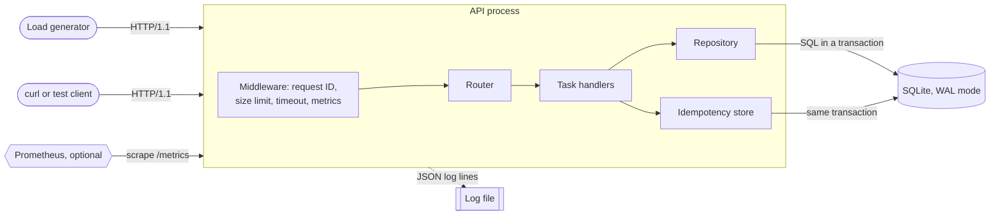

# Chapter 93 — Project Handbook

> **Level:** 1–5 · **Track:** Shared · **Estimated reading time:** 8 h (building the projects: 10–100 h each)

Reading about a write-ahead log and writing one are different experiences. When you write it, you discover that a torn record at the end of the file is a normal event, that `fsync` costs milliseconds, and that "the follower is a little behind" means something very specific when the primary dies. This chapter turns the book into twenty build projects, arranged in four levels, so that you can have those discoveries on your own laptop rather than in production or in an interview.

Each project is a scaled-down version of a system that the book designs at full size. The URL shortener of §52.4 handles 280,000 redirects per second across a fleet; your version handles a few thousand per second on one machine. The mechanisms are the same: a code generator that never collides, a cache in front of a store, an asynchronous click path. What you lose in scale you gain in visibility. You can kill any process, delay any message and read every byte on disk, and you can measure what happens.

**How to use the projects.** Pick a level that matches what you already know, read the project's prerequisites, and skim the owning chapter sections before you start. Then work through the milestones in order. Each milestone ends with a **done when** statement: a check you can run, not a feeling. Do not move on until it passes. Keep two files next to your code from the first day: a one-page design document (requirements, the architecture figure redrawn in your own words, the decisions you made and why), and a results log in which every measurement is recorded with the hardware, Python version, command line and date. The results log is what turns a toy into evidence. When an interviewer asks "how do you know?", you will have an answer (§93.7 shows how to talk about a project in an interview).

The starter code in each project is deliberately small: a runnable core of 60–120 lines that demonstrates the central mechanism and prints its result. It is not a solution. The milestones ask you to replace almost all of it. Every starter was run with Python 3.13 on Linux, and its printed output is quoted below it. Where a starter uses randomness, it fixes the seed, so you should see exactly the same output.

::: note
**Tooling assumptions for every project in this chapter.**

- **Language.** Python 3.11 or later, standard library first (`http.server`, `asyncio`, `socket`, `sqlite3`, `threading`, `heapq`, `hashlib`, `unittest`). Where a third-party package makes a milestone much easier (an HTTP client for load tests, a WebSocket library, a Prometheus client), the milestone says so and the package is optional. You may port any project to Go, Java or Rust once the Python version works; the measurements then change, and that comparison is itself instructive (§23.9).
- **Containers.** Docker is optional. It is useful for running a real Redis, PostgreSQL or Kafka next to your own implementation for comparison, and for running several copies of a node with separate network namespaces (§42.3). Nothing in Part A requires it.
- **Local only.** No cloud account, no paid service and no real e-mail, SMS or push provider. External systems are replaced by fakes you write, which is also the only way to inject their failures on demand.
- **Hardware.** One laptop or workstation with 4 or more cores and 8 GB of memory. Targets are stated for that machine. Loopback networking flatters latency (a round trip is tens of microseconds instead of the ~0.5 ms of a datacenter network, §4.17), so when a target concerns distribution rather than raw speed, the project asks you to add artificial delay.
:::

**Measuring honestly.** Report latency as percentiles (p50, p99), never as an average alone (§4.8, §40.5.2). Warm up before measuring, run each measurement at least three times and report the spread, and record whether your load generator is open-loop (sends at a fixed rate regardless of responses) or closed-loop (each worker waits for its previous response). Closed-loop generators hide queueing delay, a problem known as coordinated omission (§23.5). Every load-test target in this chapter is stated for an open-loop generator unless it says otherwise.

**Self-assessment.** Each project ends with a rubric of five dimensions scored 1–3: **1 — Working** (it runs and the happy path is correct), **2 — Solid** (failure cases handled, measured against the targets), **3 — Interview-ready** (you can explain each design choice, its alternative and the number that decided it). A total of 12 or more out of 15 means the project is ready to discuss in an interview; below 10 means a milestone was skipped.

**Table 93.1 — Project map.**

| § | Project | Level | Core concepts exercised | Owning chapters and case studies |
|---|---|---|---|---|
| 93.1.1 | REST API service | Beginner | Resource design, idempotency, pagination, persistence, observability | §8.6, §22.15, §40.4–40.5 |
| 93.1.2 | URL shortener | Beginner | ID generation, base62, cache-aside, redirect latency | §52.4, §17.10, §20.7 |
| 93.1.3 | Redis-style cache | Beginner | Wire protocol, TTL and expiry, eviction, persistence | §20.6, §20.8–20.9 |
| 93.1.4 | Rate limiter | Beginner | Token bucket, sliding window, distributed counters | §22.3–22.8, §52.6 |
| 93.1.5 | Load-balancer simulation | Beginner | Health checks, ejection, draining, retry budgets | §19.4–19.8, §22.12 |
| 93.2.1 | Message queue | Intermediate | Append-only log, offsets, consumer groups, acknowledgments | Ch 30, Ch 31 |
| 93.2.2 | Distributed key-value store | Intermediate | Consistent hashing, quorums, hinted handoff, rebalancing | §14.8, §27.7–27.9, §52.8 |
| 93.2.3 | Replicated database simulation | Intermediate | WAL shipping, replication lag, failover, fencing | §14.4, §27.4, §27.11, §26.13 |
| 93.2.4 | Notification service | Intermediate | Priority queues, deduplication, retries, preferences | §52.7, §30.10–30.11 |
| 93.2.5 | Real-time chat | Intermediate | Persistent connections, per-conversation ordering, sync | Ch 9, §53.4 |
| 93.3.1–93.3.5 | Job scheduler, event-driven microservices, real-time analytics, recommendation engine, distributed ML inference | Advanced | See §93.3 | §52.9, Ch 32, §56.7, Ch 68, Ch 66 |
| 93.4.1–93.4.5 | Distributed training, multi-tenant feature store, production RAG, LLM inference platform, multi-agent orchestration | Expert | See §93.4 | Ch 65, Ch 62, Ch 75, Ch 73, Ch 77 |

Beginner projects take roughly 10–20 hours each and Intermediate projects 20–40 hours. They build on each other: the rate limiter reuses the cache's TTL logic, the notification service sits on top of the message queue, and the chat server reuses the REST service's operational scaffolding. If you only have time for four projects in Part A, build the REST API service, the Redis-style cache, the message queue and the distributed key-value store; together they exercise almost every Book I chapter that interviews probe.

## 93.1 Beginner

The five Beginner projects are single-process or single-machine systems. Each one isolates one idea that every larger design depends on: a well-behaved API, a collision-free identifier, a cache with expiry and eviction, admission control, and traffic distribution under failure. None needs consensus or replication, which keeps your attention on getting the mechanism right and measuring it.

### 93.1.1 REST API service

#### Goal and learning outcomes

Build a small task-tracking API (`/tasks`) that behaves like a production service: correct status codes, validated input, stable pagination, safe retries, durable writes, structured logs and metrics, and a measured capacity. The domain is deliberately boring so that every hour goes into the properties that make an API trustworthy. Almost every later project in this chapter exposes an HTTP interface, and they all reuse what you build here.

After this project you should be able to:

- Design resource URIs, methods and status codes that follow HTTP semantics, and explain which methods are safe and idempotent (§8.6.3).
- Implement cursor pagination that stays correct while rows are being inserted, and explain why offset pagination does not (§8.6.5).
- Make `POST` retry-safe with an idempotency key, including the concurrent-duplicate case (§22.15).
- Persist data in SQLite with transactions and survive `kill -9` without losing an acknowledged write.
- Instrument a service with request IDs, structured logs, a latency histogram and health endpoints, and shut it down gracefully.
- Run an open-loop load test, find the saturation point, and explain the result with Little's Law (§4.11).

#### Prerequisites

- Client–server model and statelessness — §8.3; the request–response lifecycle — §8.5.
- REST design: resources, methods, status codes, pagination, problem-details errors — §8.6.2–8.6.7.
- Idempotency keys — §22.15; timeouts — §22.11.
- Transactions and indexes — §11.7, §11.11; write-ahead logging and `fsync` — §13.5, §13.12.
- Structured logs, correlation IDs and metric types — §40.4.1–40.4.2, §40.5.1; percentiles — §4.8.

#### Specification

**Functional requirements.**

1. `POST /tasks` creates a task from `{"title": ..., "due": ...}`, returns `201 Created` with a `Location` header and the stored representation. A request carrying an `Idempotency-Key` header that has been seen before returns the original response and creates nothing. Reusing a key with a different body returns `422`.
2. `GET /tasks/{id}` returns `200` with an `ETag`, or `404`.
3. `GET /tasks?done=false&limit=50&cursor=...` returns a page and a `next_cursor`, which is `null` on the last page. `limit` is capped at 100.
4. `PATCH /tasks/{id}` with `If-Match` updates fields; a stale `ETag` returns `412 Precondition Failed` (optimistic concurrency).
5. `DELETE /tasks/{id}` returns `204`, and `204` again on repetition (idempotent).
6. All errors use `application/problem+json` (RFC 9457, §8.6.7). Oversized bodies (over 16 KB) return `413`; malformed JSON returns `400`; schema violations return `422`.
7. `GET /healthz` (process alive), `GET /readyz` (database reachable), `GET /metrics` (Prometheus text format, §40.8).

**Non-functional requirements.**

**Table 93.2 — REST API service: non-functional targets (one laptop, loopback).**

| Property | Target | How you verify it |
|---|---|---|
| Read latency | `GET /tasks/{id}` p99 ≤ 20 ms at 300 RPS for 60 s | Open-loop load test, latency histogram |
| Write latency | `POST /tasks` p99 ≤ 50 ms at 100 RPS with durable commits | Same, with SQLite `synchronous=FULL` |
| Errors under target load | 0 server errors (5xx) | Load-test report |
| Durability | No acknowledged `201` lost after `kill -9`, over 100 trials | Crash test script |
| Idempotency | 50 concurrent `POST`s with one key create exactly 1 task | Concurrency test |
| Graceful shutdown | On SIGTERM, in-flight requests complete; exit within 5 s | Shutdown test |
| Overload behavior | At 2× the saturation rate, p99 of accepted requests stays ≤ 200 ms; excess gets `503` with `Retry-After` | Overload test |

Out of scope: authentication (add it as an extension), multi-node deployment, and a user interface.

#### Architecture

**Figure 93.1 — REST API service: components and request path.**



**Reading the diagram.** Clients (your load generator and ad-hoc `curl` calls) send synchronous HTTP/1.1 requests to a single API process. Inside it, every request first passes through middleware that assigns a request ID, rejects oversized bodies, starts a deadline timer and records a latency observation; the router then dispatches to a handler. Handlers never touch SQL directly: they call a repository, which keeps storage concerns in one place and lets you swap SQLite for PostgreSQL later. The idempotency store lives in the same SQLite file and, crucially, is written in the **same transaction** as the task it protects, so a crash can never leave a task without its idempotency record or vice versa. The storage boundary is the SQLite file in write-ahead-log mode (§13.5); everything above it is stateless and could be replicated behind a load balancer. The dotted arrow to the log file is asynchronous from the request's point of view: logging must never fail a request. Prometheus, if you run it in Docker, pulls metrics (§40.8.1). Failure points to study: the database (locked, slow or full disk), the process (killed mid-request) and the client (retrying after a timeout). Scaling: run several API processes behind the load balancer of §93.1.5; the single SQLite writer then becomes the bottleneck, which is the motivation for a client–server database.

#### Milestones

1. **Core resource model (in memory).** Start from the starter code. Add `PATCH` with `ETag`/`If-Match`, `DELETE`, the `done` filter and the `400`/`413`/`422` distinctions. Write an OpenAPI description of the five operations (§8.16). *Done when:* a `unittest` suite of at least 20 cases covering every status code in the specification passes.
2. **Durable storage.** Replace the dictionaries with SQLite: a `tasks` table with an index on `(done, id)` for the filtered list, and an `idempotency_keys` table holding the key, a SHA-256 fingerprint of the request body, the status and the response body. Write both rows in one transaction. Enable WAL mode and `synchronous=FULL`. *Done when:* a script that starts the server, sends `POST`s in a loop, and kills the process with SIGKILL at a random moment finds every acknowledged task after restart in 100 out of 100 trials.
3. **Operability.** Emit one JSON log line per request (`ts`, `request_id`, `method`, `route`, `status`, `duration_ms`); accept an incoming `X-Request-ID` or generate one. Expose a request counter by route and status, and a latency histogram with buckets from 1 ms to 1 s, at `/metrics`. Add `/healthz` and `/readyz`. Handle SIGTERM by flipping `/readyz` to `503`, finishing in-flight requests and exiting. *Done when:* the shutdown test shows zero failed in-flight requests, and you can compute p99 from your histogram and compare it with the load generator's figure.
4. **Robustness under load.** Bound the number of concurrent requests (for example with a semaphore of 64) and reject excess with `503` and `Retry-After: 1` rather than queuing without limit (§22.9). Give every request a 2 s deadline. *Done when:* the overload test in the targets table passes.
5. **Capacity report.** Measure p50 and p99 against offered load from 100 RPS upward in steps of 100 until p99 exceeds 100 ms or errors appear. Plot or tabulate the curve, mark the knee, and explain it. *Done when:* your results log contains the curve for reads and for writes, and a one-paragraph explanation that names the bottleneck resource (CPU, the Python GIL, or SQLite's single writer) with evidence from a profile (§23.4).

#### Starter code

The starter serves `POST /tasks`, `GET /tasks/{id}` and a cursor-paginated list from memory, with problem-details errors and an idempotency key, then exercises itself with a few requests. It binds to port 0 so that the operating system picks a free port.

```python
"""Tasks API: a minimal REST service on the standard library (starter core)."""
import json, threading, urllib.request, urllib.error
from http.server import BaseHTTPRequestHandler, ThreadingHTTPServer
from urllib.parse import urlparse, parse_qs

TASKS, IDEMPOTENCY, LOCK = {}, {}, threading.Lock()   # id -> task; key -> (status, body)

class Handler(BaseHTTPRequestHandler):
    def send_json(self, status, body, headers=None):
        data = json.dumps(body).encode()
        self.send_response(status)
        ctype = "application/problem+json" if status >= 400 else "application/json"
        self.send_header("Content-Type", ctype)
        self.send_header("Content-Length", str(len(data)))
        for k, v in (headers or {}).items():
            self.send_header(k, v)
        self.end_headers()
        self.wfile.write(data)

    def problem(self, status, title):                     # RFC 9457 error body
        self.send_json(status, {"type": "about:blank", "title": title, "status": status})

    def do_POST(self):
        if self.path != "/tasks":
            return self.problem(404, "Not Found")
        try:
            body = json.loads(self.rfile.read(int(self.headers.get("Content-Length", 0))))
            title = body["title"].strip()
            assert 0 < len(title) <= 200
        except Exception:
            return self.problem(422, "title must be a 1-200 character string")
        key = self.headers.get("Idempotency-Key")
        with LOCK:
            if key in IDEMPOTENCY:                          # replay: same response, no new task
                return self.send_json(*IDEMPOTENCY[key])
            task = {"id": len(TASKS) + 1, "title": title, "done": False}
            TASKS[task["id"]] = task
            if key:
                IDEMPOTENCY[key] = (201, task)
        self.send_json(201, task, {"Location": f"/tasks/{task['id']}"})

    def do_GET(self):
        url = urlparse(self.path)
        parts = url.path.strip("/").split("/")
        if parts == ["tasks"]:                              # cursor pagination by id
            q = parse_qs(url.query)
            limit = min(int(q.get("limit", ["2"])[0]), 100)
            after = int(q.get("cursor", ["0"])[0])
            with LOCK:
                ids = sorted(i for i in TASKS if i > after)[:limit + 1]
                items = [TASKS[i] for i in ids[:limit]]
            nxt = str(ids[limit - 1]) if len(ids) > limit else None   # peek one extra
            return self.send_json(200, {"items": items, "next_cursor": nxt})
        if len(parts) == 2 and parts[0] == "tasks" and parts[1].isdigit():
            with LOCK:
                task = TASKS.get(int(parts[1]))
            return self.send_json(200, task) if task else self.problem(404, "Task not found")
        self.problem(404, "Not Found")

    def log_message(self, *args):                           # keep test output quiet
        pass

def call(base, method, path, body=None, headers=None):
    data = json.dumps(body).encode() if body is not None else None
    req = urllib.request.Request(base + path, data=data, method=method,
                                 headers={"Content-Type": "application/json", **(headers or {})})
    try:
        with urllib.request.urlopen(req) as r:
            return r.status, json.loads(r.read())
    except urllib.error.HTTPError as e:
        return e.code, json.loads(e.read())

if __name__ == "__main__":
    server = ThreadingHTTPServer(("127.0.0.1", 0), Handler)     # port 0 = any free port
    threading.Thread(target=server.serve_forever, daemon=True).start()
    base = f"http://127.0.0.1:{server.server_address[1]}"
    for t in ["write spec", "add tests", "load test"]:
        print("POST", call(base, "POST", "/tasks", {"title": t}))
    print("POST retry", call(base, "POST", "/tasks", {"title": "pay"}, {"Idempotency-Key": "k1"}))
    print("POST retry", call(base, "POST", "/tasks", {"title": "pay"}, {"Idempotency-Key": "k1"}))
    print("POST bad ", call(base, "POST", "/tasks", {"title": ""})[0])
    print("GET  4   ", call(base, "GET", "/tasks/4"))
    print("GET  99  ", call(base, "GET", "/tasks/99"))
    page = call(base, "GET", "/tasks?limit=2")[1]
    print("page 1   ", [t["id"] for t in page["items"]], "next", page["next_cursor"])
    page = call(base, "GET", f"/tasks?limit=2&cursor={page['next_cursor']}")[1]
    print("page 2   ", [t["id"] for t in page["items"]], "next", page["next_cursor"])
    server.shutdown()
```

Output:

```text
POST (201, {'id': 1, 'title': 'write spec', 'done': False})
POST (201, {'id': 2, 'title': 'add tests', 'done': False})
POST (201, {'id': 3, 'title': 'load test', 'done': False})
POST retry (201, {'id': 4, 'title': 'pay', 'done': False})
POST retry (201, {'id': 4, 'title': 'pay', 'done': False})
POST bad  422
GET  4    (200, {'id': 4, 'title': 'pay', 'done': False})
GET  99   (404, {'type': 'about:blank', 'title': 'Task not found', 'status': 404})
page 1    [1, 2] next 2
page 2    [3, 4] next None
```

What to notice:

- The retried `POST` with `Idempotency-Key: k1` returns task 4 twice and creates nothing the second time. The check and the insert happen under one lock; in Milestone 2 that lock becomes a database transaction with a unique constraint on the key, which is what makes the concurrent-duplicate case safe across processes.
- The idempotency store does not yet fingerprint the body, so a client that reuses `k1` for a different task silently gets the old response. The specification requires `422` in that case (§22.15.3).
- The list endpoint fetches one row more than `limit`. If the extra row exists there is a next page; if not, `next_cursor` is `null`. Without this peek the last page would return a cursor that leads to an empty page.
- The cursor is the last ID seen, so a task inserted while the client is paging appears exactly once or not at all, never twice. Offset pagination (`?page=3`) would shift every later row by one and produce duplicates (§8.6.5).
- `id = len(TASKS) + 1` is a bug waiting for `DELETE`: after a deletion it reissues an existing ID. SQLite's `INTEGER PRIMARY KEY` fixes this in Milestone 2.

#### Test plan and load-test targets

Write three layers of tests. **Unit and contract tests** (`unittest`, in-process server on port 0) cover every status code, every header (`Location`, `ETag`, `Retry-After`, `Content-Type`), pagination across 250 rows with concurrent inserts, and the problem-details body. **Concurrency tests** launch 50 threads that `POST` the same idempotency key and assert one row; launch 20 threads that `PATCH` the same task with the same `ETag` and assert exactly one `200` and 19 `412`s. **Process-level tests** start the server as a subprocess for the crash and shutdown cases.

For load, write a small open-loop generator: a scheduler thread that emits a request every $1/\lambda$ seconds into a pool of worker threads, recording each request's intended send time and its completion time. Measuring from the intended time, not the actual send time, is what avoids coordinated omission. Optional tools such as `wrk2` or `vegeta` do the same and are worth comparing with your own.

::: example
**Worked example — How many in-flight requests should the load test and the server allow?**

*Assumptions.* Target 300 RPS of `GET /tasks/{id}`; measured service time at low load about 5 ms per request (the starter measured roughly 5 ms p50 on loopback with the client in the same process).

1. By Little's Law (§4.11), the average number of requests in flight is $L = \lambda W = 300 \times 0.005 = 1.5$.
2. To leave room for bursts, give the load generator 10× that, 15 workers, so that it never becomes the bottleneck itself.
3. At 1,000 RPS with $W$ rising to 20 ms under contention, $L = 1{,}000 \times 0.020 = 20$ in flight, still below the server's concurrency limit of 64.
4. If $W$ reaches 200 ms during overload, $L = 1{,}000 \times 0.2 = 200$ would exceed 64, so about $200 - 64 = 136$ requests at any moment would be rejected with `503` instead of queuing.

*Interpretation.* The concurrency cap converts unbounded queueing delay into explicit rejections. *Engineering implication.* Size the cap from the latency you are willing to accept, not from the thread count you can afford: cap $= \lambda_{\max} \times W_{\text{target}}$.
:::

Record, for each step of offered load, the achieved throughput, p50, p99, the 5xx rate and the 503 rate. The project meets its targets when the read and write rows of Table 93.2 hold for three consecutive 60-second runs.

#### Failure-injection exercises

1. **Crash mid-write.** Send SIGKILL while 20 clients are posting. After restart, compare the set of acknowledged IDs (from client logs) with the database. Any missing ID is a durability bug; any extra row the client never saw acknowledged is fine (the client will retry with the same key and get the original response).
2. **Slow database.** Wrap every repository call in a configurable delay and set it to 300 ms. Observe the deadline firing, the concurrency limiter shedding load, and `/readyz` staying healthy. Decide whether a slow database should make the service "not ready", and write down your reasoning (§42.7.3).
3. **Locked database.** Open the SQLite file from a second process and hold a write transaction for 10 s. Your service should return `503` with `Retry-After`, not hang and not return `500`.
4. **Retry storm.** Make the client retry on timeout with no backoff while the database is slow. Measure how offered load multiplies, then add exponential backoff with full jitter (§22.12.2) and measure again.
5. **Malicious input.** Send a 10 MB body, a body that claims `Content-Length: 1000000` but sends 10 bytes, deeply nested JSON and a title containing SQL metacharacters. None should crash the process or leak a stack trace.

#### Extensions

- Add bearer-token authentication with signed JSON Web Tokens and per-user task ownership (§8.11, §8.13); return `404`, not `403`, for other users' tasks so that IDs cannot be probed.
- Replace SQLite with PostgreSQL in Docker, add a connection pool, and repeat the capacity report; explain the change in the knee (§14.13.1).
- Add `ETag`-based conditional `GET` (`If-None-Match` → `304`) and measure bandwidth saved.
- Run three instances behind the load balancer of §93.1.5 and confirm that idempotency still holds when a retry lands on a different instance.
- Add OpenTelemetry tracing and follow one slow request from middleware to SQL (§40.6–40.7).

#### Self-assessment rubric

**Table 93.3 — REST API service: self-assessment rubric.**

| Dimension | 1 — Working | 2 — Solid | 3 — Interview-ready |
|---|---|---|---|
| HTTP semantics | Correct happy-path codes | Every error code in the spec, problem-details bodies, `ETag`/`If-Match` | You can say which methods are idempotent and why `PATCH` is not by default |
| Retry safety | Idempotency key stored | Fingerprint check, same-transaction write, concurrent test passes | You can explain retention, key scope and what happens on a crash between commit and response |
| Durability | Data in SQLite | 100/100 crash trials pass | You can explain WAL mode, `synchronous=FULL` and their latency cost with your numbers |
| Operability | Logs printed | JSON logs, request IDs, histogram, health endpoints, graceful shutdown | You can find one slow request from a metric to its log line |
| Capacity | One load test run | Open-loop curve to the knee, overload test passes | You name the bottleneck with profile evidence and size the concurrency cap with Little's Law |

