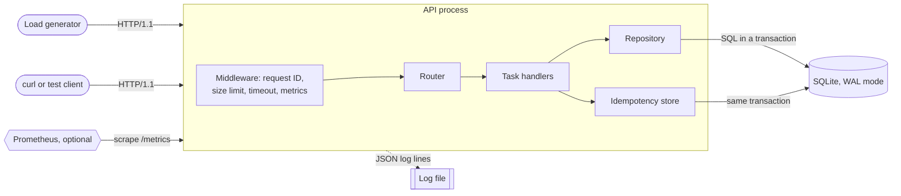
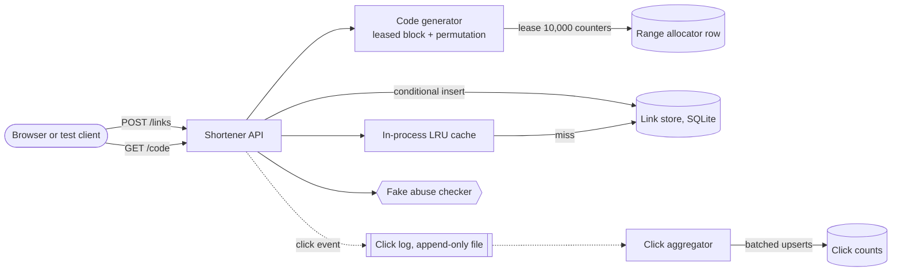
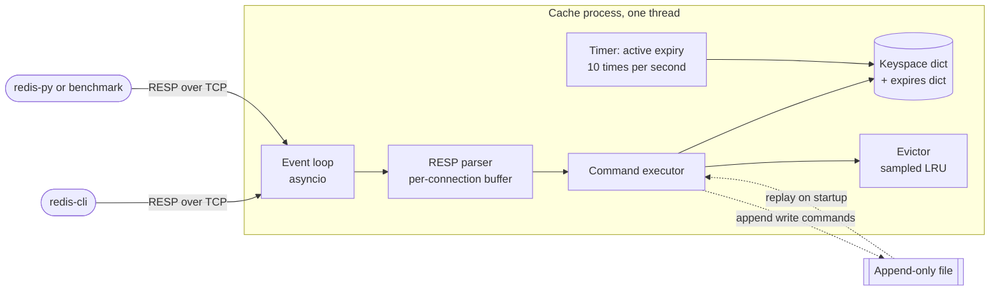
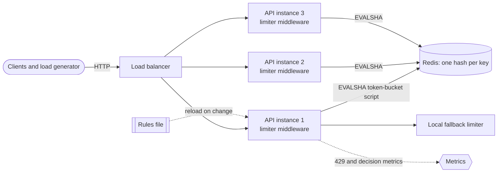
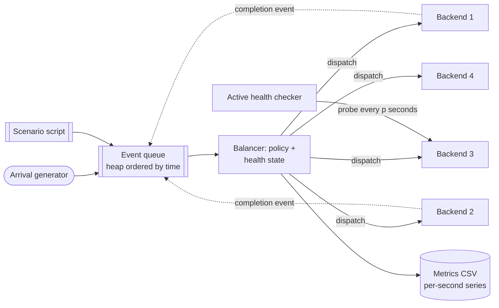
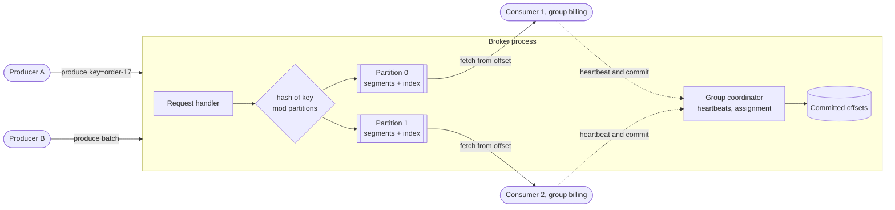
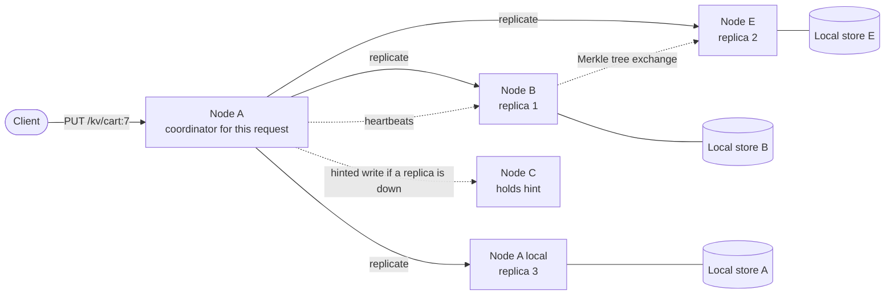

# Chapter 93 — Project Handbook

> **Level:** 1–5 · **Track:** Shared · **Estimated reading time:** 8 h (building the projects: 10–100 h each)

Reading about a write-ahead log and writing one are different experiences. When you write it, you discover that a torn record at the end of the file is a normal event, that `fsync` costs milliseconds, and that "the follower is a little behind" means something very specific when the primary dies. This chapter turns the book into twenty build projects, arranged in four levels, so that you can have those discoveries on your own laptop rather than in production or in an interview.

Each project is a scaled-down version of a system that the book designs at full size. The URL shortener of §52.4 handles 280,000 redirects per second across a fleet; your version handles a few thousand per second on one machine. The mechanisms are the same: a code generator that never collides, a cache in front of a store, an asynchronous click path. What you lose in scale you gain in visibility. You can kill any process, delay any message and read every byte on disk, and you can measure what happens.

**How to use the projects.** Pick a level that matches what you already know, read the project's prerequisites, and skim the owning chapter sections before you start. Then work through the milestones in order. Each milestone ends with a **done when** statement: a check you can run, not a feeling. Do not move on until it passes. Keep two files next to your code from the first day: a one-page design document (requirements, the architecture figure redrawn in your own words, the decisions you made and why), and a results log in which every measurement is recorded with the hardware, Python version, command line and date. The results log is what turns a toy into evidence. When an interviewer asks "how do you know?", you will have an answer (§93.7 shows how to talk about a project in an interview).

The starter code in each project is deliberately small: a runnable core of 60–120 lines that demonstrates the central mechanism and prints its result. It is not a solution. The milestones ask you to replace almost all of it. Every starter was run with Python 3.13 on Linux, and its printed output is quoted below it. Where a starter uses randomness, it fixes the seed, so you should see exactly the same output.

::: note
**Tooling assumptions for every project in this chapter.**

- **Language.** Python 3.11 or later, standard library first (`http.server`, `asyncio`, `socket`, `sqlite3`, `threading`, `heapq`, `hashlib`, `unittest`). Where a third-party package makes a milestone much easier (an HTTP client for load tests, a WebSocket library, a Prometheus client), the milestone says so and the package is optional. You may port any project to Go, Java or Rust once the Python version works; the measurements then change, and that comparison is itself instructive (§23.9).
- **Containers.** Docker is optional. It is useful for running a real Redis, PostgreSQL or Kafka next to your own implementation for comparison, and for running several copies of a node with separate network namespaces (§42.3). Nothing in Part A requires it.
- **Local only.** No cloud account, no paid service and no real e-mail, SMS or push provider. External systems are replaced by fakes you write, which is also the only way to inject their failures on demand.
- **Hardware.** One laptop or workstation with 4 or more cores and 8 GB of memory. Targets are stated for that machine. Loopback networking flatters latency (a round trip is tens of microseconds instead of the ~0.5 ms of a datacenter network, §4.17), so when a target concerns distribution rather than raw speed, the project asks you to add artificial delay.
:::

**Measuring honestly.** Report latency as percentiles (p50, p99), never as an average alone (§4.8, §40.5.2). Warm up before measuring, run each measurement at least three times and report the spread, and record whether your load generator is open-loop (sends at a fixed rate regardless of responses) or closed-loop (each worker waits for its previous response). Closed-loop generators hide queueing delay, a problem known as coordinated omission (§23.5). Every load-test target in this chapter is stated for an open-loop generator unless it says otherwise.

**Self-assessment.** Each project ends with a rubric of five dimensions scored 1–3: **1 — Working** (it runs and the happy path is correct), **2 — Solid** (failure cases handled, measured against the targets), **3 — Interview-ready** (you can explain each design choice, its alternative and the number that decided it). A total of 12 or more out of 15 means the project is ready to discuss in an interview; below 10 means a milestone was skipped.

**Table 93.1 — Project map.**

| § | Project | Level | Core concepts exercised | Owning chapters and case studies |
|---|---|---|---|---|
| 93.1.1 | REST API service | Beginner | Resource design, idempotency, pagination, persistence, observability | §8.6, §22.15, §40.4–40.5 |
| 93.1.2 | URL shortener | Beginner | ID generation, base62, cache-aside, redirect latency | §52.4, §17.10, §20.7 |
| 93.1.3 | Redis-style cache | Beginner | Wire protocol, TTL and expiry, eviction, persistence | §20.6, §20.8–20.9 |
| 93.1.4 | Rate limiter | Beginner | Token bucket, sliding window, distributed counters | §22.3–22.8, §52.6 |
| 93.1.5 | Load-balancer simulation | Beginner | Health checks, ejection, draining, retry budgets | §19.4–19.8, §22.12 |
| 93.2.1 | Message queue | Intermediate | Append-only log, offsets, consumer groups, acknowledgments | Ch 30, Ch 31 |
| 93.2.2 | Distributed key-value store | Intermediate | Consistent hashing, quorums, hinted handoff, rebalancing | §14.8, §27.7–27.9, §52.8 |
| 93.2.3 | Replicated database simulation | Intermediate | WAL shipping, replication lag, failover, fencing | §14.4, §27.4, §27.11, §26.13 |
| 93.2.4 | Notification service | Intermediate | Priority queues, deduplication, retries, preferences | §52.7, §30.10–30.11 |
| 93.2.5 | Real-time chat | Intermediate | Persistent connections, per-conversation ordering, sync | Ch 9, §53.4 |
| 93.3.1–93.3.5 | Job scheduler, event-driven microservices, real-time analytics, recommendation engine, distributed ML inference | Advanced | See §93.3 | §52.9, Ch 32, §56.7, Ch 68, Ch 66 |
| 93.4.1–93.4.5 | Distributed training, multi-tenant feature store, production RAG, LLM inference platform, multi-agent orchestration | Expert | See §93.4 | Ch 65, Ch 62, Ch 75, Ch 73, Ch 77 |

Beginner projects take roughly 10–20 hours each and Intermediate projects 20–40 hours. They build on each other: the rate limiter reuses the cache's TTL logic, the notification service sits on top of the message queue, and the chat server reuses the REST service's operational scaffolding. If you only have time for four projects in Part A, build the REST API service, the Redis-style cache, the message queue and the distributed key-value store; together they exercise almost every Book I chapter that interviews probe.

## 93.1 Beginner

The five Beginner projects are single-process or single-machine systems. Each one isolates one idea that every larger design depends on: a well-behaved API, a collision-free identifier, a cache with expiry and eviction, admission control, and traffic distribution under failure. None needs consensus or replication, which keeps your attention on getting the mechanism right and measuring it.

### 93.1.1 REST API service

#### Goal and learning outcomes

Build a small task-tracking API (`/tasks`) that behaves like a production service: correct status codes, validated input, stable pagination, safe retries, durable writes, structured logs and metrics, and a measured capacity. The domain is deliberately boring so that every hour goes into the properties that make an API trustworthy. Almost every later project in this chapter exposes an HTTP interface, and they all reuse what you build here.

After this project you should be able to:

- Design resource URIs, methods and status codes that follow HTTP semantics, and explain which methods are safe and idempotent (§8.6.3).
- Implement cursor pagination that stays correct while rows are being inserted, and explain why offset pagination does not (§8.6.5).
- Make `POST` retry-safe with an idempotency key, including the concurrent-duplicate case (§22.15).
- Persist data in SQLite with transactions and survive `kill -9` without losing an acknowledged write.
- Instrument a service with request IDs, structured logs, a latency histogram and health endpoints, and shut it down gracefully.
- Run an open-loop load test, find the saturation point, and explain the result with Little's Law (§4.11).

#### Prerequisites

- Client–server model and statelessness — §8.3; the request–response lifecycle — §8.5.
- REST design: resources, methods, status codes, pagination, problem-details errors — §8.6.2–8.6.7.
- Idempotency keys — §22.15; timeouts — §22.11.
- Transactions and indexes — §11.7, §11.11; write-ahead logging and `fsync` — §13.5, §13.12.
- Structured logs, correlation IDs and metric types — §40.4.1–40.4.2, §40.5.1; percentiles — §4.8.

#### Specification

**Functional requirements.**

1. `POST /tasks` creates a task from `{"title": ..., "due": ...}`, returns `201 Created` with a `Location` header and the stored representation. A request carrying an `Idempotency-Key` header that has been seen before returns the original response and creates nothing. Reusing a key with a different body returns `422`.
2. `GET /tasks/{id}` returns `200` with an `ETag`, or `404`.
3. `GET /tasks?done=false&limit=50&cursor=...` returns a page and a `next_cursor`, which is `null` on the last page. `limit` is capped at 100.
4. `PATCH /tasks/{id}` with `If-Match` updates fields; a stale `ETag` returns `412 Precondition Failed` (optimistic concurrency).
5. `DELETE /tasks/{id}` returns `204`, and `204` again on repetition (idempotent).
6. All errors use `application/problem+json` (RFC 9457, §8.6.7). Oversized bodies (over 16 KB) return `413`; malformed JSON returns `400`; schema violations return `422`.
7. `GET /healthz` (process alive), `GET /readyz` (database reachable), `GET /metrics` (Prometheus text format, §40.8).

**Non-functional requirements.**

**Table 93.2 — REST API service: non-functional targets (one laptop, loopback).**

| Property | Target | How you verify it |
|---|---|---|
| Read latency | `GET /tasks/{id}` p99 ≤ 20 ms at 300 RPS for 60 s | Open-loop load test, latency histogram |
| Write latency | `POST /tasks` p99 ≤ 50 ms at 100 RPS with durable commits | Same, with SQLite `synchronous=FULL` |
| Errors under target load | 0 server errors (5xx) | Load-test report |
| Durability | No acknowledged `201` lost after `kill -9`, over 100 trials | Crash test script |
| Idempotency | 50 concurrent `POST`s with one key create exactly 1 task | Concurrency test |
| Graceful shutdown | On SIGTERM, in-flight requests complete; exit within 5 s | Shutdown test |
| Overload behavior | At 2× the saturation rate, p99 of accepted requests stays ≤ 200 ms; excess gets `503` with `Retry-After` | Overload test |

Out of scope: authentication (add it as an extension), multi-node deployment, and a user interface.

#### Architecture

**Figure 93.1 — REST API service: components and request path.**



**Reading the diagram.** Clients (your load generator and ad-hoc `curl` calls) send synchronous HTTP/1.1 requests to a single API process. Inside it, every request first passes through middleware that assigns a request ID, rejects oversized bodies, starts a deadline timer and records a latency observation; the router then dispatches to a handler. Handlers never touch SQL directly: they call a repository, which keeps storage concerns in one place and lets you swap SQLite for PostgreSQL later. The idempotency store lives in the same SQLite file and, crucially, is written in the **same transaction** as the task it protects, so a crash can never leave a task without its idempotency record or vice versa. The storage boundary is the SQLite file in write-ahead-log mode (§13.5); everything above it is stateless and could be replicated behind a load balancer. The dotted arrow to the log file is asynchronous from the request's point of view: logging must never fail a request. Prometheus, if you run it in Docker, pulls metrics (§40.8.1). Failure points to study: the database (locked, slow or full disk), the process (killed mid-request) and the client (retrying after a timeout). Scaling: run several API processes behind the load balancer of §93.1.5; the single SQLite writer then becomes the bottleneck, which is the motivation for a client–server database.

#### Milestones

1. **Core resource model (in memory).** Start from the starter code. Add `PATCH` with `ETag`/`If-Match`, `DELETE`, the `done` filter and the `400`/`413`/`422` distinctions. Write an OpenAPI description of the five operations (§8.16). *Done when:* a `unittest` suite of at least 20 cases covering every status code in the specification passes.
2. **Durable storage.** Replace the dictionaries with SQLite: a `tasks` table with an index on `(done, id)` for the filtered list, and an `idempotency_keys` table holding the key, a SHA-256 fingerprint of the request body, the status and the response body. Write both rows in one transaction. Enable WAL mode and `synchronous=FULL`. *Done when:* a script that starts the server, sends `POST`s in a loop, and kills the process with SIGKILL at a random moment finds every acknowledged task after restart in 100 out of 100 trials.
3. **Operability.** Emit one JSON log line per request (`ts`, `request_id`, `method`, `route`, `status`, `duration_ms`); accept an incoming `X-Request-ID` or generate one. Expose a request counter by route and status, and a latency histogram with buckets from 1 ms to 1 s, at `/metrics`. Add `/healthz` and `/readyz`. Handle SIGTERM by flipping `/readyz` to `503`, finishing in-flight requests and exiting. *Done when:* the shutdown test shows zero failed in-flight requests, and you can compute p99 from your histogram and compare it with the load generator's figure.
4. **Robustness under load.** Bound the number of concurrent requests (for example with a semaphore of 64) and reject excess with `503` and `Retry-After: 1` rather than queuing without limit (§22.9). Give every request a 2 s deadline. *Done when:* the overload test in the targets table passes.
5. **Capacity report.** Measure p50 and p99 against offered load from 100 RPS upward in steps of 100 until p99 exceeds 100 ms or errors appear. Plot or tabulate the curve, mark the knee, and explain it. *Done when:* your results log contains the curve for reads and for writes, and a one-paragraph explanation that names the bottleneck resource (CPU, the Python GIL, or SQLite's single writer) with evidence from a profile (§23.4).

#### Starter code

The starter serves `POST /tasks`, `GET /tasks/{id}` and a cursor-paginated list from memory, with problem-details errors and an idempotency key, then exercises itself with a few requests. It binds to port 0 so that the operating system picks a free port.

```python
"""Tasks API: a minimal REST service on the standard library (starter core)."""
import json, threading, urllib.request, urllib.error
from http.server import BaseHTTPRequestHandler, ThreadingHTTPServer
from urllib.parse import urlparse, parse_qs

TASKS, IDEMPOTENCY, LOCK = {}, {}, threading.Lock()   # id -> task; key -> (status, body)

class Handler(BaseHTTPRequestHandler):
    def send_json(self, status, body, headers=None):
        data = json.dumps(body).encode()
        self.send_response(status)
        ctype = "application/problem+json" if status >= 400 else "application/json"
        self.send_header("Content-Type", ctype)
        self.send_header("Content-Length", str(len(data)))
        for k, v in (headers or {}).items():
            self.send_header(k, v)
        self.end_headers()
        self.wfile.write(data)

    def problem(self, status, title):                     # RFC 9457 error body
        self.send_json(status, {"type": "about:blank", "title": title, "status": status})

    def do_POST(self):
        if self.path != "/tasks":
            return self.problem(404, "Not Found")
        try:
            body = json.loads(self.rfile.read(int(self.headers.get("Content-Length", 0))))
            title = body["title"].strip()
            assert 0 < len(title) <= 200
        except Exception:
            return self.problem(422, "title must be a 1-200 character string")
        key = self.headers.get("Idempotency-Key")
        with LOCK:
            if key in IDEMPOTENCY:                          # replay: same response, no new task
                return self.send_json(*IDEMPOTENCY[key])
            task = {"id": len(TASKS) + 1, "title": title, "done": False}
            TASKS[task["id"]] = task
            if key:
                IDEMPOTENCY[key] = (201, task)
        self.send_json(201, task, {"Location": f"/tasks/{task['id']}"})

    def do_GET(self):
        url = urlparse(self.path)
        parts = url.path.strip("/").split("/")
        if parts == ["tasks"]:                              # cursor pagination by id
            q = parse_qs(url.query)
            limit = min(int(q.get("limit", ["2"])[0]), 100)
            after = int(q.get("cursor", ["0"])[0])
            with LOCK:
                ids = sorted(i for i in TASKS if i > after)[:limit + 1]
                items = [TASKS[i] for i in ids[:limit]]
            nxt = str(ids[limit - 1]) if len(ids) > limit else None   # peek one extra
            return self.send_json(200, {"items": items, "next_cursor": nxt})
        if len(parts) == 2 and parts[0] == "tasks" and parts[1].isdigit():
            with LOCK:
                task = TASKS.get(int(parts[1]))
            return self.send_json(200, task) if task else self.problem(404, "Task not found")
        self.problem(404, "Not Found")

    def log_message(self, *args):                           # keep test output quiet
        pass

def call(base, method, path, body=None, headers=None):
    data = json.dumps(body).encode() if body is not None else None
    req = urllib.request.Request(base + path, data=data, method=method,
                                 headers={"Content-Type": "application/json", **(headers or {})})
    try:
        with urllib.request.urlopen(req) as r:
            return r.status, json.loads(r.read())
    except urllib.error.HTTPError as e:
        return e.code, json.loads(e.read())

if __name__ == "__main__":
    server = ThreadingHTTPServer(("127.0.0.1", 0), Handler)     # port 0 = any free port
    threading.Thread(target=server.serve_forever, daemon=True).start()
    base = f"http://127.0.0.1:{server.server_address[1]}"
    for t in ["write spec", "add tests", "load test"]:
        print("POST", call(base, "POST", "/tasks", {"title": t}))
    print("POST retry", call(base, "POST", "/tasks", {"title": "pay"}, {"Idempotency-Key": "k1"}))
    print("POST retry", call(base, "POST", "/tasks", {"title": "pay"}, {"Idempotency-Key": "k1"}))
    print("POST bad ", call(base, "POST", "/tasks", {"title": ""})[0])
    print("GET  4   ", call(base, "GET", "/tasks/4"))
    print("GET  99  ", call(base, "GET", "/tasks/99"))
    page = call(base, "GET", "/tasks?limit=2")[1]
    print("page 1   ", [t["id"] for t in page["items"]], "next", page["next_cursor"])
    page = call(base, "GET", f"/tasks?limit=2&cursor={page['next_cursor']}")[1]
    print("page 2   ", [t["id"] for t in page["items"]], "next", page["next_cursor"])
    server.shutdown()
```

Output:

```text
POST (201, {'id': 1, 'title': 'write spec', 'done': False})
POST (201, {'id': 2, 'title': 'add tests', 'done': False})
POST (201, {'id': 3, 'title': 'load test', 'done': False})
POST retry (201, {'id': 4, 'title': 'pay', 'done': False})
POST retry (201, {'id': 4, 'title': 'pay', 'done': False})
POST bad  422
GET  4    (200, {'id': 4, 'title': 'pay', 'done': False})
GET  99   (404, {'type': 'about:blank', 'title': 'Task not found', 'status': 404})
page 1    [1, 2] next 2
page 2    [3, 4] next None
```

What to notice:

- The retried `POST` with `Idempotency-Key: k1` returns task 4 twice and creates nothing the second time. The check and the insert happen under one lock; in Milestone 2 that lock becomes a database transaction with a unique constraint on the key, which is what makes the concurrent-duplicate case safe across processes.
- The idempotency store does not yet fingerprint the body, so a client that reuses `k1` for a different task silently gets the old response. The specification requires `422` in that case (§22.15.3).
- The list endpoint fetches one row more than `limit`. If the extra row exists there is a next page; if not, `next_cursor` is `null`. Without this peek the last page would return a cursor that leads to an empty page.
- The cursor is the last ID seen, so a task inserted while the client is paging appears exactly once or not at all, never twice. Offset pagination (`?page=3`) would shift every later row by one and produce duplicates (§8.6.5).
- `id = len(TASKS) + 1` is a bug waiting for `DELETE`: after a deletion it reissues an existing ID. SQLite's `INTEGER PRIMARY KEY` fixes this in Milestone 2.

#### Test plan and load-test targets

Write three layers of tests. **Unit and contract tests** (`unittest`, in-process server on port 0) cover every status code, every header (`Location`, `ETag`, `Retry-After`, `Content-Type`), pagination across 250 rows with concurrent inserts, and the problem-details body. **Concurrency tests** launch 50 threads that `POST` the same idempotency key and assert one row; launch 20 threads that `PATCH` the same task with the same `ETag` and assert exactly one `200` and 19 `412`s. **Process-level tests** start the server as a subprocess for the crash and shutdown cases.

For load, write a small open-loop generator: a scheduler thread that emits a request every $1/\lambda$ seconds into a pool of worker threads, recording each request's intended send time and its completion time. Measuring from the intended time, not the actual send time, is what avoids coordinated omission. Optional tools such as `wrk2` or `vegeta` do the same and are worth comparing with your own.

::: example
**Worked example — How many in-flight requests should the load test and the server allow?**

*Assumptions.* Target 300 RPS of `GET /tasks/{id}`; measured service time at low load about 5 ms per request (the starter measured roughly 5 ms p50 on loopback with the client in the same process).

1. By Little's Law (§4.11), the average number of requests in flight is $L = \lambda W = 300 \times 0.005 = 1.5$.
2. To leave room for bursts, give the load generator 10× that, 15 workers, so that it never becomes the bottleneck itself.
3. At 1,000 RPS with $W$ rising to 20 ms under contention, $L = 1{,}000 \times 0.020 = 20$ in flight, still below the server's concurrency limit of 64.
4. If $W$ reaches 200 ms during overload, $L = 1{,}000 \times 0.2 = 200$ would exceed 64, so about $200 - 64 = 136$ requests at any moment would be rejected with `503` instead of queuing.

*Interpretation.* The concurrency cap converts unbounded queueing delay into explicit rejections. *Engineering implication.* Size the cap from the latency you are willing to accept, not from the thread count you can afford: cap $= \lambda_{\max} \times W_{\text{target}}$.
:::

Record, for each step of offered load, the achieved throughput, p50, p99, the 5xx rate and the 503 rate. The project meets its targets when the read and write rows of Table 93.2 hold for three consecutive 60-second runs.

#### Failure-injection exercises

1. **Crash mid-write.** Send SIGKILL while 20 clients are posting. After restart, compare the set of acknowledged IDs (from client logs) with the database. Any missing ID is a durability bug; any extra row the client never saw acknowledged is fine (the client will retry with the same key and get the original response).
2. **Slow database.** Wrap every repository call in a configurable delay and set it to 300 ms. Observe the deadline firing, the concurrency limiter shedding load, and `/readyz` staying healthy. Decide whether a slow database should make the service "not ready", and write down your reasoning (§42.7.3).
3. **Locked database.** Open the SQLite file from a second process and hold a write transaction for 10 s. Your service should return `503` with `Retry-After`, not hang and not return `500`.
4. **Retry storm.** Make the client retry on timeout with no backoff while the database is slow. Measure how offered load multiplies, then add exponential backoff with full jitter (§22.12.2) and measure again.
5. **Malicious input.** Send a 10 MB body, a body that claims `Content-Length: 1000000` but sends 10 bytes, deeply nested JSON and a title containing SQL metacharacters. None should crash the process or leak a stack trace.

#### Extensions

- Add bearer-token authentication with signed JSON Web Tokens and per-user task ownership (§8.11, §8.13); return `404`, not `403`, for other users' tasks so that IDs cannot be probed.
- Replace SQLite with PostgreSQL in Docker, add a connection pool, and repeat the capacity report; explain the change in the knee (§14.13.1).
- Add `ETag`-based conditional `GET` (`If-None-Match` → `304`) and measure bandwidth saved.
- Run three instances behind the load balancer of §93.1.5 and confirm that idempotency still holds when a retry lands on a different instance.
- Add OpenTelemetry tracing and follow one slow request from middleware to SQL (§40.6–40.7).

#### Self-assessment rubric

**Table 93.3 — REST API service: self-assessment rubric.**

| Dimension | 1 — Working | 2 — Solid | 3 — Interview-ready |
|---|---|---|---|
| HTTP semantics | Correct happy-path codes | Every error code in the spec, problem-details bodies, `ETag`/`If-Match` | You can say which methods are idempotent and why `PATCH` is not by default |
| Retry safety | Idempotency key stored | Fingerprint check, same-transaction write, concurrent test passes | You can explain retention, key scope and what happens on a crash between commit and response |
| Durability | Data in SQLite | 100/100 crash trials pass | You can explain WAL mode, `synchronous=FULL` and their latency cost with your numbers |
| Operability | Logs printed | JSON logs, request IDs, histogram, health endpoints, graceful shutdown | You can find one slow request from a metric to its log line |
| Capacity | One load test run | Open-loop curve to the knee, overload test passes | You name the bottleneck with profile evidence and size the concurrency cap with Little's Law |

### 93.1.2 URL shortener

#### Goal and learning outcomes

Build a working URL shortener: an API that turns a long URL into a seven-character code, a redirect endpoint that answers in a few milliseconds, and click analytics that never slow the redirect. Section 52.4 designs this system for 280,000 redirects per second; your version runs on one machine, but it has the same three paths (create, redirect, analytics) and the same central decisions: how to generate codes that never collide and cannot be enumerated, how to keep the redirect path out of the database, and how to count clicks without putting a write on the read path.

After this project you should be able to:

- Compare random codes, hashed URLs, counters and keyed permutations as code generators, and predict the collision rate of random codes with the birthday bound (§17.10.2, §52.4.8).
- Implement cache-aside with LRU eviction and measure hit ratio as a function of cache size on a skewed trace (§20.3, §20.7.1).
- Separate a latency-critical read path from an asynchronous analytics path, and bound the analytics backlog.
- Choose between `301` and `302` redirects and explain what each does to caching and to analytics.
- Defend the design in an interview with your own measured numbers.

#### Prerequisites

- The full case study — §52.4, especially capacity (§52.4.4), code generation (§52.4.8) and failure scenarios (§52.4.11).
- Unique ID generation and the birthday bound — §17.10; counter blocks and ticket servers — §17.10.5.
- Cache hit ratio and popularity skew — §20.3.2–20.3.3; cache-aside and its races — §20.7.1–20.7.2; LRU and TinyLFU — §20.9.
- HTTP redirects and caching headers — §7.9.1, §21.6.1.
- The REST API service of §93.1.1 (reuse its server scaffolding, logging and load generator).

#### Specification

**Functional requirements.**

1. `POST /links` with `{"url": ..., "alias": optional, "expires_at": optional}` returns `201` with a seven-character base62 code. Only `http` and `https` URLs up to 2,048 characters are accepted; a custom alias that exists returns `409`.
2. `GET /{code}` returns a redirect with a `Location` header, or `404` for unknown, expired or disabled codes. The redirect status is configurable (`301` or `302`).
3. `GET /links/{code}/stats` returns total clicks and clicks per day, at most 60 s stale.
4. `DELETE /links/{code}` disables a link; the redirect must return `404` within 5 s on every instance, including from caches.
5. A fake abuse checker (a blocklist of domains) rejects bad destinations at creation time.

**Non-functional requirements.**

**Table 93.4 — URL shortener: non-functional targets (one laptop, loopback).**

| Property | Target | How you verify it |
|---|---|---|
| Redirect latency | p99 ≤ 15 ms over HTTP at 500 RPS, Zipf trace | Open-loop load test |
| Create latency | p99 ≤ 50 ms at 50 RPS, durable | Load test with SQLite `synchronous=FULL` |
| Cache effectiveness | Hit ratio ≥ 0.80 with a cache holding 20% of 100,000 links, 1 million-request Zipf (s = 1.0) trace | Trace replay against the cache alone |
| Uniqueness | Zero duplicate codes over 10 million generated codes | Generator test |
| Non-enumerability | No two consecutive creates produce codes sharing a 4-character prefix more often than chance | Statistical test on 100,000 codes |
| Analytics isolation | Redirect p99 unchanged (within 10%) when the click aggregator is stopped for 60 s | Failure-injection run |
| Click accuracy | Counts exact after the aggregator catches up, with no double counting after an aggregator crash | Replay and compare |

Out of scope: user accounts, QR codes and a dashboard user interface.

#### Architecture

**Figure 93.2 — URL shortener: create, redirect and click paths.**



**Reading the diagram.** The shortener API serves both creates and redirects; in §52.4 these are separate fleets, and you can split them later. On create (solid arrows, synchronous), the API checks the destination with the fake abuse checker, takes the next value from the code generator and performs a conditional insert into the link store. The generator holds a block of 10,000 counter values leased from a single allocator row, so only one create in 10,000 touches the allocator, and it scrambles each counter with a keyed permutation so that consecutive links get unrelated codes (§52.4.8). On redirect, the API looks in an in-process LRU cache first and reads the link store only on a miss (cache-aside). The click path is dotted because it is asynchronous: the API appends one line per click to a log file and returns immediately; a separate aggregator reads the file, batches counts and upserts them into a click-counts table, remembering the file offset it has processed. Storage boundaries are the allocator row, the link store, the click log and the click-count table. Failure points: the allocator (creates stall after the current block runs out), the link store (redirects survive on cache hits only), the click log disk, and the aggregator (counts go stale but redirects are unaffected). Scaling: more API processes, each with its own block and cache; a shared Redis between the in-process cache and the store; and partitioning the link store by code (§52.4.12).

#### Milestones

1. **Create and redirect with random codes.** Wrap the starter's `Shortener` in the HTTP scaffolding from §93.1.1, persist to an SQLite file, and add URL validation, aliases and expiry. *Done when:* contract tests pass for every status code in the specification, and the `301`/`302` switch works.
2. **Collision-free, non-enumerable codes.** Replace random codes with leased counter blocks and a keyed permutation: implement the allocator row with compare-and-set (`UPDATE alloc SET next = next + 10000 WHERE next = ?`), and use the four-round Feistel permutation with cycle-walking from §52.4.8. *Done when:* 10 million generated codes are distinct, two processes generating in parallel never collide, and the prefix test in Table 93.4 passes.
3. **Cache and invalidation.** Measure hit ratio against cache size on the 1 million-request trace; then implement deletion so that a disabled link stops redirecting everywhere within 5 s. With one process, delete from the local cache; with several, either give cache entries a 5 s TTL or broadcast invalidations (§20.10). *Done when:* the hit-ratio target holds and a test that deletes a hot link sees `404` on all instances within 5 s.
4. **Asynchronous analytics.** Write clicks to an append-only log with one line per event; build the aggregator, which reads from a stored offset, adds counts in memory and commits the counts and the new offset in one SQLite transaction. *Done when:* killing the aggregator at random points and restarting it yields exactly the same final counts as an uninterrupted run, and stopping it for 60 s does not change redirect p99 by more than 10%.
5. **Capacity report.** Load-test redirects with the Zipf trace and creates at a fixed rate, simultaneously. *Done when:* your results log shows p50 and p99 for both paths at the targets, the measured hit ratio, and store reads per second, and you can scale the numbers to the §52.4.4 estimate (how many of your processes would 280,000 RPS need, and why that estimate is pessimistic for a compiled language).

#### Starter code

The starter uses random codes with a conditional insert and retry, an LRU cache in front of SQLite, and an in-memory click queue drained by an aggregator. To make collisions visible on a laptop it uses three-character codes ($62^3 = 238{,}328$ possible) for 20,000 links; production uses seven. It replays a 100,000-request Zipf trace at three cache sizes.

```python
"""URL shortener core: random codes with conditional insert, cache-aside redirects,
and an asynchronous click counter (starter)."""
import random, sqlite3
from collections import Counter, OrderedDict, deque
from itertools import accumulate

ALPHABET = "0123456789ABCDEFGHIJKLMNOPQRSTUVWXYZabcdefghijklmnopqrstuvwxyz"
rng = random.Random(42)                     # production: use the secrets module

class Shortener:
    def __init__(self, code_len, cache_size):
        self.db = sqlite3.connect(":memory:")
        self.db.execute("CREATE TABLE links (code TEXT PRIMARY KEY, url TEXT NOT NULL)")
        self.code_len, self.cache_size = code_len, cache_size
        self.cache = OrderedDict()              # code -> url, in LRU order
        self.clicks = deque()                   # click events awaiting the aggregator
        self.stats = Counter()

    def create(self, url):
        while True:
            code = "".join(rng.choice(ALPHABET) for _ in range(self.code_len))
            try:
                with self.db:                   # conditional insert: fails on duplicate
                    self.db.execute("INSERT INTO links VALUES (?, ?)", (code, url))
                return code
            except sqlite3.IntegrityError:
                self.stats["collisions"] += 1   # retry with a fresh random code

    def redirect(self, code):
        url = self.cache.get(code)
        if url is not None:
            self.cache.move_to_end(code)
            self.stats["hits"] += 1
        else:
            self.stats["misses"] += 1           # cache-aside: read store, then fill cache
            row = self.db.execute("SELECT url FROM links WHERE code = ?", (code,)).fetchone()
            if row is None:
                return 404, None
            url = row[0]
            self.cache[code] = url
            if len(self.cache) > self.cache_size:
                self.cache.popitem(last=False)  # evict least recently used
        self.clicks.append(code)                # never block the redirect on analytics
        return 301, url

    def flush_clicks(self, totals):             # the aggregator, run off the hot path
        while self.clicks:
            totals[self.clicks.popleft()] += 1

def zipf_trace(codes, n, s, seed):
    weights = [1 / (k + 1) ** s for k in range(len(codes))]
    return random.Random(seed).choices(codes, cum_weights=list(accumulate(weights)), k=n)

if __name__ == "__main__":
    for cache_size in (200, 1_000, 4_000):
        rng.seed(42)
        s = Shortener(code_len=3, cache_size=cache_size)   # 62^3 = 238,328 codes
        codes = [s.create(f"https://example.com/page/{i}") for i in range(20_000)]
        totals = Counter()
        for i, code in enumerate(zipf_trace(codes, 100_000, s=1.0, seed=7)):
            s.redirect(code)
            if i % 1_000 == 999:
                s.flush_clicks(totals)
        hit = s.stats["hits"] / (s.stats["hits"] + s.stats["misses"])
        print(f"cache={cache_size:>5}  hit ratio={hit:.3f}  store reads={s.stats['misses']:>6}"
              f"  collisions={s.stats['collisions']}  top link clicks={totals.most_common(1)[0][1]}")
    print("unknown code ->", s.redirect("-404")[0])   # "-" is not in the alphabet
```

Output:

```text
cache=  200  hit ratio=0.431  store reads= 56865  collisions=862  top link clicks=9495
cache= 1000  hit ratio=0.613  store reads= 38664  collisions=862  top link clicks=9495
cache= 4000  hit ratio=0.774  store reads= 22643  collisions=862  top link clicks=9495
unknown code -> 404
```

What to notice:

- 862 collisions for 20,000 inserts into a space of 238,328 codes. The worked example below predicts about 890, so the measurement matches the birthday arithmetic. Each collision costs one extra database round trip on the create path.
- A cache holding 1% of links (200) already absorbs 43% of redirects, and 20% of links (4,000) absorbs 77%. Popularity skew is what makes small caches effective (§20.3.3). Some misses are unavoidable **cold misses**: the first request for each link always goes to the store.
- `redirect` appends to the click queue and returns. If the aggregator stops, the queue grows but redirects are unaffected. In Milestone 4 the queue becomes a file, so a crash does not lose clicks, and the aggregator's offset makes replay safe.
- A miss for an unknown code is not cached, so every request for a nonexistent code reaches the store. That is the **cache penetration** problem (§20.12); caching negative results with a short TTL, or a Bloom filter of existing codes, fixes it.

::: example
**Worked example — Predicting collisions for random codes.**

*Assumptions.* Code space $N = 62^3 = 238{,}328$; $n = 20{,}000$ links created one after another, each retrying until it finds a free code.

1. When $i$ codes are taken, a fresh random code collides with probability $i/N$; the expected number of failed attempts before success is $\frac{i/N}{1 - i/N} = \frac{i}{N - i}$.
2. Summing over $i = 0 \ldots 19{,}999$ gives $\sum \frac{i}{N - i} \approx 889$ expected retries (computed exactly with Python).
3. The simpler birthday approximation, $n^2 / (2N) = 20{,}000^2 / 476{,}656 = 839$, is close because the space is only 8.4% full ($20{,}000 / 238{,}328$).
4. For seven characters, $N = 62^7 = 3.52 \times 10^{12}$. One million links give $10^{12} / (7.04 \times 10^{12}) = 0.14$ expected collisions in total.

*Interpretation.* Random codes are cheap at low fill and degrade smoothly as the space fills; the measured 862 agrees with the prediction within 3%. *Engineering implication.* Random codes are a defensible choice for your project's scale. The case for counter blocks plus a permutation (Milestone 2) is guaranteed uniqueness without a read-before-write, which matters when the store makes conditional inserts expensive (§52.4.8).
:::

#### Test plan and load-test targets

Unit tests cover base62 encoding (round trip for 0, 1, 61, 62 and $62^7 - 1$), the permutation (bijective on a sample, deterministic for a fixed key, different for a different key), URL validation (schemes, length, internationalized domain names) and alias conflicts. A property-based test inserts random sequences of create, redirect and delete operations and checks that every redirect agrees with a plain dictionary model.

For load, generate a 1 million-request trace from Zipf ($s = 1.0$) over 100,000 links, save it to a file, and replay it open-loop at 500 RPS. Report p50 and p99 for hits and misses separately: a blended percentile hides that misses are several times slower. Run creates at 50 RPS concurrently, since in production both paths share the machine. Finally, run the non-enumerability check: for 100,000 consecutive codes, count how often adjacent codes share their first four characters. With a good permutation the expected count is about $100{,}000 / 62^4 \approx 0.007$, so any nonzero count is a red flag.

#### Failure-injection exercises

1. **Store outage.** Make the link store raise an error on every read for 30 s. Hits must keep working; misses should return `503` (not `404`, which a browser may cache and which is simply wrong). Measure the fraction of redirects that still succeed and compare it with your hit ratio.
2. **Allocator outage.** Make the allocator unavailable. Creates continue until each process's block is exhausted; at 50 creates per second and 10,000 codes per block, that is $10{,}000 / 50 = 200$ s of runway per process. Verify the number, then decide what the API should return when the block runs out.
3. **Crash between lease and use.** Kill a process right after it leases a block. Its unused counters are lost forever. Compute how many codes per year a crash a day would waste and whether it matters against $62^7$.
4. **Aggregator crash during commit.** Kill the aggregator between reading events and committing. After restart, counts must be exact. Then deliberately break it by committing the offset *before* the counts, and observe lost clicks; commit counts before the offset without a transaction, and observe double counting (§30.8.1).
5. **Hot link.** Replay a trace in which one link receives 50% of all traffic. Confirm it stays cached, and measure whether the single lock around your LRU structure becomes a bottleneck with many threads (§20.15).

#### Extensions

- Add a shared Redis (Docker) between the in-process cache and SQLite, and measure the latency of each tier.
- Replace LRU with a W-TinyLFU admission filter and compare hit ratios on the same trace (§20.9.3).
- Record approximate unique visitors per link with HyperLogLog (§17.5) and compare its error with exact counting.
- Add a negative cache or a Bloom filter for unknown codes and measure store reads under a scan of random codes (§17.4).
- Re-check stored destinations against an updated blocklist in a background job and disable matches, as §52.4.11 describes.

#### Self-assessment rubric

**Table 93.5 — URL shortener: self-assessment rubric.**

| Dimension | 1 — Working | 2 — Solid | 3 — Interview-ready |
|---|---|---|---|
| Code generation | Random codes with retry | Leased blocks + keyed permutation; 10 million unique codes; parallel processes never collide | You can compare all five schemes of Table 52.3 with your collision and enumeration measurements |
| Redirect path | Redirect works | Cache-aside with eviction; hit-ratio target met; store outage degrades gracefully | You can explain `301` versus `302` for caching and analytics, and cache penetration with a fix |
| Invalidation | Delete removes the row | Disabled links stop within 5 s on every instance | You can state the staleness bound of your approach and its cost |
| Analytics | Counts update | File-backed log, offset in the same transaction, exact counts after crashes | You can explain why redirect latency is unaffected by aggregator failure, with data |
| Capacity | One load test | Hits and misses measured separately at target rates | You scale your numbers to §52.4.4 and identify what changes at 280,000 RPS |

### 93.1.3 Redis-style cache

#### Goal and learning outcomes

Build a single-node, in-memory key-value cache that speaks enough of the Redis wire protocol (RESP) for the real `redis-cli` and `redis-py` clients to talk to it. You will implement the parts of Redis that system-design interviews keep returning to: a single-threaded event loop, time-to-live (TTL) with lazy and active expiry, eviction under a memory limit, and optional persistence. Section 20.6 explains how Redis does each of these; this project makes you choose the same trade-offs yourself and measure them.

After this project you should be able to:

- Explain why a single-threaded event loop can serve tens of thousands of operations per second, and where it stops scaling (§20.6.1).
- Implement TTL with both lazy expiry (check on access) and active expiry (periodic sampling), and quantify how much memory each leaves to expired keys.
- Implement sampled approximate LRU eviction and compare it with exact LRU on a skewed trace (§20.9.4).
- Implement an append-only file (AOF) with a configurable `fsync` policy and state its data-loss window (§20.6.3).
- Parse and produce a binary-safe framed protocol, and handle partial reads and pipelined requests.

#### Prerequisites

- Redis internals: event loop, data structures, persistence — §20.6.1–20.6.3; Memcached for contrast — §20.6.5.
- TTL — §20.8; eviction policies and Redis's approximations — §20.9.1, §20.9.4–20.9.5.
- Event-driven I/O and the cost of system calls — §6.7; TCP byte streams (why a read can return half a command) — §7.7.1.
- `fsync` and durability — §13.12; write-ahead logging — §13.5.
- Cache patterns that clients will use against your server — §20.7.

#### Specification

**Functional requirements.**

1. A TCP server on a configurable port that accepts RESP arrays of bulk strings and replies with simple strings, errors, integers, bulk strings and nulls.
2. Commands: `PING`, `GET`, `SET key value [EX seconds] [NX|XX]`, `DEL`, `EXISTS`, `EXPIRE`, `TTL`, `INCR`, `MGET`, `DBSIZE`, `INFO` (a few counters), plus one data structure of your choice (`LPUSH`/`LRANGE` or `HSET`/`HGET`).
3. Pipelining: a client may send many commands before reading any replies; replies come back in order.
4. `maxmemory` in bytes with policies `noeviction` (writes fail with an error) and `allkeys-lru` (sampled approximate LRU with configurable sample size).
5. Optional persistence: an AOF that logs every write command, with `appendfsync` set to `always`, `everysec` or `no`, replayed on startup.

**Non-functional requirements.**

**Table 93.6 — Redis-style cache: non-functional targets (one laptop, loopback, single event-loop thread).**

| Property | Target | How you verify it |
|---|---|---|
| Throughput, no pipelining | ≥ 10,000 `GET`/`SET` operations/s with 50 clients, p99 ≤ 5 ms | `redis-benchmark` from the Redis Docker image, or your own client |
| Throughput, pipelined | ≥ 40,000 operations/s with pipeline depth 16 | Same tool with pipelining enabled |
| Memory bound | Used memory (your accounting) never exceeds `maxmemory` by more than 1% | Fill test with values of random size |
| Expiry | After all TTLs elapse, ≥ 75% of expired keys are reclaimed within 1 s with no client traffic | Active-expiry test |
| Eviction quality | Hit ratio within 1 percentage point of exact LRU at 5 samples, on the Zipf trace | Trace replay |
| Durability with AOF `everysec` | Loses at most the last ~1 s of acknowledged writes on `kill -9` | Crash test with a write counter |
| Compatibility | `redis-cli` and `redis-py` work for every implemented command | Client tests |

Out of scope: replication, clustering, Lua scripting and transactions (`MULTI`).

#### Architecture

**Figure 93.3 — Redis-style cache: event loop, keyspace, expiry and persistence.**



**Reading the diagram.** Clients connect over TCP and speak RESP; each request is synchronous from the client's point of view, but a client may pipeline many requests on one connection. Inside the process there is exactly one thread. The event loop multiplexes all connections; for each connection it keeps a byte buffer, because TCP delivers a stream, not messages, so the parser must handle a command split across two reads and several commands in one read. The executor runs each command to completion against two dictionaries: the keyspace (key → value) and the expires dictionary (key → absolute expiry time), which holds only keys that have a TTL. Because there is one thread, no command needs a lock, and every command is atomic; the price is that one slow command (a `KEYS *` over a million keys) stalls every client. A timer callback performs active expiry; the evictor runs inside a write when memory is over the limit. Persistence is drawn dotted because it is asynchronous with respect to the reply under `everysec`: the command is appended to an in-memory buffer, written to the file, and `fsync`ed once a second. The storage boundary is process memory, plus the AOF on disk if enabled. Failure points: the process (all data is lost without AOF), the disk (AOF writes stall the loop under `always`), and slow commands. Scaling: one node is bounded by one core; scaling out means partitioning keys across nodes with consistent hashing (§20.14), which is where the distributed key-value store of §93.2.2 begins.

#### Milestones

1. **Protocol and server.** Put the starter's executor behind an `asyncio` server with a per-connection buffer. Implement the full command list and RESP errors (`-ERR unknown command`). *Done when:* `redis-cli -p <port>` can run every command interactively, and a test that sends 1,000 pipelined commands in one `write` gets 1,000 replies in order.
2. **Expiry done properly.** Run `active_expire_cycle` ten times a second with a time budget (stop after, say, 25 ms), and make every read path apply lazy expiry. *Done when:* the expiry target holds for 100,000 keys with equal TTLs, and a test proves that an expired key is never returned, even if the active cycle has not yet reached it.
3. **Memory limit and eviction.** Account memory per key (key length + value length + a fixed per-entry overhead you estimate by measuring `sys.getsizeof` or `tracemalloc`). Implement `noeviction` and `allkeys-lru`, and replace the starter's $O(n)$ `list(self.data)` sampling with an $O(1)$ scheme (for example, a list of keys with swap-remove and an index map). *Done when:* the memory bound and eviction-quality targets hold, and eviction does not make `SET` p99 exceed 5 ms.
4. **Persistence.** Append each write command, in RESP form, to an AOF; implement the three `fsync` policies; replay on startup; tolerate a truncated last command. *Done when:* the crash test shows the expected loss window for each policy, and you have measured `SET` throughput under each.
5. **Benchmark and profile.** Run the throughput tests, profile the hot path, and make one evidence-backed optimization. *Done when:* your results log shows before and after numbers and names the dominant cost (parsing, dictionary operations or system calls).

#### Starter code

The starter contains a RESP parser for complete requests, a reply encoder, a command executor with TTL and lazy expiry, Redis's classic active-expiry loop (sample 20 keys with a TTL, delete the expired ones, repeat while more than 25% of the sample was expired), and sampled LRU eviction. A fake clock (`self.now`) replaces wall time so that runs are deterministic.

```python
"""Redis-style cache core: RESP parsing, TTL with lazy + active expiry, and
sampled (approximate) LRU eviction. A fake clock keeps runs deterministic."""
import random
from itertools import accumulate

def parse_resp(buf):
    """Parse one RESP array of bulk strings: *2\r\n$3\r\nGET\r\n$1\r\nk\r\n"""
    lines = buf.split(b"\r\n")
    n, out, i = int(lines[0][1:]), [], 1
    for _ in range(n):
        out.append(lines[i + 1].decode())      # lines[i] is the $len header
        i += 2
    return out

def encode(v):
    if v is None:
        return b"$-1\r\n"                       # null bulk string
    if isinstance(v, int):
        return b":%d\r\n" % v
    if v == "OK":
        return b"+OK\r\n"
    return b"$%d\r\n%s\r\n" % (len(v), v.encode())

class Cache:
    def __init__(self, max_keys, samples, rng):
        self.data, self.expires, self.used = {}, {}, {}    # value, expiry time, last access
        self.max_keys, self.samples, self.rng, self.now = max_keys, samples, rng, 0.0

    def _alive(self, k):                        # lazy expiry on every access
        if k in self.expires and self.expires[k] <= self.now:
            self._delete(k)
        return k in self.data

    def _delete(self, k):
        self.data.pop(k, None); self.expires.pop(k, None); self.used.pop(k, None)

    def execute(self, cmd, *args):
        cmd = cmd.upper()
        if cmd == "SET":
            k, v = args[0], args[1]
            if k not in self.data and len(self.data) >= self.max_keys:
                self._evict()
            self.data[k], self.used[k] = v, self.now
            self.expires.pop(k, None)
            if len(args) == 4 and args[2].upper() == "EX":
                self.expires[k] = self.now + float(args[3])
            return "OK"
        if cmd == "GET":
            if not self._alive(args[0]):
                return None
            self.used[args[0]] = self.now
            return self.data[args[0]]
        if cmd == "DEL":
            hit = self._alive(args[0]); self._delete(args[0]); return int(hit)
        if cmd == "TTL":
            if not self._alive(args[0]):
                return -2
            return int(self.expires[args[0]] - self.now) if args[0] in self.expires else -1
        raise ValueError("unknown command " + cmd)

    def _evict(self):                           # approximate LRU: oldest of a random sample
        keys = self.rng.sample(list(self.data), min(self.samples, len(self.data)))
        self._delete(min(keys, key=self.used.__getitem__))

    def active_expire_cycle(self, sample=20):   # periodic: sample keys that have a TTL
        while self.expires:
            keys = self.rng.sample(list(self.expires), min(sample, len(self.expires)))
            dead = [k for k in keys if self.expires[k] <= self.now]
            for k in dead:
                self._delete(k)
            if len(dead) <= sample // 4:        # stop when <= 25% of the sample expired
                return

if __name__ == "__main__":
    c = Cache(max_keys=1000, samples=5, rng=random.Random(1))
    for raw in [b"*3\r\n$3\r\nSET\r\n$4\r\nuser\r\n$3\r\nada\r\n",
                b"*5\r\n$3\r\nSET\r\n$3\r\notp\r\n$4\r\n9137\r\n$2\r\nEX\r\n$2\r\n30\r\n",
                b"*2\r\n$3\r\nTTL\r\n$3\r\notp\r\n", b"*2\r\n$3\r\nGET\r\n$3\r\notp\r\n"]:
        print(parse_resp(raw), "->", encode(c.execute(*parse_resp(raw))))
    c.now += 31
    print("after 31 s GET otp ->", encode(c.execute("GET", "otp")), " TTL user ->", c.execute("TTL", "user"))

    for i in range(900):                        # active expiry: 900 keys with 10 s TTL
        c.execute("SET", f"s{i}", "x", "EX", "10")
    c.now += 11
    before = len(c.data); c.active_expire_cycle(); print(f"active expiry: {before} keys -> {len(c.data)}")

    weights = list(accumulate(1 / (k + 1) for k in range(10_000)))   # Zipf(1.0) over 10k keys
    trace = random.Random(7).choices(range(10_000), cum_weights=weights, k=200_000)
    for samples in (1, 5, 10):
        c = Cache(max_keys=1000, samples=samples, rng=random.Random(1)); hits = 0
        for t, k in enumerate(trace):
            c.now = t * 0.001
            if c.execute("GET", str(k)) is None:
                c.execute("SET", str(k), "v")
            else:
                hits += 1
        print(f"approx LRU, {samples:>2} samples: hit ratio {hits / len(trace):.3f}")
```

Output:

```text
['SET', 'user', 'ada'] -> b'+OK\r\n'
['SET', 'otp', '9137', 'EX', '30'] -> b'+OK\r\n'
['TTL', 'otp'] -> b':30\r\n'
['GET', 'otp'] -> b'$4\r\n9137\r\n'
after 31 s GET otp -> b'$-1\r\n'  TTL user -> -1
active expiry: 901 keys -> 1
approx LRU,  1 samples: hit ratio 0.631
approx LRU,  5 samples: hit ratio 0.671
approx LRU, 10 samples: hit ratio 0.674
```

What to notice:

- `TTL` returns `-1` for a key without expiry and `-2` for a key that does not exist (or has expired); clients rely on that distinction. The one-time password `otp` disappears after 31 s on the next `GET` through lazy expiry, without any background work.
- Active expiry removed all 900 expired keys in one call because every sample was 100% expired, so the loop kept going. When few keys are expired, the loop stops after one sample of 20, which bounds its cost; the trade-off is that up to roughly 25% of keys with a TTL may be expired but still occupying memory.
- With one sample, "approximate LRU" is random eviction, and the hit ratio drops to 0.631. Five samples reach 0.671 and ten reach 0.674, while the same trace under exact LRU gives 0.675 (measured separately with an `OrderedDict`). Five samples is also Redis's default `maxmemory-samples` (§20.9.4): nearly all of LRU's benefit without a linked list threaded through every entry.
- `parse_resp` assumes a complete request in one buffer and splits on `\r\n`, which breaks for values that contain `\r\n`. A real parser reads the `$len` header and then exactly `len` bytes; Milestone 1 asks for that, and it is what makes RESP binary-safe.
- `rng.sample(list(self.data), ...)` copies every key on every eviction, which is $O(n)$. At a million keys this would dominate the event loop; Milestone 3 replaces it.

::: example
**Worked example — What each `appendfsync` policy costs and risks.**

*Assumptions.* A laptop SSD completes an `fsync` in about 2 ms (measure yours with a loop of small writes and `os.fsync`; values from 0.1 ms to 10 ms are common). The cache receives 10,000 `SET`s per second.

1. **`always`, one `fsync` per command.** With a single thread, each `SET` waits for its own `fsync`: at most $1 / 0.002 = 500$ `SET`s per second, 20 times below the offered load. Grouping all commands that arrived in one event-loop iteration into one `write` and one `fsync` (group commit) restores throughput: at 10,000 per second and one `fsync` every 2 ms, each `fsync` covers about $10{,}000 \times 0.002 = 20$ commands.
2. **`everysec`.** One `fsync` per second costs at most 2 ms per second of loop time (0.2%), and a crash loses at most the last ~1 s of acknowledged writes, about 10,000 `SET`s at this rate.
3. **`no`.** The operating system flushes when it chooses (often within 30 s on Linux); a power loss can lose that much, although a process crash alone loses nothing that reached the kernel's page cache (§6.6.6).

*Interpretation.* The policies trade throughput against the size of the loss window, and group commit changes the arithmetic of `always` dramatically. *Engineering implication.* For a cache, `everysec` or no persistence is usually right, because the source of truth lives elsewhere; measure all three and record the numbers so that you can defend the choice.
:::

#### Test plan and load-test targets

Unit tests drive the executor directly with the fake clock: every command's success and error replies, `SET` with `NX`/`XX`, `EX` overwritten by a plain `SET` (which must clear the TTL, as in Redis), `INCR` on a non-integer (error), and expiry exactly at the boundary instant. Protocol tests open a real socket and send a command one byte at a time, then 1,000 commands in one write, then a value containing `\r\n`; replies must be identical in all three cases. A **model-based test** generates random command sequences with a fixed seed and compares every reply with a plain Python dictionary model that implements the same semantics without eviction (set `maxmemory` high for this test).

For load, use `redis-benchmark` from the official Redis image in Docker, restricted to the commands you implement (for example `-t get,set -n 200000 -c 50`, then with `-P 16`). Run the same benchmark against real Redis on the same machine. Your server will be slower; the useful output is the ratio and an explanation of where the difference comes from (interpreted Python per command versus C, and allocation per request). Report the hit ratio from the trace replay for `samples` = 1, 3, 5 and 10, next to exact LRU.

#### Failure-injection exercises

1. **Slow command.** Implement `KEYS *` naively and call it on 1 million keys while `redis-benchmark` runs. Measure the p99 spike seen by every other client. This is the single-thread trade-off in one experiment; then implement a cursor-based `SCAN` and repeat.
2. **Crash with AOF.** Under each `fsync` policy, run a client that `INCR`s a counter and records each acknowledged value, kill the server with SIGKILL, restart it, and compare the recovered counter with the last acknowledged value. The gap is your measured loss window.
3. **Torn AOF tail.** Truncate the AOF in the middle of the last command. Startup must replay everything before it and discard the fragment with a warning, not refuse to start (§13.12).
4. **Memory pressure.** Set `maxmemory` to 50 MB and write 200 MB of values under `noeviction` (writes must fail cleanly with an error reply) and under `allkeys-lru` (memory stays bounded). Check that no client connection is dropped.
5. **Client misbehavior.** Open 5,000 idle connections, send a request with a declared length of 1 GB, and disconnect in the middle of a pipelined batch. The server must stay up; add a per-connection buffer limit and a maximum bulk length.

#### Extensions

- Add `allkeys-lfu` with a logarithmic counter and decay, as §20.9.4 describes, and compare it with LRU on a trace whose popular keys change halfway through.
- Add point-in-time snapshots (RDB-style): on Linux, `os.fork()` and let the child write the dictionary while the parent continues; measure the copy-on-write memory growth while writes continue (§6.6.5).
- Add primary–replica replication by streaming the AOF to a second process; this is a small preview of §93.2.3.
- Add keyspace notifications (publish an event when a key expires) and use them to build a delayed-job queue.
- Shard keys across three of your servers with client-side consistent hashing (§20.14) and measure how many keys move when you add a fourth.

#### Self-assessment rubric

**Table 93.7 — Redis-style cache: self-assessment rubric.**

| Dimension | 1 — Working | 2 — Solid | 3 — Interview-ready |
|---|---|---|---|
| Protocol | Commands work for complete requests | Partial reads, pipelining, binary-safe values; `redis-cli` and `redis-py` work | You can explain why a stream protocol needs length framing and how pipelining raises throughput |
| Expiry | Lazy expiry correct | Active expiry with a time budget meets the reclamation target | You can explain the 25% rule's trade-off between CPU and memory held by expired keys |
| Eviction | Some eviction under a limit | Memory accounting, $O(1)$ sampling, quality within 1 point of LRU | You can compare sampled LRU, exact LRU and LFU with your trace numbers |
| Persistence | AOF written | Three `fsync` policies, replay, torn-tail tolerance, measured loss windows | You can justify a policy for a cache versus a primary store using measured throughput |
| Performance | One benchmark run | Comparison with real Redis; profile; one optimization with before and after | You can explain where a single thread saturates and what Redis does about it (I/O threads, cluster) |

### 93.1.4 Rate limiter

#### Goal and learning outcomes

Build a rate limiter in two forms: a library that decides "allow or reject" in microseconds inside one process, and a shared service in front of several API instances that enforces one limit across all of them. Section 22.3–22.8 teaches the algorithms and §52.6 designs the distributed service at scale. Your job is to make the algorithms concrete, show their differences with traces you can replay, and then confront the problem that makes rate limiting a system-design question rather than a coding exercise: several servers must agree on a count without slowing every request down.

After this project you should be able to:

- Implement token bucket, fixed window, sliding-window log and sliding-window counter, and demonstrate each one's behavior at window boundaries and under bursts (§22.4–22.7).
- Return correct `429 Too Many Requests` responses with `Retry-After` and rate-limit headers (§22.3.4).
- Enforce a global limit across several processes with an atomic script in a shared store, and measure the latency it adds (§22.8.2).
- Compare centralized counting with local counting plus periodic synchronization, and quantify the over- or under-admission of each (§22.8.3).
- Decide, and defend, whether the limiter fails open or closed when its store is unavailable (§22.8.5, §52.6.11).

#### Prerequisites

- Rate limiting: purpose, placement, keys and headers — §22.3; the algorithms — §22.4–22.7; distributed limiting — §22.8.
- The case study — §52.6, especially detailed design (§52.6.8) and failure scenarios (§52.6.11).
- Load shedding and the difference from rate limiting — §22.9.
- Redis atomicity and single-threaded execution — §20.6.1 (or your own server from §93.1.3).
- The REST service of §93.1.1, which becomes the protected API.

#### Specification

**Functional requirements.**

1. A library with a common interface, `allow(key, cost=1, now=None) -> Decision(allowed, remaining, retry_after)`, and four algorithms: token bucket, fixed window, sliding-window log and sliding-window counter.
2. A rules file (YAML or JSON) mapping a key pattern to a limit: for example, 100 requests per minute per API key on `POST /tasks`, 1,000 per minute per API key overall, and 20 per second per client IP address for unauthenticated routes. A request is checked against every matching rule.
3. HTTP middleware for the §93.1.1 service that rejects with `429`, sets `Retry-After`, and includes remaining-quota headers on every response.
4. A distributed mode in which three API instances share counters in Redis (Docker) or in your §93.1.3 server, updated atomically by one script per request.
5. A configurable failure policy per rule: fail open (allow) or fail closed (reject) when the shared store is unreachable, with a local fallback limiter.

**Non-functional requirements.**

**Table 93.8 — Rate limiter: non-functional targets.**

| Property | Target | How you verify it |
|---|---|---|
| Local decision cost | ≤ 10 µs per `allow` call (p99) for 100,000 distinct keys | Micro-benchmark with `time.perf_counter_ns` |
| Distributed decision cost | Adds ≤ 2 ms at p99 to a request, loopback Redis | Load test with and without the limiter |
| Accuracy, single process | Over 60 s, allowed count ≤ limit × 60 s + burst | Replayed trace |
| Accuracy, three instances | Global allowed count within 5% of the limit when traffic is split unevenly (70/20/10) | Three-instance load test |
| Fairness | A client under its limit is never rejected because another client exceeds theirs | Mixed trace (greedy plus polite client) |
| Store outage | Fallback engaged within 1 s; no request blocks longer than the store timeout (50 ms) | Kill Redis during a load test |
| Memory | Bytes per tracked key measured and stated; idle keys expire after 2 windows | Memory test with 1 million keys |

#### Architecture

**Figure 93.4 — Rate limiter: local library and shared-counter mode in front of three API instances.**



**Reading the diagram.** Clients send HTTP requests through a load balancer to three identical API instances (use the simulator of §93.1.5 or simply three ports and a client that rotates among them). In each instance, limiter middleware runs before the handler. It finds the rules that match the request, then, for each rule, makes one synchronous call to Redis that runs a stored script: read the key's bucket, refill it for the elapsed time, take a token if one is available and write it back. Because Redis executes a script atomically on one thread, two instances can never both take the last token. The middleware rejects with `429` if any rule says no. Each instance also holds a local fallback limiter (drawn for instance 1 only) that takes over when Redis is unreachable. The rules file is reloaded asynchronously (dotted). The storage boundary is Redis, which holds only soft state: if it is wiped, limits reset, which is acceptable. Failure points are Redis itself (outage or latency spike), the network to it, and clock disagreement between instances if the script uses the client's time instead of the server's. Scaling: partition keys across several Redis nodes by key hash (each key lives on one node, so no cross-node coordination is needed), or reduce calls with local counting and periodic synchronization (§22.8.3).

#### Milestones

1. **Algorithms and replay harness.** Extend the starter with the sliding-window log and a `Decision` result carrying `remaining` and `retry_after`. Build a harness that replays a trace file of `(time, key)` events against any limiter. *Done when:* the boundary-burst and greedy/polite experiments run for all four algorithms, and you can explain every number in the resulting table.
2. **HTTP integration.** Add middleware to the §93.1.1 service with rules from a file, `429` responses and headers. *Done when:* a test client that honors `Retry-After` is never rejected twice in a row, and the polite client in a mixed load test sees zero `429`s.
3. **Distributed counters.** Move the token bucket into a Redis script that uses Redis's own clock (`TIME`), not the caller's. Run three instances. *Done when:* the three-instance accuracy target holds with a 70/20/10 traffic split, and the added p99 latency is measured.
4. **Failure handling.** Give every Redis call a 50 ms timeout and a circuit breaker (§22.13); when it opens, switch to a local limiter that allows limit ÷ 3 per instance. *Done when:* killing Redis during a load test causes no request to wait longer than the timeout, and you have measured how far the fallback over- or under-admits.
5. **Local counting with synchronization.** Implement the alternative: each instance counts locally and every 100 ms adds its delta to a shared counter and reads the global total. *Done when:* your results log compares Redis calls per second, added latency and accuracy for the centralized and synchronized designs.

#### Starter code

The starter implements three algorithms with a common `allow(key, now)` method and drives them with a fake clock through two experiments: 20 requests packed across a window boundary, and a 60 s Poisson trace of a greedy client (30 RPS) next to a polite one (5 RPS), each limited to 10 requests per second.

```python
"""Rate limiter core: token bucket, fixed window and sliding-window counter,
driven by a fake clock so that every run is identical (starter)."""
import random

class TokenBucket:
    def __init__(self, rate, burst):
        self.rate, self.burst, self.state = rate, burst, {}       # key -> (tokens, last_ts)

    def allow(self, key, now):
        tokens, last = self.state.get(key, (self.burst, now))
        tokens = min(self.burst, tokens + (now - last) * self.rate)   # lazy refill
        ok = tokens >= 1
        self.state[key] = (tokens - 1 if ok else tokens, now)
        return ok

class FixedWindow:
    def __init__(self, limit, window):
        self.limit, self.window, self.counts = limit, window, {}  # (key, window#) -> count

    def allow(self, key, now):
        w = (key, int(now // self.window))
        if self.counts.get(w, 0) >= self.limit:
            return False
        self.counts[w] = self.counts.get(w, 0) + 1
        return True

class SlidingWindowCounter:
    """Weight the previous window's count by how much of it still overlaps."""
    def __init__(self, limit, window):
        self.limit, self.window, self.counts = limit, window, {}

    def allow(self, key, now):
        cur = int(now // self.window)
        overlap = 1 - (now % self.window) / self.window
        estimate = self.counts.get((key, cur - 1), 0) * overlap + self.counts.get((key, cur), 0)
        if estimate >= self.limit:
            return False
        self.counts[(key, cur)] = self.counts.get((key, cur), 0) + 1
        return True

def limiters():
    return {"token bucket": TokenBucket(rate=10, burst=10),
            "fixed window": FixedWindow(limit=10, window=1.0),
            "sliding counter": SlidingWindowCounter(limit=10, window=1.0)}

if __name__ == "__main__":
    # 1) Boundary burst: 20 requests between t=0.90 s and t=1.09 s (limit: 10 per second).
    times = [0.90 + i * 0.01 for i in range(20)]
    for name, lim in limiters().items():
        print(f"{name:<16} boundary burst: {sum(lim.allow('u1', t) for t in times):>2} of 20 allowed")
    # 2) Steady abuse: one client at 30 RPS (Poisson) for 60 s next to a polite one at 5 RPS.
    rng = random.Random(3)
    events, t = [], 0.0
    for key, rps in (("greedy", 30), ("polite", 5)):
        t = 0.0
        while (t := t + rng.expovariate(rps)) < 60:
            events.append((t, key))
    events.sort()
    for name, lim in limiters().items():
        ok = {"greedy": 0, "polite": 0}
        sent = {"greedy": 0, "polite": 0}
        for t, key in events:
            sent[key] += 1
            ok[key] += lim.allow(key, t)
        print(f"{name:<16} greedy {ok['greedy']:>4}/{sent['greedy']} allowed "
              f"({ok['greedy'] / 60:.1f}/s)  polite {ok['polite']}/{sent['polite']}")
```

Output:

```text
token bucket     boundary burst: 11 of 20 allowed
fixed window     boundary burst: 20 of 20 allowed
sliding counter  boundary burst: 11 of 20 allowed
token bucket     greedy  609/1824 allowed (10.2/s)  polite 283/283
fixed window     greedy  600/1824 allowed (10.0/s)  polite 283/283
sliding counter  greedy  597/1824 allowed (9.9/s)  polite 283/283
```

What to notice:

- The fixed window allows all 20 requests in 0.19 s, twice the limit, because ten land at the end of window 0 and ten at the start of window 1. This is the boundary problem of §22.6, reproduced in one line of output.
- The token bucket allows 11: the full burst of 10, plus the $0.19 \times 10 = 1.9$ tokens that refill during the burst, of which one is whole. The sliding-window counter also allows 11, because it weights the previous window's 10 by the fraction that still overlaps.
- Over 60 s every algorithm holds the greedy client to about 10 per second. The token bucket's 609 is $600$ plus most of the initial burst of 10: the long-run rate plus the burst allowance, exactly as designed.
- The polite client is never rejected by any algorithm because state is per key. A single shared bucket, a common bug, would let the greedy client starve the polite one.
- State grows forever: nothing removes old windows or idle buckets. In the distributed version, a TTL of two windows on each Redis key solves this; locally, you need your own expiry (reuse the idea from §93.1.3).

::: example
**Worked example — Why "each instance enforces limit ÷ N" goes wrong with uneven traffic.**

*Assumptions.* A client's limit is 100 RPS; it sends exactly 100 RPS; there are $N = 3$ instances; the load balancer's routing (for example, connection reuse) sends 70%, 20% and 10% of this client's requests to instances 1, 2 and 3.

1. Each instance enforces $100 / 3 = 33.3$ RPS locally.
2. Instance 1 receives 70 RPS and allows 33.3; instances 2 and 3 receive 20 and 10 RPS and allow all of them.
3. Allowed in total: $33.3 + 20 + 10 = 63.3$ RPS. The client is held to 63% of its paid-for limit while sending exactly its limit.
4. The opposite naive choice, each instance enforcing the full 100, would let a client spread evenly across instances send up to $3 \times 100 = 300$ RPS.

*Interpretation.* Purely local limiting is wrong in one direction or the other unless traffic is perfectly balanced per key. *Engineering implication.* Use shared counters (Milestone 3), or local counting that synchronizes often enough that the error is bounded (Milestone 5); and treat limit ÷ N as an emergency fallback only, which is exactly how Milestone 4 uses it.
:::

#### Test plan and load-test targets

Unit tests use the fake clock and check exact allowed counts for hand-computed traces: a full bucket, an empty bucket refilling, a request with `cost` larger than the burst (always rejected, with a clear error), clock going backward (treat as no elapsed time) and `retry_after` values that are exactly long enough. Property tests generate random traces and assert the accuracy bound: for any interval of length $T$, a token bucket never allows more than $\text{burst} + \text{rate} \times T$.

Load tests run in two configurations. Single process: an open-loop generator with 1,000 keys and a Zipf key distribution at 1,000 RPS, comparing p99 with the limiter on and off. Three instances: run the greedy/polite pattern with an uneven split and record the global allowed rate per key. Micro-benchmark `allow` for each algorithm at 100,000 keys to check the 10 µs target, and record bytes per key by measuring memory before and after inserting 1 million keys (`tracemalloc`).

#### Failure-injection exercises

1. **Store outage.** Stop the Redis container during a three-instance load test. Measure time to fallback, the error rate during the switch, and over-admission while the fallback is active. Repeat with fail-closed on a sensitive route (login) and fail-open on a read route, and justify each choice (§52.6.11).
2. **Store latency.** Add 30 ms of delay to Redis with `tc netem` in Docker, or with a delaying proxy written in `asyncio`. Show that the timeout and circuit breaker keep API p99 bounded.
3. **Clock skew.** Change the script to use each caller's clock and skew one instance by +2 s. Observe refills computed from mismatched times; then restore server-side `TIME` and confirm the effect disappears (§24.9).
4. **Hot key.** Send 90% of all traffic with one API key. Measure whether the single Redis key becomes a bottleneck, and consider local pre-aggregation for that key (§20.15).
5. **Retry amplification.** Make the clients ignore `Retry-After` and retry immediately. Measure the multiplication of offered load and the limiter's own cost, then add jittered backoff (§22.12.2).

#### Extensions

- Implement GCRA, the leaky bucket stored as a single timestamp per key, and compare its memory per key with the token bucket (§22.5.2).
- Add hierarchical limits (per user within per organization) and decide what `remaining` means when two limits apply.
- Add priority-based load shedding that rejects low-priority traffic first when the protected service's latency rises, and contrast it with per-client limits (§22.9.2).
- Place the limiter in a gateway process in front of the API instead of inside it, and compare latency and operational trade-offs (§22.3.2).

#### Self-assessment rubric

**Table 93.9 — Rate limiter: self-assessment rubric.**

| Dimension | 1 — Working | 2 — Solid | 3 — Interview-ready |
|---|---|---|---|
| Algorithms | One algorithm works | Four algorithms; boundary and fairness traces explained | You can choose an algorithm for a given product requirement and justify it with your traces |
| HTTP behavior | Returns `429` | `Retry-After` and quota headers correct; polite clients unaffected | You can explain where in the stack to enforce limits and which key to use (§22.3.2–22.3.3) |
| Distributed accuracy | Shared counter used | Atomic script with server time; accuracy target met with uneven traffic | You can quantify the error of local, limit ÷ N and synchronized designs |
| Failure policy | Errors when the store is down | Timeout, circuit breaker, fallback; measured over-admission | You can defend fail-open versus fail-closed per route |
| Performance | Limiter works under load | Local and distributed costs measured; memory per key stated | You can size the Redis tier for §52.6's traffic from your numbers |

### 93.1.5 Load-balancer simulation

#### Goal and learning outcomes

Build a discrete-event simulator of a load balancer in front of a small fleet, and then a real reverse proxy that applies the same policies to live HTTP traffic. Section 19.4.5 already compares balancing algorithms on a healthy, heterogeneous fleet. This project concentrates on what happens when backends misbehave: a backend that crashes, one that stays up but becomes slow (a **gray failure**, §24.8), a rolling deployment, and a total outage that turns retries into a storm. Those are the situations in which a balancer earns its keep, and they are hard to study on real machines because they are rare and messy. A simulator makes them repeatable.

After this project you should be able to:

- Build an event-driven simulation with a fixed seed whose results you can reproduce and explain line by line.
- Implement passive health checking (outlier ejection) and active health checks, and measure detection time and the number of requests that hit a dead backend (§19.5).
- Show why error-based health checks miss gray failures, and fix it with a latency-aware policy (§19.4.3–19.4.4).
- Bound retry amplification with a retry budget, and demonstrate a retry storm without one (§22.12.3–22.12.4).
- Drain connections during a rolling deployment with zero failed requests (§19.8.4, §42.7.4).
- Validate the simulator against a real `asyncio` reverse proxy.

#### Prerequisites

- Load-balancing algorithms, including power of two choices and EWMA — §19.4; the existing simulation — §19.4.5.
- Health checks — §19.5; balancer redundancy and connection draining — §19.8.
- Partial and gray failures, timeouts — §24.8.
- Retries, backoff, retry budgets and circuit breakers — §22.12–22.13.
- Percentiles and tail latency — §4.8, §23.6; queueing intuition — §4.10.

#### Specification

**Functional requirements.**

1. A simulator with configurable arrival process (Poisson, or replay from a trace), backends with service-time distributions and capacity (concurrent request slots with a FIFO queue), and a **scenario script** that changes backend state over time (`crash`, `slow`, `recover`, `drain`, `restart`).
2. Policies: round robin, weighted round robin, random, least outstanding requests, power of two choices, and power of two choices with EWMA latency.
3. Health checking: passive (eject after $k$ consecutive errors or when a backend's latency exceeds the fleet median by a factor), active (probe every $p$ seconds, mark down after $f$ failures, up after $s$ successes), and a maximum ejection percentage so that a fleet-wide problem does not eject everything.
4. Client behavior: timeouts, one retry to a different backend, and a retry budget (retries ≤ 10% of requests over a sliding 10 s window).
5. Output: per-second time series of throughput, error rate, p50 and p99 latency, retries and per-backend share, written to CSV for plotting.
6. A real reverse proxy (`asyncio`, HTTP/1.1) in front of four copies of the §93.1.1 service, using the same policy and health-check code.

**Non-functional requirements.**

**Table 93.10 — Load-balancer simulation: targets.**

| Property | Target | How you verify it |
|---|---|---|
| Reproducibility | Same seed and scenario give byte-identical CSV | Run twice, compare checksums |
| Simulator speed | ≥ 1 million simulated requests per minute of wall time | Timed run |
| Crash detection | Crashed backend receives ≤ 30 requests in total after the crash at 200 RPS, with one retry each | Crash scenario |
| Gray-failure handling | Slow backend's traffic share falls below 2% within 5 s; fleet p99 ≤ 60 ms | Slow-backend scenario |
| Rolling deployment | Zero failed requests while each of four backends is drained and restarted | Deploy scenario |
| Retry storm | During a full outage, total backend attempts ≤ 1.1 × client requests with the budget | Outage scenario, with and without budget |
| Real proxy overhead | Adds ≤ 2 ms at p50 and ≤ 10 ms at p99 at 300 RPS on loopback | Load test direct versus through the proxy |

#### Architecture

**Figure 93.5 — Load-balancer simulation: event loop, policies, health checking and scenario.**



**Reading the diagram.** Everything happens in simulated time, driven by one event queue, a heap ordered by timestamp. The arrival generator inserts request arrivals; the scenario script inserts state changes such as "backend 2 becomes slow at $t$ = 40 s". The main loop pops the earliest event and handles it. For an arrival, the balancer chooses a backend using its policy and its health state, and the dispatch is treated as synchronous from the client's view (solid arrows). The backend computes a service time from its distribution and current state and schedules a completion event back into the queue (dotted, because it arrives later in simulated time; only two of these are drawn). Completion events update in-flight counts, EWMA latency and the passive health checker's error streaks. The active health checker is just another event source that probes backends periodically (drawn for one backend). There is no real network or storage; the only output is the metrics CSV. The failure points are the scenario's: crashes, slowness and drains, plus the balancer's own decisions (ejecting too eagerly can overload the survivors). Scaling the simulator means more events per second of wall time; scaling the simulated system means more backends or several balancers, each with its own partial view, which is a good extension.

#### Milestones

1. **Simulator with queues and time series.** Turn the starter into a proper event loop with arrival, completion and scenario events; give each backend a fixed number of concurrent slots and a FIFO queue, so that overload produces queueing delay, not just slow service. Emit the per-second CSV. *Done when:* the reproducibility target holds and a run with a healthy fleet at 70% utilization shows the p99 you expect from an M/M/c intuition (§4.10).
2. **Health checking.** Add active probes with up/down thresholds, passive ejection on errors and on latency outliers, and a maximum ejection percentage of 50%. *Done when:* the crash and gray-failure targets hold for at least two policies, and you can plot detection time against probe interval.
3. **Retries and budgets.** Add client timeouts, one retry and a retry budget. Script a 30 s total outage followed by recovery. *Done when:* without the budget, attempts during the outage roughly double the offered load; with it they stay within 10% above it, and the fleet recovers within 5 s of the outage ending.
4. **Rolling deployment.** Implement `drain` (no new requests; wait for in-flight ones to finish, up to a deadline) and slow start (ramp a restarted backend's weight up over 10 s, so that its cold caches are not hit with a full share at once). *Done when:* a four-backend rolling restart completes with zero failed requests.
5. **Real proxy.** Write an `asyncio` HTTP/1.1 reverse proxy that reuses the policy and health-check classes, start four copies of your §93.1.1 service, and inject the same failures for real: kill one with SIGKILL, add a 250 ms sleep to another. *Done when:* the real proxy's per-second series has the same shape as the simulator's for the same scenario, and you have explained every difference.

#### Starter code

The starter simulates four backends at 200 RPS for 60 s. Backend 1 crashes at $t$ = 20 s and fails fast; backend 2 becomes 250 ms slower at $t$ = 40 s. The client retries a failed request once on a random other backend. It compares round robin with and without passive ejection (three errors in a row eject a backend for 5 s), power of two choices on in-flight count, and power of two choices on EWMA latency × (in-flight + 1). The simulation is simplified: backends have unlimited concurrency, so there is no queueing yet.

```python
"""Load-balancer simulation core: four backends, one crashes at t=20 s and one turns
slow (a gray failure) at t=40 s. Compares policies with and without passive health
checks (outlier ejection). Event-driven, fixed seed, no real sockets (starter)."""
import heapq, random

DURATION, RPS, N = 60.0, 200, 4

def backend_state(i, t):
    if i == 1 and t >= 20: return "down"        # crashed: connection refused
    if i == 2 and t >= 40: return "slow"        # gray failure: alive but 250 ms slower
    return "ok"

class Balancer:
    def __init__(self, policy, eject, rng):
        self.policy, self.eject, self.rng = policy, eject, rng
        self.rr, self.inflight, self.done = -1, [0] * N, []   # done: (finish, server, latency)
        self.ewma = [0.010] * N                               # smoothed latency per backend
        self.errors_in_row, self.ejected_until = [0] * N, [0.0] * N

    def pick(self, now, exclude=None):
        while self.done and self.done[0][0] <= now:        # retire finished requests
            _, i, latency = heapq.heappop(self.done)
            self.inflight[i] -= 1
            self.ewma[i] = 0.8 * self.ewma[i] + 0.2 * latency  # learned only on completion
        live = [i for i in range(N) if self.ejected_until[i] <= now and i != exclude]
        live = live or [i for i in range(N) if i != exclude]   # never eject everyone
        if exclude is not None:
            return self.rng.choice(live)                     # a retry goes to a random other
        if self.policy == "round robin":
            self.rr += 1
            return live[self.rr % len(live)]
        a, b = self.rng.sample(live, 2) if len(live) > 1 else (live[0], live[0])
        if self.policy == "p2c-ewma":                        # latency-aware score
            score = lambda i: self.ewma[i] * (self.inflight[i] + 1)
            return a if score(a) <= score(b) else b
        return a if self.inflight[a] <= self.inflight[b] else b  # p2c: fewest in flight

    def record(self, i, now, latency, ok):
        self.inflight[i] += 1
        heapq.heappush(self.done, (now + latency, i, latency))
        self.errors_in_row[i] = 0 if ok else self.errors_in_row[i] + 1
        if self.eject and self.errors_in_row[i] >= 3:      # passive check: 3 errors in a row
            self.ejected_until[i], self.errors_in_row[i] = now + 5.0, 0

def serve(i, t, rng):
    state = backend_state(i, t)
    if state == "down":
        return 0.002, False                                 # fast failure
    base = rng.expovariate(1 / 0.010)                       # 10 ms mean service time
    return base + (0.250 if state == "slow" else 0.0), True

def run(policy, eject, seed=11):
    rng = random.Random(seed)
    lb, t, lat, failed, retries = Balancer(policy, eject, rng), 0.0, [], 0, 0
    while (t := t + rng.expovariate(RPS)) < DURATION:
        i = lb.pick(t)
        latency, ok = serve(i, t, rng)
        lb.record(i, t, latency, ok)
        if not ok:                                          # one retry on another backend
            retries += 1
            j = lb.pick(t + latency, exclude=i)
            extra, ok = serve(j, t + latency, rng)
            lb.record(j, t + latency, extra, ok)
            latency += extra
        failed += not ok
        lat.append(latency)
    lat.sort()
    p = lambda q: lat[int(q * (len(lat) - 1))] * 1000
    slow = sum(x > 0.100 for x in lat) / len(lat) * 100
    return (f"{policy:<11} eject={str(eject):<5} failed={failed} retries={retries:>4}"
            f"  >100ms={slow:4.1f}%  p50={p(.5):4.1f} ms  p99={p(.99):5.1f} ms")

if __name__ == "__main__":
    for policy, eject in [("round robin", False), ("round robin", True),
                          ("p2c", True), ("p2c-ewma", True)]:
        print(run(policy, eject))
```

Output:

```text
round robin eject=False failed=0 retries=1991  >100ms=11.2%  p50= 8.6 ms  p99=274.1 ms
round robin eject=True  failed=0 retries=  24  >100ms=11.2%  p50= 8.0 ms  p99=273.2 ms
p2c         eject=True  failed=0 retries=  24  >100ms= 1.7%  p50= 7.2 ms  p99=255.7 ms
p2c-ewma    eject=True  failed=0 retries=  24  >100ms= 0.1%  p50= 7.0 ms  p99= 48.1 ms
```

What to notice:

- Without ejection, 1,991 requests hit the crashed backend and had to be retried. With passive ejection only 24 did: three errors to trigger each ejection, eight 5 s ejections in 40 s. The worked example below derives both numbers. Because the failure is fast and the retry goes elsewhere, no request fails in any configuration; in production each of those 1,991 retries adds a round trip and load.
- Ejection does nothing for the slow backend, because it returns successes. Round robin keeps sending it a quarter of the traffic (after ejection, a third of the first attempts), so 11.2% of all requests take more than 100 ms and p99 is 274 ms. Error-based health checks are blind to gray failures.
- Power of two choices on in-flight count helps a lot (1.7% slow) but not completely. At 200 RPS the healthy backends often have zero or one request in flight, so a slow backend with one or two in flight does not look very different; about 5% of requests in the last 20 s still reach it.
- Adding EWMA latency to the score nearly eliminates slow requests (0.1%) and brings p99 down to 48 ms. The EWMA is updated only when a request completes, which is realistic: the balancer learns that a backend is slow only after waiting for it.
- The code tracks consecutive errors per backend and never ejects everyone (`live or ...`). Real systems cap ejection at a percentage of the fleet, which Milestone 2 adds.

::: example
**Worked example — How many requests hit a dead backend?**

*Assumptions.* 200 RPS arriving, four backends, backend 1 dead from $t$ = 20 s to 60 s (40 s), fast failures.

1. Round robin without ejection sends 1/4 of first attempts to backend 1: $200 \times 40 \times 0.25 = 2{,}000$ failed attempts. The simulation measured 1,991; Poisson arrivals make the count vary slightly.
2. With passive ejection, each cycle is "three errors, then 5 s ejected". The errors arrive within a few tens of milliseconds (backend 1 gets about 50 RPS), so each cycle lasts about 5 s: $40 / 5 = 8$ cycles × 3 errors = 24 failed attempts, exactly as measured.
3. An active checker probing every 2 s with a threshold of two failures would detect the crash within 2–4 s, during which round robin sends $50 \times 4 = 200$ requests to the dead backend before the first ejection; afterwards, probes, not real requests, discover whether it is back.

*Interpretation.* Passive checks detect within a few requests but keep re-testing the dead backend with real traffic; active checks detect more slowly but test with probes. *Engineering implication.* Use both: passive ejection for fast reaction, active probes to decide readmission, which is what production proxies typically offer (§19.5.1).
:::

#### Test plan and load-test targets

Test the simulator like any other program. Unit tests check each policy on hand-built states (round robin skips ejected backends; power of two choices never picks the worse of two; weighted round robin produces the exact smooth sequence for weights 5, 1, 1). Conservation tests check that every request either completes or fails exactly once and that in-flight counts return to zero at the end. Statistical tests compare a healthy-fleet run with theory: with Poisson arrivals and exponential service at 70% utilization on one server, the mean time in system should be close to $1/(\mu - \lambda)$ (§4.10).

Then run every scenario in Table 93.10 for five seeds and report the mean and range of each metric. For the real proxy, load-test at 300 RPS directly against one backend and through the proxy with four backends; the difference in p50 and p99 is the proxy's overhead.

#### Failure-injection exercises

1. **Flapping backend.** Make a backend alternate between healthy and failing every 3 s. Tune ejection duration and readmission thresholds so that the error rate is low without permanently losing the backend; plot the trade-off.
2. **Correlated failure.** Crash two of four backends at once. The survivors now run at double load; if that exceeds their capacity, latency explodes and passive latency-based ejection may eject a third backend, making things worse. Show the cascade, then show how the maximum ejection percentage stops it.
3. **Retry storm and metastability.** In the full-outage scenario, set client retries to three with no budget and no backoff. Show that after the outage ends the fleet stays overloaded because retries keep the queues full, a metastable failure; then show that the retry budget breaks the loop (§22.12.3).
4. **Health-check lies.** Make a backend's `/healthz` return `200` while real requests fail (a dependency is down). Active checks alone keep it in rotation; passive checks catch it. Then decide what a health check should test (§19.5.2).
5. **Balancer failure.** Run two balancers that share no state, each seeing half the clients. Compare their ejection decisions and their per-backend load estimates, and discuss what a client-side balancer in every client would see (§19.10).

#### Extensions

- Add consistent hashing with bounded loads (§19.4.7) for a cache-like workload, and measure the trade-off between hit ratio (affinity) and balance.
- Model a multi-zone fleet with zone-aware routing, and simulate the loss of one zone (§19.9).
- Implement Maglev-style lookup tables and measure disruption when a backend is removed (§19.4.8).
- Feed the simulator with the latency distribution you measured from the §93.1.1 service instead of an exponential distribution, and compare predictions with the real proxy.

#### Self-assessment rubric

**Table 93.11 — Load-balancer simulation: self-assessment rubric.**

| Dimension | 1 — Working | 2 — Solid | 3 — Interview-ready |
|---|---|---|---|
| Simulation correctness | Runs and prints metrics | Queues, conservation tests, reproducible CSV, healthy run matches queueing theory | You can explain every number in a run from first principles |
| Health checking | Ejection on errors | Active and passive checks, latency outliers, ejection cap; detection time measured | You can explain why gray failures defeat error-based checks and what detects them |
| Policies | Two policies | Six policies compared on every scenario | You can choose a policy for a fleet and defend it with your plots |
| Retries and overload | Retries implemented | Budget, outage and recovery measured; metastable storm demonstrated | You can explain metastability and three defenses against it |
| Real system | Simulator only | Real proxy, same scenarios, results compared | You can say where the simulator was wrong and why |

## 93.2 Intermediate

The Intermediate projects are distributed: several processes (or simulated nodes) that must cooperate while any of them may crash and any message may be delayed or lost. The main new skill is reasoning about state that lives in more than one place. Each project gives you a fault-injection harness from the start, because a distributed system that has only been run without failures has not really been tested. Run the nodes as separate processes on one machine, communicating over TCP or HTTP on different ports; Docker Compose is a convenient alternative that also lets you cut network links between containers.

### 93.2.1 Message queue

#### Goal and learning outcomes

Build a small durable message broker in the style of a partitioned log: producers append messages to topics split into partitions, the broker stores them in segment files on disk, and consumer groups read them by offset and commit their progress. Chapter 30 explains queues and delivery guarantees, and Chapter 31 explains how Kafka builds a log-based broker. Here you discover why the details matter: a torn record after a crash, a consumer that processed messages but died before committing, a rebalance that hands a partition to a new consumer while the old one is still working.

After this project you should be able to:

- Store messages in an append-only, checksummed segment format and recover correctly from a crash at any byte (§31.3, §13.12).
- Explain and demonstrate at-most-once and at-least-once delivery by moving one line of code (the commit) (§30.8, §31.8.2).
- Partition a topic by key, preserve per-key order, and explain why order across partitions is not preserved (§31.5.3, §30.9).
- Implement consumer groups with heartbeats, partition assignment and rebalancing, and measure the pause a rebalance causes (§31.7.2, §31.12).
- Measure the throughput gained by batching and the latency it costs, and size consumers to drain a backlog (§30.4.3, §31.13).

#### Prerequisites

- Queues, acknowledgments and the visibility timeout — §30.4; delivery guarantees and where duplicates come from — §30.8; ordering — §30.9; poison messages and dead-letter queues — §30.10–30.11 (§30.11.2 has a runnable in-memory queue with visibility timeouts; this project builds the log-based alternative).
- The log abstraction, partitions, producers, consumer groups and offsets — §31.3, §31.5–31.8; retention and compaction — §31.10.
- `fsync`, checksums and torn writes — §13.12; log-structured storage — §13.7.
- The REST service (§93.1.1) for the broker's API, or raw TCP with length-prefixed frames.

#### Specification

**Functional requirements.**

1. Topics with a configurable number of partitions. `produce(topic, key, value)` chooses the partition by hashing the key (or round robin when the key is empty) and returns `(partition, offset)` once the record is durable.
2. Each partition is a directory of segment files (roll a new segment at 1 MB) plus a sparse offset index; startup recovery truncates a torn tail and rebuilds the index.
3. `fetch(topic, partition, offset, max_bytes, max_wait_ms)` returns records from `offset` onward; with long polling it waits up to `max_wait_ms` for new data instead of returning empty at once.
4. Consumer groups: consumers join with heartbeats; the broker assigns partitions (range or round robin) and reassigns them when a consumer joins, leaves or misses heartbeats for the session timeout. `commit(group, topic, partition, offset)` stores progress durably.
5. Retention by size and age: whole segments older than the limit are deleted.
6. A dead-letter topic: consumers in the client library move a message there after five failed processing attempts.

**Non-functional requirements.**

**Table 93.12 — Message queue: non-functional targets (one broker process, laptop SSD).**

| Property | Target | How you verify it |
|---|---|---|
| Producer throughput | ≥ 20,000 messages/s of 200 bytes with batching (one `fsync` per batch) | Producer benchmark |
| Unbatched durable produce | Measured and explained against your disk's `fsync` latency | Same benchmark, batch size 1 |
| End-to-end latency | p99 ≤ 50 ms from produce acknowledgment to consumer delivery at 1,000 messages/s | Timestamps in messages |
| Durability | No acknowledged message lost over 100 `kill -9` trials | Crash test |
| Ordering | Per-key order preserved for 1 million messages across 8 partitions | Consumer-side check |
| Rebalance | Partitions of a dead consumer resume elsewhere within the 10 s session timeout plus 2 s | Kill a consumer during a run |
| Duplicates | Only after a crash or rebalance, and every duplicate is detected by an idempotent consumer | Duplicate counter |

#### Architecture

**Figure 93.6 — Message queue: producers, partitioned log, consumer groups.**



**Reading the diagram.** Producers send produce requests synchronously to the broker and wait for an acknowledgment that carries the record's partition and offset. The request handler hashes the key to pick a partition, so all messages with key `order-17` land in the same partition and keep their relative order. Each partition is an append-only log stored as segment files with a sparse index from offset to byte position; this is the storage boundary, and the only state that must survive a crash besides the committed offsets. Consumers pull: each one fetches from its current offset in the partitions assigned to it, with long polling so that an idle consumer does not spin. Consumers in the same group split the partitions between them, so a partition is read by exactly one member at a time; a second group (not drawn) would read the same partitions independently with its own offsets. Heartbeats and commits (dotted) go to the group coordinator, which reassigns partitions when a heartbeat stops arriving and stores committed offsets durably. Failure points: the broker process (everything stops; acknowledged data must survive), the disk, a consumer that dies before committing (its messages are redelivered) and a consumer that is only slow (it may lose its partitions while still processing, creating duplicates). Scaling: more partitions for more consumer parallelism (§31.5.2), and several brokers with replicated partitions, which is §93.2.3's subject applied to a log.

#### Milestones

1. **Durable partition log.** Extend the starter to segments with rolling, a sparse index file per segment and offset lookup by binary search. *Done when:* a crash test that kills the broker at random moments during writes shows that every acknowledged offset is readable after restart, and that no partially written record is ever returned.
2. **Broker API and producers.** Expose produce and fetch over HTTP or TCP, with key hashing, batching (a producer sends up to 100 records or waits up to 5 ms, whichever comes first) and long-poll fetch. *Done when:* the throughput and end-to-end latency targets hold, and your results log shows throughput and p99 for batch sizes 1, 10, 100 and 1,000.
3. **Consumer groups.** Implement join, heartbeat, assignment and rebalancing with a generation number, so that a commit from a consumer of an old generation is rejected. *Done when:* the rebalance target holds and a commit from a zombie consumer is refused (§26.13 explains why the generation number acts as a fencing token).
4. **Delivery semantics.** Provide a client library with two modes: commit before processing (at-most-once) and commit after processing (at-least-once); write an idempotent consumer that deduplicates by message ID with a processed-ID table (§32.10). *Done when:* in crash tests, at-most-once loses some messages and never duplicates, at-least-once never loses and sometimes duplicates, and the idempotent consumer's side effects are exact.
5. **Retention, dead letters and lag.** Add retention by size and age, the dead-letter topic, and a lag metric per group and partition (log end offset minus committed offset). *Done when:* old segments disappear on schedule while consumers keep reading, poison messages end up in the dead-letter topic after five attempts, and a lag graph shows a backlog draining after a consumer outage.

#### Starter code

The starter is one partition: an append-only file of records, each with a 4-byte length, a 4-byte CRC32 and a JSON payload. On startup it scans the file and truncates a torn tail. A consumer group's offset is committed by writing a temporary file and renaming it, which is atomic on POSIX file systems. The demonstration simulates a broker crash in the middle of a write, then a consumer crash between processing and committing.

```python
"""Message-queue core: a durable append-only log with CRC-checked, length-prefixed
records, torn-tail recovery, and consumer-group offsets (starter)."""
import json, os, struct, tempfile, zlib

HEADER = struct.Struct(">II")                  # record length, CRC32 of the payload

class Log:
    def __init__(self, path):
        self.path, self.offsets = path, []      # offsets[i] = byte position of record i
        self.recover()
        self.f = open(path, "ab")

    def recover(self):
        """Scan the file; keep the longest valid prefix, truncate a torn tail."""
        if not os.path.exists(self.path):
            open(self.path, "wb").close()
        with open(self.path, "rb") as f:
            data = f.read()
        pos = 0
        while pos + HEADER.size <= len(data):
            length, crc = HEADER.unpack_from(data, pos)
            payload = data[pos + HEADER.size: pos + HEADER.size + length]
            if len(payload) < length or zlib.crc32(payload) != crc:
                break                           # torn or corrupt record: stop here
            self.offsets.append(pos)
            pos += HEADER.size + length
        if pos < len(data):
            print(f"  recovery: truncating {len(data) - pos} bytes of torn tail")
            with open(self.path, "r+b") as f:
                f.truncate(pos)

    def append(self, message, sync=True):
        payload = json.dumps(message).encode()
        self.offsets.append(self.f.tell())
        self.f.write(HEADER.pack(len(payload), zlib.crc32(payload)) + payload)
        self.f.flush()
        if sync:
            os.fsync(self.f.fileno())           # durable before we acknowledge
        return len(self.offsets) - 1            # the record's offset (its index)

    def read(self, offset, max_records=10):
        out = []
        with open(self.path, "rb") as f:
            for i in range(offset, min(offset + max_records, len(self.offsets))):
                f.seek(self.offsets[i])
                length, _ = HEADER.unpack(f.read(HEADER.size))
                out.append((i, json.loads(f.read(length))))
        return out

class ConsumerGroup:
    """Committed offset per group, stored atomically (write temp file, then rename)."""
    def __init__(self, path):
        self.path = path
        self.committed = json.load(open(path))["next"] if os.path.exists(path) else 0

    def commit(self, next_offset):
        tmp = self.path + ".tmp"
        with open(tmp, "w") as f:
            json.dump({"next": next_offset}, f); f.flush(); os.fsync(f.fileno())
        os.replace(tmp, self.path)              # atomic on POSIX
        self.committed = next_offset

if __name__ == "__main__":
    d = tempfile.mkdtemp()
    log = Log(os.path.join(d, "orders-0.log"))
    for i in range(5):
        log.append({"order": 100 + i, "amount": 10 * (i + 1)})
    log.f.write(HEADER.pack(50, 12345) + b'{"order": 1')   # simulate a crash mid-write
    log.f.close()

    print("restart broker:")
    log = Log(os.path.join(d, "orders-0.log"))
    print("  records after recovery:", len(log.offsets))
    print("  append ->", log.append({"order": 105, "amount": 60}))

    group = ConsumerGroup(os.path.join(d, "billing.offset"))
    batch = log.read(group.committed, max_records=4)
    print("consumer reads:", [m["order"] for _, m in batch])
    print("consumer crashes before commit; restarts")
    group = ConsumerGroup(os.path.join(d, "billing.offset"))
    batch = log.read(group.committed, max_records=4)
    print("consumer re-reads:", [m["order"] for _, m in batch], "(at-least-once)")
    group.commit(batch[-1][0] + 1)
    print("after commit, next read:", [m["order"] for _, m in log.read(group.committed)])
```

Output:

```text
restart broker:
  recovery: truncating 19 bytes of torn tail
  records after recovery: 5
  append -> 5
consumer reads: [100, 101, 102, 103]
consumer crashes before commit; restarts
consumer re-reads: [100, 101, 102, 103] (at-least-once)
after commit, next read: [104, 105]
```

What to notice:

- The simulated crash left a header that promised 50 bytes followed by only 11. Recovery reads records until the first one that is incomplete or fails its CRC, keeps that prefix and truncates the rest (19 bytes: an 8-byte header plus 11 payload bytes). Five acknowledged records survive and the next append gets offset 5, so offsets stay dense.
- `append` calls `fsync` before returning the offset. Acknowledging before `fsync` would make the broker faster and occasionally lose acknowledged messages after a power failure; batching (Milestone 2) lets you keep the `fsync` and amortize it.
- The consumer processed offsets 0–3 and crashed before committing, so after restart it read them again: **at-least-once** delivery. Committing before processing would have lost them instead. There is no third option without making processing idempotent or transactional with the commit (§31.11).
- An offset here is a record index, and the in-memory list `offsets` maps it to a byte position. That list is rebuilt by scanning the whole file at startup, which is fine for 1 MB and hopeless for 100 GB; the sparse index in Milestone 1 fixes it.
- The commit uses write-to-temporary, `fsync`, then `os.replace`. Overwriting the offset file in place could leave it half-written after a crash, and the consumer group would lose its position.

::: example
**Worked example — How long does a backlog take to drain?**

*Assumptions.* Producers write 1,000 messages/s steadily. The billing consumer group is down for 30 minutes. When it returns, its consumers can process 1,500 messages/s in total (§30.4.3 gives the general method).

1. Backlog accumulated: $1{,}000 \times 30 \times 60 = 1.8 \times 10^6$ messages.
2. While draining, new messages keep arriving, so the backlog shrinks at the *net* rate $1{,}500 - 1{,}000 = 500$ messages/s.
3. Drain time: $1.8 \times 10^6 / 500 = 3{,}600$ s, one hour, twice as long as the outage.
4. With 3,000 messages/s of consumer capacity, the net rate is 2,000/s and the drain takes $1.8 \times 10^6 / 2{,}000 = 900$ s, 15 minutes.

*Interpretation.* Recovery time depends on spare capacity, not total capacity: a consumer group running at 67% utilization needs twice the outage length to catch up. *Engineering implication.* Size consumer groups for drain time, not only for steady state, and make sure there are enough partitions to add consumers when you need them (§31.7.3). Retention must also outlast the worst outage plus its drain time, or the backlog is deleted before it is read.
:::

#### Test plan and load-test targets

Unit tests cover encoding and decoding, recovery at every possible truncation point of a three-record file (loop over all byte lengths), CRC detection of a flipped bit, index lookups at segment boundaries and the assignment algorithms. A **model-based test** runs random sequences of produce, fetch, commit, broker restart and consumer restart against your broker and against a trivially correct in-memory model, and checks that every fetched record matches the model and that offsets never go backward except to the committed position.

Load tests run producers at increasing rates with batch sizes 1, 10, 100 and 1,000, recording throughput, produce latency p99 and end-to-end p99 (each message carries its produce timestamp). Run a 1 million-message ordering test with 1,000 keys over 8 partitions and three consumers, and check per-key sequence numbers at the consumers.

#### Failure-injection exercises

1. **Crash during a batch.** Kill the broker while it writes a batch of 100 records. Decide, and test, whether a batch is all-or-nothing after recovery or may be partially present, and what producers see in each case.
2. **Disk full.** Point the log at a small `tmpfs` or loop-mounted file system and fill it. Produce must fail with a clear error; existing data must stay readable; nothing may be acknowledged without being written.
3. **Zombie consumer.** Pause a consumer with SIGSTOP for longer than the session timeout, let its partitions move, then resume it with SIGCONT. It will try to commit; your generation check must refuse it. Count duplicates processed during the overlap.
4. **Poison message.** Produce a message that makes the consumer throw. Without a dead-letter path, the partition stalls forever behind it (head-of-line blocking); with one, it moves on after five attempts (§30.11).
5. **Slow consumer and retention.** Set retention to 5 minutes and stop a consumer for 10. On restart its committed offset no longer exists. Implement and justify the reset policy (earliest or latest) and record how many messages were lost.

#### Extensions

- Replicate each partition to a follower broker with an in-sync replica set and `acks=all`, following §31.9; then run §31.9.5's scenarios against your code.
- Add log compaction for keyed topics: keep only the latest value per key in closed segments (§31.10.2).
- Add idempotent producers: a producer ID and sequence number per partition, with the broker rejecting duplicates after a producer retry (§31.6.3).
- Implement a share-group (queue) mode where consumers acknowledge individual messages instead of committing offsets, and compare it with the visibility-timeout queue of §30.11.2 (§31.7.4).
- Benchmark against Kafka or RabbitMQ in Docker with the same workload, and explain the gap.

#### Self-assessment rubric

**Table 93.13 — Message queue: self-assessment rubric.**

| Dimension | 1 — Working | 2 — Solid | 3 — Interview-ready |
|---|---|---|---|
| Storage | Append and read work | Segments, index, CRC, torn-tail recovery; 100/100 crash trials | You can explain what an acknowledgment promises under each `fsync` policy |
| Throughput | One producer works | Batching curve measured; targets met | You can explain the batching trade-off with your numbers and §31.13 |
| Consumer groups | Single consumer | Assignment, heartbeats, rebalancing, generation fencing | You can describe the duplicate window during a rebalance and how to shrink it |
| Delivery semantics | Messages delivered | At-most-once and at-least-once shown; idempotent consumer exact | You can explain why exactly-once needs cooperation from the consumer's side effects |
| Operations | Runs | Retention, dead letters, lag metric, drain measured | You can size partitions and consumers for a given rate and drain time |

### 93.2.2 Distributed key-value store

#### Goal and learning outcomes

Build a Dynamo-style key-value store: five or more node processes that partition keys with consistent hashing, replicate each key to three nodes, and serve reads and writes with tunable quorums. Section 52.8 designs this system in full and Chapters 14 and 27 explain each mechanism. In this project you will watch the mechanisms interact: a write that succeeds with one replica down, a stale replica that comes back, a read that repairs it, a node that joins and pulls its share of keys, and the cases where "eventually consistent" means a user briefly sees an old value.

After this project you should be able to:

- Implement a consistent-hash ring with virtual nodes and measure load balance and key movement when nodes join or leave (§14.8).
- Implement quorum reads and writes with configurable $N$, $R$ and $W$, and demonstrate both what $R + W > N$ guarantees and what it does not (§27.8).
- Implement read repair, hinted handoff and Merkle-tree anti-entropy, and measure how quickly replicas converge after a failure (§27.9, §27.13, §17.8).
- Detect concurrent writes with version vectors and return siblings, and compare with last-writer-wins (§27.14).
- Run a Jepsen-style test that records a history of operations under faults and checks it (§25.11).

#### Prerequisites

- Consistent hashing, virtual nodes and replication on the ring — §14.8; rebalancing — §14.9.
- Leaderless replication, quorums, sloppy quorums and hinted handoff — §27.7–27.9; anti-entropy and read repair — §27.13; conflict resolution — §27.14.
- Failure detection with heartbeats and gossip — §27.10.
- Vector clocks and version vectors — §24.11; consistency models and Jepsen-style testing — §25.3, §25.7, §25.11.
- The case study — §52.8; and the message-queue project's storage lessons (§93.2.1), since each node needs a durable local store.

#### Specification

**Functional requirements.**

1. Each node is a process with an HTTP API: `GET /kv/{key}`, `PUT /kv/{key}` with an optional version context, `DELETE /kv/{key}` (a tombstone). Any node can act as **coordinator** for any key and forwards to the key's replicas.
2. Configurable $N$, $R$, $W$ per request or per cluster; defaults $N = 3$, $R = W = 2$.
3. Membership from a static seed list plus heartbeats; a node that misses heartbeats for 3 s is considered down by the coordinator.
4. Hinted handoff: when a replica is down, the coordinator writes to the next healthy node on the ring with a hint naming the intended owner, and that node delivers the write when the owner returns.
5. Anti-entropy: each pair of replicas compares Merkle trees of their key ranges every 30 s and exchanges only differing keys.
6. Node join and decommission with background data movement, rate-limited.
7. Each node persists data locally (SQLite, or an append-only log with an in-memory index, reusing §93.2.1).

**Non-functional requirements.**

**Table 93.14 — Distributed key-value store: targets (five to six node processes on one machine).**

| Property | Target | How you verify it |
|---|---|---|
| Latency | `GET` and `PUT` p99 ≤ 20 ms at 1,000 operations/s across the cluster, loopback | Load test |
| Load balance | Largest node holds ≤ 1.15 × the mean number of keys with 128 virtual nodes each | Key-count report |
| Availability | Reads and writes at $R = W = 2$ keep succeeding with any one node down | Kill a node during a load test |
| Read-your-writes | With $R + W > N$ and no sloppy-quorum substitutes, a read after an acknowledged write returns it in 100% of 10,000 trials | Linearizability-style checker on single-key histories |
| Convergence | After a node is down for 60 s under writes and then returns, all replicas agree within 2 anti-entropy rounds | Replica comparison |
| Join | Adding a sixth node moves ≈ 1/6 of the data, and foreground p99 stays ≤ 40 ms during movement | Movement counter and load test |
| Conflict detection | Concurrent writes from two clients produce siblings, never silent loss, in version-vector mode | Concurrency test |

#### Architecture

**Figure 93.7 — Distributed key-value store: coordinator, ring and replicas.**



**Reading the diagram.** The client sends a request to any node, which becomes the coordinator for that request. The coordinator computes the key's preference list on the hash ring: the first three distinct nodes clockwise from the key's hash (here B, E and A itself). It sends the write to all three in parallel over HTTP and replies to the client as soon as $W$ of them acknowledge; the remaining replica's acknowledgment arrives later. Reads work the same way with $R$ responses, and if the responses disagree, the coordinator returns the newest and writes it back to the stale replicas (read repair). If a replica is down, the coordinator writes to the next node on the ring (C) with a hint (dotted), and C forwards the write when the owner recovers. In the background, replicas compare Merkle trees of shared key ranges and exchange only differences, and nodes exchange heartbeats (both dotted, asynchronous). Each node's storage boundary is its local store; there is no shared storage. Failure points: any node (tolerated up to $N - W$ for writes and $N - R$ for reads), the coordinator crashing after a partial write (the write may be present on fewer than $W$ nodes and still surface later), lost hints, and network partitions that make each side believe the other is down. Scaling: add nodes; each joins the ring at its virtual-node positions and takes over about $1/n$ of the keys.

#### Milestones

1. **Single-process prototype.** Extend the starter with tombstones, version vectors (instead of a global counter, which a real cluster does not have) and siblings, and a deterministic fault schedule. *Done when:* unit tests reproduce every scenario in the starter plus a concurrent-write test that returns two siblings.
2. **Real nodes.** Move each node into its own process with an HTTP API and local persistence; the coordinator sends replica requests in parallel with a 200 ms timeout. *Done when:* the latency and availability targets hold with five processes, including a kill of one node mid-test.
3. **Hinted handoff and anti-entropy.** Implement hints with durable storage on the substitute node and a Merkle tree over each node's key range (hash leaves by key-range bucket, as §17.8 describes). *Done when:* the convergence target holds, and you can show the number of keys exchanged by anti-entropy compared with a full comparison.
4. **Membership changes.** Implement join and decommission with rate-limited streaming of the affected ranges, and switch reads to the new owner only after its copy is complete. *Done when:* the join target holds, and no acknowledged key is unreadable at any time during the move.
5. **Consistency testing.** Write a test harness that runs concurrent clients, records every operation's invocation and completion time and result, injects faults (kills, pauses with SIGSTOP, and network delays through a small proxy), and checks single-key histories for stale reads. *Done when:* the checker finds stale reads with $R = W = 1$, finds none with $R = W = 2$ when sloppy quorums are disabled, and finds some again with sloppy quorums enabled, and you can explain each result (§27.8.2).

#### Starter code

The starter keeps all nodes in one process, so failure is just a flag. It builds a ring with 64 virtual nodes per node, writes 1,000 keys with $N = 3$, $R = W = 2$, takes a replica down during a write, brings it back stale, repairs it on read, and finally measures key movement when a sixth node joins, compared with naive `hash mod N` placement.

```python
"""Distributed KV core: consistent hashing with virtual nodes, N=3 replication,
quorum reads and writes (R=W=2), last-writer-wins versions and read repair.
Nodes are in-process objects so that failures are one flag away (starter)."""
import bisect, hashlib

def h(s):
    return int.from_bytes(hashlib.md5(s.encode()).digest()[:8], "big")

class Ring:
    def __init__(self, nodes, vnodes=64):
        self.vnodes, self.points = vnodes, []          # sorted (hash, node) pairs
        for n in nodes:
            self.add(n)

    def add(self, node):
        for v in range(self.vnodes):
            bisect.insort(self.points, (h(f"{node}#{v}"), node))

    def preference_list(self, key, n=3):
        """First n distinct nodes clockwise from the key's position."""
        i, out = bisect.bisect(self.points, (h(key), "")), []
        while len(out) < n:
            node = self.points[i % len(self.points)][1]
            if node not in out:
                out.append(node)
            i += 1
        return out

class Node:
    def __init__(self, name):
        self.name, self.data, self.up = name, {}, True  # key -> (version, value)

class Cluster:
    def __init__(self, names, n=3, r=2, w=2):
        self.nodes = {x: Node(x) for x in names}
        self.ring, self.n, self.r, self.w, self.clock = Ring(names), n, r, w, 0

    def put(self, key, value):
        self.clock += 1                                 # stand-in for a hybrid clock
        acks = 0
        for name in self.ring.preference_list(key, self.n):
            node = self.nodes[name]
            if node.up:
                node.data[key] = (self.clock, value)
                acks += 1
        return acks >= self.w                           # success only with W acks

    def get(self, key):
        replies = [(name, self.nodes[name].data.get(key, (0, None)))
                   for name in self.ring.preference_list(key, self.n) if self.nodes[name].up]
        if len(replies) < self.r:
            raise RuntimeError("read quorum not met")
        newest = max(v for _, v in replies)             # last-writer-wins by version
        for name, v in replies:                         # read repair of stale replicas
            if v < newest:
                self.nodes[name].data[key] = newest
        return newest[1]

if __name__ == "__main__":
    names = ["A", "B", "C", "D", "E"]
    c = Cluster(names)
    print("preference list for 'user:42':", c.ring.preference_list("user:42"))
    for i in range(1000):
        c.put(f"k{i}", f"v{i}")
    print("keys per node:", {x: len(c.nodes[x].data) for x in names})

    a, b, _ = c.ring.preference_list("cart:7")
    c.put("cart:7", "1 item")
    c.nodes[a].up = False                               # one replica down
    print("put with one replica down ->", c.put("cart:7", "2 items"))
    c.nodes[a].up = True                                # it returns with a stale value
    print("stale replica holds:", c.nodes[a].data["cart:7"][1])
    print("quorum read ->", c.get("cart:7"), "| after read repair:", c.nodes[a].data["cart:7"][1])
    c.nodes[a].up = c.nodes[b].up = False
    print("put with two replicas down ->", c.put("cart:7", "3 items"))

    keys = [f"k{i}" for i in range(10_000)]
    before = {k: c.ring.preference_list(k, 1)[0] for k in keys}
    c.ring.add("F")
    moved = sum(before[k] != c.ring.preference_list(k, 1)[0] for k in keys)
    print(f"add node F: {moved / len(keys):.1%} of keys change primary (ideal 1/6 = 16.7%)")
    naive = sum(h(k) % 5 != h(k) % 6 for k in keys)
    print(f"hash mod N, 5 -> 6 nodes: {naive / len(keys):.1%} of keys move")
```

Output:

```text
preference list for 'user:42': ['B', 'E', 'A']
keys per node: {'A': 535, 'B': 607, 'C': 634, 'D': 604, 'E': 620}
put with one replica down -> True
stale replica holds: 1 item
quorum read -> 2 items | after read repair: 2 items
put with two replicas down -> False
add node F: 14.2% of keys change primary (ideal 1/6 = 16.7%)
hash mod N, 5 -> 6 nodes: 83.5% of keys move
```

What to notice:

- Five nodes with three replicas each should hold 600 keys on average; the actual range is 535–634, about ±10%, with 64 virtual nodes per node. More virtual nodes narrow the spread (§14.8.4); measure it with 16, 64, 128 and 256.
- The write with one replica down succeeds because two acknowledgments meet $W = 2$. The returning replica still holds `1 item`, and the quorum read returns `2 items` because any two of the three replicas include at least one with the new value. Read repair then fixes the stale copy as a side effect.
- The write with two replicas down returns `False`, but the one live replica *did* store `3 items`, and nothing undoes it. A later read that reaches that replica will return the "failed" value. A failed quorum write means "not guaranteed", not "did not happen"; clients must retry until success or treat the outcome as unknown.
- Adding a sixth node moved 14.2% of keys' primary owner, close to the ideal 1/6, whereas `hash mod N` moved 83.5%. The difference between those two numbers is the reason consistent hashing exists (§14.8.1).
- The global `self.clock` gives every write a total order, which no real cluster has. Replace it with version vectors in Milestone 1 and you will discover concurrent writes that last-writer-wins silently discards.

::: example
**Worked example — How available is a quorum write?**

*Assumptions.* $N = 3$ replicas; each replica is independently reachable with probability $p = 0.99$ at any moment (§4.14 for the arithmetic; real failures are often correlated, which makes the true numbers worse).

1. $W = 3$ (all replicas): $p^3 = 0.99^3 = 0.9703$, so about 3% of writes fail.
2. $W = 2$: success when all three are up or exactly two are: $p^3 + 3p^2(1 - p) = 0.9703 + 3 \times 0.9801 \times 0.01 = 0.9703 + 0.0294 = 0.9997$.
3. $W = 1$: success unless all three are down: $1 - (1 - p)^3 = 1 - 10^{-6} = 0.999999$.

*Interpretation.* Moving from $W = 3$ to $W = 2$ cuts the write failure rate a hundredfold, from about 3% to 0.03%, while keeping $R + W > N$ possible with $R = 2$. *Engineering implication.* $N = 3$, $R = W = 2$ is the common default because it tolerates one replica failure for both reads and writes; sloppy quorums push availability further at the cost of the overlap guarantee (§27.9). Place replicas in different zones so that the independence assumption is closer to the truth (§39.4.2).
:::

#### Test plan and load-test targets

Unit tests check the ring (preference lists have $N$ distinct nodes, wrap around correctly, and change minimally on join), version-vector comparison (equal, descends, concurrent), sibling merging and Merkle-tree diffing on ranges that differ by one key. Integration tests start five processes on different ports and run scripted fault scenarios.

The consistency harness is the centerpiece of the test plan. Run 10 clients for 60 s against 100 keys, each performing random reads and writes of unique values, while a nemesis thread kills and restarts a random node every 10 s. Record histories and check, per key, that no read returns a value older than one whose write completed before the read began (when $R + W > N$ without substitutes). Load-test at 1,000 operations/s with 90% reads and a Zipf key distribution, and record p99 overall and during a node kill.

#### Failure-injection exercises

1. **Coordinator crash mid-write.** Kill the coordinator after it has sent the write to one replica. Show the value surfacing later through read repair or anti-entropy, and decide whether your client should treat a timed-out write as failed or unknown.
2. **Network partition.** Put a forwarding proxy between nodes and drop traffic between {A, B} and {C, D, E}. With strict quorums, which keys can each side write? With sloppy quorums, both sides accept writes for every key; heal the partition and observe siblings or last-writer-wins losses (§25.8).
3. **Lost hints.** Kill the node holding hints before it delivers them. Show that anti-entropy eventually repairs the owner, and measure how long it takes.
4. **Clock skew with last-writer-wins.** Switch to wall-clock timestamps and skew one coordinator's clock by −5 s. Writes coordinated by it lose to older writes from other coordinators. Count the silently lost updates (§27.14.1).
5. **Hot key.** Send 50% of traffic to one key. Its three replicas saturate while the other nodes idle. Measure it, then add a coordinator-side cache with a short TTL and discuss the consistency cost.

#### Extensions

- Add multi-datacenter replication with per-datacenter quorums (local quorum in each of two "datacenters" on different ports with added delay).
- Replace last-writer-wins for a shopping-cart value with a CRDT (an observed-remove set) and show that concurrent adds and removes merge without loss (§27.14.3).
- Use gossip (SWIM-style) for membership instead of a static list (§27.10.3).
- Measure tail latency with hedged reads: send the read to a third replica if the first two have not answered within the p95 (§23.7).
- Compare your store with a single-leader design built on the Raft simulator of §26.7.7 for the same workload: what do you gain and lose?

#### Self-assessment rubric

**Table 93.15 — Distributed key-value store: self-assessment rubric.**

| Dimension | 1 — Working | 2 — Solid | 3 — Interview-ready |
|---|---|---|---|
| Partitioning | Ring with virtual nodes | Balance and movement measured; join and decommission online | You can derive the movement fraction and the effect of virtual-node count |
| Replication and quorums | Quorum reads and writes | Availability under a node failure; parallel requests with timeouts | You can explain what $R + W > N$ does and does not guarantee, with your checker's results |
| Repair | Read repair | Hinted handoff and Merkle anti-entropy; convergence measured | You can compare the repair mechanisms by cost and by what they miss |
| Conflicts | Last-writer-wins | Version vectors and siblings; lost updates demonstrated under clock skew | You can choose LWW, siblings or CRDTs for a given data type and defend it |
| Testing | Unit tests | History checker with a nemesis | You can describe a bug your checker found and how you fixed it |

