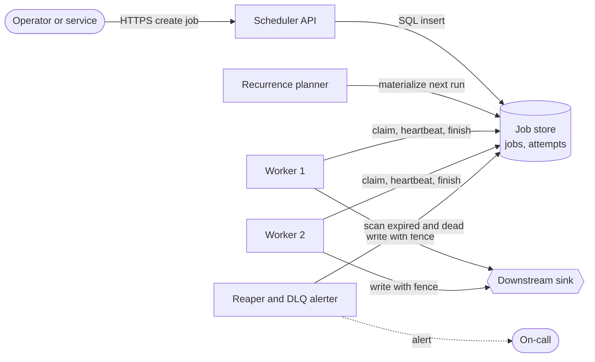
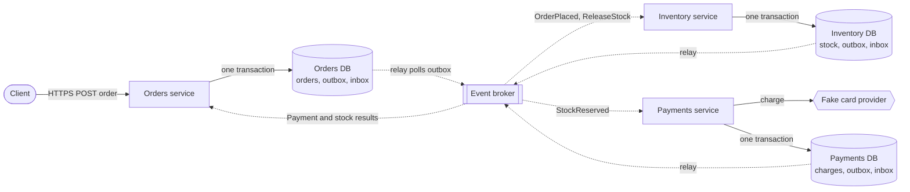
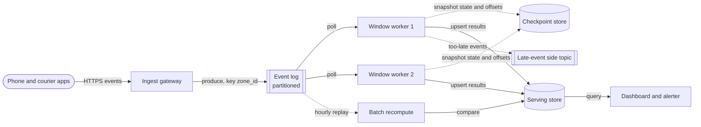
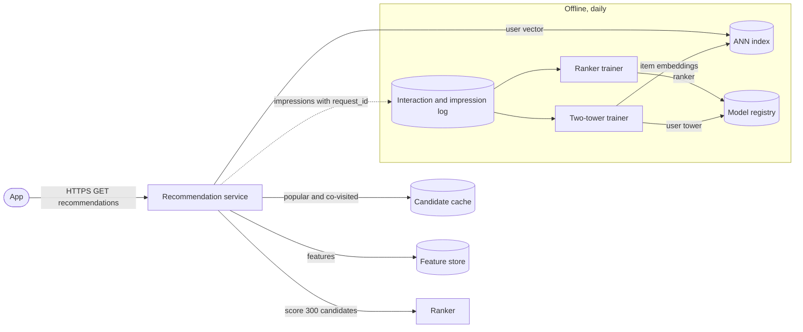
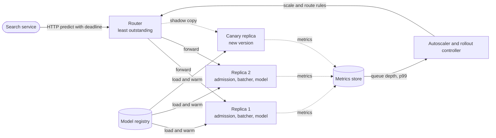

## 93.3 Advanced projects

The five advanced projects move from "one service that works" to "several processes that must agree while some of them fail." Each one is built around a single mechanism that interviewers probe again and again: leases and fencing tokens (job scheduler), the transactional outbox and sagas (event-driven microservices), event-time windows and watermarks (real-time analytics), two-tower retrieval with a sampling correction (recommendation engine) and dynamic batching with admission control (distributed ML inference). The starter code isolates that mechanism in under a hundred lines so you can see it work and break before you wrap it in HTTP servers, containers and dashboards.

All five assume the beginner and intermediate projects in §93.1–§93.2 or equivalent experience: you can build a REST service, run several processes locally, write a load generator and read a p99. Each project is sized for roughly 25–40 hours. Numbers attached to QuickBite are the Book II assumptions; laptop targets are deliberately modest so they can be met on a four-core machine without a GPU.

### 93.3.1 Distributed job scheduler

**Level:** 3 · **Effort:** about 25–35 hours · **Related:** full case study §52.9, leases §26.11, fencing tokens §26.13, workflow engines §32.11, cluster scheduling Ch 46, practice question Ch 91 Q40

#### Goal and learning outcomes

QuickBite runs thousands of jobs that must happen *at a time* rather than *in response to a request*: restaurant payout batches at 02:00, menu syncs every 15 minutes, "your order is late" checks five minutes after a promised time, nightly retraining triggers for the ETA model. A single cron daemon is a single point of failure; two cron daemons run every job twice. You will build a scheduler that runs every job **at least once, close to its due time, on a pool of workers that may crash or pause at any moment**, and that makes the duplicates harmless.

After this project you should be able to:

- **Implement** a job store with atomic claims, time-bounded leases, heartbeats and monotonically increasing fencing tokens.
- **Explain** why a lease alone cannot prevent two workers acting on the same job, and show with a test how a fencing token and an idempotent effect close the gap.
- **Design** retry with exponential backoff, a maximum attempt count and a dead-letter state, and choose the lease duration from the heartbeat interval.
- **Measure** firing delay (actual start minus due time) and takeover time after a worker crash, and state both as p99 targets.

#### Prerequisites

- Leases and the clock assumptions behind them — §26.11; fencing tokens — §26.13. This project is those two sections turned into code.
- Visibility timeouts and dead-letter queues — §30.4.2 and §30.11. A leased job is the same idea as an in-flight message.
- Idempotency keys — §22.15. The only reliable defense against the duplicates the scheduler will produce.
- Durable execution and workflow engines — §32.11, to see what you are *not* building (multi-step workflows with saved state).
- Scheduling vocabulary (jobs, tasks, priorities, quota) — §46.3 and §46.8.
- The interview-length design of the same system — §52.9. Read its requirements and capacity sections first; this project builds the claim path of that design.

#### Specification

**Functional requirements.**

1. `POST /jobs` creates a one-off job (`run_at`, `payload`, `max_attempts`, `idempotency_key`) or a recurring job (`cron` expression, time zone). Creating the same `idempotency_key` twice returns the first job.
2. Workers call `claim(worker_id, n)` to lease up to $n$ due jobs, `heartbeat(job_id, fence)` to extend a lease, and `complete(job_id, fence, result)` or `fail(job_id, fence, error)` to finish one.
3. A failed run is retried after $b \cdot 2^{a-1}$ seconds (attempt $a$, base $b$) until `max_attempts`, after which the job moves to `DEAD` and raises an alert.
4. A recurring job materializes its next occurrence only when the current one is claimed, so a backlog never multiplies.
5. `GET /jobs/{id}` shows state, attempts, current fence, lease holder and history; `POST /jobs/{id}/cancel` and `/retry` exist for operators.

**Non-functional requirements (laptop scale).**

- **No lost jobs:** every due job reaches `DONE` or `DEAD`; verified by a reconciliation query after each test.
- **Firing delay:** p99 below 2 s with 10,000 jobs due in the same minute and 8 workers.
- **Takeover after a crash:** a crashed worker's job restarts within lease + one claim interval (10 s + 1 s).
- **Throughput:** 500 claims/s sustained against PostgreSQL or SQLite in WAL mode.
- **Duplicates:** permitted at the job level (at-least-once) but **zero duplicate side effects** at the sink, because effects are keyed by `job_id`.

::: formula
**Lease duration from heartbeats**

$$L \;\ge\; k \cdot h + d_{\max}$$

| Symbol | Meaning | Units |
|---|---|---|
| $L$ | Lease duration granted on claim and on each heartbeat | s |
| $h$ | Heartbeat interval used by workers | s |
| $k$ | Number of consecutive heartbeats you are willing to lose before takeover | count |
| $d_{\max}$ | Worst-case delay between a heartbeat being sent and the store recording it | s |
:::

::: example
**Worked example — sizing the lease for QuickBite's scheduler.** Heartbeats every $h = 3$ s; tolerate $k = 3$ lost heartbeats (a short network blip or a slow database); $d_{\max} = 1$ s.

1. $k \cdot h = 3 \times 3 = 9$ s.
2. $L \ge 9 + 1 = 10$ s, the value used in the starter code.
3. Worst-case takeover after a real crash: the lease can have up to 10 s left, plus one claim poll of 1 s, so about 11 s.

**Interpretation.** Halving the lease to 5 s halves takeover time but turns a single 6 s database hiccup into a false takeover and a duplicate run. **Engineering implication.** Choose $L$ from the heartbeat budget, then make duplicates cheap with fencing and idempotent effects rather than trying to make them impossible. The clock-drift margin of §26.11 adds only milliseconds here; pauses dominate.
:::

#### Architecture

**Figure 93.101 — Distributed job scheduler with leases and fencing tokens.**



**Reading the diagram.** Clients create jobs through the **Scheduler API**, which inserts rows into the **job store** (PostgreSQL in production, SQLite for the first milestone); the store is the only source of truth, and every state change is a single conditional `UPDATE`. The **recurrence planner** turns cron expressions into concrete `run_at` rows, one occurrence ahead. **Workers** pull: they claim due rows with `SELECT … FOR UPDATE SKIP LOCKED` (or an equivalent compare-and-set), receive a lease and a fencing token, heartbeat while working and finish with the token. All of these calls are synchronous request/response (solid arrows). Workers write their effect to the **downstream sink** (a payout API, a table) carrying the fence, and the sink rejects writes older than the newest fence it has seen. The **reaper** scans for expired leases and dead jobs; its alerts are asynchronous (dotted). Failure points: a worker can crash (lease expires, job is re-claimed), pause (it becomes a zombie holding a stale fence) or lose its connection; the store itself is the availability bottleneck and is made highly available with a replica and automatic failover (§27). Scaling: partition jobs by `hash(job_id)` across store shards and give each worker pool a shard set, or move to a log-based design (Kafka topics per delay bucket) once one database cannot sustain the claim rate.

#### Milestones

1. **Single-node store and claim loop.** Implement `submit`, `claim`, `finish` and backoff on SQLite with one worker process. *Done when:* 1,000 jobs with random `run_at` all reach `DONE` and the firing delay histogram is printed.
2. **Leases, heartbeats and takeover.** Add leases and a heartbeat thread; kill a worker with `SIGKILL` mid-job. *Done when:* the job is re-claimed by another worker within 11 s, measured by the test.
3. **Fencing and idempotent effects.** Add fencing tokens and a sink that checks them; make the effect an upsert keyed by `job_id`. *Done when:* the pause test in the starter code produces zero duplicate effects after the idempotent upsert.
4. **Recurring jobs and operator API.** Cron parsing with time zones, cancel, retry and a DLQ view. *Done when:* a job scheduled for 02:30 local time behaves correctly across a daylight-saving transition in a unit test.
5. **Scale-out and observability.** Move to PostgreSQL with `SKIP LOCKED`, 8 workers and metrics for due-but-unclaimed jobs, firing delay, attempts and dead jobs. *Done when:* the load test in the test plan meets its targets.

#### Starter code

The core is a job table with atomic claims and a worker simulation in logical time. Five percent of claims are followed by a 15 s stop-the-world pause, longer than the 10 s lease, so some workers wake up as zombies holding stale fences.

```python
import random

class JobStore:
    """Authoritative job table (stands in for Postgres or etcd). All methods are atomic."""
    def __init__(self, lease_s=10, max_attempts=4, backoff_s=2):
        self.jobs, self.fence = {}, 0
        self.lease_s, self.max_attempts, self.backoff_s = lease_s, max_attempts, backoff_s

    def submit(self, jid, run_at):
        self.jobs[jid] = dict(state="PENDING", run_at=run_at, attempts=0, fence=0, until=0)

    def claim(self, now):
        ready = [(j["run_at"], jid) for jid, j in self.jobs.items()
                 if (j["state"] == "PENDING" and j["run_at"] <= now)
                 or (j["state"] == "LEASED" and j["until"] <= now)]       # expired lease
        for _, jid in sorted(ready):
            j = self.jobs[jid]
            if j["attempts"] >= self.max_attempts:
                j["state"] = "DEAD"; continue                              # dead-letter
            self.fence += 1                                                # monotonic token
            j.update(state="LEASED", until=now + self.lease_s, fence=self.fence)
            j["attempts"] += 1
            return jid, self.fence
        return None

    def heartbeat(self, jid, fence, now):
        j = self.jobs[jid]
        if j["state"] == "LEASED" and j["fence"] == fence:
            j["until"] = now + self.lease_s
            return True
        return False                                                       # lease lost

    def finish(self, jid, fence, now, ok):
        j = self.jobs[jid]
        if j["state"] != "LEASED" or j["fence"] != fence:
            return "STALE"
        if ok:
            j["state"] = "DONE"
        else:
            j.update(state="PENDING", run_at=now + self.backoff_s * 2 ** (j["attempts"] - 1))
        return "OK"

class Sink:
    """Downstream resource that checks fencing tokens (e.g. a conditional write)."""
    def __init__(self):
        self.highest, self.effects, self.rejected = {}, 0, 0
    def write(self, jid, fence):
        if fence < self.highest.get(jid, 0):
            self.rejected += 1; return False
        self.highest[jid] = fence; self.effects += 1; return True

def simulate(n_jobs=300, n_workers=6, seed=7):
    rng = random.Random(seed)
    store, sink = JobStore(), Sink()
    for i in range(n_jobs):
        store.submit(f"job-{i:03d}", run_at=rng.randrange(0, 120))
    workers = [dict(job=None, busy_until=0, paused_until=0) for _ in range(n_workers)]
    stale = 0
    for now in range(0, 400):
        for w in workers:
            if w["paused_until"] > now:                    # stop-the-world pause: no heartbeats
                continue
            if w["job"] is None:
                got = store.claim(now)
                if got:
                    w["job"], w["busy_until"] = got, now + rng.randint(2, 6)
                    if rng.random() < 0.05:                # 5%: long pause > lease
                        w["paused_until"] = now + 15
                continue
            jid, fence = w["job"]
            if now < w["busy_until"]:
                store.heartbeat(jid, fence, now); continue
            ok = rng.random() > 0.15                       # 15% of runs fail
            if ok:
                sink.write(jid, fence)                     # side effect guarded by fence
            if store.finish(jid, fence, now, ok) == "STALE":
                stale += 1
            w["job"] = None
    states = {}
    for j in store.jobs.values():
        states[j["state"]] = states.get(j["state"], 0) + 1
    print("final states:", dict(sorted(states.items())))
    print("fencing tokens issued:", store.fence, "| stale finishes rejected:", stale)
    print("side effects applied:", sink.effects, "| stale writes blocked at sink:", sink.rejected)
    print("jobs with >1 applied effect:", sink.effects - len(sink.highest))

simulate()
```

Output:

```text
final states: {'DEAD': 1, 'DONE': 299}
fencing tokens issued: 387 | stale finishes rejected: 24
side effects applied: 311 | stale writes blocked at sink: 8
jobs with >1 applied effect: 11
```

What to notice:

- `claim` treats an expired lease exactly like a pending job; this is the whole takeover mechanism, and it needs no failure detector beyond the clock.
- `fence` is a single counter for the whole store. Every claim gets a strictly larger number than any earlier claim, so "newer holder" is well defined even across jobs and workers.
- `finish` rejected 24 stale completions: zombies that woke after their lease had been reassigned. Without the fence check, those completions would have overwritten the new holder's state.
- The sink blocked 8 stale writes but **11 jobs still had two effects applied**. A fence only stops a stale write that arrives *after* a newer one; when the zombie writes first, both writes look legitimate. This is the central lesson: leases and fences give at-least-once with ordering protection, not exactly-once. Making the effect an upsert keyed by `job_id` (§22.15) turns those 11 into no-ops.
- 387 tokens for 300 jobs means about 29% extra claims came from retries and takeovers. Track this ratio in production; a sudden rise means slow workers or a lease that is too short.

#### Test plan and load-test targets

- **Unit tests:** claim never returns a job twice while its lease is valid; `finish` with an old fence returns `STALE`; backoff delays are 2, 4 and 8 s; a job reaches `DEAD` after `max_attempts`.
- **Property test:** with random crashes and pauses, the final state of every job is `DONE` or `DEAD` and the count of distinct `job_id`s with an effect equals the count of `DONE` jobs.
- **Concurrency test:** 8 worker processes against PostgreSQL; assert no two *unexpired* leases on one job by scanning an audit log of claims.
- **Load test:** 10,000 jobs due in one minute, 8 workers each processing jobs that sleep 50 ms. Targets: p99 firing delay below 2 s, claim rate at least 500/s, database CPU below 70%.
- **Soak test:** 24 hours of a recurring job every 10 s; assert exactly 8,640 occurrences and no growth in table size beyond retention.

#### Failure-injection exercises

**Table 93.101 — Distributed job scheduler: failure injections.**

| Inject | Expected behavior | How you verify |
|---|---|---|
| `SIGKILL` a worker mid-job | Job re-claimed within about 11 s with a higher fence | Takeover-time metric; attempts column increments |
| `SIGSTOP` a worker for 20 s, then `SIGCONT` | Its `finish` returns `STALE`; its sink write is rejected or deduplicated | Stale-finish counter; sink shows one effect per job |
| Database failover during claims | Claims fail fast and retry; no job lost; some duplicates | Reconciliation query after failover |
| Clock step of +30 s on one worker | Worker-local clock is not used for lease decisions | Leases computed from the database clock (`now()`) only |
| Poison job that always fails | Moves to `DEAD` after `max_attempts`; alert fires | DLQ view and alert log |
| 50,000 jobs due at once (thundering herd) | Claim batches of $n$ jobs keep up; firing delay degrades gracefully | Firing-delay p99 and backlog gauge |

#### Extensions

- Add **priorities and per-tenant quotas** so a bulk backfill cannot starve payout jobs (§46.8 and §47.8).
- Replace polling with **delay buckets** on a log: one topic per minute bucket, consumers that sleep until the bucket's time, and a compacted topic for cancellations.
- Add **DAG dependencies** (job B runs after job A succeeds) and compare your design with a workflow engine's durable execution (§32.11.1).
- Make the store **multi-region**: what happens to fencing tokens when two regions can each issue them? (Hint: partition token ranges by region or run consensus, §26.7.)

#### Self-assessment rubric

**Table 93.102 — Distributed job scheduler: self-assessment rubric.**

| Dimension | 1 — Working | 2 — Solid | 3 — Interview-ready |
|---|---|---|---|
| Correctness | No lost jobs in crash tests | Zero duplicate effects with pauses | Property test with random faults in CI |
| Lease design | Fixed lease and heartbeat | Lease derived from $k \cdot h + d_{\max}$ and justified | Database clock only; clock-step test |
| Throughput | 100 claims/s | 500 claims/s with `SKIP LOCKED` | Sharded store and measured scaling curve |
| Operations | Logs | Metrics for delay, backlog, DLQ | Runbook, cancel/retry API, DST tests |
| Explanation | Describes the flow | Explains lease versus fence with the pause test | Explains why exactly-once needs idempotent effects, with the 11-duplicate result |

### 93.3.2 Event-driven microservices

**Level:** 3 · **Effort:** about 30–40 hours · **Related:** transactional outbox §32.5, sagas §32.7, idempotent consumers §32.10, delivery guarantees §30.8, database-per-service §34.11, e-commerce case study §55.7, payment case study §55.9

#### Goal and learning outcomes

When a QuickBite customer places an order, three teams' services must agree: **Orders** records it, **Inventory** reserves the limited-quantity dishes (a restaurant may have 60 portions of a daily special), and **Payments** charges the card. There is no shared database and no distributed transaction. You will build these three services so that they communicate only through events, survive crashes between any two steps, absorb duplicate messages, and undo partial work when a later step fails. The outcome you are aiming for is an invariant you can check with a query: *units reserved equal units in confirmed orders, and charges equal confirmed orders*, no matter where you pull the plug.

After this project you should be able to:

- **Explain** the dual-write problem and implement the transactional outbox with a relay.
- **Implement** idempotent consumers with a processed-message (inbox) table written in the same transaction as the business change.
- **Design** an orchestrated or choreographed saga with compensating actions and state each service's local transaction.
- **Verify** cross-service invariants with reconciliation queries after randomized crash tests, and trace one order across services by correlation ID.

#### Prerequisites

- The dual-write problem and the outbox — §32.5; change data capture as the alternative relay — §32.6.
- Sagas, compensation and living without isolation — §32.7; choreography versus orchestration — §32.8.
- Idempotent consumers — §32.10; delivery guarantees and where duplicates come from — §30.8.
- Database-per-service and service boundaries — §34.3 and §34.11.
- Optional: the order and payment paths in the e-commerce and payment case studies — §55.7 and §55.9.

#### Specification

**Functional requirements.**

1. `POST /orders` (Orders service) validates the request, stores the order as `PENDING` and returns `202 Accepted` with an `order_id`; the client polls `GET /orders/{id}` or subscribes to a status stream.
2. Inventory consumes `OrderPlaced`, reserves stock if available and emits `StockReserved` or `StockRejected`.
3. Payments consumes `StockReserved`, charges a fake card provider and emits `PaymentSucceeded` or `PaymentFailed`.
4. Orders moves the order to `CONFIRMED`, `REJECTED` or `CANCELLED`; on `PaymentFailed` it emits `ReleaseStock`, which Inventory applies as a compensation.
5. Every event carries `event_id`, `correlation_id` (the order ID), `causation_id` (the event that caused it), `type`, `schema_version` and `occurred_at`.
6. A `GET /orders/{id}/timeline` endpoint stitches the events for one order from all three services.

**Non-functional requirements (laptop scale).**

- **Throughput:** 200 orders/s end to end, about 3× QuickBite's 60 orders/s peak, on one machine with a local broker (Redis Streams, RabbitMQ or Kafka in Docker; or the in-memory log of the starter).
- **Latency:** p99 from `POST /orders` to a terminal state below 2 s at 200 orders/s.
- **Correctness:** after any crash test, `SUM(reserved) = SUM(qty of CONFIRMED)`, `COUNT(charges) = COUNT(CONFIRMED)` and no order remains `PENDING` longer than 60 s.
- **Duplicates:** every consumer tolerates every message delivered 1–3 times.
- **Isolation:** each service owns its database file or schema; no service reads another's tables.

#### Architecture

**Figure 93.102 — Three services, three databases, one broker: outbox, inbox and saga.**



**Reading the diagram.** The **client** talks synchronously only to the **Orders service**, which commits the order row and an `OrderPlaced` outbox row in one local transaction and returns `202`. Everything after that is asynchronous (dotted arrows). Each service has its own **database** holding business tables plus an **outbox** (events to publish) and an **inbox** (IDs of events already processed); that is the storage boundary, and no arrow crosses it except through the broker. A **relay** per database polls unsent outbox rows, publishes them to the **event broker** and marks them sent; it can crash between publishing and marking, which is the main source of duplicates. **Inventory** and **Payments** consume, apply their change and their outbox row in one transaction together with an inbox insert, so a redelivered event is detected and skipped. Payments calls the **fake card provider** synchronously; it is the failure point you will inject latency and errors into, and the call must carry an idempotency key (§22.15) so a retry never charges twice. Scaling: partition the broker topic by `order_id` so all events of one order are processed in order by one consumer, and add consumer instances up to the partition count (§31.7.3).

#### Milestones

1. **Three services, one happy path.** HTTP Orders service, two consumer processes, SQLite per service, in-memory or Redis Streams broker. *Done when:* 1,000 orders reach a terminal state and the invariants hold with no injected failures.
2. **Outbox and relay.** Remove every direct `publish()` from request handlers; publish only via the relay. *Done when:* killing the Orders service between commit and publish loses no events (the relay publishes them after restart).
3. **Idempotent consumers.** Add the inbox table and inject duplicate deliveries at 10%. *Done when:* invariants hold and the duplicate-skipped counter equals the number of injected duplicates.
4. **Saga with compensation.** Add declines (20%) and stock exhaustion; implement `ReleaseStock`. *Done when:* the starter's invariants hold across 10 seeds and the timeline endpoint shows each compensation.
5. **Observability and load.** Correlation IDs in logs, traces across the broker (propagate trace context in event headers, §40.6.2), consumer-lag metrics. *Done when:* the 200 orders/s load test meets the p99 target and one slow order can be found from a latency histogram to its trace.

#### Starter code

The starter runs all three services in one process to keep it short: three in-memory SQLite databases, one list as the broker, relays that crash 10% of the time after publishing but before marking a row sent, and a 20% card-decline rate.

```python
import json, random, sqlite3

rng = random.Random(42)
log = []                                   # the broker: one append-only topic

def db(schema):
    c = sqlite3.connect(":memory:"); c.executescript(schema); return c

def emit(conn, etype, key, body):          # call inside the caller's transaction
    conn.execute("INSERT INTO outbox(type, key, body) VALUES (?,?,?)", (etype, key, json.dumps(body)))

def relay(conn, crash_rate):
    """Publish unsent outbox rows; a crash before marking sent causes a re-publish."""
    for oid, etype, key, body in conn.execute("SELECT id,type,key,body FROM outbox WHERE sent=0").fetchall():
        log.append(dict(type=etype, key=key, body=json.loads(body), msg_id=f"{etype}:{key}"))
        if rng.random() < crash_rate:
            return                                          # crashed: row stays unsent
        with conn: conn.execute("UPDATE outbox SET sent=1 WHERE id=?", (oid,))

OUTBOX = "CREATE TABLE outbox(id INTEGER PRIMARY KEY, type, key, body, sent INT DEFAULT 0);"
INBOX = "CREATE TABLE inbox(msg_id PRIMARY KEY);"           # processed-message table
orders = db(OUTBOX + "CREATE TABLE orders(id PRIMARY KEY, sku, qty, state);")
stock = db(OUTBOX + INBOX + "CREATE TABLE stock(sku PRIMARY KEY, avail, reserved);")
pay = db(OUTBOX + INBOX + "CREATE TABLE charges(order_id PRIMARY KEY, amount);")
orders.executescript(INBOX)
with stock: stock.executemany("INSERT INTO stock VALUES (?,?,0)", [("pizza", 60), ("sushi", 60)])

def handle(conn, msg, fn):
    """Idempotent consumer: business change and inbox insert commit together."""
    with conn:
        if conn.execute("SELECT 1 FROM inbox WHERE msg_id=?", (msg["msg_id"],)).fetchone():
            return False                                    # duplicate: skip
        conn.execute("INSERT INTO inbox VALUES (?)", (msg["msg_id"],))
        fn(conn, msg["key"], msg["body"])
        return True

def inventory(conn, oid, b):
    if b.get("release"):
        conn.execute("UPDATE stock SET avail=avail+?, reserved=reserved-? WHERE sku=?", (b["qty"], b["qty"], b["sku"]))
        return
    (avail,) = conn.execute("SELECT avail FROM stock WHERE sku=?", (b["sku"],)).fetchone()
    if avail >= b["qty"]:
        conn.execute("UPDATE stock SET avail=avail-?, reserved=reserved+? WHERE sku=?", (b["qty"], b["qty"], b["sku"]))
        emit(conn, "StockReserved", oid, b)
    else:
        emit(conn, "StockRejected", oid, b)

def payment(conn, oid, b):
    if rng.random() < 0.2:                                  # card declined
        emit(conn, "PaymentFailed", oid, b); return
    conn.execute("INSERT INTO charges VALUES (?,?)", (oid, 12 * b["qty"]))
    emit(conn, "PaymentSucceeded", oid, b)

def order_events(conn, oid, b, etype):
    new = {"PaymentSucceeded": "CONFIRMED", "PaymentFailed": "CANCELLED", "StockRejected": "REJECTED"}[etype]
    conn.execute("UPDATE orders SET state=? WHERE id=?", (new, oid))
    if etype == "PaymentFailed":                            # saga compensation
        emit(conn, "ReleaseStock", oid, dict(b, release=True))

routes = {"OrderPlaced": [(stock, inventory)], "ReleaseStock": [(stock, inventory)],
          "StockReserved": [(pay, payment)], "StockRejected": [(orders, None)],
          "PaymentSucceeded": [(orders, None)], "PaymentFailed": [(orders, None)]}

for i in range(100):                                        # place 100 orders
    oid, sku, qty = f"o{i:03d}", rng.choice(["pizza", "sushi"]), rng.randint(1, 2)
    with orders:
        orders.execute("INSERT INTO orders VALUES (?,?,?,'PENDING')", (oid, sku, qty))
        emit(orders, "OrderPlaced", oid, dict(sku=sku, qty=qty))

offset, applied, dupes = 0, 0, 0
while True:
    for conn in (orders, stock, pay):
        relay(conn, crash_rate=0.1)
    if offset == len(log):
        break
    msg = log[offset]; offset += 1
    for conn, fn in routes[msg["type"]]:
        f = fn or (lambda c, k, b, t=msg["type"]: order_events(c, k, b, t))
        if handle(conn, msg, f): applied += 1
        else: dupes += 1

states = dict(orders.execute("SELECT state, COUNT(*) FROM orders GROUP BY state").fetchall())
qty_confirmed = orders.execute("SELECT SUM(qty) FROM orders WHERE state='CONFIRMED'").fetchone()[0]
reserved = stock.execute("SELECT SUM(reserved) FROM stock").fetchone()[0]
charged = pay.execute("SELECT COUNT(*) FROM charges").fetchone()[0]
print("messages published:", len(log), "| applied:", applied, "| duplicates skipped:", dupes)
print("order states:", states)
print("units reserved:", reserved, "| units in confirmed orders:", qty_confirmed)
print("charges:", charged, "| confirmed orders:", states.get("CONFIRMED", 0))
```

Output:

```text
messages published: 331 | applied: 304 | duplicates skipped: 27
order states: {'CANCELLED': 19, 'CONFIRMED': 66, 'REJECTED': 15}
units reserved: 95 | units in confirmed orders: 95
charges: 66 | confirmed orders: 66
```

What to notice:

- `emit` never publishes; it inserts an outbox row inside the caller's transaction. The event exists if and only if the business change committed, which is the whole point of the outbox (§32.5.2).
- The relay crashed often enough to publish 27 duplicates (331 published versus 304 applied). Every one was skipped by the inbox check in `handle`, because the inbox insert and the business change commit atomically.
- `msg_id` is derived from `type:key`, which is unique here because each order produces at most one event of each type. In your version, generate a UUID when the outbox row is written and keep it through retries; never derive it at publish time, or a re-publish gets a new ID and defeats deduplication.
- The 19 cancelled orders each triggered `ReleaseStock`; the invariant `reserved = confirmed units` (95 = 95) shows every compensation landed exactly once. The 15 rejected orders never reserved stock, so they needed no compensation.
- Ordering is not guaranteed in general: if `PaymentFailed` could arrive at Inventory before `StockReserved` was applied, the release would run first. Partitioning by `order_id` and processing each partition serially (§30.9) is what makes the simple handlers safe.

#### Test plan and load-test targets

- **Contract tests:** each event type has a JSON Schema with `schema_version`; producers validate before writing the outbox, consumers reject unknown major versions to a dead-letter queue (§30.11).
- **Crash matrix:** for each of the six arrows in Figure 93.102, kill the producing or consuming process at that point 20 times; run the invariant queries after each run.
- **Duplicate and reorder tests:** a broker wrapper that redelivers 10% of messages and delays 5% by up to 2 s.
- **Load test:** open-loop 200 orders/s for 10 minutes. Targets: p99 end-to-end below 2 s, consumer lag below 1,000 events at all times, zero invariant violations.
- **Back-pressure test:** stop Payments for 2 minutes at 200 orders/s; when it restarts, lag must drain within 5 minutes and no order may be lost or double-charged.

#### Failure-injection exercises

**Table 93.103 — Event-driven microservices: failure injections.**

| Inject | Expected behavior | How you verify |
|---|---|---|
| Kill Orders right after commit, before relay runs | Event published after restart; order completes late | No `PENDING` older than 60 s after recovery |
| Relay crashes after publish, before marking sent | Duplicate event; consumer skips it | Duplicate-skipped counter rises; invariants hold |
| Card provider times out but actually charged | Retry with the same idempotency key returns the first result | One charge row and one provider charge per order |
| Inventory down for 5 minutes | Orders stay `PENDING`; lag grows then drains | Lag graph; all orders terminal after drain |
| Poison event (schema the consumer cannot parse) | Sent to DLQ after 3 attempts; partition keeps moving | DLQ count; lag returns to zero |
| Compensation fails (Inventory rejects `ReleaseStock`) | Retried; alert after N failures; manual runbook | Alert fires; reconciliation report lists the order |

#### Extensions

- Replace the polling relay with **log-tailing CDC** (Debezium against PostgreSQL in Docker, §32.6.2) and compare publish latency and database load.
- Convert the choreographed saga to an **orchestrator** with an explicit state machine, then to a workflow engine (§32.11); compare how easy it is to answer "where is order X stuck?".
- Add a **CQRS read model** (§32.4) that serves the order timeline from a denormalized view, and measure its staleness.
- Add a **Notifications** consumer that must send exactly one "order confirmed" message per order, reusing the notification service of §93.2.4.

#### Self-assessment rubric

**Table 93.104 — Event-driven microservices: self-assessment rubric.**

| Dimension | 1 — Working | 2 — Solid | 3 — Interview-ready |
|---|---|---|---|
| Atomicity | Events published after commit | Outbox with relay; crash test passes | You can explain why "publish then commit" and "commit then publish" both fail |
| Duplicates | Consumers mostly idempotent | Inbox in the same transaction; 10% duplicate test passes | You explain where duplicates come from and why the message ID is fixed at outbox time |
| Saga | Happy path | Compensation for every failure branch | You defend choreography or orchestration with this system's numbers |
| Observability | Logs per service | Correlation IDs, lag metric, timeline endpoint | One trace spans all three services across the broker |
| Capacity | Runs at 50 orders/s | 200 orders/s meets the p99 target | You name the bottleneck (relay poll interval, SQLite write lock or consumer count) with evidence |

### 93.3.3 Real-time analytics pipeline

**Level:** 3–4 · **Effort:** about 30–40 hours · **Related:** windows and watermarks §29.8, Flink state and checkpoints §29.9, Kafka consumers and offsets §31.7–31.8, full case study §56.7, streaming features §61.6

#### Goal and learning outcomes

QuickBite's operations team watches a live dashboard: orders per delivery zone over the last minute, refreshed every 10 seconds, with alerts when a zone's order rate doubles or courier acceptance collapses. Events come from phones on mobile networks, so some arrive seconds or minutes late and out of order. A dashboard that counts by *arrival* time shows phantom dips and spikes whenever a cell tower reconnects. You will build a pipeline that counts by **event time**, decides when a window is complete with a **watermark**, handles late events explicitly, and recovers from a crash without double counting.

After this project you should be able to:

- **Implement** hopping (sliding) and tumbling event-time windows with a watermark, allowed lateness, updates to already-emitted results and a side output for events that are too late.
- **Quantify** the trade-off between completeness, latency and state size, and predict state size from the window parameters.
- **Recover** from a crash with checkpointed state and source offsets so each event affects each window once.
- **Validate** a streaming result against a batch recomputation over the same events, the habit that makes streaming systems trustworthy.

#### Prerequisites

- Event time versus processing time, windows, watermarks, triggers and late data — §29.8. This project implements §29.8.3 directly.
- State and exactly-once processing in a stream processor — §29.8.4 and §29.9.2 (asynchronous barrier snapshots).
- Consumer groups, offsets and commit strategies — §31.7 and §31.8.
- The full design of a real-time analytics platform, including the serving store and rollups — §56.7.
- Percentiles and why they cannot be averaged across windows — §40.5.2.

#### Specification

**Functional requirements.**

1. Ingest `order_placed`, `order_delivered` and `courier_accepted` events with `event_id`, `zone_id` and `event_ts` from a log (Kafka or Redpanda in Docker, or a file replayed at a controlled rate).
2. Compute per zone: order count over 60 s windows sliding every 10 s; delivered-order p50 and p95 delivery time over 5-minute tumbling windows; courier acceptance ratio over 60 s windows.
3. Emit each window result when the watermark passes the window end; re-emit an **update** if a late event within allowed lateness changes it; route events later than that to a side output with a counter.
4. Write results to a serving store (SQLite, PostgreSQL or Redis) keyed by `(metric, zone_id, window_start)` with upsert semantics, and serve them to a minimal dashboard.
5. Alert when a zone's order count in the latest window exceeds twice its trailing one-hour median.

**Non-functional requirements (laptop scale).**

- **Throughput:** 20,000 events/s per worker process (QuickBite's browse traffic is about 7,000 RPS at peak, so this leaves headroom for clickstream as well as orders).
- **Freshness:** p99 delay from window end to result visible in the store below 15 s.
- **Completeness:** at least 99.5% of events counted in their windows with the default lateness, measured against batch recomputation.
- **Crash recovery:** after `SIGKILL` and restart, final window results equal the no-crash results.
- **Bounded state:** state size proportional to zones × open windows, not to total events.

::: formula
**Open windows held in state**

$$N_{\text{open}} \;\approx\; K \cdot \left\lceil \frac{W + D + A}{S} \right\rceil$$

| Symbol | Meaning | Units |
|---|---|---|
| $N_{\text{open}}$ | Number of (key, window) aggregates held in memory at steady state | aggregates |
| $K$ | Number of active keys (zones) | keys |
| $W$ | Window size | s |
| $S$ | Slide (hop) between window starts; $S = W$ for tumbling windows | s |
| $D$ | Watermark delay: how far the watermark trails the largest event time seen | s |
| $A$ | Allowed lateness after the watermark passes the window end | s |
:::

::: example
**Worked example — state for the starter and for QuickBite.** Starter: $K = 3$ zones, $W = 60$ s, $S = 10$ s, $D = 5$ s.

1. $A = 0$: $\lceil 65/10 \rceil = 7$ windows per zone; $3 \times 7 = 21$ aggregates. The starter measured a peak of 21 keys.
2. $A = 30$ s: $\lceil 95/10 \rceil = 10$; $3 \times 10 = 30$. Measured: 30.
3. $A = 120$ s: $\lceil 185/10 \rceil = 19$; $3 \times 19 = 57$. Measured: 57.
4. QuickBite: $K = 4{,}000$ zones, three metrics, $A = 120$ s: $4{,}000 \times 3 \times 19 = 228{,}000$ aggregates. At about 100 bytes each (key, counters, a small percentile sketch for the delivery-time metric is larger) this is roughly 23 MB, comfortably in memory on one worker.

**Interpretation.** Allowed lateness costs state linearly, and a small slide multiplies it: a 1 s slide instead of 10 s would make the same configuration $\lceil 185/1 \rceil = 185$ windows per zone, ten times the memory. **Engineering implication.** Choose $A$ from the measured lateness distribution (the 99.5th percentile of arrival delay), and prefer tumbling sub-windows combined at query time (pane-based aggregation) when slides are small.
:::

#### Architecture

**Figure 93.103 — Event-time analytics pipeline with watermarks, late-data side output and checkpoints.**



**Reading the diagram.** Apps send events over HTTPS to an **ingest gateway**, which stamps a receive time but never overwrites `event_ts`, and produces them to a **partitioned event log** keyed by `zone_id`, so every event for one zone goes to the same partition and therefore the same **window worker**. Workers poll synchronously, update in-memory window state, advance the watermark per partition (the minimum across their partitions is the operator's watermark) and **upsert** results into the **serving store**. Periodically and asynchronously, each worker writes its window state *and* the source offsets it has consumed to the **checkpoint store** in one atomic snapshot; on restart it loads the snapshot and seeks the log to those offsets, which is what makes counts exactly-once (§29.8.4). Too-late events go to a **side topic** for auditing rather than vanishing. The **batch recompute** replays an hour of the log and compares with the served results, giving a continuous completeness metric. Failure points: an idle partition holds back the watermark (use idle-source detection), a skewed zone overloads one worker (§29.6.3), and upserts must be idempotent because results are re-emitted after recovery. Scaling: add partitions and workers; the serving store is written at most once per window per key per slide, so it scales with zones, not events.

#### Milestones

1. **Tumbling event-time counts.** Read a replay file, compute 60 s tumbling counts per zone, flush at end of stream. *Done when:* results equal a batch `GROUP BY` over the same file.
2. **Watermarks and lateness.** Add hopping windows, watermark delay, allowed lateness, updates and a side output. *Done when:* the completeness-versus-lateness table of the starter is reproduced on your generator with three settings.
3. **Log-backed and checkpointed.** Consume from Kafka or Redpanda; checkpoint state and offsets every 10 s. *Done when:* `SIGKILL` at random times during a 5-minute replay yields final results identical to the no-crash run.
4. **Serving and alerting.** Upsert into the serving store, a dashboard page and the doubling alert. *Done when:* an injected surge in one zone triggers the alert within 30 s of its event time.
5. **Throughput and percentiles.** Batch processing, a t-digest or histogram sketch for delivery-time percentiles, two workers. *Done when:* 20,000 events/s per worker with freshness p99 below 15 s.

#### Starter code

The starter generates ten minutes of events for three zones: 90% arrive on time, 8% arrive 1–20 s late and 2% arrive 40–120 s late (a phone that lost signal). It processes them in arrival order with three allowed-lateness settings and compares every window with a batch recomputation.

```python
import random
from collections import defaultdict

SIZE, SLIDE = 60, 10                     # 60 s windows every 10 s (hopping)
DELAY = 5                                # watermark = max event time seen - DELAY

def windows_for(ts):                     # every window start s with s <= ts < s + SIZE
    first = (ts // SLIDE) * SLIDE - SIZE + SLIDE
    return range(max(first, 0), ts // SLIDE * SLIDE + 1, SLIDE)

class SlidingAggregator:
    def __init__(self, lateness):
        self.lateness, self.peak = lateness, 0
        self.state = defaultdict(int)    # (zone, window_start) -> count
        self.emitted = {}                # last value emitted downstream
        self.watermark, self.max_ts = -1, -1
        self.lost, self.updates = 0, 0

    def on_event(self, zone, ts):
        for s in windows_for(ts):
            if s + SIZE + self.lateness <= self.watermark:
                self.lost += 1; continue                # window closed -> side output
            self.state[(zone, s)] += 1                  # window still accepting
            if (zone, s) in self.emitted:               # late update to an emitted result
                self.emitted[(zone, s)] = self.state[(zone, s)]; self.updates += 1
        self.peak = max(self.peak, len(self.state))
        self.max_ts = max(self.max_ts, ts)
        self.advance(self.max_ts - DELAY)

    def advance(self, wm):
        self.watermark = max(self.watermark, wm)
        for (zone, s), v in list(self.state.items()):
            if s + SIZE <= self.watermark and (zone, s) not in self.emitted:
                self.emitted[(zone, s)] = v             # on-time firing
            if s + SIZE + self.lateness <= self.watermark:
                del self.state[(zone, s)]               # purge: bounded state

rng = random.Random(3)
events = []                                              # (arrival_order_key, zone, event_ts)
for ts in range(0, 600):
    for _ in range(rng.randint(2, 8)):
        zone = rng.choice(["z1", "z2", "z3"])
        r = rng.random()
        delay = 0 if r < 0.90 else rng.randint(1, 20) if r < 0.98 else rng.randint(40, 120)
        events.append((ts + delay + rng.random(), zone, ts))
events.sort()                                            # arrival (processing-time) order

truth = defaultdict(int)                                 # batch recompute over all events
for _, zone, ts in events:
    for s in windows_for(ts):
        truth[(zone, s)] += 1
keys = [k for k in truth if k[1] + SIZE <= 600]
print(f"events: {len(events)} | windows checked: {len(keys)}")
for lateness in (0, 30, 120):
    agg = SlidingAggregator(lateness)
    for _, zone, ts in events:
        agg.on_event(zone, ts)
    agg.advance(10**9)                                   # end of stream: flush
    exact = sum(agg.emitted.get(k) == truth[k] for k in keys)
    err = sum(abs(agg.emitted.get(k, 0) - truth[k]) for k in keys) / sum(truth[k] for k in keys)
    print(f"lateness {lateness:>3} s: exact {exact:>3}/{len(keys)}  error {err:.3%}  "
          f"late updates {agg.updates:>4}  lost {agg.lost:>3}  peak state {agg.peak} keys")
```

Output:

```text
events: 2963 | windows checked: 165
lateness   0 s: exact  14/165  error 2.254%  late updates    0  lost 365  peak state 21 keys
lateness  30 s: exact  62/165  error 1.050%  late updates  195  lost 170  peak state 30 keys
lateness 120 s: exact 165/165  error 0.000%  late updates  365  lost   0  peak state 57 keys
```

What to notice:

- With no allowed lateness only 14 of 165 windows are exact, even though only 10% of events are late at all. Hopping windows amplify lateness: each event belongs to six windows, so one late event can make six windows wrong (365 lost event-window contributions).
- Allowing 120 s of lateness makes every window exact but needs 365 **updates** to results already emitted. Downstream consumers must therefore treat results as upserts keyed by window, not as append-only facts.
- Peak state grows 21 → 30 → 57 exactly as the formula predicts. In production this is the number that tells you whether a lateness increase fits in memory.
- The watermark is `max event time seen − 5 s`, a heuristic. One device with a wrong clock that sends `event_ts` an hour in the future would push the watermark forward and close every window early; cap accepted `event_ts` at receive time plus a small skew.
- `advance` scans all state on every event, which is fine for 3 zones and far too slow for 4,000. Your version should keep windows in a heap or bucketed by end time.

#### Test plan and load-test targets

- **Golden tests:** fixed event files with known answers, including events exactly on window boundaries (is `ts = window_end` in or out? decide and test it).
- **Batch reconciliation:** every hour of replayed data is recomputed in batch; completeness must be at least 99.5% with the default lateness.
- **Out-of-order fuzzing:** shuffle arrival order within a bounded delay; results with sufficient lateness must equal the batch answer.
- **Crash tests:** 20 random `SIGKILL`s during replay; final results byte-identical to the no-crash run.
- **Load test:** open-loop producer at 20,000 events/s per worker for 10 minutes; record processing rate, consumer lag, freshness p99 and RSS memory every 10 s. Lag must stay bounded and memory flat.

#### Failure-injection exercises

**Table 93.105 — Real-time analytics pipeline: failure injections.**

| Inject | Expected behavior | How you verify |
|---|---|---|
| `SIGKILL` a worker between checkpoints | Restores state and offsets; replays; no double counts | Final results equal the no-crash run |
| One partition goes idle | Idle detection lets the watermark advance | Freshness stays below 15 s for other zones |
| Device with clock 1 hour ahead | Event rejected or clamped; watermark unaffected | Clamped-event counter; no early window closure |
| 5-minute network outage for 10% of devices | Their events arrive late; within lateness they update windows | Update count; completeness after replay |
| Hot zone at 20× normal rate | That worker lags; others unaffected | Per-partition lag; then split the key or rebalance |
| Serving store unavailable for 60 s | Worker buffers or blocks with back-pressure; no results lost | All windows present after recovery |

#### Extensions

- Implement **pane-based aggregation**: keep 10 s tumbling panes and compute each 60 s window as the sum of six panes, and measure the state and CPU saving.
- Add **approximate distinct counts** (HyperLogLog, §17.5) for unique active customers per zone and compare error with exact counts.
- Port the pipeline to Flink or Kafka Streams and compare code size, checkpoint behavior and throughput with your version (§29.11).
- Add a **Lambda-style** correction (§29.10): a nightly batch job overwrites the day's streaming results, and measure how often it changes anything.

#### Self-assessment rubric

**Table 93.106 — Real-time analytics pipeline: self-assessment rubric.**

| Dimension | 1 — Working | 2 — Solid | 3 — Interview-ready |
|---|---|---|---|
| Time semantics | Counts by event time | Watermarks, lateness, updates and side output | You choose lateness from a measured delay distribution and defend it |
| Correctness | Matches batch on in-order data | Matches batch under shuffling and crashes | Continuous batch reconciliation with a completeness metric |
| State | Unbounded dictionary | Purging with predicted size | Pane-based aggregation; state sized with the formula for 4,000 zones |
| Throughput | 2,000 events/s | 20,000 events/s per worker | Scaling curve over workers with skew handling |
| Explanation | Describes windows | Explains watermark heuristics and their failure modes | Explains exactly-once as state + offsets in one snapshot |

### 93.3.4 Recommendation engine

**Level:** 4 · **Effort:** about 35–45 hours · **Related:** multi-stage funnel §68.4, two-tower models §68.6, ranking §68.7, evaluation §68.14, cold start §68.15, QuickBite reference architecture §68.16, systems view §56.5, e-commerce recommendations §81.8, ANN search Ch 74

#### Goal and learning outcomes

QuickBite's home feed shows "dishes you might like" drawn from about 120,000 dishes deliverable to a typical urban address, at 2,500 requests per second at peak with a 120 ms server-side p99 (Ch 68). Scoring every dish with a heavy model per request is impossible, so production recommenders are **funnels**: cheap retrieval narrows the catalog to hundreds of candidates, a ranker orders them, and business rules re-rank the top. You will build a working two-stage funnel with offline training, an embedding index, an online service with a latency budget, and an honest offline evaluation against baselines.

After this project you should be able to:

- **Train** a two-tower retrieval model with in-batch negatives and explain why it needs a sampling-bias (log-Q) correction.
- **Evaluate** retrieval with recall@K on a time-ordered holdout and compare against random and popularity baselines, the two numbers every reviewer asks for first.
- **Serve** the funnel: precomputed item embeddings, an ANN index, a feature lookup and a ranker within a latency budget, with fallbacks.
- **Explain** feedback loops, position bias and cold start, and design the logging that makes the next model trainable.

#### Prerequisites

- Why recommenders are funnels and how budgets are split across stages — §68.4 and §56.5.
- Two-tower models, in-batch negatives and serving with precomputed item embeddings — §68.6.
- Ranking models and calibration — §68.7; offline metrics and A/B tests — §68.14.
- ANN indexes (HNSW, IVF) and recall–latency trade-offs — §74.6–74.8.
- Feature stores and training–serving skew — §62.7 and §62.9 (the expert feature-store project, §93.4.2, builds one).

#### Specification

**Functional requirements.**

1. **Data:** a synthetic or public interaction log (for example MovieLens, used locally) converted to `(user_id, item_id, ts, event)` with impressions, clicks and orders.
2. **Retrieval:** a two-tower model (user ID + context features; item ID + content features) trained daily; item embeddings exported to an ANN index (FAISS, hnswlib or brute force for small catalogs).
3. **Additional sources:** a popularity-by-zone source and an item-to-item co-occurrence source, merged with the two-tower candidates (§68.5.5).
4. **Ranking:** a gradient-boosted tree or small neural ranker over about 300 candidates using user, item and cross features, predicting order probability.
5. **Re-ranking:** diversity by restaurant (at most two dishes per restaurant in the top 20) and filtering of unavailable dishes.
6. **API:** `GET /recommendations?user_id=&zone_id=&k=20` returning items, scores, source tags and a `request_id`; impressions are logged with the `request_id` and the model versions.

**Non-functional requirements (laptop scale).**

- **Quality:** retrieval recall@50 at least 15% relative above popularity on a time-split holdout; ranker NDCG@20 above the retrieval-score order.
- **Latency:** p99 below 120 ms at 200 RPS on a laptop for a 120,000-item catalog (brute force or ANN).
- **Freshness:** a new item gets an embedding within one training cycle; until then the content tower or popularity source can surface it.
- **Availability:** if the ranker times out (40 ms budget), return retrieval order; if retrieval fails, return zone popularity.
- **Reproducibility:** each response can be traced to the model and index versions that produced it.

#### Architecture

**Figure 93.104 — Two-stage recommendation funnel with offline training and online serving.**



**Reading the diagram.** The **offline** boundary trains two models every day from the **interaction and impression log**: the **two-tower trainer** produces a user tower (loaded by the service) and item embeddings (bulk-loaded into the **ANN index**), and the **ranker trainer** produces the ranker; both are versioned in the **model registry** and published together so the user tower always matches the index. Online, the **app** calls the **recommendation service** synchronously; it computes the user vector, queries the index for about 200 nearest items, adds popular and co-visited items from the **candidate cache**, fetches features from the **feature store** and asks the **ranker** to score about 300 candidates before re-ranking to 20. Impressions are written asynchronously (dotted) back to the log, which closes the feedback loop: tomorrow's training data is today's recommendations. Failure points: a stale or mismatched index (user tower v2 against item embeddings v1 gives garbage silently), feature-store timeouts and ranker overload; each stage has a deadline and a fallback. Scaling: the service and ranker scale horizontally with request rate; the index replicates per node and scales with catalog size (§74.14); logging scales with impressions, which are 20× the request count.

#### Milestones

1. **Data and baselines.** Build the interaction log, a time-based split and random, popularity and popularity-by-zone baselines. *Done when:* recall@50 for each baseline is in your results log with the split described.
2. **Two-tower retrieval.** Train with in-batch negatives and log-Q correction; export item embeddings. *Done when:* recall@50 beats popularity by at least 15% relative, and you can show the result without the correction.
3. **Ranker.** Generate candidates for training impressions, add features, train a LightGBM or logistic ranker on order labels. *Done when:* NDCG@20 of the ranked list exceeds the retrieval-score order on the holdout.
4. **Online service.** HTTP service with ANN retrieval, the cache, the ranker, re-ranking and fallbacks; impressions logged. *Done when:* p99 below 120 ms at 200 RPS and the ranker-timeout fallback is exercised by a test.
5. **Loop and cold start.** Retrain from logged impressions, add a small exploration slot (§68.11) and content-only embeddings for new items. *Done when:* a newly added dish appears in some users' top 50 on day one, and the impression log contains propensities for the exploration slot.

#### Starter code

The starter builds 2,000 users and 1,000 dishes whose orders follow hidden tastes plus a strong global popularity term, holds out each user's last two orders and trains the same two-tower model twice: with plain in-batch softmax and with the log-Q correction of Yi et al. [Yi et al. 2019]. It runs in about 11 seconds on one CPU core.

```python
import numpy as np, torch, torch.nn as nn, torch.nn.functional as F

torch.set_num_threads(1); rng = np.random.default_rng(0)
U, I, K = 2000, 1000, 50
zones, cuisine = rng.integers(0, 10, U), rng.integers(0, 20, I)   # context and content features
taste, item_lat = rng.normal(size=(U, 8)), rng.normal(size=(I, 8))
logits = taste @ item_lat.T / 2 + rng.normal(size=I)             # personal taste + global popularity
probs = np.exp(logits - logits.max(1, keepdims=True)); probs /= probs.sum(1, keepdims=True)
hist = np.stack([rng.choice(I, 22, replace=False, p=probs[u]) for u in range(U)])
train, test = hist[:, :20], hist[:, 20:]                         # hold out 2 orders per user
pairs = np.array([(u, i) for u in range(U) for i in train[u]])
counts = np.bincount(train.ravel(), minlength=I)
logq = torch.tensor(np.log(counts / counts.sum() + 1e-9), dtype=torch.float32)
zones_t, cuisine_t = torch.tensor(zones), torch.tensor(cuisine)

class Tower(nn.Module):
    def __init__(self, n_ids, n_feat, d=32):
        super().__init__()
        self.id, self.feat = nn.Embedding(n_ids, d), nn.Embedding(n_feat, d)
        self.mlp = nn.Sequential(nn.Linear(2 * d, 64), nn.ReLU(), nn.Linear(64, d))
    def forward(self, ids, feats):
        return F.normalize(self.mlp(torch.cat([self.id(ids), self.feat(feats)], -1)), dim=-1)

def recall(scores):
    scores = scores.copy()
    np.put_along_axis(scores, train, -np.inf, axis=1)            # never re-recommend seen items
    top = np.argpartition(-scores, K, axis=1)[:, :K]
    return np.mean([len(set(top[u]) & set(test[u])) / 2 for u in range(U)])

def train_two_tower(correct_logq, epochs=8, batch=256):
    torch.manual_seed(0); order = np.random.default_rng(1)
    user_t, item_t = Tower(U, 10), Tower(I, 20)
    opt = torch.optim.Adam([*user_t.parameters(), *item_t.parameters()], lr=1e-2)
    for _ in range(epochs):
        perm = order.permutation(len(pairs))
        for b in range(0, len(pairs), batch):
            u, i = map(torch.tensor, pairs[perm[b:b + batch]].T)
            sim = user_t(u, zones_t[u]) @ item_t(i, cuisine_t[i]).T / 0.1
            if correct_logq:
                sim = sim - logq[i]                              # popular items are over-sampled negatives
            loss = F.cross_entropy(sim, torch.arange(len(u)))    # in-batch negatives
            opt.zero_grad(); loss.backward(); opt.step()
    with torch.no_grad():                                        # offline: embed the whole catalog once
        return user_t(torch.arange(U), zones_t).numpy(), item_t(torch.arange(I), cuisine_t).numpy()

print(f"recall@{K}: random {recall(rng.random((U, I))):.3f} | popularity {recall(np.tile(counts, (U, 1)).astype(float)):.3f}")
for flag in (False, True):
    users, items = train_two_tower(flag)
    print(f"recall@{K}: two-tower, logQ correction={flag!s:<5} {recall(users @ items.T):.3f}")
```

Output:

```text
recall@50: random 0.048 | popularity 0.225
recall@50: two-tower, logQ correction=False 0.128
recall@50: two-tower, logQ correction=True  0.269
```

What to notice:

- Random retrieval scores 0.048, close to the expected $50/980 \approx 0.051$ (50 slots, about 980 unseen items). Always compute this number; it catches evaluation bugs.
- Popularity alone reaches 0.225. A personalized model that does not beat it is not worth serving, and the uncorrected two-tower model (0.128) does not.
- The failure is not the architecture but the **sampling bias** of in-batch negatives: popular dishes appear in many batches and are pushed down as negatives far more often than their true frequency warrants, so the model learns to under-rank them. Subtracting $\log Q(i)$, the log of each item's sampling probability, from its logit removes that bias, and recall jumps to 0.269, 20% above popularity.
- `F.normalize` and the temperature 0.1 matter: with unit vectors, dot products lie in $[-1, 1]$ and the temperature stretches them into a useful softmax range.
- The scoring step `users @ items.T` is brute force over 1,000 items. At 120,000 items and 64 dimensions it is still only about 7.7 million multiply-adds (15 million FLOPs) per request (§68.4 works this out); ANN becomes necessary at millions of items or tight CPU budgets.

::: industry
**YouTube's two-stage recommender and sampling-bias correction.** Covington, Adams and Sargin described YouTube's deep recommender as two networks: candidate generation that retrieves hundreds of videos from millions using learned user and video embeddings and nearest-neighbor search, followed by a ranking network over those candidates [Covington et al. 2016]. A later Google paper on two-tower retrieval with in-batch negatives showed that streaming item-frequency estimates used to correct the sampling bias improved retrieval quality, with evaluation on YouTube data [Yi et al. 2019]. The starter reproduces the shape of that finding on synthetic data; it makes no claim about the size of the effect in production.
*Evidence: Primary* — [Covington et al. 2016], [Yi et al. 2019]
:::

#### Test plan and load-test targets

- **Evaluation hygiene tests:** the holdout is strictly later in time than training; seen items are excluded; random-baseline recall matches its analytic value within 10%.
- **Version-consistency test:** the service refuses to start if the user tower version differs from the index's embedding version.
- **Offline–online parity:** for 1,000 logged requests, recompute the served scores offline from logged features; the mean absolute difference must be below $10^{-4}$ (detects training–serving skew, §62.9.2).
- **Load test:** open-loop 200 RPS for 10 minutes against a 120,000-item index. Targets: p99 below 120 ms, ranker p99 below 40 ms, fallback rate below 0.1%.
- **Degradation test:** add 100 ms latency to the feature store; responses must still return within 120 ms using the fallback path, and the fallback counter must rise.

#### Failure-injection exercises

**Table 93.107 — Recommendation engine: failure injections.**

| Inject | Expected behavior | How you verify |
|---|---|---|
| Load an index built with last week's item tower | Service refuses the mismatched pair or rolls back | Startup check; version labels in metrics |
| Feature store returns defaults for 30% of features | Ranker quality drops; null-rate alert fires | Feature null-rate metric; NDCG on a shadow set |
| Ranker process killed | Retrieval-order fallback within the deadline | Fallback counter; p99 unchanged |
| A dish is delisted mid-day | Filtered out at re-rank before the next index build | Availability filter test |
| Training data loses one day of impressions | Training job fails its data-volume check and keeps yesterday's model | Pipeline gate log (§61.11) |
| Popularity feedback loop (only top items logged) | Exploration slot keeps logging other items | Share of impressions outside top 1% of items |

#### Extensions

- Replace brute force with **HNSW** and plot recall@50 against query latency for three `ef` settings (§74.7).
- Add a **multi-task ranker** for click and order and a value model that combines them (§68.7.4).
- Measure **position bias** with a small randomized top-3 swap and correct the ranker's training data with inverse propensity scoring (§68.12.2).
- Add **session features** updated in real time from the analytics pipeline of §93.3.3 and measure the uplift on the last-click holdout.

#### Self-assessment rubric

**Table 93.108 — Recommendation engine: self-assessment rubric.**

| Dimension | 1 — Working | 2 — Solid | 3 — Interview-ready |
|---|---|---|---|
| Evaluation | One offline metric | Time split, three baselines, recall and NDCG | You explain why offline gains may not survive an A/B test, and what you would log to find out |
| Retrieval | Two-tower trains | Beats popularity with log-Q correction | You explain the sampling bias and the temperature with your numbers |
| Serving | Returns results | Meets p99 with fallbacks and version checks | You allocate the 120 ms budget per stage and defend it |
| Feedback loop | Logs clicks | Logs impressions with request ID and versions | Exploration slot with propensities; cold-start path |
| Explanation | Describes the model | Explains the funnel and why stages exist | Discusses position bias, popularity bias and long-term effects |

### 93.3.5 Distributed ML inference service

**Level:** 4 · **Effort:** about 30–40 hours · **Related:** model server anatomy §66.4, dynamic batching §66.6, autoscaling §66.9, model loading §66.10, versioning and safe deployment §66.11–66.12, reliability §66.14, ETA serving reference §66.16, case studies §85.6–85.7, load shedding §22.9

#### Goal and learning outcomes

QuickBite's ETA model is called for every restaurant shown in search: 2,000 search RPS × 20 restaurants = 40,000 predictions per second at peak (§66.16). A model that takes 4 ms to run once but only 12 ms to run on 32 inputs together is a capacity problem disguised as a latency problem: served one at a time, two replicas saturate at about 470 predictions per second; batched, the same two replicas serve thousands. You will build a multi-replica inference service with a router, a dynamic batcher, admission control, model versioning with canary rollout and autoscaling signals, and you will measure each knob's effect on throughput and tail latency.

After this project you should be able to:

- **Implement** a dynamic batcher with maximum batch size and maximum queue delay, and predict its throughput ceiling from a measured batch-time curve.
- **Design** admission control (deadline-aware shedding and concurrency limits) so overload produces fast rejections instead of unbounded latency.
- **Operate** model versions: load, warm up, shadow, canary and roll back without dropping requests.
- **Choose** autoscaling signals (queue depth, in-flight requests, utilization) and explain why CPU utilization alone misleads for batched inference.

#### Prerequisites

- Inference modes and the anatomy of a model server — §66.3 and §66.4.
- Dynamic batching and its latency and throughput formula — §66.6. The starter reproduces that formula's predictions.
- Autoscaling with headroom for reaction time — §66.9; cold-start time — §66.10.
- Shadow, canary and rollback — §66.12; timeouts, fallbacks and load shedding — §66.14 and §22.9.
- Little's Law and queueing near saturation — §4.10–4.11 and §89.11.

#### Specification

**Functional requirements.**

1. `POST /v1/models/eta:predict` accepts 1–64 rows of features and returns predictions with the serving `model_version`; a gRPC endpoint is optional.
2. A **router** spreads requests across replicas using least-outstanding-requests and removes replicas that fail health checks.
3. Each **replica** runs a dynamic batcher (`max_batch`, `max_wait_ms`) in front of a model loaded from a local registry directory (scikit-learn, ONNX Runtime or PyTorch on CPU).
4. **Admission control:** each request carries a deadline; requests that cannot start before their deadline are rejected with `429` or `503` and `Retry-After`.
5. **Versioning:** `POST /admin/models/eta/versions/{v}:load` loads and warms a version; routing rules send a percentage of traffic or a shadow copy to it; `:rollback` restores the previous version in under 10 s.
6. **Fallback:** if the model is unavailable, return a heuristic (the zone's median prep plus travel time) flagged `fallback=true`.

**Non-functional requirements (laptop scale).**

- **Throughput:** 3,000 predictions/s with two replicas on four cores, using a model whose single-row time is about 4 ms.
- **Latency:** p99 below 25 ms at 3,000 predictions/s; below 10 ms at 400/s.
- **Overload:** at 2× capacity, p99 of accepted requests stays below 60 ms and rejections return in under 5 ms.
- **Deployment:** canary at 5% with automatic rollback if the canary's p99 or error rate exceeds the baseline by 20%; zero failed requests during rollout.
- **Cold start:** a new replica serves its first request within 30 s, including model load and warm-up.

::: example
**Worked example — throughput ceilings from the batch curve.** Use the dynamic-batching formula of §66.6, $X(B) = B/(t_0 + B\,t_1)$, with the starter's assumed curve $t_0 = 4$ ms and $t_1 = 0.25$ ms per row, and two replicas.

1. No batching, $B = 1$: $T(1) = 4.25$ ms, so $X(1) = 1/0.00425 = 235$ rows/s per replica, **471 rows/s** for two. The starter measured 471 served/s at 3,000 RPS offered.
2. Full batches, $B = 32$: $T(32) = 4 + 8 = 12$ ms, so $X(32) = 32/0.012 = 2{,}667$ rows/s per replica, **5,333 rows/s** for two.
3. At 3,000 RPS the two replicas need average batches of at least $B$ where $2B/(4 + 0.25B)\,\text{ms} \ge 3{,}000$/s, that is $2{,}000B \ge 3{,}000(4 + 0.25B)$, so $1{,}250B \ge 12{,}000$ and $B \ge 9.6$. The starter's batches averaged 11.1 with a 2 ms wait: just enough, with queueing absorbing the rest.
4. QuickBite's 40,000 predictions/s at $X(32) = 2{,}667$ per replica and 60% target utilization needs $40{,}000 / (2{,}667 \times 0.6) \approx 25$ CPU replicas of this model (the GPU design of §66.16 needs far fewer).

**Interpretation.** Batching multiplies capacity by $X(32)/X(1) \approx 11$ here because the fixed cost $t_0$ dominates single-row time. **Engineering implication.** Measure $t_0$ and $t_1$ before choosing hardware or replica counts; a model with small $t_0$ gains little from batching and should be scaled out instead.
:::

#### Architecture

**Figure 93.105 — Inference service: router, per-replica dynamic batchers, registry and control loop.**



**Reading the diagram.** The **search service** sends synchronous prediction requests with a deadline to the **router**, which forwards each to the replica with the fewest outstanding requests (better than round robin when batch times vary). Each **replica** first applies admission control (reject if the queue's expected wait exceeds the deadline), then queues the request for its **dynamic batcher**, which dispatches when `max_batch` rows are waiting or the oldest has waited `max_wait_ms`. Replicas load model artifacts from the **model registry** and run warm-up inputs before reporting ready. The **canary replica** receives a percentage of real traffic or an asynchronous shadow copy whose responses are discarded but compared. Replicas push metrics (queue depth, batch size histogram, latency, errors, per version) asynchronously to the **metrics store**; the **autoscaler and rollout controller** reads them and changes replica counts and routing rules. Failure points: a replica's in-memory queue is lost on crash (clients retry within their deadline); a slow replica attracts fewer requests under least-outstanding routing; the router is a single point of failure unless replicated. Scaling: replicas scale horizontally on queue depth or in-flight requests; the router is stateless and scales behind a layer-4 load balancer (§19.4).

#### Milestones

1. **Single replica, no batching.** HTTP server with a scikit-learn or ONNX model and an open-loop load generator. *Done when:* you have measured $T(B)$ for $B = 1, 2, 4, \dots, 64$ and fitted $t_0$ and $t_1$.
2. **Dynamic batcher.** An `asyncio` queue and batcher with `max_batch` and `max_wait_ms`. *Done when:* the throughput at $B_{\max} = 32$ is within 15% of $X(32)$ predicted from your fit.
3. **Router and admission control.** Two replicas, least-outstanding routing, deadline-based rejection. *Done when:* at 2× capacity, accepted-request p99 stays below 60 ms and rejections are fast.
4. **Versions and canary.** Load, warm-up, shadow and 5% canary with automatic rollback. *Done when:* deploying a deliberately slower version triggers rollback automatically with zero failed requests.
5. **Autoscaling.** A controller that adds or removes replicas on queue depth. *Done when:* a load step from 400 to 3,000 RPS is absorbed with p99 below 50 ms after at most 30 s, and the controller does not oscillate.

#### Starter code

The starter is a discrete-event simulation of two replicas fed by a Poisson stream, each serving batches in $T(B) = 4 + 0.25B$ ms. It compares no batching, dynamic batching with two maximum waits, and no batching with load shedding, at a moderate and a high load.

```python
import numpy as np

T0, T1 = 4.0, 0.25            # batch service time = T0 + B*T1 ms (fixed overhead + per-item cost)

def simulate(rps, replicas, max_batch, max_wait_ms, shed_after_ms=None, seconds=20, seed=0):
    rng = np.random.default_rng(seed)
    arrivals = np.cumsum(rng.exponential(1000.0 / rps, int(rps * seconds)))   # ms, Poisson
    free = np.zeros(replicas)                     # time each replica becomes free
    lat, shed, sizes, head, n = [], 0, [], 0, len(arrivals)
    while head < n:
        r = int(np.argmin(free))
        full_at = arrivals[min(head + max_batch - 1, n - 1)]          # batch full
        dispatch = max(free[r], min(arrivals[head] + max_wait_ms, full_at))
        end = min(np.searchsorted(arrivals, dispatch, side="right"), head + max_batch)
        batch = arrivals[head:end]; head = end
        if shed_after_ms is not None:              # admission control: drop requests that
            late = dispatch - batch > shed_after_ms                # already waited too long
            shed += int(late.sum()); batch = batch[~late]
        if len(batch) == 0:
            continue
        done = dispatch + T0 + T1 * len(batch)
        free[r] = done; lat.extend(done - batch); sizes.append(len(batch))
    lat = np.array(lat)
    return dict(p50=np.percentile(lat, 50), p99=np.percentile(lat, 99),
                batch=np.mean(sizes), shed=shed / n, goodput=len(lat) / (free.max() / 1000))

print(f"{'scenario':<34}{'p50 ms':>8}{'p99 ms':>9}{'avg B':>7}{'shed':>7}{'served/s':>10}")
for rps in (400, 3000):
    for name, mb, mw, shed in [("no batching", 1, 0, None),
                               ("dynamic B<=32, wait 2 ms", 32, 2, None),
                               ("dynamic B<=32, wait 10 ms", 32, 10, None),
                               ("no batching + shed >50 ms", 1, 0, 50)]:
        m = simulate(rps, replicas=2, max_batch=mb, max_wait_ms=mw, shed_after_ms=shed)
        print(f"{rps:>5} RPS {name:<25}{m['p50']:>8.1f}{m['p99']:>9.1f}{m['batch']:>7.1f}"
              f"{m['shed']:>7.1%}{m['goodput']:>10.0f}")
```

Output:

```text
scenario                            p50 ms   p99 ms  avg B   shed  served/s
  400 RPS no batching                   7.8     39.7    1.0   0.0%       403
  400 RPS dynamic B<=32, wait 2 ms      6.2      7.0    1.8   0.0%       403
  400 RPS dynamic B<=32, wait 10 ms    11.8     16.2    5.0   0.0%       403
  400 RPS no batching + shed >50 ms     7.8     39.7    1.0   0.0%       403
 3000 RPS no batching               53833.9 106418.4    1.0   0.0%       471
 3000 RPS dynamic B<=32, wait 2 ms      9.3     15.3   11.1   0.0%      2998
 3000 RPS dynamic B<=32, wait 10 ms    16.2     21.5   29.3   0.0%      2997
 3000 RPS no batching + shed >50 ms    54.0     54.2    1.0  84.3%       471
```

What to notice:

- At 400 RPS the unbatched replicas run at 85% utilization ($400/471$), and the p99 is already 39.7 ms. A 2 ms batching window *lowers* p99 to 7.0 ms because small batches (1.8 on average) drain bursts faster: batching helps tail latency well before saturation.
- A 10 ms wait is worse at 400 RPS (p50 11.8 ms): `max_wait_ms` is a latency floor whenever traffic is light. Tune it to the smallest value that still reaches the batch size you need at peak.
- At 3,000 RPS unbatched serving collapses: throughput is capped at 471/s and the queue grows for the whole run, so latency reaches tens of seconds. The batched configurations serve all 3,000/s with p99 of 15–22 ms.
- Shedding without batching keeps accepted latency bounded (p99 54.2 ms, just above the 50 ms threshold plus service time) but rejects 84% of requests. Admission control protects latency; only capacity (here, batching) protects throughput.
- The simulator assumes a central queue per replica pool and ignores network time and model variability. Your real service will be worse; the simulator tells you what *ideal* looks like so you can measure the gap.

#### Test plan and load-test targets

- **Correctness:** batched predictions equal unbatched predictions row for row (catches padding and ordering bugs); responses carry the right `model_version`.
- **Batch-curve test:** measured throughput at each `max_batch` within 15% of the formula.
- **Load ladder:** open-loop steps of 400, 1,000, 2,000, 3,000 and 6,000 RPS for 2 minutes each; record p50, p99, average batch size, rejection rate and CPU per replica.
- **Overload test:** 6,000 RPS (2× capacity) for 5 minutes. Targets: accepted p99 below 60 ms, rejection latency below 5 ms, no memory growth.
- **Rollout test:** canary a version with +5 ms latency; rollback must trigger within 2 minutes; zero 5xx during the whole rollout.

#### Failure-injection exercises

**Table 93.109 — Distributed ML inference service: failure injections.**

| Inject | Expected behavior | How you verify |
|---|---|---|
| Kill one replica at 3,000 RPS | Router ejects it; survivor batches larger; some rejections | Health-check log; p99 and rejection rate during the gap |
| Model file corrupted in the registry | Load fails checksum; replica stays on the old version | Version gauge unchanged; alert |
| New version 3× slower | Canary p99 breach triggers rollback | Rollout controller log; traffic back to 100% old |
| Clients retry immediately on `503` | Retry storm amplifies load; retry budget limits it | Offered versus original RPS; add jittered backoff (§22.12) |
| Feature payload with NaNs | Validation rejects or imputes; no crash | Validation counter; fallback flag |
| Autoscaler metric delayed 60 s | Scale-up lags; shedding covers the gap | Rejection spike bounded; no oscillation afterwards |

#### Extensions

- Run the model with **ONNX Runtime** and **INT8 dynamic quantization** (§67.5) and refit $t_0$ and $t_1$; recompute the replica count for 40,000 predictions/s.
- Implement **multi-model serving** on one replica pool with per-model queues and fair scheduling (§66.8).
- Add **hedged requests** for the slowest 1% (§66.14) and measure the p99 gain against the extra load.
- Add a **feature-fetch stage** that reads from the feature store of §93.4.2 and include it in the latency budget.

#### Self-assessment rubric

**Table 93.110 — Distributed ML inference service: self-assessment rubric.**

| Dimension | 1 — Working | 2 — Solid | 3 — Interview-ready |
|---|---|---|---|
| Batching | Batches requests | Measured curve; throughput matches $X(B)$ | You choose `max_batch` and `max_wait_ms` from the curve and the latency budget |
| Overload | Slows down under load | Deadline-aware shedding; bounded p99 | You explain why shedding protects latency but not throughput, with your numbers |
| Deployment | Restart to deploy | Warm-up, shadow, canary, rollback | Automatic rollback criteria with statistical justification |
| Scaling | Fixed replicas | Queue-depth autoscaling without oscillation | Replica count for 40,000/s with headroom for reaction time (§66.9) |
| Explanation | Describes the server | Explains router choice and batching | Connects $t_0$, $t_1$ to hardware choice (CPU versus GPU) |
